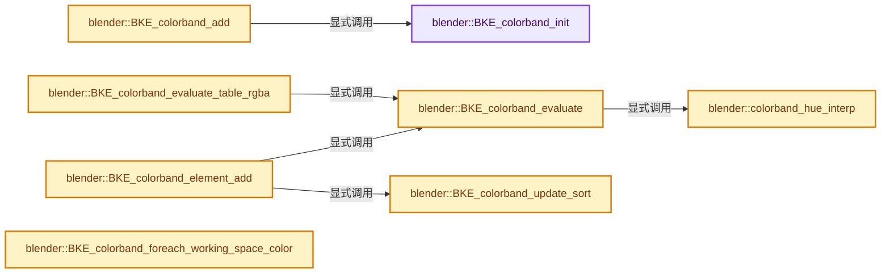
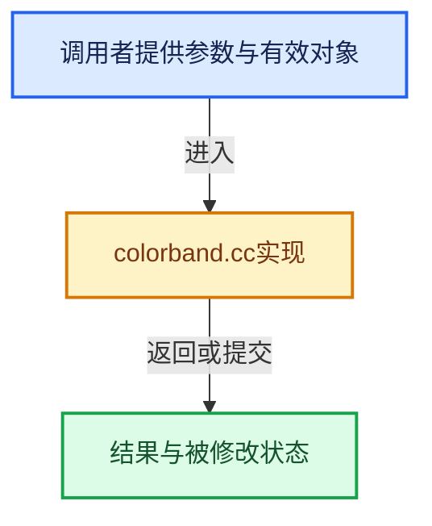

# 实现依赖专题：source/blender/blenkernel/intern/colorband.cc

[实现依赖导航](../../README.md) · [符号索引](../../../00-课程指南/02-源码与提交索引/符号依赖与实现索引.md)

本专题从正文实际调用进入，集中保存共享实现。函数有稳定锚点，可从调用处直接跳到对应完整函数；递归与互相调用通过回链组织。

## 本文件的实现关系






## 完整成员与函数实现

<a id="f-8163eb6f92abdc50"></a>

### `blender::BKE_colorband_init`

实现位置：[source/blender/blenkernel/intern/colorband.cc](../../../../../../../source/blender/blenkernel/intern/colorband.cc) · L25—L67。

接口参数：

- `ColorBand *coba`
- `bool rangetype`

**教学注释版**

<!-- annotated:436cc988e94f6f -->

```cpp
void BKE_colorband_init(ColorBand *coba, bool rangetype)
{
  int a;

  coba->data[0].pos = 0.0;
  coba->data[1].pos = 1.0;

  if (rangetype == 0) {
    coba->data[0].r = 0.0;
    coba->data[0].g = 0.0;
    coba->data[0].b = 0.0;
    coba->data[0].a = 0.0;

    coba->data[1].r = 1.0;
    coba->data[1].g = 1.0;
    coba->data[1].b = 1.0;
    coba->data[1].a = 1.0;
  }
  else {
    coba->data[0].r = 0.0;
    coba->data[0].g = 0.0;
    coba->data[0].b = 0.0;
    coba->data[0].a = 1.0;

    coba->data[1].r = 1.0;
    coba->data[1].g = 1.0;
    coba->data[1].b = 1.0;
    coba->data[1].a = 1.0;
  }

  for (a = 2; a < MAXCOLORBAND; a++) {
    coba->data[a].r = 0.5;
    coba->data[a].g = 0.5;
    coba->data[a].b = 0.5;
    coba->data[a].a = 1.0;
    coba->data[a].pos = 0.5;
  }

  coba->tot = 2;
  coba->cur = 0;
  coba->color_mode = COLBAND_BLEND_RGB;
  coba->ipotype = COLBAND_INTERP_LINEAR;
}
```

<details>
<summary>核对原始源码：source/blender/blenkernel/intern/colorband.cc · L25—L67</summary>

<!-- original:436cc988e94f6f:source/blender/blenkernel/intern/colorband.cc:25:67 -->

```cpp
void BKE_colorband_init(ColorBand *coba, bool rangetype)
{
  int a;

  coba->data[0].pos = 0.0;
  coba->data[1].pos = 1.0;

  if (rangetype == 0) {
    coba->data[0].r = 0.0;
    coba->data[0].g = 0.0;
    coba->data[0].b = 0.0;
    coba->data[0].a = 0.0;

    coba->data[1].r = 1.0;
    coba->data[1].g = 1.0;
    coba->data[1].b = 1.0;
    coba->data[1].a = 1.0;
  }
  else {
    coba->data[0].r = 0.0;
    coba->data[0].g = 0.0;
    coba->data[0].b = 0.0;
    coba->data[0].a = 1.0;

    coba->data[1].r = 1.0;
    coba->data[1].g = 1.0;
    coba->data[1].b = 1.0;
    coba->data[1].a = 1.0;
  }

  for (a = 2; a < MAXCOLORBAND; a++) {
    coba->data[a].r = 0.5;
    coba->data[a].g = 0.5;
    coba->data[a].b = 0.5;
    coba->data[a].a = 1.0;
    coba->data[a].pos = 0.5;
  }

  coba->tot = 2;
  coba->cur = 0;
  coba->color_mode = COLBAND_BLEND_RGB;
  coba->ipotype = COLBAND_INTERP_LINEAR;
}
```

</details>

**沿实际写入检查状态**

- `coba->data[0].pos = 0.0;`
- `coba->data[1].pos = 1.0;`
- `coba->data[0].r = 0.0;`
- `coba->data[0].g = 0.0;`
- `coba->data[0].b = 0.0;`
- `coba->data[0].a = 0.0;`
- `coba->data[1].r = 1.0;`
- `coba->data[1].g = 1.0;`
- `coba->data[1].b = 1.0;`
- `coba->data[1].a = 1.0;`
- `coba->data[0].a = 1.0;`
- `coba->data[a].r = 0.5;`
- `coba->data[a].g = 0.5;`
- `coba->data[a].b = 0.5;`
- `coba->data[a].a = 1.0;`
- `coba->data[a].pos = 0.5;`
- `coba->tot = 2;`
- `coba->cur = 0;`
- `coba->color_mode = COLBAND_BLEND_RGB;`
- `coba->ipotype = COLBAND_INTERP_LINEAR;`

**继续追踪实现**

本实现没有需要继续展开的显式调用；检查返回表达式、对象转换和调用者前置条件。

<a id="f-2b3cb7b1d3e8cc22"></a>

### `blender::BKE_colorband_add`

实现位置：[source/blender/blenkernel/intern/colorband.cc](../../../../../../../source/blender/blenkernel/intern/colorband.cc) · L301—L309。

接口参数：

- `bool rangetype`

**教学注释版**

<!-- annotated:b9d49b11b25fab -->

```cpp
ColorBand *BKE_colorband_add(bool rangetype)
{
  ColorBand *coba;

  coba = MEM_new<ColorBand>("colorband");
  BKE_colorband_init(coba, rangetype);

  return coba;
}
```

<details>
<summary>核对原始源码：source/blender/blenkernel/intern/colorband.cc · L301—L309</summary>

<!-- original:b9d49b11b25fab:source/blender/blenkernel/intern/colorband.cc:301:309 -->

```cpp
ColorBand *BKE_colorband_add(bool rangetype)
{
  ColorBand *coba;

  coba = MEM_new<ColorBand>("colorband");
  BKE_colorband_init(coba, rangetype);

  return coba;
}
```

</details>

**沿实际写入检查状态**

- `coba = MEM_new<ColorBand>("colorband");`

**结果出口**

- `return coba;`

**继续追踪实现**

- `MEM_new<ColorBand>` → [MEM_new · L351](../../07-Intern运行时与平台/guardedalloc/MEM_guardedalloc.h.md#f-115f9b6784f89912)。
- `BKE_colorband_init` → [blender::BKE_colorband_init · L25](colorband.cc.md#f-8163eb6f92abdc50)。

<a id="f-c27b612afdb9351a"></a>

### `blender::colorband_hue_interp`

实现位置：[source/blender/blenkernel/intern/colorband.cc](../../../../../../../source/blender/blenkernel/intern/colorband.cc) · L313—L397。

接口参数：

- `const int ipotype_hue`
- `const float mfac`
- `const float fac`
- `float h1`
- `float h2`

**教学注释版**

<!-- annotated:47e8c4c743b542 -->

```cpp
static float colorband_hue_interp(
    const int ipotype_hue, const float mfac, const float fac, float h1, float h2)
{
  float h_interp;
  int mode = 0;

#define HUE_INTERP(h_a, h_b) ((mfac * (h_a)) + (fac * (h_b)))
#define HUE_MOD(h) (((h) < 1.0f) ? (h) : (h) - 1.0f)

  h1 = HUE_MOD(h1);
  h2 = HUE_MOD(h2);

  BLI_assert(h1 >= 0.0f && h1 < 1.0f);
  BLI_assert(h2 >= 0.0f && h2 < 1.0f);

  switch (ipotype_hue) {
    case COLBAND_HUE_NEAR: {
      if ((h1 < h2) && (h2 - h1) > +0.5f) {
        mode = 1;
      }
      else if ((h1 > h2) && (h2 - h1) < -0.5f) {
        mode = 2;
      }
      else {
        mode = 0;
      }
      break;
    }
    case COLBAND_HUE_FAR: {
      /* Do full loop in Hue space in case both stops are the same... */
      if (h1 == h2) {
        mode = 1;
      }
      else if ((h1 < h2) && (h2 - h1) < +0.5f) {
        mode = 1;
      }
      else if ((h1 > h2) && (h2 - h1) > -0.5f) {
        mode = 2;
      }
      else {
        mode = 0;
      }
      break;
    }
    case COLBAND_HUE_CCW: {
      if (h1 > h2) {
        mode = 2;
      }
      else {
        mode = 0;
      }
      break;
    }
    case COLBAND_HUE_CW: {
      if (h1 < h2) {
        mode = 1;
      }
      else {
        mode = 0;
      }
      break;
    }
  }

  switch (mode) {
    case 0:
      h_interp = HUE_INTERP(h1, h2);
      break;
    case 1:
      h_interp = HUE_INTERP(h1 + 1.0f, h2);
      h_interp = HUE_MOD(h_interp);
      break;
    case 2:
      h_interp = HUE_INTERP(h1, h2 + 1.0f);
      h_interp = HUE_MOD(h_interp);
      break;
  }

  BLI_assert(h_interp >= 0.0f && h_interp < 1.0f);

#undef HUE_INTERP
#undef HUE_MOD

  return h_interp;
}
```

<details>
<summary>核对原始源码：source/blender/blenkernel/intern/colorband.cc · L313—L397</summary>

<!-- original:47e8c4c743b542:source/blender/blenkernel/intern/colorband.cc:313:397 -->

```cpp
static float colorband_hue_interp(
    const int ipotype_hue, const float mfac, const float fac, float h1, float h2)
{
  float h_interp;
  int mode = 0;

#define HUE_INTERP(h_a, h_b) ((mfac * (h_a)) + (fac * (h_b)))
#define HUE_MOD(h) (((h) < 1.0f) ? (h) : (h) - 1.0f)

  h1 = HUE_MOD(h1);
  h2 = HUE_MOD(h2);

  BLI_assert(h1 >= 0.0f && h1 < 1.0f);
  BLI_assert(h2 >= 0.0f && h2 < 1.0f);

  switch (ipotype_hue) {
    case COLBAND_HUE_NEAR: {
      if ((h1 < h2) && (h2 - h1) > +0.5f) {
        mode = 1;
      }
      else if ((h1 > h2) && (h2 - h1) < -0.5f) {
        mode = 2;
      }
      else {
        mode = 0;
      }
      break;
    }
    case COLBAND_HUE_FAR: {
      /* Do full loop in Hue space in case both stops are the same... */
      if (h1 == h2) {
        mode = 1;
      }
      else if ((h1 < h2) && (h2 - h1) < +0.5f) {
        mode = 1;
      }
      else if ((h1 > h2) && (h2 - h1) > -0.5f) {
        mode = 2;
      }
      else {
        mode = 0;
      }
      break;
    }
    case COLBAND_HUE_CCW: {
      if (h1 > h2) {
        mode = 2;
      }
      else {
        mode = 0;
      }
      break;
    }
    case COLBAND_HUE_CW: {
      if (h1 < h2) {
        mode = 1;
      }
      else {
        mode = 0;
      }
      break;
    }
  }

  switch (mode) {
    case 0:
      h_interp = HUE_INTERP(h1, h2);
      break;
    case 1:
      h_interp = HUE_INTERP(h1 + 1.0f, h2);
      h_interp = HUE_MOD(h_interp);
      break;
    case 2:
      h_interp = HUE_INTERP(h1, h2 + 1.0f);
      h_interp = HUE_MOD(h_interp);
      break;
  }

  BLI_assert(h_interp >= 0.0f && h_interp < 1.0f);

#undef HUE_INTERP
#undef HUE_MOD

  return h_interp;
}
```

</details>

**沿实际写入检查状态**

- `h1 = HUE_MOD(h1);`
- `h2 = HUE_MOD(h2);`
- `mode = 1;`
- `mode = 2;`
- `mode = 0;`
- `h_interp = HUE_INTERP(h1, h2);`
- `h_interp = HUE_INTERP(h1 + 1.0f, h2);`
- `h_interp = HUE_MOD(h_interp);`
- `h_interp = HUE_INTERP(h1, h2 + 1.0f);`

**结果出口**

- `return h_interp;`

**继续追踪实现**

- `HUE_MOD` → [调用协议](../../../00-课程指南/01-路线与规范/模板宏与动态分派协议.md)：函数指针、局部可调用对象或未展开的宏；必须结合调用者环境。调用位置L322。
- `BLI_assert` → [BLI_assert · L48](../../01-BLI基础库/BLI_assert.hh.md#m-57a88495704d)；[BLI_assert · L63](../../01-BLI基础库/BLI_assert.hh.md#m-d07050020cb5)。宏定义由构建条件选择。
- `HUE_INTERP` → [调用协议](../../../00-课程指南/01-路线与规范/模板宏与动态分派协议.md)：函数指针、局部可调用对象或未展开的宏；必须结合调用者环境。调用位置L379。

<a id="f-eaf01798b5e01b4c"></a>

### `blender::BKE_colorband_evaluate`

实现位置：[source/blender/blenkernel/intern/colorband.cc](../../../../../../../source/blender/blenkernel/intern/colorband.cc) · L399—L560。

接口参数：

- `const ColorBand *coba`
- `float in`
- `float out[4]`

**教学注释版**

<!-- annotated:39d104940166ed -->

```cpp
bool BKE_colorband_evaluate(const ColorBand *coba, float in, float out[4])
{
  const CBData *cbd1, *cbd2, *cbd0, *cbd3;
  float fac;
  int ipotype;
  int a;

  if (coba == nullptr || coba->tot == 0) {
    return false;
  }

  cbd1 = coba->data;

  /* NOTE: when ipotype >= COLBAND_INTERP_B_SPLINE,
   * we cannot do early-out with a constant color before first color stop and after last one,
   * because interpolation starts before and ends after those... */
  ipotype = (coba->color_mode == COLBAND_BLEND_RGB) ? coba->ipotype : int(COLBAND_INTERP_LINEAR);

  if (coba->tot == 1) {
    out[0] = cbd1->r;
    out[1] = cbd1->g;
    out[2] = cbd1->b;
    out[3] = cbd1->a;
  }
  else if ((in <= cbd1->pos) &&
           ELEM(ipotype, COLBAND_INTERP_LINEAR, COLBAND_INTERP_EASE, COLBAND_INTERP_CONSTANT))
  {
    /* We are before first color stop. */
    out[0] = cbd1->r;
    out[1] = cbd1->g;
    out[2] = cbd1->b;
    out[3] = cbd1->a;
  }
  else {
    CBData left, right;

    /* we're looking for first pos > in */
    for (a = 0; a < coba->tot; a++, cbd1++) {
      if (cbd1->pos > in) {
        break;
      }
    }

    if (a == coba->tot) {
      cbd2 = cbd1 - 1;
      right = *cbd2;
      right.pos = 1.0f;
      cbd1 = &right;
    }
    else if (a == 0) {
      left = *cbd1;
      left.pos = 0.0f;
      cbd2 = &left;
    }
    else {
      cbd2 = cbd1 - 1;
    }

    if ((a == coba->tot) &&
        ELEM(ipotype, COLBAND_INTERP_LINEAR, COLBAND_INTERP_EASE, COLBAND_INTERP_CONSTANT))
    {
      /* We are after last color stop. */
      out[0] = cbd2->r;
      out[1] = cbd2->g;
      out[2] = cbd2->b;
      out[3] = cbd2->a;
    }
    else if (ipotype == COLBAND_INTERP_CONSTANT) {
      /* constant */
      out[0] = cbd2->r;
      out[1] = cbd2->g;
      out[2] = cbd2->b;
      out[3] = cbd2->a;
    }
    else {
      if (cbd2->pos != cbd1->pos) {
        fac = (in - cbd1->pos) / (cbd2->pos - cbd1->pos);
      }
      else {
        /* was setting to 0.0 in 2.56 & previous, but this
         * is incorrect for the last element, see #26732. */
        fac = (a != coba->tot) ? 0.0f : 1.0f;
      }

      if (ELEM(ipotype, COLBAND_INTERP_B_SPLINE, COLBAND_INTERP_CARDINAL)) {
        /* Interpolate from right to left: `3 2 1 0`. */
        float t[4];

        if (a >= coba->tot - 1) {
          cbd0 = cbd1;
        }
        else {
          cbd0 = cbd1 + 1;
        }
        if (a < 2) {
          cbd3 = cbd2;
        }
        else {
          cbd3 = cbd2 - 1;
        }

        CLAMP(fac, 0.0f, 1.0f);

        if (ipotype == COLBAND_INTERP_CARDINAL) {
          key_curve_position_weights(fac, t, KEY_CARDINAL);
        }
        else {
          key_curve_position_weights(fac, t, KEY_BSPLINE);
        }

        out[0] = t[3] * cbd3->r + t[2] * cbd2->r + t[1] * cbd1->r + t[0] * cbd0->r;
        out[1] = t[3] * cbd3->g + t[2] * cbd2->g + t[1] * cbd1->g + t[0] * cbd0->g;
        out[2] = t[3] * cbd3->b + t[2] * cbd2->b + t[1] * cbd1->b + t[0] * cbd0->b;
        out[3] = t[3] * cbd3->a + t[2] * cbd2->a + t[1] * cbd1->a + t[0] * cbd0->a;
        clamp_v4(out, 0.0f, 1.0f);
      }
      else {
        if (ipotype == COLBAND_INTERP_EASE) {
          const float fac2 = fac * fac;
          fac = 3.0f * fac2 - 2.0f * fac2 * fac;
        }
        const float mfac = 1.0f - fac;

        if (coba->color_mode == COLBAND_BLEND_HSV) [[unlikely]] {
          float col1[3], col2[3];

          rgb_to_hsv_v(&cbd1->r, col1);
          rgb_to_hsv_v(&cbd2->r, col2);

          out[0] = colorband_hue_interp(coba->ipotype_hue, mfac, fac, col1[0], col2[0]);
          out[1] = mfac * col1[1] + fac * col2[1];
          out[2] = mfac * col1[2] + fac * col2[2];
          out[3] = mfac * cbd1->a + fac * cbd2->a;

          hsv_to_rgb_v(out, out);
        }
        else if (coba->color_mode == COLBAND_BLEND_HSL) [[unlikely]] {
          float col1[3], col2[3];

          rgb_to_hsl_v(&cbd1->r, col1);
          rgb_to_hsl_v(&cbd2->r, col2);

          out[0] = colorband_hue_interp(coba->ipotype_hue, mfac, fac, col1[0], col2[0]);
          out[1] = mfac * col1[1] + fac * col2[1];
          out[2] = mfac * col1[2] + fac * col2[2];
          out[3] = mfac * cbd1->a + fac * cbd2->a;

          hsl_to_rgb_v(out, out);
        }
        else {
          /* COLBAND_BLEND_RGB */
          out[0] = mfac * cbd1->r + fac * cbd2->r;
          out[1] = mfac * cbd1->g + fac * cbd2->g;
          out[2] = mfac * cbd1->b + fac * cbd2->b;
          out[3] = mfac * cbd1->a + fac * cbd2->a;
        }
      }
    }
  }

  return true; /* OK */
}
```

<details>
<summary>核对原始源码：source/blender/blenkernel/intern/colorband.cc · L399—L560</summary>

<!-- original:39d104940166ed:source/blender/blenkernel/intern/colorband.cc:399:560 -->

```cpp
bool BKE_colorband_evaluate(const ColorBand *coba, float in, float out[4])
{
  const CBData *cbd1, *cbd2, *cbd0, *cbd3;
  float fac;
  int ipotype;
  int a;

  if (coba == nullptr || coba->tot == 0) {
    return false;
  }

  cbd1 = coba->data;

  /* NOTE: when ipotype >= COLBAND_INTERP_B_SPLINE,
   * we cannot do early-out with a constant color before first color stop and after last one,
   * because interpolation starts before and ends after those... */
  ipotype = (coba->color_mode == COLBAND_BLEND_RGB) ? coba->ipotype : int(COLBAND_INTERP_LINEAR);

  if (coba->tot == 1) {
    out[0] = cbd1->r;
    out[1] = cbd1->g;
    out[2] = cbd1->b;
    out[3] = cbd1->a;
  }
  else if ((in <= cbd1->pos) &&
           ELEM(ipotype, COLBAND_INTERP_LINEAR, COLBAND_INTERP_EASE, COLBAND_INTERP_CONSTANT))
  {
    /* We are before first color stop. */
    out[0] = cbd1->r;
    out[1] = cbd1->g;
    out[2] = cbd1->b;
    out[3] = cbd1->a;
  }
  else {
    CBData left, right;

    /* we're looking for first pos > in */
    for (a = 0; a < coba->tot; a++, cbd1++) {
      if (cbd1->pos > in) {
        break;
      }
    }

    if (a == coba->tot) {
      cbd2 = cbd1 - 1;
      right = *cbd2;
      right.pos = 1.0f;
      cbd1 = &right;
    }
    else if (a == 0) {
      left = *cbd1;
      left.pos = 0.0f;
      cbd2 = &left;
    }
    else {
      cbd2 = cbd1 - 1;
    }

    if ((a == coba->tot) &&
        ELEM(ipotype, COLBAND_INTERP_LINEAR, COLBAND_INTERP_EASE, COLBAND_INTERP_CONSTANT))
    {
      /* We are after last color stop. */
      out[0] = cbd2->r;
      out[1] = cbd2->g;
      out[2] = cbd2->b;
      out[3] = cbd2->a;
    }
    else if (ipotype == COLBAND_INTERP_CONSTANT) {
      /* constant */
      out[0] = cbd2->r;
      out[1] = cbd2->g;
      out[2] = cbd2->b;
      out[3] = cbd2->a;
    }
    else {
      if (cbd2->pos != cbd1->pos) {
        fac = (in - cbd1->pos) / (cbd2->pos - cbd1->pos);
      }
      else {
        /* was setting to 0.0 in 2.56 & previous, but this
         * is incorrect for the last element, see #26732. */
        fac = (a != coba->tot) ? 0.0f : 1.0f;
      }

      if (ELEM(ipotype, COLBAND_INTERP_B_SPLINE, COLBAND_INTERP_CARDINAL)) {
        /* Interpolate from right to left: `3 2 1 0`. */
        float t[4];

        if (a >= coba->tot - 1) {
          cbd0 = cbd1;
        }
        else {
          cbd0 = cbd1 + 1;
        }
        if (a < 2) {
          cbd3 = cbd2;
        }
        else {
          cbd3 = cbd2 - 1;
        }

        CLAMP(fac, 0.0f, 1.0f);

        if (ipotype == COLBAND_INTERP_CARDINAL) {
          key_curve_position_weights(fac, t, KEY_CARDINAL);
        }
        else {
          key_curve_position_weights(fac, t, KEY_BSPLINE);
        }

        out[0] = t[3] * cbd3->r + t[2] * cbd2->r + t[1] * cbd1->r + t[0] * cbd0->r;
        out[1] = t[3] * cbd3->g + t[2] * cbd2->g + t[1] * cbd1->g + t[0] * cbd0->g;
        out[2] = t[3] * cbd3->b + t[2] * cbd2->b + t[1] * cbd1->b + t[0] * cbd0->b;
        out[3] = t[3] * cbd3->a + t[2] * cbd2->a + t[1] * cbd1->a + t[0] * cbd0->a;
        clamp_v4(out, 0.0f, 1.0f);
      }
      else {
        if (ipotype == COLBAND_INTERP_EASE) {
          const float fac2 = fac * fac;
          fac = 3.0f * fac2 - 2.0f * fac2 * fac;
        }
        const float mfac = 1.0f - fac;

        if (coba->color_mode == COLBAND_BLEND_HSV) [[unlikely]] {
          float col1[3], col2[3];

          rgb_to_hsv_v(&cbd1->r, col1);
          rgb_to_hsv_v(&cbd2->r, col2);

          out[0] = colorband_hue_interp(coba->ipotype_hue, mfac, fac, col1[0], col2[0]);
          out[1] = mfac * col1[1] + fac * col2[1];
          out[2] = mfac * col1[2] + fac * col2[2];
          out[3] = mfac * cbd1->a + fac * cbd2->a;

          hsv_to_rgb_v(out, out);
        }
        else if (coba->color_mode == COLBAND_BLEND_HSL) [[unlikely]] {
          float col1[3], col2[3];

          rgb_to_hsl_v(&cbd1->r, col1);
          rgb_to_hsl_v(&cbd2->r, col2);

          out[0] = colorband_hue_interp(coba->ipotype_hue, mfac, fac, col1[0], col2[0]);
          out[1] = mfac * col1[1] + fac * col2[1];
          out[2] = mfac * col1[2] + fac * col2[2];
          out[3] = mfac * cbd1->a + fac * cbd2->a;

          hsl_to_rgb_v(out, out);
        }
        else {
          /* COLBAND_BLEND_RGB */
          out[0] = mfac * cbd1->r + fac * cbd2->r;
          out[1] = mfac * cbd1->g + fac * cbd2->g;
          out[2] = mfac * cbd1->b + fac * cbd2->b;
          out[3] = mfac * cbd1->a + fac * cbd2->a;
        }
      }
    }
  }

  return true; /* OK */
}
```

</details>

**沿实际写入检查状态**

- `cbd1 = coba->data;`
- `ipotype = (coba->color_mode == COLBAND_BLEND_RGB) ? coba->ipotype : int(COLBAND_INTERP_LINEAR);`
- `out[0] = cbd1->r;`
- `out[1] = cbd1->g;`
- `out[2] = cbd1->b;`
- `out[3] = cbd1->a;`
- `cbd2 = cbd1 - 1;`
- `right = *cbd2;`
- `right.pos = 1.0f;`
- `cbd1 = &right;`
- `left = *cbd1;`
- `left.pos = 0.0f;`
- `cbd2 = &left;`
- `out[0] = cbd2->r;`
- `out[1] = cbd2->g;`
- `out[2] = cbd2->b;`
- `out[3] = cbd2->a;`
- `fac = (in - cbd1->pos) / (cbd2->pos - cbd1->pos);`
- `fac = (a != coba->tot) ? 0.0f : 1.0f;`
- `cbd0 = cbd1;`
- `cbd0 = cbd1 + 1;`
- `cbd3 = cbd2;`
- `cbd3 = cbd2 - 1;`
- `out[0] = t[3] * cbd3->r + t[2] * cbd2->r + t[1] * cbd1->r + t[0] * cbd0->r;`
- `out[1] = t[3] * cbd3->g + t[2] * cbd2->g + t[1] * cbd1->g + t[0] * cbd0->g;`
- `out[2] = t[3] * cbd3->b + t[2] * cbd2->b + t[1] * cbd1->b + t[0] * cbd0->b;`
- `out[3] = t[3] * cbd3->a + t[2] * cbd2->a + t[1] * cbd1->a + t[0] * cbd0->a;`
- `fac = 3.0f * fac2 - 2.0f * fac2 * fac;`
- `out[0] = colorband_hue_interp(coba->ipotype_hue, mfac, fac, col1[0], col2[0]);`
- `out[1] = mfac * col1[1] + fac * col2[1];`
- `out[2] = mfac * col1[2] + fac * col2[2];`
- `out[3] = mfac * cbd1->a + fac * cbd2->a;`
- `out[0] = mfac * cbd1->r + fac * cbd2->r;`
- `out[1] = mfac * cbd1->g + fac * cbd2->g;`
- `out[2] = mfac * cbd1->b + fac * cbd2->b;`

**结果出口**

- `return false;`
- `return true; /* OK */`

**继续追踪实现**

- `ELEM` → [ELEM · L88](../../07-Intern运行时与平台/ghost/intern/GHOST_utildefines.hh.md#m-d28724a15928)；[ELEM · L135](../../01-BLI基础库/BLI_utildefines.hh.md#m-d6572de7cae0)。宏定义由构建条件选择。
- `CLAMP` → [CLAMP · L200](../../01-BLI基础库/BLI_utildefines.hh.md#m-69703e497120)。宏定义由构建条件选择。
- `key_curve_position_weights` → [blender::key_curve_position_weights · L310](key.cc.md#f-afb0f795e30f80db)。
- `clamp_v4` → [blender::clamp_v4 · L1082](../../01-BLI基础库/intern/math_vector_inline.cc.md#f-e67ed96a3feeb610)。
- `rgb_to_hsv_v` → [blender::rgb_to_hsv_v · L322](../../01-BLI基础库/intern/math_color.cc.md#f-7312a69cee7c11bb)。
- `colorband_hue_interp` → [blender::colorband_hue_interp · L313](colorband.cc.md#f-c27b612afdb9351a)。
- `hsv_to_rgb_v` → [blender::hsv_to_rgb_v · L61](../../01-BLI基础库/intern/math_color.cc.md#f-d78b8d5b93aafd9e)。
- `rgb_to_hsl_v` → [blender::rgb_to_hsl_v · L392](../../01-BLI基础库/intern/math_color.cc.md#f-16d9ab741e7d9a8b)。
- `hsl_to_rgb_v` → [blender::hsl_to_rgb_v · L66](../../01-BLI基础库/intern/math_color.cc.md#f-87d85e7be1bc56e8)。

<a id="f-e8047fa331095f36"></a>

### `blender::BKE_colorband_evaluate_table_rgba`

实现位置：[source/blender/blenkernel/intern/colorband.cc](../../../../../../../source/blender/blenkernel/intern/colorband.cc) · L562—L572。

接口参数：

- `const ColorBand *coba`
- `float **array`
- `int *size`

**教学注释版**

<!-- annotated:cc250e86e0d387 -->

```cpp
void BKE_colorband_evaluate_table_rgba(const ColorBand *coba, float **array, int *size)
{
  int a;

  *size = CM_TABLE + 1;
  *array = MEM_new_array_zeroed<float>(4 * size_t(*size), "ColorBand");

  for (a = 0; a < *size; a++) {
    BKE_colorband_evaluate(coba, float(a) / float(CM_TABLE), &(*array)[a * 4]);
  }
}
```

<details>
<summary>核对原始源码：source/blender/blenkernel/intern/colorband.cc · L562—L572</summary>

<!-- original:cc250e86e0d387:source/blender/blenkernel/intern/colorband.cc:562:572 -->

```cpp
void BKE_colorband_evaluate_table_rgba(const ColorBand *coba, float **array, int *size)
{
  int a;

  *size = CM_TABLE + 1;
  *array = MEM_new_array_zeroed<float>(4 * size_t(*size), "ColorBand");

  for (a = 0; a < *size; a++) {
    BKE_colorband_evaluate(coba, float(a) / float(CM_TABLE), &(*array)[a * 4]);
  }
}
```

</details>

**继续追踪实现**

- `MEM_new_array_zeroed<float>` → [MEM_new_array_zeroed · L566](../../07-Intern运行时与平台/guardedalloc/MEM_guardedalloc.h.md#f-3a0cf63fb5216500)；[MEM_new_array_zeroed · L119](../../07-Intern运行时与平台/guardedalloc/intern/mallocn.cc.md#f-6825557da566fdbe)。同名重载需按实参类型选择。
- `BKE_colorband_evaluate` → [blender::BKE_colorband_evaluate · L399](colorband.cc.md#f-eaf01798b5e01b4c)。

<a id="f-3357075560fd7fc1"></a>

### `blender::BKE_colorband_update_sort`

实现位置：[source/blender/blenkernel/intern/colorband.cc](../../../../../../../source/blender/blenkernel/intern/colorband.cc) · L587—L607。

接口参数：

- `ColorBand *coba`

**教学注释版**

<!-- annotated:e91ce5e9ce8d59 -->

```cpp
void BKE_colorband_update_sort(ColorBand *coba)
{
  int a;

  if (coba->tot < 2) {
    return;
  }

  for (a = 0; a < coba->tot; a++) {
    coba->data[a].cur = a;
  }

  qsort(coba->data, coba->tot, sizeof(CBData), vergcband);

  for (a = 0; a < coba->tot; a++) {
    if (coba->data[a].cur == coba->cur) {
      coba->cur = a;
      break;
    }
  }
}
```

<details>
<summary>核对原始源码：source/blender/blenkernel/intern/colorband.cc · L587—L607</summary>

<!-- original:e91ce5e9ce8d59:source/blender/blenkernel/intern/colorband.cc:587:607 -->

```cpp
void BKE_colorband_update_sort(ColorBand *coba)
{
  int a;

  if (coba->tot < 2) {
    return;
  }

  for (a = 0; a < coba->tot; a++) {
    coba->data[a].cur = a;
  }

  qsort(coba->data, coba->tot, sizeof(CBData), vergcband);

  for (a = 0; a < coba->tot; a++) {
    if (coba->data[a].cur == coba->cur) {
      coba->cur = a;
      break;
    }
  }
}
```

</details>

**沿实际写入检查状态**

- `coba->data[a].cur = a;`
- `coba->cur = a;`

**继续追踪实现**

- `qsort` → [调用协议](../../../00-课程指南/01-路线与规范/模板宏与动态分派协议.md)：函数指针、局部可调用对象或未展开的宏；必须结合调用者环境。调用位置L599。

<a id="f-de7b6bf0150ef698"></a>

### `blender::BKE_colorband_element_add`

实现位置：[source/blender/blenkernel/intern/colorband.cc](../../../../../../../source/blender/blenkernel/intern/colorband.cc) · L609—L633。

接口参数：

- `ColorBand *coba`
- `float position`

**教学注释版**

<!-- annotated:7bf5b95654281e -->

```cpp
CBData *BKE_colorband_element_add(ColorBand *coba, float position)
{
  if (coba->tot == MAXCOLORBAND) {
    return nullptr;
  }

  CBData *xnew;

  xnew = &coba->data[coba->tot];
  xnew->pos = position;

  if (coba->tot != 0) {
    BKE_colorband_evaluate(coba, position, &xnew->r);
  }
  else {
    zero_v4(&xnew->r);
  }

  coba->tot++;
  coba->cur = coba->tot - 1;

  BKE_colorband_update_sort(coba);

  return coba->data + coba->cur;
}
```

<details>
<summary>核对原始源码：source/blender/blenkernel/intern/colorband.cc · L609—L633</summary>

<!-- original:7bf5b95654281e:source/blender/blenkernel/intern/colorband.cc:609:633 -->

```cpp
CBData *BKE_colorband_element_add(ColorBand *coba, float position)
{
  if (coba->tot == MAXCOLORBAND) {
    return nullptr;
  }

  CBData *xnew;

  xnew = &coba->data[coba->tot];
  xnew->pos = position;

  if (coba->tot != 0) {
    BKE_colorband_evaluate(coba, position, &xnew->r);
  }
  else {
    zero_v4(&xnew->r);
  }

  coba->tot++;
  coba->cur = coba->tot - 1;

  BKE_colorband_update_sort(coba);

  return coba->data + coba->cur;
}
```

</details>

**沿实际写入检查状态**

- `xnew = &coba->data[coba->tot];`
- `xnew->pos = position;`
- `coba->cur = coba->tot - 1;`

**结果出口**

- `return nullptr;`
- `return coba->data + coba->cur;`

**继续追踪实现**

- `BKE_colorband_evaluate` → [blender::BKE_colorband_evaluate · L399](colorband.cc.md#f-eaf01798b5e01b4c)。
- `zero_v4` → [blender::zero_v4 · L33](../../01-BLI基础库/intern/math_vector_inline.cc.md#f-ebb683697baa0431)。
- `BKE_colorband_update_sort` → [blender::BKE_colorband_update_sort · L587](colorband.cc.md#f-3357075560fd7fc1)。

<a id="f-9a99d715ca440f5d"></a>

### `blender::BKE_colorband_foreach_working_space_color`

实现位置：[source/blender/blenkernel/intern/colorband.cc](../../../../../../../source/blender/blenkernel/intern/colorband.cc) · L655—L661。

接口参数：

- `ColorBand *coba`
- `const IDTypeForeachColorFunctionCallback &fn`

**教学注释版**

<!-- annotated:8f8c4a0975c068 -->

```cpp
void BKE_colorband_foreach_working_space_color(ColorBand *coba,
                                               const IDTypeForeachColorFunctionCallback &fn)
{
  for (int a = 0; a < coba->tot; a++) {
    fn.single(&coba->data[a].r);
  }
}
```

<details>
<summary>核对原始源码：source/blender/blenkernel/intern/colorband.cc · L655—L661</summary>

<!-- original:8f8c4a0975c068:source/blender/blenkernel/intern/colorband.cc:655:661 -->

```cpp
void BKE_colorband_foreach_working_space_color(ColorBand *coba,
                                               const IDTypeForeachColorFunctionCallback &fn)
{
  for (int a = 0; a < coba->tot; a++) {
    fn.single(&coba->data[a].r);
  }
}
```

</details>

**继续追踪实现**

- `fn.single` → [blender::bits::BoolToBit::single · L68](../../01-BLI基础库/intern/bit_bool_conversion.cc.md#f-08318f2d0747602b)。
