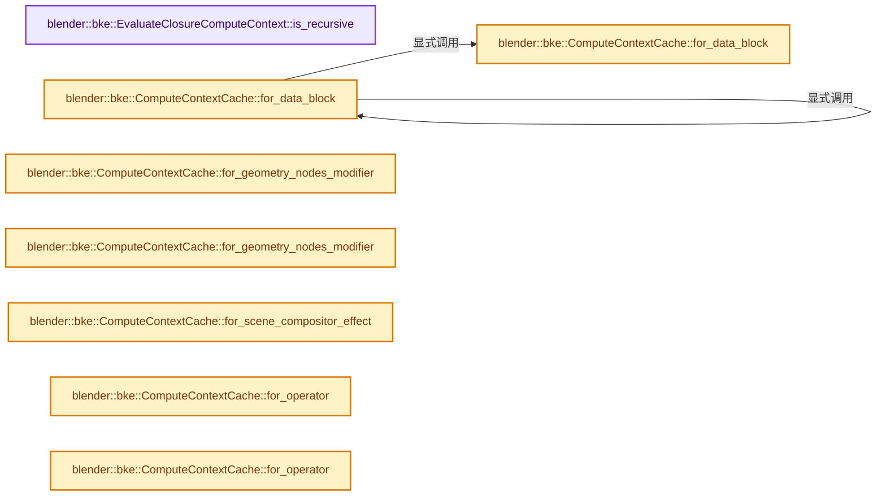

# 实现依赖专题：source/blender/blenkernel/intern/compute_contexts.cc

[实现依赖导航](../../README.md) · [符号索引](../../../00-课程指南/02-源码与提交索引/符号依赖与实现索引.md)

本专题从正文实际调用进入，集中保存共享实现。函数有稳定锚点，可从调用处直接跳到对应完整函数；递归与互相调用通过回链组织。

## 本文件的实现关系




## 完整成员与函数实现

<a id="f-77f40e09972aab06"></a>

### `blender::bke::EvaluateClosureComputeContext::is_recursive`

实现位置：[source/blender/blenkernel/intern/compute_contexts.cc](../../../../../../../source/blender/blenkernel/intern/compute_contexts.cc) · L209—L232。

**教学注释版**

<!-- annotated:6ccc671118f5ae -->

```cpp
bool EvaluateClosureComputeContext::is_recursive() const
{
  if (!closure_source_location_) {
    /* Can't determine recursiveness in this case. */
    return false;
  }
  for (const ComputeContext *parent = parent_; parent; parent = parent->parent()) {
    if (const auto *evaluate_closure_compute_context =
            dynamic_cast<const EvaluateClosureComputeContext *>(parent))
    {
      if (!evaluate_closure_compute_context->closure_source_location_) {
        continue;
      }
      if (evaluate_closure_compute_context->closure_source_location_->tree ==
              closure_source_location_->tree &&
          evaluate_closure_compute_context->closure_source_location_->closure_output_node_id ==
              closure_source_location_->closure_output_node_id)
      {
        return true;
      }
    }
  }
  return false;
}
```

<details>
<summary>核对原始源码：source/blender/blenkernel/intern/compute_contexts.cc · L209—L232</summary>

<!-- original:6ccc671118f5ae:source/blender/blenkernel/intern/compute_contexts.cc:209:232 -->

```cpp
bool EvaluateClosureComputeContext::is_recursive() const
{
  if (!closure_source_location_) {
    /* Can't determine recursiveness in this case. */
    return false;
  }
  for (const ComputeContext *parent = parent_; parent; parent = parent->parent()) {
    if (const auto *evaluate_closure_compute_context =
            dynamic_cast<const EvaluateClosureComputeContext *>(parent))
    {
      if (!evaluate_closure_compute_context->closure_source_location_) {
        continue;
      }
      if (evaluate_closure_compute_context->closure_source_location_->tree ==
              closure_source_location_->tree &&
          evaluate_closure_compute_context->closure_source_location_->closure_output_node_id ==
              closure_source_location_->closure_output_node_id)
      {
        return true;
      }
    }
  }
  return false;
}
```

</details>

**结果出口**

- `return false;`
- `return true;`

**继续追踪实现**

- `parent->parent` → [blender::ComputeContext::parent · L117](../../01-BLI基础库/BLI_compute_context.hh.md#f-6c97ea64470f3be0)。

<a id="f-e018edb6791310c0"></a>

### `blender::bke::ComputeContextCache::for_data_block`

实现位置：[source/blender/blenkernel/intern/compute_contexts.cc](../../../../../../../source/blender/blenkernel/intern/compute_contexts.cc) · L292—L299。

接口参数：

- `const ComputeContext *parent`
- `const uint32_t orig_session_uid`
- `const ID *id`

**教学注释版**

<!-- annotated:5b82b9948356d8 -->

```cpp
const DataBlockComputeContext &ComputeContextCache::for_data_block(const ComputeContext *parent,
                                                                   const uint32_t orig_session_uid,
                                                                   const ID *id)
{
  return *data_block_contexts_cache_.lookup_or_add_cb(std::pair{parent, orig_session_uid}, [&]() {
    return &this->for_any_uncached<DataBlockComputeContext>(parent, orig_session_uid, id);
  });
}
```

<details>
<summary>核对原始源码：source/blender/blenkernel/intern/compute_contexts.cc · L292—L299</summary>

<!-- original:5b82b9948356d8:source/blender/blenkernel/intern/compute_contexts.cc:292:299 -->

```cpp
const DataBlockComputeContext &ComputeContextCache::for_data_block(const ComputeContext *parent,
                                                                   const uint32_t orig_session_uid,
                                                                   const ID *id)
{
  return *data_block_contexts_cache_.lookup_or_add_cb(std::pair{parent, orig_session_uid}, [&]() {
    return &this->for_any_uncached<DataBlockComputeContext>(parent, orig_session_uid, id);
  });
}
```

</details>

**结果出口**

- `return *data_block_contexts_cache_.lookup_or_add_cb(std::pair{parent, orig_session_uid}, [&]() {`
- `return &this->for_any_uncached<DataBlockComputeContext>(parent, orig_session_uid, id);`

**继续追踪实现**

- `data_block_contexts_cache_.lookup_or_add_cb` → [调用协议](../../../00-课程指南/01-路线与规范/模板宏与动态分派协议.md)：接收对象类型依赖auto、返回值或模板实例；不按同名猜测目标。调用位置L296。
- `this->for_any_uncached<DataBlockComputeContext>` → [blender::bke::ComputeContextCache::for_any_uncached · L105](../BKE_compute_context_cache.hh.md#f-bb4254894ad9d107)。

<a id="f-f443c09ac8446ed0"></a>

### `blender::bke::ComputeContextCache::for_data_block`

实现位置：[source/blender/blenkernel/intern/compute_contexts.cc](../../../../../../../source/blender/blenkernel/intern/compute_contexts.cc) · L301—L312。

接口参数：

- `const ComputeContext *parent`
- `const ID &id`

**教学注释版**

<!-- annotated:eee38c0f3050a0 -->

```cpp
const DataBlockComputeContext &ComputeContextCache::for_data_block(const ComputeContext *parent,
                                                                   const ID &id)
{
  uint32_t orig_session_uid = 0;
  if (DEG_is_original(&id)) {
    orig_session_uid = id.session_uid;
  }
  else {
    orig_session_uid = DEG_get_original(&id)->session_uid;
  }
  return this->for_data_block(parent, orig_session_uid, &id);
}
```

<details>
<summary>核对原始源码：source/blender/blenkernel/intern/compute_contexts.cc · L301—L312</summary>

<!-- original:eee38c0f3050a0:source/blender/blenkernel/intern/compute_contexts.cc:301:312 -->

```cpp
const DataBlockComputeContext &ComputeContextCache::for_data_block(const ComputeContext *parent,
                                                                   const ID &id)
{
  uint32_t orig_session_uid = 0;
  if (DEG_is_original(&id)) {
    orig_session_uid = id.session_uid;
  }
  else {
    orig_session_uid = DEG_get_original(&id)->session_uid;
  }
  return this->for_data_block(parent, orig_session_uid, &id);
}
```

</details>

**沿实际写入检查状态**

- `orig_session_uid = id.session_uid;`
- `orig_session_uid = DEG_get_original(&id)->session_uid;`

**结果出口**

- `return this->for_data_block(parent, orig_session_uid, &id);`

**继续追踪实现**

- `DEG_is_original` → [blender::DEG_is_original · L158](../../06-Depsgraph依赖图/DEG_depsgraph_query.hh.md#f-729ea058ec76a2a8)。
- `DEG_get_original` → [blender::DEG_get_original · L128](../../06-Depsgraph依赖图/DEG_depsgraph_query.hh.md#f-79782eab82a92d86)；[blender::DEG_get_original · L134](../../06-Depsgraph依赖图/DEG_depsgraph_query.hh.md#f-c032f06e9ef8f0cb)。同名重载需按实参类型选择。
- `this->for_data_block` → [blender::bke::ComputeContextCache::for_data_block · L292](compute_contexts.cc.md#f-e018edb6791310c0)；[blender::bke::ComputeContextCache::for_data_block · L301](compute_contexts.cc.md#f-f443c09ac8446ed0)。同名重载需按实参类型选择。

<a id="f-0611ac92ae7cd3e8"></a>

### `blender::bke::ComputeContextCache::for_geometry_nodes_modifier`

实现位置：[source/blender/blenkernel/intern/compute_contexts.cc](../../../../../../../source/blender/blenkernel/intern/compute_contexts.cc) · L314—L320。

接口参数：

- `const ComputeContext *parent`
- `const NodesModifierData &nmd`

**教学注释版**

<!-- annotated:616a89d572efa8 -->

```cpp
const GeometryNodesModifierComputeContext &ComputeContextCache::for_geometry_nodes_modifier(
    const ComputeContext *parent, const NodesModifierData &nmd)
{
  return *geometry_nodes_modifier_contexts_cache_.lookup_or_add_cb(
      std::pair{parent, nmd.modifier.persistent_uid},
      [&]() { return &this->for_any_uncached<GeometryNodesModifierComputeContext>(parent, nmd); });
}
```

<details>
<summary>核对原始源码：source/blender/blenkernel/intern/compute_contexts.cc · L314—L320</summary>

<!-- original:616a89d572efa8:source/blender/blenkernel/intern/compute_contexts.cc:314:320 -->

```cpp
const GeometryNodesModifierComputeContext &ComputeContextCache::for_geometry_nodes_modifier(
    const ComputeContext *parent, const NodesModifierData &nmd)
{
  return *geometry_nodes_modifier_contexts_cache_.lookup_or_add_cb(
      std::pair{parent, nmd.modifier.persistent_uid},
      [&]() { return &this->for_any_uncached<GeometryNodesModifierComputeContext>(parent, nmd); });
}
```

</details>

**结果出口**

- `return *geometry_nodes_modifier_contexts_cache_.lookup_or_add_cb(`

**继续追踪实现**

- `geometry_nodes_modifier_contexts_cache_.lookup_or_add_cb` → [调用协议](../../../00-课程指南/01-路线与规范/模板宏与动态分派协议.md)：接收对象类型依赖auto、返回值或模板实例；不按同名猜测目标。调用位置L317。
- `this->for_any_uncached<GeometryNodesModifierComputeContext>` → [blender::bke::ComputeContextCache::for_any_uncached · L105](../BKE_compute_context_cache.hh.md#f-bb4254894ad9d107)。

<a id="f-9a6e3ad85b57e5b9"></a>

### `blender::bke::ComputeContextCache::for_geometry_nodes_modifier`

实现位置：[source/blender/blenkernel/intern/compute_contexts.cc](../../../../../../../source/blender/blenkernel/intern/compute_contexts.cc) · L322—L329。

接口参数：

- `const ComputeContext *parent`
- `const int modifier_uid`

**教学注释版**

<!-- annotated:3fba2f89ab3b92 -->

```cpp
const GeometryNodesModifierComputeContext &ComputeContextCache::for_geometry_nodes_modifier(
    const ComputeContext *parent, const int modifier_uid)
{
  return *geometry_nodes_modifier_contexts_cache_.lookup_or_add_cb(
      std::pair{parent, modifier_uid}, [&]() {
        return &this->for_any_uncached<GeometryNodesModifierComputeContext>(parent, modifier_uid);
      });
}
```

<details>
<summary>核对原始源码：source/blender/blenkernel/intern/compute_contexts.cc · L322—L329</summary>

<!-- original:3fba2f89ab3b92:source/blender/blenkernel/intern/compute_contexts.cc:322:329 -->

```cpp
const GeometryNodesModifierComputeContext &ComputeContextCache::for_geometry_nodes_modifier(
    const ComputeContext *parent, const int modifier_uid)
{
  return *geometry_nodes_modifier_contexts_cache_.lookup_or_add_cb(
      std::pair{parent, modifier_uid}, [&]() {
        return &this->for_any_uncached<GeometryNodesModifierComputeContext>(parent, modifier_uid);
      });
}
```

</details>

**结果出口**

- `return *geometry_nodes_modifier_contexts_cache_.lookup_or_add_cb(`
- `return &this->for_any_uncached<GeometryNodesModifierComputeContext>(parent, modifier_uid);`

**继续追踪实现**

- `geometry_nodes_modifier_contexts_cache_.lookup_or_add_cb` → [调用协议](../../../00-课程指南/01-路线与规范/模板宏与动态分派协议.md)：接收对象类型依赖auto、返回值或模板实例；不按同名猜测目标。调用位置L325。
- `this->for_any_uncached<GeometryNodesModifierComputeContext>` → [blender::bke::ComputeContextCache::for_any_uncached · L105](../BKE_compute_context_cache.hh.md#f-bb4254894ad9d107)。

<a id="f-abf54ba23d93b191"></a>

### `blender::bke::ComputeContextCache::for_scene_compositor_effect`

实现位置：[source/blender/blenkernel/intern/compute_contexts.cc](../../../../../../../source/blender/blenkernel/intern/compute_contexts.cc) · L331—L338。

接口参数：

- `const ComputeContext *parent`
- `const SceneCompositorEffect &effect`

**教学注释版**

<!-- annotated:866fa779b2a82d -->

```cpp
const SceneCompositorEffectComputeContext &ComputeContextCache::for_scene_compositor_effect(
    const ComputeContext *parent, const SceneCompositorEffect &effect)
{
  return *scene_compositor_effect_contexts_cache_.lookup_or_add_cb(
      std::pair{parent, effect.name}, [&]() {
        return &this->for_any_uncached<SceneCompositorEffectComputeContext>(parent, effect);
      });
}
```

<details>
<summary>核对原始源码：source/blender/blenkernel/intern/compute_contexts.cc · L331—L338</summary>

<!-- original:866fa779b2a82d:source/blender/blenkernel/intern/compute_contexts.cc:331:338 -->

```cpp
const SceneCompositorEffectComputeContext &ComputeContextCache::for_scene_compositor_effect(
    const ComputeContext *parent, const SceneCompositorEffect &effect)
{
  return *scene_compositor_effect_contexts_cache_.lookup_or_add_cb(
      std::pair{parent, effect.name}, [&]() {
        return &this->for_any_uncached<SceneCompositorEffectComputeContext>(parent, effect);
      });
}
```

</details>

**结果出口**

- `return *scene_compositor_effect_contexts_cache_.lookup_or_add_cb(`
- `return &this->for_any_uncached<SceneCompositorEffectComputeContext>(parent, effect);`

**继续追踪实现**

- `scene_compositor_effect_contexts_cache_.lookup_or_add_cb` → [调用协议](../../../00-课程指南/01-路线与规范/模板宏与动态分派协议.md)：接收对象类型依赖auto、返回值或模板实例；不按同名猜测目标。调用位置L334。
- `this->for_any_uncached<SceneCompositorEffectComputeContext>` → [blender::bke::ComputeContextCache::for_any_uncached · L105](../BKE_compute_context_cache.hh.md#f-bb4254894ad9d107)。

<a id="f-21325c7308c988a7"></a>

### `blender::bke::ComputeContextCache::for_operator`

实现位置：[source/blender/blenkernel/intern/compute_contexts.cc](../../../../../../../source/blender/blenkernel/intern/compute_contexts.cc) · L340—L344。

接口参数：

- `const ComputeContext *parent`

**教学注释版**

<!-- annotated:45b8eb33d993a3 -->

```cpp
const OperatorComputeContext &ComputeContextCache::for_operator(const ComputeContext *parent)
{
  return *operator_contexts_cache_.lookup_or_add_cb(
      parent, [&]() { return &this->for_any_uncached<OperatorComputeContext>(parent); });
}
```

<details>
<summary>核对原始源码：source/blender/blenkernel/intern/compute_contexts.cc · L340—L344</summary>

<!-- original:45b8eb33d993a3:source/blender/blenkernel/intern/compute_contexts.cc:340:344 -->

```cpp
const OperatorComputeContext &ComputeContextCache::for_operator(const ComputeContext *parent)
{
  return *operator_contexts_cache_.lookup_or_add_cb(
      parent, [&]() { return &this->for_any_uncached<OperatorComputeContext>(parent); });
}
```

</details>

**结果出口**

- `return *operator_contexts_cache_.lookup_or_add_cb(`

**继续追踪实现**

- `operator_contexts_cache_.lookup_or_add_cb` → [调用协议](../../../00-课程指南/01-路线与规范/模板宏与动态分派协议.md)：接收对象类型依赖auto、返回值或模板实例；不按同名猜测目标。调用位置L342。
- `this->for_any_uncached<OperatorComputeContext>` → [blender::bke::ComputeContextCache::for_any_uncached · L105](../BKE_compute_context_cache.hh.md#f-bb4254894ad9d107)。

<a id="f-16ef4b033ef1fa9c"></a>

### `blender::bke::ComputeContextCache::for_operator`

实现位置：[source/blender/blenkernel/intern/compute_contexts.cc](../../../../../../../source/blender/blenkernel/intern/compute_contexts.cc) · L346—L351。

接口参数：

- `const ComputeContext *parent`
- `const bNodeTree &tree`

**教学注释版**

<!-- annotated:de98f6a487108a -->

```cpp
const OperatorComputeContext &ComputeContextCache::for_operator(const ComputeContext *parent,
                                                                const bNodeTree &tree)
{
  return *operator_contexts_cache_.lookup_or_add_cb(
      parent, [&]() { return &this->for_any_uncached<OperatorComputeContext>(parent, tree); });
}
```

<details>
<summary>核对原始源码：source/blender/blenkernel/intern/compute_contexts.cc · L346—L351</summary>

<!-- original:de98f6a487108a:source/blender/blenkernel/intern/compute_contexts.cc:346:351 -->

```cpp
const OperatorComputeContext &ComputeContextCache::for_operator(const ComputeContext *parent,
                                                                const bNodeTree &tree)
{
  return *operator_contexts_cache_.lookup_or_add_cb(
      parent, [&]() { return &this->for_any_uncached<OperatorComputeContext>(parent, tree); });
}
```

</details>

**结果出口**

- `return *operator_contexts_cache_.lookup_or_add_cb(`

**继续追踪实现**

- `operator_contexts_cache_.lookup_or_add_cb` → [调用协议](../../../00-课程指南/01-路线与规范/模板宏与动态分派协议.md)：接收对象类型依赖auto、返回值或模板实例；不按同名猜测目标。调用位置L349。
- `this->for_any_uncached<OperatorComputeContext>` → [blender::bke::ComputeContextCache::for_any_uncached · L105](../BKE_compute_context_cache.hh.md#f-bb4254894ad9d107)。

<a id="f-d3dcbeb9c9f4aaec"></a>

### `blender::bke::ComputeContextCache::for_shader`

实现位置：[source/blender/blenkernel/intern/compute_contexts.cc](../../../../../../../source/blender/blenkernel/intern/compute_contexts.cc) · L353—L358。

接口参数：

- `const ComputeContext *parent`
- `const bNodeTree *tree`

**教学注释版**

<!-- annotated:79f28739c56848 -->

```cpp
const ShaderComputeContext &ComputeContextCache::for_shader(const ComputeContext *parent,
                                                            const bNodeTree *tree)
{
  return *shader_contexts_cache_.lookup_or_add_cb(
      parent, [&]() { return &this->for_any_uncached<ShaderComputeContext>(parent, tree); });
}
```

<details>
<summary>核对原始源码：source/blender/blenkernel/intern/compute_contexts.cc · L353—L358</summary>

<!-- original:79f28739c56848:source/blender/blenkernel/intern/compute_contexts.cc:353:358 -->

```cpp
const ShaderComputeContext &ComputeContextCache::for_shader(const ComputeContext *parent,
                                                            const bNodeTree *tree)
{
  return *shader_contexts_cache_.lookup_or_add_cb(
      parent, [&]() { return &this->for_any_uncached<ShaderComputeContext>(parent, tree); });
}
```

</details>

**结果出口**

- `return *shader_contexts_cache_.lookup_or_add_cb(`

**继续追踪实现**

- `shader_contexts_cache_.lookup_or_add_cb` → [调用协议](../../../00-课程指南/01-路线与规范/模板宏与动态分派协议.md)：接收对象类型依赖auto、返回值或模板实例；不按同名猜测目标。调用位置L356。
- `this->for_any_uncached<ShaderComputeContext>` → [blender::bke::ComputeContextCache::for_any_uncached · L105](../BKE_compute_context_cache.hh.md#f-bb4254894ad9d107)。

<a id="f-e682e12ad78f58a0"></a>

### `blender::bke::ComputeContextCache::for_group_node`

实现位置：[source/blender/blenkernel/intern/compute_contexts.cc](../../../../../../../source/blender/blenkernel/intern/compute_contexts.cc) · L360—L367。

接口参数：

- `const ComputeContext *parent`
- `const int32_t node_id`
- `const bNodeTree *tree`

**教学注释版**

<!-- annotated:757f483a783e8c -->

```cpp
const GroupNodeComputeContext &ComputeContextCache::for_group_node(const ComputeContext *parent,
                                                                   const int32_t node_id,
                                                                   const bNodeTree *tree)
{
  return *group_node_contexts_cache_.lookup_or_add_cb(std::pair{parent, node_id}, [&]() {
    return &this->for_any_uncached<GroupNodeComputeContext>(parent, node_id, tree);
  });
}
```

<details>
<summary>核对原始源码：source/blender/blenkernel/intern/compute_contexts.cc · L360—L367</summary>

<!-- original:757f483a783e8c:source/blender/blenkernel/intern/compute_contexts.cc:360:367 -->

```cpp
const GroupNodeComputeContext &ComputeContextCache::for_group_node(const ComputeContext *parent,
                                                                   const int32_t node_id,
                                                                   const bNodeTree *tree)
{
  return *group_node_contexts_cache_.lookup_or_add_cb(std::pair{parent, node_id}, [&]() {
    return &this->for_any_uncached<GroupNodeComputeContext>(parent, node_id, tree);
  });
}
```

</details>

**结果出口**

- `return *group_node_contexts_cache_.lookup_or_add_cb(std::pair{parent, node_id}, [&]() {`
- `return &this->for_any_uncached<GroupNodeComputeContext>(parent, node_id, tree);`

**继续追踪实现**

- `group_node_contexts_cache_.lookup_or_add_cb` → [调用协议](../../../00-课程指南/01-路线与规范/模板宏与动态分派协议.md)：接收对象类型依赖auto、返回值或模板实例；不按同名猜测目标。调用位置L364。
- `this->for_any_uncached<GroupNodeComputeContext>` → [blender::bke::ComputeContextCache::for_any_uncached · L105](../BKE_compute_context_cache.hh.md#f-bb4254894ad9d107)。

<a id="f-0923b6080a4968ba"></a>

### `blender::bke::ComputeContextCache::for_simulation_zone`

实现位置：[source/blender/blenkernel/intern/compute_contexts.cc](../../../../../../../source/blender/blenkernel/intern/compute_contexts.cc) · L369—L376。

接口参数：

- `const ComputeContext *parent`
- `int output_node_id`

**教学注释版**

<!-- annotated:dfacb84bc37fc5 -->

```cpp
const SimulationZoneComputeContext &ComputeContextCache::for_simulation_zone(
    const ComputeContext *parent, int output_node_id)
{
  return *simulation_zone_contexts_cache_.lookup_or_add_cb(
      std::pair{parent, output_node_id}, [&]() {
        return &this->for_any_uncached<SimulationZoneComputeContext>(parent, output_node_id);
      });
}
```

<details>
<summary>核对原始源码：source/blender/blenkernel/intern/compute_contexts.cc · L369—L376</summary>

<!-- original:dfacb84bc37fc5:source/blender/blenkernel/intern/compute_contexts.cc:369:376 -->

```cpp
const SimulationZoneComputeContext &ComputeContextCache::for_simulation_zone(
    const ComputeContext *parent, int output_node_id)
{
  return *simulation_zone_contexts_cache_.lookup_or_add_cb(
      std::pair{parent, output_node_id}, [&]() {
        return &this->for_any_uncached<SimulationZoneComputeContext>(parent, output_node_id);
      });
}
```

</details>

**结果出口**

- `return *simulation_zone_contexts_cache_.lookup_or_add_cb(`
- `return &this->for_any_uncached<SimulationZoneComputeContext>(parent, output_node_id);`

**继续追踪实现**

- `simulation_zone_contexts_cache_.lookup_or_add_cb` → [调用协议](../../../00-课程指南/01-路线与规范/模板宏与动态分派协议.md)：接收对象类型依赖auto、返回值或模板实例；不按同名猜测目标。调用位置L372。
- `this->for_any_uncached<SimulationZoneComputeContext>` → [blender::bke::ComputeContextCache::for_any_uncached · L105](../BKE_compute_context_cache.hh.md#f-bb4254894ad9d107)。

<a id="f-011b757f77eed842"></a>

### `blender::bke::ComputeContextCache::for_simulation_zone`

实现位置：[source/blender/blenkernel/intern/compute_contexts.cc](../../../../../../../source/blender/blenkernel/intern/compute_contexts.cc) · L378—L385。

接口参数：

- `const ComputeContext *parent`
- `const bNode &output_node`

**教学注释版**

<!-- annotated:f94f90288dfaad -->

```cpp
const SimulationZoneComputeContext &ComputeContextCache::for_simulation_zone(
    const ComputeContext *parent, const bNode &output_node)
{
  return *simulation_zone_contexts_cache_.lookup_or_add_cb(
      std::pair{parent, output_node.identifier}, [&]() {
        return &this->for_any_uncached<SimulationZoneComputeContext>(parent, output_node);
      });
}
```

<details>
<summary>核对原始源码：source/blender/blenkernel/intern/compute_contexts.cc · L378—L385</summary>

<!-- original:f94f90288dfaad:source/blender/blenkernel/intern/compute_contexts.cc:378:385 -->

```cpp
const SimulationZoneComputeContext &ComputeContextCache::for_simulation_zone(
    const ComputeContext *parent, const bNode &output_node)
{
  return *simulation_zone_contexts_cache_.lookup_or_add_cb(
      std::pair{parent, output_node.identifier}, [&]() {
        return &this->for_any_uncached<SimulationZoneComputeContext>(parent, output_node);
      });
}
```

</details>

**结果出口**

- `return *simulation_zone_contexts_cache_.lookup_or_add_cb(`
- `return &this->for_any_uncached<SimulationZoneComputeContext>(parent, output_node);`

**继续追踪实现**

- `simulation_zone_contexts_cache_.lookup_or_add_cb` → [调用协议](../../../00-课程指南/01-路线与规范/模板宏与动态分派协议.md)：接收对象类型依赖auto、返回值或模板实例；不按同名猜测目标。调用位置L381。
- `this->for_any_uncached<SimulationZoneComputeContext>` → [blender::bke::ComputeContextCache::for_any_uncached · L105](../BKE_compute_context_cache.hh.md#f-bb4254894ad9d107)。

<a id="f-8ff2c2bf4820c044"></a>

### `blender::bke::ComputeContextCache::for_repeat_zone`

实现位置：[source/blender/blenkernel/intern/compute_contexts.cc](../../../../../../../source/blender/blenkernel/intern/compute_contexts.cc) · L387—L396。

接口参数：

- `const ComputeContext *parent`
- `int32_t output_node_id`
- `int iteration`

**教学注释版**

<!-- annotated:4339ac2a586a46 -->

```cpp
const RepeatZoneComputeContext &ComputeContextCache::for_repeat_zone(const ComputeContext *parent,
                                                                     int32_t output_node_id,
                                                                     int iteration)
{
  return *repeat_zone_contexts_cache_.lookup_or_add_cb(
      std::pair{parent, std::pair{output_node_id, iteration}}, [&]() {
        return &this->for_any_uncached<RepeatZoneComputeContext>(
            parent, output_node_id, iteration);
      });
}
```

<details>
<summary>核对原始源码：source/blender/blenkernel/intern/compute_contexts.cc · L387—L396</summary>

<!-- original:4339ac2a586a46:source/blender/blenkernel/intern/compute_contexts.cc:387:396 -->

```cpp
const RepeatZoneComputeContext &ComputeContextCache::for_repeat_zone(const ComputeContext *parent,
                                                                     int32_t output_node_id,
                                                                     int iteration)
{
  return *repeat_zone_contexts_cache_.lookup_or_add_cb(
      std::pair{parent, std::pair{output_node_id, iteration}}, [&]() {
        return &this->for_any_uncached<RepeatZoneComputeContext>(
            parent, output_node_id, iteration);
      });
}
```

</details>

**结果出口**

- `return *repeat_zone_contexts_cache_.lookup_or_add_cb(`
- `return &this->for_any_uncached<RepeatZoneComputeContext>(`

**继续追踪实现**

- `repeat_zone_contexts_cache_.lookup_or_add_cb` → [调用协议](../../../00-课程指南/01-路线与规范/模板宏与动态分派协议.md)：接收对象类型依赖auto、返回值或模板实例；不按同名猜测目标。调用位置L391。
- `this->for_any_uncached<RepeatZoneComputeContext>` → [blender::bke::ComputeContextCache::for_any_uncached · L105](../BKE_compute_context_cache.hh.md#f-bb4254894ad9d107)。

<a id="f-603cb5361feedd9b"></a>

### `blender::bke::ComputeContextCache::for_repeat_zone`

实现位置：[source/blender/blenkernel/intern/compute_contexts.cc](../../../../../../../source/blender/blenkernel/intern/compute_contexts.cc) · L398—L406。

接口参数：

- `const ComputeContext *parent`
- `const bNode &output_node`
- `int iteration`

**教学注释版**

<!-- annotated:e59b91068a6bcf -->

```cpp
const RepeatZoneComputeContext &ComputeContextCache::for_repeat_zone(const ComputeContext *parent,
                                                                     const bNode &output_node,
                                                                     int iteration)
{
  return *repeat_zone_contexts_cache_.lookup_or_add_cb(
      std::pair{parent, std::pair{output_node.identifier, iteration}}, [&]() {
        return &this->for_any_uncached<RepeatZoneComputeContext>(parent, output_node, iteration);
      });
}
```

<details>
<summary>核对原始源码：source/blender/blenkernel/intern/compute_contexts.cc · L398—L406</summary>

<!-- original:e59b91068a6bcf:source/blender/blenkernel/intern/compute_contexts.cc:398:406 -->

```cpp
const RepeatZoneComputeContext &ComputeContextCache::for_repeat_zone(const ComputeContext *parent,
                                                                     const bNode &output_node,
                                                                     int iteration)
{
  return *repeat_zone_contexts_cache_.lookup_or_add_cb(
      std::pair{parent, std::pair{output_node.identifier, iteration}}, [&]() {
        return &this->for_any_uncached<RepeatZoneComputeContext>(parent, output_node, iteration);
      });
}
```

</details>

**结果出口**

- `return *repeat_zone_contexts_cache_.lookup_or_add_cb(`
- `return &this->for_any_uncached<RepeatZoneComputeContext>(parent, output_node, iteration);`

**继续追踪实现**

- `repeat_zone_contexts_cache_.lookup_or_add_cb` → [调用协议](../../../00-课程指南/01-路线与规范/模板宏与动态分派协议.md)：接收对象类型依赖auto、返回值或模板实例；不按同名猜测目标。调用位置L402。
- `this->for_any_uncached<RepeatZoneComputeContext>` → [blender::bke::ComputeContextCache::for_any_uncached · L105](../BKE_compute_context_cache.hh.md#f-bb4254894ad9d107)。

<a id="f-76ee6329b9b0d44e"></a>

### `blender::bke::for_foreach_geometry_element_zone`

实现位置：[source/blender/blenkernel/intern/compute_contexts.cc](../../../../../../../source/blender/blenkernel/intern/compute_contexts.cc) · L408—L418。

接口参数：

- `const ComputeContext *parent`
- `int32_t output_node_id`
- `int index`

**教学注释版**

<!-- annotated:2eca352df7a619 -->

```cpp
const ForeachGeometryElementZoneComputeContext &ComputeContextCache::
    for_foreach_geometry_element_zone(const ComputeContext *parent,
                                      int32_t output_node_id,
                                      int index)
{
  return *foreach_geometry_element_zone_contexts_cache_.lookup_or_add_cb(
      std::pair{parent, std::pair{output_node_id, index}}, [&]() {
        return &this->for_any_uncached<ForeachGeometryElementZoneComputeContext>(
            parent, output_node_id, index);
      });
}
```

<details>
<summary>核对原始源码：source/blender/blenkernel/intern/compute_contexts.cc · L408—L418</summary>

<!-- original:2eca352df7a619:source/blender/blenkernel/intern/compute_contexts.cc:408:418 -->

```cpp
const ForeachGeometryElementZoneComputeContext &ComputeContextCache::
    for_foreach_geometry_element_zone(const ComputeContext *parent,
                                      int32_t output_node_id,
                                      int index)
{
  return *foreach_geometry_element_zone_contexts_cache_.lookup_or_add_cb(
      std::pair{parent, std::pair{output_node_id, index}}, [&]() {
        return &this->for_any_uncached<ForeachGeometryElementZoneComputeContext>(
            parent, output_node_id, index);
      });
}
```

</details>

**结果出口**

- `return *foreach_geometry_element_zone_contexts_cache_.lookup_or_add_cb(`
- `return &this->for_any_uncached<ForeachGeometryElementZoneComputeContext>(`

**继续追踪实现**

- `foreach_geometry_element_zone_contexts_cache_.lookup_or_add_cb` → [调用协议](../../../00-课程指南/01-路线与规范/模板宏与动态分派协议.md)：接收对象类型依赖auto、返回值或模板实例；不按同名猜测目标。调用位置L413。
- `this->for_any_uncached<ForeachGeometryElementZoneComputeContext>` → [调用协议](../../../00-课程指南/01-路线与规范/模板宏与动态分派协议.md)：接收对象类型依赖auto、返回值或模板实例；不按同名猜测目标。调用位置L415。

<a id="f-976cb54ce4a8bf38"></a>

### `blender::bke::for_foreach_geometry_element_zone`

实现位置：[source/blender/blenkernel/intern/compute_contexts.cc](../../../../../../../source/blender/blenkernel/intern/compute_contexts.cc) · L420—L430。

接口参数：

- `const ComputeContext *parent`
- `const bNode &output_node`
- `int index`

**教学注释版**

<!-- annotated:7e7e5195e4940b -->

```cpp
const ForeachGeometryElementZoneComputeContext &ComputeContextCache::
    for_foreach_geometry_element_zone(const ComputeContext *parent,
                                      const bNode &output_node,
                                      int index)
{
  return *foreach_geometry_element_zone_contexts_cache_.lookup_or_add_cb(
      std::pair{parent, std::pair{output_node.identifier, index}}, [&]() {
        return &this->for_any_uncached<ForeachGeometryElementZoneComputeContext>(
            parent, output_node, index);
      });
}
```

<details>
<summary>核对原始源码：source/blender/blenkernel/intern/compute_contexts.cc · L420—L430</summary>

<!-- original:7e7e5195e4940b:source/blender/blenkernel/intern/compute_contexts.cc:420:430 -->

```cpp
const ForeachGeometryElementZoneComputeContext &ComputeContextCache::
    for_foreach_geometry_element_zone(const ComputeContext *parent,
                                      const bNode &output_node,
                                      int index)
{
  return *foreach_geometry_element_zone_contexts_cache_.lookup_or_add_cb(
      std::pair{parent, std::pair{output_node.identifier, index}}, [&]() {
        return &this->for_any_uncached<ForeachGeometryElementZoneComputeContext>(
            parent, output_node, index);
      });
}
```

</details>

**结果出口**

- `return *foreach_geometry_element_zone_contexts_cache_.lookup_or_add_cb(`
- `return &this->for_any_uncached<ForeachGeometryElementZoneComputeContext>(`

**继续追踪实现**

- `foreach_geometry_element_zone_contexts_cache_.lookup_or_add_cb` → [调用协议](../../../00-课程指南/01-路线与规范/模板宏与动态分派协议.md)：接收对象类型依赖auto、返回值或模板实例；不按同名猜测目标。调用位置L425。
- `this->for_any_uncached<ForeachGeometryElementZoneComputeContext>` → [调用协议](../../../00-课程指南/01-路线与规范/模板宏与动态分派协议.md)：接收对象类型依赖auto、返回值或模板实例；不按同名猜测目标。调用位置L427。

<a id="f-afbd4184debda39b"></a>

### `blender::bke::ComputeContextCache::for_evaluate_closure`

实现位置：[source/blender/blenkernel/intern/compute_contexts.cc](../../../../../../../source/blender/blenkernel/intern/compute_contexts.cc) · L432—L442。

接口参数：

- `const ComputeContext *parent`
- `const int32_t node_id`
- `const bNodeTree *tree`
- `const std::optional<nodes::ClosureSourceLocation> &closure_source_location`

**教学注释版**

<!-- annotated:251e1f8c96dece -->

```cpp
const EvaluateClosureComputeContext &ComputeContextCache::for_evaluate_closure(
    const ComputeContext *parent,
    const int32_t node_id,
    const bNodeTree *tree,
    const std::optional<nodes::ClosureSourceLocation> &closure_source_location)
{
  return *evaluate_closure_contexts_cache_.lookup_or_add_cb(std::pair{parent, node_id}, [&]() {
    return &this->for_any_uncached<EvaluateClosureComputeContext>(
        parent, node_id, tree, closure_source_location);
  });
}
```

<details>
<summary>核对原始源码：source/blender/blenkernel/intern/compute_contexts.cc · L432—L442</summary>

<!-- original:251e1f8c96dece:source/blender/blenkernel/intern/compute_contexts.cc:432:442 -->

```cpp
const EvaluateClosureComputeContext &ComputeContextCache::for_evaluate_closure(
    const ComputeContext *parent,
    const int32_t node_id,
    const bNodeTree *tree,
    const std::optional<nodes::ClosureSourceLocation> &closure_source_location)
{
  return *evaluate_closure_contexts_cache_.lookup_or_add_cb(std::pair{parent, node_id}, [&]() {
    return &this->for_any_uncached<EvaluateClosureComputeContext>(
        parent, node_id, tree, closure_source_location);
  });
}
```

</details>

**结果出口**

- `return *evaluate_closure_contexts_cache_.lookup_or_add_cb(std::pair{parent, node_id}, [&]() {`
- `return &this->for_any_uncached<EvaluateClosureComputeContext>(`

**继续追踪实现**

- `evaluate_closure_contexts_cache_.lookup_or_add_cb` → [调用协议](../../../00-课程指南/01-路线与规范/模板宏与动态分派协议.md)：接收对象类型依赖auto、返回值或模板实例；不按同名猜测目标。调用位置L438。
- `this->for_any_uncached<EvaluateClosureComputeContext>` → [blender::bke::ComputeContextCache::for_any_uncached · L105](../BKE_compute_context_cache.hh.md#f-bb4254894ad9d107)。
