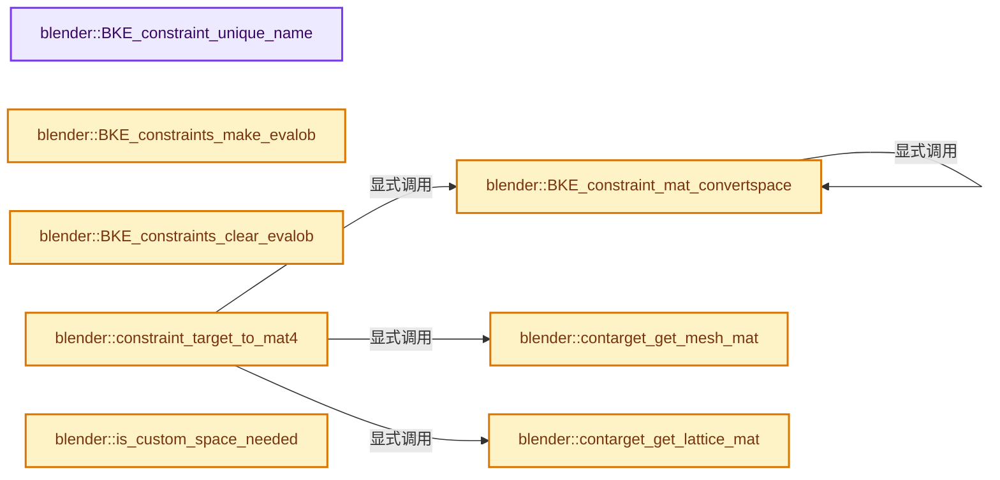
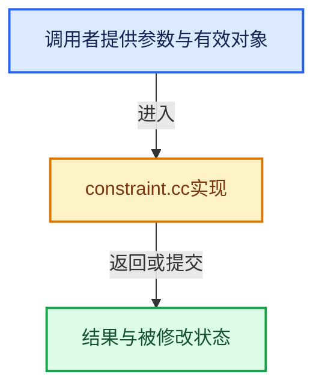

# 实现依赖专题：source/blender/blenkernel/intern/constraint.cc

[实现依赖导航](../../README.md) · [符号索引](../../../00-课程指南/02-源码与提交索引/符号依赖与实现索引.md)

本专题从正文实际调用进入，集中保存共享实现。函数有稳定锚点，可从调用处直接跳到对应完整函数；递归与互相调用通过回链组织。

## 本文件的实现关系






<a id="m-410cba8ce885"></a>

## 宏 `SINGLETARGET_GET_TARS`

<!-- annotated:d3ec035f23715f -->

```cpp
#define SINGLETARGET_GET_TARS(con, datatar, datasubtarget, ct, list) \
  { \
    ct = MEM_new<bConstraintTarget>("tempConstraintTarget"); \
\
    ct->tar = datatar; \
    STRNCPY_UTF8(ct->subtarget, datasubtarget); \
    ct->space = con->tarspace; \
    ct->flag = CONSTRAINT_TAR_TEMP; \
\
    if (ct->tar) { \
      if ((ct->tar->type == OB_ARMATURE) && (ct->subtarget[0])) { \
        bPoseChannel *pchan = BKE_pose_channel_find_name(ct->tar->pose, ct->subtarget); \
        ct->type = CONSTRAINT_OBTYPE_BONE; \
        ct->rotOrder = (pchan) ? (pchan->rotmode) : int(EULER_ORDER_DEFAULT); \
      } \
      else if (OB_TYPE_SUPPORT_VGROUP(ct->tar->type) && (ct->subtarget[0])) { \
        ct->type = CONSTRAINT_OBTYPE_VERT; \
        ct->rotOrder = EULER_ORDER_DEFAULT; \
      } \
      else { \
        ct->type = CONSTRAINT_OBTYPE_OBJECT; \
        ct->rotOrder = ct->tar->rotmode; \
      } \
    } \
\
    BLI_addtail(list, ct); \
  } \
  (void)0

```

<details>
<summary>核对原始源码：source/blender/blenkernel/intern/constraint.cc · L893—L921</summary>

<!-- original:d3ec035f23715f:source/blender/blenkernel/intern/constraint.cc:893:921 -->

```cpp
#define SINGLETARGET_GET_TARS(con, datatar, datasubtarget, ct, list) \
  { \
    ct = MEM_new<bConstraintTarget>("tempConstraintTarget"); \
\
    ct->tar = datatar; \
    STRNCPY_UTF8(ct->subtarget, datasubtarget); \
    ct->space = con->tarspace; \
    ct->flag = CONSTRAINT_TAR_TEMP; \
\
    if (ct->tar) { \
      if ((ct->tar->type == OB_ARMATURE) && (ct->subtarget[0])) { \
        bPoseChannel *pchan = BKE_pose_channel_find_name(ct->tar->pose, ct->subtarget); \
        ct->type = CONSTRAINT_OBTYPE_BONE; \
        ct->rotOrder = (pchan) ? (pchan->rotmode) : int(EULER_ORDER_DEFAULT); \
      } \
      else if (OB_TYPE_SUPPORT_VGROUP(ct->tar->type) && (ct->subtarget[0])) { \
        ct->type = CONSTRAINT_OBTYPE_VERT; \
        ct->rotOrder = EULER_ORDER_DEFAULT; \
      } \
      else { \
        ct->type = CONSTRAINT_OBTYPE_OBJECT; \
        ct->rotOrder = ct->tar->rotmode; \
      } \
    } \
\
    BLI_addtail(list, ct); \
  } \
  (void)0

```

</details>

宏在预处理阶段展开，参数替换、重复求值和条件编译应直接从该定义检查。与普通函数不同，宏不会自动提供参数类型检查；构建配置选择哪个定义需结合外围条件。

## 完整成员与函数实现

<a id="f-387e4bd21783efdd"></a>

### `blender::BKE_constraint_unique_name`

实现位置：[source/blender/blenkernel/intern/constraint.cc](../../../../../../../source/blender/blenkernel/intern/constraint.cc) · L130—L133。

接口参数：

- `bConstraint *con`
- `ListBaseT<bConstraint> *list`

**教学注释版**

<!-- annotated:e76800865350f8 -->

```cpp
void BKE_constraint_unique_name(bConstraint *con, ListBaseT<bConstraint> *list)
{
  BLI_uniquename(list, con, DATA_("Const"), '.', offsetof(bConstraint, name), sizeof(con->name));
}
```

<details>
<summary>核对原始源码：source/blender/blenkernel/intern/constraint.cc · L130—L133</summary>

<!-- original:e76800865350f8:source/blender/blenkernel/intern/constraint.cc:130:133 -->

```cpp
void BKE_constraint_unique_name(bConstraint *con, ListBaseT<bConstraint> *list)
{
  BLI_uniquename(list, con, DATA_("Const"), '.', offsetof(bConstraint, name), sizeof(con->name));
}
```

</details>

**继续追踪实现**

- `BLI_uniquename` → [blender::BLI_uniquename · L491](../../01-BLI基础库/intern/string_utils.cc.md#f-bcf1a000dbfb87d1)。
- `DATA_` → [DATA_ · L52](../../08-其他Blender模块/blentranslation/BLT_translation.hh.md#m-178736083f83)。宏定义由构建条件选择。

<a id="f-170ffd250a05fb45"></a>

### `blender::BKE_constraints_make_evalob`

实现位置：[source/blender/blenkernel/intern/constraint.cc](../../../../../../../source/blender/blenkernel/intern/constraint.cc) · L137—L213。

接口参数：

- `Depsgraph *depsgraph`
- `Scene *scene`
- `Object *ob`
- `void *subdata`
- `short datatype`

**教学注释版**

<!-- annotated:1efa4f6e190f4a -->

```cpp
bConstraintOb *BKE_constraints_make_evalob(
    Depsgraph *depsgraph, Scene *scene, Object *ob, void *subdata, short datatype)
{
  bConstraintOb *cob;

  /* create regardless of whether we have any data! */
  cob = MEM_new_zeroed<bConstraintOb>("bConstraintOb");

  /* NOTE(@ton): For system time, part of de-globalization, code nicer later with local time. */
  cob->scene = scene;
  cob->depsgraph = depsgraph;

  /* based on type of available data */
  switch (datatype) {
    case CONSTRAINT_OBTYPE_OBJECT: {
      /* disregard subdata... calloc should set other values right */
      if (ob) {
        cob->ob = ob;
        cob->type = datatype;

        if (cob->ob->rotmode > 0) {
          /* Should be some kind of Euler order, so use it */
          /* NOTE: Versions <= 2.76 assumed that "default" order
           *       would always get used, so we may seem some rig
           *       breakage as a result. However, this change here
           *       is needed to fix #46599
           */
          cob->rotOrder = ob->rotmode;
        }
        else {
          /* Quaternion/Axis-Angle, so Eulers should just use default order. */
          cob->rotOrder = EULER_ORDER_DEFAULT;
        }
        copy_m4_m4(cob->matrix, ob->object_to_world().ptr());
      }
      else {
        unit_m4(cob->matrix);
      }

      copy_m4_m4(cob->startmat, cob->matrix);
      break;
    }
    case CONSTRAINT_OBTYPE_BONE: {
      /* only set if we have valid bone, otherwise default */
      if (ob && subdata) {
        cob->ob = ob;
        cob->pchan = static_cast<bPoseChannel *>(subdata);
        cob->pchan_armbone = cob->pchan ? cob->pchan->bone_get(*ob) : nullptr;
        cob->type = datatype;

        if (cob->pchan->rotmode > 0) {
          /* should be some type of Euler order */
          cob->rotOrder = cob->pchan->rotmode;
        }
        else {
          /* Quaternion, so eulers should just use default order */
          cob->rotOrder = EULER_ORDER_DEFAULT;
        }

        /* matrix in world-space */
        mul_m4_m4m4(cob->matrix, ob->object_to_world().ptr(), cob->pchan->pose_mat);
      }
      else {
        unit_m4(cob->matrix);
      }

      copy_m4_m4(cob->startmat, cob->matrix);
      break;
    }
    default: /* other types not yet handled */
      unit_m4(cob->matrix);
      unit_m4(cob->startmat);
      break;
  }

  return cob;
}
```

<details>
<summary>核对原始源码：source/blender/blenkernel/intern/constraint.cc · L137—L213</summary>

<!-- original:1efa4f6e190f4a:source/blender/blenkernel/intern/constraint.cc:137:213 -->

```cpp
bConstraintOb *BKE_constraints_make_evalob(
    Depsgraph *depsgraph, Scene *scene, Object *ob, void *subdata, short datatype)
{
  bConstraintOb *cob;

  /* create regardless of whether we have any data! */
  cob = MEM_new_zeroed<bConstraintOb>("bConstraintOb");

  /* NOTE(@ton): For system time, part of de-globalization, code nicer later with local time. */
  cob->scene = scene;
  cob->depsgraph = depsgraph;

  /* based on type of available data */
  switch (datatype) {
    case CONSTRAINT_OBTYPE_OBJECT: {
      /* disregard subdata... calloc should set other values right */
      if (ob) {
        cob->ob = ob;
        cob->type = datatype;

        if (cob->ob->rotmode > 0) {
          /* Should be some kind of Euler order, so use it */
          /* NOTE: Versions <= 2.76 assumed that "default" order
           *       would always get used, so we may seem some rig
           *       breakage as a result. However, this change here
           *       is needed to fix #46599
           */
          cob->rotOrder = ob->rotmode;
        }
        else {
          /* Quaternion/Axis-Angle, so Eulers should just use default order. */
          cob->rotOrder = EULER_ORDER_DEFAULT;
        }
        copy_m4_m4(cob->matrix, ob->object_to_world().ptr());
      }
      else {
        unit_m4(cob->matrix);
      }

      copy_m4_m4(cob->startmat, cob->matrix);
      break;
    }
    case CONSTRAINT_OBTYPE_BONE: {
      /* only set if we have valid bone, otherwise default */
      if (ob && subdata) {
        cob->ob = ob;
        cob->pchan = static_cast<bPoseChannel *>(subdata);
        cob->pchan_armbone = cob->pchan ? cob->pchan->bone_get(*ob) : nullptr;
        cob->type = datatype;

        if (cob->pchan->rotmode > 0) {
          /* should be some type of Euler order */
          cob->rotOrder = cob->pchan->rotmode;
        }
        else {
          /* Quaternion, so eulers should just use default order */
          cob->rotOrder = EULER_ORDER_DEFAULT;
        }

        /* matrix in world-space */
        mul_m4_m4m4(cob->matrix, ob->object_to_world().ptr(), cob->pchan->pose_mat);
      }
      else {
        unit_m4(cob->matrix);
      }

      copy_m4_m4(cob->startmat, cob->matrix);
      break;
    }
    default: /* other types not yet handled */
      unit_m4(cob->matrix);
      unit_m4(cob->startmat);
      break;
  }

  return cob;
}
```

</details>

**沿实际写入检查状态**

- `cob = MEM_new_zeroed<bConstraintOb>("bConstraintOb");`
- `cob->scene = scene;`
- `cob->depsgraph = depsgraph;`
- `cob->ob = ob;`
- `cob->type = datatype;`
- `cob->rotOrder = ob->rotmode;`
- `cob->rotOrder = EULER_ORDER_DEFAULT;`
- `cob->pchan = static_cast<bPoseChannel *>(subdata);`
- `cob->pchan_armbone = cob->pchan ? cob->pchan->bone_get(*ob) : nullptr;`
- `cob->rotOrder = cob->pchan->rotmode;`

**结果出口**

- `return cob;`

**继续追踪实现**

- `MEM_new_zeroed<bConstraintOb>` → [MEM_new_zeroed · L550](../../07-Intern运行时与平台/guardedalloc/MEM_guardedalloc.h.md#f-eeb1e2a7f57dd231)；[MEM_new_zeroed · L114](../../07-Intern运行时与平台/guardedalloc/intern/mallocn.cc.md#f-e04cf01c64c8b180)。同名重载需按实参类型选择。
- `copy_m4_m4` → [blender::copy_m4_m4 · L84](../../01-BLI基础库/intern/math_matrix_c.cc.md#f-b4390cf8c94710f5)。
- `ob->object_to_world().ptr` → [调用协议](../../../00-课程指南/01-路线与规范/模板宏与动态分派协议.md)：接收对象类型依赖auto、返回值或模板实例；不按同名猜测目标。调用位置L170。
- `ob->object_to_world` → [blender::Object::object_to_world · L5761](object.cc.md#f-12fc20026327d50c)。
- `unit_m4` → [blender::unit_m4 · L55](../../01-BLI基础库/intern/math_matrix_c.cc.md#f-e6cd812aae119176)。
- `cob->pchan->bone_get` → [调用协议](../../../00-课程指南/01-路线与规范/模板宏与动态分派协议.md)：接收对象类型依赖auto、返回值或模板实例；不按同名猜测目标。调用位置L184。
- `mul_m4_m4m4` → [blender::mul_m4_m4m4 · L217](../../01-BLI基础库/intern/math_matrix_c.cc.md#f-b5272136b543b73b)。

<a id="f-281468190a709499"></a>

### `blender::BKE_constraints_clear_evalob`

实现位置：[source/blender/blenkernel/intern/constraint.cc](../../../../../../../source/blender/blenkernel/intern/constraint.cc) · L215—L260。

接口参数：

- `bConstraintOb *cob`

**教学注释版**

<!-- annotated:8c717ce601d037 -->

```cpp
void BKE_constraints_clear_evalob(bConstraintOb *cob)
{
  float delta[4][4], imat[4][4];

  /* prevent crashes */
  if (cob == nullptr) {
    return;
  }

  /* calculate delta of constraints evaluation */
  invert_m4_m4(imat, cob->startmat);
  /* XXX This would seem to be in wrong order. However, it does not work in 'right' order - would
   *     be nice to understand why pre-multiply is needed here instead of usual post-multiply?
   *     In any case, we *do not get a delta* here (e.g. startmat & matrix having same location,
   *     still gives a 'delta' with non-null translation component :/ ). */
  mul_m4_m4m4(delta, cob->matrix, imat);

  /* copy matrices back to source */
  switch (cob->type) {
    case CONSTRAINT_OBTYPE_OBJECT: {
      /* cob->ob might not exist! */
      if (cob->ob) {
        /* copy new ob-matrix back to owner */
        copy_m4_m4(cob->ob->runtime->object_to_world.ptr(), cob->matrix);

        /* copy inverse of delta back to owner */
        invert_m4_m4(cob->ob->constinv, delta);
      }
      break;
    }
    case CONSTRAINT_OBTYPE_BONE: {
      /* cob->ob or cob->pchan might not exist */
      if (cob->ob && cob->pchan) {
        /* copy new pose-matrix back to owner */
        mul_m4_m4m4(cob->pchan->pose_mat, cob->ob->world_to_object().ptr(), cob->matrix);

        /* copy inverse of delta back to owner */
        invert_m4_m4(cob->pchan->constinv, delta);
      }
      break;
    }
  }

  /* Free temporary struct. */
  MEM_delete(cob);
}
```

<details>
<summary>核对原始源码：source/blender/blenkernel/intern/constraint.cc · L215—L260</summary>

<!-- original:8c717ce601d037:source/blender/blenkernel/intern/constraint.cc:215:260 -->

```cpp
void BKE_constraints_clear_evalob(bConstraintOb *cob)
{
  float delta[4][4], imat[4][4];

  /* prevent crashes */
  if (cob == nullptr) {
    return;
  }

  /* calculate delta of constraints evaluation */
  invert_m4_m4(imat, cob->startmat);
  /* XXX This would seem to be in wrong order. However, it does not work in 'right' order - would
   *     be nice to understand why pre-multiply is needed here instead of usual post-multiply?
   *     In any case, we *do not get a delta* here (e.g. startmat & matrix having same location,
   *     still gives a 'delta' with non-null translation component :/ ). */
  mul_m4_m4m4(delta, cob->matrix, imat);

  /* copy matrices back to source */
  switch (cob->type) {
    case CONSTRAINT_OBTYPE_OBJECT: {
      /* cob->ob might not exist! */
      if (cob->ob) {
        /* copy new ob-matrix back to owner */
        copy_m4_m4(cob->ob->runtime->object_to_world.ptr(), cob->matrix);

        /* copy inverse of delta back to owner */
        invert_m4_m4(cob->ob->constinv, delta);
      }
      break;
    }
    case CONSTRAINT_OBTYPE_BONE: {
      /* cob->ob or cob->pchan might not exist */
      if (cob->ob && cob->pchan) {
        /* copy new pose-matrix back to owner */
        mul_m4_m4m4(cob->pchan->pose_mat, cob->ob->world_to_object().ptr(), cob->matrix);

        /* copy inverse of delta back to owner */
        invert_m4_m4(cob->pchan->constinv, delta);
      }
      break;
    }
  }

  /* Free temporary struct. */
  MEM_delete(cob);
}
```

</details>

**继续追踪实现**

- `invert_m4_m4` → [blender::invert_m4_m4 · L1150](../../01-BLI基础库/intern/math_matrix_c.cc.md#f-c75789f10cdd5b92)。
- `mul_m4_m4m4` → [blender::mul_m4_m4m4 · L217](../../01-BLI基础库/intern/math_matrix_c.cc.md#f-b5272136b543b73b)。
- `copy_m4_m4` → [blender::copy_m4_m4 · L84](../../01-BLI基础库/intern/math_matrix_c.cc.md#f-b4390cf8c94710f5)。
- `cob->ob->runtime->object_to_world.ptr` → [调用协议](../../../00-课程指南/01-路线与规范/模板宏与动态分派协议.md)：接收对象类型依赖auto、返回值或模板实例；不按同名猜测目标。调用位置L238。
- `cob->ob->world_to_object().ptr` → [调用协议](../../../00-课程指南/01-路线与规范/模板宏与动态分派协议.md)：接收对象类型依赖auto、返回值或模板实例；不按同名猜测目标。调用位置L249。
- `cob->ob->world_to_object` → [调用协议](../../../00-课程指南/01-路线与规范/模板宏与动态分派协议.md)：接收对象类型依赖auto、返回值或模板实例；不按同名猜测目标。调用位置L249。
- `MEM_delete` → [MEM_delete · L400](../../07-Intern运行时与平台/guardedalloc/MEM_guardedalloc.h.md#f-9049ffdd1682887c)。

<a id="f-268684a32963fa8a"></a>

### `blender::BKE_constraint_mat_convertspace`

实现位置：[source/blender/blenkernel/intern/constraint.cc](../../../../../../../source/blender/blenkernel/intern/constraint.cc) · L264—L530。

接口参数：

- `Object *ob`
- `bPoseChannel *pchan`
- `bConstraintOb *cob`
- `float mat[4][4]`
- `short from`
- `short to`
- `const bool keep_scale`

**教学注释版**

<!-- annotated:27523e3c605c5c -->

```cpp
void BKE_constraint_mat_convertspace(Object *ob,
                                     bPoseChannel *pchan,
                                     bConstraintOb *cob,
                                     float mat[4][4],
                                     short from,
                                     short to,
                                     const bool keep_scale)
{
  float diff_mat[4][4];
  float imat[4][4];

  /* Prevent crashes in these unlikely events. */
  if (ob == nullptr || mat == nullptr) {
    return;
  }
  /* optimize trick - check if need to do anything */
  if (from == to) {
    return;
  }

  /* are we dealing with pose-channels or objects */
  if (pchan) {
    Bone *pchan_bone = pchan->bone_get(*ob);

    /* pose channels */
    switch (from) {
      case CONSTRAINT_SPACE_WORLD: /* ---------- FROM WORLDSPACE ---------- */
      {
        if (to == CONSTRAINT_SPACE_CUSTOM) {
          /* World to custom. */
          BLI_assert(cob);
          invert_m4_m4(imat, cob->space_obj_world_matrix);
          mul_m4_m4m4(mat, imat, mat);
        }
        else {
          /* World to pose. */
          invert_m4_m4(imat, ob->object_to_world().ptr());
          mul_m4_m4m4(mat, imat, mat);

          /* Use pose-space as stepping stone for other spaces. */
          if (ELEM(to,
                   CONSTRAINT_SPACE_LOCAL,
                   CONSTRAINT_SPACE_PARLOCAL,
                   CONSTRAINT_SPACE_OWNLOCAL))
          {
            /* Call self with slightly different values. */
            BKE_constraint_mat_convertspace(
                ob, pchan, cob, mat, CONSTRAINT_SPACE_POSE, to, keep_scale);
          }
        }
        break;
      }
      case CONSTRAINT_SPACE_POSE: /* ---------- FROM POSESPACE ---------- */
      {
        /* pose to local */
        if (to == CONSTRAINT_SPACE_LOCAL) {
          if (pchan_bone) {
            BKE_armature_mat_pose_to_bone({pchan, pchan_bone}, mat, mat);
          }
        }
        /* pose to owner local */
        else if (to == CONSTRAINT_SPACE_OWNLOCAL) {
          /* pose to local */
          if (pchan_bone) {
            BKE_armature_mat_pose_to_bone({pchan, pchan_bone}, mat, mat);
          }

          /* local to owner local (recursive) */
          BKE_constraint_mat_convertspace(
              ob, pchan, cob, mat, CONSTRAINT_SPACE_LOCAL, to, keep_scale);
        }
        /* pose to local with parent */
        else if (to == CONSTRAINT_SPACE_PARLOCAL) {
          if (pchan_bone) {
            invert_m4_m4(imat, pchan_bone->arm_mat);
            mul_m4_m4m4(mat, imat, mat);
          }
        }
        else {
          /* Pose to world. */
          mul_m4_m4m4(mat, ob->object_to_world().ptr(), mat);
          /* Use world-space as stepping stone for other spaces. */
          if (to != CONSTRAINT_SPACE_WORLD) {
            /* Call self with slightly different values. */
            BKE_constraint_mat_convertspace(
                ob, pchan, cob, mat, CONSTRAINT_SPACE_WORLD, to, keep_scale);
          }
        }
        break;
      }
      case CONSTRAINT_SPACE_LOCAL: /* ------------ FROM LOCALSPACE --------- */
      {
        /* local to owner local */
        if (to == CONSTRAINT_SPACE_OWNLOCAL) {
          if (pchan_bone) {
            copy_m4_m4(diff_mat, pchan_bone->arm_mat);

            if (cob && cob->pchan) {
              if (Bone *cob_bone = cob->pchan->bone_get(*cob->ob)) {
                invert_m4_m4(imat, cob_bone->arm_mat);
                mul_m4_m4m4(diff_mat, imat, diff_mat);
              }
            }

            zero_v3(diff_mat[3]);
            invert_m4_m4(imat, diff_mat);
            mul_m4_series(mat, diff_mat, mat, imat);
          }
        }
        /* local to pose - do inverse procedure that was done for pose to local */
        else {
          if (pchan_bone) {
            /* We need the:
             *  `posespace_matrix = local_matrix + (parent_posespace_matrix + restpos)`. */
            BKE_armature_mat_bone_to_pose({pchan, pchan_bone}, mat, mat);
          }

          /* use pose-space as stepping stone for other spaces */
          if (ELEM(to, CONSTRAINT_SPACE_WORLD, CONSTRAINT_SPACE_PARLOCAL, CONSTRAINT_SPACE_CUSTOM))
          {
            /* call self with slightly different values */
            BKE_constraint_mat_convertspace(
                ob, pchan, cob, mat, CONSTRAINT_SPACE_POSE, to, keep_scale);
          }
        }
        break;
      }
      case CONSTRAINT_SPACE_OWNLOCAL: { /* -------------- FROM OWNER LOCAL ---------- */
        /* owner local to local */
        if (pchan_bone) {
          copy_m4_m4(diff_mat, pchan_bone->arm_mat);

          if (cob && cob->pchan) {
            if (Bone *cob_bone = cob->pchan->bone_get(*cob->ob)) {
              invert_m4_m4(imat, cob_bone->arm_mat);
              mul_m4_m4m4(diff_mat, imat, diff_mat);
            }
          }

          zero_v3(diff_mat[3]);
          invert_m4_m4(imat, diff_mat);
          mul_m4_series(mat, imat, mat, diff_mat);
        }

        if (to != CONSTRAINT_SPACE_LOCAL) {
          /* call self with slightly different values */
          BKE_constraint_mat_convertspace(
              ob, pchan, cob, mat, CONSTRAINT_SPACE_LOCAL, to, keep_scale);
        }
        break;
      }
      case CONSTRAINT_SPACE_PARLOCAL: /* -------------- FROM LOCAL WITH PARENT ---------- */
      {
        /* local + parent to pose */
        if (pchan_bone) {
          mul_m4_m4m4(mat, pchan_bone->arm_mat, mat);
        }

        /* use pose-space as stepping stone for other spaces */
        if (ELEM(to,
                 CONSTRAINT_SPACE_WORLD,
                 CONSTRAINT_SPACE_LOCAL,
                 CONSTRAINT_SPACE_OWNLOCAL,
                 CONSTRAINT_SPACE_CUSTOM))
        {
          /* call self with slightly different values */
          BKE_constraint_mat_convertspace(
              ob, pchan, cob, mat, CONSTRAINT_SPACE_POSE, to, keep_scale);
        }
        break;
      }
      case CONSTRAINT_SPACE_CUSTOM: /* -------------- FROM CUSTOM SPACE ---------- */
      {
        /* Custom to world. */
        BLI_assert(cob);
        mul_m4_m4m4(mat, cob->space_obj_world_matrix, mat);

        /* Use world-space as stepping stone for other spaces. */
        if (to != CONSTRAINT_SPACE_WORLD) {
          /* Call self with slightly different values. */
          BKE_constraint_mat_convertspace(
              ob, pchan, cob, mat, CONSTRAINT_SPACE_WORLD, to, keep_scale);
        }
        break;
      }
    }
  }
  else {
    /* objects */
    if (from == CONSTRAINT_SPACE_WORLD) {
      if (to == CONSTRAINT_SPACE_LOCAL) {
        /* Check if object has a parent. */
        if (ob->parent) {
          /* 'subtract' parent's effects from owner. */
          mul_m4_m4m4(diff_mat, ob->parent->object_to_world().ptr(), ob->parentinv);
          invert_m4_m4_safe(imat, diff_mat);
          mul_m4_m4m4(mat, imat, mat);
        }
        else {
          /* Local space in this case will have to be defined as local to the owner's
           * transform-property-rotated axes. So subtract this rotation component.
           */
          /* XXX This is actually an ugly hack, local space of a parent-less object *is* the same
           * as global space! Think what we want actually here is some kind of 'Final Space', i.e
           *     . once transformations are applied - users are often confused about this too,
           *     this is not consistent with bones
           *     local space either... Meh :|
           *     --mont29
           */
          BKE_object_to_mat4(ob, diff_mat);
          if (!keep_scale) {
            normalize_m4(diff_mat);
          }
          zero_v3(diff_mat[3]);

          invert_m4_m4_safe(imat, diff_mat);
          mul_m4_m4m4(mat, imat, mat);
        }
      }
      else if (to == CONSTRAINT_SPACE_CUSTOM) {
        /* 'subtract' custom objects's effects from owner. */
        BLI_assert(cob);
        invert_m4_m4_safe(imat, cob->space_obj_world_matrix);
        mul_m4_m4m4(mat, imat, mat);
      }
    }
    else if (from == CONSTRAINT_SPACE_LOCAL) {
      /* check that object has a parent - otherwise this won't work */
      if (ob->parent) {
        /* 'add' parent's effect back to owner */
        mul_m4_m4m4(diff_mat, ob->parent->object_to_world().ptr(), ob->parentinv);
        mul_m4_m4m4(mat, diff_mat, mat);
      }
      else {
        /* Local space in this case will have to be defined as local to the owner's
         * transform-property-rotated axes. So add back this rotation component.
         */
        /* XXX See comment above for world->local case... */
        BKE_object_to_mat4(ob, diff_mat);
        if (!keep_scale) {
          normalize_m4(diff_mat);
        }
        zero_v3(diff_mat[3]);

        mul_m4_m4m4(mat, diff_mat, mat);
      }
      if (to == CONSTRAINT_SPACE_CUSTOM) {
        /* 'subtract' objects's effects from owner. */
        BLI_assert(cob);
        invert_m4_m4_safe(imat, cob->space_obj_world_matrix);
        mul_m4_m4m4(mat, imat, mat);
      }
    }
    else if (from == CONSTRAINT_SPACE_CUSTOM) {
      /* Custom to world. */
      BLI_assert(cob);
      mul_m4_m4m4(mat, cob->space_obj_world_matrix, mat);

      /* Use world-space as stepping stone for other spaces. */
      if (to != CONSTRAINT_SPACE_WORLD) {
        /* Call self with slightly different values. */
        BKE_constraint_mat_convertspace(
            ob, pchan, cob, mat, CONSTRAINT_SPACE_WORLD, to, keep_scale);
      }
    }
  }
}
```

<details>
<summary>核对原始源码：source/blender/blenkernel/intern/constraint.cc · L264—L530</summary>

<!-- original:27523e3c605c5c:source/blender/blenkernel/intern/constraint.cc:264:530 -->

```cpp
void BKE_constraint_mat_convertspace(Object *ob,
                                     bPoseChannel *pchan,
                                     bConstraintOb *cob,
                                     float mat[4][4],
                                     short from,
                                     short to,
                                     const bool keep_scale)
{
  float diff_mat[4][4];
  float imat[4][4];

  /* Prevent crashes in these unlikely events. */
  if (ob == nullptr || mat == nullptr) {
    return;
  }
  /* optimize trick - check if need to do anything */
  if (from == to) {
    return;
  }

  /* are we dealing with pose-channels or objects */
  if (pchan) {
    Bone *pchan_bone = pchan->bone_get(*ob);

    /* pose channels */
    switch (from) {
      case CONSTRAINT_SPACE_WORLD: /* ---------- FROM WORLDSPACE ---------- */
      {
        if (to == CONSTRAINT_SPACE_CUSTOM) {
          /* World to custom. */
          BLI_assert(cob);
          invert_m4_m4(imat, cob->space_obj_world_matrix);
          mul_m4_m4m4(mat, imat, mat);
        }
        else {
          /* World to pose. */
          invert_m4_m4(imat, ob->object_to_world().ptr());
          mul_m4_m4m4(mat, imat, mat);

          /* Use pose-space as stepping stone for other spaces. */
          if (ELEM(to,
                   CONSTRAINT_SPACE_LOCAL,
                   CONSTRAINT_SPACE_PARLOCAL,
                   CONSTRAINT_SPACE_OWNLOCAL))
          {
            /* Call self with slightly different values. */
            BKE_constraint_mat_convertspace(
                ob, pchan, cob, mat, CONSTRAINT_SPACE_POSE, to, keep_scale);
          }
        }
        break;
      }
      case CONSTRAINT_SPACE_POSE: /* ---------- FROM POSESPACE ---------- */
      {
        /* pose to local */
        if (to == CONSTRAINT_SPACE_LOCAL) {
          if (pchan_bone) {
            BKE_armature_mat_pose_to_bone({pchan, pchan_bone}, mat, mat);
          }
        }
        /* pose to owner local */
        else if (to == CONSTRAINT_SPACE_OWNLOCAL) {
          /* pose to local */
          if (pchan_bone) {
            BKE_armature_mat_pose_to_bone({pchan, pchan_bone}, mat, mat);
          }

          /* local to owner local (recursive) */
          BKE_constraint_mat_convertspace(
              ob, pchan, cob, mat, CONSTRAINT_SPACE_LOCAL, to, keep_scale);
        }
        /* pose to local with parent */
        else if (to == CONSTRAINT_SPACE_PARLOCAL) {
          if (pchan_bone) {
            invert_m4_m4(imat, pchan_bone->arm_mat);
            mul_m4_m4m4(mat, imat, mat);
          }
        }
        else {
          /* Pose to world. */
          mul_m4_m4m4(mat, ob->object_to_world().ptr(), mat);
          /* Use world-space as stepping stone for other spaces. */
          if (to != CONSTRAINT_SPACE_WORLD) {
            /* Call self with slightly different values. */
            BKE_constraint_mat_convertspace(
                ob, pchan, cob, mat, CONSTRAINT_SPACE_WORLD, to, keep_scale);
          }
        }
        break;
      }
      case CONSTRAINT_SPACE_LOCAL: /* ------------ FROM LOCALSPACE --------- */
      {
        /* local to owner local */
        if (to == CONSTRAINT_SPACE_OWNLOCAL) {
          if (pchan_bone) {
            copy_m4_m4(diff_mat, pchan_bone->arm_mat);

            if (cob && cob->pchan) {
              if (Bone *cob_bone = cob->pchan->bone_get(*cob->ob)) {
                invert_m4_m4(imat, cob_bone->arm_mat);
                mul_m4_m4m4(diff_mat, imat, diff_mat);
              }
            }

            zero_v3(diff_mat[3]);
            invert_m4_m4(imat, diff_mat);
            mul_m4_series(mat, diff_mat, mat, imat);
          }
        }
        /* local to pose - do inverse procedure that was done for pose to local */
        else {
          if (pchan_bone) {
            /* We need the:
             *  `posespace_matrix = local_matrix + (parent_posespace_matrix + restpos)`. */
            BKE_armature_mat_bone_to_pose({pchan, pchan_bone}, mat, mat);
          }

          /* use pose-space as stepping stone for other spaces */
          if (ELEM(to, CONSTRAINT_SPACE_WORLD, CONSTRAINT_SPACE_PARLOCAL, CONSTRAINT_SPACE_CUSTOM))
          {
            /* call self with slightly different values */
            BKE_constraint_mat_convertspace(
                ob, pchan, cob, mat, CONSTRAINT_SPACE_POSE, to, keep_scale);
          }
        }
        break;
      }
      case CONSTRAINT_SPACE_OWNLOCAL: { /* -------------- FROM OWNER LOCAL ---------- */
        /* owner local to local */
        if (pchan_bone) {
          copy_m4_m4(diff_mat, pchan_bone->arm_mat);

          if (cob && cob->pchan) {
            if (Bone *cob_bone = cob->pchan->bone_get(*cob->ob)) {
              invert_m4_m4(imat, cob_bone->arm_mat);
              mul_m4_m4m4(diff_mat, imat, diff_mat);
            }
          }

          zero_v3(diff_mat[3]);
          invert_m4_m4(imat, diff_mat);
          mul_m4_series(mat, imat, mat, diff_mat);
        }

        if (to != CONSTRAINT_SPACE_LOCAL) {
          /* call self with slightly different values */
          BKE_constraint_mat_convertspace(
              ob, pchan, cob, mat, CONSTRAINT_SPACE_LOCAL, to, keep_scale);
        }
        break;
      }
      case CONSTRAINT_SPACE_PARLOCAL: /* -------------- FROM LOCAL WITH PARENT ---------- */
      {
        /* local + parent to pose */
        if (pchan_bone) {
          mul_m4_m4m4(mat, pchan_bone->arm_mat, mat);
        }

        /* use pose-space as stepping stone for other spaces */
        if (ELEM(to,
                 CONSTRAINT_SPACE_WORLD,
                 CONSTRAINT_SPACE_LOCAL,
                 CONSTRAINT_SPACE_OWNLOCAL,
                 CONSTRAINT_SPACE_CUSTOM))
        {
          /* call self with slightly different values */
          BKE_constraint_mat_convertspace(
              ob, pchan, cob, mat, CONSTRAINT_SPACE_POSE, to, keep_scale);
        }
        break;
      }
      case CONSTRAINT_SPACE_CUSTOM: /* -------------- FROM CUSTOM SPACE ---------- */
      {
        /* Custom to world. */
        BLI_assert(cob);
        mul_m4_m4m4(mat, cob->space_obj_world_matrix, mat);

        /* Use world-space as stepping stone for other spaces. */
        if (to != CONSTRAINT_SPACE_WORLD) {
          /* Call self with slightly different values. */
          BKE_constraint_mat_convertspace(
              ob, pchan, cob, mat, CONSTRAINT_SPACE_WORLD, to, keep_scale);
        }
        break;
      }
    }
  }
  else {
    /* objects */
    if (from == CONSTRAINT_SPACE_WORLD) {
      if (to == CONSTRAINT_SPACE_LOCAL) {
        /* Check if object has a parent. */
        if (ob->parent) {
          /* 'subtract' parent's effects from owner. */
          mul_m4_m4m4(diff_mat, ob->parent->object_to_world().ptr(), ob->parentinv);
          invert_m4_m4_safe(imat, diff_mat);
          mul_m4_m4m4(mat, imat, mat);
        }
        else {
          /* Local space in this case will have to be defined as local to the owner's
           * transform-property-rotated axes. So subtract this rotation component.
           */
          /* XXX This is actually an ugly hack, local space of a parent-less object *is* the same
           * as global space! Think what we want actually here is some kind of 'Final Space', i.e
           *     . once transformations are applied - users are often confused about this too,
           *     this is not consistent with bones
           *     local space either... Meh :|
           *     --mont29
           */
          BKE_object_to_mat4(ob, diff_mat);
          if (!keep_scale) {
            normalize_m4(diff_mat);
          }
          zero_v3(diff_mat[3]);

          invert_m4_m4_safe(imat, diff_mat);
          mul_m4_m4m4(mat, imat, mat);
        }
      }
      else if (to == CONSTRAINT_SPACE_CUSTOM) {
        /* 'subtract' custom objects's effects from owner. */
        BLI_assert(cob);
        invert_m4_m4_safe(imat, cob->space_obj_world_matrix);
        mul_m4_m4m4(mat, imat, mat);
      }
    }
    else if (from == CONSTRAINT_SPACE_LOCAL) {
      /* check that object has a parent - otherwise this won't work */
      if (ob->parent) {
        /* 'add' parent's effect back to owner */
        mul_m4_m4m4(diff_mat, ob->parent->object_to_world().ptr(), ob->parentinv);
        mul_m4_m4m4(mat, diff_mat, mat);
      }
      else {
        /* Local space in this case will have to be defined as local to the owner's
         * transform-property-rotated axes. So add back this rotation component.
         */
        /* XXX See comment above for world->local case... */
        BKE_object_to_mat4(ob, diff_mat);
        if (!keep_scale) {
          normalize_m4(diff_mat);
        }
        zero_v3(diff_mat[3]);

        mul_m4_m4m4(mat, diff_mat, mat);
      }
      if (to == CONSTRAINT_SPACE_CUSTOM) {
        /* 'subtract' objects's effects from owner. */
        BLI_assert(cob);
        invert_m4_m4_safe(imat, cob->space_obj_world_matrix);
        mul_m4_m4m4(mat, imat, mat);
      }
    }
    else if (from == CONSTRAINT_SPACE_CUSTOM) {
      /* Custom to world. */
      BLI_assert(cob);
      mul_m4_m4m4(mat, cob->space_obj_world_matrix, mat);

      /* Use world-space as stepping stone for other spaces. */
      if (to != CONSTRAINT_SPACE_WORLD) {
        /* Call self with slightly different values. */
        BKE_constraint_mat_convertspace(
            ob, pchan, cob, mat, CONSTRAINT_SPACE_WORLD, to, keep_scale);
      }
    }
  }
}
```

</details>

**继续追踪实现**

- `pchan->bone_get` → [blender::bPoseChannel::bone_get · L847](action.cc.md#f-0eb8bfcf060715cf)；[blender::bPoseChannel::bone_get · L862](action.cc.md#f-ccec81f60dc65040)；[blender::bPoseChannel::bone_get · L875](action.cc.md#f-b7d34ff46210a1f3)；[blender::bPoseChannel::bone_get · L881](action.cc.md#f-0bf83e1e4d68c624)。同名重载需按实参类型选择。
- `BLI_assert` → [BLI_assert · L48](../../01-BLI基础库/BLI_assert.hh.md#m-57a88495704d)；[BLI_assert · L63](../../01-BLI基础库/BLI_assert.hh.md#m-d07050020cb5)。宏定义由构建条件选择。
- `invert_m4_m4` → [blender::invert_m4_m4 · L1150](../../01-BLI基础库/intern/math_matrix_c.cc.md#f-c75789f10cdd5b92)。
- `mul_m4_m4m4` → [blender::mul_m4_m4m4 · L217](../../01-BLI基础库/intern/math_matrix_c.cc.md#f-b5272136b543b73b)。
- `ob->object_to_world().ptr` → [调用协议](../../../00-课程指南/01-路线与规范/模板宏与动态分派协议.md)：接收对象类型依赖auto、返回值或模板实例；不按同名猜测目标。调用位置L300。
- `ob->object_to_world` → [blender::Object::object_to_world · L5761](object.cc.md#f-12fc20026327d50c)。
- `ELEM` → [ELEM · L88](../../07-Intern运行时与平台/ghost/intern/GHOST_utildefines.hh.md#m-d28724a15928)；[ELEM · L135](../../01-BLI基础库/BLI_utildefines.hh.md#m-d6572de7cae0)。宏定义由构建条件选择。
- `BKE_constraint_mat_convertspace` → [blender::BKE_constraint_mat_convertspace · L264](constraint.cc.md#f-268684a32963fa8a)。
- `BKE_armature_mat_pose_to_bone` → [blender::BKE_armature_mat_pose_to_bone · L2371](armature.cc.md#f-b1509260a38c49cd)。
- `copy_m4_m4` → [blender::copy_m4_m4 · L84](../../01-BLI基础库/intern/math_matrix_c.cc.md#f-b4390cf8c94710f5)。
- `cob->pchan->bone_get` → [调用协议](../../../00-课程指南/01-路线与规范/模板宏与动态分派协议.md)：接收对象类型依赖auto、返回值或模板实例；不按同名猜测目标。调用位置L362。
- `zero_v3` → [blender::zero_v3 · L26](../../01-BLI基础库/intern/math_vector_inline.cc.md#f-13235b08fdecb098)。
- `mul_m4_series` → [mul_m4_series · L175](../../01-BLI基础库/BLI_math_matrix_c.hh.md#m-5c76fa91d8c7)。宏定义由构建条件选择。
- `BKE_armature_mat_bone_to_pose` → [blender::BKE_armature_mat_bone_to_pose · L2382](armature.cc.md#f-e535cfb21c40fc0b)。
- `ob->parent->object_to_world().ptr` → [调用协议](../../../00-课程指南/01-路线与规范/模板宏与动态分派协议.md)：接收对象类型依赖auto、返回值或模板实例；不按同名猜测目标。调用位置L458。
- `ob->parent->object_to_world` → [调用协议](../../../00-课程指南/01-路线与规范/模板宏与动态分派协议.md)：接收对象类型依赖auto、返回值或模板实例；不按同名猜测目标。调用位置L458。
- `invert_m4_m4_safe` → [blender::invert_m4_m4_safe · L2902](../../01-BLI基础库/intern/math_matrix_c.cc.md#f-13b459563f5a5e8f)。
- `BKE_object_to_mat4` → [blender::BKE_object_to_mat4 · L3125](object.cc.md#f-0d3c5355d76a9941)。
- `normalize_m4` → [blender::normalize_m4 · L1779](../../01-BLI基础库/intern/math_matrix_c.cc.md#f-55c35f5c5d7d4719)。

<a id="f-b896af916f7f2666"></a>

### `blender::contarget_get_mesh_mat`

实现位置：[source/blender/blenkernel/intern/constraint.cc](../../../../../../../source/blender/blenkernel/intern/constraint.cc) · L535—L631。

接口参数：

- `Object *ob`
- `const char *substring`
- `float mat[4][4]`

**教学注释版**

<!-- annotated:4ec9b5ffb1d1c4 -->

```cpp
static void contarget_get_mesh_mat(Object *ob, const char *substring, float mat[4][4])
{
  /* when not in EditMode, use the 'final' evaluated mesh, depsgraph
   * ensures we build with CD_MDEFORMVERT layer
   */
  const Mesh *mesh_eval = BKE_object_get_evaluated_mesh(ob);
  float plane[3];
  float imat[3][3], tmat[3][3];
  const int defgroup = BKE_object_defgroup_name_index(ob, substring);

  /* initialize target matrix using target matrix */
  copy_m4_m4(mat, ob->object_to_world().ptr());

  /* get index of vertex group */
  if (defgroup == -1) {
    return;
  }

  float vec[3] = {0.0f, 0.0f, 0.0f};
  float normal[3] = {0.0f, 0.0f, 0.0f};
  float weightsum = 0.0f;
  if (const BMesh *bm = BKE_editmesh_bmesh_get(ob)) {
    if (CustomData_has_layer(&bm->vdata, CD_MDEFORMVERT)) {
      BMVert *v;
      BMIter iter;

      BM_ITER_MESH (v, &iter, const_cast<BMesh *>(bm), BM_VERTS_OF_MESH) {
        MDeformVert *dv = static_cast<MDeformVert *>(
            CustomData_bmesh_get(&bm->vdata, v->head.data, CD_MDEFORMVERT));
        MDeformWeight *dw = BKE_defvert_find_index(dv, defgroup);

        if (dw && dw->weight > 0.0f) {
          madd_v3_v3fl(vec, v->co, dw->weight);
          madd_v3_v3fl(normal, v->no, dw->weight);
          weightsum += dw->weight;
        }
      }
    }
  }
  else if (mesh_eval) {
    const Span<float3> positions = mesh_eval->vert_positions();
    const Span<float3> vert_normals = mesh_eval->vert_normals();
    const Span<MDeformVert> dverts = mesh_eval->deform_verts();
    /* check that dvert is a valid pointers (just in case) */
    // [讲解] dverts.is_empty：查询视图长度或生成对应有效索引区间。
    if (!dverts.is_empty()) {
      /* get the average of all verts with that are in the vertex-group */
      // [讲解] positions.index_range：查询视图长度或生成对应有效索引区间。
      for (const int i : positions.index_range()) {
        const MDeformVert *dv = &dverts[i];
        const MDeformWeight *dw = BKE_defvert_find_index(dv, defgroup);

        if (dw && dw->weight > 0.0f) {
          madd_v3_v3fl(vec, positions[i], dw->weight);
          madd_v3_v3fl(normal, vert_normals[i], dw->weight);
          weightsum += dw->weight;
        }
      }
    }
  }
  else {
    /* No valid edit or evaluated mesh, just abort. */
    return;
  }

  /* calculate averages of normal and coordinates */
  if (weightsum > 0) {
    mul_v3_fl(vec, 1.0f / weightsum);
    mul_v3_fl(normal, 1.0f / weightsum);
  }

  /* derive the rotation from the average normal:
   * - code taken from transform_gizmo.c,
   *   calc_gizmo_stats, V3D_ORIENT_NORMAL case */

  /* We need the transpose of the inverse for a normal. */
  copy_m3_m4(imat, ob->object_to_world().ptr());

  invert_m3_m3(tmat, imat);
  transpose_m3(tmat);
  mul_m3_v3(tmat, normal);

  normalize_v3(normal);
  copy_v3_v3(plane, tmat[1]);

  cross_v3_v3v3(mat[0], normal, plane);
  if (len_squared_v3(mat[0]) < square_f(1e-3f)) {
    copy_v3_v3(plane, tmat[0]);
    cross_v3_v3v3(mat[0], normal, plane);
  }

  copy_v3_v3(mat[2], normal);
  cross_v3_v3v3(mat[1], mat[2], mat[0]);

  normalize_m4(mat);

  /* apply the average coordinate as the new location */
  mul_v3_m4v3(mat[3], ob->object_to_world().ptr(), vec);
}
```

<details>
<summary>核对原始源码：source/blender/blenkernel/intern/constraint.cc · L535—L631</summary>

<!-- original:4ec9b5ffb1d1c4:source/blender/blenkernel/intern/constraint.cc:535:631 -->

```cpp
static void contarget_get_mesh_mat(Object *ob, const char *substring, float mat[4][4])
{
  /* when not in EditMode, use the 'final' evaluated mesh, depsgraph
   * ensures we build with CD_MDEFORMVERT layer
   */
  const Mesh *mesh_eval = BKE_object_get_evaluated_mesh(ob);
  float plane[3];
  float imat[3][3], tmat[3][3];
  const int defgroup = BKE_object_defgroup_name_index(ob, substring);

  /* initialize target matrix using target matrix */
  copy_m4_m4(mat, ob->object_to_world().ptr());

  /* get index of vertex group */
  if (defgroup == -1) {
    return;
  }

  float vec[3] = {0.0f, 0.0f, 0.0f};
  float normal[3] = {0.0f, 0.0f, 0.0f};
  float weightsum = 0.0f;
  if (const BMesh *bm = BKE_editmesh_bmesh_get(ob)) {
    if (CustomData_has_layer(&bm->vdata, CD_MDEFORMVERT)) {
      BMVert *v;
      BMIter iter;

      BM_ITER_MESH (v, &iter, const_cast<BMesh *>(bm), BM_VERTS_OF_MESH) {
        MDeformVert *dv = static_cast<MDeformVert *>(
            CustomData_bmesh_get(&bm->vdata, v->head.data, CD_MDEFORMVERT));
        MDeformWeight *dw = BKE_defvert_find_index(dv, defgroup);

        if (dw && dw->weight > 0.0f) {
          madd_v3_v3fl(vec, v->co, dw->weight);
          madd_v3_v3fl(normal, v->no, dw->weight);
          weightsum += dw->weight;
        }
      }
    }
  }
  else if (mesh_eval) {
    const Span<float3> positions = mesh_eval->vert_positions();
    const Span<float3> vert_normals = mesh_eval->vert_normals();
    const Span<MDeformVert> dverts = mesh_eval->deform_verts();
    /* check that dvert is a valid pointers (just in case) */
    if (!dverts.is_empty()) {
      /* get the average of all verts with that are in the vertex-group */
      for (const int i : positions.index_range()) {
        const MDeformVert *dv = &dverts[i];
        const MDeformWeight *dw = BKE_defvert_find_index(dv, defgroup);

        if (dw && dw->weight > 0.0f) {
          madd_v3_v3fl(vec, positions[i], dw->weight);
          madd_v3_v3fl(normal, vert_normals[i], dw->weight);
          weightsum += dw->weight;
        }
      }
    }
  }
  else {
    /* No valid edit or evaluated mesh, just abort. */
    return;
  }

  /* calculate averages of normal and coordinates */
  if (weightsum > 0) {
    mul_v3_fl(vec, 1.0f / weightsum);
    mul_v3_fl(normal, 1.0f / weightsum);
  }

  /* derive the rotation from the average normal:
   * - code taken from transform_gizmo.c,
   *   calc_gizmo_stats, V3D_ORIENT_NORMAL case */

  /* We need the transpose of the inverse for a normal. */
  copy_m3_m4(imat, ob->object_to_world().ptr());

  invert_m3_m3(tmat, imat);
  transpose_m3(tmat);
  mul_m3_v3(tmat, normal);

  normalize_v3(normal);
  copy_v3_v3(plane, tmat[1]);

  cross_v3_v3v3(mat[0], normal, plane);
  if (len_squared_v3(mat[0]) < square_f(1e-3f)) {
    copy_v3_v3(plane, tmat[0]);
    cross_v3_v3v3(mat[0], normal, plane);
  }

  copy_v3_v3(mat[2], normal);
  cross_v3_v3v3(mat[1], mat[2], mat[0]);

  normalize_m4(mat);

  /* apply the average coordinate as the new location */
  mul_v3_m4v3(mat[3], ob->object_to_world().ptr(), vec);
}
```

</details>

**沿实际写入检查状态**

- `weightsum += dw->weight;`

**继续追踪实现**

- `BKE_object_get_evaluated_mesh` → [blender::BKE_object_get_evaluated_mesh · L4436](object.cc.md#f-51b5453b29547868)。
- `BKE_object_defgroup_name_index` → [blender::BKE_object_defgroup_name_index · L597](deform.cc.md#f-ad856e5bba5cd758)。
- `copy_m4_m4` → [blender::copy_m4_m4 · L84](../../01-BLI基础库/intern/math_matrix_c.cc.md#f-b4390cf8c94710f5)。
- `ob->object_to_world().ptr` → [调用协议](../../../00-课程指南/01-路线与规范/模板宏与动态分派协议.md)：接收对象类型依赖auto、返回值或模板实例；不按同名猜测目标。调用位置L546。
- `ob->object_to_world` → [blender::Object::object_to_world · L5761](object.cc.md#f-12fc20026327d50c)。
- `BKE_editmesh_bmesh_get` → [blender::BKE_editmesh_bmesh_get · L65](editmesh.cc.md#f-2afdd2773d3f0d88)；[blender::BKE_editmesh_bmesh_get · L71](editmesh.cc.md#f-80631d704a7e9947)。同名重载需按实参类型选择。
- `CustomData_has_layer` → [blender::CustomData_has_layer · L3005](customdata.cc.md#f-7333340531d48ea3)。
- `BM_ITER_MESH` → [BM_ITER_MESH · L72](../../08-其他Blender模块/bmesh/intern/bmesh_iterators.hh.md#m-cfc837c73218)。宏定义由构建条件选择。
- `CustomData_bmesh_get` → [blender::CustomData_bmesh_get · L3745](customdata.cc.md#f-35f239034780edea)。
- `BKE_defvert_find_index` → [blender::BKE_defvert_find_index · L811](deform.cc.md#f-d8c22e4305ac3d34)。
- `madd_v3_v3fl` → [blender::madd_v3_v3fl · L501](../../01-BLI基础库/intern/math_vector_inline.cc.md#f-4f81667c5d595c80)。
- `mesh_eval->vert_positions` → [Mesh::vert_positions · L1193](../../../05-几何存储与拓扑映射/03-MPoly迁移与兼容.md#f-ae4177e5c5f2b371)。
- `mesh_eval->vert_normals` → [blender::Mesh::vert_normals · L349](../../../06-隐式共享与缓存系统/08-法线缓存的真实依赖.md#f-e9a9d50dc8e15fba)。
- `mesh_eval->deform_verts` → [Mesh::deform_verts · L1266](../../../05-几何存储与拓扑映射/03-MPoly迁移与兼容.md#f-4c0433aad24aa301)。
- `dverts.is_empty` → [blender::Span::is_empty · L264](../../../01-基础容器与现代CPP/05-Span只读连续视图.md#f-8cc1d7ba8feb50e6)。
- `positions.index_range` → [blender::Span::index_range · L405](../../../01-基础容器与现代CPP/05-Span只读连续视图.md#f-caaa9b06e13e53e0)。
- `mul_v3_fl` → [blender::mul_v3_fl · L414](../../01-BLI基础库/intern/math_vector_inline.cc.md#f-00165156a06d1224)。
- `copy_m3_m4` → [blender::copy_m3_m4 · L94](../../01-BLI基础库/intern/math_matrix_c.cc.md#f-1141cb3624c754b0)。
- `invert_m3_m3` → [blender::invert_m3_m3 · L1043](../../01-BLI基础库/intern/math_matrix_c.cc.md#f-3807bacd2e4afbad)。
- `transpose_m3` → [blender::transpose_m3 · L1199](../../01-BLI基础库/intern/math_matrix_c.cc.md#f-ba1c715782a096a2)。
- `mul_m3_v3` → [blender::mul_m3_v3 · L853](../../01-BLI基础库/intern/math_matrix_c.cc.md#f-8dbb02b9a9a2d195)。
- `normalize_v3` → [blender::normalize_v3 · L933](../../01-BLI基础库/intern/math_vector_inline.cc.md#f-5f3257e657ef732c)。
- `copy_v3_v3` → [blender::copy_v3_v3 · L47](../../01-BLI基础库/intern/math_vector_inline.cc.md#f-037a0d5fa5060bd6)。
- `cross_v3_v3v3` → [blender::cross_v3_v3v3 · L690](../../01-BLI基础库/intern/math_vector_inline.cc.md#f-ac8d04405fb5dad4)。
- `len_squared_v3` → [blender::len_squared_v3 · L724](../../01-BLI基础库/intern/math_vector_inline.cc.md#f-089409f6f09f82ef)。
- `square_f` → [blender::square_f · L302](../../01-BLI基础库/intern/math_base_inline.cc.md#f-30f1dde493a37e0d)。
- `normalize_m4` → [blender::normalize_m4 · L1779](../../01-BLI基础库/intern/math_matrix_c.cc.md#f-55c35f5c5d7d4719)。
- `mul_v3_m4v3` → [blender::mul_v3_m4v3 · L687](../../01-BLI基础库/intern/math_matrix_c.cc.md#f-31076c71c40783a8)。

<a id="f-d24541b630342eda"></a>

### `blender::contarget_get_lattice_mat`

实现位置：[source/blender/blenkernel/intern/constraint.cc](../../../../../../../source/blender/blenkernel/intern/constraint.cc) · L634—L695。

接口参数：

- `Object *ob`
- `const char *substring`
- `float mat[4][4]`

**教学注释版**

<!-- annotated:bf9532d8e4913d -->

```cpp
static void contarget_get_lattice_mat(Object *ob, const char *substring, float mat[4][4])
{
  Lattice *lt = id_cast<Lattice *>(ob->data);

  DispList *dl = ob->runtime->curve_cache ?
                     BKE_displist_find(&ob->runtime->curve_cache->disp, DL_VERTS) :
                     nullptr;
  const float *co = dl ? dl->verts : nullptr;
  BPoint *bp = lt->def;

  MDeformVert *dv = lt->dvert;
  int tot_verts = lt->pntsu * lt->pntsv * lt->pntsw;
  float vec[3] = {0.0f, 0.0f, 0.0f}, tvec[3];
  int grouped = 0;
  int i, n;
  const int defgroup = BKE_object_defgroup_name_index(ob, substring);

  /* initialize target matrix using target matrix */
  copy_m4_m4(mat, ob->object_to_world().ptr());

  /* get index of vertex group */
  if (defgroup == -1) {
    return;
  }
  if (dv == nullptr) {
    return;
  }

  /* 1. Loop through control-points checking if in nominated vertex-group.
   * 2. If it is, add it to vec to find the average point.
   */
  for (i = 0; i < tot_verts; i++, dv++) {
    for (n = 0; n < dv->totweight; n++) {
      MDeformWeight *dw = BKE_defvert_find_index(dv, defgroup);
      if (dw && dw->weight > 0.0f) {
        /* copy coordinates of point to temporary vector, then add to find average */
        // [讲解] memcpy：复制字节，源与目标不应重叠。类型生命周期、对齐和可复制表示须由调用者证明，不是任意对象的复制构造。
        memcpy(tvec, co ? co : bp->vec, sizeof(float[3]));

        add_v3_v3(vec, tvec);
        grouped++;
      }
    }

    /* advance pointer to coordinate data */
    if (co) {
      co += 3;
    }
    else {
      bp++;
    }
  }

  /* find average location, then multiply by ob->object_to_world().ptr() to find world-space
   * location */
  if (grouped) {
    mul_v3_fl(vec, 1.0f / grouped);
  }
  mul_v3_m4v3(tvec, ob->object_to_world().ptr(), vec);

  /* copy new location to matrix */
  copy_v3_v3(mat[3], tvec);
}
```

<details>
<summary>核对原始源码：source/blender/blenkernel/intern/constraint.cc · L634—L695</summary>

<!-- original:bf9532d8e4913d:source/blender/blenkernel/intern/constraint.cc:634:695 -->

```cpp
static void contarget_get_lattice_mat(Object *ob, const char *substring, float mat[4][4])
{
  Lattice *lt = id_cast<Lattice *>(ob->data);

  DispList *dl = ob->runtime->curve_cache ?
                     BKE_displist_find(&ob->runtime->curve_cache->disp, DL_VERTS) :
                     nullptr;
  const float *co = dl ? dl->verts : nullptr;
  BPoint *bp = lt->def;

  MDeformVert *dv = lt->dvert;
  int tot_verts = lt->pntsu * lt->pntsv * lt->pntsw;
  float vec[3] = {0.0f, 0.0f, 0.0f}, tvec[3];
  int grouped = 0;
  int i, n;
  const int defgroup = BKE_object_defgroup_name_index(ob, substring);

  /* initialize target matrix using target matrix */
  copy_m4_m4(mat, ob->object_to_world().ptr());

  /* get index of vertex group */
  if (defgroup == -1) {
    return;
  }
  if (dv == nullptr) {
    return;
  }

  /* 1. Loop through control-points checking if in nominated vertex-group.
   * 2. If it is, add it to vec to find the average point.
   */
  for (i = 0; i < tot_verts; i++, dv++) {
    for (n = 0; n < dv->totweight; n++) {
      MDeformWeight *dw = BKE_defvert_find_index(dv, defgroup);
      if (dw && dw->weight > 0.0f) {
        /* copy coordinates of point to temporary vector, then add to find average */
        memcpy(tvec, co ? co : bp->vec, sizeof(float[3]));

        add_v3_v3(vec, tvec);
        grouped++;
      }
    }

    /* advance pointer to coordinate data */
    if (co) {
      co += 3;
    }
    else {
      bp++;
    }
  }

  /* find average location, then multiply by ob->object_to_world().ptr() to find world-space
   * location */
  if (grouped) {
    mul_v3_fl(vec, 1.0f / grouped);
  }
  mul_v3_m4v3(tvec, ob->object_to_world().ptr(), vec);

  /* copy new location to matrix */
  copy_v3_v3(mat[3], tvec);
}
```

</details>

**沿实际写入检查状态**

- `co += 3;`

**继续追踪实现**

- `id_cast<Lattice *>` → [blender::id_cast · L1417](../../08-其他Blender模块/makesdna/DNA_ID.h.md#f-6c8ac6412850ac5a)。
- `BKE_displist_find` → [blender::BKE_displist_find · L75](displist.cc.md#f-64a8e45792ce7493)。
- `BKE_object_defgroup_name_index` → [blender::BKE_object_defgroup_name_index · L597](deform.cc.md#f-ad856e5bba5cd758)。
- `copy_m4_m4` → [blender::copy_m4_m4 · L84](../../01-BLI基础库/intern/math_matrix_c.cc.md#f-b4390cf8c94710f5)。
- `ob->object_to_world().ptr` → [调用协议](../../../00-课程指南/01-路线与规范/模板宏与动态分派协议.md)：接收对象类型依赖auto、返回值或模板实例；不按同名猜测目标。调用位置L652。
- `ob->object_to_world` → [blender::Object::object_to_world · L5761](object.cc.md#f-12fc20026327d50c)。
- `BKE_defvert_find_index` → [blender::BKE_defvert_find_index · L811](deform.cc.md#f-d8c22e4305ac3d34)。
- `memcpy` → [外部契约](https://eel.is/c++draft/cstring.syn)：复制字节，源与目标不应重叠。类型生命周期、对齐和可复制表示须由调用者证明，不是任意对象的复制构造。
- `add_v3_v3` → [blender::add_v3_v3 · L286](../../01-BLI基础库/intern/math_vector_inline.cc.md#f-e7930c6fdefe462c)。
- `mul_v3_fl` → [blender::mul_v3_fl · L414](../../01-BLI基础库/intern/math_vector_inline.cc.md#f-00165156a06d1224)。
- `mul_v3_m4v3` → [blender::mul_v3_m4v3 · L687](../../01-BLI基础库/intern/math_matrix_c.cc.md#f-31076c71c40783a8)。
- `copy_v3_v3` → [blender::copy_v3_v3 · L47](../../01-BLI基础库/intern/math_vector_inline.cc.md#f-037a0d5fa5060bd6)。

<a id="f-73b08e417d7920b8"></a>

### `blender::constraint_target_to_mat4`

实现位置：[source/blender/blenkernel/intern/constraint.cc](../../../../../../../source/blender/blenkernel/intern/constraint.cc) · L699—L793。

接口参数：

- `Object *ob`
- `const char *substring`
- `bConstraintOb *cob`
- `float mat[4][4]`
- `short from`
- `short to`
- `short flag`
- `float headtail`

**教学注释版**

<!-- annotated:40c279c5292300 -->

```cpp
static void constraint_target_to_mat4(Object *ob,
                                      const char *substring,
                                      bConstraintOb *cob,
                                      float mat[4][4],
                                      short from,
                                      short to,
                                      short flag,
                                      float headtail)
{
  /* Case OBJECT */
  if (substring[0] == '\0') {
    copy_m4_m4(mat, ob->object_to_world().ptr());
    BKE_constraint_mat_convertspace(ob, nullptr, cob, mat, from, to, false);
  }
  /* Case VERTEXGROUP */
  /* Current method just takes the average location of all the points in the
   * VertexGroup, and uses that as the location value of the targets. Where
   * possible, the orientation will also be calculated, by calculating an
   * 'average' vertex normal, and deriving the rotation from that.
   *
   * NOTE: EditMode is not currently supported, and will most likely remain that
   *       way as constraints can only really affect things on object/bone level.
   */
  else if (ob->type == OB_MESH) {
    contarget_get_mesh_mat(ob, substring, mat);
    BKE_constraint_mat_convertspace(ob, nullptr, cob, mat, from, to, false);
  }
  else if (ob->type == OB_LATTICE) {
    contarget_get_lattice_mat(ob, substring, mat);
    BKE_constraint_mat_convertspace(ob, nullptr, cob, mat, from, to, false);
  }
  /* Case BONE */
  else {
    bPoseChannel *pchan;

    pchan = BKE_pose_channel_find_name(ob->pose, substring);
    if (pchan) {
      /* Multiply the PoseSpace accumulation/final matrix for this
       * PoseChannel by the Armature Object's Matrix to get a world-space matrix.
       */
      Bone *bone = pchan->bone_get(*ob);
      bool is_bbone = bone && (bone->segments > 1) && (flag & CONSTRAINT_BBONE_SHAPE);
      bool full_bbone = (flag & CONSTRAINT_BBONE_SHAPE_FULL) != 0;

      if (headtail < 0.000001f && !(is_bbone && full_bbone)) {
        /* skip length interpolation if set to head */
        mul_m4_m4m4(mat, ob->object_to_world().ptr(), pchan->pose_mat);
      }
      else if (is_bbone && bone->segments == pchan->runtime.bbone_segments) {
        /* use point along bbone */
        Mat4 *bbone = pchan->runtime.bbone_pose_mats;
        float tempmat[4][4];
        float loc[3], fac;
        int index;

        /* figure out which segment(s) the headtail value falls in */
        BKE_pchan_bbone_deform_clamp_segment_index(*bone, headtail, &index, &fac);

        /* apply full transformation of the segment if requested */
        if (full_bbone) {
          interp_m4_m4m4(tempmat, bbone[index].mat, bbone[index + 1].mat, fac);

          mul_m4_m4m4(tempmat, pchan->pose_mat, tempmat);
        }
        /* only interpolate location */
        else {
          interp_v3_v3v3(loc, bbone[index].mat[3], bbone[index + 1].mat[3], fac);

          copy_m4_m4(tempmat, pchan->pose_mat);
          mul_v3_m4v3(tempmat[3], pchan->pose_mat, loc);
        }

        mul_m4_m4m4(mat, ob->object_to_world().ptr(), tempmat);
      }
      else {
        float tempmat[4][4], loc[3];

        /* interpolate along length of bone */
        interp_v3_v3v3(loc, pchan->pose_head, pchan->pose_tail, headtail);

        /* use interpolated distance for subtarget */
        copy_m4_m4(tempmat, pchan->pose_mat);
        copy_v3_v3(tempmat[3], loc);

        mul_m4_m4m4(mat, ob->object_to_world().ptr(), tempmat);
      }
    }
    else {
      copy_m4_m4(mat, ob->object_to_world().ptr());
    }

    /* convert matrix space as required */
    BKE_constraint_mat_convertspace(ob, pchan, cob, mat, from, to, false);
  }
}
```

<details>
<summary>核对原始源码：source/blender/blenkernel/intern/constraint.cc · L699—L793</summary>

<!-- original:40c279c5292300:source/blender/blenkernel/intern/constraint.cc:699:793 -->

```cpp
static void constraint_target_to_mat4(Object *ob,
                                      const char *substring,
                                      bConstraintOb *cob,
                                      float mat[4][4],
                                      short from,
                                      short to,
                                      short flag,
                                      float headtail)
{
  /* Case OBJECT */
  if (substring[0] == '\0') {
    copy_m4_m4(mat, ob->object_to_world().ptr());
    BKE_constraint_mat_convertspace(ob, nullptr, cob, mat, from, to, false);
  }
  /* Case VERTEXGROUP */
  /* Current method just takes the average location of all the points in the
   * VertexGroup, and uses that as the location value of the targets. Where
   * possible, the orientation will also be calculated, by calculating an
   * 'average' vertex normal, and deriving the rotation from that.
   *
   * NOTE: EditMode is not currently supported, and will most likely remain that
   *       way as constraints can only really affect things on object/bone level.
   */
  else if (ob->type == OB_MESH) {
    contarget_get_mesh_mat(ob, substring, mat);
    BKE_constraint_mat_convertspace(ob, nullptr, cob, mat, from, to, false);
  }
  else if (ob->type == OB_LATTICE) {
    contarget_get_lattice_mat(ob, substring, mat);
    BKE_constraint_mat_convertspace(ob, nullptr, cob, mat, from, to, false);
  }
  /* Case BONE */
  else {
    bPoseChannel *pchan;

    pchan = BKE_pose_channel_find_name(ob->pose, substring);
    if (pchan) {
      /* Multiply the PoseSpace accumulation/final matrix for this
       * PoseChannel by the Armature Object's Matrix to get a world-space matrix.
       */
      Bone *bone = pchan->bone_get(*ob);
      bool is_bbone = bone && (bone->segments > 1) && (flag & CONSTRAINT_BBONE_SHAPE);
      bool full_bbone = (flag & CONSTRAINT_BBONE_SHAPE_FULL) != 0;

      if (headtail < 0.000001f && !(is_bbone && full_bbone)) {
        /* skip length interpolation if set to head */
        mul_m4_m4m4(mat, ob->object_to_world().ptr(), pchan->pose_mat);
      }
      else if (is_bbone && bone->segments == pchan->runtime.bbone_segments) {
        /* use point along bbone */
        Mat4 *bbone = pchan->runtime.bbone_pose_mats;
        float tempmat[4][4];
        float loc[3], fac;
        int index;

        /* figure out which segment(s) the headtail value falls in */
        BKE_pchan_bbone_deform_clamp_segment_index(*bone, headtail, &index, &fac);

        /* apply full transformation of the segment if requested */
        if (full_bbone) {
          interp_m4_m4m4(tempmat, bbone[index].mat, bbone[index + 1].mat, fac);

          mul_m4_m4m4(tempmat, pchan->pose_mat, tempmat);
        }
        /* only interpolate location */
        else {
          interp_v3_v3v3(loc, bbone[index].mat[3], bbone[index + 1].mat[3], fac);

          copy_m4_m4(tempmat, pchan->pose_mat);
          mul_v3_m4v3(tempmat[3], pchan->pose_mat, loc);
        }

        mul_m4_m4m4(mat, ob->object_to_world().ptr(), tempmat);
      }
      else {
        float tempmat[4][4], loc[3];

        /* interpolate along length of bone */
        interp_v3_v3v3(loc, pchan->pose_head, pchan->pose_tail, headtail);

        /* use interpolated distance for subtarget */
        copy_m4_m4(tempmat, pchan->pose_mat);
        copy_v3_v3(tempmat[3], loc);

        mul_m4_m4m4(mat, ob->object_to_world().ptr(), tempmat);
      }
    }
    else {
      copy_m4_m4(mat, ob->object_to_world().ptr());
    }

    /* convert matrix space as required */
    BKE_constraint_mat_convertspace(ob, pchan, cob, mat, from, to, false);
  }
}
```

</details>

**沿实际写入检查状态**

- `pchan = BKE_pose_channel_find_name(ob->pose, substring);`

**继续追踪实现**

- `copy_m4_m4` → [blender::copy_m4_m4 · L84](../../01-BLI基础库/intern/math_matrix_c.cc.md#f-b4390cf8c94710f5)。
- `ob->object_to_world().ptr` → [调用协议](../../../00-课程指南/01-路线与规范/模板宏与动态分派协议.md)：接收对象类型依赖auto、返回值或模板实例；不按同名猜测目标。调用位置L710。
- `ob->object_to_world` → [blender::Object::object_to_world · L5761](object.cc.md#f-12fc20026327d50c)。
- `BKE_constraint_mat_convertspace` → [blender::BKE_constraint_mat_convertspace · L264](constraint.cc.md#f-268684a32963fa8a)。
- `contarget_get_mesh_mat` → [blender::contarget_get_mesh_mat · L535](constraint.cc.md#f-b896af916f7f2666)。
- `contarget_get_lattice_mat` → [blender::contarget_get_lattice_mat · L634](constraint.cc.md#f-d24541b630342eda)。
- `BKE_pose_channel_find_name` → [blender::BKE_pose_channel_find_name · L895](action.cc.md#f-5997206551bfc9f9)。
- `pchan->bone_get` → [blender::bPoseChannel::bone_get · L847](action.cc.md#f-0eb8bfcf060715cf)；[blender::bPoseChannel::bone_get · L862](action.cc.md#f-ccec81f60dc65040)；[blender::bPoseChannel::bone_get · L875](action.cc.md#f-b7d34ff46210a1f3)；[blender::bPoseChannel::bone_get · L881](action.cc.md#f-0bf83e1e4d68c624)。同名重载需按实参类型选择。
- `mul_m4_m4m4` → [blender::mul_m4_m4m4 · L217](../../01-BLI基础库/intern/math_matrix_c.cc.md#f-b5272136b543b73b)。
- `BKE_pchan_bbone_deform_clamp_segment_index` → [blender::BKE_pchan_bbone_deform_clamp_segment_index · L1922](armature.cc.md#f-8549d91022ba4ebf)。
- `interp_m4_m4m4` → [blender::interp_m4_m4m4 · L2271](../../01-BLI基础库/intern/math_matrix_c.cc.md#f-c35e4625242114b0)。
- `interp_v3_v3v3` → [blender::interp_v3_v3v3 · L41](../../01-BLI基础库/intern/math_vector.cc.md#f-18251c70c00824d7)。
- `mul_v3_m4v3` → [blender::mul_v3_m4v3 · L687](../../01-BLI基础库/intern/math_matrix_c.cc.md#f-31076c71c40783a8)。
- `copy_v3_v3` → [blender::copy_v3_v3 · L47](../../01-BLI基础库/intern/math_vector_inline.cc.md#f-037a0d5fa5060bd6)。

<a id="f-cf0d981775fdcfb7"></a>

### `blender::is_custom_space_needed`

实现位置：[source/blender/blenkernel/intern/constraint.cc](../../../../../../../source/blender/blenkernel/intern/constraint.cc) · L986—L989。

接口参数：

- `bConstraint *con`

**教学注释版**

<!-- annotated:15e025989ed83b -->

```cpp
static bool is_custom_space_needed(bConstraint *con)
{
  return con->ownspace == CONSTRAINT_SPACE_CUSTOM || con->tarspace == CONSTRAINT_SPACE_CUSTOM;
}
```

<details>
<summary>核对原始源码：source/blender/blenkernel/intern/constraint.cc · L986—L989</summary>

<!-- original:15e025989ed83b:source/blender/blenkernel/intern/constraint.cc:986:989 -->

```cpp
static bool is_custom_space_needed(bConstraint *con)
{
  return con->ownspace == CONSTRAINT_SPACE_CUSTOM || con->tarspace == CONSTRAINT_SPACE_CUSTOM;
}
```

</details>

**结果出口**

- `return con->ownspace == CONSTRAINT_SPACE_CUSTOM || con->tarspace == CONSTRAINT_SPACE_CUSTOM;`

**继续追踪实现**

本实现没有需要继续展开的显式调用；检查返回表达式、对象转换和调用者前置条件。

<a id="f-7fc544f9fb8a4ac5"></a>

### `blender::constraints_init_typeinfo`

实现位置：[source/blender/blenkernel/intern/constraint.cc](../../../../../../../source/blender/blenkernel/intern/constraint.cc) · L5831—L5865。

**教学注释版**

<!-- annotated:07d20a381cf4bc -->

```cpp
static void constraints_init_typeinfo()
{
  constraintsTypeInfo[0] = nullptr;               /* 'Null' Constraint */
  constraintsTypeInfo[1] = &CTI_CHILDOF;          /* ChildOf Constraint */
  constraintsTypeInfo[2] = &CTI_TRACKTO;          /* TrackTo Constraint */
  constraintsTypeInfo[3] = &CTI_KINEMATIC;        /* IK Constraint */
  constraintsTypeInfo[4] = &CTI_FOLLOWPATH;       /* Follow-Path Constraint */
  constraintsTypeInfo[5] = &CTI_ROTLIMIT;         /* Limit Rotation Constraint */
  constraintsTypeInfo[6] = &CTI_LOCLIMIT;         /* Limit Location Constraint */
  constraintsTypeInfo[7] = &CTI_SIZELIMIT;        /* Limit Scale Constraint */
  constraintsTypeInfo[8] = &CTI_ROTLIKE;          /* Copy Rotation Constraint */
  constraintsTypeInfo[9] = &CTI_LOCLIKE;          /* Copy Location Constraint */
  constraintsTypeInfo[10] = &CTI_SIZELIKE;        /* Copy Scale Constraint */
  constraintsTypeInfo[11] = nullptr;              /* Python/Script Constraint: DEPRECATED. */
  constraintsTypeInfo[12] = &CTI_ACTION;          /* Action Constraint */
  constraintsTypeInfo[13] = &CTI_LOCKTRACK;       /* Locked-Track Constraint */
  constraintsTypeInfo[14] = &CTI_DISTLIMIT;       /* Limit Distance Constraint */
  constraintsTypeInfo[15] = &CTI_STRETCHTO;       /* StretchTo Constraint */
  constraintsTypeInfo[16] = &CTI_MINMAX;          /* Floor Constraint */
  constraintsTypeInfo[17] = nullptr;              /* RigidBody Constraint: DEPRECATED. */
  constraintsTypeInfo[18] = &CTI_CLAMPTO;         /* ClampTo Constraint */
  constraintsTypeInfo[19] = &CTI_TRANSFORM;       /* Transformation Constraint */
  constraintsTypeInfo[20] = &CTI_SHRINKWRAP;      /* Shrinkwrap Constraint */
  constraintsTypeInfo[21] = &CTI_DAMPTRACK;       /* Damped TrackTo Constraint */
  constraintsTypeInfo[22] = &CTI_SPLINEIK;        /* Spline IK Constraint */
  constraintsTypeInfo[23] = &CTI_TRANSLIKE;       /* Copy Transforms Constraint */
  constraintsTypeInfo[24] = &CTI_SAMEVOL;         /* Maintain Volume Constraint */
  constraintsTypeInfo[25] = &CTI_PIVOT;           /* Pivot Constraint */
  constraintsTypeInfo[26] = &CTI_FOLLOWTRACK;     /* Follow Track Constraint */
  constraintsTypeInfo[27] = &CTI_CAMERASOLVER;    /* Camera Solver Constraint */
  constraintsTypeInfo[28] = &CTI_OBJECTSOLVER;    /* Object Solver Constraint */
  constraintsTypeInfo[29] = &CTI_TRANSFORM_CACHE; /* Transform Cache Constraint */
  constraintsTypeInfo[30] = &CTI_ARMATURE;        /* Armature Constraint */
  constraintsTypeInfo[31] = &CTI_ATTRIBUTE;       /* Attribute Transform Constraint */
}
```

<details>
<summary>核对原始源码：source/blender/blenkernel/intern/constraint.cc · L5831—L5865</summary>

<!-- original:07d20a381cf4bc:source/blender/blenkernel/intern/constraint.cc:5831:5865 -->

```cpp
static void constraints_init_typeinfo()
{
  constraintsTypeInfo[0] = nullptr;               /* 'Null' Constraint */
  constraintsTypeInfo[1] = &CTI_CHILDOF;          /* ChildOf Constraint */
  constraintsTypeInfo[2] = &CTI_TRACKTO;          /* TrackTo Constraint */
  constraintsTypeInfo[3] = &CTI_KINEMATIC;        /* IK Constraint */
  constraintsTypeInfo[4] = &CTI_FOLLOWPATH;       /* Follow-Path Constraint */
  constraintsTypeInfo[5] = &CTI_ROTLIMIT;         /* Limit Rotation Constraint */
  constraintsTypeInfo[6] = &CTI_LOCLIMIT;         /* Limit Location Constraint */
  constraintsTypeInfo[7] = &CTI_SIZELIMIT;        /* Limit Scale Constraint */
  constraintsTypeInfo[8] = &CTI_ROTLIKE;          /* Copy Rotation Constraint */
  constraintsTypeInfo[9] = &CTI_LOCLIKE;          /* Copy Location Constraint */
  constraintsTypeInfo[10] = &CTI_SIZELIKE;        /* Copy Scale Constraint */
  constraintsTypeInfo[11] = nullptr;              /* Python/Script Constraint: DEPRECATED. */
  constraintsTypeInfo[12] = &CTI_ACTION;          /* Action Constraint */
  constraintsTypeInfo[13] = &CTI_LOCKTRACK;       /* Locked-Track Constraint */
  constraintsTypeInfo[14] = &CTI_DISTLIMIT;       /* Limit Distance Constraint */
  constraintsTypeInfo[15] = &CTI_STRETCHTO;       /* StretchTo Constraint */
  constraintsTypeInfo[16] = &CTI_MINMAX;          /* Floor Constraint */
  constraintsTypeInfo[17] = nullptr;              /* RigidBody Constraint: DEPRECATED. */
  constraintsTypeInfo[18] = &CTI_CLAMPTO;         /* ClampTo Constraint */
  constraintsTypeInfo[19] = &CTI_TRANSFORM;       /* Transformation Constraint */
  constraintsTypeInfo[20] = &CTI_SHRINKWRAP;      /* Shrinkwrap Constraint */
  constraintsTypeInfo[21] = &CTI_DAMPTRACK;       /* Damped TrackTo Constraint */
  constraintsTypeInfo[22] = &CTI_SPLINEIK;        /* Spline IK Constraint */
  constraintsTypeInfo[23] = &CTI_TRANSLIKE;       /* Copy Transforms Constraint */
  constraintsTypeInfo[24] = &CTI_SAMEVOL;         /* Maintain Volume Constraint */
  constraintsTypeInfo[25] = &CTI_PIVOT;           /* Pivot Constraint */
  constraintsTypeInfo[26] = &CTI_FOLLOWTRACK;     /* Follow Track Constraint */
  constraintsTypeInfo[27] = &CTI_CAMERASOLVER;    /* Camera Solver Constraint */
  constraintsTypeInfo[28] = &CTI_OBJECTSOLVER;    /* Object Solver Constraint */
  constraintsTypeInfo[29] = &CTI_TRANSFORM_CACHE; /* Transform Cache Constraint */
  constraintsTypeInfo[30] = &CTI_ARMATURE;        /* Armature Constraint */
  constraintsTypeInfo[31] = &CTI_ATTRIBUTE;       /* Attribute Transform Constraint */
}
```

</details>

**沿实际写入检查状态**

- `constraintsTypeInfo[0] = nullptr;               /* 'Null' Constraint */`
- `constraintsTypeInfo[1] = &CTI_CHILDOF;          /* ChildOf Constraint */`
- `constraintsTypeInfo[2] = &CTI_TRACKTO;          /* TrackTo Constraint */`
- `constraintsTypeInfo[3] = &CTI_KINEMATIC;        /* IK Constraint */`
- `constraintsTypeInfo[4] = &CTI_FOLLOWPATH;       /* Follow-Path Constraint */`
- `constraintsTypeInfo[5] = &CTI_ROTLIMIT;         /* Limit Rotation Constraint */`
- `constraintsTypeInfo[6] = &CTI_LOCLIMIT;         /* Limit Location Constraint */`
- `constraintsTypeInfo[7] = &CTI_SIZELIMIT;        /* Limit Scale Constraint */`
- `constraintsTypeInfo[8] = &CTI_ROTLIKE;          /* Copy Rotation Constraint */`
- `constraintsTypeInfo[9] = &CTI_LOCLIKE;          /* Copy Location Constraint */`
- `constraintsTypeInfo[10] = &CTI_SIZELIKE;        /* Copy Scale Constraint */`
- `constraintsTypeInfo[11] = nullptr;              /* Python/Script Constraint: DEPRECATED. */`
- `constraintsTypeInfo[12] = &CTI_ACTION;          /* Action Constraint */`
- `constraintsTypeInfo[13] = &CTI_LOCKTRACK;       /* Locked-Track Constraint */`
- `constraintsTypeInfo[14] = &CTI_DISTLIMIT;       /* Limit Distance Constraint */`
- `constraintsTypeInfo[15] = &CTI_STRETCHTO;       /* StretchTo Constraint */`
- `constraintsTypeInfo[16] = &CTI_MINMAX;          /* Floor Constraint */`
- `constraintsTypeInfo[17] = nullptr;              /* RigidBody Constraint: DEPRECATED. */`
- `constraintsTypeInfo[18] = &CTI_CLAMPTO;         /* ClampTo Constraint */`
- `constraintsTypeInfo[19] = &CTI_TRANSFORM;       /* Transformation Constraint */`
- `constraintsTypeInfo[20] = &CTI_SHRINKWRAP;      /* Shrinkwrap Constraint */`
- `constraintsTypeInfo[21] = &CTI_DAMPTRACK;       /* Damped TrackTo Constraint */`
- `constraintsTypeInfo[22] = &CTI_SPLINEIK;        /* Spline IK Constraint */`
- `constraintsTypeInfo[23] = &CTI_TRANSLIKE;       /* Copy Transforms Constraint */`
- `constraintsTypeInfo[24] = &CTI_SAMEVOL;         /* Maintain Volume Constraint */`
- `constraintsTypeInfo[25] = &CTI_PIVOT;           /* Pivot Constraint */`
- `constraintsTypeInfo[26] = &CTI_FOLLOWTRACK;     /* Follow Track Constraint */`
- `constraintsTypeInfo[27] = &CTI_CAMERASOLVER;    /* Camera Solver Constraint */`
- `constraintsTypeInfo[28] = &CTI_OBJECTSOLVER;    /* Object Solver Constraint */`
- `constraintsTypeInfo[29] = &CTI_TRANSFORM_CACHE; /* Transform Cache Constraint */`
- `constraintsTypeInfo[30] = &CTI_ARMATURE;        /* Armature Constraint */`
- `constraintsTypeInfo[31] = &CTI_ATTRIBUTE;       /* Attribute Transform Constraint */`

**继续追踪实现**

本实现没有需要继续展开的显式调用；检查返回表达式、对象转换和调用者前置条件。

<a id="f-07491c6c15cf3e71"></a>

### `blender::BKE_constraint_typeinfo_from_type`

实现位置：[source/blender/blenkernel/intern/constraint.cc](../../../../../../../source/blender/blenkernel/intern/constraint.cc) · L5867—L5884。

接口参数：

- `int type`

**教学注释版**

<!-- annotated:fa50ebbcc88113 -->

```cpp
const bConstraintTypeInfo *BKE_constraint_typeinfo_from_type(int type)
{
  /* initialize the type-info list? */
  if (CTI_INIT) {
    constraints_init_typeinfo();
    CTI_INIT = 0;
  }

  /* only return for valid types */
  if ((type >= CONSTRAINT_TYPE_NULL) && (type < NUM_CONSTRAINT_TYPES)) {
    /* there shouldn't be any segfaults here... */
    return constraintsTypeInfo[type];
  }

  CLOG_WARN(&LOG, "No valid constraint type-info data available. Type = %i", type);

  return nullptr;
}
```

<details>
<summary>核对原始源码：source/blender/blenkernel/intern/constraint.cc · L5867—L5884</summary>

<!-- original:fa50ebbcc88113:source/blender/blenkernel/intern/constraint.cc:5867:5884 -->

```cpp
const bConstraintTypeInfo *BKE_constraint_typeinfo_from_type(int type)
{
  /* initialize the type-info list? */
  if (CTI_INIT) {
    constraints_init_typeinfo();
    CTI_INIT = 0;
  }

  /* only return for valid types */
  if ((type >= CONSTRAINT_TYPE_NULL) && (type < NUM_CONSTRAINT_TYPES)) {
    /* there shouldn't be any segfaults here... */
    return constraintsTypeInfo[type];
  }

  CLOG_WARN(&LOG, "No valid constraint type-info data available. Type = %i", type);

  return nullptr;
}
```

</details>

**沿实际写入检查状态**

- `CTI_INIT = 0;`

**结果出口**

- `return constraintsTypeInfo[type];`
- `return nullptr;`

**继续追踪实现**

- `constraints_init_typeinfo` → [blender::constraints_init_typeinfo · L5831](constraint.cc.md#f-7fc544f9fb8a4ac5)。
- `CLOG_WARN` → [CLOG_WARN · L189](../../07-Intern运行时与平台/clog/CLG_log.h.md#m-9da21a06cdbe)。宏定义由构建条件选择。

<a id="f-aca82cacc5fd968b"></a>

### `blender::BKE_constraint_typeinfo_get`

实现位置：[source/blender/blenkernel/intern/constraint.cc](../../../../../../../source/blender/blenkernel/intern/constraint.cc) · L5886—L5894。

接口参数：

- `bConstraint *con`

**教学注释版**

<!-- annotated:d72a99d1d2d8ef -->

```cpp
const bConstraintTypeInfo *BKE_constraint_typeinfo_get(bConstraint *con)
{
  /* only return typeinfo for valid constraints */
  if (con) {
    return BKE_constraint_typeinfo_from_type(con->type);
  }

  return nullptr;
}
```

<details>
<summary>核对原始源码：source/blender/blenkernel/intern/constraint.cc · L5886—L5894</summary>

<!-- original:d72a99d1d2d8ef:source/blender/blenkernel/intern/constraint.cc:5886:5894 -->

```cpp
const bConstraintTypeInfo *BKE_constraint_typeinfo_get(bConstraint *con)
{
  /* only return typeinfo for valid constraints */
  if (con) {
    return BKE_constraint_typeinfo_from_type(con->type);
  }

  return nullptr;
}
```

</details>

**结果出口**

- `return BKE_constraint_typeinfo_from_type(con->type);`
- `return nullptr;`

**继续追踪实现**

- `BKE_constraint_typeinfo_from_type` → [blender::BKE_constraint_typeinfo_from_type · L5867](constraint.cc.md#f-07491c6c15cf3e71)。

<a id="f-1aaf1c5451daa810"></a>

### `blender::con_invoke_id_looper`

实现位置：[source/blender/blenkernel/intern/constraint.cc](../../../../../../../source/blender/blenkernel/intern/constraint.cc) · L5922—L5933。

接口参数：

- `const bConstraintTypeInfo *cti`
- `bConstraint *con`
- `ConstraintIDFunc func`
- `const int`
- `void *userdata`

**教学注释版**

<!-- annotated:fcbe45dc370780 -->

```cpp
static void con_invoke_id_looper(const bConstraintTypeInfo *cti,
                                 bConstraint *con,
                                 ConstraintIDFunc func,
                                 const int /*flag*/,
                                 void *userdata)
{
  if (cti->id_looper) {
    cti->id_looper(con, func, userdata);
  }

  func(con, reinterpret_cast<ID **>(&con->space_object), false, userdata);
}
```

<details>
<summary>核对原始源码：source/blender/blenkernel/intern/constraint.cc · L5922—L5933</summary>

<!-- original:fcbe45dc370780:source/blender/blenkernel/intern/constraint.cc:5922:5933 -->

```cpp
static void con_invoke_id_looper(const bConstraintTypeInfo *cti,
                                 bConstraint *con,
                                 ConstraintIDFunc func,
                                 const int /*flag*/,
                                 void *userdata)
{
  if (cti->id_looper) {
    cti->id_looper(con, func, userdata);
  }

  func(con, reinterpret_cast<ID **>(&con->space_object), false, userdata);
}
```

</details>

**继续追踪实现**

- `cti->id_looper` → [调用协议](../../../00-课程指南/01-路线与规范/模板宏与动态分派协议.md)：由接收对象具体类型或运行时策略提供实现。调用位置L5929。
- `func` → [调用协议](../../../00-课程指南/01-路线与规范/模板宏与动态分派协议.md)：局部可调用对象，须结合其初始化与捕获环境。调用位置L5932。

<a id="f-53160fb7251b0eb2"></a>

### `blender::BKE_constraint_free_data_ex`

实现位置：[source/blender/blenkernel/intern/constraint.cc](../../../../../../../source/blender/blenkernel/intern/constraint.cc) · L5935—L5955。

接口参数：

- `bConstraint *con`
- `bool do_id_user`

**教学注释版**

<!-- annotated:f299b0cbd1e81c -->

```cpp
void BKE_constraint_free_data_ex(bConstraint *con, bool do_id_user)
{
  if (con->data) {
    const bConstraintTypeInfo *cti = BKE_constraint_typeinfo_get(con);

    if (cti) {
      /* perform any special freeing constraint may have */
      if (cti->free_data) {
        cti->free_data(con);
      }

      /* unlink the referenced resources it uses */
      if (do_id_user) {
        con_invoke_id_looper(cti, con, con_unlink_refs_cb, IDWALK_NOP, nullptr);
      }
    }

    /* free constraint data now */
    // [讲解] MEM_delete_void：以原始存储释放约定调用当前后端。
    MEM_delete_void(con->data);
  }
}
```

<details>
<summary>核对原始源码：source/blender/blenkernel/intern/constraint.cc · L5935—L5955</summary>

<!-- original:f299b0cbd1e81c:source/blender/blenkernel/intern/constraint.cc:5935:5955 -->

```cpp
void BKE_constraint_free_data_ex(bConstraint *con, bool do_id_user)
{
  if (con->data) {
    const bConstraintTypeInfo *cti = BKE_constraint_typeinfo_get(con);

    if (cti) {
      /* perform any special freeing constraint may have */
      if (cti->free_data) {
        cti->free_data(con);
      }

      /* unlink the referenced resources it uses */
      if (do_id_user) {
        con_invoke_id_looper(cti, con, con_unlink_refs_cb, IDWALK_NOP, nullptr);
      }
    }

    /* free constraint data now */
    MEM_delete_void(con->data);
  }
}
```

</details>

**继续追踪实现**

- `BKE_constraint_typeinfo_get` → [blender::BKE_constraint_typeinfo_get · L5886](constraint.cc.md#f-aca82cacc5fd968b)。
- `cti->free_data` → [blender::bNodeTreeInterface::free_data · L1742](node_tree_interface.cc.md#f-71f6f7812aa213ee)。
- `con_invoke_id_looper` → [blender::con_invoke_id_looper · L5922](constraint.cc.md#f-1aaf1c5451daa810)。
- `MEM_delete_void` → [MEM_delete_void · L647](../../07-Intern运行时与平台/guardedalloc/MEM_guardedalloc.h.md#f-642896c7c62ff8b9)；[MEM_delete_void · L109](../../07-Intern运行时与平台/guardedalloc/intern/mallocn.cc.md#f-9a07b26421f2bee6)。同名重载需按实参类型选择。

<a id="f-060f5d610e531b88"></a>

### `blender::BKE_constraints_free_ex`

实现位置：[source/blender/blenkernel/intern/constraint.cc](../../../../../../../source/blender/blenkernel/intern/constraint.cc) · L5962—L5971。

接口参数：

- `ListBaseT<bConstraint> *list`
- `bool do_id_user`

**教学注释版**

<!-- annotated:760b7f77829666 -->

```cpp
void BKE_constraints_free_ex(ListBaseT<bConstraint> *list, bool do_id_user)
{
  /* Free constraint data and also any extra data */
  for (bConstraint &con : *list) {
    BKE_constraint_free_data_ex(&con, do_id_user);
  }

  /* Free the whole list */
  list->free_no_destruct();
}
```

<details>
<summary>核对原始源码：source/blender/blenkernel/intern/constraint.cc · L5962—L5971</summary>

<!-- original:760b7f77829666:source/blender/blenkernel/intern/constraint.cc:5962:5971 -->

```cpp
void BKE_constraints_free_ex(ListBaseT<bConstraint> *list, bool do_id_user)
{
  /* Free constraint data and also any extra data */
  for (bConstraint &con : *list) {
    BKE_constraint_free_data_ex(&con, do_id_user);
  }

  /* Free the whole list */
  list->free_no_destruct();
}
```

</details>

**继续追踪实现**

- `BKE_constraint_free_data_ex` → [blender::BKE_constraint_free_data_ex · L5935](constraint.cc.md#f-53160fb7251b0eb2)。
- `list->free_no_destruct` → [blender::ListBaseT::free_no_destruct · L78](../../08-其他Blender模块/makesdna/DNA_listBase.h.md#f-8656670edd0f6b7e)。

<a id="f-d077314c812f543b"></a>

### `blender::add_new_constraint_internal`

实现位置：[source/blender/blenkernel/intern/constraint.cc](../../../../../../../source/blender/blenkernel/intern/constraint.cc) · L6131—L6173。

接口参数：

- `const char *name`
- `eBConstraint_Types type`

**教学注释版**

<!-- annotated:0a31344656d355 -->

```cpp
static bConstraint *add_new_constraint_internal(const char *name, eBConstraint_Types type)
{
  bConstraint *con = MEM_new<bConstraint>("Constraint");
  const bConstraintTypeInfo *cti = BKE_constraint_typeinfo_from_type(type);
  const char *newName;

  /* Set up a generic constraint data-block. */
  con->type = type;
  con->flag |= CONSTRAINT_OVERRIDE_LIBRARY_LOCAL;
  con->enforce = 1.0f;

  /* Only open the main panel when constraints are created, not the sub-panels. */
  con->ui_expand_flag = UI_PANEL_DATA_EXPAND_ROOT;
  if (ELEM(type, CONSTRAINT_TYPE_ACTION, CONSTRAINT_TYPE_SPLINEIK)) {
    /* Expand the two sub-panels in the cases where the main panel barely has any properties. */
    con->ui_expand_flag |= UI_SUBPANEL_DATA_EXPAND_1 | UI_SUBPANEL_DATA_EXPAND_2;
  }

  /* Determine a basic name, and info */
  if (cti) {
    /* initialize constraint data */
    con->data = MEM_new_zeroed(cti->size, cti->struct_name);

    /* only constraints that change any settings need this */
    if (cti->new_data) {
      cti->new_data(con->data);
    }

    /* if no name is provided, use the type of the constraint as the name */
    newName = (name && name[0]) ? name : DATA_(cti->name);
  }
  else {
    /* if no name is provided, use the generic "Const" name */
    /* NOTE: any constraint type that gets here really shouldn't get added... */
    newName = (name && name[0]) ? name : DATA_("Const");
  }

  /* copy the name */
  STRNCPY_UTF8(con->name, newName);

  /* return the new constraint */
  return con;
}
```

<details>
<summary>核对原始源码：source/blender/blenkernel/intern/constraint.cc · L6131—L6173</summary>

<!-- original:0a31344656d355:source/blender/blenkernel/intern/constraint.cc:6131:6173 -->

```cpp
static bConstraint *add_new_constraint_internal(const char *name, eBConstraint_Types type)
{
  bConstraint *con = MEM_new<bConstraint>("Constraint");
  const bConstraintTypeInfo *cti = BKE_constraint_typeinfo_from_type(type);
  const char *newName;

  /* Set up a generic constraint data-block. */
  con->type = type;
  con->flag |= CONSTRAINT_OVERRIDE_LIBRARY_LOCAL;
  con->enforce = 1.0f;

  /* Only open the main panel when constraints are created, not the sub-panels. */
  con->ui_expand_flag = UI_PANEL_DATA_EXPAND_ROOT;
  if (ELEM(type, CONSTRAINT_TYPE_ACTION, CONSTRAINT_TYPE_SPLINEIK)) {
    /* Expand the two sub-panels in the cases where the main panel barely has any properties. */
    con->ui_expand_flag |= UI_SUBPANEL_DATA_EXPAND_1 | UI_SUBPANEL_DATA_EXPAND_2;
  }

  /* Determine a basic name, and info */
  if (cti) {
    /* initialize constraint data */
    con->data = MEM_new_zeroed(cti->size, cti->struct_name);

    /* only constraints that change any settings need this */
    if (cti->new_data) {
      cti->new_data(con->data);
    }

    /* if no name is provided, use the type of the constraint as the name */
    newName = (name && name[0]) ? name : DATA_(cti->name);
  }
  else {
    /* if no name is provided, use the generic "Const" name */
    /* NOTE: any constraint type that gets here really shouldn't get added... */
    newName = (name && name[0]) ? name : DATA_("Const");
  }

  /* copy the name */
  STRNCPY_UTF8(con->name, newName);

  /* return the new constraint */
  return con;
}
```

</details>

**沿实际写入检查状态**

- `con->type = type;`
- `con->flag |= CONSTRAINT_OVERRIDE_LIBRARY_LOCAL;`
- `con->enforce = 1.0f;`
- `con->ui_expand_flag = UI_PANEL_DATA_EXPAND_ROOT;`
- `con->ui_expand_flag |= UI_SUBPANEL_DATA_EXPAND_1 | UI_SUBPANEL_DATA_EXPAND_2;`
- `con->data = MEM_new_zeroed(cti->size, cti->struct_name);`
- `newName = (name && name[0]) ? name : DATA_(cti->name);`
- `newName = (name && name[0]) ? name : DATA_("Const");`

**结果出口**

- `return con;`

**继续追踪实现**

- `MEM_new<bConstraint>` → [MEM_new · L351](../../07-Intern运行时与平台/guardedalloc/MEM_guardedalloc.h.md#f-115f9b6784f89912)。
- `BKE_constraint_typeinfo_from_type` → [blender::BKE_constraint_typeinfo_from_type · L5867](constraint.cc.md#f-07491c6c15cf3e71)。
- `ELEM` → [ELEM · L88](../../07-Intern运行时与平台/ghost/intern/GHOST_utildefines.hh.md#m-d28724a15928)；[ELEM · L135](../../01-BLI基础库/BLI_utildefines.hh.md#m-d6572de7cae0)。宏定义由构建条件选择。
- `MEM_new_zeroed` → [MEM_new_zeroed · L550](../../07-Intern运行时与平台/guardedalloc/MEM_guardedalloc.h.md#f-eeb1e2a7f57dd231)；[MEM_new_zeroed · L114](../../07-Intern运行时与平台/guardedalloc/intern/mallocn.cc.md#f-e04cf01c64c8b180)。同名重载需按实参类型选择。
- `cti->new_data` → [调用协议](../../../00-课程指南/01-路线与规范/模板宏与动态分派协议.md)：由接收对象具体类型或运行时策略提供实现。调用位置L6156。
- `DATA_` → [DATA_ · L52](../../08-其他Blender模块/blentranslation/BLT_translation.hh.md#m-178736083f83)。宏定义由构建条件选择。
- `STRNCPY_UTF8` → [STRNCPY_UTF8 · L335](../../01-BLI基础库/BLI_string_utf8.hh.md#m-222967f0ab6a)。宏定义由构建条件选择。

<a id="f-726c3cbe41fb931f"></a>

### `blender::add_new_constraint_to_list`

实现位置：[source/blender/blenkernel/intern/constraint.cc](../../../../../../../source/blender/blenkernel/intern/constraint.cc) · L6176—L6193。

接口参数：

- `Object *ob`
- `bPoseChannel *pchan`
- `bConstraint *con`

**教学注释版**

<!-- annotated:da5a3e6fcea720 -->

```cpp
static void add_new_constraint_to_list(Object *ob, bPoseChannel *pchan, bConstraint *con)
{
  ListBaseT<bConstraint> *list;

  /* find the constraint stack - bone or object? */
  list = (pchan) ? (&pchan->constraints) : (&ob->constraints);

  if (list) {
    /* add new constraint to end of list of constraints before ensuring that it has a unique name
     * (otherwise unique-naming code will fail, since it assumes element exists in list)
     */
    BLI_addtail(list, con);
    BKE_constraint_unique_name(con, list);

    /* make this constraint the active one */
    BKE_constraints_active_set(list, con);
  }
}
```

<details>
<summary>核对原始源码：source/blender/blenkernel/intern/constraint.cc · L6176—L6193</summary>

<!-- original:da5a3e6fcea720:source/blender/blenkernel/intern/constraint.cc:6176:6193 -->

```cpp
static void add_new_constraint_to_list(Object *ob, bPoseChannel *pchan, bConstraint *con)
{
  ListBaseT<bConstraint> *list;

  /* find the constraint stack - bone or object? */
  list = (pchan) ? (&pchan->constraints) : (&ob->constraints);

  if (list) {
    /* add new constraint to end of list of constraints before ensuring that it has a unique name
     * (otherwise unique-naming code will fail, since it assumes element exists in list)
     */
    BLI_addtail(list, con);
    BKE_constraint_unique_name(con, list);

    /* make this constraint the active one */
    BKE_constraints_active_set(list, con);
  }
}
```

</details>

**沿实际写入检查状态**

- `list = (pchan) ? (&pchan->constraints) : (&ob->constraints);`

**继续追踪实现**

- `BLI_addtail` → [blender::BLI_addtail · L118](../../01-BLI基础库/intern/listbase.cc.md#f-4fb027713fa3115b)。
- `BKE_constraint_unique_name` → [blender::BKE_constraint_unique_name · L130](constraint.cc.md#f-387e4bd21783efdd)。
- `BKE_constraints_active_set` → [blender::BKE_constraints_active_set · L6416](constraint.cc.md#f-c5cd9e45034e87bf)。

<a id="f-e3c48750ca8d7a41"></a>

### `blender::add_new_constraint`

实现位置：[source/blender/blenkernel/intern/constraint.cc](../../../../../../../source/blender/blenkernel/intern/constraint.cc) · L6196—L6235。

接口参数：

- `Object *ob`
- `bPoseChannel *pchan`
- `const char *name`
- `eBConstraint_Types type`

**教学注释版**

<!-- annotated:5f2f753225e1fc -->

```cpp
static bConstraint *add_new_constraint(Object *ob,
                                       bPoseChannel *pchan,
                                       const char *name,
                                       eBConstraint_Types type)
{
  bConstraint *con;

  /* add the constraint */
  con = add_new_constraint_internal(name, type);

  add_new_constraint_to_list(ob, pchan, con);

  /* set type+owner specific immutable settings */
  /* TODO: does action constraint need anything here - i.e. spaceonce? */
  switch (type) {
    case CONSTRAINT_TYPE_CHILDOF: {
      /* If this constraint is being added to a pose-channel, make sure
       * the constraint gets evaluated in pose-space. */
      if (pchan) {
        con->ownspace = CONSTRAINT_SPACE_POSE;
      }
      break;
    }
    case CONSTRAINT_TYPE_ACTION: {
      /* The Before or Split modes require computing in local space, but
       * for objects the Local space doesn't make sense (#78462, D6095 etc).
       * So only default to Before (Split) if the constraint is on a bone. */
      if (pchan) {
        bActionConstraint *data = static_cast<bActionConstraint *>(con->data);
        data->mix_mode = ACTCON_MIX_BEFORE_SPLIT;
        con->ownspace = CONSTRAINT_SPACE_LOCAL;
      }
      break;
    }
    default:
      break;
  }

  return con;
}
```

<details>
<summary>核对原始源码：source/blender/blenkernel/intern/constraint.cc · L6196—L6235</summary>

<!-- original:5f2f753225e1fc:source/blender/blenkernel/intern/constraint.cc:6196:6235 -->

```cpp
static bConstraint *add_new_constraint(Object *ob,
                                       bPoseChannel *pchan,
                                       const char *name,
                                       eBConstraint_Types type)
{
  bConstraint *con;

  /* add the constraint */
  con = add_new_constraint_internal(name, type);

  add_new_constraint_to_list(ob, pchan, con);

  /* set type+owner specific immutable settings */
  /* TODO: does action constraint need anything here - i.e. spaceonce? */
  switch (type) {
    case CONSTRAINT_TYPE_CHILDOF: {
      /* If this constraint is being added to a pose-channel, make sure
       * the constraint gets evaluated in pose-space. */
      if (pchan) {
        con->ownspace = CONSTRAINT_SPACE_POSE;
      }
      break;
    }
    case CONSTRAINT_TYPE_ACTION: {
      /* The Before or Split modes require computing in local space, but
       * for objects the Local space doesn't make sense (#78462, D6095 etc).
       * So only default to Before (Split) if the constraint is on a bone. */
      if (pchan) {
        bActionConstraint *data = static_cast<bActionConstraint *>(con->data);
        data->mix_mode = ACTCON_MIX_BEFORE_SPLIT;
        con->ownspace = CONSTRAINT_SPACE_LOCAL;
      }
      break;
    }
    default:
      break;
  }

  return con;
}
```

</details>

**沿实际写入检查状态**

- `con = add_new_constraint_internal(name, type);`
- `con->ownspace = CONSTRAINT_SPACE_POSE;`
- `data->mix_mode = ACTCON_MIX_BEFORE_SPLIT;`
- `con->ownspace = CONSTRAINT_SPACE_LOCAL;`

**结果出口**

- `return con;`

**继续追踪实现**

- `add_new_constraint_internal` → [blender::add_new_constraint_internal · L6131](constraint.cc.md#f-d077314c812f543b)。
- `add_new_constraint_to_list` → [blender::add_new_constraint_to_list · L6176](constraint.cc.md#f-726c3cbe41fb931f)。

<a id="f-52b3bac59c2095da"></a>

### `blender::BKE_constraint_target_uses_bbone`

实现位置：[source/blender/blenkernel/intern/constraint.cc](../../../../../../../source/blender/blenkernel/intern/constraint.cc) · L6237—L6244。

接口参数：

- `bConstraint *con`
- `bConstraintTarget *ct`

**教学注释版**

<!-- annotated:64ec523beb74d3 -->

```cpp
bool BKE_constraint_target_uses_bbone(bConstraint *con, bConstraintTarget *ct)
{
  if (ct->flag & CONSTRAINT_TAR_CUSTOM_SPACE) {
    return false;
  }

  return (con->flag & CONSTRAINT_BBONE_SHAPE) || (con->type == CONSTRAINT_TYPE_ARMATURE);
}
```

<details>
<summary>核对原始源码：source/blender/blenkernel/intern/constraint.cc · L6237—L6244</summary>

<!-- original:64ec523beb74d3:source/blender/blenkernel/intern/constraint.cc:6237:6244 -->

```cpp
bool BKE_constraint_target_uses_bbone(bConstraint *con, bConstraintTarget *ct)
{
  if (ct->flag & CONSTRAINT_TAR_CUSTOM_SPACE) {
    return false;
  }

  return (con->flag & CONSTRAINT_BBONE_SHAPE) || (con->type == CONSTRAINT_TYPE_ARMATURE);
}
```

</details>

**结果出口**

- `return false;`
- `return (con->flag & CONSTRAINT_BBONE_SHAPE) || (con->type == CONSTRAINT_TYPE_ARMATURE);`

**继续追踪实现**

本实现没有需要继续展开的显式调用；检查返回表达式、对象转换和调用者前置条件。

<a id="f-2e2518d3972467eb"></a>

### `blender::BKE_constraint_add_for_object`

实现位置：[source/blender/blenkernel/intern/constraint.cc](../../../../../../../source/blender/blenkernel/intern/constraint.cc) · L6260—L6263。

接口参数：

- `Object *ob`
- `const char *name`
- `eBConstraint_Types type`

**教学注释版**

<!-- annotated:f051c248b3ed90 -->

```cpp
bConstraint *BKE_constraint_add_for_object(Object *ob, const char *name, eBConstraint_Types type)
{
  return add_new_constraint(ob, nullptr, name, type);
}
```

<details>
<summary>核对原始源码：source/blender/blenkernel/intern/constraint.cc · L6260—L6263</summary>

<!-- original:f051c248b3ed90:source/blender/blenkernel/intern/constraint.cc:6260:6263 -->

```cpp
bConstraint *BKE_constraint_add_for_object(Object *ob, const char *name, eBConstraint_Types type)
{
  return add_new_constraint(ob, nullptr, name, type);
}
```

</details>

**结果出口**

- `return add_new_constraint(ob, nullptr, name, type);`

**继续追踪实现**

- `add_new_constraint` → [blender::add_new_constraint · L6196](constraint.cc.md#f-e3c48750ca8d7a41)。

<a id="f-77ed04bc15846e57"></a>

### `blender::BKE_constraints_id_loop`

实现位置：[source/blender/blenkernel/intern/constraint.cc](../../../../../../../source/blender/blenkernel/intern/constraint.cc) · L6267—L6279。

接口参数：

- `ListBaseT<bConstraint> *conlist`
- `ConstraintIDFunc func`
- `const int flag`
- `void *userdata`

**教学注释版**

<!-- annotated:829241e1d18043 -->

```cpp
void BKE_constraints_id_loop(ListBaseT<bConstraint> *conlist,
                             ConstraintIDFunc func,
                             const int flag,
                             void *userdata)
{
  for (bConstraint &con : *conlist) {
    const bConstraintTypeInfo *cti = BKE_constraint_typeinfo_get(&con);

    if (cti) {
      con_invoke_id_looper(cti, &con, func, flag, userdata);
    }
  }
}
```

<details>
<summary>核对原始源码：source/blender/blenkernel/intern/constraint.cc · L6267—L6279</summary>

<!-- original:829241e1d18043:source/blender/blenkernel/intern/constraint.cc:6267:6279 -->

```cpp
void BKE_constraints_id_loop(ListBaseT<bConstraint> *conlist,
                             ConstraintIDFunc func,
                             const int flag,
                             void *userdata)
{
  for (bConstraint &con : *conlist) {
    const bConstraintTypeInfo *cti = BKE_constraint_typeinfo_get(&con);

    if (cti) {
      con_invoke_id_looper(cti, &con, func, flag, userdata);
    }
  }
}
```

</details>

**继续追踪实现**

- `BKE_constraint_typeinfo_get` → [blender::BKE_constraint_typeinfo_get · L5886](constraint.cc.md#f-aca82cacc5fd968b)。
- `con_invoke_id_looper` → [blender::con_invoke_id_looper · L5922](constraint.cc.md#f-1aaf1c5451daa810)。

<a id="f-c5cd9e45034e87bf"></a>

### `blender::BKE_constraints_active_set`

实现位置：[source/blender/blenkernel/intern/constraint.cc](../../../../../../../source/blender/blenkernel/intern/constraint.cc) · L6416—L6429。

接口参数：

- `ListBaseT<bConstraint> *list`
- `bConstraint *con`

**教学注释版**

<!-- annotated:49828cf4d72ee0 -->

```cpp
void BKE_constraints_active_set(ListBaseT<bConstraint> *list, bConstraint *con)
{

  if (list) {
    for (bConstraint &con_iter : *list) {
      if (&con_iter == con) {
        con_iter.flag |= CONSTRAINT_ACTIVE;
      }
      else {
        con_iter.flag &= ~CONSTRAINT_ACTIVE;
      }
    }
  }
}
```

<details>
<summary>核对原始源码：source/blender/blenkernel/intern/constraint.cc · L6416—L6429</summary>

<!-- original:49828cf4d72ee0:source/blender/blenkernel/intern/constraint.cc:6416:6429 -->

```cpp
void BKE_constraints_active_set(ListBaseT<bConstraint> *list, bConstraint *con)
{

  if (list) {
    for (bConstraint &con_iter : *list) {
      if (&con_iter == con) {
        con_iter.flag |= CONSTRAINT_ACTIVE;
      }
      else {
        con_iter.flag &= ~CONSTRAINT_ACTIVE;
      }
    }
  }
}
```

</details>

**沿实际写入检查状态**

- `con_iter.flag |= CONSTRAINT_ACTIVE;`
- `con_iter.flag &= ~CONSTRAINT_ACTIVE;`

**继续追踪实现**

本实现没有需要继续展开的显式调用；检查返回表达式、对象转换和调用者前置条件。

<a id="f-272ede7c7fd70653"></a>

### `blender::BKE_constraint_has_influence`

实现位置：[source/blender/blenkernel/intern/constraint.cc](../../../../../../../source/blender/blenkernel/intern/constraint.cc) · L6431—L6451。

接口参数：

- `const bConstraint *con`

**教学注释版**

<!-- annotated:f709549bbb2fe0 -->

```cpp
bool BKE_constraint_has_influence(const bConstraint *con)
{
  if (con->flag & CONSTRAINT_OFF) {
    return false;
  }
  if (con->enforce == 0.0f) {
    return false;
  }
  if (con->flag & CONSTRAINT_DISABLE) {
    if (con->type != CONSTRAINT_TYPE_KINEMATIC) {
      return false;
    }
    /* Targetless/Auto IK constraints still need to be considered "active". */
    bKinematicConstraint *data = static_cast<bKinematicConstraint *>(con->data);
    if ((data->flag & (CONSTRAINT_IK_AUTO | CONSTRAINT_IK_TEMP)) == 0) {
      return false;
    }
  }

  return true;
}
```

<details>
<summary>核对原始源码：source/blender/blenkernel/intern/constraint.cc · L6431—L6451</summary>

<!-- original:f709549bbb2fe0:source/blender/blenkernel/intern/constraint.cc:6431:6451 -->

```cpp
bool BKE_constraint_has_influence(const bConstraint *con)
{
  if (con->flag & CONSTRAINT_OFF) {
    return false;
  }
  if (con->enforce == 0.0f) {
    return false;
  }
  if (con->flag & CONSTRAINT_DISABLE) {
    if (con->type != CONSTRAINT_TYPE_KINEMATIC) {
      return false;
    }
    /* Targetless/Auto IK constraints still need to be considered "active". */
    bKinematicConstraint *data = static_cast<bKinematicConstraint *>(con->data);
    if ((data->flag & (CONSTRAINT_IK_AUTO | CONSTRAINT_IK_TEMP)) == 0) {
      return false;
    }
  }

  return true;
}
```

</details>

**结果出口**

- `return false;`
- `return true;`

**继续追踪实现**

本实现没有需要继续展开的显式调用；检查返回表达式、对象转换和调用者前置条件。

<a id="f-df4e30e4953111a0"></a>

### `blender::BKE_constraint_targets_get`

实现位置：[source/blender/blenkernel/intern/constraint.cc](../../../../../../../source/blender/blenkernel/intern/constraint.cc) · L6576—L6603。

接口参数：

- `bConstraint *con`
- `ListBaseT<bConstraintTarget> *r_targets`

**教学注释版**

<!-- annotated:a432adac252c5e -->

```cpp
int BKE_constraint_targets_get(bConstraint *con, ListBaseT<bConstraintTarget> *r_targets)
{
  r_targets->clear_no_delete();

  const bConstraintTypeInfo *cti = BKE_constraint_typeinfo_get(con);

  if (!cti) {
    return 0;
  }

  int count = 0;

  /* Constraint-specific targets. */
  if (cti->get_constraint_targets) {
    count = cti->get_constraint_targets(con, r_targets);
  }

  /* Add the custom target. */
  if (is_custom_space_needed(con)) {
    bConstraintTarget *ct;
    SINGLETARGET_GET_TARS(con, con->space_object, con->space_subtarget, ct, r_targets);
    ct->space = CONSTRAINT_SPACE_WORLD;
    ct->flag |= CONSTRAINT_TAR_CUSTOM_SPACE;
    count++;
  }

  return count;
}
```

<details>
<summary>核对原始源码：source/blender/blenkernel/intern/constraint.cc · L6576—L6603</summary>

<!-- original:a432adac252c5e:source/blender/blenkernel/intern/constraint.cc:6576:6603 -->

```cpp
int BKE_constraint_targets_get(bConstraint *con, ListBaseT<bConstraintTarget> *r_targets)
{
  r_targets->clear_no_delete();

  const bConstraintTypeInfo *cti = BKE_constraint_typeinfo_get(con);

  if (!cti) {
    return 0;
  }

  int count = 0;

  /* Constraint-specific targets. */
  if (cti->get_constraint_targets) {
    count = cti->get_constraint_targets(con, r_targets);
  }

  /* Add the custom target. */
  if (is_custom_space_needed(con)) {
    bConstraintTarget *ct;
    SINGLETARGET_GET_TARS(con, con->space_object, con->space_subtarget, ct, r_targets);
    ct->space = CONSTRAINT_SPACE_WORLD;
    ct->flag |= CONSTRAINT_TAR_CUSTOM_SPACE;
    count++;
  }

  return count;
}
```

</details>

**沿实际写入检查状态**

- `count = cti->get_constraint_targets(con, r_targets);`
- `ct->space = CONSTRAINT_SPACE_WORLD;`
- `ct->flag |= CONSTRAINT_TAR_CUSTOM_SPACE;`

**结果出口**

- `return 0;`
- `return count;`

**继续追踪实现**

- `r_targets->clear_no_delete` → [blender::ListBaseT::clear_no_delete · L68](../../08-其他Blender模块/makesdna/DNA_listBase.h.md#f-431defdf189ae643)。
- `BKE_constraint_typeinfo_get` → [blender::BKE_constraint_typeinfo_get · L5886](constraint.cc.md#f-aca82cacc5fd968b)。
- `cti->get_constraint_targets` → [调用协议](../../../00-课程指南/01-路线与规范/模板宏与动态分派协议.md)：由接收对象具体类型或运行时策略提供实现。调用位置L6590。
- `is_custom_space_needed` → [blender::is_custom_space_needed · L986](constraint.cc.md#f-cf0d981775fdcfb7)。
- `SINGLETARGET_GET_TARS` → [SINGLETARGET_GET_TARS · L893](constraint.cc.md#m-410cba8ce885)。宏定义由构建条件选择。

<a id="f-44b6841be1a69a72"></a>

### `blender::BKE_constraint_targets_flush`

实现位置：[source/blender/blenkernel/intern/constraint.cc](../../../../../../../source/blender/blenkernel/intern/constraint.cc) · L6605—L6633。

接口参数：

- `bConstraint *con`
- `ListBaseT<bConstraintTarget> *targets`
- `bool no_copy`

**教学注释版**

<!-- annotated:7805258b484595 -->

```cpp
void BKE_constraint_targets_flush(bConstraint *con,
                                  ListBaseT<bConstraintTarget> *targets,
                                  bool no_copy)
{
  const bConstraintTypeInfo *cti = BKE_constraint_typeinfo_get(con);

  if (!cti) {
    return;
  }

  /* Remove the custom target. */
  bConstraintTarget *ct = targets->last();

  if (ct && (ct->flag & CONSTRAINT_TAR_CUSTOM_SPACE)) {
    BLI_assert(is_custom_space_needed(con));

    if (!no_copy) {
      con->space_object = ct->tar;
      STRNCPY_UTF8(con->space_subtarget, ct->subtarget);
    }

    BLI_freelinkN(targets, ct);
  }

  /* Release the constraint-specific targets. */
  if (cti->flush_constraint_targets) {
    cti->flush_constraint_targets(con, targets, no_copy);
  }
}
```

<details>
<summary>核对原始源码：source/blender/blenkernel/intern/constraint.cc · L6605—L6633</summary>

<!-- original:7805258b484595:source/blender/blenkernel/intern/constraint.cc:6605:6633 -->

```cpp
void BKE_constraint_targets_flush(bConstraint *con,
                                  ListBaseT<bConstraintTarget> *targets,
                                  bool no_copy)
{
  const bConstraintTypeInfo *cti = BKE_constraint_typeinfo_get(con);

  if (!cti) {
    return;
  }

  /* Remove the custom target. */
  bConstraintTarget *ct = targets->last();

  if (ct && (ct->flag & CONSTRAINT_TAR_CUSTOM_SPACE)) {
    BLI_assert(is_custom_space_needed(con));

    if (!no_copy) {
      con->space_object = ct->tar;
      STRNCPY_UTF8(con->space_subtarget, ct->subtarget);
    }

    BLI_freelinkN(targets, ct);
  }

  /* Release the constraint-specific targets. */
  if (cti->flush_constraint_targets) {
    cti->flush_constraint_targets(con, targets, no_copy);
  }
}
```

</details>

**沿实际写入检查状态**

- `con->space_object = ct->tar;`

**继续追踪实现**

- `BKE_constraint_typeinfo_get` → [blender::BKE_constraint_typeinfo_get · L5886](constraint.cc.md#f-aca82cacc5fd968b)。
- `targets->last` → [blender::ListBaseT::last · L110](../../08-其他Blender模块/makesdna/DNA_listBase.h.md#f-7b7d35c25b6d06a4)；[blender::ListBaseT::last · L114](../../08-其他Blender模块/makesdna/DNA_listBase.h.md#f-1376db91ee7f5ddb)。同名重载需按实参类型选择。
- `BLI_assert` → [BLI_assert · L48](../../01-BLI基础库/BLI_assert.hh.md#m-57a88495704d)；[BLI_assert · L63](../../01-BLI基础库/BLI_assert.hh.md#m-d07050020cb5)。宏定义由构建条件选择。
- `is_custom_space_needed` → [blender::is_custom_space_needed · L986](constraint.cc.md#f-cf0d981775fdcfb7)。
- `STRNCPY_UTF8` → [STRNCPY_UTF8 · L335](../../01-BLI基础库/BLI_string_utf8.hh.md#m-222967f0ab6a)。宏定义由构建条件选择。
- `BLI_freelinkN` → [blender::BLI_freelinkN · L277](../../01-BLI基础库/intern/listbase.cc.md#f-c7719591852af7da)。
- `cti->flush_constraint_targets` → [调用协议](../../../00-课程指南/01-路线与规范/模板宏与动态分派协议.md)：由接收对象具体类型或运行时策略提供实现。调用位置L6631。

<a id="f-64c519178d15dd31"></a>

### `blender::BKE_constraint_targets_for_solving_get`

实现位置：[source/blender/blenkernel/intern/constraint.cc](../../../../../../../source/blender/blenkernel/intern/constraint.cc) · L6703—L6737。

接口参数：

- `Depsgraph *depsgraph`
- `bConstraint *con`
- `bConstraintOb *cob`
- `ListBaseT<bConstraintTarget> *targets`
- `float ctime`

**教学注释版**

<!-- annotated:2e7b4b813a9282 -->

```cpp
void BKE_constraint_targets_for_solving_get(Depsgraph *depsgraph,
                                            bConstraint *con,
                                            bConstraintOb *cob,
                                            ListBaseT<bConstraintTarget> *targets,
                                            float ctime)
{
  const bConstraintTypeInfo *cti = BKE_constraint_typeinfo_get(con);

  if (cti && cti->get_constraint_targets) {
    /* get targets
     * - constraints should use ct->matrix, not directly accessing values
     * - ct->matrix members have not yet been calculated here!
     */
    cti->get_constraint_targets(con, targets);

    /* The Armature constraint doesn't need ct->matrix for evaluate at all. */
    if (ELEM(cti->type, CONSTRAINT_TYPE_ARMATURE)) {
      return;
    }

    /* set matrices
     * - calculate if possible, otherwise just initialize as identity matrix
     */
    if (cti->get_target_matrix) {
      for (bConstraintTarget &ct : *targets) {
        cti->get_target_matrix(depsgraph, con, cob, &ct, ctime);
      }
    }
    else {
      for (bConstraintTarget &ct : *targets) {
        unit_m4(ct.matrix);
      }
    }
  }
}
```

<details>
<summary>核对原始源码：source/blender/blenkernel/intern/constraint.cc · L6703—L6737</summary>

<!-- original:2e7b4b813a9282:source/blender/blenkernel/intern/constraint.cc:6703:6737 -->

```cpp
void BKE_constraint_targets_for_solving_get(Depsgraph *depsgraph,
                                            bConstraint *con,
                                            bConstraintOb *cob,
                                            ListBaseT<bConstraintTarget> *targets,
                                            float ctime)
{
  const bConstraintTypeInfo *cti = BKE_constraint_typeinfo_get(con);

  if (cti && cti->get_constraint_targets) {
    /* get targets
     * - constraints should use ct->matrix, not directly accessing values
     * - ct->matrix members have not yet been calculated here!
     */
    cti->get_constraint_targets(con, targets);

    /* The Armature constraint doesn't need ct->matrix for evaluate at all. */
    if (ELEM(cti->type, CONSTRAINT_TYPE_ARMATURE)) {
      return;
    }

    /* set matrices
     * - calculate if possible, otherwise just initialize as identity matrix
     */
    if (cti->get_target_matrix) {
      for (bConstraintTarget &ct : *targets) {
        cti->get_target_matrix(depsgraph, con, cob, &ct, ctime);
      }
    }
    else {
      for (bConstraintTarget &ct : *targets) {
        unit_m4(ct.matrix);
      }
    }
  }
}
```

</details>

**继续追踪实现**

- `BKE_constraint_typeinfo_get` → [blender::BKE_constraint_typeinfo_get · L5886](constraint.cc.md#f-aca82cacc5fd968b)。
- `cti->get_constraint_targets` → [调用协议](../../../00-课程指南/01-路线与规范/模板宏与动态分派协议.md)：由接收对象具体类型或运行时策略提供实现。调用位置L6716。
- `ELEM` → [ELEM · L88](../../07-Intern运行时与平台/ghost/intern/GHOST_utildefines.hh.md#m-d28724a15928)；[ELEM · L135](../../01-BLI基础库/BLI_utildefines.hh.md#m-d6572de7cae0)。宏定义由构建条件选择。
- `cti->get_target_matrix` → [调用协议](../../../00-课程指南/01-路线与规范/模板宏与动态分派协议.md)：由接收对象具体类型或运行时策略提供实现。调用位置L6728。
- `unit_m4` → [blender::unit_m4 · L55](../../01-BLI基础库/intern/math_matrix_c.cc.md#f-e6cd812aae119176)。

<a id="f-03dc1aeae89b4922"></a>

### `blender::BKE_constraint_custom_object_space_init`

实现位置：[source/blender/blenkernel/intern/constraint.cc](../../../../../../../source/blender/blenkernel/intern/constraint.cc) · L6739—L6756。

接口参数：

- `bConstraintOb *cob`
- `bConstraint *con`

**教学注释版**

<!-- annotated:befa73bba3003a -->

```cpp
void BKE_constraint_custom_object_space_init(bConstraintOb *cob, bConstraint *con)
{
  if (con && con->space_object && is_custom_space_needed(con)) {
    /* Basically default_get_tarmat but without the unused parameters. */
    constraint_target_to_mat4(con->space_object,
                              con->space_subtarget,
                              nullptr,
                              cob->space_obj_world_matrix,
                              CONSTRAINT_SPACE_WORLD,
                              CONSTRAINT_SPACE_WORLD,
                              0,
                              0);

    return;
  }

  unit_m4(cob->space_obj_world_matrix);
}
```

<details>
<summary>核对原始源码：source/blender/blenkernel/intern/constraint.cc · L6739—L6756</summary>

<!-- original:befa73bba3003a:source/blender/blenkernel/intern/constraint.cc:6739:6756 -->

```cpp
void BKE_constraint_custom_object_space_init(bConstraintOb *cob, bConstraint *con)
{
  if (con && con->space_object && is_custom_space_needed(con)) {
    /* Basically default_get_tarmat but without the unused parameters. */
    constraint_target_to_mat4(con->space_object,
                              con->space_subtarget,
                              nullptr,
                              cob->space_obj_world_matrix,
                              CONSTRAINT_SPACE_WORLD,
                              CONSTRAINT_SPACE_WORLD,
                              0,
                              0);

    return;
  }

  unit_m4(cob->space_obj_world_matrix);
}
```

</details>

**继续追踪实现**

- `is_custom_space_needed` → [blender::is_custom_space_needed · L986](constraint.cc.md#f-cf0d981775fdcfb7)。
- `constraint_target_to_mat4` → [blender::constraint_target_to_mat4 · L699](constraint.cc.md#f-73b08e417d7920b8)。
- `unit_m4` → [blender::unit_m4 · L55](../../01-BLI基础库/intern/math_matrix_c.cc.md#f-e6cd812aae119176)。

<a id="f-c71ef9368e3c53c6"></a>

### `blender::BKE_constraints_solve`

实现位置：[source/blender/blenkernel/intern/constraint.cc](../../../../../../../source/blender/blenkernel/intern/constraint.cc) · L6760—L6838。

接口参数：

- `Depsgraph *depsgraph`
- `ListBaseT<bConstraint> *conlist`
- `bConstraintOb *cob`
- `float ctime`

**教学注释版**

<!-- annotated:95d061c025652c -->

```cpp
void BKE_constraints_solve(Depsgraph *depsgraph,
                           ListBaseT<bConstraint> *conlist,
                           bConstraintOb *cob,
                           float ctime)
{
  float oldmat[4][4];
  float enf;

  /* check that there is a valid constraint object to evaluate */
  if (cob == nullptr) {
    return;
  }

  /* loop over available constraints, solving and blending them */
  for (bConstraint &con : *conlist) {
    const bConstraintTypeInfo *cti = BKE_constraint_typeinfo_get(&con);
    ListBaseT<bConstraintTarget> targets = {nullptr, nullptr};

    /* these we can skip completely (invalid constraints...) */
    if (cti == nullptr) {
      continue;
    }
    if (!BKE_constraint_has_influence(&con)) {
      continue;
    }
    /* these constraints can't be evaluated anyway */
    if (cti->evaluate_constraint == nullptr) {
      continue;
    }

    /* influence of constraint
     * - value should have been set from animation data already
     */
    enf = con.enforce;

    /* Initialize the custom space for use in calculating the matrices. */
    BKE_constraint_custom_object_space_init(cob, &con);

    /* make copy of world-space matrix pre-constraint for use with blending later */
    copy_m4_m4(oldmat, cob->matrix);

    /* move owner matrix into right space */
    BKE_constraint_mat_convertspace(
        cob->ob, cob->pchan, cob, cob->matrix, CONSTRAINT_SPACE_WORLD, con.ownspace, false);

    /* prepare targets for constraint solving */
    BKE_constraint_targets_for_solving_get(depsgraph, &con, cob, &targets, ctime);

    /* Solve the constraint and put result in cob->matrix */
    cti->evaluate_constraint(&con, cob, &targets);

    /* clear targets after use
     * - this should free temp targets but no data should be copied back
     *   as constraints may have done some nasty things to it...
     */
    if (cti->flush_constraint_targets) {
      cti->flush_constraint_targets(&con, &targets, true);
    }

    /* move owner back into world-space for next constraint/other business */
    if ((con.flag & CONSTRAINT_SPACEONCE) == 0) {
      BKE_constraint_mat_convertspace(
          cob->ob, cob->pchan, cob, cob->matrix, con.ownspace, CONSTRAINT_SPACE_WORLD, false);
    }

    /* Interpolate the enforcement, to blend result of constraint into final owner transform
     * - all this happens in world-space to prevent any weirdness creeping in
     *   (#26014 and #25725), since some constraints may not convert the solution back to the input
     *   space before blending but all are guaranteed to end up in good "world-space" result.
     */
    /* NOTE: all kind of stuff here before (caused trouble), much easier to just interpolate,
     * or did I miss something? -jahka (r.32105) */
    if (enf < 1.0f) {
      float solution[4][4];
      copy_m4_m4(solution, cob->matrix);
      interp_m4_m4m4(cob->matrix, oldmat, solution, enf);
    }
  }
}
```

<details>
<summary>核对原始源码：source/blender/blenkernel/intern/constraint.cc · L6760—L6838</summary>

<!-- original:95d061c025652c:source/blender/blenkernel/intern/constraint.cc:6760:6838 -->

```cpp
void BKE_constraints_solve(Depsgraph *depsgraph,
                           ListBaseT<bConstraint> *conlist,
                           bConstraintOb *cob,
                           float ctime)
{
  float oldmat[4][4];
  float enf;

  /* check that there is a valid constraint object to evaluate */
  if (cob == nullptr) {
    return;
  }

  /* loop over available constraints, solving and blending them */
  for (bConstraint &con : *conlist) {
    const bConstraintTypeInfo *cti = BKE_constraint_typeinfo_get(&con);
    ListBaseT<bConstraintTarget> targets = {nullptr, nullptr};

    /* these we can skip completely (invalid constraints...) */
    if (cti == nullptr) {
      continue;
    }
    if (!BKE_constraint_has_influence(&con)) {
      continue;
    }
    /* these constraints can't be evaluated anyway */
    if (cti->evaluate_constraint == nullptr) {
      continue;
    }

    /* influence of constraint
     * - value should have been set from animation data already
     */
    enf = con.enforce;

    /* Initialize the custom space for use in calculating the matrices. */
    BKE_constraint_custom_object_space_init(cob, &con);

    /* make copy of world-space matrix pre-constraint for use with blending later */
    copy_m4_m4(oldmat, cob->matrix);

    /* move owner matrix into right space */
    BKE_constraint_mat_convertspace(
        cob->ob, cob->pchan, cob, cob->matrix, CONSTRAINT_SPACE_WORLD, con.ownspace, false);

    /* prepare targets for constraint solving */
    BKE_constraint_targets_for_solving_get(depsgraph, &con, cob, &targets, ctime);

    /* Solve the constraint and put result in cob->matrix */
    cti->evaluate_constraint(&con, cob, &targets);

    /* clear targets after use
     * - this should free temp targets but no data should be copied back
     *   as constraints may have done some nasty things to it...
     */
    if (cti->flush_constraint_targets) {
      cti->flush_constraint_targets(&con, &targets, true);
    }

    /* move owner back into world-space for next constraint/other business */
    if ((con.flag & CONSTRAINT_SPACEONCE) == 0) {
      BKE_constraint_mat_convertspace(
          cob->ob, cob->pchan, cob, cob->matrix, con.ownspace, CONSTRAINT_SPACE_WORLD, false);
    }

    /* Interpolate the enforcement, to blend result of constraint into final owner transform
     * - all this happens in world-space to prevent any weirdness creeping in
     *   (#26014 and #25725), since some constraints may not convert the solution back to the input
     *   space before blending but all are guaranteed to end up in good "world-space" result.
     */
    /* NOTE: all kind of stuff here before (caused trouble), much easier to just interpolate,
     * or did I miss something? -jahka (r.32105) */
    if (enf < 1.0f) {
      float solution[4][4];
      copy_m4_m4(solution, cob->matrix);
      interp_m4_m4m4(cob->matrix, oldmat, solution, enf);
    }
  }
}
```

</details>

**沿实际写入检查状态**

- `enf = con.enforce;`

**继续追踪实现**

- `BKE_constraint_typeinfo_get` → [blender::BKE_constraint_typeinfo_get · L5886](constraint.cc.md#f-aca82cacc5fd968b)。
- `BKE_constraint_has_influence` → [blender::BKE_constraint_has_influence · L6431](constraint.cc.md#f-272ede7c7fd70653)。
- `BKE_constraint_custom_object_space_init` → [blender::BKE_constraint_custom_object_space_init · L6739](constraint.cc.md#f-03dc1aeae89b4922)。
- `copy_m4_m4` → [blender::copy_m4_m4 · L84](../../01-BLI基础库/intern/math_matrix_c.cc.md#f-b4390cf8c94710f5)。
- `BKE_constraint_mat_convertspace` → [blender::BKE_constraint_mat_convertspace · L264](constraint.cc.md#f-268684a32963fa8a)。
- `BKE_constraint_targets_for_solving_get` → [blender::BKE_constraint_targets_for_solving_get · L6703](constraint.cc.md#f-64c519178d15dd31)。
- `cti->evaluate_constraint` → [调用协议](../../../00-课程指南/01-路线与规范/模板宏与动态分派协议.md)：由接收对象具体类型或运行时策略提供实现。调用位置L6809。
- `cti->flush_constraint_targets` → [调用协议](../../../00-课程指南/01-路线与规范/模板宏与动态分派协议.md)：由接收对象具体类型或运行时策略提供实现。调用位置L6816。
- `interp_m4_m4m4` → [blender::interp_m4_m4m4 · L2271](../../01-BLI基础库/intern/math_matrix_c.cc.md#f-c35e4625242114b0)。
