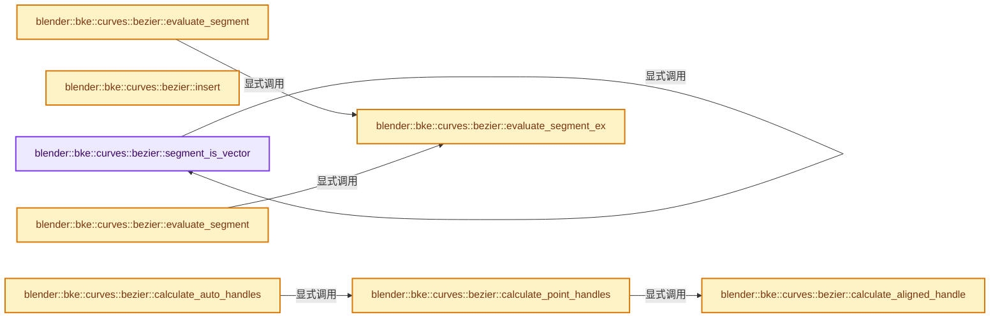
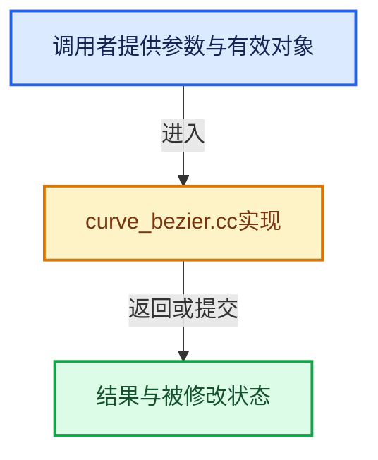

# 实现依赖专题：source/blender/blenkernel/intern/curve_bezier.cc

[实现依赖导航](../../README.md) · [符号索引](../../../00-课程指南/02-源码与提交索引/符号依赖与实现索引.md)

本专题从正文实际调用进入，集中保存共享实现。函数有稳定锚点，可从调用处直接跳到对应完整函数；递归与互相调用通过回链组织。

## 本文件的实现关系






## 完整成员与函数实现

<a id="f-9bcee099d538029c"></a>

### `blender::bke::curves::bezier::segment_is_vector`

实现位置：[source/blender/blenkernel/intern/curve_bezier.cc](../../../../../../../source/blender/blenkernel/intern/curve_bezier.cc) · L18—L25。

接口参数：

- `const Span<int8_t> handle_types_left`
- `const Span<int8_t> handle_types_right`
- `const int segment_index`

**教学注释版**

<!-- annotated:f0c64059e8e360 -->

```cpp
bool segment_is_vector(const Span<int8_t> handle_types_left,
                       const Span<int8_t> handle_types_right,
                       const int segment_index)
{
  // [讲解] handle_types_left.index_range：查询视图长度或生成对应有效索引区间。
  BLI_assert(handle_types_left.index_range().drop_back(1).contains(segment_index));
  return segment_is_vector(handle_types_right[segment_index],
                           handle_types_left[segment_index + 1]);
}
```

<details>
<summary>核对原始源码：source/blender/blenkernel/intern/curve_bezier.cc · L18—L25</summary>

<!-- original:f0c64059e8e360:source/blender/blenkernel/intern/curve_bezier.cc:18:25 -->

```cpp
bool segment_is_vector(const Span<int8_t> handle_types_left,
                       const Span<int8_t> handle_types_right,
                       const int segment_index)
{
  BLI_assert(handle_types_left.index_range().drop_back(1).contains(segment_index));
  return segment_is_vector(handle_types_right[segment_index],
                           handle_types_left[segment_index + 1]);
}
```

</details>

**结果出口**

- `return segment_is_vector(handle_types_right[segment_index],`

**继续追踪实现**

- `BLI_assert` → [BLI_assert · L48](../../01-BLI基础库/BLI_assert.hh.md#m-57a88495704d)；[BLI_assert · L63](../../01-BLI基础库/BLI_assert.hh.md#m-d07050020cb5)。宏定义由构建条件选择。
- `handle_types_left.index_range().drop_back(1).contains` → [调用协议](../../../00-课程指南/01-路线与规范/模板宏与动态分派协议.md)：接收对象类型依赖auto、返回值或模板实例；不按同名猜测目标。调用位置L22。
- `handle_types_left.index_range().drop_back` → [调用协议](../../../00-课程指南/01-路线与规范/模板宏与动态分派协议.md)：接收对象类型依赖auto、返回值或模板实例；不按同名猜测目标。调用位置L22。
- `handle_types_left.index_range` → [blender::Span::index_range · L405](../../../01-基础容器与现代CPP/05-Span只读连续视图.md#f-caaa9b06e13e53e0)。
- `segment_is_vector` → [blender::bke::curves::bezier::segment_is_vector · L18](curve_bezier.cc.md#f-9bcee099d538029c)。

<a id="f-115829690704cbb5"></a>

### `blender::bke::curves::bezier::insert`

实现位置：[source/blender/blenkernel/intern/curve_bezier.cc](../../../../../../../source/blender/blenkernel/intern/curve_bezier.cc) · L69—L87。

接口参数：

- `const float3 &point_prev`
- `const float3 &handle_prev`
- `const float3 &handle_next`
- `const float3 &point_next`
- `float parameter`

**教学注释版**

<!-- annotated:b693d4868876b0 -->

```cpp
Insertion insert(const float3 &point_prev,
                 const float3 &handle_prev,
                 const float3 &handle_next,
                 const float3 &point_next,
                 float parameter)
{
  /* De Casteljau Bezier subdivision. */
  BLI_assert(parameter <= 1.0f && parameter >= 0.0f);

  const float3 center_point = math::interpolate(handle_prev, handle_next, parameter);

  Insertion result;
  result.handle_prev = math::interpolate(point_prev, handle_prev, parameter);
  result.handle_next = math::interpolate(handle_next, point_next, parameter);
  result.left_handle = math::interpolate(result.handle_prev, center_point, parameter);
  result.right_handle = math::interpolate(center_point, result.handle_next, parameter);
  result.position = math::interpolate(result.left_handle, result.right_handle, parameter);
  return result;
}
```

<details>
<summary>核对原始源码：source/blender/blenkernel/intern/curve_bezier.cc · L69—L87</summary>

<!-- original:b693d4868876b0:source/blender/blenkernel/intern/curve_bezier.cc:69:87 -->

```cpp
Insertion insert(const float3 &point_prev,
                 const float3 &handle_prev,
                 const float3 &handle_next,
                 const float3 &point_next,
                 float parameter)
{
  /* De Casteljau Bezier subdivision. */
  BLI_assert(parameter <= 1.0f && parameter >= 0.0f);

  const float3 center_point = math::interpolate(handle_prev, handle_next, parameter);

  Insertion result;
  result.handle_prev = math::interpolate(point_prev, handle_prev, parameter);
  result.handle_next = math::interpolate(handle_next, point_next, parameter);
  result.left_handle = math::interpolate(result.handle_prev, center_point, parameter);
  result.right_handle = math::interpolate(center_point, result.handle_next, parameter);
  result.position = math::interpolate(result.left_handle, result.right_handle, parameter);
  return result;
}
```

</details>

**沿实际写入检查状态**

- `result.handle_prev = math::interpolate(point_prev, handle_prev, parameter);`
- `result.handle_next = math::interpolate(handle_next, point_next, parameter);`
- `result.left_handle = math::interpolate(result.handle_prev, center_point, parameter);`
- `result.right_handle = math::interpolate(center_point, result.handle_next, parameter);`
- `result.position = math::interpolate(result.left_handle, result.right_handle, parameter);`

**结果出口**

- `return result;`

**继续追踪实现**

- `BLI_assert` → [BLI_assert · L48](../../01-BLI基础库/BLI_assert.hh.md#m-57a88495704d)；[BLI_assert · L63](../../01-BLI基础库/BLI_assert.hh.md#m-d07050020cb5)。宏定义由构建条件选择。
- `math::interpolate` → [blender::math::interpolate · L335](../../01-BLI基础库/intern/math_matrix.cc.md#f-91e7f517ebd72fb5)；[blender::math::interpolate · L379](../../01-BLI基础库/intern/math_matrix.cc.md#f-a1be14e86ce595c2)；[blender::math::interpolate · L636](../../01-BLI基础库/BLI_math_vector.hh.md#f-d612b6d6ab1b6e7c)；[blender::math::interpolate · L303](../../01-BLI基础库/BLI_math_quaternion.hh.md#f-48b9ace2a9c6185c)；[blender::math::interpolate · L17](../../01-BLI基础库/BLI_math_color.hh.md#f-eb5ef92b0f8c0926)；[blender::math::interpolate · L28](../../01-BLI基础库/BLI_math_color.hh.md#f-2a9e33ec55979ab6)；[blender::math::interpolate · L278](../../01-BLI基础库/BLI_math_base.hh.md#f-2629b871528f6528)。同名重载需按实参类型选择。

<a id="f-16c457b11f7e1700"></a>

### `blender::bke::curves::bezier::calculate_aligned_handle`

实现位置：[source/blender/blenkernel/intern/curve_bezier.cc](../../../../../../../source/blender/blenkernel/intern/curve_bezier.cc) · L89—L103。

接口参数：

- `const float3 &position`
- `const float3 &other_handle`
- `const float3 &aligned_handle`

**教学注释版**

<!-- annotated:0b354f5365fa63 -->

```cpp
static float3 calculate_aligned_handle(const float3 &position,
                                       const float3 &other_handle,
                                       const float3 &aligned_handle)
{
  /* Keep track of the old length of the opposite handle. */
  const float length = math::distance(aligned_handle, position);
  /* Set the other handle to directly opposite from the current handle. */
  const float3 dir = math::normalize(other_handle - position);
  if (math::is_zero(dir)) {
    /* There is no direction to align against when the opposite handle coincides with the
     * control point, so preserve the existing aligned handle. */
    return aligned_handle;
  }
  return position - dir * length;
}
```

<details>
<summary>核对原始源码：source/blender/blenkernel/intern/curve_bezier.cc · L89—L103</summary>

<!-- original:0b354f5365fa63:source/blender/blenkernel/intern/curve_bezier.cc:89:103 -->

```cpp
static float3 calculate_aligned_handle(const float3 &position,
                                       const float3 &other_handle,
                                       const float3 &aligned_handle)
{
  /* Keep track of the old length of the opposite handle. */
  const float length = math::distance(aligned_handle, position);
  /* Set the other handle to directly opposite from the current handle. */
  const float3 dir = math::normalize(other_handle - position);
  if (math::is_zero(dir)) {
    /* There is no direction to align against when the opposite handle coincides with the
     * control point, so preserve the existing aligned handle. */
    return aligned_handle;
  }
  return position - dir * length;
}
```

</details>

**结果出口**

- `return aligned_handle;`
- `return position - dir * length;`

**继续追踪实现**

- `math::distance` → [blender::math::distance · L485](../../01-BLI基础库/BLI_math_vector.hh.md#f-0a0df9b41ececd7b)；[blender::math::distance · L143](../../01-BLI基础库/BLI_math_base.hh.md#f-45db793191057701)。同名重载需按实参类型选择。
- `math::normalize` → [blender::math::normalize · L542](../../01-BLI基础库/BLI_math_vector.hh.md#f-5bea914457e11f7f)；[blender::math::normalize · L258](../../01-BLI基础库/BLI_math_quaternion.hh.md#f-5bf6b351333e4054)；[blender::math::normalize · L450](../../01-BLI基础库/BLI_math_quaternion.hh.md#f-b852cee8f0cc9b6a)；[blender::math::normalize · L745](../../01-BLI基础库/BLI_math_matrix.hh.md#f-2235cb6f5ec7ff18)；[blender::math::normalize · L783](../../01-BLI基础库/BLI_math_matrix.hh.md#f-0386bc4ee9ac7425)。同名重载需按实参类型选择。
- `math::is_zero` → [blender::math::is_zero · L784](../../01-BLI基础库/BLI_math_vector.hh.md#f-b05b3db842a9f17e)；[blender::math::is_zero · L108](../../01-BLI基础库/BLI_math_quaternion.hh.md#f-b97bee3fbc328c0d)；[blender::math::is_zero · L593](../../01-BLI基础库/BLI_math_matrix.hh.md#f-b879ac524126b464)；[blender::math::is_zero · L23](../../01-BLI基础库/BLI_math_base.hh.md#f-6fdcc74ca7338838)。同名重载需按实参类型选择。

<a id="f-dcca6f2430231d36"></a>

### `blender::bke::curves::bezier::calculate_point_handles`

实现位置：[source/blender/blenkernel/intern/curve_bezier.cc](../../../../../../../source/blender/blenkernel/intern/curve_bezier.cc) · L151—L218。

接口参数：

- `const HandleType type_left`
- `const HandleType type_right`
- `const float3 position`
- `const float3 prev_position`
- `const float3 next_position`
- `float3 &left`
- `float3 &right`

**教学注释版**

<!-- annotated:b2716cb6473fb7 -->

```cpp
static void calculate_point_handles(const HandleType type_left,
                                    const HandleType type_right,
                                    const float3 position,
                                    const float3 prev_position,
                                    const float3 next_position,
                                    float3 &left,
                                    float3 &right)
{
  if (ELEM(BEZIER_HANDLE_AUTO, type_left, type_right)) {
    const float3 prev_diff = position - prev_position;
    const float3 next_diff = next_position - position;
    float prev_len = math::length(prev_diff);
    float next_len = math::length(next_diff);
    if (prev_len == 0.0f) {
      prev_len = 1.0f;
    }
    if (next_len == 0.0f) {
      next_len = 1.0f;
    }
    const float3 dir = next_diff / next_len + prev_diff / prev_len;

    /* The magic number 2.5614 is derived from approximating a circular arc at the control point.
     * Given the constraints:
     *
     * - `P0=(0,1),P1=(c,1),P2=(1,c),P3=(1,0)`.
     * - The first derivative of the curve must agree with the circular arc derivative at the
     *   endpoints.
     * - Minimize the maximum radial drift.
     *   one can compute `c ≈ 0.5519150244935105707435627`.
     *   The distance from P0 to P3 is `sqrt(2)`.
     *
     * The magic factor for `len` is `(sqrt(2) / 0.5519150244935105707435627) ≈ 2.562375546255352`.
     * In older code of blender a slightly worse approximation of 2.5614 is used. It's kept
     * for compatibility.
     *
     * See https://spencermortensen.com/articles/bezier-circle/. */
    const float len = math::length(dir) * 2.5614f;
    if (len != 0.0f) {
      if (type_left == BEZIER_HANDLE_AUTO) {
        // [讲解] std::min：按比较关系选取较小值；截断范围时还需先满足非负和可表示范围，min本身不会证明边界安全。
        const float prev_len_clamped = std::min(prev_len, next_len * 5.0f);
        left = position + dir * -(prev_len_clamped / len);
      }
      if (type_right == BEZIER_HANDLE_AUTO) {
        const float next_len_clamped = std::min(next_len, prev_len * 5.0f);
        right = position + dir * (next_len_clamped / len);
      }
    }
  }

  if (type_left == BEZIER_HANDLE_VECTOR) {
    left = calculate_vector_handle(position, prev_position);
  }

  if (type_right == BEZIER_HANDLE_VECTOR) {
    right = calculate_vector_handle(position, next_position);
  }

  /* When one of the handles is "aligned" handle, it must be aligned with the other, i.e. point in
   * the opposite direction. Don't handle the case of two aligned handles, because code elsewhere
   * should keep the pair consistent, and the relative locations aren't affected by other points
   * anyway. */
  if (type_left == BEZIER_HANDLE_ALIGN && type_right != BEZIER_HANDLE_ALIGN) {
    left = calculate_aligned_handle(position, right, left);
  }
  else if (type_left != BEZIER_HANDLE_ALIGN && type_right == BEZIER_HANDLE_ALIGN) {
    right = calculate_aligned_handle(position, left, right);
  }
}
```

<details>
<summary>核对原始源码：source/blender/blenkernel/intern/curve_bezier.cc · L151—L218</summary>

<!-- original:b2716cb6473fb7:source/blender/blenkernel/intern/curve_bezier.cc:151:218 -->

```cpp
static void calculate_point_handles(const HandleType type_left,
                                    const HandleType type_right,
                                    const float3 position,
                                    const float3 prev_position,
                                    const float3 next_position,
                                    float3 &left,
                                    float3 &right)
{
  if (ELEM(BEZIER_HANDLE_AUTO, type_left, type_right)) {
    const float3 prev_diff = position - prev_position;
    const float3 next_diff = next_position - position;
    float prev_len = math::length(prev_diff);
    float next_len = math::length(next_diff);
    if (prev_len == 0.0f) {
      prev_len = 1.0f;
    }
    if (next_len == 0.0f) {
      next_len = 1.0f;
    }
    const float3 dir = next_diff / next_len + prev_diff / prev_len;

    /* The magic number 2.5614 is derived from approximating a circular arc at the control point.
     * Given the constraints:
     *
     * - `P0=(0,1),P1=(c,1),P2=(1,c),P3=(1,0)`.
     * - The first derivative of the curve must agree with the circular arc derivative at the
     *   endpoints.
     * - Minimize the maximum radial drift.
     *   one can compute `c ≈ 0.5519150244935105707435627`.
     *   The distance from P0 to P3 is `sqrt(2)`.
     *
     * The magic factor for `len` is `(sqrt(2) / 0.5519150244935105707435627) ≈ 2.562375546255352`.
     * In older code of blender a slightly worse approximation of 2.5614 is used. It's kept
     * for compatibility.
     *
     * See https://spencermortensen.com/articles/bezier-circle/. */
    const float len = math::length(dir) * 2.5614f;
    if (len != 0.0f) {
      if (type_left == BEZIER_HANDLE_AUTO) {
        const float prev_len_clamped = std::min(prev_len, next_len * 5.0f);
        left = position + dir * -(prev_len_clamped / len);
      }
      if (type_right == BEZIER_HANDLE_AUTO) {
        const float next_len_clamped = std::min(next_len, prev_len * 5.0f);
        right = position + dir * (next_len_clamped / len);
      }
    }
  }

  if (type_left == BEZIER_HANDLE_VECTOR) {
    left = calculate_vector_handle(position, prev_position);
  }

  if (type_right == BEZIER_HANDLE_VECTOR) {
    right = calculate_vector_handle(position, next_position);
  }

  /* When one of the handles is "aligned" handle, it must be aligned with the other, i.e. point in
   * the opposite direction. Don't handle the case of two aligned handles, because code elsewhere
   * should keep the pair consistent, and the relative locations aren't affected by other points
   * anyway. */
  if (type_left == BEZIER_HANDLE_ALIGN && type_right != BEZIER_HANDLE_ALIGN) {
    left = calculate_aligned_handle(position, right, left);
  }
  else if (type_left != BEZIER_HANDLE_ALIGN && type_right == BEZIER_HANDLE_ALIGN) {
    right = calculate_aligned_handle(position, left, right);
  }
}
```

</details>

**沿实际写入检查状态**

- `prev_len = 1.0f;`
- `next_len = 1.0f;`
- `left = position + dir * -(prev_len_clamped / len);`
- `right = position + dir * (next_len_clamped / len);`
- `left = calculate_vector_handle(position, prev_position);`
- `right = calculate_vector_handle(position, next_position);`
- `left = calculate_aligned_handle(position, right, left);`
- `right = calculate_aligned_handle(position, left, right);`

**继续追踪实现**

- `ELEM` → [ELEM · L88](../../07-Intern运行时与平台/ghost/intern/GHOST_utildefines.hh.md#m-d28724a15928)；[ELEM · L135](../../01-BLI基础库/BLI_utildefines.hh.md#m-d6572de7cae0)。宏定义由构建条件选择。
- `math::length` → [blender::math::length · L40](../../01-BLI基础库/BLI_math_vector_mpq_types.hh.md#f-16c31b0e3391026f)；[blender::math::length · L49](../../01-BLI基础库/BLI_math_vector_mpq_types.hh.md#f-82d5aa193c621065)；[blender::math::length · L457](../../01-BLI基础库/BLI_math_vector.hh.md#f-2c7dceafa898907c)。同名重载需按实参类型选择。
- `std::min` → [外部契约](https://eel.is/c++draft/alg.min.max)：按比较关系选取较小值；截断范围时还需先满足非负和可表示范围，min本身不会证明边界安全。
- `calculate_vector_handle` → [blender::bke::curves::bezier::calculate_vector_handle · L1141](../../../05-几何存储与拓扑映射/04-CurvesGeometry存储.md#f-14f87ea5301b948b)。
- `calculate_aligned_handle` → [blender::bke::curves::bezier::calculate_aligned_handle · L89](curve_bezier.cc.md#f-16c457b11f7e1700)。

<a id="f-b922bbd0e96e613a"></a>

### `blender::bke::curves::bezier::calculate_auto_handles`

实现位置：[source/blender/blenkernel/intern/curve_bezier.cc](../../../../../../../source/blender/blenkernel/intern/curve_bezier.cc) · L268—L307。

接口参数：

- `const bool cyclic`
- `const Span<int8_t> types_left`
- `const Span<int8_t> types_right`
- `const Span<float3> positions`
- `MutableSpan<float3> positions_left`
- `MutableSpan<float3> positions_right`

**教学注释版**

<!-- annotated:666f17ea6356ea -->

```cpp
void calculate_auto_handles(const bool cyclic,
                            const Span<int8_t> types_left,
                            const Span<int8_t> types_right,
                            const Span<float3> positions,
                            MutableSpan<float3> positions_left,
                            MutableSpan<float3> positions_right)
{
  // [讲解] positions.size：查询视图长度或生成对应有效索引区间。
  const int points_num = positions.size();
  if (points_num == 1) {
    return;
  }

  // [讲解] types_left.first：按视图边界访问元素。
  calculate_point_handles(HandleType(types_left.first()),
                          HandleType(types_right.first()),
                          positions.first(),
                          // [讲解] positions.last：按视图边界访问元素。
                          cyclic ? positions.last() : 2.0f * positions.first() - positions[1],
                          positions[1],
                          positions_left.first(),
                          positions_right.first());

  threading::parallel_for(IndexRange(1, points_num - 2), 1024, [&](IndexRange range) {
    for (const int i : range) {
      calculate_point_handles(HandleType(types_left[i]),
                              HandleType(types_right[i]),
                              positions[i],
                              positions[i - 1],
                              positions[i + 1],
                              positions_left[i],
                              positions_right[i]);
    }
  });

  calculate_point_handles(HandleType(types_left.last()),
                          HandleType(types_right.last()),
                          positions.last(),
                          positions.last(1),
                          cyclic ? positions.first() : 2.0f * positions.last() - positions.last(1),
                          positions_left.last(),
                          positions_right.last());
}
```

<details>
<summary>核对原始源码：source/blender/blenkernel/intern/curve_bezier.cc · L268—L307</summary>

<!-- original:666f17ea6356ea:source/blender/blenkernel/intern/curve_bezier.cc:268:307 -->

```cpp
void calculate_auto_handles(const bool cyclic,
                            const Span<int8_t> types_left,
                            const Span<int8_t> types_right,
                            const Span<float3> positions,
                            MutableSpan<float3> positions_left,
                            MutableSpan<float3> positions_right)
{
  const int points_num = positions.size();
  if (points_num == 1) {
    return;
  }

  calculate_point_handles(HandleType(types_left.first()),
                          HandleType(types_right.first()),
                          positions.first(),
                          cyclic ? positions.last() : 2.0f * positions.first() - positions[1],
                          positions[1],
                          positions_left.first(),
                          positions_right.first());

  threading::parallel_for(IndexRange(1, points_num - 2), 1024, [&](IndexRange range) {
    for (const int i : range) {
      calculate_point_handles(HandleType(types_left[i]),
                              HandleType(types_right[i]),
                              positions[i],
                              positions[i - 1],
                              positions[i + 1],
                              positions_left[i],
                              positions_right[i]);
    }
  });

  calculate_point_handles(HandleType(types_left.last()),
                          HandleType(types_right.last()),
                          positions.last(),
                          positions.last(1),
                          cyclic ? positions.first() : 2.0f * positions.last() - positions.last(1),
                          positions_left.last(),
                          positions_right.last());
}
```

</details>

**继续追踪实现**

- `positions.size` → [blender::Span::size · L256](../../../01-基础容器与现代CPP/05-Span只读连续视图.md#f-5f80fa006089c998)。
- `calculate_point_handles` → [blender::bke::curves::bezier::calculate_point_handles · L151](curve_bezier.cc.md#f-dcca6f2430231d36)。
- `HandleType` → [blender::HandleType](../../08-其他Blender模块/makesdna/DNA_curves_types.h.md#t-daf7799cb5ba)。
- `types_left.first` → [blender::Span::first · L319](../../../01-基础容器与现代CPP/05-Span只读连续视图.md#f-d8c9bcc3e9757248)。
- `types_right.first` → [blender::Span::first · L319](../../../01-基础容器与现代CPP/05-Span只读连续视图.md#f-d8c9bcc3e9757248)。
- `positions.first` → [blender::Span::first · L319](../../../01-基础容器与现代CPP/05-Span只读连续视图.md#f-d8c9bcc3e9757248)。
- `positions.last` → [blender::Span::last · L329](../../../01-基础容器与现代CPP/05-Span只读连续视图.md#f-a92146c285596891)。
- `positions_left.first` → [blender::MutableSpan::first · L685](../../../01-基础容器与现代CPP/06-MutableSpan可写视图.md#f-3126bab9f43cee1c)。
- `positions_right.first` → [blender::MutableSpan::first · L685](../../../01-基础容器与现代CPP/06-MutableSpan可写视图.md#f-3126bab9f43cee1c)。
- `threading::parallel_for` → [blender::threading::parallel_for · L68](../../../11-Depsgraph与并行任务系统/07-任务池与TBB接入.md#f-838294754c24426c)。
- `IndexRange` → [blender::IndexRange](../../01-BLI基础库/BLI_index_range.hh.md#t-caa3466d6776)；[blender::gpu::shader::parser::IndexRange](../../08-其他Blender模块/gpu/shader_tool/utils.hh.md#t-82d2bd4ea71c)；[blender::IndexRange](../../08-其他Blender模块/makesdna/DNA_node_types.h.md#t-0448cc889d39)。
- `types_left.last` → [blender::Span::last · L329](../../../01-基础容器与现代CPP/05-Span只读连续视图.md#f-a92146c285596891)。
- `types_right.last` → [blender::Span::last · L329](../../../01-基础容器与现代CPP/05-Span只读连续视图.md#f-a92146c285596891)。
- `positions_left.last` → [blender::MutableSpan::last · L695](../../../01-基础容器与现代CPP/06-MutableSpan可写视图.md#f-73191eeabe29aab7)。
- `positions_right.last` → [blender::MutableSpan::last · L695](../../../01-基础容器与现代CPP/06-MutableSpan可写视图.md#f-73191eeabe29aab7)。

<a id="f-82a4b7f9a02ece07"></a>

### `blender::bke::curves::bezier::evaluate_segment_ex`

实现位置：[source/blender/blenkernel/intern/curve_bezier.cc](../../../../../../../source/blender/blenkernel/intern/curve_bezier.cc) · L309—L332。

接口参数：

- `const T &point_0`
- `const T &point_1`
- `const T &point_2`
- `const T &point_3`
- `MutableSpan<T> result`

**教学注释版**

<!-- annotated:b4409bbd917a4d -->

```cpp
template<typename T>
void evaluate_segment_ex(
    const T &point_0, const T &point_1, const T &point_2, const T &point_3, MutableSpan<T> result)
{
  // [讲解] result.size：查询视图长度或生成对应有效索引区间。
  BLI_assert(result.size() > 0);
  const float inv_len = 1.0f / float(result.size());
  const float inv_len_squared = inv_len * inv_len;
  const float inv_len_cubed = inv_len_squared * inv_len;

  const T rt1 = 3.0f * (point_1 - point_0) * inv_len;
  const T rt2 = 3.0f * (point_0 - 2.0f * point_1 + point_2) * inv_len_squared;
  const T rt3 = (point_3 - point_0 + 3.0f * (point_1 - point_2)) * inv_len_cubed;

  T q0 = point_0;
  T q1 = rt1 + rt2 + rt3;
  T q2 = 2.0f * rt2 + 6.0f * rt3;
  T q3 = 6.0f * rt3;
  // [讲解] result.index_range：查询视图长度或生成对应有效索引区间。
  for (const int i : result.index_range()) {
    result[i] = q0;
    q0 += q1;
    q1 += q2;
    q2 += q3;
  }
}
```

<details>
<summary>核对原始源码：source/blender/blenkernel/intern/curve_bezier.cc · L309—L332</summary>

<!-- original:b4409bbd917a4d:source/blender/blenkernel/intern/curve_bezier.cc:309:332 -->

```cpp
template<typename T>
void evaluate_segment_ex(
    const T &point_0, const T &point_1, const T &point_2, const T &point_3, MutableSpan<T> result)
{
  BLI_assert(result.size() > 0);
  const float inv_len = 1.0f / float(result.size());
  const float inv_len_squared = inv_len * inv_len;
  const float inv_len_cubed = inv_len_squared * inv_len;

  const T rt1 = 3.0f * (point_1 - point_0) * inv_len;
  const T rt2 = 3.0f * (point_0 - 2.0f * point_1 + point_2) * inv_len_squared;
  const T rt3 = (point_3 - point_0 + 3.0f * (point_1 - point_2)) * inv_len_cubed;

  T q0 = point_0;
  T q1 = rt1 + rt2 + rt3;
  T q2 = 2.0f * rt2 + 6.0f * rt3;
  T q3 = 6.0f * rt3;
  for (const int i : result.index_range()) {
    result[i] = q0;
    q0 += q1;
    q1 += q2;
    q2 += q3;
  }
}
```

</details>

**沿实际写入检查状态**

- `result[i] = q0;`
- `q0 += q1;`
- `q1 += q2;`
- `q2 += q3;`

**继续追踪实现**

- `BLI_assert` → [BLI_assert · L48](../../01-BLI基础库/BLI_assert.hh.md#m-57a88495704d)；[BLI_assert · L63](../../01-BLI基础库/BLI_assert.hh.md#m-d07050020cb5)。宏定义由构建条件选择。
- `result.size` → [blender::MutableSpan::size · L499](../../../01-基础容器与现代CPP/06-MutableSpan可写视图.md#f-1de6a66839c304a8)；[blender::gpu::shader::parser::MutableSpan::size · L87](../../08-其他Blender模块/gpu/shader_tool/utils.hh.md#f-5e684af6ee7990e9)。同名重载需按实参类型选择。
- `result.index_range` → [blender::MutableSpan::index_range · L676](../../../01-基础容器与现代CPP/06-MutableSpan可写视图.md#f-f9a9d59a69ca64b5)。

<a id="f-886ce8172dcba4b2"></a>

### `blender::bke::curves::bezier::evaluate_segment`

实现位置：[source/blender/blenkernel/intern/curve_bezier.cc](../../../../../../../source/blender/blenkernel/intern/curve_bezier.cc) · L333—L341。

接口参数：

- `const float3 &point_0`
- `const float3 &point_1`
- `const float3 &point_2`
- `const float3 &point_3`
- `MutableSpan<float3> result`

**教学注释版**

<!-- annotated:41f768535a77f6 -->

```cpp
template<>
void evaluate_segment(const float3 &point_0,
                      const float3 &point_1,
                      const float3 &point_2,
                      const float3 &point_3,
                      MutableSpan<float3> result)
{
  evaluate_segment_ex<float3>(point_0, point_1, point_2, point_3, result);
}
```

<details>
<summary>核对原始源码：source/blender/blenkernel/intern/curve_bezier.cc · L333—L341</summary>

<!-- original:41f768535a77f6:source/blender/blenkernel/intern/curve_bezier.cc:333:341 -->

```cpp
template<>
void evaluate_segment(const float3 &point_0,
                      const float3 &point_1,
                      const float3 &point_2,
                      const float3 &point_3,
                      MutableSpan<float3> result)
{
  evaluate_segment_ex<float3>(point_0, point_1, point_2, point_3, result);
}
```

</details>

**继续追踪实现**

- `evaluate_segment_ex<float3>` → [blender::bke::curves::bezier::evaluate_segment_ex · L309](curve_bezier.cc.md#f-82a4b7f9a02ece07)。

<a id="f-4f45a0196447480e"></a>

### `blender::bke::curves::bezier::evaluate_segment`

实现位置：[source/blender/blenkernel/intern/curve_bezier.cc](../../../../../../../source/blender/blenkernel/intern/curve_bezier.cc) · L342—L350。

接口参数：

- `const float2 &point_0`
- `const float2 &point_1`
- `const float2 &point_2`
- `const float2 &point_3`
- `MutableSpan<float2> result`

**教学注释版**

<!-- annotated:6b93051b3e6408 -->

```cpp
template<>
void evaluate_segment(const float2 &point_0,
                      const float2 &point_1,
                      const float2 &point_2,
                      const float2 &point_3,
                      MutableSpan<float2> result)
{
  evaluate_segment_ex<float2>(point_0, point_1, point_2, point_3, result);
}
```

<details>
<summary>核对原始源码：source/blender/blenkernel/intern/curve_bezier.cc · L342—L350</summary>

<!-- original:6b93051b3e6408:source/blender/blenkernel/intern/curve_bezier.cc:342:350 -->

```cpp
template<>
void evaluate_segment(const float2 &point_0,
                      const float2 &point_1,
                      const float2 &point_2,
                      const float2 &point_3,
                      MutableSpan<float2> result)
{
  evaluate_segment_ex<float2>(point_0, point_1, point_2, point_3, result);
}
```

</details>

**继续追踪实现**

- `evaluate_segment_ex<float2>` → [blender::bke::curves::bezier::evaluate_segment_ex · L309](curve_bezier.cc.md#f-82a4b7f9a02ece07)。

<a id="f-f17d3058d1436884"></a>

### `blender::bke::curves::bezier::calculate_evaluated_positions`

实现位置：[source/blender/blenkernel/intern/curve_bezier.cc](../../../../../../../source/blender/blenkernel/intern/curve_bezier.cc) · L352—L402。

接口参数：

- `const Span<float3> positions`
- `const Span<float3> handles_left`
- `const Span<float3> handles_right`
- `const OffsetIndices<int> evaluated_offsets`
- `MutableSpan<float3> evaluated_positions`

**教学注释版**

<!-- annotated:f381dcf4373e26 -->

```cpp
void calculate_evaluated_positions(const Span<float3> positions,
                                   const Span<float3> handles_left,
                                   const Span<float3> handles_right,
                                   const OffsetIndices<int> evaluated_offsets,
                                   MutableSpan<float3> evaluated_positions)
{
  // [讲解] evaluated_positions.size：查询视图长度或生成对应有效索引区间。
  BLI_assert(evaluated_offsets.total_size() == evaluated_positions.size());
  if (evaluated_offsets.total_size() == 1) {
    // [讲解] evaluated_positions.first：按视图边界访问元素。
    evaluated_positions.first() = positions.first();
    return;
  }

  /* Evaluate the first segment. */
  evaluate_segment(positions.first(),
                   handles_right.first(),
                   handles_left[1],
                   positions[1],
                   // [讲解] evaluated_positions.slice：建立原连续范围的子视图。
                   evaluated_positions.slice(evaluated_offsets[0]));

  /* Give each task fewer segments as the resolution gets larger. */
  // [讲解] std::max<int>：按比较关系选取较大值。本讲解中的增长公式同时满足最低请求和几何增长；若保存返回引用，还需注意实参寿命。
  const int grain_size = std::max<int>(evaluated_positions.size() / positions.size() * 32, 1);
  // [讲解] positions.index_range：查询视图长度或生成对应有效索引区间。
  const IndexRange inner_segments = positions.index_range().drop_back(1).drop_front(1);
  threading::parallel_for(inner_segments, grain_size, [&](IndexRange range) {
    for (const int i : range) {
      const IndexRange evaluated_range = evaluated_offsets[i];
      if (evaluated_range.size() == 1) {
        evaluated_positions[evaluated_range.first()] = positions[i];
      }
      else {
        evaluate_segment(positions[i],
                         handles_right[i],
                         handles_left[i + 1],
                         positions[i + 1],
                         evaluated_positions.slice(evaluated_range));
      }
    }
  });

  /* Evaluate the final cyclic segment if necessary. */
  const IndexRange last_segment_points = evaluated_offsets[positions.index_range().last()];
  if (last_segment_points.size() == 1) {
    // [讲解] evaluated_positions.last：按视图边界访问元素。
    evaluated_positions.last() = positions.last();
  }
  else {
    evaluate_segment(positions.last(),
                     handles_right.last(),
                     handles_left.first(),
                     positions.first(),
                     evaluated_positions.slice(last_segment_points));
  }
}
```

<details>
<summary>核对原始源码：source/blender/blenkernel/intern/curve_bezier.cc · L352—L402</summary>

<!-- original:f381dcf4373e26:source/blender/blenkernel/intern/curve_bezier.cc:352:402 -->

```cpp
void calculate_evaluated_positions(const Span<float3> positions,
                                   const Span<float3> handles_left,
                                   const Span<float3> handles_right,
                                   const OffsetIndices<int> evaluated_offsets,
                                   MutableSpan<float3> evaluated_positions)
{
  BLI_assert(evaluated_offsets.total_size() == evaluated_positions.size());
  if (evaluated_offsets.total_size() == 1) {
    evaluated_positions.first() = positions.first();
    return;
  }

  /* Evaluate the first segment. */
  evaluate_segment(positions.first(),
                   handles_right.first(),
                   handles_left[1],
                   positions[1],
                   evaluated_positions.slice(evaluated_offsets[0]));

  /* Give each task fewer segments as the resolution gets larger. */
  const int grain_size = std::max<int>(evaluated_positions.size() / positions.size() * 32, 1);
  const IndexRange inner_segments = positions.index_range().drop_back(1).drop_front(1);
  threading::parallel_for(inner_segments, grain_size, [&](IndexRange range) {
    for (const int i : range) {
      const IndexRange evaluated_range = evaluated_offsets[i];
      if (evaluated_range.size() == 1) {
        evaluated_positions[evaluated_range.first()] = positions[i];
      }
      else {
        evaluate_segment(positions[i],
                         handles_right[i],
                         handles_left[i + 1],
                         positions[i + 1],
                         evaluated_positions.slice(evaluated_range));
      }
    }
  });

  /* Evaluate the final cyclic segment if necessary. */
  const IndexRange last_segment_points = evaluated_offsets[positions.index_range().last()];
  if (last_segment_points.size() == 1) {
    evaluated_positions.last() = positions.last();
  }
  else {
    evaluate_segment(positions.last(),
                     handles_right.last(),
                     handles_left.first(),
                     positions.first(),
                     evaluated_positions.slice(last_segment_points));
  }
}
```

</details>

**继续追踪实现**

- `BLI_assert` → [BLI_assert · L48](../../01-BLI基础库/BLI_assert.hh.md#m-57a88495704d)；[BLI_assert · L63](../../01-BLI基础库/BLI_assert.hh.md#m-d07050020cb5)。宏定义由构建条件选择。
- `evaluated_offsets.total_size` → [blender::offset_indices::OffsetIndices::total_size · L58](../../../05-几何存储与拓扑映射/02-OffsetIndices完整接口.md#f-c111ffdac7a19248)。
- `evaluated_positions.size` → [blender::MutableSpan::size · L499](../../../01-基础容器与现代CPP/06-MutableSpan可写视图.md#f-1de6a66839c304a8)；[blender::gpu::shader::parser::MutableSpan::size · L87](../../08-其他Blender模块/gpu/shader_tool/utils.hh.md#f-5e684af6ee7990e9)。同名重载需按实参类型选择。
- `evaluated_positions.first` → [blender::MutableSpan::first · L685](../../../01-基础容器与现代CPP/06-MutableSpan可写视图.md#f-3126bab9f43cee1c)。
- `positions.first` → [blender::Span::first · L319](../../../01-基础容器与现代CPP/05-Span只读连续视图.md#f-d8c9bcc3e9757248)。
- `evaluate_segment` → [blender::bke::curves::bezier::evaluate_segment · L333](curve_bezier.cc.md#f-886ce8172dcba4b2)；[blender::bke::curves::bezier::evaluate_segment · L342](curve_bezier.cc.md#f-4f45a0196447480e)。同名重载需按实参类型选择。
- `handles_right.first` → [blender::Span::first · L319](../../../01-基础容器与现代CPP/05-Span只读连续视图.md#f-d8c9bcc3e9757248)。
- `evaluated_positions.slice` → [blender::MutableSpan::slice · L579](../../../01-基础容器与现代CPP/06-MutableSpan可写视图.md#f-6808b4aefbf58808)；[blender::MutableSpan::slice · L587](../../../01-基础容器与现代CPP/06-MutableSpan可写视图.md#f-c05b010821861e4f)。同名重载需按实参类型选择。
- `std::max<int>` → [外部契约](https://eel.is/c++draft/alg.min.max)：按比较关系选取较大值。本讲解中的增长公式同时满足最低请求和几何增长；若保存返回引用，还需注意实参寿命。
- `positions.size` → [blender::Span::size · L256](../../../01-基础容器与现代CPP/05-Span只读连续视图.md#f-5f80fa006089c998)。
- `positions.index_range().drop_back(1).drop_front` → [调用协议](../../../00-课程指南/01-路线与规范/模板宏与动态分派协议.md)：接收对象类型依赖auto、返回值或模板实例；不按同名猜测目标。调用位置L373。
- `positions.index_range().drop_back` → [调用协议](../../../00-课程指南/01-路线与规范/模板宏与动态分派协议.md)：接收对象类型依赖auto、返回值或模板实例；不按同名猜测目标。调用位置L373。
- `positions.index_range` → [blender::Span::index_range · L405](../../../01-基础容器与现代CPP/05-Span只读连续视图.md#f-caaa9b06e13e53e0)。
- `threading::parallel_for` → [blender::threading::parallel_for · L68](../../../11-Depsgraph与并行任务系统/07-任务池与TBB接入.md#f-838294754c24426c)。
- `evaluated_range.size` → [blender::IndexRange::size · L156](../../../01-基础容器与现代CPP/04-IndexRange连续整数区间.md#f-05f66c3ebb2fdfec)。
- `evaluated_range.first` → [blender::IndexRange::first · L204](../../../01-基础容器与现代CPP/04-IndexRange连续整数区间.md#f-ab443c94e531befa)。
- `positions.index_range().last` → [调用协议](../../../00-课程指南/01-路线与规范/模板宏与动态分派协议.md)：接收对象类型依赖auto、返回值或模板实例；不按同名猜测目标。调用位置L391。
- `last_segment_points.size` → [blender::IndexRange::size · L156](../../../01-基础容器与现代CPP/04-IndexRange连续整数区间.md#f-05f66c3ebb2fdfec)。
- `evaluated_positions.last` → [blender::MutableSpan::last · L695](../../../01-基础容器与现代CPP/06-MutableSpan可写视图.md#f-73191eeabe29aab7)。
- `positions.last` → [blender::Span::last · L329](../../../01-基础容器与现代CPP/05-Span只读连续视图.md#f-a92146c285596891)。
- `handles_right.last` → [blender::Span::last · L329](../../../01-基础容器与现代CPP/05-Span只读连续视图.md#f-a92146c285596891)。
- `handles_left.first` → [blender::Span::first · L319](../../../01-基础容器与现代CPP/05-Span只读连续视图.md#f-d8c9bcc3e9757248)。
