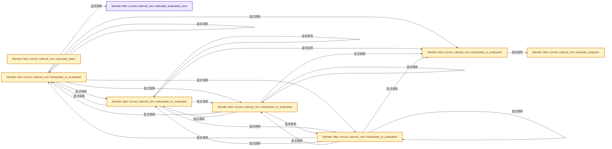

# 实现依赖专题：source/blender/blenkernel/intern/curve_catmull_rom.cc

[实现依赖导航](../../README.md) · [符号索引](../../../00-课程指南/02-源码与提交索引/符号依赖与实现索引.md)

本专题从正文实际调用进入，集中保存共享实现。函数有稳定锚点，可从调用处直接跳到对应完整函数；递归与互相调用通过回链组织。

## 本文件的实现关系




## 完整成员与函数实现

<a id="f-1bfc8b4278b920ad"></a>

### `blender::bke::curves::catmull_rom::calculate_evaluated_num`

实现位置：[source/blender/blenkernel/intern/curve_catmull_rom.cc](../../../../../../../source/blender/blenkernel/intern/curve_catmull_rom.cc) · L16—L26。

接口参数：

- `const int points_num`
- `const bool cyclic`
- `const int resolution`

**教学注释版**

<!-- annotated:0e28afa57abec6 -->

```cpp
int calculate_evaluated_num(const int points_num, const bool cyclic, const int resolution)
{
  // [讲解] std::max：按比较关系选取较大值。本讲解中的增长公式同时满足最低请求和几何增长；若保存返回引用，还需注意实参寿命。
  const int points_per_segment = std::max(1, resolution);
  const int eval_num = points_per_segment * segments_num(points_num, cyclic);
  if (cyclic) {
    /* Make sure there is a single evaluated point for the single-point curve case. */
    return std::max(eval_num, 1);
  }
  /* If the curve isn't cyclic, one last point is added to the final point. */
  return eval_num + 1;
}
```

<details>
<summary>核对原始源码：source/blender/blenkernel/intern/curve_catmull_rom.cc · L16—L26</summary>

<!-- original:0e28afa57abec6:source/blender/blenkernel/intern/curve_catmull_rom.cc:16:26 -->

```cpp
int calculate_evaluated_num(const int points_num, const bool cyclic, const int resolution)
{
  const int points_per_segment = std::max(1, resolution);
  const int eval_num = points_per_segment * segments_num(points_num, cyclic);
  if (cyclic) {
    /* Make sure there is a single evaluated point for the single-point curve case. */
    return std::max(eval_num, 1);
  }
  /* If the curve isn't cyclic, one last point is added to the final point. */
  return eval_num + 1;
}
```

</details>

**结果出口**

- `return std::max(eval_num, 1);`
- `return eval_num + 1;`

**继续追踪实现**

- `std::max` → [外部契约](https://eel.is/c++draft/alg.min.max)：按比较关系选取较大值。本讲解中的增长公式同时满足最低请求和几何增长；若保存返回引用，还需注意实参寿命。
- `segments_num` → [调用协议](../../../00-课程指南/01-路线与规范/模板宏与动态分派协议.md)：函数指针、局部可调用对象或未展开的宏；必须结合调用者环境。调用位置L19。

<a id="f-f99b22d64d08635a"></a>

### `blender::bke::curves::catmull_rom::calculate_basis`

实现位置：[source/blender/blenkernel/intern/curve_catmull_rom.cc](../../../../../../../source/blender/blenkernel/intern/curve_catmull_rom.cc) · L28—L39。

接口参数：

- `const float parameter`

**教学注释版**

<!-- annotated:de1c342d52f9f5 -->

```cpp
float4 calculate_basis(const float parameter)
{
  /* Adapted from Cycles #catmull_rom_basis_eval function. */
  const float t = parameter;
  const float s = 1.0f - parameter;
  return {
      -t * s * s,
      2.0f + t * t * (3.0f * t - 5.0f),
      2.0f + s * s * (3.0f * s - 5.0f),
      -s * t * t,
  };
}
```

<details>
<summary>核对原始源码：source/blender/blenkernel/intern/curve_catmull_rom.cc · L28—L39</summary>

<!-- original:de1c342d52f9f5:source/blender/blenkernel/intern/curve_catmull_rom.cc:28:39 -->

```cpp
float4 calculate_basis(const float parameter)
{
  /* Adapted from Cycles #catmull_rom_basis_eval function. */
  const float t = parameter;
  const float s = 1.0f - parameter;
  return {
      -t * s * s,
      2.0f + t * t * (3.0f * t - 5.0f),
      2.0f + s * s * (3.0f * s - 5.0f),
      -s * t * t,
  };
}
```

</details>

**结果出口**

- `return {`

**继续追踪实现**

本实现没有需要继续展开的显式调用；检查返回表达式、对象转换和调用者前置条件。

<a id="f-1c196616177ab75e"></a>

### `blender::bke::curves::catmull_rom::evaluate_segment`

实现位置：[source/blender/blenkernel/intern/curve_catmull_rom.cc](../../../../../../../source/blender/blenkernel/intern/curve_catmull_rom.cc) · L41—L49。

接口参数：

- `const T &a`
- `const T &b`
- `const T &c`
- `const T &d`
- `MutableSpan<T> dst`

**教学注释版**

<!-- annotated:1dbe180e20132a -->

```cpp
template<typename T>
static void evaluate_segment(const T &a, const T &b, const T &c, const T &d, MutableSpan<T> dst)
{
  // [讲解] dst.size：查询视图长度或生成对应有效索引区间。
  const float step = 1.0f / dst.size();
  // [讲解] dst.first：按视图边界访问元素。
  dst.first() = b;
  // [讲解] dst.index_range：查询视图长度或生成对应有效索引区间。
  for (const int i : dst.index_range().drop_front(1)) {
    dst[i] = interpolate<T>(a, b, c, d, i * step);
  }
}
```

<details>
<summary>核对原始源码：source/blender/blenkernel/intern/curve_catmull_rom.cc · L41—L49</summary>

<!-- original:1dbe180e20132a:source/blender/blenkernel/intern/curve_catmull_rom.cc:41:49 -->

```cpp
template<typename T>
static void evaluate_segment(const T &a, const T &b, const T &c, const T &d, MutableSpan<T> dst)
{
  const float step = 1.0f / dst.size();
  dst.first() = b;
  for (const int i : dst.index_range().drop_front(1)) {
    dst[i] = interpolate<T>(a, b, c, d, i * step);
  }
}
```

</details>

**沿实际写入检查状态**

- `dst[i] = interpolate<T>(a, b, c, d, i * step);`

**继续追踪实现**

- `dst.size` → [blender::MutableSpan::size · L499](../../../01-基础容器与现代CPP/06-MutableSpan可写视图.md#f-1de6a66839c304a8)；[blender::gpu::shader::parser::MutableSpan::size · L87](../../08-其他Blender模块/gpu/shader_tool/utils.hh.md#f-5e684af6ee7990e9)。同名重载需按实参类型选择。
- `dst.first` → [blender::MutableSpan::first · L685](../../../01-基础容器与现代CPP/06-MutableSpan可写视图.md#f-3126bab9f43cee1c)。
- `dst.index_range().drop_front` → [调用协议](../../../00-课程指南/01-路线与规范/模板宏与动态分派协议.md)：接收对象类型依赖auto、返回值或模板实例；不按同名猜测目标。调用位置L46。
- `dst.index_range` → [blender::MutableSpan::index_range · L676](../../../01-基础容器与现代CPP/06-MutableSpan可写视图.md#f-f9a9d59a69ca64b5)。
- `interpolate<T>` → [blender::bke::curves::catmull_rom::interpolate · L841](../../../05-几何存储与拓扑映射/04-CurvesGeometry存储.md#f-fb6d6db316a5388b)。

<a id="f-d07ecc0f84d089c5"></a>

### `blender::bke::curves::catmull_rom::interpolate_to_evaluated`

实现位置：[source/blender/blenkernel/intern/curve_catmull_rom.cc](../../../../../../../source/blender/blenkernel/intern/curve_catmull_rom.cc) · L56—L111。

接口参数：

- `const Span<T> src`
- `const bool cyclic`
- `const RangeForSegmentFn &range_fn`
- `MutableSpan<T> dst`

**教学注释版**

<!-- annotated:3c980365053864 -->

```cpp
template<typename T, typename RangeForSegmentFn>
static void interpolate_to_evaluated(const Span<T> src,
                                     const bool cyclic,
                                     const RangeForSegmentFn &range_fn,
                                     MutableSpan<T> dst)

{
  /* - First deal with one and two point curves need special attention.
   * - Then evaluate the first and last segment(s) whose control points need to wrap around
   *   to the other side of the source array.
   * - Finally evaluate all of the segments in the middle in parallel. */

  // [讲解] src.size：查询视图长度或生成对应有效索引区间。
  if (src.size() == 1) {
    // [讲解] dst.first：按视图边界访问元素。
    dst.first() = src.first();
    return;
  }

  const IndexRange first = range_fn(0);

  if (src.size() == 2) {
    // [讲解] src.last：按视图边界访问元素。
    evaluate_segment(src.first(), src.first(), src.last(), src.last(), dst.slice(first));
    if (cyclic) {
      const IndexRange last = range_fn(1);
      // [讲解] dst.slice：建立原连续范围的子视图。
      evaluate_segment(src.last(), src.last(), src.first(), src.first(), dst.slice(last));
    }
    else {
      dst.last() = src.last();
    }
    return;
  }

  // [讲解] src.index_range：查询视图长度或生成对应有效索引区间。
  const IndexRange second_to_last = range_fn(src.index_range().last(1));
  const IndexRange last = range_fn(src.index_range().last());
  if (cyclic) {
    evaluate_segment(src.last(), src[0], src[1], src[2], dst.slice(first));
    evaluate_segment(src.last(2), src.last(1), src.last(), src.first(), dst.slice(second_to_last));
    evaluate_segment(src.last(1), src.last(), src[0], src[1], dst.slice(last));
  }
  else {
    evaluate_segment(src[0], src[0], src[1], src[2], dst.slice(first));
    evaluate_segment(src.last(2), src.last(1), src.last(), src.last(), dst.slice(second_to_last));
    /* For non-cyclic curves, the last segment should always just have a single point. We could
     * assert that the size of the provided range is 1 here, but that would require specializing
     * the #range_fn implementation for the last point, which may have a performance cost. */
    dst.last() = src.last();
  }

  /* Evaluate every segment that isn't the first or last. */
  const IndexRange inner_range = src.index_range().drop_back(2).drop_front(1);
  threading::parallel_for(inner_range, 512, [&](IndexRange range) {
    for (const int i : range) {
      const IndexRange segment = range_fn(i);
      evaluate_segment(src[i - 1], src[i], src[i + 1], src[i + 2], dst.slice(segment));
    }
  });
}
```

<details>
<summary>核对原始源码：source/blender/blenkernel/intern/curve_catmull_rom.cc · L56—L111</summary>

<!-- original:3c980365053864:source/blender/blenkernel/intern/curve_catmull_rom.cc:56:111 -->

```cpp
template<typename T, typename RangeForSegmentFn>
static void interpolate_to_evaluated(const Span<T> src,
                                     const bool cyclic,
                                     const RangeForSegmentFn &range_fn,
                                     MutableSpan<T> dst)

{
  /* - First deal with one and two point curves need special attention.
   * - Then evaluate the first and last segment(s) whose control points need to wrap around
   *   to the other side of the source array.
   * - Finally evaluate all of the segments in the middle in parallel. */

  if (src.size() == 1) {
    dst.first() = src.first();
    return;
  }

  const IndexRange first = range_fn(0);

  if (src.size() == 2) {
    evaluate_segment(src.first(), src.first(), src.last(), src.last(), dst.slice(first));
    if (cyclic) {
      const IndexRange last = range_fn(1);
      evaluate_segment(src.last(), src.last(), src.first(), src.first(), dst.slice(last));
    }
    else {
      dst.last() = src.last();
    }
    return;
  }

  const IndexRange second_to_last = range_fn(src.index_range().last(1));
  const IndexRange last = range_fn(src.index_range().last());
  if (cyclic) {
    evaluate_segment(src.last(), src[0], src[1], src[2], dst.slice(first));
    evaluate_segment(src.last(2), src.last(1), src.last(), src.first(), dst.slice(second_to_last));
    evaluate_segment(src.last(1), src.last(), src[0], src[1], dst.slice(last));
  }
  else {
    evaluate_segment(src[0], src[0], src[1], src[2], dst.slice(first));
    evaluate_segment(src.last(2), src.last(1), src.last(), src.last(), dst.slice(second_to_last));
    /* For non-cyclic curves, the last segment should always just have a single point. We could
     * assert that the size of the provided range is 1 here, but that would require specializing
     * the #range_fn implementation for the last point, which may have a performance cost. */
    dst.last() = src.last();
  }

  /* Evaluate every segment that isn't the first or last. */
  const IndexRange inner_range = src.index_range().drop_back(2).drop_front(1);
  threading::parallel_for(inner_range, 512, [&](IndexRange range) {
    for (const int i : range) {
      const IndexRange segment = range_fn(i);
      evaluate_segment(src[i - 1], src[i], src[i + 1], src[i + 2], dst.slice(segment));
    }
  });
}
```

</details>

**继续追踪实现**

- `src.size` → [blender::Span::size · L256](../../../01-基础容器与现代CPP/05-Span只读连续视图.md#f-5f80fa006089c998)。
- `dst.first` → [blender::MutableSpan::first · L685](../../../01-基础容器与现代CPP/06-MutableSpan可写视图.md#f-3126bab9f43cee1c)。
- `src.first` → [blender::Span::first · L319](../../../01-基础容器与现代CPP/05-Span只读连续视图.md#f-d8c9bcc3e9757248)。
- `range_fn` → [调用协议](../../../00-课程指南/01-路线与规范/模板宏与动态分派协议.md)：局部可调用对象，须结合其初始化与捕获环境。调用位置L73。
- `evaluate_segment` → [blender::bke::curves::catmull_rom::evaluate_segment · L41](curve_catmull_rom.cc.md#f-1c196616177ab75e)。
- `src.last` → [blender::Span::last · L329](../../../01-基础容器与现代CPP/05-Span只读连续视图.md#f-a92146c285596891)。
- `dst.slice` → [blender::MutableSpan::slice · L579](../../../01-基础容器与现代CPP/06-MutableSpan可写视图.md#f-6808b4aefbf58808)；[blender::MutableSpan::slice · L587](../../../01-基础容器与现代CPP/06-MutableSpan可写视图.md#f-c05b010821861e4f)。同名重载需按实参类型选择。
- `dst.last` → [blender::MutableSpan::last · L695](../../../01-基础容器与现代CPP/06-MutableSpan可写视图.md#f-73191eeabe29aab7)。
- `src.index_range().last` → [调用协议](../../../00-课程指南/01-路线与规范/模板宏与动态分派协议.md)：接收对象类型依赖auto、返回值或模板实例；不按同名猜测目标。调用位置L87。
- `src.index_range` → [blender::Span::index_range · L405](../../../01-基础容器与现代CPP/05-Span只读连续视图.md#f-caaa9b06e13e53e0)。
- `src.index_range().drop_back(2).drop_front` → [调用协议](../../../00-课程指南/01-路线与规范/模板宏与动态分派协议.md)：接收对象类型依赖auto、返回值或模板实例；不按同名猜测目标。调用位置L104。
- `src.index_range().drop_back` → [调用协议](../../../00-课程指南/01-路线与规范/模板宏与动态分派协议.md)：接收对象类型依赖auto、返回值或模板实例；不按同名猜测目标。调用位置L104。
- `threading::parallel_for` → [blender::threading::parallel_for · L68](../../../11-Depsgraph与并行任务系统/07-任务池与TBB接入.md#f-838294754c24426c)。

<a id="f-cf2213e968548ef8"></a>

### `blender::bke::curves::catmull_rom::interpolate_to_evaluated`

实现位置：[source/blender/blenkernel/intern/curve_catmull_rom.cc](../../../../../../../source/blender/blenkernel/intern/curve_catmull_rom.cc) · L113—L129。

接口参数：

- `const Span<T> src`
- `const bool cyclic`
- `const int resolution`
- `MutableSpan<T> dst`

**教学注释版**

<!-- annotated:5f9c4cd4ddb74f -->

```cpp
template<typename T>
static void interpolate_to_evaluated(const Span<T> src,
                                     const bool cyclic,
                                     const int resolution,
                                     MutableSpan<T> dst)

{
  // [讲解] dst.size：查询视图长度或生成对应有效索引区间。
  BLI_assert(dst.size() == calculate_evaluated_num(src.size(), cyclic, resolution));
  interpolate_to_evaluated(
      src,
      cyclic,
      [resolution](const int segment_i) -> IndexRange {
        // [讲解] std::max：按比较关系选取较大值。本讲解中的增长公式同时满足最低请求和几何增长；若保存返回引用，还需注意实参寿命。
        const int points_per_segment = std::max(1, resolution);
        return {segment_i * points_per_segment, points_per_segment};
      },
      dst);
}
```

<details>
<summary>核对原始源码：source/blender/blenkernel/intern/curve_catmull_rom.cc · L113—L129</summary>

<!-- original:5f9c4cd4ddb74f:source/blender/blenkernel/intern/curve_catmull_rom.cc:113:129 -->

```cpp
template<typename T>
static void interpolate_to_evaluated(const Span<T> src,
                                     const bool cyclic,
                                     const int resolution,
                                     MutableSpan<T> dst)

{
  BLI_assert(dst.size() == calculate_evaluated_num(src.size(), cyclic, resolution));
  interpolate_to_evaluated(
      src,
      cyclic,
      [resolution](const int segment_i) -> IndexRange {
        const int points_per_segment = std::max(1, resolution);
        return {segment_i * points_per_segment, points_per_segment};
      },
      dst);
}
```

</details>

**结果出口**

- `return {segment_i * points_per_segment, points_per_segment};`

**继续追踪实现**

- `BLI_assert` → [BLI_assert · L48](../../01-BLI基础库/BLI_assert.hh.md#m-57a88495704d)；[BLI_assert · L63](../../01-BLI基础库/BLI_assert.hh.md#m-d07050020cb5)。宏定义由构建条件选择。
- `dst.size` → [blender::MutableSpan::size · L499](../../../01-基础容器与现代CPP/06-MutableSpan可写视图.md#f-1de6a66839c304a8)；[blender::gpu::shader::parser::MutableSpan::size · L87](../../08-其他Blender模块/gpu/shader_tool/utils.hh.md#f-5e684af6ee7990e9)。同名重载需按实参类型选择。
- `calculate_evaluated_num` → [blender::bke::curves::catmull_rom::calculate_evaluated_num · L16](curve_catmull_rom.cc.md#f-1bfc8b4278b920ad)。
- `src.size` → [blender::Span::size · L256](../../../01-基础容器与现代CPP/05-Span只读连续视图.md#f-5f80fa006089c998)。
- `interpolate_to_evaluated` → [blender::bke::curves::catmull_rom::interpolate_to_evaluated · L56](curve_catmull_rom.cc.md#f-d07ecc0f84d089c5)；[blender::bke::curves::catmull_rom::interpolate_to_evaluated · L113](curve_catmull_rom.cc.md#f-cf2213e968548ef8)；[blender::bke::curves::catmull_rom::interpolate_to_evaluated · L131](curve_catmull_rom.cc.md#f-1e2b64d09d8923a7)；[blender::bke::curves::catmull_rom::interpolate_to_evaluated · L147](curve_catmull_rom.cc.md#f-7185bb8789ba3429)；[blender::bke::curves::catmull_rom::interpolate_to_evaluated · L159](curve_catmull_rom.cc.md#f-3fc5f9dc177d77b9)。同名重载需按实参类型选择。
- `std::max` → [外部契约](https://eel.is/c++draft/alg.min.max)：按比较关系选取较大值。本讲解中的增长公式同时满足最低请求和几何增长；若保存返回引用，还需注意实参寿命。

<a id="f-1e2b64d09d8923a7"></a>

### `blender::bke::curves::catmull_rom::interpolate_to_evaluated`

实现位置：[source/blender/blenkernel/intern/curve_catmull_rom.cc](../../../../../../../source/blender/blenkernel/intern/curve_catmull_rom.cc) · L131—L145。

接口参数：

- `const Span<T> src`
- `const bool cyclic`
- `const OffsetIndices<int> evaluated_offsets`
- `MutableSpan<T> dst`

**教学注释版**

<!-- annotated:f5fe870c939fa1 -->

```cpp
template<typename T>
static void interpolate_to_evaluated(const Span<T> src,
                                     const bool cyclic,
                                     const OffsetIndices<int> evaluated_offsets,
                                     MutableSpan<T> dst)

{
  interpolate_to_evaluated(
      src,
      cyclic,
      [evaluated_offsets](const int segment_i) -> IndexRange {
        return evaluated_offsets[segment_i];
      },
      dst);
}
```

<details>
<summary>核对原始源码：source/blender/blenkernel/intern/curve_catmull_rom.cc · L131—L145</summary>

<!-- original:f5fe870c939fa1:source/blender/blenkernel/intern/curve_catmull_rom.cc:131:145 -->

```cpp
template<typename T>
static void interpolate_to_evaluated(const Span<T> src,
                                     const bool cyclic,
                                     const OffsetIndices<int> evaluated_offsets,
                                     MutableSpan<T> dst)

{
  interpolate_to_evaluated(
      src,
      cyclic,
      [evaluated_offsets](const int segment_i) -> IndexRange {
        return evaluated_offsets[segment_i];
      },
      dst);
}
```

</details>

**结果出口**

- `return evaluated_offsets[segment_i];`

**继续追踪实现**

- `interpolate_to_evaluated` → [blender::bke::curves::catmull_rom::interpolate_to_evaluated · L56](curve_catmull_rom.cc.md#f-d07ecc0f84d089c5)；[blender::bke::curves::catmull_rom::interpolate_to_evaluated · L113](curve_catmull_rom.cc.md#f-cf2213e968548ef8)；[blender::bke::curves::catmull_rom::interpolate_to_evaluated · L131](curve_catmull_rom.cc.md#f-1e2b64d09d8923a7)；[blender::bke::curves::catmull_rom::interpolate_to_evaluated · L147](curve_catmull_rom.cc.md#f-7185bb8789ba3429)；[blender::bke::curves::catmull_rom::interpolate_to_evaluated · L159](curve_catmull_rom.cc.md#f-3fc5f9dc177d77b9)。同名重载需按实参类型选择。

<a id="f-7185bb8789ba3429"></a>

### `blender::bke::curves::catmull_rom::interpolate_to_evaluated`

实现位置：[source/blender/blenkernel/intern/curve_catmull_rom.cc](../../../../../../../source/blender/blenkernel/intern/curve_catmull_rom.cc) · L147—L157。

接口参数：

- `const GSpan src`
- `const bool cyclic`
- `const int resolution`
- `GMutableSpan dst`

**教学注释版**

<!-- annotated:29e073e310a90a -->

```cpp
void interpolate_to_evaluated(const GSpan src,
                              const bool cyclic,
                              const int resolution,
                              GMutableSpan dst)
{
  attribute_math::to_static_type(src.type(), [&]<typename T>() {
    if constexpr (!std::is_same_v<T, std::string>) {
      interpolate_to_evaluated(src.typed<T>(), cyclic, resolution, dst.typed<T>());
    }
  });
}
```

<details>
<summary>核对原始源码：source/blender/blenkernel/intern/curve_catmull_rom.cc · L147—L157</summary>

<!-- original:29e073e310a90a:source/blender/blenkernel/intern/curve_catmull_rom.cc:147:157 -->

```cpp
void interpolate_to_evaluated(const GSpan src,
                              const bool cyclic,
                              const int resolution,
                              GMutableSpan dst)
{
  attribute_math::to_static_type(src.type(), [&]<typename T>() {
    if constexpr (!std::is_same_v<T, std::string>) {
      interpolate_to_evaluated(src.typed<T>(), cyclic, resolution, dst.typed<T>());
    }
  });
}
```

</details>

**继续追踪实现**

- `attribute_math::to_static_type` → [blender::bke::attribute_math::to_static_type · L35](../BKE_attribute_math.hh.md#f-fdfaf0b86a24f278)；[blender::bke::attribute_math::to_static_type · L52](../BKE_attribute_math.hh.md#f-5346ade4e816ebd6)。同名重载需按实参类型选择。
- `src.type` → [blender::GSpan::type · L55](../../../03-内存分配与运行时类型/11-GSpan与GArray.md#f-4c44cc0364dcf191)。
- `interpolate_to_evaluated` → [blender::bke::curves::catmull_rom::interpolate_to_evaluated · L56](curve_catmull_rom.cc.md#f-d07ecc0f84d089c5)；[blender::bke::curves::catmull_rom::interpolate_to_evaluated · L113](curve_catmull_rom.cc.md#f-cf2213e968548ef8)；[blender::bke::curves::catmull_rom::interpolate_to_evaluated · L131](curve_catmull_rom.cc.md#f-1e2b64d09d8923a7)；[blender::bke::curves::catmull_rom::interpolate_to_evaluated · L147](curve_catmull_rom.cc.md#f-7185bb8789ba3429)；[blender::bke::curves::catmull_rom::interpolate_to_evaluated · L159](curve_catmull_rom.cc.md#f-3fc5f9dc177d77b9)。同名重载需按实参类型选择。
- `src.typed<T>` → [blender::GSpan::typed · L92](../../../03-内存分配与运行时类型/11-GSpan与GArray.md#f-aa54cf0d7a8dae2b)。
- `dst.typed<T>` → [blender::GMutableSpan::typed · L220](../../../03-内存分配与运行时类型/11-GSpan与GArray.md#f-d66e288b393f6545)。

<a id="f-3fc5f9dc177d77b9"></a>

### `blender::bke::curves::catmull_rom::interpolate_to_evaluated`

实现位置：[source/blender/blenkernel/intern/curve_catmull_rom.cc](../../../../../../../source/blender/blenkernel/intern/curve_catmull_rom.cc) · L159—L169。

接口参数：

- `const GSpan src`
- `const bool cyclic`
- `const OffsetIndices<int> evaluated_offsets`
- `GMutableSpan dst`

**教学注释版**

<!-- annotated:ba13166735fc23 -->

```cpp
void interpolate_to_evaluated(const GSpan src,
                              const bool cyclic,
                              const OffsetIndices<int> evaluated_offsets,
                              GMutableSpan dst)
{
  attribute_math::to_static_type(src.type(), [&]<typename T>() {
    if constexpr (!std::is_same_v<T, std::string>) {
      interpolate_to_evaluated(src.typed<T>(), cyclic, evaluated_offsets, dst.typed<T>());
    }
  });
}
```

<details>
<summary>核对原始源码：source/blender/blenkernel/intern/curve_catmull_rom.cc · L159—L169</summary>

<!-- original:ba13166735fc23:source/blender/blenkernel/intern/curve_catmull_rom.cc:159:169 -->

```cpp
void interpolate_to_evaluated(const GSpan src,
                              const bool cyclic,
                              const OffsetIndices<int> evaluated_offsets,
                              GMutableSpan dst)
{
  attribute_math::to_static_type(src.type(), [&]<typename T>() {
    if constexpr (!std::is_same_v<T, std::string>) {
      interpolate_to_evaluated(src.typed<T>(), cyclic, evaluated_offsets, dst.typed<T>());
    }
  });
}
```

</details>

**继续追踪实现**

- `attribute_math::to_static_type` → [blender::bke::attribute_math::to_static_type · L35](../BKE_attribute_math.hh.md#f-fdfaf0b86a24f278)；[blender::bke::attribute_math::to_static_type · L52](../BKE_attribute_math.hh.md#f-5346ade4e816ebd6)。同名重载需按实参类型选择。
- `src.type` → [blender::GSpan::type · L55](../../../03-内存分配与运行时类型/11-GSpan与GArray.md#f-4c44cc0364dcf191)。
- `interpolate_to_evaluated` → [blender::bke::curves::catmull_rom::interpolate_to_evaluated · L56](curve_catmull_rom.cc.md#f-d07ecc0f84d089c5)；[blender::bke::curves::catmull_rom::interpolate_to_evaluated · L113](curve_catmull_rom.cc.md#f-cf2213e968548ef8)；[blender::bke::curves::catmull_rom::interpolate_to_evaluated · L131](curve_catmull_rom.cc.md#f-1e2b64d09d8923a7)；[blender::bke::curves::catmull_rom::interpolate_to_evaluated · L147](curve_catmull_rom.cc.md#f-7185bb8789ba3429)；[blender::bke::curves::catmull_rom::interpolate_to_evaluated · L159](curve_catmull_rom.cc.md#f-3fc5f9dc177d77b9)。同名重载需按实参类型选择。
- `src.typed<T>` → [blender::GSpan::typed · L92](../../../03-内存分配与运行时类型/11-GSpan与GArray.md#f-aa54cf0d7a8dae2b)。
- `dst.typed<T>` → [blender::GMutableSpan::typed · L220](../../../03-内存分配与运行时类型/11-GSpan与GArray.md#f-d66e288b393f6545)。
