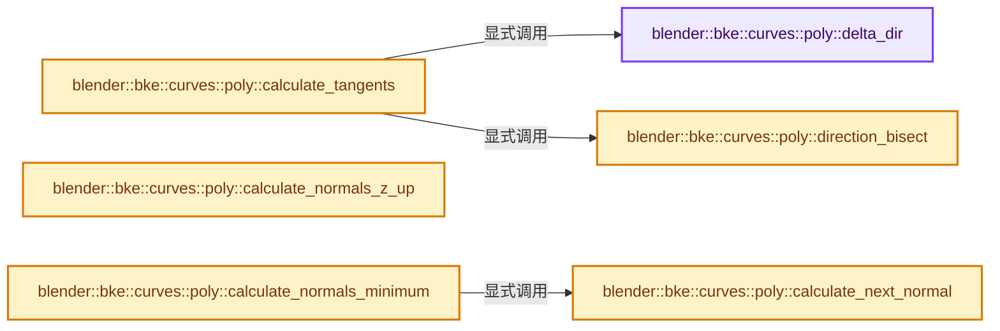
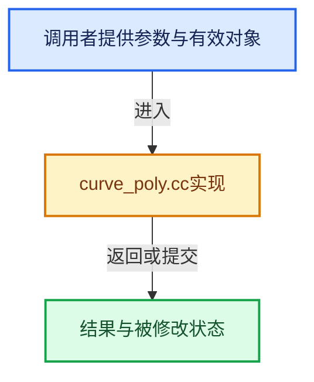

# 实现依赖专题：source/blender/blenkernel/intern/curve_poly.cc

[实现依赖导航](../../README.md) · [符号索引](../../../00-课程指南/02-源码与提交索引/符号依赖与实现索引.md)

本专题从正文实际调用进入，集中保存共享实现。函数有稳定锚点，可从调用处直接跳到对应完整函数；递归与互相调用通过回链组织。

## 本文件的实现关系






## 完整成员与函数实现

<a id="f-efffc14435a3a79c"></a>

### `blender::bke::curves::poly::delta_dir`

实现位置：[source/blender/blenkernel/intern/curve_poly.cc](../../../../../../../source/blender/blenkernel/intern/curve_poly.cc) · L16—L27。

接口参数：

- `const float3 &pos`
- `const float3 &next`
- `float3 &r_delta_dir`

**教学注释版**

<!-- annotated:4923a04188ae35 -->

```cpp
static bool delta_dir(const float3 &pos, const float3 &next, float3 &r_delta_dir)
{
  const float epsilon = 1.0e-9f;

  const float3 delta = next - pos;
  const float norm = math::length(delta);
  if (norm < epsilon) [[unlikely]] {
    return false;
  }
  r_delta_dir = delta / norm;
  return true;
}
```

<details>
<summary>核对原始源码：source/blender/blenkernel/intern/curve_poly.cc · L16—L27</summary>

<!-- original:4923a04188ae35:source/blender/blenkernel/intern/curve_poly.cc:16:27 -->

```cpp
static bool delta_dir(const float3 &pos, const float3 &next, float3 &r_delta_dir)
{
  const float epsilon = 1.0e-9f;

  const float3 delta = next - pos;
  const float norm = math::length(delta);
  if (norm < epsilon) [[unlikely]] {
    return false;
  }
  r_delta_dir = delta / norm;
  return true;
}
```

</details>

**沿实际写入检查状态**

- `r_delta_dir = delta / norm;`

**结果出口**

- `return false;`
- `return true;`

**继续追踪实现**

- `math::length` → [blender::math::length · L40](../../01-BLI基础库/BLI_math_vector_mpq_types.hh.md#f-16c31b0e3391026f)；[blender::math::length · L49](../../01-BLI基础库/BLI_math_vector_mpq_types.hh.md#f-82d5aa193c621065)；[blender::math::length · L457](../../01-BLI基础库/BLI_math_vector.hh.md#f-2c7dceafa898907c)。同名重载需按实参类型选择。

<a id="f-2a40cf3b590dcc71"></a>

### `blender::bke::curves::poly::direction_bisect`

实现位置：[source/blender/blenkernel/intern/curve_poly.cc](../../../../../../../source/blender/blenkernel/intern/curve_poly.cc) · L33—L72。

接口参数：

- `const float3 &pos`
- `const float3 &next`
- `float3 &other_dir`
- `bool &is_equal`

**教学注释版**

<!-- annotated:98c3ab5a879939 -->

```cpp
static float3 direction_bisect(const float3 &pos,
                               const float3 &next,
                               float3 &other_dir,
                               bool &is_equal)
{
  const float epsilon = 1.0e-9f;
  const bool prev_equal = is_equal;

  const float3 next_delta = next - pos;
  const float next_norm = math::length(next_delta);
  is_equal = next_norm < epsilon;
  if (is_equal) [[unlikely]] {
    /* Return the direction relative the 'previous' point. If 'prev_equal' is true, this
     * will return the direction of the last non-zero segment.
     */
    return other_dir;
  }

  const float3 prev_dir = other_dir;
  other_dir = next_delta / next_norm;
  if (prev_equal) [[unlikely]] {
    /* Return the direction of the next segment as previous direction is not an adjacent segment!
     */
    return other_dir;
  }
  const float3 tangent = prev_dir + other_dir;
  const float norm = math::length(tangent);
  if (norm < 0.6627619f) { /* Approximates angle between segments < 45 degrees. */
    if (norm < 2e-7) {     /* Approximately < sin(1e-5) */
      return other_dir;
    }
    /* Compute using the cross product, as catastrophic cancellation occurs in `tangent`
     * when the sum approaches 0, leading to significant numerical errors (see #146332).
     */
    const float3 binormal = math::cross(other_dir, prev_dir);
    const float3 normal = other_dir - prev_dir;
    return math::normalize(math::cross(binormal, normal));
  }
  return tangent / norm;
}
```

<details>
<summary>核对原始源码：source/blender/blenkernel/intern/curve_poly.cc · L33—L72</summary>

<!-- original:98c3ab5a879939:source/blender/blenkernel/intern/curve_poly.cc:33:72 -->

```cpp
static float3 direction_bisect(const float3 &pos,
                               const float3 &next,
                               float3 &other_dir,
                               bool &is_equal)
{
  const float epsilon = 1.0e-9f;
  const bool prev_equal = is_equal;

  const float3 next_delta = next - pos;
  const float next_norm = math::length(next_delta);
  is_equal = next_norm < epsilon;
  if (is_equal) [[unlikely]] {
    /* Return the direction relative the 'previous' point. If 'prev_equal' is true, this
     * will return the direction of the last non-zero segment.
     */
    return other_dir;
  }

  const float3 prev_dir = other_dir;
  other_dir = next_delta / next_norm;
  if (prev_equal) [[unlikely]] {
    /* Return the direction of the next segment as previous direction is not an adjacent segment!
     */
    return other_dir;
  }
  const float3 tangent = prev_dir + other_dir;
  const float norm = math::length(tangent);
  if (norm < 0.6627619f) { /* Approximates angle between segments < 45 degrees. */
    if (norm < 2e-7) {     /* Approximately < sin(1e-5) */
      return other_dir;
    }
    /* Compute using the cross product, as catastrophic cancellation occurs in `tangent`
     * when the sum approaches 0, leading to significant numerical errors (see #146332).
     */
    const float3 binormal = math::cross(other_dir, prev_dir);
    const float3 normal = other_dir - prev_dir;
    return math::normalize(math::cross(binormal, normal));
  }
  return tangent / norm;
}
```

</details>

**沿实际写入检查状态**

- `is_equal = next_norm < epsilon;`
- `other_dir = next_delta / next_norm;`

**结果出口**

- `return other_dir;`
- `return math::normalize(math::cross(binormal, normal));`
- `return tangent / norm;`

**继续追踪实现**

- `math::length` → [blender::math::length · L40](../../01-BLI基础库/BLI_math_vector_mpq_types.hh.md#f-16c31b0e3391026f)；[blender::math::length · L49](../../01-BLI基础库/BLI_math_vector_mpq_types.hh.md#f-82d5aa193c621065)；[blender::math::length · L457](../../01-BLI基础库/BLI_math_vector.hh.md#f-2c7dceafa898907c)。同名重载需按实参类型选择。
- `math::cross` → [blender::math::cross · L549](../../01-BLI基础库/BLI_math_vector.hh.md#f-cb1b14dc107aa107)；[blender::math::cross · L562](../../01-BLI基础库/BLI_math_vector.hh.md#f-8dcac1cc63a3672a)；[blender::math::cross · L217](../../01-BLI基础库/BLI_math_basis_types.hh.md#f-0cb9fb63f068f85e)。同名重载需按实参类型选择。
- `math::normalize` → [blender::math::normalize · L542](../../01-BLI基础库/BLI_math_vector.hh.md#f-5bea914457e11f7f)；[blender::math::normalize · L258](../../01-BLI基础库/BLI_math_quaternion.hh.md#f-5bf6b351333e4054)；[blender::math::normalize · L450](../../01-BLI基础库/BLI_math_quaternion.hh.md#f-b852cee8f0cc9b6a)；[blender::math::normalize · L745](../../01-BLI基础库/BLI_math_matrix.hh.md#f-2235cb6f5ec7ff18)；[blender::math::normalize · L783](../../01-BLI基础库/BLI_math_matrix.hh.md#f-0386bc4ee9ac7425)。同名重载需按实参类型选择。

<a id="f-56266c9ce9e85bea"></a>

### `blender::bke::curves::poly::calculate_tangents`

实现位置：[source/blender/blenkernel/intern/curve_poly.cc](../../../../../../../source/blender/blenkernel/intern/curve_poly.cc) · L74—L124。

接口参数：

- `const Span<float3> positions`
- `const bool is_cyclic`
- `MutableSpan<float3> tangents`

**教学注释版**

<!-- annotated:70f32bdb82113d -->

```cpp
void calculate_tangents(const Span<float3> positions,
                        const bool is_cyclic,
                        MutableSpan<float3> tangents)
{
  // [讲解] positions.size：查询视图长度或生成对应有效索引区间。
  BLI_assert(positions.size() == tangents.size());

  // [讲解] positions.is_empty：查询视图长度或生成对应有效索引区间。
  if (positions.is_empty()) {
    return;
  }

  if (positions.size() == 1) {
    // [讲解] tangents.first：按视图边界访问元素。
    tangents.first() = float3(0.0f, 0.0f, 1.0f);
    return;
  }

  /* Find an initial valid tangent. */
  int first_valid_index = -1;
  for (const int i : IndexRange(0, positions.size() - 1)) {
    if (delta_dir(positions[i], positions[i + 1], tangents[i])) {
      first_valid_index = i;
      break;
    }
  }

  if (first_valid_index == -1) {
    /* If all tangents used the fallback, it means that all positions are (almost) the same. Just
     * use the up-vector as default tangent. */
    const float3 up_vector{0.0f, 0.0f, 1.0f};
    // [讲解] tangents.fill：修改已有目标元素，不改变底层容器长度。
    tangents.fill(up_vector);
    return;
  }
  if (first_valid_index > 0) {
    // [讲解] tangents.slice：建立原连续范围的子视图。
    tangents.slice(0, first_valid_index).fill(tangents[first_valid_index]);
  }

  /* Calculate curve tangents using the delta from previous iteration(s). */
  float3 prev_delta = tangents[first_valid_index];
  bool prev_equal = false;
  // [讲解] positions.index_range：查询视图长度或生成对应有效索引区间。
  for (const int i : positions.index_range().drop_front(first_valid_index + 1).drop_back(1)) {
    tangents[i] = direction_bisect(positions[i], positions[i + 1], prev_delta, prev_equal);
  }

  if (is_cyclic) {
    const float3 &first = positions.first();
    // [讲解] tangents.last：按视图边界访问元素。
    tangents.last() = direction_bisect(positions.last(), first, prev_delta, prev_equal);
    tangents.first() = direction_bisect(first, positions[1], prev_delta, prev_equal);
  }
  else if (!delta_dir(positions.last(1), positions.last(), tangents.last())) {
    tangents.last() = prev_delta;
  }
}
```

<details>
<summary>核对原始源码：source/blender/blenkernel/intern/curve_poly.cc · L74—L124</summary>

<!-- original:70f32bdb82113d:source/blender/blenkernel/intern/curve_poly.cc:74:124 -->

```cpp
void calculate_tangents(const Span<float3> positions,
                        const bool is_cyclic,
                        MutableSpan<float3> tangents)
{
  BLI_assert(positions.size() == tangents.size());

  if (positions.is_empty()) {
    return;
  }

  if (positions.size() == 1) {
    tangents.first() = float3(0.0f, 0.0f, 1.0f);
    return;
  }

  /* Find an initial valid tangent. */
  int first_valid_index = -1;
  for (const int i : IndexRange(0, positions.size() - 1)) {
    if (delta_dir(positions[i], positions[i + 1], tangents[i])) {
      first_valid_index = i;
      break;
    }
  }

  if (first_valid_index == -1) {
    /* If all tangents used the fallback, it means that all positions are (almost) the same. Just
     * use the up-vector as default tangent. */
    const float3 up_vector{0.0f, 0.0f, 1.0f};
    tangents.fill(up_vector);
    return;
  }
  if (first_valid_index > 0) {
    tangents.slice(0, first_valid_index).fill(tangents[first_valid_index]);
  }

  /* Calculate curve tangents using the delta from previous iteration(s). */
  float3 prev_delta = tangents[first_valid_index];
  bool prev_equal = false;
  for (const int i : positions.index_range().drop_front(first_valid_index + 1).drop_back(1)) {
    tangents[i] = direction_bisect(positions[i], positions[i + 1], prev_delta, prev_equal);
  }

  if (is_cyclic) {
    const float3 &first = positions.first();
    tangents.last() = direction_bisect(positions.last(), first, prev_delta, prev_equal);
    tangents.first() = direction_bisect(first, positions[1], prev_delta, prev_equal);
  }
  else if (!delta_dir(positions.last(1), positions.last(), tangents.last())) {
    tangents.last() = prev_delta;
  }
}
```

</details>

**沿实际写入检查状态**

- `first_valid_index = i;`
- `tangents[i] = direction_bisect(positions[i], positions[i + 1], prev_delta, prev_equal);`

**继续追踪实现**

- `BLI_assert` → [BLI_assert · L48](../../01-BLI基础库/BLI_assert.hh.md#m-57a88495704d)；[BLI_assert · L63](../../01-BLI基础库/BLI_assert.hh.md#m-d07050020cb5)。宏定义由构建条件选择。
- `positions.size` → [blender::Span::size · L256](../../../01-基础容器与现代CPP/05-Span只读连续视图.md#f-5f80fa006089c998)。
- `tangents.size` → [blender::MutableSpan::size · L499](../../../01-基础容器与现代CPP/06-MutableSpan可写视图.md#f-1de6a66839c304a8)；[blender::gpu::shader::parser::MutableSpan::size · L87](../../08-其他Blender模块/gpu/shader_tool/utils.hh.md#f-5e684af6ee7990e9)。同名重载需按实参类型选择。
- `positions.is_empty` → [blender::Span::is_empty · L264](../../../01-基础容器与现代CPP/05-Span只读连续视图.md#f-8cc1d7ba8feb50e6)。
- `tangents.first` → [blender::MutableSpan::first · L685](../../../01-基础容器与现代CPP/06-MutableSpan可写视图.md#f-3126bab9f43cee1c)。
- `float3` → [float3 · L641](../../08-其他Blender模块/compositor/algorithms/intern/smaa.cc.md#m-0ea8254cfdb4)。宏定义由构建条件选择。
- `IndexRange` → [blender::IndexRange](../../01-BLI基础库/BLI_index_range.hh.md#t-caa3466d6776)；[blender::gpu::shader::parser::IndexRange](../../08-其他Blender模块/gpu/shader_tool/utils.hh.md#t-82d2bd4ea71c)；[blender::IndexRange](../../08-其他Blender模块/makesdna/DNA_node_types.h.md#t-0448cc889d39)。
- `delta_dir` → [blender::bke::curves::poly::delta_dir · L16](curve_poly.cc.md#f-efffc14435a3a79c)。
- `tangents.fill` → [blender::MutableSpan::fill · L523](../../../01-基础容器与现代CPP/06-MutableSpan可写视图.md#f-8daedd52c727ec26)。
- `tangents.slice(0, first_valid_index).fill` → [调用协议](../../../00-课程指南/01-路线与规范/模板宏与动态分派协议.md)：接收对象类型依赖auto、返回值或模板实例；不按同名猜测目标。调用位置L106。
- `tangents.slice` → [blender::MutableSpan::slice · L579](../../../01-基础容器与现代CPP/06-MutableSpan可写视图.md#f-6808b4aefbf58808)；[blender::MutableSpan::slice · L587](../../../01-基础容器与现代CPP/06-MutableSpan可写视图.md#f-c05b010821861e4f)。同名重载需按实参类型选择。
- `positions.index_range().drop_front(first_valid_index + 1).drop_back` → [调用协议](../../../00-课程指南/01-路线与规范/模板宏与动态分派协议.md)：接收对象类型依赖auto、返回值或模板实例；不按同名猜测目标。调用位置L112。
- `positions.index_range().drop_front` → [调用协议](../../../00-课程指南/01-路线与规范/模板宏与动态分派协议.md)：接收对象类型依赖auto、返回值或模板实例；不按同名猜测目标。调用位置L112。
- `positions.index_range` → [blender::Span::index_range · L405](../../../01-基础容器与现代CPP/05-Span只读连续视图.md#f-caaa9b06e13e53e0)。
- `direction_bisect` → [blender::bke::curves::poly::direction_bisect · L33](curve_poly.cc.md#f-2a40cf3b590dcc71)。
- `positions.first` → [blender::Span::first · L319](../../../01-基础容器与现代CPP/05-Span只读连续视图.md#f-d8c9bcc3e9757248)。
- `tangents.last` → [blender::MutableSpan::last · L695](../../../01-基础容器与现代CPP/06-MutableSpan可写视图.md#f-73191eeabe29aab7)。
- `positions.last` → [blender::Span::last · L329](../../../01-基础容器与现代CPP/05-Span只读连续视图.md#f-a92146c285596891)。

<a id="f-f664b957311eee3e"></a>

### `blender::bke::curves::poly::calculate_normals_z_up`

实现位置：[source/blender/blenkernel/intern/curve_poly.cc](../../../../../../../source/blender/blenkernel/intern/curve_poly.cc) · L126—L141。

接口参数：

- `const Span<float3> tangents`
- `MutableSpan<float3> normals`

**教学注释版**

<!-- annotated:4edf216a10eeaa -->

```cpp
void calculate_normals_z_up(const Span<float3> tangents, MutableSpan<float3> normals)
{
  // [讲解] normals.size：查询视图长度或生成对应有效索引区间。
  BLI_assert(normals.size() == tangents.size());

  /* Same as in `vec_to_quat`. */
  const float epsilon = 1e-4f;
  // [讲解] normals.index_range：查询视图长度或生成对应有效索引区间。
  for (const int i : normals.index_range()) {
    const float3 &tangent = tangents[i];
    if (std::abs(tangent.x) + std::abs(tangent.y) < epsilon) {
      normals[i] = {1.0f, 0.0f, 0.0f};
    }
    else {
      normals[i] = math::normalize(float3(tangent.y, -tangent.x, 0.0f));
    }
  }
}
```

<details>
<summary>核对原始源码：source/blender/blenkernel/intern/curve_poly.cc · L126—L141</summary>

<!-- original:4edf216a10eeaa:source/blender/blenkernel/intern/curve_poly.cc:126:141 -->

```cpp
void calculate_normals_z_up(const Span<float3> tangents, MutableSpan<float3> normals)
{
  BLI_assert(normals.size() == tangents.size());

  /* Same as in `vec_to_quat`. */
  const float epsilon = 1e-4f;
  for (const int i : normals.index_range()) {
    const float3 &tangent = tangents[i];
    if (std::abs(tangent.x) + std::abs(tangent.y) < epsilon) {
      normals[i] = {1.0f, 0.0f, 0.0f};
    }
    else {
      normals[i] = math::normalize(float3(tangent.y, -tangent.x, 0.0f));
    }
  }
}
```

</details>

**沿实际写入检查状态**

- `normals[i] = {1.0f, 0.0f, 0.0f};`
- `normals[i] = math::normalize(float3(tangent.y, -tangent.x, 0.0f));`

**继续追踪实现**

- `BLI_assert` → [BLI_assert · L48](../../01-BLI基础库/BLI_assert.hh.md#m-57a88495704d)；[BLI_assert · L63](../../01-BLI基础库/BLI_assert.hh.md#m-d07050020cb5)。宏定义由构建条件选择。
- `normals.size` → [blender::MutableSpan::size · L499](../../../01-基础容器与现代CPP/06-MutableSpan可写视图.md#f-1de6a66839c304a8)；[blender::gpu::shader::parser::MutableSpan::size · L87](../../08-其他Blender模块/gpu/shader_tool/utils.hh.md#f-5e684af6ee7990e9)。同名重载需按实参类型选择。
- `tangents.size` → [blender::Span::size · L256](../../../01-基础容器与现代CPP/05-Span只读连续视图.md#f-5f80fa006089c998)。
- `normals.index_range` → [blender::MutableSpan::index_range · L676](../../../01-基础容器与现代CPP/06-MutableSpan可写视图.md#f-f9a9d59a69ca64b5)。
- `std::abs` → [外部契约](https://eel.is/c++draft/)：这个边界按实际表达式及所属类型核对参数、返回值、寿命与失败行为。这里提供接口入口，不声称已解释该第三方版本的内部实现。
- `math::normalize` → [blender::math::normalize · L542](../../01-BLI基础库/BLI_math_vector.hh.md#f-5bea914457e11f7f)；[blender::math::normalize · L258](../../01-BLI基础库/BLI_math_quaternion.hh.md#f-5bf6b351333e4054)；[blender::math::normalize · L450](../../01-BLI基础库/BLI_math_quaternion.hh.md#f-b852cee8f0cc9b6a)；[blender::math::normalize · L745](../../01-BLI基础库/BLI_math_matrix.hh.md#f-2235cb6f5ec7ff18)；[blender::math::normalize · L783](../../01-BLI基础库/BLI_math_matrix.hh.md#f-0386bc4ee9ac7425)。同名重载需按实参类型选择。
- `float3` → [float3 · L641](../../08-其他Blender模块/compositor/algorithms/intern/smaa.cc.md#m-0ea8254cfdb4)。宏定义由构建条件选择。

<a id="f-ea5bd660186f1fd7"></a>

### `blender::bke::curves::poly::calculate_next_normal`

实现位置：[source/blender/blenkernel/intern/curve_poly.cc](../../../../../../../source/blender/blenkernel/intern/curve_poly.cc) · L146—L164。

接口参数：

- `const float3 &last_normal`
- `const float3 &last_tangent`
- `const float3 &current_tangent`

**教学注释版**

<!-- annotated:199da6f1c0feee -->

```cpp
static float3 calculate_next_normal(const float3 &last_normal,
                                    const float3 &last_tangent,
                                    const float3 &current_tangent)
{
  if (math::is_zero(last_tangent) || math::is_zero(current_tangent)) {
    return last_normal;
  }
  const float angle = angle_normalized_v3v3(last_tangent, current_tangent);
  if (angle != 0.0f) {
    const float3 axis = math::normalize(math::cross(last_tangent, current_tangent));
    if (!math::is_zero(axis)) [[likely]] {
      /* The iterative process here (computing the current normal by rotating the previous one) can
       * accumulate small floating point errors, leading to 'not enough' normalized results at some
       * point (see #121169). */
      return math::normalize(math::rotate_direction_around_axis(last_normal, axis, angle));
    }
  }
  return last_normal;
}
```

<details>
<summary>核对原始源码：source/blender/blenkernel/intern/curve_poly.cc · L146—L164</summary>

<!-- original:199da6f1c0feee:source/blender/blenkernel/intern/curve_poly.cc:146:164 -->

```cpp
static float3 calculate_next_normal(const float3 &last_normal,
                                    const float3 &last_tangent,
                                    const float3 &current_tangent)
{
  if (math::is_zero(last_tangent) || math::is_zero(current_tangent)) {
    return last_normal;
  }
  const float angle = angle_normalized_v3v3(last_tangent, current_tangent);
  if (angle != 0.0f) {
    const float3 axis = math::normalize(math::cross(last_tangent, current_tangent));
    if (!math::is_zero(axis)) [[likely]] {
      /* The iterative process here (computing the current normal by rotating the previous one) can
       * accumulate small floating point errors, leading to 'not enough' normalized results at some
       * point (see #121169). */
      return math::normalize(math::rotate_direction_around_axis(last_normal, axis, angle));
    }
  }
  return last_normal;
}
```

</details>

**结果出口**

- `return last_normal;`
- `return math::normalize(math::rotate_direction_around_axis(last_normal, axis, angle));`

**继续追踪实现**

- `math::is_zero` → [blender::math::is_zero · L784](../../01-BLI基础库/BLI_math_vector.hh.md#f-b05b3db842a9f17e)；[blender::math::is_zero · L108](../../01-BLI基础库/BLI_math_quaternion.hh.md#f-b97bee3fbc328c0d)；[blender::math::is_zero · L593](../../01-BLI基础库/BLI_math_matrix.hh.md#f-b879ac524126b464)；[blender::math::is_zero · L23](../../01-BLI基础库/BLI_math_base.hh.md#f-6fdcc74ca7338838)。同名重载需按实参类型选择。
- `angle_normalized_v3v3` → [调用协议](../../../00-课程指南/01-路线与规范/模板宏与动态分派协议.md)：函数指针、局部可调用对象或未展开的宏；必须结合调用者环境。调用位置L153。
- `math::normalize` → [blender::math::normalize · L542](../../01-BLI基础库/BLI_math_vector.hh.md#f-5bea914457e11f7f)；[blender::math::normalize · L258](../../01-BLI基础库/BLI_math_quaternion.hh.md#f-5bf6b351333e4054)；[blender::math::normalize · L450](../../01-BLI基础库/BLI_math_quaternion.hh.md#f-b852cee8f0cc9b6a)；[blender::math::normalize · L745](../../01-BLI基础库/BLI_math_matrix.hh.md#f-2235cb6f5ec7ff18)；[blender::math::normalize · L783](../../01-BLI基础库/BLI_math_matrix.hh.md#f-0386bc4ee9ac7425)。同名重载需按实参类型选择。
- `math::cross` → [blender::math::cross · L549](../../01-BLI基础库/BLI_math_vector.hh.md#f-cb1b14dc107aa107)；[blender::math::cross · L562](../../01-BLI基础库/BLI_math_vector.hh.md#f-8dcac1cc63a3672a)；[blender::math::cross · L217](../../01-BLI基础库/BLI_math_basis_types.hh.md#f-0cb9fb63f068f85e)。同名重载需按实参类型选择。
- `math::rotate_direction_around_axis` → [blender::math::rotate_direction_around_axis · L112](../../01-BLI基础库/intern/math_rotation.cc.md#f-02597d22527d8aae)。

<a id="f-ef7aad05d9e5c2a3"></a>

### `blender::bke::curves::poly::calculate_normals_minimum`

实现位置：[source/blender/blenkernel/intern/curve_poly.cc](../../../../../../../source/blender/blenkernel/intern/curve_poly.cc) · L166—L216。

接口参数：

- `const Span<float3> tangents`
- `const bool cyclic`
- `MutableSpan<float3> normals`

**教学注释版**

<!-- annotated:052bb8dd8a06bc -->

```cpp
void calculate_normals_minimum(const Span<float3> tangents,
                               const bool cyclic,
                               MutableSpan<float3> normals)
{
  // [讲解] normals.size：查询视图长度或生成对应有效索引区间。
  BLI_assert(normals.size() == tangents.size());

  // [讲解] normals.is_empty：查询视图长度或生成对应有效索引区间。
  if (normals.is_empty()) {
    return;
  }

  const float epsilon = 1e-4f;

  /* Set initial normal. */
  // [讲解] tangents.first：按视图边界访问元素。
  const float3 &first_tangent = tangents.first();
  if (fabs(first_tangent.x) + fabs(first_tangent.y) < epsilon) [[unlikely]] {
    normals.first() = {1.0f, 0.0f, 0.0f};
  }
  else {
    normals.first() = math::normalize(float3(first_tangent.y, -first_tangent.x, 0.0f));
  }

  /* Forward normal with minimum twist along the entire curve. */
  for (const int i : IndexRange(1, normals.size() - 1)) {
    normals[i] = calculate_next_normal(normals[i - 1], tangents[i - 1], tangents[i]);
  }

  if (!cyclic) {
    return;
  }

  /* Compute how much the first normal deviates from the normal that has been forwarded along the
   * entire cyclic curve. */
  const float3 uncorrected_last_normal = calculate_next_normal(
      // [讲解] normals.last：按视图边界访问元素。
      normals.last(), tangents.last(), tangents.first());
  float correction_angle = angle_signed_on_axis_v3v3_v3(
      normals.first(), uncorrected_last_normal, tangents.first());
  if (correction_angle > M_PI) {
    correction_angle = correction_angle - 2 * M_PI;
  }

  /* Gradually apply correction by rotating all normals slightly around their tangents. */
  const float angle_step = correction_angle / normals.size();
  // [讲解] normals.index_range：查询视图长度或生成对应有效索引区间。
  for (const int i : normals.index_range()) {
    const float3 axis = tangents[i];
    if (math::is_zero(axis)) [[unlikely]] {
      continue;
    }
    const float angle = angle_step * i;
    normals[i] = math::rotate_direction_around_axis(normals[i], axis, angle);
  }
}
```

<details>
<summary>核对原始源码：source/blender/blenkernel/intern/curve_poly.cc · L166—L216</summary>

<!-- original:052bb8dd8a06bc:source/blender/blenkernel/intern/curve_poly.cc:166:216 -->

```cpp
void calculate_normals_minimum(const Span<float3> tangents,
                               const bool cyclic,
                               MutableSpan<float3> normals)
{
  BLI_assert(normals.size() == tangents.size());

  if (normals.is_empty()) {
    return;
  }

  const float epsilon = 1e-4f;

  /* Set initial normal. */
  const float3 &first_tangent = tangents.first();
  if (fabs(first_tangent.x) + fabs(first_tangent.y) < epsilon) [[unlikely]] {
    normals.first() = {1.0f, 0.0f, 0.0f};
  }
  else {
    normals.first() = math::normalize(float3(first_tangent.y, -first_tangent.x, 0.0f));
  }

  /* Forward normal with minimum twist along the entire curve. */
  for (const int i : IndexRange(1, normals.size() - 1)) {
    normals[i] = calculate_next_normal(normals[i - 1], tangents[i - 1], tangents[i]);
  }

  if (!cyclic) {
    return;
  }

  /* Compute how much the first normal deviates from the normal that has been forwarded along the
   * entire cyclic curve. */
  const float3 uncorrected_last_normal = calculate_next_normal(
      normals.last(), tangents.last(), tangents.first());
  float correction_angle = angle_signed_on_axis_v3v3_v3(
      normals.first(), uncorrected_last_normal, tangents.first());
  if (correction_angle > M_PI) {
    correction_angle = correction_angle - 2 * M_PI;
  }

  /* Gradually apply correction by rotating all normals slightly around their tangents. */
  const float angle_step = correction_angle / normals.size();
  for (const int i : normals.index_range()) {
    const float3 axis = tangents[i];
    if (math::is_zero(axis)) [[unlikely]] {
      continue;
    }
    const float angle = angle_step * i;
    normals[i] = math::rotate_direction_around_axis(normals[i], axis, angle);
  }
}
```

</details>

**沿实际写入检查状态**

- `normals[i] = calculate_next_normal(normals[i - 1], tangents[i - 1], tangents[i]);`
- `correction_angle = correction_angle - 2 * M_PI;`
- `normals[i] = math::rotate_direction_around_axis(normals[i], axis, angle);`

**继续追踪实现**

- `BLI_assert` → [BLI_assert · L48](../../01-BLI基础库/BLI_assert.hh.md#m-57a88495704d)；[BLI_assert · L63](../../01-BLI基础库/BLI_assert.hh.md#m-d07050020cb5)。宏定义由构建条件选择。
- `normals.size` → [blender::MutableSpan::size · L499](../../../01-基础容器与现代CPP/06-MutableSpan可写视图.md#f-1de6a66839c304a8)；[blender::gpu::shader::parser::MutableSpan::size · L87](../../08-其他Blender模块/gpu/shader_tool/utils.hh.md#f-5e684af6ee7990e9)。同名重载需按实参类型选择。
- `tangents.size` → [blender::Span::size · L256](../../../01-基础容器与现代CPP/05-Span只读连续视图.md#f-5f80fa006089c998)。
- `normals.is_empty` → [blender::MutableSpan::is_empty · L515](../../../01-基础容器与现代CPP/06-MutableSpan可写视图.md#f-be88df1422757437)。
- `tangents.first` → [blender::Span::first · L319](../../../01-基础容器与现代CPP/05-Span只读连续视图.md#f-d8c9bcc3e9757248)。
- `fabs` → [外部契约](https://eel.is/c++draft/)：这个边界按实际表达式及所属类型核对参数、返回值、寿命与失败行为。这里提供接口入口，不声称已解释该第三方版本的内部实现。
- `normals.first` → [blender::MutableSpan::first · L685](../../../01-基础容器与现代CPP/06-MutableSpan可写视图.md#f-3126bab9f43cee1c)。
- `math::normalize` → [blender::math::normalize · L542](../../01-BLI基础库/BLI_math_vector.hh.md#f-5bea914457e11f7f)；[blender::math::normalize · L258](../../01-BLI基础库/BLI_math_quaternion.hh.md#f-5bf6b351333e4054)；[blender::math::normalize · L450](../../01-BLI基础库/BLI_math_quaternion.hh.md#f-b852cee8f0cc9b6a)；[blender::math::normalize · L745](../../01-BLI基础库/BLI_math_matrix.hh.md#f-2235cb6f5ec7ff18)；[blender::math::normalize · L783](../../01-BLI基础库/BLI_math_matrix.hh.md#f-0386bc4ee9ac7425)。同名重载需按实参类型选择。
- `float3` → [float3 · L641](../../08-其他Blender模块/compositor/algorithms/intern/smaa.cc.md#m-0ea8254cfdb4)。宏定义由构建条件选择。
- `IndexRange` → [blender::IndexRange](../../01-BLI基础库/BLI_index_range.hh.md#t-caa3466d6776)；[blender::gpu::shader::parser::IndexRange](../../08-其他Blender模块/gpu/shader_tool/utils.hh.md#t-82d2bd4ea71c)；[blender::IndexRange](../../08-其他Blender模块/makesdna/DNA_node_types.h.md#t-0448cc889d39)。
- `calculate_next_normal` → [blender::bke::curves::poly::calculate_next_normal · L146](curve_poly.cc.md#f-ea5bd660186f1fd7)。
- `normals.last` → [blender::MutableSpan::last · L695](../../../01-基础容器与现代CPP/06-MutableSpan可写视图.md#f-73191eeabe29aab7)。
- `tangents.last` → [blender::Span::last · L329](../../../01-基础容器与现代CPP/05-Span只读连续视图.md#f-a92146c285596891)。
- `angle_signed_on_axis_v3v3_v3` → [调用协议](../../../00-课程指南/01-路线与规范/模板宏与动态分派协议.md)：函数指针、局部可调用对象或未展开的宏；必须结合调用者环境。调用位置L200。
- `normals.index_range` → [blender::MutableSpan::index_range · L676](../../../01-基础容器与现代CPP/06-MutableSpan可写视图.md#f-f9a9d59a69ca64b5)。
- `math::is_zero` → [blender::math::is_zero · L784](../../01-BLI基础库/BLI_math_vector.hh.md#f-b05b3db842a9f17e)；[blender::math::is_zero · L108](../../01-BLI基础库/BLI_math_quaternion.hh.md#f-b97bee3fbc328c0d)；[blender::math::is_zero · L593](../../01-BLI基础库/BLI_math_matrix.hh.md#f-b879ac524126b464)；[blender::math::is_zero · L23](../../01-BLI基础库/BLI_math_base.hh.md#f-6fdcc74ca7338838)。同名重载需按实参类型选择。
- `math::rotate_direction_around_axis` → [blender::math::rotate_direction_around_axis · L112](../../01-BLI基础库/intern/math_rotation.cc.md#f-02597d22527d8aae)。
