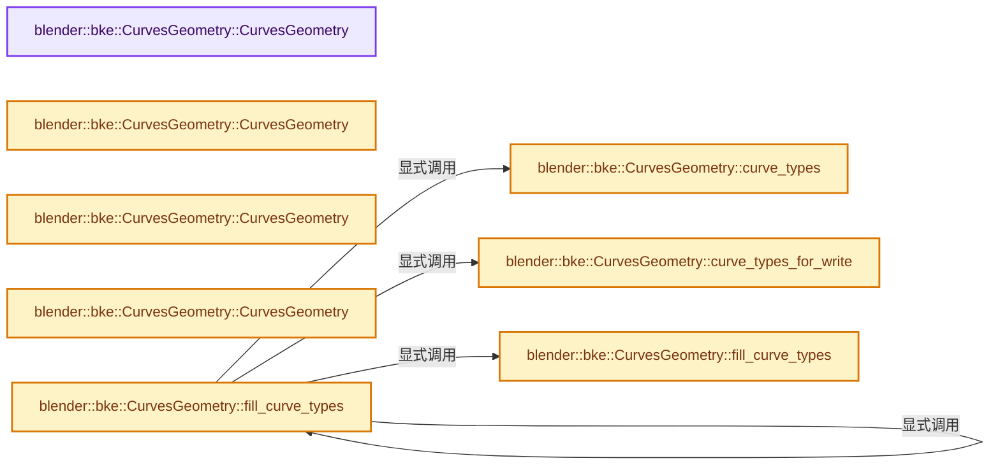

# 实现依赖专题：source/blender/blenkernel/intern/curves_geometry.cc

[实现依赖导航](../../README.md) · [符号索引](../../../00-课程指南/02-源码与提交索引/符号依赖与实现索引.md)

本专题从正文实际调用进入，集中保存共享实现。函数有稳定锚点，可从调用处直接跳到对应完整函数；递归与互相调用通过回链组织。

## 本文件的实现关系




## 完整成员与函数实现

<a id="f-006b40599dbee342"></a>

### `blender::bke::CurvesGeometry::CurvesGeometry`

实现位置：[source/blender/blenkernel/intern/curves_geometry.cc](../../../../../../../source/blender/blenkernel/intern/curves_geometry.cc) · L65—L65。

**教学注释版**

<!-- annotated:44df3c081a3cae -->

```cpp
CurvesGeometry::CurvesGeometry() : CurvesGeometry(0, 0) {}
```

<details>
<summary>核对原始源码：source/blender/blenkernel/intern/curves_geometry.cc · L65—L65</summary>

<!-- original:44df3c081a3cae:source/blender/blenkernel/intern/curves_geometry.cc:65:65 -->

```cpp
CurvesGeometry::CurvesGeometry() : CurvesGeometry(0, 0) {}
```

</details>

**继续追踪实现**

本实现没有需要继续展开的显式调用；检查返回表达式、对象转换和调用者前置条件。

<a id="f-ca007a417604d0cf"></a>

### `blender::bke::CurvesGeometry::CurvesGeometry`

实现位置：[source/blender/blenkernel/intern/curves_geometry.cc](../../../../../../../source/blender/blenkernel/intern/curves_geometry.cc) · L67—L101。

接口参数：

- `const int point_num`
- `const int curve_num`

**教学注释版**

<!-- annotated:dcfaade04223a6 -->

```cpp
CurvesGeometry::CurvesGeometry(const int point_num, const int curve_num)
{
  this->runtime = MEM_new<CurvesGeometryRuntime>(__func__);

  this->point_num = point_num;
  this->curve_num = curve_num;
  CustomData_reset(&this->point_data);
  CustomData_reset(&this->curve_data_legacy);
  new (&this->attribute_storage.wrap()) bke::AttributeStorage();
  this->vertex_group_names.clear_no_delete();

  this->attributes_for_write().add<float3>(
      "position", AttrDomain::Point, AttributeInitConstruct());

  this->custom_knots = nullptr;
  this->custom_knot_num = 0;

  if (curve_num > 0) {
    this->curve_offsets = MEM_new_array_uninitialized<int>(size_t(this->curve_num) + 1, __func__);
    this->runtime->curve_offsets_sharing_info = implicit_sharing::info_for_mem_free(
        this->curve_offsets);
#ifndef NDEBUG
    this->offsets_for_write().fill(-1);
#endif
    /* Set common values for convenience. */
    this->curve_offsets[0] = 0;
    this->curve_offsets[this->curve_num] = this->point_num;
  }
  else {
    this->curve_offsets = nullptr;
  }

  /* Fill the type counts with the default so they're in a valid state. */
  this->runtime->type_counts[CURVE_TYPE_CATMULL_ROM] = curve_num;
}
```

<details>
<summary>核对原始源码：source/blender/blenkernel/intern/curves_geometry.cc · L67—L101</summary>

<!-- original:dcfaade04223a6:source/blender/blenkernel/intern/curves_geometry.cc:67:101 -->

```cpp
CurvesGeometry::CurvesGeometry(const int point_num, const int curve_num)
{
  this->runtime = MEM_new<CurvesGeometryRuntime>(__func__);

  this->point_num = point_num;
  this->curve_num = curve_num;
  CustomData_reset(&this->point_data);
  CustomData_reset(&this->curve_data_legacy);
  new (&this->attribute_storage.wrap()) bke::AttributeStorage();
  this->vertex_group_names.clear_no_delete();

  this->attributes_for_write().add<float3>(
      "position", AttrDomain::Point, AttributeInitConstruct());

  this->custom_knots = nullptr;
  this->custom_knot_num = 0;

  if (curve_num > 0) {
    this->curve_offsets = MEM_new_array_uninitialized<int>(size_t(this->curve_num) + 1, __func__);
    this->runtime->curve_offsets_sharing_info = implicit_sharing::info_for_mem_free(
        this->curve_offsets);
#ifndef NDEBUG
    this->offsets_for_write().fill(-1);
#endif
    /* Set common values for convenience. */
    this->curve_offsets[0] = 0;
    this->curve_offsets[this->curve_num] = this->point_num;
  }
  else {
    this->curve_offsets = nullptr;
  }

  /* Fill the type counts with the default so they're in a valid state. */
  this->runtime->type_counts[CURVE_TYPE_CATMULL_ROM] = curve_num;
}
```

</details>

**沿实际写入检查状态**

- `this->runtime = MEM_new<CurvesGeometryRuntime>(__func__);`
- `this->point_num = point_num;`
- `this->curve_num = curve_num;`
- `this->custom_knots = nullptr;`
- `this->custom_knot_num = 0;`
- `this->curve_offsets = MEM_new_array_uninitialized<int>(size_t(this->curve_num) + 1, __func__);`
- `this->runtime->curve_offsets_sharing_info = implicit_sharing::info_for_mem_free(`
- `this->curve_offsets[0] = 0;`
- `this->curve_offsets[this->curve_num] = this->point_num;`
- `this->curve_offsets = nullptr;`
- `this->runtime->type_counts[CURVE_TYPE_CATMULL_ROM] = curve_num;`

**继续追踪实现**

- `MEM_new<CurvesGeometryRuntime>` → [MEM_new · L351](../../07-Intern运行时与平台/guardedalloc/MEM_guardedalloc.h.md#f-115f9b6784f89912)。
- `CustomData_reset` → [blender::CustomData_reset · L2495](customdata.cc.md#f-b5d2fd143bcd64b1)。
- `this->attribute_storage.wrap` → [调用协议](../../../00-课程指南/01-路线与规范/模板宏与动态分派协议.md)：接收对象类型依赖auto、返回值或模板实例；不按同名猜测目标。调用位置L75。
- `this->vertex_group_names.clear_no_delete` → [调用协议](../../../00-课程指南/01-路线与规范/模板宏与动态分派协议.md)：接收对象类型依赖auto、返回值或模板实例；不按同名猜测目标。调用位置L76。
- `this->attributes_for_write().add<float3>` → [调用协议](../../../00-课程指南/01-路线与规范/模板宏与动态分派协议.md)：接收对象类型依赖auto、返回值或模板实例；不按同名猜测目标。调用位置L78。
- `this->attributes_for_write` → [blender::bke::CurvesGeometry::attributes_for_write · L1913](curves_geometry.cc.md#f-4930091b34fa9663)。
- `AttributeInitConstruct` → [blender::bke::AttributeInitConstruct::AttributeInitConstruct · L90](../../../05-几何存储与拓扑映射/08-AttributeAccessor接口.md#f-864cb8bb6c1e50b4)。
- `MEM_new_array_uninitialized<int>` → [MEM_new_array_uninitialized · L608](../../07-Intern运行时与平台/guardedalloc/MEM_guardedalloc.h.md#f-b7103eae8eb57b05)；[MEM_new_array_uninitialized · L129](../../07-Intern运行时与平台/guardedalloc/intern/mallocn.cc.md#f-bf6ef4ddcfb6e5df)。同名重载需按实参类型选择。
- `implicit_sharing::info_for_mem_free` → [blender::implicit_sharing::info_for_mem_free · L301](../../../06-隐式共享与缓存系统/02-ImplicitSharingInfo计数.md#f-7ad95caa930eb54d)。
- `this->offsets_for_write().fill` → [调用协议](../../../00-课程指南/01-路线与规范/模板宏与动态分派协议.md)：接收对象类型依赖auto、返回值或模板实例；不按同名猜测目标。调用位置L89。
- `this->offsets_for_write` → [blender::bke::CurvesGeometry::offsets_for_write · L352](curves_geometry.cc.md#f-9ea1e4f36b216dd0)。

<a id="f-a64d9d52bf663422"></a>

### `blender::bke::CurvesGeometry::CurvesGeometry`

实现位置：[source/blender/blenkernel/intern/curves_geometry.cc](../../../../../../../source/blender/blenkernel/intern/curves_geometry.cc) · L103—L151。

接口参数：

- `const CurvesGeometry &other`

**教学注释版**

<!-- annotated:47460dd5f45870 -->

```cpp
CurvesGeometry::CurvesGeometry(const CurvesGeometry &other)
{
  this->curve_offsets = other.curve_offsets;
  if (other.runtime->curve_offsets_sharing_info) {
    other.runtime->curve_offsets_sharing_info->add_user();
  }

  this->custom_knots = other.custom_knots;
  this->custom_knot_num = other.custom_knot_num;
  if (other.runtime->custom_knots_sharing_info) {
    other.runtime->custom_knots_sharing_info->add_user();
  }

  CustomData_init_from(&other.point_data, &this->point_data, CD_MASK_MDEFORMVERT, other.point_num);

  new (&this->attribute_storage.wrap()) AttributeStorage(other.attribute_storage.wrap());

  this->point_num = other.point_num;
  this->curve_num = other.curve_num;

  BKE_defgroup_copy_list(&this->vertex_group_names, &other.vertex_group_names);
  this->vertex_group_active_index = other.vertex_group_active_index;

  this->attributes_active_index = other.attributes_active_index;

  this->runtime = MEM_new<CurvesGeometryRuntime>(
      __func__,
      CurvesGeometryRuntime{other.runtime->curve_offsets_sharing_info,
                            other.runtime->custom_knots_sharing_info,
                            other.runtime->type_counts,
                            other.runtime->evaluated_offsets_cache,
                            other.runtime->has_cyclic_curve_cache,
                            other.runtime->nurbs_basis_cache,
                            other.runtime->evaluated_position_cache,
                            other.runtime->bounds_cache,
                            other.runtime->bounds_with_radius_cache,
                            other.runtime->evaluated_length_cache,
                            other.runtime->evaluated_tangent_cache,
                            other.runtime->evaluated_normal_cache,
                            other.runtime->max_material_index_cache,
                            other.runtime->custom_knot_offsets_cache,
                            {},
                            true});

  if (other.runtime->bake_materials) {
    // [讲解] std::make_unique<bake::BakeMaterialsList>：创建独占拥有的对象，拥有关系可移动，get返回的借用指针不自动延长寿命。
    this->runtime->bake_materials = std::make_unique<bake::BakeMaterialsList>(
        *other.runtime->bake_materials);
  }
}
```

<details>
<summary>核对原始源码：source/blender/blenkernel/intern/curves_geometry.cc · L103—L151</summary>

<!-- original:47460dd5f45870:source/blender/blenkernel/intern/curves_geometry.cc:103:151 -->

```cpp
CurvesGeometry::CurvesGeometry(const CurvesGeometry &other)
{
  this->curve_offsets = other.curve_offsets;
  if (other.runtime->curve_offsets_sharing_info) {
    other.runtime->curve_offsets_sharing_info->add_user();
  }

  this->custom_knots = other.custom_knots;
  this->custom_knot_num = other.custom_knot_num;
  if (other.runtime->custom_knots_sharing_info) {
    other.runtime->custom_knots_sharing_info->add_user();
  }

  CustomData_init_from(&other.point_data, &this->point_data, CD_MASK_MDEFORMVERT, other.point_num);

  new (&this->attribute_storage.wrap()) AttributeStorage(other.attribute_storage.wrap());

  this->point_num = other.point_num;
  this->curve_num = other.curve_num;

  BKE_defgroup_copy_list(&this->vertex_group_names, &other.vertex_group_names);
  this->vertex_group_active_index = other.vertex_group_active_index;

  this->attributes_active_index = other.attributes_active_index;

  this->runtime = MEM_new<CurvesGeometryRuntime>(
      __func__,
      CurvesGeometryRuntime{other.runtime->curve_offsets_sharing_info,
                            other.runtime->custom_knots_sharing_info,
                            other.runtime->type_counts,
                            other.runtime->evaluated_offsets_cache,
                            other.runtime->has_cyclic_curve_cache,
                            other.runtime->nurbs_basis_cache,
                            other.runtime->evaluated_position_cache,
                            other.runtime->bounds_cache,
                            other.runtime->bounds_with_radius_cache,
                            other.runtime->evaluated_length_cache,
                            other.runtime->evaluated_tangent_cache,
                            other.runtime->evaluated_normal_cache,
                            other.runtime->max_material_index_cache,
                            other.runtime->custom_knot_offsets_cache,
                            {},
                            true});

  if (other.runtime->bake_materials) {
    this->runtime->bake_materials = std::make_unique<bake::BakeMaterialsList>(
        *other.runtime->bake_materials);
  }
}
```

</details>

**沿实际写入检查状态**

- `this->curve_offsets = other.curve_offsets;`
- `this->custom_knots = other.custom_knots;`
- `this->custom_knot_num = other.custom_knot_num;`
- `this->point_num = other.point_num;`
- `this->curve_num = other.curve_num;`
- `this->vertex_group_active_index = other.vertex_group_active_index;`
- `this->attributes_active_index = other.attributes_active_index;`
- `this->runtime = MEM_new<CurvesGeometryRuntime>(`
- `this->runtime->bake_materials = std::make_unique<bake::BakeMaterialsList>(`

**继续追踪实现**

- `other.runtime->curve_offsets_sharing_info->add_user` → [调用协议](../../../00-课程指南/01-路线与规范/模板宏与动态分派协议.md)：接收对象类型依赖auto、返回值或模板实例；不按同名猜测目标。调用位置L107。
- `other.runtime->custom_knots_sharing_info->add_user` → [调用协议](../../../00-课程指南/01-路线与规范/模板宏与动态分派协议.md)：接收对象类型依赖auto、返回值或模板实例；不按同名猜测目标。调用位置L113。
- `CustomData_init_from` → [blender::CustomData_init_from · L2448](customdata.cc.md#f-f317525a89779ded)。
- `this->attribute_storage.wrap` → [调用协议](../../../00-课程指南/01-路线与规范/模板宏与动态分派协议.md)：接收对象类型依赖auto、返回值或模板实例；不按同名猜测目标。调用位置L118。
- `other.attribute_storage.wrap` → [调用协议](../../../00-课程指南/01-路线与规范/模板宏与动态分派协议.md)：接收对象类型依赖auto、返回值或模板实例；不按同名猜测目标。调用位置L118。
- `BKE_defgroup_copy_list` → [blender::BKE_defgroup_copy_list · L75](deform.cc.md#f-abb39694bedcca18)。
- `MEM_new<CurvesGeometryRuntime>` → [MEM_new · L351](../../07-Intern运行时与平台/guardedalloc/MEM_guardedalloc.h.md#f-115f9b6784f89912)。
- `std::make_unique<bake::BakeMaterialsList>` → [外部契约](https://eel.is/c++draft/unique.ptr.create)：创建独占拥有的对象，拥有关系可移动，get返回的借用指针不自动延长寿命。

<a id="f-7eba5148b7d750c9"></a>

### `blender::bke::CurvesGeometry::CurvesGeometry`

实现位置：[source/blender/blenkernel/intern/curves_geometry.cc](../../../../../../../source/blender/blenkernel/intern/curves_geometry.cc) · L163—L197。

接口参数：

- `CurvesGeometry &&other`

**教学注释版**

<!-- annotated:4a865a548b3a57 -->

```cpp
CurvesGeometry::CurvesGeometry(CurvesGeometry &&other)
{
  this->curve_offsets = other.curve_offsets;
  other.curve_offsets = nullptr;

  this->custom_knots = other.custom_knots;
  other.custom_knots = nullptr;

  this->custom_knot_num = other.custom_knot_num;
  other.custom_knot_num = 0;

  this->point_data = other.point_data;
  CustomData_reset(&other.point_data);

  new (&this->attribute_storage.wrap())
      // [讲解] std::move：把表达式转换成可供移动重载选择的值类别；不保证真的移动，不结束源对象寿命，对const值可能选择复制。
      AttributeStorage(std::move(other.attribute_storage.wrap()));

  this->point_num = other.point_num;
  other.point_num = 0;

  this->curve_num = other.curve_num;
  other.curve_num = 0;

  this->vertex_group_names = other.vertex_group_names;
  other.vertex_group_names.clear_no_delete();

  this->vertex_group_active_index = other.vertex_group_active_index;
  other.vertex_group_active_index = 0;

  this->attributes_active_index = other.attributes_active_index;
  other.attributes_active_index = -1;

  this->runtime = other.runtime;
  other.runtime = nullptr;
}
```

<details>
<summary>核对原始源码：source/blender/blenkernel/intern/curves_geometry.cc · L163—L197</summary>

<!-- original:4a865a548b3a57:source/blender/blenkernel/intern/curves_geometry.cc:163:197 -->

```cpp
CurvesGeometry::CurvesGeometry(CurvesGeometry &&other)
{
  this->curve_offsets = other.curve_offsets;
  other.curve_offsets = nullptr;

  this->custom_knots = other.custom_knots;
  other.custom_knots = nullptr;

  this->custom_knot_num = other.custom_knot_num;
  other.custom_knot_num = 0;

  this->point_data = other.point_data;
  CustomData_reset(&other.point_data);

  new (&this->attribute_storage.wrap())
      AttributeStorage(std::move(other.attribute_storage.wrap()));

  this->point_num = other.point_num;
  other.point_num = 0;

  this->curve_num = other.curve_num;
  other.curve_num = 0;

  this->vertex_group_names = other.vertex_group_names;
  other.vertex_group_names.clear_no_delete();

  this->vertex_group_active_index = other.vertex_group_active_index;
  other.vertex_group_active_index = 0;

  this->attributes_active_index = other.attributes_active_index;
  other.attributes_active_index = -1;

  this->runtime = other.runtime;
  other.runtime = nullptr;
}
```

</details>

**沿实际写入检查状态**

- `this->curve_offsets = other.curve_offsets;`
- `other.curve_offsets = nullptr;`
- `this->custom_knots = other.custom_knots;`
- `other.custom_knots = nullptr;`
- `this->custom_knot_num = other.custom_knot_num;`
- `other.custom_knot_num = 0;`
- `this->point_data = other.point_data;`
- `this->point_num = other.point_num;`
- `other.point_num = 0;`
- `this->curve_num = other.curve_num;`
- `other.curve_num = 0;`
- `this->vertex_group_names = other.vertex_group_names;`
- `this->vertex_group_active_index = other.vertex_group_active_index;`
- `other.vertex_group_active_index = 0;`
- `this->attributes_active_index = other.attributes_active_index;`
- `other.attributes_active_index = -1;`
- `this->runtime = other.runtime;`
- `other.runtime = nullptr;`

**继续追踪实现**

- `CustomData_reset` → [blender::CustomData_reset · L2495](customdata.cc.md#f-b5d2fd143bcd64b1)。
- `this->attribute_storage.wrap` → [调用协议](../../../00-课程指南/01-路线与规范/模板宏与动态分派协议.md)：接收对象类型依赖auto、返回值或模板实例；不按同名猜测目标。调用位置L177。
- `std::move` → [外部契约](https://eel.is/c++draft/utility.forward)：把表达式转换成可供移动重载选择的值类别；不保证真的移动，不结束源对象寿命，对const值可能选择复制。
- `other.attribute_storage.wrap` → [调用协议](../../../00-课程指南/01-路线与规范/模板宏与动态分派协议.md)：接收对象类型依赖auto、返回值或模板实例；不按同名猜测目标。调用位置L178。
- `other.vertex_group_names.clear_no_delete` → [调用协议](../../../00-课程指南/01-路线与规范/模板宏与动态分派协议.md)：接收对象类型依赖auto、返回值或模板实例；不按同名猜测目标。调用位置L187。

<a id="f-e3847cb390c85e93"></a>

### `blender::bke::CurvesGeometry::curve_types`

实现位置：[source/blender/blenkernel/intern/curves_geometry.cc](../../../../../../../source/blender/blenkernel/intern/curves_geometry.cc) · L229—L236。

**教学注释版**

<!-- annotated:b3c02d8342281b -->

```cpp
VArray<int8_t> CurvesGeometry::curve_types() const
{
  return get_varray_attribute<int8_t>(this->attribute_storage.wrap(),
                                      AttrDomain::Curve,
                                      ATTR_CURVE_TYPE,
                                      this->curves_num(),
                                      CURVE_TYPE_CATMULL_ROM);
}
```

<details>
<summary>核对原始源码：source/blender/blenkernel/intern/curves_geometry.cc · L229—L236</summary>

<!-- original:b3c02d8342281b:source/blender/blenkernel/intern/curves_geometry.cc:229:236 -->

```cpp
VArray<int8_t> CurvesGeometry::curve_types() const
{
  return get_varray_attribute<int8_t>(this->attribute_storage.wrap(),
                                      AttrDomain::Curve,
                                      ATTR_CURVE_TYPE,
                                      this->curves_num(),
                                      CURVE_TYPE_CATMULL_ROM);
}
```

</details>

**结果出口**

- `return get_varray_attribute<int8_t>(this->attribute_storage.wrap(),`

**继续追踪实现**

- `get_varray_attribute<int8_t>` → [blender::bke::get_varray_attribute · L51](attribute_storage_access.hh.md#f-0df9ea62fe11ae5b)；[blender::bke::get_varray_attribute · L131](attribute_storage_access.cc.md#f-f83c3184952b0870)。同名重载需按实参类型选择。
- `this->attribute_storage.wrap` → [调用协议](../../../00-课程指南/01-路线与规范/模板宏与动态分派协议.md)：接收对象类型依赖auto、返回值或模板实例；不按同名猜测目标。调用位置L231。
- `this->curves_num` → [blender::bke::CurvesGeometry::curves_num · L1005](../../../05-几何存储与拓扑映射/04-CurvesGeometry存储.md#f-eabb3f0e5d3c57be)。

<a id="f-14c49257795f8879"></a>

### `blender::bke::CurvesGeometry::curve_types_for_write`

实现位置：[source/blender/blenkernel/intern/curves_geometry.cc](../../../../../../../source/blender/blenkernel/intern/curves_geometry.cc) · L238—L242。

**教学注释版**

<!-- annotated:04e4f360424226 -->

```cpp
MutableSpan<int8_t> CurvesGeometry::curve_types_for_write()
{
  return get_mutable_attribute<int8_t>(
      this->attribute_storage.wrap(), AttrDomain::Curve, ATTR_CURVE_TYPE, this->curves_num());
}
```

<details>
<summary>核对原始源码：source/blender/blenkernel/intern/curves_geometry.cc · L238—L242</summary>

<!-- original:04e4f360424226:source/blender/blenkernel/intern/curves_geometry.cc:238:242 -->

```cpp
MutableSpan<int8_t> CurvesGeometry::curve_types_for_write()
{
  return get_mutable_attribute<int8_t>(
      this->attribute_storage.wrap(), AttrDomain::Curve, ATTR_CURVE_TYPE, this->curves_num());
}
```

</details>

**结果出口**

- `return get_mutable_attribute<int8_t>(`

**继续追踪实现**

- `get_mutable_attribute<int8_t>` → [blender::bke::get_mutable_attribute · L90](attribute_storage_access.hh.md#f-94948323441578df)；[blender::bke::get_mutable_attribute · L188](attribute_storage_access.cc.md#f-1dc04fa7db8e0dd3)。同名重载需按实参类型选择。
- `this->attribute_storage.wrap` → [调用协议](../../../00-课程指南/01-路线与规范/模板宏与动态分派协议.md)：接收对象类型依赖auto、返回值或模板实例；不按同名猜测目标。调用位置L241。
- `this->curves_num` → [blender::bke::CurvesGeometry::curves_num · L1005](../../../05-几何存储与拓扑映射/04-CurvesGeometry存储.md#f-eabb3f0e5d3c57be)。

<a id="f-30f4cd01705c67bb"></a>

### `blender::bke::CurvesGeometry::fill_curve_types`

实现位置：[source/blender/blenkernel/intern/curves_geometry.cc](../../../../../../../source/blender/blenkernel/intern/curves_geometry.cc) · L244—L265。

接口参数：

- `const CurveType type`

**教学注释版**

<!-- annotated:aa34a86f65413f -->

```cpp
void CurvesGeometry::fill_curve_types(const CurveType type)
{
  if (type == CURVE_TYPE_CATMULL_ROM) {
    /* Avoid creating the attribute for Catmull Rom which is the default when the attribute doesn't
     * exist anyway. */
    this->attributes_for_write().remove("curve_type");
  }
  else {
    const GPointer value(CPPType::get<int8_t>(), &type);
    Attribute::SingleData data = Attribute::SingleData::from_value(value);
    if (Attribute *attr = this->attribute_storage.wrap().lookup("curve_type")) {
      // [讲解] std::move：把表达式转换成可供移动重载选择的值类别；不保证真的移动，不结束源对象寿命，对const值可能选择复制。
      attr->assign_data(std::move(data));
    }
    else {
      this->attribute_storage.wrap().add(
          "curve_type", AttrDomain::Curve, AttrType::Int8, std::move(data));
    }
  }
  this->runtime->type_counts.fill(0);
  this->runtime->type_counts[type] = this->curves_num();
  this->tag_topology_changed();
}
```

<details>
<summary>核对原始源码：source/blender/blenkernel/intern/curves_geometry.cc · L244—L265</summary>

<!-- original:aa34a86f65413f:source/blender/blenkernel/intern/curves_geometry.cc:244:265 -->

```cpp
void CurvesGeometry::fill_curve_types(const CurveType type)
{
  if (type == CURVE_TYPE_CATMULL_ROM) {
    /* Avoid creating the attribute for Catmull Rom which is the default when the attribute doesn't
     * exist anyway. */
    this->attributes_for_write().remove("curve_type");
  }
  else {
    const GPointer value(CPPType::get<int8_t>(), &type);
    Attribute::SingleData data = Attribute::SingleData::from_value(value);
    if (Attribute *attr = this->attribute_storage.wrap().lookup("curve_type")) {
      attr->assign_data(std::move(data));
    }
    else {
      this->attribute_storage.wrap().add(
          "curve_type", AttrDomain::Curve, AttrType::Int8, std::move(data));
    }
  }
  this->runtime->type_counts.fill(0);
  this->runtime->type_counts[type] = this->curves_num();
  this->tag_topology_changed();
}
```

</details>

**沿实际写入检查状态**

- `this->runtime->type_counts[type] = this->curves_num();`

**继续追踪实现**

- `this->attributes_for_write().remove` → [调用协议](../../../00-课程指南/01-路线与规范/模板宏与动态分派协议.md)：接收对象类型依赖auto、返回值或模板实例；不按同名猜测目标。调用位置L249。
- `this->attributes_for_write` → [blender::bke::CurvesGeometry::attributes_for_write · L1913](curves_geometry.cc.md#f-4930091b34fa9663)。
- `CPPType::get<int8_t>` → [blender::CPPType::get · L481](../../../03-内存分配与运行时类型/08-CPPType构造与析构.md#f-0cc10a3783d6abdb)。
- `Attribute::SingleData::from_value` → [blender::bke::Attribute::SingleData::from_value · L105](attribute_storage.cc.md#f-f977a7eff1a396a8)。
- `this->attribute_storage.wrap().lookup` → [调用协议](../../../00-课程指南/01-路线与规范/模板宏与动态分派协议.md)：接收对象类型依赖auto、返回值或模板实例；不按同名猜测目标。调用位置L254。
- `this->attribute_storage.wrap` → [调用协议](../../../00-课程指南/01-路线与规范/模板宏与动态分派协议.md)：接收对象类型依赖auto、返回值或模板实例；不按同名猜测目标。调用位置L254。
- `attr->assign_data` → [blender::bke::Attribute::assign_data · L312](../../../05-几何存储与拓扑映射/10-布局兼容与几何实战.md#f-9fcff5d02b6d8c44)。
- `std::move` → [外部契约](https://eel.is/c++draft/utility.forward)：把表达式转换成可供移动重载选择的值类别；不保证真的移动，不结束源对象寿命，对const值可能选择复制。
- `this->attribute_storage.wrap().add` → [调用协议](../../../00-课程指南/01-路线与规范/模板宏与动态分派协议.md)：接收对象类型依赖auto、返回值或模板实例；不按同名猜测目标。调用位置L258。
- `this->runtime->type_counts.fill` → [调用协议](../../../00-课程指南/01-路线与规范/模板宏与动态分派协议.md)：接收对象类型依赖auto、返回值或模板实例；不按同名猜测目标。调用位置L262。
- `this->curves_num` → [blender::bke::CurvesGeometry::curves_num · L1005](../../../05-几何存储与拓扑映射/04-CurvesGeometry存储.md#f-eabb3f0e5d3c57be)。
- `this->tag_topology_changed` → [blender::bke::CurvesGeometry::tag_topology_changed · L1256](curves_geometry.cc.md#f-5e9e12c0e1d70e27)。

<a id="f-1683aedab3fa0c10"></a>

### `blender::bke::CurvesGeometry::fill_curve_types`

实现位置：[source/blender/blenkernel/intern/curves_geometry.cc](../../../../../../../source/blender/blenkernel/intern/curves_geometry.cc) · L267—L283。

接口参数：

- `const IndexMask &selection`
- `const CurveType type`

**教学注释版**

<!-- annotated:f04438d0d4b76d -->

```cpp
void CurvesGeometry::fill_curve_types(const IndexMask &selection, const CurveType type)
{
  if (selection.size() == this->curves_num()) {
    this->fill_curve_types(type);
    return;
  }
  if (std::optional<int8_t> single_type = this->curve_types().get_if_single()) {
    if (single_type == type) {
      this->fill_curve_types(type);
      return;
    }
  }
  /* A potential performance optimization is only counting the changed indices. */
  index_mask::masked_fill<int8_t>(this->curve_types_for_write(), type, selection);
  this->update_curve_types();
  this->tag_topology_changed();
}
```

<details>
<summary>核对原始源码：source/blender/blenkernel/intern/curves_geometry.cc · L267—L283</summary>

<!-- original:f04438d0d4b76d:source/blender/blenkernel/intern/curves_geometry.cc:267:283 -->

```cpp
void CurvesGeometry::fill_curve_types(const IndexMask &selection, const CurveType type)
{
  if (selection.size() == this->curves_num()) {
    this->fill_curve_types(type);
    return;
  }
  if (std::optional<int8_t> single_type = this->curve_types().get_if_single()) {
    if (single_type == type) {
      this->fill_curve_types(type);
      return;
    }
  }
  /* A potential performance optimization is only counting the changed indices. */
  index_mask::masked_fill<int8_t>(this->curve_types_for_write(), type, selection);
  this->update_curve_types();
  this->tag_topology_changed();
}
```

</details>

**继续追踪实现**

- `selection.size` → [blender::index_mask::IndexMask::size · L743](../../../04-虚拟数组与索引选择/09-分段存储与遍历.md#f-0163b32abc9a0d9c)。
- `this->curves_num` → [blender::bke::CurvesGeometry::curves_num · L1005](../../../05-几何存储与拓扑映射/04-CurvesGeometry存储.md#f-eabb3f0e5d3c57be)。
- `this->fill_curve_types` → [blender::bke::CurvesGeometry::fill_curve_types · L244](curves_geometry.cc.md#f-30f4cd01705c67bb)；[blender::bke::CurvesGeometry::fill_curve_types · L267](curves_geometry.cc.md#f-1683aedab3fa0c10)。同名重载需按实参类型选择。
- `this->curve_types().get_if_single` → [调用协议](../../../00-课程指南/01-路线与规范/模板宏与动态分派协议.md)：接收对象类型依赖auto、返回值或模板实例；不按同名猜测目标。调用位置L273。
- `this->curve_types` → [blender::bke::CurvesGeometry::curve_types · L229](curves_geometry.cc.md#f-e3847cb390c85e93)。
- `index_mask::masked_fill<int8_t>` → [blender::index_mask::masked_fill · L1261](../../../04-虚拟数组与索引选择/12-重构历史与基准练习.md#f-00f1f611c7000f05)。
- `this->curve_types_for_write` → [blender::bke::CurvesGeometry::curve_types_for_write · L238](curves_geometry.cc.md#f-14c49257795f8879)。
- `this->update_curve_types` → [blender::bke::CurvesGeometry::update_curve_types · L318](curves_geometry.cc.md#f-f7155d4f5776d2ad)。
- `this->tag_topology_changed` → [blender::bke::CurvesGeometry::tag_topology_changed · L1256](curves_geometry.cc.md#f-5e9e12c0e1d70e27)。

<a id="f-f7a150abf6fce904"></a>

### `blender::bke::calculate_type_counts`

实现位置：[source/blender/blenkernel/intern/curves_geometry.cc](../../../../../../../source/blender/blenkernel/intern/curves_geometry.cc) · L285—L316。

接口参数：

- `const VArray<int8_t> &types`

**教学注释版**

<!-- annotated:2a23fdbf90f00b -->

```cpp
std::array<int, CURVE_TYPES_NUM> calculate_type_counts(const VArray<int8_t> &types)
{
  PRF_scope(ProfileCategory::Core);
  using CountsType = std::array<int, CURVE_TYPES_NUM>;
  CountsType counts;
  counts.fill(0);

  if (const std::optional<int8_t> single = types.get_if_single()) {
    counts[*single] = types.size();
    return counts;
  }

  Span<int8_t> types_span = types.get_internal_span();
  return threading::parallel_reduce(
      types.index_range(),
      2048,
      counts,
      [&](const IndexRange curves_range, const CountsType &init) {
        CountsType result = init;
        for (const int curve_index : curves_range) {
          result[types_span[curve_index]]++;
        }
        return result;
      },
      [](const CountsType &a, const CountsType &b) {
        CountsType result = a;
        for (const int i : IndexRange(CURVE_TYPES_NUM)) {
          result[i] += b[i];
        }
        return result;
      });
}
```

<details>
<summary>核对原始源码：source/blender/blenkernel/intern/curves_geometry.cc · L285—L316</summary>

<!-- original:2a23fdbf90f00b:source/blender/blenkernel/intern/curves_geometry.cc:285:316 -->

```cpp
std::array<int, CURVE_TYPES_NUM> calculate_type_counts(const VArray<int8_t> &types)
{
  PRF_scope(ProfileCategory::Core);
  using CountsType = std::array<int, CURVE_TYPES_NUM>;
  CountsType counts;
  counts.fill(0);

  if (const std::optional<int8_t> single = types.get_if_single()) {
    counts[*single] = types.size();
    return counts;
  }

  Span<int8_t> types_span = types.get_internal_span();
  return threading::parallel_reduce(
      types.index_range(),
      2048,
      counts,
      [&](const IndexRange curves_range, const CountsType &init) {
        CountsType result = init;
        for (const int curve_index : curves_range) {
          result[types_span[curve_index]]++;
        }
        return result;
      },
      [](const CountsType &a, const CountsType &b) {
        CountsType result = a;
        for (const int i : IndexRange(CURVE_TYPES_NUM)) {
          result[i] += b[i];
        }
        return result;
      });
}
```

</details>

**沿实际写入检查状态**

- `result[i] += b[i];`

**结果出口**

- `return counts;`
- `return threading::parallel_reduce(`
- `return result;`

**继续追踪实现**

- `PRF_scope` → [PRF_scope · L51](../../07-Intern运行时与平台/profile/PRF_profile.hh.md#m-9f5e4ea0487b)；[PRF_scope · L90](../../07-Intern运行时与平台/profile/PRF_profile.hh.md#m-8fc74ae4419e)。宏定义由构建条件选择。
- `counts.fill` → [调用协议](../../../00-课程指南/01-路线与规范/模板宏与动态分派协议.md)：由接收对象具体类型或运行时策略提供实现。调用位置L290。
- `types.get_if_single` → [blender::VArrayCommon::get_if_single · L649](../../../04-虚拟数组与索引选择/03-单值与Span表示.md#f-779c11c4fd8e6ac3)。
- `types.size` → [调用协议](../../../00-课程指南/01-路线与规范/模板宏与动态分派协议.md)：由接收对象具体类型或运行时策略提供实现。调用位置L293。
- `types.get_internal_span` → [调用协议](../../../00-课程指南/01-路线与规范/模板宏与动态分派协议.md)：由接收对象具体类型或运行时策略提供实现。调用位置L297。
- `threading::parallel_reduce` → [blender::threading::parallel_reduce · L126](../../../11-Depsgraph与并行任务系统/07-任务池与TBB接入.md#f-9225ddb5efb97fcc)。
- `types.index_range` → [调用协议](../../../00-课程指南/01-路线与规范/模板宏与动态分派协议.md)：由接收对象具体类型或运行时策略提供实现。调用位置L299。
- `IndexRange` → [blender::IndexRange](../../01-BLI基础库/BLI_index_range.hh.md#t-caa3466d6776)；[blender::gpu::shader::parser::IndexRange](../../08-其他Blender模块/gpu/shader_tool/utils.hh.md#t-82d2bd4ea71c)；[blender::IndexRange](../../08-其他Blender模块/makesdna/DNA_node_types.h.md#t-0448cc889d39)。

<a id="f-f7155d4f5776d2ad"></a>

### `blender::bke::CurvesGeometry::update_curve_types`

实现位置：[source/blender/blenkernel/intern/curves_geometry.cc](../../../../../../../source/blender/blenkernel/intern/curves_geometry.cc) · L318—L321。

**教学注释版**

<!-- annotated:8e510ead595be3 -->

```cpp
void CurvesGeometry::update_curve_types()
{
  this->runtime->type_counts = calculate_type_counts(this->curve_types());
}
```

<details>
<summary>核对原始源码：source/blender/blenkernel/intern/curves_geometry.cc · L318—L321</summary>

<!-- original:8e510ead595be3:source/blender/blenkernel/intern/curves_geometry.cc:318:321 -->

```cpp
void CurvesGeometry::update_curve_types()
{
  this->runtime->type_counts = calculate_type_counts(this->curve_types());
}
```

</details>

**沿实际写入检查状态**

- `this->runtime->type_counts = calculate_type_counts(this->curve_types());`

**继续追踪实现**

- `calculate_type_counts` → [blender::bke::calculate_type_counts · L285](curves_geometry.cc.md#f-f7a150abf6fce904)。
- `this->curve_types` → [blender::bke::CurvesGeometry::curve_types · L229](curves_geometry.cc.md#f-e3847cb390c85e93)。

<a id="f-42ba586557e8ff18"></a>

### `blender::bke::CurvesGeometry::positions`

实现位置：[source/blender/blenkernel/intern/curves_geometry.cc](../../../../../../../source/blender/blenkernel/intern/curves_geometry.cc) · L323—L327。

**教学注释版**

<!-- annotated:e70863e44b5cba -->

```cpp
Span<float3> CurvesGeometry::positions() const
{
  return *get_span_attribute<float3>(
      this->attribute_storage.wrap(), AttrDomain::Point, ATTR_POSITION, this->points_num());
}
```

<details>
<summary>核对原始源码：source/blender/blenkernel/intern/curves_geometry.cc · L323—L327</summary>

<!-- original:e70863e44b5cba:source/blender/blenkernel/intern/curves_geometry.cc:323:327 -->

```cpp
Span<float3> CurvesGeometry::positions() const
{
  return *get_span_attribute<float3>(
      this->attribute_storage.wrap(), AttrDomain::Point, ATTR_POSITION, this->points_num());
}
```

</details>

**结果出口**

- `return *get_span_attribute<float3>(`

**继续追踪实现**

- `get_span_attribute<float3>` → [blender::bke::get_span_attribute · L69](attribute_storage_access.hh.md#f-31bf92bc55779d80)；[blender::bke::get_span_attribute · L167](attribute_storage_access.cc.md#f-043f0c9c1fd78c2f)。同名重载需按实参类型选择。
- `this->attribute_storage.wrap` → [调用协议](../../../00-课程指南/01-路线与规范/模板宏与动态分派协议.md)：接收对象类型依赖auto、返回值或模板实例；不按同名猜测目标。调用位置L326。
- `this->points_num` → [blender::bke::CurvesGeometry::points_num · L1001](../../../05-几何存储与拓扑映射/04-CurvesGeometry存储.md#f-049421b1f643c700)。

<a id="f-30e013e651e830c3"></a>

### `blender::bke::CurvesGeometry::positions_for_write`

实现位置：[source/blender/blenkernel/intern/curves_geometry.cc](../../../../../../../source/blender/blenkernel/intern/curves_geometry.cc) · L328—L332。

**教学注释版**

<!-- annotated:0964101b977e66 -->

```cpp
MutableSpan<float3> CurvesGeometry::positions_for_write()
{
  return get_mutable_attribute<float3>(
      this->attribute_storage.wrap(), AttrDomain::Point, ATTR_POSITION, this->points_num());
}
```

<details>
<summary>核对原始源码：source/blender/blenkernel/intern/curves_geometry.cc · L328—L332</summary>

<!-- original:0964101b977e66:source/blender/blenkernel/intern/curves_geometry.cc:328:332 -->

```cpp
MutableSpan<float3> CurvesGeometry::positions_for_write()
{
  return get_mutable_attribute<float3>(
      this->attribute_storage.wrap(), AttrDomain::Point, ATTR_POSITION, this->points_num());
}
```

</details>

**结果出口**

- `return get_mutable_attribute<float3>(`

**继续追踪实现**

- `get_mutable_attribute<float3>` → [blender::bke::get_mutable_attribute · L90](attribute_storage_access.hh.md#f-94948323441578df)；[blender::bke::get_mutable_attribute · L188](attribute_storage_access.cc.md#f-1dc04fa7db8e0dd3)。同名重载需按实参类型选择。
- `this->attribute_storage.wrap` → [调用协议](../../../00-课程指南/01-路线与规范/模板宏与动态分派协议.md)：接收对象类型依赖auto、返回值或模板实例；不按同名猜测目标。调用位置L331。
- `this->points_num` → [blender::bke::CurvesGeometry::points_num · L1001](../../../05-几何存储与拓扑映射/04-CurvesGeometry存储.md#f-049421b1f643c700)。

<a id="f-ea4a223eceef4fa3"></a>

### `blender::bke::CurvesGeometry::radius`

实现位置：[source/blender/blenkernel/intern/curves_geometry.cc](../../../../../../../source/blender/blenkernel/intern/curves_geometry.cc) · L334—L338。

**教学注释版**

<!-- annotated:905c74e8d076e2 -->

```cpp
VArray<float> CurvesGeometry::radius() const
{
  return get_varray_attribute<float>(
      this->attribute_storage.wrap(), AttrDomain::Point, ATTR_RADIUS, this->points_num(), 0.01f);
}
```

<details>
<summary>核对原始源码：source/blender/blenkernel/intern/curves_geometry.cc · L334—L338</summary>

<!-- original:905c74e8d076e2:source/blender/blenkernel/intern/curves_geometry.cc:334:338 -->

```cpp
VArray<float> CurvesGeometry::radius() const
{
  return get_varray_attribute<float>(
      this->attribute_storage.wrap(), AttrDomain::Point, ATTR_RADIUS, this->points_num(), 0.01f);
}
```

</details>

**结果出口**

- `return get_varray_attribute<float>(`

**继续追踪实现**

- `get_varray_attribute<float>` → [blender::bke::get_varray_attribute · L51](attribute_storage_access.hh.md#f-0df9ea62fe11ae5b)；[blender::bke::get_varray_attribute · L131](attribute_storage_access.cc.md#f-f83c3184952b0870)。同名重载需按实参类型选择。
- `this->attribute_storage.wrap` → [调用协议](../../../00-课程指南/01-路线与规范/模板宏与动态分派协议.md)：接收对象类型依赖auto、返回值或模板实例；不按同名猜测目标。调用位置L337。
- `this->points_num` → [blender::bke::CurvesGeometry::points_num · L1001](../../../05-几何存储与拓扑映射/04-CurvesGeometry存储.md#f-049421b1f643c700)。

<a id="f-2db30b798fa3e184"></a>

### `blender::bke::CurvesGeometry::radius_for_write`

实现位置：[source/blender/blenkernel/intern/curves_geometry.cc](../../../../../../../source/blender/blenkernel/intern/curves_geometry.cc) · L339—L343。

**教学注释版**

<!-- annotated:a95052718de973 -->

```cpp
MutableSpan<float> CurvesGeometry::radius_for_write()
{
  return get_mutable_attribute<float>(
      this->attribute_storage.wrap(), AttrDomain::Point, ATTR_RADIUS, this->points_num(), 0.01f);
}
```

<details>
<summary>核对原始源码：source/blender/blenkernel/intern/curves_geometry.cc · L339—L343</summary>

<!-- original:a95052718de973:source/blender/blenkernel/intern/curves_geometry.cc:339:343 -->

```cpp
MutableSpan<float> CurvesGeometry::radius_for_write()
{
  return get_mutable_attribute<float>(
      this->attribute_storage.wrap(), AttrDomain::Point, ATTR_RADIUS, this->points_num(), 0.01f);
}
```

</details>

**结果出口**

- `return get_mutable_attribute<float>(`

**继续追踪实现**

- `get_mutable_attribute<float>` → [blender::bke::get_mutable_attribute · L90](attribute_storage_access.hh.md#f-94948323441578df)；[blender::bke::get_mutable_attribute · L188](attribute_storage_access.cc.md#f-1dc04fa7db8e0dd3)。同名重载需按实参类型选择。
- `this->attribute_storage.wrap` → [调用协议](../../../00-课程指南/01-路线与规范/模板宏与动态分派协议.md)：接收对象类型依赖auto、返回值或模板实例；不按同名猜测目标。调用位置L342。
- `this->points_num` → [blender::bke::CurvesGeometry::points_num · L1001](../../../05-几何存储与拓扑映射/04-CurvesGeometry存储.md#f-049421b1f643c700)。

<a id="f-933ebcc46965545e"></a>

### `blender::bke::CurvesGeometry::offsets`

实现位置：[source/blender/blenkernel/intern/curves_geometry.cc](../../../../../../../source/blender/blenkernel/intern/curves_geometry.cc) · L345—L351。

**教学注释版**

<!-- annotated:ace06886ef72fd -->

```cpp
Span<int> CurvesGeometry::offsets() const
{
  if (this->curve_num == 0) {
    return {};
  }
  return {this->curve_offsets, this->curve_num + 1};
}
```

<details>
<summary>核对原始源码：source/blender/blenkernel/intern/curves_geometry.cc · L345—L351</summary>

<!-- original:ace06886ef72fd:source/blender/blenkernel/intern/curves_geometry.cc:345:351 -->

```cpp
Span<int> CurvesGeometry::offsets() const
{
  if (this->curve_num == 0) {
    return {};
  }
  return {this->curve_offsets, this->curve_num + 1};
}
```

</details>

**结果出口**

- `return {};`
- `return {this->curve_offsets, this->curve_num + 1};`

**继续追踪实现**

本实现没有需要继续展开的显式调用；检查返回表达式、对象转换和调用者前置条件。

<a id="f-9ea1e4f36b216dd0"></a>

### `blender::bke::CurvesGeometry::offsets_for_write`

实现位置：[source/blender/blenkernel/intern/curves_geometry.cc](../../../../../../../source/blender/blenkernel/intern/curves_geometry.cc) · L352—L360。

**教学注释版**

<!-- annotated:0dc0a43ad8ac3c -->

```cpp
MutableSpan<int> CurvesGeometry::offsets_for_write()
{
  if (this->curve_num == 0) {
    return {};
  }
  implicit_sharing::make_trivial_data_mutable(
      &this->curve_offsets, &this->runtime->curve_offsets_sharing_info, this->curve_num + 1);
  return {this->curve_offsets, this->curve_num + 1};
}
```

<details>
<summary>核对原始源码：source/blender/blenkernel/intern/curves_geometry.cc · L352—L360</summary>

<!-- original:0dc0a43ad8ac3c:source/blender/blenkernel/intern/curves_geometry.cc:352:360 -->

```cpp
MutableSpan<int> CurvesGeometry::offsets_for_write()
{
  if (this->curve_num == 0) {
    return {};
  }
  implicit_sharing::make_trivial_data_mutable(
      &this->curve_offsets, &this->runtime->curve_offsets_sharing_info, this->curve_num + 1);
  return {this->curve_offsets, this->curve_num + 1};
}
```

</details>

**结果出口**

- `return {};`
- `return {this->curve_offsets, this->curve_num + 1};`

**继续追踪实现**

- `implicit_sharing::make_trivial_data_mutable` → [blender::implicit_sharing::make_trivial_data_mutable · L312](../../../06-隐式共享与缓存系统/02-ImplicitSharingInfo计数.md#f-b499c16ddcf078f7)。

<a id="f-ec08c2a1d6f3bfea"></a>

### `blender::bke::CurvesGeometry::cyclic`

实现位置：[source/blender/blenkernel/intern/curves_geometry.cc](../../../../../../../source/blender/blenkernel/intern/curves_geometry.cc) · L362—L366。

**教学注释版**

<!-- annotated:8cc50336a2e8b1 -->

```cpp
VArray<bool> CurvesGeometry::cyclic() const
{
  return get_varray_attribute<bool>(
      this->attribute_storage.wrap(), AttrDomain::Curve, ATTR_CYCLIC, this->curves_num(), false);
}
```

<details>
<summary>核对原始源码：source/blender/blenkernel/intern/curves_geometry.cc · L362—L366</summary>

<!-- original:8cc50336a2e8b1:source/blender/blenkernel/intern/curves_geometry.cc:362:366 -->

```cpp
VArray<bool> CurvesGeometry::cyclic() const
{
  return get_varray_attribute<bool>(
      this->attribute_storage.wrap(), AttrDomain::Curve, ATTR_CYCLIC, this->curves_num(), false);
}
```

</details>

**结果出口**

- `return get_varray_attribute<bool>(`

**继续追踪实现**

- `get_varray_attribute<bool>` → [blender::bke::get_varray_attribute · L51](attribute_storage_access.hh.md#f-0df9ea62fe11ae5b)；[blender::bke::get_varray_attribute · L131](attribute_storage_access.cc.md#f-f83c3184952b0870)。同名重载需按实参类型选择。
- `this->attribute_storage.wrap` → [调用协议](../../../00-课程指南/01-路线与规范/模板宏与动态分派协议.md)：接收对象类型依赖auto、返回值或模板实例；不按同名猜测目标。调用位置L365。
- `this->curves_num` → [blender::bke::CurvesGeometry::curves_num · L1005](../../../05-几何存储与拓扑映射/04-CurvesGeometry存储.md#f-eabb3f0e5d3c57be)。

<a id="f-b1256d63406f260e"></a>

### `blender::bke::CurvesGeometry::cyclic_for_write`

实现位置：[source/blender/blenkernel/intern/curves_geometry.cc](../../../../../../../source/blender/blenkernel/intern/curves_geometry.cc) · L367—L371。

**教学注释版**

<!-- annotated:77ee175205f7ff -->

```cpp
MutableSpan<bool> CurvesGeometry::cyclic_for_write()
{
  return get_mutable_attribute<bool>(
      this->attribute_storage.wrap(), AttrDomain::Curve, ATTR_CYCLIC, this->curves_num(), false);
}
```

<details>
<summary>核对原始源码：source/blender/blenkernel/intern/curves_geometry.cc · L367—L371</summary>

<!-- original:77ee175205f7ff:source/blender/blenkernel/intern/curves_geometry.cc:367:371 -->

```cpp
MutableSpan<bool> CurvesGeometry::cyclic_for_write()
{
  return get_mutable_attribute<bool>(
      this->attribute_storage.wrap(), AttrDomain::Curve, ATTR_CYCLIC, this->curves_num(), false);
}
```

</details>

**结果出口**

- `return get_mutable_attribute<bool>(`

**继续追踪实现**

- `get_mutable_attribute<bool>` → [blender::bke::get_mutable_attribute · L90](attribute_storage_access.hh.md#f-94948323441578df)；[blender::bke::get_mutable_attribute · L188](attribute_storage_access.cc.md#f-1dc04fa7db8e0dd3)。同名重载需按实参类型选择。
- `this->attribute_storage.wrap` → [调用协议](../../../00-课程指南/01-路线与规范/模板宏与动态分派协议.md)：接收对象类型依赖auto、返回值或模板实例；不按同名猜测目标。调用位置L370。
- `this->curves_num` → [blender::bke::CurvesGeometry::curves_num · L1005](../../../05-几何存储与拓扑映射/04-CurvesGeometry存储.md#f-eabb3f0e5d3c57be)。

<a id="f-1eb9ff703d58e3fb"></a>

### `blender::bke::CurvesGeometry::resolution`

实现位置：[source/blender/blenkernel/intern/curves_geometry.cc](../../../../../../../source/blender/blenkernel/intern/curves_geometry.cc) · L373—L377。

**教学注释版**

<!-- annotated:7e16aedfdb7995 -->

```cpp
VArray<int> CurvesGeometry::resolution() const
{
  return get_varray_attribute<int>(
      this->attribute_storage.wrap(), AttrDomain::Curve, ATTR_RESOLUTION, this->curves_num(), 12);
}
```

<details>
<summary>核对原始源码：source/blender/blenkernel/intern/curves_geometry.cc · L373—L377</summary>

<!-- original:7e16aedfdb7995:source/blender/blenkernel/intern/curves_geometry.cc:373:377 -->

```cpp
VArray<int> CurvesGeometry::resolution() const
{
  return get_varray_attribute<int>(
      this->attribute_storage.wrap(), AttrDomain::Curve, ATTR_RESOLUTION, this->curves_num(), 12);
}
```

</details>

**结果出口**

- `return get_varray_attribute<int>(`

**继续追踪实现**

- `get_varray_attribute<int>` → [blender::bke::get_varray_attribute · L51](attribute_storage_access.hh.md#f-0df9ea62fe11ae5b)；[blender::bke::get_varray_attribute · L131](attribute_storage_access.cc.md#f-f83c3184952b0870)。同名重载需按实参类型选择。
- `this->attribute_storage.wrap` → [调用协议](../../../00-课程指南/01-路线与规范/模板宏与动态分派协议.md)：接收对象类型依赖auto、返回值或模板实例；不按同名猜测目标。调用位置L376。
- `this->curves_num` → [blender::bke::CurvesGeometry::curves_num · L1005](../../../05-几何存储与拓扑映射/04-CurvesGeometry存储.md#f-eabb3f0e5d3c57be)。

<a id="f-0e625de3bcdd49de"></a>

### `blender::bke::CurvesGeometry::resolution_for_write`

实现位置：[source/blender/blenkernel/intern/curves_geometry.cc](../../../../../../../source/blender/blenkernel/intern/curves_geometry.cc) · L378—L382。

**教学注释版**

<!-- annotated:75a2d3765d56f3 -->

```cpp
MutableSpan<int> CurvesGeometry::resolution_for_write()
{
  return get_mutable_attribute<int>(
      this->attribute_storage.wrap(), AttrDomain::Curve, ATTR_RESOLUTION, this->curves_num(), 12);
}
```

<details>
<summary>核对原始源码：source/blender/blenkernel/intern/curves_geometry.cc · L378—L382</summary>

<!-- original:75a2d3765d56f3:source/blender/blenkernel/intern/curves_geometry.cc:378:382 -->

```cpp
MutableSpan<int> CurvesGeometry::resolution_for_write()
{
  return get_mutable_attribute<int>(
      this->attribute_storage.wrap(), AttrDomain::Curve, ATTR_RESOLUTION, this->curves_num(), 12);
}
```

</details>

**结果出口**

- `return get_mutable_attribute<int>(`

**继续追踪实现**

- `get_mutable_attribute<int>` → [blender::bke::get_mutable_attribute · L90](attribute_storage_access.hh.md#f-94948323441578df)；[blender::bke::get_mutable_attribute · L188](attribute_storage_access.cc.md#f-1dc04fa7db8e0dd3)。同名重载需按实参类型选择。
- `this->attribute_storage.wrap` → [调用协议](../../../00-课程指南/01-路线与规范/模板宏与动态分派协议.md)：接收对象类型依赖auto、返回值或模板实例；不按同名猜测目标。调用位置L381。
- `this->curves_num` → [blender::bke::CurvesGeometry::curves_num · L1005](../../../05-几何存储与拓扑映射/04-CurvesGeometry存储.md#f-eabb3f0e5d3c57be)。

<a id="f-2c6d0ae0b2be0119"></a>

### `blender::bke::CurvesGeometry::normal_mode`

实现位置：[source/blender/blenkernel/intern/curves_geometry.cc](../../../../../../../source/blender/blenkernel/intern/curves_geometry.cc) · L384—L388。

**教学注释版**

<!-- annotated:b36cefd5082e4a -->

```cpp
VArray<int8_t> CurvesGeometry::normal_mode() const
{
  return get_varray_attribute<int8_t>(
      this->attribute_storage.wrap(), AttrDomain::Curve, ATTR_NORMAL_MODE, this->curves_num(), 0);
}
```

<details>
<summary>核对原始源码：source/blender/blenkernel/intern/curves_geometry.cc · L384—L388</summary>

<!-- original:b36cefd5082e4a:source/blender/blenkernel/intern/curves_geometry.cc:384:388 -->

```cpp
VArray<int8_t> CurvesGeometry::normal_mode() const
{
  return get_varray_attribute<int8_t>(
      this->attribute_storage.wrap(), AttrDomain::Curve, ATTR_NORMAL_MODE, this->curves_num(), 0);
}
```

</details>

**结果出口**

- `return get_varray_attribute<int8_t>(`

**继续追踪实现**

- `get_varray_attribute<int8_t>` → [blender::bke::get_varray_attribute · L51](attribute_storage_access.hh.md#f-0df9ea62fe11ae5b)；[blender::bke::get_varray_attribute · L131](attribute_storage_access.cc.md#f-f83c3184952b0870)。同名重载需按实参类型选择。
- `this->attribute_storage.wrap` → [调用协议](../../../00-课程指南/01-路线与规范/模板宏与动态分派协议.md)：接收对象类型依赖auto、返回值或模板实例；不按同名猜测目标。调用位置L387。
- `this->curves_num` → [blender::bke::CurvesGeometry::curves_num · L1005](../../../05-几何存储与拓扑映射/04-CurvesGeometry存储.md#f-eabb3f0e5d3c57be)。

<a id="f-07bb53adf2e42417"></a>

### `blender::bke::CurvesGeometry::tilt`

实现位置：[source/blender/blenkernel/intern/curves_geometry.cc](../../../../../../../source/blender/blenkernel/intern/curves_geometry.cc) · L395—L399。

**教学注释版**

<!-- annotated:2710e44ee2f586 -->

```cpp
VArray<float> CurvesGeometry::tilt() const
{
  return get_varray_attribute<float>(
      this->attribute_storage.wrap(), AttrDomain::Point, ATTR_TILT, this->points_num(), 0.0f);
}
```

<details>
<summary>核对原始源码：source/blender/blenkernel/intern/curves_geometry.cc · L395—L399</summary>

<!-- original:2710e44ee2f586:source/blender/blenkernel/intern/curves_geometry.cc:395:399 -->

```cpp
VArray<float> CurvesGeometry::tilt() const
{
  return get_varray_attribute<float>(
      this->attribute_storage.wrap(), AttrDomain::Point, ATTR_TILT, this->points_num(), 0.0f);
}
```

</details>

**结果出口**

- `return get_varray_attribute<float>(`

**继续追踪实现**

- `get_varray_attribute<float>` → [blender::bke::get_varray_attribute · L51](attribute_storage_access.hh.md#f-0df9ea62fe11ae5b)；[blender::bke::get_varray_attribute · L131](attribute_storage_access.cc.md#f-f83c3184952b0870)。同名重载需按实参类型选择。
- `this->attribute_storage.wrap` → [调用协议](../../../00-课程指南/01-路线与规范/模板宏与动态分派协议.md)：接收对象类型依赖auto、返回值或模板实例；不按同名猜测目标。调用位置L398。
- `this->points_num` → [blender::bke::CurvesGeometry::points_num · L1001](../../../05-几何存储与拓扑映射/04-CurvesGeometry存储.md#f-049421b1f643c700)。

<a id="f-b7f838eab58c874f"></a>

### `blender::bke::CurvesGeometry::tilt_for_write`

实现位置：[source/blender/blenkernel/intern/curves_geometry.cc](../../../../../../../source/blender/blenkernel/intern/curves_geometry.cc) · L400—L404。

**教学注释版**

<!-- annotated:ad8b0973f032d2 -->

```cpp
MutableSpan<float> CurvesGeometry::tilt_for_write()
{
  return get_mutable_attribute<float>(
      this->attribute_storage.wrap(), AttrDomain::Point, ATTR_TILT, this->points_num());
}
```

<details>
<summary>核对原始源码：source/blender/blenkernel/intern/curves_geometry.cc · L400—L404</summary>

<!-- original:ad8b0973f032d2:source/blender/blenkernel/intern/curves_geometry.cc:400:404 -->

```cpp
MutableSpan<float> CurvesGeometry::tilt_for_write()
{
  return get_mutable_attribute<float>(
      this->attribute_storage.wrap(), AttrDomain::Point, ATTR_TILT, this->points_num());
}
```

</details>

**结果出口**

- `return get_mutable_attribute<float>(`

**继续追踪实现**

- `get_mutable_attribute<float>` → [blender::bke::get_mutable_attribute · L90](attribute_storage_access.hh.md#f-94948323441578df)；[blender::bke::get_mutable_attribute · L188](attribute_storage_access.cc.md#f-1dc04fa7db8e0dd3)。同名重载需按实参类型选择。
- `this->attribute_storage.wrap` → [调用协议](../../../00-课程指南/01-路线与规范/模板宏与动态分派协议.md)：接收对象类型依赖auto、返回值或模板实例；不按同名猜测目标。调用位置L403。
- `this->points_num` → [blender::bke::CurvesGeometry::points_num · L1001](../../../05-几何存储与拓扑映射/04-CurvesGeometry存储.md#f-049421b1f643c700)。

<a id="f-5fdabc807d199185"></a>

### `blender::bke::CurvesGeometry::handle_types_left`

实现位置：[source/blender/blenkernel/intern/curves_geometry.cc](../../../../../../../source/blender/blenkernel/intern/curves_geometry.cc) · L406—L413。

**教学注释版**

<!-- annotated:96f598acd9aa5c -->

```cpp
VArray<int8_t> CurvesGeometry::handle_types_left() const
{
  return get_varray_attribute<int8_t>(this->attribute_storage.wrap(),
                                      AttrDomain::Point,
                                      ATTR_HANDLE_TYPE_LEFT,
                                      this->points_num(),
                                      0);
}
```

<details>
<summary>核对原始源码：source/blender/blenkernel/intern/curves_geometry.cc · L406—L413</summary>

<!-- original:96f598acd9aa5c:source/blender/blenkernel/intern/curves_geometry.cc:406:413 -->

```cpp
VArray<int8_t> CurvesGeometry::handle_types_left() const
{
  return get_varray_attribute<int8_t>(this->attribute_storage.wrap(),
                                      AttrDomain::Point,
                                      ATTR_HANDLE_TYPE_LEFT,
                                      this->points_num(),
                                      0);
}
```

</details>

**结果出口**

- `return get_varray_attribute<int8_t>(this->attribute_storage.wrap(),`

**继续追踪实现**

- `get_varray_attribute<int8_t>` → [blender::bke::get_varray_attribute · L51](attribute_storage_access.hh.md#f-0df9ea62fe11ae5b)；[blender::bke::get_varray_attribute · L131](attribute_storage_access.cc.md#f-f83c3184952b0870)。同名重载需按实参类型选择。
- `this->attribute_storage.wrap` → [调用协议](../../../00-课程指南/01-路线与规范/模板宏与动态分派协议.md)：接收对象类型依赖auto、返回值或模板实例；不按同名猜测目标。调用位置L408。
- `this->points_num` → [blender::bke::CurvesGeometry::points_num · L1001](../../../05-几何存储与拓扑映射/04-CurvesGeometry存储.md#f-049421b1f643c700)。

<a id="f-5e3c653e29ab9122"></a>

### `blender::bke::CurvesGeometry::handle_types_left_for_write`

实现位置：[source/blender/blenkernel/intern/curves_geometry.cc](../../../../../../../source/blender/blenkernel/intern/curves_geometry.cc) · L414—L421。

**教学注释版**

<!-- annotated:89f1591ebf30e6 -->

```cpp
MutableSpan<int8_t> CurvesGeometry::handle_types_left_for_write()
{
  return get_mutable_attribute<int8_t>(this->attribute_storage.wrap(),
                                       AttrDomain::Point,
                                       ATTR_HANDLE_TYPE_LEFT,
                                       this->points_num(),
                                       0);
}
```

<details>
<summary>核对原始源码：source/blender/blenkernel/intern/curves_geometry.cc · L414—L421</summary>

<!-- original:89f1591ebf30e6:source/blender/blenkernel/intern/curves_geometry.cc:414:421 -->

```cpp
MutableSpan<int8_t> CurvesGeometry::handle_types_left_for_write()
{
  return get_mutable_attribute<int8_t>(this->attribute_storage.wrap(),
                                       AttrDomain::Point,
                                       ATTR_HANDLE_TYPE_LEFT,
                                       this->points_num(),
                                       0);
}
```

</details>

**结果出口**

- `return get_mutable_attribute<int8_t>(this->attribute_storage.wrap(),`

**继续追踪实现**

- `get_mutable_attribute<int8_t>` → [blender::bke::get_mutable_attribute · L90](attribute_storage_access.hh.md#f-94948323441578df)；[blender::bke::get_mutable_attribute · L188](attribute_storage_access.cc.md#f-1dc04fa7db8e0dd3)。同名重载需按实参类型选择。
- `this->attribute_storage.wrap` → [调用协议](../../../00-课程指南/01-路线与规范/模板宏与动态分派协议.md)：接收对象类型依赖auto、返回值或模板实例；不按同名猜测目标。调用位置L416。
- `this->points_num` → [blender::bke::CurvesGeometry::points_num · L1001](../../../05-几何存储与拓扑映射/04-CurvesGeometry存储.md#f-049421b1f643c700)。

<a id="f-b61401c7d920d8b5"></a>

### `blender::bke::CurvesGeometry::handle_types_right`

实现位置：[source/blender/blenkernel/intern/curves_geometry.cc](../../../../../../../source/blender/blenkernel/intern/curves_geometry.cc) · L423—L430。

**教学注释版**

<!-- annotated:1c31b29af2270f -->

```cpp
VArray<int8_t> CurvesGeometry::handle_types_right() const
{
  return get_varray_attribute<int8_t>(this->attribute_storage.wrap(),
                                      AttrDomain::Point,
                                      ATTR_HANDLE_TYPE_RIGHT,
                                      this->points_num(),
                                      0);
}
```

<details>
<summary>核对原始源码：source/blender/blenkernel/intern/curves_geometry.cc · L423—L430</summary>

<!-- original:1c31b29af2270f:source/blender/blenkernel/intern/curves_geometry.cc:423:430 -->

```cpp
VArray<int8_t> CurvesGeometry::handle_types_right() const
{
  return get_varray_attribute<int8_t>(this->attribute_storage.wrap(),
                                      AttrDomain::Point,
                                      ATTR_HANDLE_TYPE_RIGHT,
                                      this->points_num(),
                                      0);
}
```

</details>

**结果出口**

- `return get_varray_attribute<int8_t>(this->attribute_storage.wrap(),`

**继续追踪实现**

- `get_varray_attribute<int8_t>` → [blender::bke::get_varray_attribute · L51](attribute_storage_access.hh.md#f-0df9ea62fe11ae5b)；[blender::bke::get_varray_attribute · L131](attribute_storage_access.cc.md#f-f83c3184952b0870)。同名重载需按实参类型选择。
- `this->attribute_storage.wrap` → [调用协议](../../../00-课程指南/01-路线与规范/模板宏与动态分派协议.md)：接收对象类型依赖auto、返回值或模板实例；不按同名猜测目标。调用位置L425。
- `this->points_num` → [blender::bke::CurvesGeometry::points_num · L1001](../../../05-几何存储与拓扑映射/04-CurvesGeometry存储.md#f-049421b1f643c700)。

<a id="f-c587ab7b7778d52c"></a>

### `blender::bke::CurvesGeometry::handle_types_right_for_write`

实现位置：[source/blender/blenkernel/intern/curves_geometry.cc](../../../../../../../source/blender/blenkernel/intern/curves_geometry.cc) · L431—L438。

**教学注释版**

<!-- annotated:45c20d49c5c04a -->

```cpp
MutableSpan<int8_t> CurvesGeometry::handle_types_right_for_write()
{
  return get_mutable_attribute<int8_t>(this->attribute_storage.wrap(),
                                       AttrDomain::Point,
                                       ATTR_HANDLE_TYPE_RIGHT,
                                       this->points_num(),
                                       0);
}
```

<details>
<summary>核对原始源码：source/blender/blenkernel/intern/curves_geometry.cc · L431—L438</summary>

<!-- original:45c20d49c5c04a:source/blender/blenkernel/intern/curves_geometry.cc:431:438 -->

```cpp
MutableSpan<int8_t> CurvesGeometry::handle_types_right_for_write()
{
  return get_mutable_attribute<int8_t>(this->attribute_storage.wrap(),
                                       AttrDomain::Point,
                                       ATTR_HANDLE_TYPE_RIGHT,
                                       this->points_num(),
                                       0);
}
```

</details>

**结果出口**

- `return get_mutable_attribute<int8_t>(this->attribute_storage.wrap(),`

**继续追踪实现**

- `get_mutable_attribute<int8_t>` → [blender::bke::get_mutable_attribute · L90](attribute_storage_access.hh.md#f-94948323441578df)；[blender::bke::get_mutable_attribute · L188](attribute_storage_access.cc.md#f-1dc04fa7db8e0dd3)。同名重载需按实参类型选择。
- `this->attribute_storage.wrap` → [调用协议](../../../00-课程指南/01-路线与规范/模板宏与动态分派协议.md)：接收对象类型依赖auto、返回值或模板实例；不按同名猜测目标。调用位置L433。
- `this->points_num` → [blender::bke::CurvesGeometry::points_num · L1001](../../../05-几何存储与拓扑映射/04-CurvesGeometry存储.md#f-049421b1f643c700)。

<a id="f-a510a652d2fffb85"></a>

### `blender::bke::CurvesGeometry::handle_positions_left`

实现位置：[source/blender/blenkernel/intern/curves_geometry.cc](../../../../../../../source/blender/blenkernel/intern/curves_geometry.cc) · L440—L446。

**教学注释版**

<!-- annotated:1c9fe9249b1877 -->

```cpp
std::optional<Span<float3>> CurvesGeometry::handle_positions_left() const
{
  return get_span_attribute<float3>(this->attribute_storage.wrap(),
                                    AttrDomain::Point,
                                    ATTR_HANDLE_POSITION_LEFT,
                                    this->points_num());
}
```

<details>
<summary>核对原始源码：source/blender/blenkernel/intern/curves_geometry.cc · L440—L446</summary>

<!-- original:1c9fe9249b1877:source/blender/blenkernel/intern/curves_geometry.cc:440:446 -->

```cpp
std::optional<Span<float3>> CurvesGeometry::handle_positions_left() const
{
  return get_span_attribute<float3>(this->attribute_storage.wrap(),
                                    AttrDomain::Point,
                                    ATTR_HANDLE_POSITION_LEFT,
                                    this->points_num());
}
```

</details>

**结果出口**

- `return get_span_attribute<float3>(this->attribute_storage.wrap(),`

**继续追踪实现**

- `get_span_attribute<float3>` → [blender::bke::get_span_attribute · L69](attribute_storage_access.hh.md#f-31bf92bc55779d80)；[blender::bke::get_span_attribute · L167](attribute_storage_access.cc.md#f-043f0c9c1fd78c2f)。同名重载需按实参类型选择。
- `this->attribute_storage.wrap` → [调用协议](../../../00-课程指南/01-路线与规范/模板宏与动态分派协议.md)：接收对象类型依赖auto、返回值或模板实例；不按同名猜测目标。调用位置L442。
- `this->points_num` → [blender::bke::CurvesGeometry::points_num · L1001](../../../05-几何存储与拓扑映射/04-CurvesGeometry存储.md#f-049421b1f643c700)。

<a id="f-4d7ff017617d8d81"></a>

### `blender::bke::CurvesGeometry::handle_positions_left_for_write`

实现位置：[source/blender/blenkernel/intern/curves_geometry.cc](../../../../../../../source/blender/blenkernel/intern/curves_geometry.cc) · L447—L453。

**教学注释版**

<!-- annotated:a52f5fc938ef0c -->

```cpp
MutableSpan<float3> CurvesGeometry::handle_positions_left_for_write()
{
  return get_mutable_attribute<float3>(this->attribute_storage.wrap(),
                                       AttrDomain::Point,
                                       ATTR_HANDLE_POSITION_LEFT,
                                       this->points_num());
}
```

<details>
<summary>核对原始源码：source/blender/blenkernel/intern/curves_geometry.cc · L447—L453</summary>

<!-- original:a52f5fc938ef0c:source/blender/blenkernel/intern/curves_geometry.cc:447:453 -->

```cpp
MutableSpan<float3> CurvesGeometry::handle_positions_left_for_write()
{
  return get_mutable_attribute<float3>(this->attribute_storage.wrap(),
                                       AttrDomain::Point,
                                       ATTR_HANDLE_POSITION_LEFT,
                                       this->points_num());
}
```

</details>

**结果出口**

- `return get_mutable_attribute<float3>(this->attribute_storage.wrap(),`

**继续追踪实现**

- `get_mutable_attribute<float3>` → [blender::bke::get_mutable_attribute · L90](attribute_storage_access.hh.md#f-94948323441578df)；[blender::bke::get_mutable_attribute · L188](attribute_storage_access.cc.md#f-1dc04fa7db8e0dd3)。同名重载需按实参类型选择。
- `this->attribute_storage.wrap` → [调用协议](../../../00-课程指南/01-路线与规范/模板宏与动态分派协议.md)：接收对象类型依赖auto、返回值或模板实例；不按同名猜测目标。调用位置L449。
- `this->points_num` → [blender::bke::CurvesGeometry::points_num · L1001](../../../05-几何存储与拓扑映射/04-CurvesGeometry存储.md#f-049421b1f643c700)。

<a id="f-31f9c100753c9a94"></a>

### `blender::bke::CurvesGeometry::handle_positions_right`

实现位置：[source/blender/blenkernel/intern/curves_geometry.cc](../../../../../../../source/blender/blenkernel/intern/curves_geometry.cc) · L455—L461。

**教学注释版**

<!-- annotated:0a414d79ff0a19 -->

```cpp
std::optional<Span<float3>> CurvesGeometry::handle_positions_right() const
{
  return get_span_attribute<float3>(this->attribute_storage.wrap(),
                                    AttrDomain::Point,
                                    ATTR_HANDLE_POSITION_RIGHT,
                                    this->points_num());
}
```

<details>
<summary>核对原始源码：source/blender/blenkernel/intern/curves_geometry.cc · L455—L461</summary>

<!-- original:0a414d79ff0a19:source/blender/blenkernel/intern/curves_geometry.cc:455:461 -->

```cpp
std::optional<Span<float3>> CurvesGeometry::handle_positions_right() const
{
  return get_span_attribute<float3>(this->attribute_storage.wrap(),
                                    AttrDomain::Point,
                                    ATTR_HANDLE_POSITION_RIGHT,
                                    this->points_num());
}
```

</details>

**结果出口**

- `return get_span_attribute<float3>(this->attribute_storage.wrap(),`

**继续追踪实现**

- `get_span_attribute<float3>` → [blender::bke::get_span_attribute · L69](attribute_storage_access.hh.md#f-31bf92bc55779d80)；[blender::bke::get_span_attribute · L167](attribute_storage_access.cc.md#f-043f0c9c1fd78c2f)。同名重载需按实参类型选择。
- `this->attribute_storage.wrap` → [调用协议](../../../00-课程指南/01-路线与规范/模板宏与动态分派协议.md)：接收对象类型依赖auto、返回值或模板实例；不按同名猜测目标。调用位置L457。
- `this->points_num` → [blender::bke::CurvesGeometry::points_num · L1001](../../../05-几何存储与拓扑映射/04-CurvesGeometry存储.md#f-049421b1f643c700)。

<a id="f-4e6c5f5a56ef86ec"></a>

### `blender::bke::CurvesGeometry::handle_positions_right_for_write`

实现位置：[source/blender/blenkernel/intern/curves_geometry.cc](../../../../../../../source/blender/blenkernel/intern/curves_geometry.cc) · L462—L468。

**教学注释版**

<!-- annotated:682c05e9261788 -->

```cpp
MutableSpan<float3> CurvesGeometry::handle_positions_right_for_write()
{
  return get_mutable_attribute<float3>(this->attribute_storage.wrap(),
                                       AttrDomain::Point,
                                       ATTR_HANDLE_POSITION_RIGHT,
                                       this->points_num());
}
```

<details>
<summary>核对原始源码：source/blender/blenkernel/intern/curves_geometry.cc · L462—L468</summary>

<!-- original:682c05e9261788:source/blender/blenkernel/intern/curves_geometry.cc:462:468 -->

```cpp
MutableSpan<float3> CurvesGeometry::handle_positions_right_for_write()
{
  return get_mutable_attribute<float3>(this->attribute_storage.wrap(),
                                       AttrDomain::Point,
                                       ATTR_HANDLE_POSITION_RIGHT,
                                       this->points_num());
}
```

</details>

**结果出口**

- `return get_mutable_attribute<float3>(this->attribute_storage.wrap(),`

**继续追踪实现**

- `get_mutable_attribute<float3>` → [blender::bke::get_mutable_attribute · L90](attribute_storage_access.hh.md#f-94948323441578df)；[blender::bke::get_mutable_attribute · L188](attribute_storage_access.cc.md#f-1dc04fa7db8e0dd3)。同名重载需按实参类型选择。
- `this->attribute_storage.wrap` → [调用协议](../../../00-课程指南/01-路线与规范/模板宏与动态分派协议.md)：接收对象类型依赖auto、返回值或模板实例；不按同名猜测目标。调用位置L464。
- `this->points_num` → [blender::bke::CurvesGeometry::points_num · L1001](../../../05-几何存储与拓扑映射/04-CurvesGeometry存储.md#f-049421b1f643c700)。

<a id="f-a06fca06d7875b48"></a>

### `blender::bke::CurvesGeometry::nurbs_orders`

实现位置：[source/blender/blenkernel/intern/curves_geometry.cc](../../../../../../../source/blender/blenkernel/intern/curves_geometry.cc) · L470—L474。

**教学注释版**

<!-- annotated:108a2aaae2e12a -->

```cpp
VArray<int8_t> CurvesGeometry::nurbs_orders() const
{
  return get_varray_attribute<int8_t>(
      this->attribute_storage.wrap(), AttrDomain::Curve, ATTR_NURBS_ORDER, this->curves_num(), 4);
}
```

<details>
<summary>核对原始源码：source/blender/blenkernel/intern/curves_geometry.cc · L470—L474</summary>

<!-- original:108a2aaae2e12a:source/blender/blenkernel/intern/curves_geometry.cc:470:474 -->

```cpp
VArray<int8_t> CurvesGeometry::nurbs_orders() const
{
  return get_varray_attribute<int8_t>(
      this->attribute_storage.wrap(), AttrDomain::Curve, ATTR_NURBS_ORDER, this->curves_num(), 4);
}
```

</details>

**结果出口**

- `return get_varray_attribute<int8_t>(`

**继续追踪实现**

- `get_varray_attribute<int8_t>` → [blender::bke::get_varray_attribute · L51](attribute_storage_access.hh.md#f-0df9ea62fe11ae5b)；[blender::bke::get_varray_attribute · L131](attribute_storage_access.cc.md#f-f83c3184952b0870)。同名重载需按实参类型选择。
- `this->attribute_storage.wrap` → [调用协议](../../../00-课程指南/01-路线与规范/模板宏与动态分派协议.md)：接收对象类型依赖auto、返回值或模板实例；不按同名猜测目标。调用位置L473。
- `this->curves_num` → [blender::bke::CurvesGeometry::curves_num · L1005](../../../05-几何存储与拓扑映射/04-CurvesGeometry存储.md#f-eabb3f0e5d3c57be)。

<a id="f-b4a5a03e13af1583"></a>

### `blender::bke::CurvesGeometry::nurbs_orders_for_write`

实现位置：[source/blender/blenkernel/intern/curves_geometry.cc](../../../../../../../source/blender/blenkernel/intern/curves_geometry.cc) · L475—L479。

**教学注释版**

<!-- annotated:115103932d797e -->

```cpp
MutableSpan<int8_t> CurvesGeometry::nurbs_orders_for_write()
{
  return get_mutable_attribute<int8_t>(
      this->attribute_storage.wrap(), AttrDomain::Curve, ATTR_NURBS_ORDER, this->curves_num(), 4);
}
```

<details>
<summary>核对原始源码：source/blender/blenkernel/intern/curves_geometry.cc · L475—L479</summary>

<!-- original:115103932d797e:source/blender/blenkernel/intern/curves_geometry.cc:475:479 -->

```cpp
MutableSpan<int8_t> CurvesGeometry::nurbs_orders_for_write()
{
  return get_mutable_attribute<int8_t>(
      this->attribute_storage.wrap(), AttrDomain::Curve, ATTR_NURBS_ORDER, this->curves_num(), 4);
}
```

</details>

**结果出口**

- `return get_mutable_attribute<int8_t>(`

**继续追踪实现**

- `get_mutable_attribute<int8_t>` → [blender::bke::get_mutable_attribute · L90](attribute_storage_access.hh.md#f-94948323441578df)；[blender::bke::get_mutable_attribute · L188](attribute_storage_access.cc.md#f-1dc04fa7db8e0dd3)。同名重载需按实参类型选择。
- `this->attribute_storage.wrap` → [调用协议](../../../00-课程指南/01-路线与规范/模板宏与动态分派协议.md)：接收对象类型依赖auto、返回值或模板实例；不按同名猜测目标。调用位置L478。
- `this->curves_num` → [blender::bke::CurvesGeometry::curves_num · L1005](../../../05-几何存储与拓扑映射/04-CurvesGeometry存储.md#f-eabb3f0e5d3c57be)。

<a id="f-1976466686f1902d"></a>

### `blender::bke::CurvesGeometry::nurbs_weights`

实现位置：[source/blender/blenkernel/intern/curves_geometry.cc](../../../../../../../source/blender/blenkernel/intern/curves_geometry.cc) · L481—L485。

**教学注释版**

<!-- annotated:6a6640958d1076 -->

```cpp
std::optional<Span<float>> CurvesGeometry::nurbs_weights() const
{
  return get_span_attribute<float>(
      this->attribute_storage.wrap(), AttrDomain::Point, ATTR_NURBS_WEIGHT, this->points_num());
}
```

<details>
<summary>核对原始源码：source/blender/blenkernel/intern/curves_geometry.cc · L481—L485</summary>

<!-- original:6a6640958d1076:source/blender/blenkernel/intern/curves_geometry.cc:481:485 -->

```cpp
std::optional<Span<float>> CurvesGeometry::nurbs_weights() const
{
  return get_span_attribute<float>(
      this->attribute_storage.wrap(), AttrDomain::Point, ATTR_NURBS_WEIGHT, this->points_num());
}
```

</details>

**结果出口**

- `return get_span_attribute<float>(`

**继续追踪实现**

- `get_span_attribute<float>` → [blender::bke::get_span_attribute · L69](attribute_storage_access.hh.md#f-31bf92bc55779d80)；[blender::bke::get_span_attribute · L167](attribute_storage_access.cc.md#f-043f0c9c1fd78c2f)。同名重载需按实参类型选择。
- `this->attribute_storage.wrap` → [调用协议](../../../00-课程指南/01-路线与规范/模板宏与动态分派协议.md)：接收对象类型依赖auto、返回值或模板实例；不按同名猜测目标。调用位置L484。
- `this->points_num` → [blender::bke::CurvesGeometry::points_num · L1001](../../../05-几何存储与拓扑映射/04-CurvesGeometry存储.md#f-049421b1f643c700)。

<a id="f-934c2d7d0d990c3a"></a>

### `blender::bke::CurvesGeometry::nurbs_weights_for_write`

实现位置：[source/blender/blenkernel/intern/curves_geometry.cc](../../../../../../../source/blender/blenkernel/intern/curves_geometry.cc) · L486—L493。

**教学注释版**

<!-- annotated:a29556d452d73b -->

```cpp
MutableSpan<float> CurvesGeometry::nurbs_weights_for_write()
{
  return get_mutable_attribute<float>(this->attribute_storage.wrap(),
                                      AttrDomain::Point,
                                      ATTR_NURBS_WEIGHT,
                                      this->points_num(),
                                      1.0f);
}
```

<details>
<summary>核对原始源码：source/blender/blenkernel/intern/curves_geometry.cc · L486—L493</summary>

<!-- original:a29556d452d73b:source/blender/blenkernel/intern/curves_geometry.cc:486:493 -->

```cpp
MutableSpan<float> CurvesGeometry::nurbs_weights_for_write()
{
  return get_mutable_attribute<float>(this->attribute_storage.wrap(),
                                      AttrDomain::Point,
                                      ATTR_NURBS_WEIGHT,
                                      this->points_num(),
                                      1.0f);
}
```

</details>

**结果出口**

- `return get_mutable_attribute<float>(this->attribute_storage.wrap(),`

**继续追踪实现**

- `get_mutable_attribute<float>` → [blender::bke::get_mutable_attribute · L90](attribute_storage_access.hh.md#f-94948323441578df)；[blender::bke::get_mutable_attribute · L188](attribute_storage_access.cc.md#f-1dc04fa7db8e0dd3)。同名重载需按实参类型选择。
- `this->attribute_storage.wrap` → [调用协议](../../../00-课程指南/01-路线与规范/模板宏与动态分派协议.md)：接收对象类型依赖auto、返回值或模板实例；不按同名猜测目标。调用位置L488。
- `this->points_num` → [blender::bke::CurvesGeometry::points_num · L1001](../../../05-几何存储与拓扑映射/04-CurvesGeometry存储.md#f-049421b1f643c700)。

<a id="f-694d480e72a73edb"></a>

### `blender::bke::CurvesGeometry::nurbs_knots_modes`

实现位置：[source/blender/blenkernel/intern/curves_geometry.cc](../../../../../../../source/blender/blenkernel/intern/curves_geometry.cc) · L495—L502。

**教学注释版**

<!-- annotated:02b6b4707d6064 -->

```cpp
VArray<int8_t> CurvesGeometry::nurbs_knots_modes() const
{
  return get_varray_attribute<int8_t>(this->attribute_storage.wrap(),
                                      AttrDomain::Curve,
                                      ATTR_NURBS_KNOTS_MODE,
                                      this->curves_num(),
                                      0);
}
```

<details>
<summary>核对原始源码：source/blender/blenkernel/intern/curves_geometry.cc · L495—L502</summary>

<!-- original:02b6b4707d6064:source/blender/blenkernel/intern/curves_geometry.cc:495:502 -->

```cpp
VArray<int8_t> CurvesGeometry::nurbs_knots_modes() const
{
  return get_varray_attribute<int8_t>(this->attribute_storage.wrap(),
                                      AttrDomain::Curve,
                                      ATTR_NURBS_KNOTS_MODE,
                                      this->curves_num(),
                                      0);
}
```

</details>

**结果出口**

- `return get_varray_attribute<int8_t>(this->attribute_storage.wrap(),`

**继续追踪实现**

- `get_varray_attribute<int8_t>` → [blender::bke::get_varray_attribute · L51](attribute_storage_access.hh.md#f-0df9ea62fe11ae5b)；[blender::bke::get_varray_attribute · L131](attribute_storage_access.cc.md#f-f83c3184952b0870)。同名重载需按实参类型选择。
- `this->attribute_storage.wrap` → [调用协议](../../../00-课程指南/01-路线与规范/模板宏与动态分派协议.md)：接收对象类型依赖auto、返回值或模板实例；不按同名猜测目标。调用位置L497。
- `this->curves_num` → [blender::bke::CurvesGeometry::curves_num · L1005](../../../05-几何存储与拓扑映射/04-CurvesGeometry存储.md#f-eabb3f0e5d3c57be)。

<a id="f-91d1b54ee2f8af59"></a>

### `blender::bke::CurvesGeometry::nurbs_knots_modes_for_write`

实现位置：[source/blender/blenkernel/intern/curves_geometry.cc](../../../../../../../source/blender/blenkernel/intern/curves_geometry.cc) · L503—L510。

**教学注释版**

<!-- annotated:fa88d33e17ecb5 -->

```cpp
MutableSpan<int8_t> CurvesGeometry::nurbs_knots_modes_for_write()
{
  return get_mutable_attribute<int8_t>(this->attribute_storage.wrap(),
                                       AttrDomain::Curve,
                                       ATTR_NURBS_KNOTS_MODE,
                                       this->curves_num(),
                                       0);
}
```

<details>
<summary>核对原始源码：source/blender/blenkernel/intern/curves_geometry.cc · L503—L510</summary>

<!-- original:fa88d33e17ecb5:source/blender/blenkernel/intern/curves_geometry.cc:503:510 -->

```cpp
MutableSpan<int8_t> CurvesGeometry::nurbs_knots_modes_for_write()
{
  return get_mutable_attribute<int8_t>(this->attribute_storage.wrap(),
                                       AttrDomain::Curve,
                                       ATTR_NURBS_KNOTS_MODE,
                                       this->curves_num(),
                                       0);
}
```

</details>

**结果出口**

- `return get_mutable_attribute<int8_t>(this->attribute_storage.wrap(),`

**继续追踪实现**

- `get_mutable_attribute<int8_t>` → [blender::bke::get_mutable_attribute · L90](attribute_storage_access.hh.md#f-94948323441578df)；[blender::bke::get_mutable_attribute · L188](attribute_storage_access.cc.md#f-1dc04fa7db8e0dd3)。同名重载需按实参类型选择。
- `this->attribute_storage.wrap` → [调用协议](../../../00-课程指南/01-路线与规范/模板宏与动态分派协议.md)：接收对象类型依赖auto、返回值或模板实例；不按同名猜测目标。调用位置L505。
- `this->curves_num` → [blender::bke::CurvesGeometry::curves_num · L1005](../../../05-几何存储与拓扑映射/04-CurvesGeometry存储.md#f-eabb3f0e5d3c57be)。

<a id="f-98278c23b44fbebb"></a>

### `blender::bke::CurvesGeometry::nurbs_custom_knots`

实现位置：[source/blender/blenkernel/intern/curves_geometry.cc](../../../../../../../source/blender/blenkernel/intern/curves_geometry.cc) · L528—L534。

**教学注释版**

<!-- annotated:d3b32bad050544 -->

```cpp
Span<float> CurvesGeometry::nurbs_custom_knots() const
{
  if (this->custom_knot_num == 0) {
    return {};
  }
  return {this->custom_knots, this->custom_knot_num};
}
```

<details>
<summary>核对原始源码：source/blender/blenkernel/intern/curves_geometry.cc · L528—L534</summary>

<!-- original:d3b32bad050544:source/blender/blenkernel/intern/curves_geometry.cc:528:534 -->

```cpp
Span<float> CurvesGeometry::nurbs_custom_knots() const
{
  if (this->custom_knot_num == 0) {
    return {};
  }
  return {this->custom_knots, this->custom_knot_num};
}
```

</details>

**结果出口**

- `return {};`
- `return {this->custom_knots, this->custom_knot_num};`

**继续追踪实现**

本实现没有需要继续展开的显式调用；检查返回表达式、对象转换和调用者前置条件。

<a id="f-b4d54718411be479"></a>

### `blender::bke::CurvesGeometry::nurbs_custom_knots_for_write`

实现位置：[source/blender/blenkernel/intern/curves_geometry.cc](../../../../../../../source/blender/blenkernel/intern/curves_geometry.cc) · L536—L544。

**教学注释版**

<!-- annotated:7672dfaa550ce9 -->

```cpp
MutableSpan<float> CurvesGeometry::nurbs_custom_knots_for_write()
{
  if (this->custom_knot_num == 0) {
    return {};
  }
  implicit_sharing::make_trivial_data_mutable(
      &this->custom_knots, &this->runtime->custom_knots_sharing_info, this->custom_knot_num);
  return {this->custom_knots, this->custom_knot_num};
}
```

<details>
<summary>核对原始源码：source/blender/blenkernel/intern/curves_geometry.cc · L536—L544</summary>

<!-- original:7672dfaa550ce9:source/blender/blenkernel/intern/curves_geometry.cc:536:544 -->

```cpp
MutableSpan<float> CurvesGeometry::nurbs_custom_knots_for_write()
{
  if (this->custom_knot_num == 0) {
    return {};
  }
  implicit_sharing::make_trivial_data_mutable(
      &this->custom_knots, &this->runtime->custom_knots_sharing_info, this->custom_knot_num);
  return {this->custom_knots, this->custom_knot_num};
}
```

</details>

**结果出口**

- `return {};`
- `return {this->custom_knots, this->custom_knot_num};`

**继续追踪实现**

- `implicit_sharing::make_trivial_data_mutable` → [blender::implicit_sharing::make_trivial_data_mutable · L312](../../../06-隐式共享与缓存系统/02-ImplicitSharingInfo计数.md#f-b499c16ddcf078f7)。

<a id="f-ac3ce557b065707d"></a>

### `blender::bke::CurvesGeometry::nurbs_custom_knot_curves`

实现位置：[source/blender/blenkernel/intern/curves_geometry.cc](../../../../../../../source/blender/blenkernel/intern/curves_geometry.cc) · L546—L553。

接口参数：

- `IndexMaskMemory &memory`

**教学注释版**

<!-- annotated:9df6fd6865c5df -->

```cpp
IndexMask CurvesGeometry::nurbs_custom_knot_curves(IndexMaskMemory &memory) const
{
  const VArray<int8_t> curve_types = this->curve_types();
  const VArray<int8_t> knot_modes = this->nurbs_knots_modes();
  return IndexMask::from_predicate(this->curves_range(), memory, [&](const int64_t curve) {
    return curve_types[curve] == CURVE_TYPE_NURBS && knot_modes[curve] == NURBS_KNOT_MODE_CUSTOM;
  });
}
```

<details>
<summary>核对原始源码：source/blender/blenkernel/intern/curves_geometry.cc · L546—L553</summary>

<!-- original:9df6fd6865c5df:source/blender/blenkernel/intern/curves_geometry.cc:546:553 -->

```cpp
IndexMask CurvesGeometry::nurbs_custom_knot_curves(IndexMaskMemory &memory) const
{
  const VArray<int8_t> curve_types = this->curve_types();
  const VArray<int8_t> knot_modes = this->nurbs_knots_modes();
  return IndexMask::from_predicate(this->curves_range(), memory, [&](const int64_t curve) {
    return curve_types[curve] == CURVE_TYPE_NURBS && knot_modes[curve] == NURBS_KNOT_MODE_CUSTOM;
  });
}
```

</details>

**结果出口**

- `return IndexMask::from_predicate(this->curves_range(), memory, [&](const int64_t curve) {`
- `return curve_types[curve] == CURVE_TYPE_NURBS && knot_modes[curve] == NURBS_KNOT_MODE_CUSTOM;`

**继续追踪实现**

- `this->curve_types` → [blender::bke::CurvesGeometry::curve_types · L229](curves_geometry.cc.md#f-e3847cb390c85e93)。
- `this->nurbs_knots_modes` → [blender::bke::CurvesGeometry::nurbs_knots_modes · L495](curves_geometry.cc.md#f-694d480e72a73edb)。
- `IndexMask::from_predicate` → [blender::index_mask::IndexMask::from_predicate · L1073](../../../04-虚拟数组与索引选择/12-重构历史与基准练习.md#f-3864daa059098df8)。
- `this->curves_range` → [blender::bke::CurvesGeometry::curves_range · L1023](../../../05-几何存储与拓扑映射/04-CurvesGeometry存储.md#f-9aedfb1afc5ebcfb)。

<a id="f-3fc61429012c4ef6"></a>

### `blender::bke::CurvesGeometry::nurbs_custom_knots_by_curve`

实现位置：[source/blender/blenkernel/intern/curves_geometry.cc](../../../../../../../source/blender/blenkernel/intern/curves_geometry.cc) · L555—L585。

**教学注释版**

<!-- annotated:e3369181fa1117 -->

```cpp
OffsetIndices<int> CurvesGeometry::nurbs_custom_knots_by_curve() const
{
  const CurvesGeometryRuntime &runtime = *this->runtime;
  if (!this->has_curve_with_type(CURVE_TYPE_NURBS)) {
    return {};
  }
  runtime.custom_knot_offsets_cache.ensure([&](Vector<int> &r_data) {
    // [讲解] r_data.resize：把有效元素数调整为new_size。增长路径构造新元素，缩小路径销毁尾部对象，最后才提交新的end_。
    r_data.resize(this->curve_num + 1);

    const OffsetIndices<int> points_by_curve = this->points_by_curve();
    const VArray<int8_t> curve_types = this->curve_types();
    const VArray<int8_t> knot_modes = this->nurbs_knots_modes();
    const VArray<int8_t> orders = this->nurbs_orders();

    threading::parallel_for(this->curves_range(), 1024, [&](const IndexRange range) {
      for (const int curve : range) {
        if (curve_types[curve] != CURVE_TYPE_NURBS) {
          r_data[curve] = 0;
          continue;
        }
        if (knot_modes[curve] != NURBS_KNOT_MODE_CUSTOM) {
          r_data[curve] = 0;
          continue;
        }
        r_data[curve] = points_by_curve[curve].size() + orders[curve];
      }
    });
    // [讲解] r_data.as_mutable_span：构造对当前有效元素区间的借用视图。
    offset_indices::accumulate_counts_to_offsets(r_data.as_mutable_span());
  });
  return OffsetIndices<int>(runtime.custom_knot_offsets_cache.data());
}
```

<details>
<summary>核对原始源码：source/blender/blenkernel/intern/curves_geometry.cc · L555—L585</summary>

<!-- original:e3369181fa1117:source/blender/blenkernel/intern/curves_geometry.cc:555:585 -->

```cpp
OffsetIndices<int> CurvesGeometry::nurbs_custom_knots_by_curve() const
{
  const CurvesGeometryRuntime &runtime = *this->runtime;
  if (!this->has_curve_with_type(CURVE_TYPE_NURBS)) {
    return {};
  }
  runtime.custom_knot_offsets_cache.ensure([&](Vector<int> &r_data) {
    r_data.resize(this->curve_num + 1);

    const OffsetIndices<int> points_by_curve = this->points_by_curve();
    const VArray<int8_t> curve_types = this->curve_types();
    const VArray<int8_t> knot_modes = this->nurbs_knots_modes();
    const VArray<int8_t> orders = this->nurbs_orders();

    threading::parallel_for(this->curves_range(), 1024, [&](const IndexRange range) {
      for (const int curve : range) {
        if (curve_types[curve] != CURVE_TYPE_NURBS) {
          r_data[curve] = 0;
          continue;
        }
        if (knot_modes[curve] != NURBS_KNOT_MODE_CUSTOM) {
          r_data[curve] = 0;
          continue;
        }
        r_data[curve] = points_by_curve[curve].size() + orders[curve];
      }
    });
    offset_indices::accumulate_counts_to_offsets(r_data.as_mutable_span());
  });
  return OffsetIndices<int>(runtime.custom_knot_offsets_cache.data());
}
```

</details>

**沿实际写入检查状态**

- `r_data[curve] = 0;`
- `r_data[curve] = points_by_curve[curve].size() + orders[curve];`

**结果出口**

- `return {};`
- `return OffsetIndices<int>(runtime.custom_knot_offsets_cache.data());`

**继续追踪实现**

- `this->has_curve_with_type` → [blender::bke::CurvesGeometry::has_curve_with_type · L1033](../../../05-几何存储与拓扑映射/04-CurvesGeometry存储.md#f-ad6af25919eba48f)；[blender::bke::CurvesGeometry::has_curve_with_type · L1038](../../../05-几何存储与拓扑映射/04-CurvesGeometry存储.md#f-63c87ca1983c206e)。同名重载需按实参类型选择。
- `runtime.custom_knot_offsets_cache.ensure` → [调用协议](../../../00-课程指南/01-路线与规范/模板宏与动态分派协议.md)：接收对象类型依赖auto、返回值或模板实例；不按同名猜测目标。调用位置L561。
- `r_data.resize` → [blender::Vector::resize · L418](../../../01-基础容器与现代CPP/10-Vector扩容与增长.md#f-059312cabb8abe3a)；[blender::Vector::resize · L439](../../../01-基础容器与现代CPP/10-Vector扩容与增长.md#f-ab8f94924ebe2d12)。同名重载需按实参类型选择。
- `this->points_by_curve` → [blender::bke::CurvesGeometry::points_by_curve · L1058](../../../05-几何存储与拓扑映射/04-CurvesGeometry存储.md#f-a0416697e10ec205)。
- `this->curve_types` → [blender::bke::CurvesGeometry::curve_types · L229](curves_geometry.cc.md#f-e3847cb390c85e93)。
- `this->nurbs_knots_modes` → [blender::bke::CurvesGeometry::nurbs_knots_modes · L495](curves_geometry.cc.md#f-694d480e72a73edb)。
- `this->nurbs_orders` → [blender::bke::CurvesGeometry::nurbs_orders · L470](curves_geometry.cc.md#f-a06fca06d7875b48)。
- `threading::parallel_for` → [blender::threading::parallel_for · L68](../../../11-Depsgraph与并行任务系统/07-任务池与TBB接入.md#f-838294754c24426c)。
- `this->curves_range` → [blender::bke::CurvesGeometry::curves_range · L1023](../../../05-几何存储与拓扑映射/04-CurvesGeometry存储.md#f-9aedfb1afc5ebcfb)。
- `points_by_curve[curve].size` → [调用协议](../../../00-课程指南/01-路线与规范/模板宏与动态分派协议.md)：接收对象类型依赖auto、返回值或模板实例；不按同名猜测目标。调用位置L579。
- `offset_indices::accumulate_counts_to_offsets` → [blender::offset_indices::accumulate_counts_to_offsets · L24](../../../05-几何存储与拓扑映射/05-邻接关系与前缀和.md#f-cfa9fbd186afcdd5)。
- `r_data.as_mutable_span` → [blender::Vector::as_mutable_span · L395](../../../01-基础容器与现代CPP/10-Vector扩容与增长.md#f-98b7994c0b2e3bae)。
- `OffsetIndices<int>` → [blender::offset_indices::OffsetIndices::OffsetIndices · L44](../../../05-几何存储与拓扑映射/02-OffsetIndices完整接口.md#f-52a26009810ef8ec)；[blender::offset_indices::OffsetIndices::OffsetIndices · L45](../../../05-几何存储与拓扑映射/02-OffsetIndices完整接口.md#f-7be713f9489f3dd7)；[blender::offset_indices::OffsetIndices::OffsetIndices · L55](../../../05-几何存储与拓扑映射/02-OffsetIndices完整接口.md#f-db7e81a5ec2dfb8d)。同名重载需按实参类型选择。
- `runtime.custom_knot_offsets_cache.data` → [调用协议](../../../00-课程指南/01-路线与规范/模板宏与动态分派协议.md)：接收对象类型依赖auto、返回值或模板实例；不按同名猜测目标。调用位置L584。

<a id="f-d445d63e7e1b4649"></a>

### `blender::bke::CurvesGeometry::nurbs_custom_knots_update_size`

实现位置：[source/blender/blenkernel/intern/curves_geometry.cc](../../../../../../../source/blender/blenkernel/intern/curves_geometry.cc) · L587—L599。

**教学注释版**

<!-- annotated:2cbc526586bf52 -->

```cpp
void CurvesGeometry::nurbs_custom_knots_update_size()
{
  this->runtime->custom_knot_offsets_cache.tag_dirty();
  const OffsetIndices<int> knots_by_curve = this->nurbs_custom_knots_by_curve();
  const int knots_num = knots_by_curve.total_size();
  if (this->custom_knot_num != knots_num) {
    implicit_sharing::resize_trivial_array(&this->custom_knots,
                                           &this->runtime->custom_knots_sharing_info,
                                           this->custom_knot_num,
                                           knots_num);
    this->custom_knot_num = knots_num;
  }
}
```

<details>
<summary>核对原始源码：source/blender/blenkernel/intern/curves_geometry.cc · L587—L599</summary>

<!-- original:2cbc526586bf52:source/blender/blenkernel/intern/curves_geometry.cc:587:599 -->

```cpp
void CurvesGeometry::nurbs_custom_knots_update_size()
{
  this->runtime->custom_knot_offsets_cache.tag_dirty();
  const OffsetIndices<int> knots_by_curve = this->nurbs_custom_knots_by_curve();
  const int knots_num = knots_by_curve.total_size();
  if (this->custom_knot_num != knots_num) {
    implicit_sharing::resize_trivial_array(&this->custom_knots,
                                           &this->runtime->custom_knots_sharing_info,
                                           this->custom_knot_num,
                                           knots_num);
    this->custom_knot_num = knots_num;
  }
}
```

</details>

**沿实际写入检查状态**

- `this->custom_knot_num = knots_num;`

**继续追踪实现**

- `this->runtime->custom_knot_offsets_cache.tag_dirty` → [调用协议](../../../00-课程指南/01-路线与规范/模板宏与动态分派协议.md)：接收对象类型依赖auto、返回值或模板实例；不按同名猜测目标。调用位置L589。
- `this->nurbs_custom_knots_by_curve` → [blender::bke::CurvesGeometry::nurbs_custom_knots_by_curve · L555](curves_geometry.cc.md#f-3fc61429012c4ef6)。
- `knots_by_curve.total_size` → [blender::offset_indices::OffsetIndices::total_size · L58](../../../05-几何存储与拓扑映射/02-OffsetIndices完整接口.md#f-c111ffdac7a19248)。
- `implicit_sharing::resize_trivial_array` → [blender::implicit_sharing::resize_trivial_array · L325](../../../06-隐式共享与缓存系统/02-ImplicitSharingInfo计数.md#f-e7d20aa4c26cbc5a)。

<a id="f-c9e6fa71968cb587"></a>

### `blender::bke::CurvesGeometry::nurbs_custom_knots_resize`

实现位置：[source/blender/blenkernel/intern/curves_geometry.cc](../../../../../../../source/blender/blenkernel/intern/curves_geometry.cc) · L601—L609。

接口参数：

- `int knots_num`

**教学注释版**

<!-- annotated:74c5965cd25154 -->

```cpp
void CurvesGeometry::nurbs_custom_knots_resize(int knots_num)
{
  implicit_sharing::resize_trivial_array(&this->custom_knots,
                                         &this->runtime->custom_knots_sharing_info,
                                         this->custom_knot_num,
                                         knots_num);
  this->custom_knot_num = knots_num;
  this->runtime->custom_knot_offsets_cache.tag_dirty();
}
```

<details>
<summary>核对原始源码：source/blender/blenkernel/intern/curves_geometry.cc · L601—L609</summary>

<!-- original:74c5965cd25154:source/blender/blenkernel/intern/curves_geometry.cc:601:609 -->

```cpp
void CurvesGeometry::nurbs_custom_knots_resize(int knots_num)
{
  implicit_sharing::resize_trivial_array(&this->custom_knots,
                                         &this->runtime->custom_knots_sharing_info,
                                         this->custom_knot_num,
                                         knots_num);
  this->custom_knot_num = knots_num;
  this->runtime->custom_knot_offsets_cache.tag_dirty();
}
```

</details>

**沿实际写入检查状态**

- `this->custom_knot_num = knots_num;`

**继续追踪实现**

- `implicit_sharing::resize_trivial_array` → [blender::implicit_sharing::resize_trivial_array · L325](../../../06-隐式共享与缓存系统/02-ImplicitSharingInfo计数.md#f-e7d20aa4c26cbc5a)。
- `this->runtime->custom_knot_offsets_cache.tag_dirty` → [调用协议](../../../00-课程指南/01-路线与规范/模板宏与动态分派协议.md)：接收对象类型依赖auto、返回值或模板实例；不按同名猜测目标。调用位置L608。

<a id="f-45589948eb3850fc"></a>

### `blender::bke::CurvesGeometry::deform_verts`

实现位置：[source/blender/blenkernel/intern/curves_geometry.cc](../../../../../../../source/blender/blenkernel/intern/curves_geometry.cc) · L611—L619。

**教学注释版**

<!-- annotated:9c8a34dd4ce258 -->

```cpp
Span<MDeformVert> CurvesGeometry::deform_verts() const
{
  const MDeformVert *dverts = static_cast<const MDeformVert *>(
      CustomData_get_layer(&this->point_data, CD_MDEFORMVERT));
  if (dverts == nullptr) {
    return {};
  }
  return {dverts, this->point_num};
}
```

<details>
<summary>核对原始源码：source/blender/blenkernel/intern/curves_geometry.cc · L611—L619</summary>

<!-- original:9c8a34dd4ce258:source/blender/blenkernel/intern/curves_geometry.cc:611:619 -->

```cpp
Span<MDeformVert> CurvesGeometry::deform_verts() const
{
  const MDeformVert *dverts = static_cast<const MDeformVert *>(
      CustomData_get_layer(&this->point_data, CD_MDEFORMVERT));
  if (dverts == nullptr) {
    return {};
  }
  return {dverts, this->point_num};
}
```

</details>

**结果出口**

- `return {};`
- `return {dverts, this->point_num};`

**继续追踪实现**

- `CustomData_get_layer` → [blender::CustomData_get_layer · L3308](customdata.cc.md#f-add1273f3ef3e57b)。

<a id="f-188eb89702a0a9e8"></a>

### `blender::bke::CurvesGeometry::deform_verts_for_write`

实现位置：[source/blender/blenkernel/intern/curves_geometry.cc](../../../../../../../source/blender/blenkernel/intern/curves_geometry.cc) · L621—L631。

**教学注释版**

<!-- annotated:5e4c576d38ac73 -->

```cpp
MutableSpan<MDeformVert> CurvesGeometry::deform_verts_for_write()
{
  MDeformVert *dvert = static_cast<MDeformVert *>(
      CustomData_get_layer_for_write(&this->point_data, CD_MDEFORMVERT, this->point_num));
  if (dvert != nullptr) {
    return {dvert, this->point_num};
  }
  return {static_cast<MDeformVert *>(CustomData_add_layer(
              &this->point_data, CD_MDEFORMVERT, CD_SET_DEFAULT, this->point_num)),
          this->point_num};
}
```

<details>
<summary>核对原始源码：source/blender/blenkernel/intern/curves_geometry.cc · L621—L631</summary>

<!-- original:5e4c576d38ac73:source/blender/blenkernel/intern/curves_geometry.cc:621:631 -->

```cpp
MutableSpan<MDeformVert> CurvesGeometry::deform_verts_for_write()
{
  MDeformVert *dvert = static_cast<MDeformVert *>(
      CustomData_get_layer_for_write(&this->point_data, CD_MDEFORMVERT, this->point_num));
  if (dvert != nullptr) {
    return {dvert, this->point_num};
  }
  return {static_cast<MDeformVert *>(CustomData_add_layer(
              &this->point_data, CD_MDEFORMVERT, CD_SET_DEFAULT, this->point_num)),
          this->point_num};
}
```

</details>

**结果出口**

- `return {dvert, this->point_num};`
- `return {static_cast<MDeformVert *>(CustomData_add_layer(`

**继续追踪实现**

- `CustomData_get_layer_for_write` → [blender::CustomData_get_layer_for_write · L3318](customdata.cc.md#f-6af158905e2c1274)。
- `CustomData_add_layer` → [blender::CustomData_add_layer · L2851](customdata.cc.md#f-4c7988e825541059)。

<a id="f-38820e260766d036"></a>

### `blender::bke::build_offsets`

实现位置：[source/blender/blenkernel/intern/curves_geometry.cc](../../../../../../../source/blender/blenkernel/intern/curves_geometry.cc) · L639—L647。

接口参数：

- `MutableSpan<int> offsets`
- `const CountFn &count_fn`

**教学注释版**

<!-- annotated:d2ce864a5fb1b9 -->

```cpp
template<typename CountFn> void build_offsets(MutableSpan<int> offsets, const CountFn &count_fn)
{
  int offset = 0;
  // [讲解] offsets.drop_back：从两端裁去或选取一定数量元素形成新视图。
  for (const int i : offsets.drop_back(1).index_range()) {
    offsets[i] = offset;
    offset += count_fn(i);
  }
  // [讲解] offsets.last：按视图边界访问元素。
  offsets.last() = offset;
}
```

<details>
<summary>核对原始源码：source/blender/blenkernel/intern/curves_geometry.cc · L639—L647</summary>

<!-- original:d2ce864a5fb1b9:source/blender/blenkernel/intern/curves_geometry.cc:639:647 -->

```cpp
template<typename CountFn> void build_offsets(MutableSpan<int> offsets, const CountFn &count_fn)
{
  int offset = 0;
  for (const int i : offsets.drop_back(1).index_range()) {
    offsets[i] = offset;
    offset += count_fn(i);
  }
  offsets.last() = offset;
}
```

</details>

**沿实际写入检查状态**

- `offsets[i] = offset;`
- `offset += count_fn(i);`

**继续追踪实现**

- `offsets.drop_back(1).index_range` → [调用协议](../../../00-课程指南/01-路线与规范/模板宏与动态分派协议.md)：接收对象类型依赖auto、返回值或模板实例；不按同名猜测目标。调用位置L642。
- `offsets.drop_back` → [blender::MutableSpan::drop_back · L624](../../../01-基础容器与现代CPP/06-MutableSpan可写视图.md#f-d675bc737c0ae11c)。
- `count_fn` → [调用协议](../../../00-课程指南/01-路线与规范/模板宏与动态分派协议.md)：局部可调用对象，须结合其初始化与捕获环境。调用位置L644。
- `offsets.last` → [blender::MutableSpan::last · L695](../../../01-基础容器与现代CPP/06-MutableSpan可写视图.md#f-73191eeabe29aab7)。

<a id="f-b3045fe94ad16048"></a>

### `blender::bke::calculate_evaluated_offsets`

实现位置：[source/blender/blenkernel/intern/curves_geometry.cc](../../../../../../../source/blender/blenkernel/intern/curves_geometry.cc) · L649—L704。

接口参数：

- `const CurvesGeometry &curves`
- `MutableSpan<int> offsets`
- `MutableSpan<int> all_bezier_offsets`

**教学注释版**

<!-- annotated:2eb47912b8308e -->

```cpp
static void calculate_evaluated_offsets(const CurvesGeometry &curves,
                                        MutableSpan<int> offsets,
                                        MutableSpan<int> all_bezier_offsets)
{
  PRF_scope(ProfileCategory::Default);
  const OffsetIndices points_by_curve = curves.points_by_curve();
  const VArray<int8_t> types = curves.curve_types();
  const VArray<int> resolution = curves.resolution();
  const VArray<bool> cyclic = curves.cyclic();

  VArraySpan<int8_t> handle_types_left;
  VArraySpan<int8_t> handle_types_right;
  if (curves.has_curve_with_type(CURVE_TYPE_BEZIER)) {
    handle_types_left = curves.handle_types_left();
    handle_types_right = curves.handle_types_right();
  }

  const VArray<int8_t> nurbs_orders = curves.nurbs_orders();
  const VArray<int8_t> nurbs_knots_modes = curves.nurbs_knots_modes();
  const OffsetIndices<int> custom_knots_by_curve = curves.nurbs_custom_knots_by_curve();
  const Span<float> all_custom_knots = curves.nurbs_custom_knots();

  build_offsets(offsets, [&](const int curve_index) -> int {
    const IndexRange points = points_by_curve[curve_index];
    switch (types[curve_index]) {
      case CURVE_TYPE_CATMULL_ROM:
        return curves::catmull_rom::calculate_evaluated_num(
            // [讲解] points.size：读取连续区间或分组的边界信息。
            points.size(), cyclic[curve_index], resolution[curve_index]);
      case CURVE_TYPE_POLY:
        return points.size();
      case CURVE_TYPE_BEZIER: {
        const IndexRange offsets = curves::per_curve_point_offsets_range(points, curve_index);
        curves::bezier::calculate_evaluated_offsets(handle_types_left.slice(points),
                                                    handle_types_right.slice(points),
                                                    cyclic[curve_index],
                                                    resolution[curve_index],
                                                    // [讲解] all_bezier_offsets.slice：建立原连续范围的子视图。
                                                    all_bezier_offsets.slice(offsets));
        // [讲解] offsets.last：按视图边界访问元素。
        return all_bezier_offsets[offsets.last()];
      }
      case CURVE_TYPE_NURBS:
        const bool is_cyclic = cyclic[curve_index];
        const int8_t order = nurbs_orders[curve_index];
        const KnotsMode knots_mode = KnotsMode(nurbs_knots_modes[curve_index]);
        const IndexRange custom_knots_range = custom_knots_by_curve[curve_index];
        const Span<float> custom_knots = knots_mode == NURBS_KNOT_MODE_CUSTOM &&
                                                 // [讲解] all_custom_knots.is_empty：查询视图长度或生成对应有效索引区间。
                                                 !all_custom_knots.is_empty() &&
                                                 !custom_knots_range.is_empty() ?
                                             all_custom_knots.slice(custom_knots_range) :
                                             Span<float>();
        return curves::nurbs::calculate_evaluated_num(
            points.size(), order, is_cyclic, resolution[curve_index], knots_mode, custom_knots);
    }
    BLI_assert_unreachable();
    return 0;
  });
}
```

<details>
<summary>核对原始源码：source/blender/blenkernel/intern/curves_geometry.cc · L649—L704</summary>

<!-- original:2eb47912b8308e:source/blender/blenkernel/intern/curves_geometry.cc:649:704 -->

```cpp
static void calculate_evaluated_offsets(const CurvesGeometry &curves,
                                        MutableSpan<int> offsets,
                                        MutableSpan<int> all_bezier_offsets)
{
  PRF_scope(ProfileCategory::Default);
  const OffsetIndices points_by_curve = curves.points_by_curve();
  const VArray<int8_t> types = curves.curve_types();
  const VArray<int> resolution = curves.resolution();
  const VArray<bool> cyclic = curves.cyclic();

  VArraySpan<int8_t> handle_types_left;
  VArraySpan<int8_t> handle_types_right;
  if (curves.has_curve_with_type(CURVE_TYPE_BEZIER)) {
    handle_types_left = curves.handle_types_left();
    handle_types_right = curves.handle_types_right();
  }

  const VArray<int8_t> nurbs_orders = curves.nurbs_orders();
  const VArray<int8_t> nurbs_knots_modes = curves.nurbs_knots_modes();
  const OffsetIndices<int> custom_knots_by_curve = curves.nurbs_custom_knots_by_curve();
  const Span<float> all_custom_knots = curves.nurbs_custom_knots();

  build_offsets(offsets, [&](const int curve_index) -> int {
    const IndexRange points = points_by_curve[curve_index];
    switch (types[curve_index]) {
      case CURVE_TYPE_CATMULL_ROM:
        return curves::catmull_rom::calculate_evaluated_num(
            points.size(), cyclic[curve_index], resolution[curve_index]);
      case CURVE_TYPE_POLY:
        return points.size();
      case CURVE_TYPE_BEZIER: {
        const IndexRange offsets = curves::per_curve_point_offsets_range(points, curve_index);
        curves::bezier::calculate_evaluated_offsets(handle_types_left.slice(points),
                                                    handle_types_right.slice(points),
                                                    cyclic[curve_index],
                                                    resolution[curve_index],
                                                    all_bezier_offsets.slice(offsets));
        return all_bezier_offsets[offsets.last()];
      }
      case CURVE_TYPE_NURBS:
        const bool is_cyclic = cyclic[curve_index];
        const int8_t order = nurbs_orders[curve_index];
        const KnotsMode knots_mode = KnotsMode(nurbs_knots_modes[curve_index]);
        const IndexRange custom_knots_range = custom_knots_by_curve[curve_index];
        const Span<float> custom_knots = knots_mode == NURBS_KNOT_MODE_CUSTOM &&
                                                 !all_custom_knots.is_empty() &&
                                                 !custom_knots_range.is_empty() ?
                                             all_custom_knots.slice(custom_knots_range) :
                                             Span<float>();
        return curves::nurbs::calculate_evaluated_num(
            points.size(), order, is_cyclic, resolution[curve_index], knots_mode, custom_knots);
    }
    BLI_assert_unreachable();
    return 0;
  });
}
```

</details>

**沿实际写入检查状态**

- `handle_types_left = curves.handle_types_left();`
- `handle_types_right = curves.handle_types_right();`

**结果出口**

- `return curves::catmull_rom::calculate_evaluated_num(`
- `return points.size();`
- `return all_bezier_offsets[offsets.last()];`
- `return curves::nurbs::calculate_evaluated_num(`
- `return 0;`

**继续追踪实现**

- `PRF_scope` → [PRF_scope · L51](../../07-Intern运行时与平台/profile/PRF_profile.hh.md#m-9f5e4ea0487b)；[PRF_scope · L90](../../07-Intern运行时与平台/profile/PRF_profile.hh.md#m-8fc74ae4419e)。宏定义由构建条件选择。
- `curves.points_by_curve` → [blender::bke::CurvesGeometry::points_by_curve · L1058](../../../05-几何存储与拓扑映射/04-CurvesGeometry存储.md#f-a0416697e10ec205)。
- `curves.curve_types` → [blender::bke::CurvesGeometry::curve_types · L229](curves_geometry.cc.md#f-e3847cb390c85e93)。
- `curves.resolution` → [blender::bke::CurvesGeometry::resolution · L373](curves_geometry.cc.md#f-1eb9ff703d58e3fb)。
- `curves.cyclic` → [blender::bke::CurvesGeometry::cyclic · L362](curves_geometry.cc.md#f-ec08c2a1d6f3bfea)。
- `curves.has_curve_with_type` → [blender::bke::CurvesGeometry::has_curve_with_type · L1033](../../../05-几何存储与拓扑映射/04-CurvesGeometry存储.md#f-ad6af25919eba48f)；[blender::bke::CurvesGeometry::has_curve_with_type · L1038](../../../05-几何存储与拓扑映射/04-CurvesGeometry存储.md#f-63c87ca1983c206e)。同名重载需按实参类型选择。
- `curves.handle_types_left` → [blender::bke::CurvesGeometry::handle_types_left · L406](curves_geometry.cc.md#f-5fdabc807d199185)。
- `curves.handle_types_right` → [blender::bke::CurvesGeometry::handle_types_right · L423](curves_geometry.cc.md#f-b61401c7d920d8b5)。
- `curves.nurbs_orders` → [blender::bke::CurvesGeometry::nurbs_orders · L470](curves_geometry.cc.md#f-a06fca06d7875b48)。
- `curves.nurbs_knots_modes` → [blender::bke::CurvesGeometry::nurbs_knots_modes · L495](curves_geometry.cc.md#f-694d480e72a73edb)。
- `curves.nurbs_custom_knots_by_curve` → [blender::bke::CurvesGeometry::nurbs_custom_knots_by_curve · L555](curves_geometry.cc.md#f-3fc61429012c4ef6)。
- `curves.nurbs_custom_knots` → [blender::bke::CurvesGeometry::nurbs_custom_knots · L528](curves_geometry.cc.md#f-98278c23b44fbebb)。
- `build_offsets` → [blender::bke::build_offsets · L639](curves_geometry.cc.md#f-38820e260766d036)。
- `curves::catmull_rom::calculate_evaluated_num` → [blender::bke::curves::catmull_rom::calculate_evaluated_num · L16](curve_catmull_rom.cc.md#f-1bfc8b4278b920ad)。
- `points.size` → [blender::IndexRange::size · L156](../../../01-基础容器与现代CPP/04-IndexRange连续整数区间.md#f-05f66c3ebb2fdfec)。
- `curves::per_curve_point_offsets_range` → [blender::bke::curves::per_curve_point_offsets_range · L597](../../../05-几何存储与拓扑映射/04-CurvesGeometry存储.md#f-92c59782b4fd056e)。
- `curves::bezier::calculate_evaluated_offsets` → [blender::bke::calculate_evaluated_offsets · L649](curves_geometry.cc.md#f-b3045fe94ad16048)。
- `handle_types_left.slice` → [调用协议](../../../00-课程指南/01-路线与规范/模板宏与动态分派协议.md)：由接收对象具体类型或运行时策略提供实现。调用位置L681。
- `handle_types_right.slice` → [调用协议](../../../00-课程指南/01-路线与规范/模板宏与动态分派协议.md)：由接收对象具体类型或运行时策略提供实现。调用位置L682。
- `all_bezier_offsets.slice` → [blender::MutableSpan::slice · L579](../../../01-基础容器与现代CPP/06-MutableSpan可写视图.md#f-6808b4aefbf58808)；[blender::MutableSpan::slice · L587](../../../01-基础容器与现代CPP/06-MutableSpan可写视图.md#f-c05b010821861e4f)。同名重载需按实参类型选择。
- `offsets.last` → [blender::MutableSpan::last · L695](../../../01-基础容器与现代CPP/06-MutableSpan可写视图.md#f-73191eeabe29aab7)。
- `KnotsMode` → [blender::KnotsMode](../../08-其他Blender模块/makesdna/DNA_curves_types.h.md#t-4172d17fc5f5)。
- `all_custom_knots.is_empty` → [blender::Span::is_empty · L264](../../../01-基础容器与现代CPP/05-Span只读连续视图.md#f-8cc1d7ba8feb50e6)。
- `custom_knots_range.is_empty` → [blender::IndexRange::is_empty · L169](../../../01-基础容器与现代CPP/04-IndexRange连续整数区间.md#f-9501e070be01ff71)。
- `all_custom_knots.slice` → [blender::Span::slice · L141](../../../01-基础容器与现代CPP/05-Span只读连续视图.md#f-380a0e8fdcbd53cc)；[blender::Span::slice · L149](../../../01-基础容器与现代CPP/05-Span只读连续视图.md#f-9b9c15e78dd54eec)。同名重载需按实参类型选择。
- `Span<float>` → [blender::Span](../../01-BLI基础库/BLI_span.hh.md#t-8765a8e0c1d5)；[blender::Span](../../01-BLI基础库/BLI_index_range.hh.md#t-86091874a1c0)；[blender::Span](../../08-其他Blender模块/makesdna/DNA_pointcloud_types.h.md#t-112aa6ed842c)；[blender::Span](../../08-其他Blender模块/makesdna/DNA_node_types.h.md#t-49ec6fbb9b69)；[blender::Span](../../08-其他Blender模块/makesdna/DNA_mesh_types.h.md#t-184fd48fb638)；[blender::Span](../../08-其他Blender模块/makesdna/DNA_anim_types.h.md#t-d841071994c2)；[blender::Span](../../08-其他Blender模块/makesrna/RNA_path_fwd.hh.md#t-4dbb08969e41)。
- `curves::nurbs::calculate_evaluated_num` → [blender::bke::curves::nurbs::calculate_evaluated_num · L88](curve_nurbs.cc.md#f-548d29a0ed280c2e)。
- `BLI_assert_unreachable` → [BLI_assert_unreachable · L77](../../01-BLI基础库/BLI_assert.hh.md#m-7a2d91a67d8e)。宏定义由构建条件选择。

<a id="f-50a98b54f67dd20c"></a>

### `blender::bke::CurvesGeometry::evaluated_points_by_curve`

实现位置：[source/blender/blenkernel/intern/curves_geometry.cc](../../../../../../../source/blender/blenkernel/intern/curves_geometry.cc) · L706—L733。

**教学注释版**

<!-- annotated:5259b68bbb7bcb -->

```cpp
OffsetIndices<int> CurvesGeometry::evaluated_points_by_curve() const
{
  const CurvesGeometryRuntime &runtime = *this->runtime;
  if (this->is_single_type(CURVE_TYPE_POLY)) {
    /* When all the curves are poly curves, the evaluated offsets are the same as the control
     * point offsets, so it's possible to completely avoid building a new offsets array. */
    runtime.evaluated_offsets_cache.ensure([&](CurvesGeometryRuntime::EvaluatedOffsets &r_data) {
      r_data.evaluated_offsets.clear_and_shrink();
      r_data.all_bezier_offsets.clear_and_shrink();
    });
    return this->points_by_curve();
  }

  runtime.evaluated_offsets_cache.ensure([&](CurvesGeometryRuntime::EvaluatedOffsets &r_data) {
    r_data.evaluated_offsets.resize(this->curves_num() + 1);

    if (this->has_curve_with_type(CURVE_TYPE_BEZIER)) {
      r_data.all_bezier_offsets.resize(this->points_num() + this->curves_num());
    }
    else {
      r_data.all_bezier_offsets.clear_and_shrink();
    }

    calculate_evaluated_offsets(*this, r_data.evaluated_offsets, r_data.all_bezier_offsets);
  });

  return OffsetIndices<int>(runtime.evaluated_offsets_cache.data().evaluated_offsets);
}
```

<details>
<summary>核对原始源码：source/blender/blenkernel/intern/curves_geometry.cc · L706—L733</summary>

<!-- original:5259b68bbb7bcb:source/blender/blenkernel/intern/curves_geometry.cc:706:733 -->

```cpp
OffsetIndices<int> CurvesGeometry::evaluated_points_by_curve() const
{
  const CurvesGeometryRuntime &runtime = *this->runtime;
  if (this->is_single_type(CURVE_TYPE_POLY)) {
    /* When all the curves are poly curves, the evaluated offsets are the same as the control
     * point offsets, so it's possible to completely avoid building a new offsets array. */
    runtime.evaluated_offsets_cache.ensure([&](CurvesGeometryRuntime::EvaluatedOffsets &r_data) {
      r_data.evaluated_offsets.clear_and_shrink();
      r_data.all_bezier_offsets.clear_and_shrink();
    });
    return this->points_by_curve();
  }

  runtime.evaluated_offsets_cache.ensure([&](CurvesGeometryRuntime::EvaluatedOffsets &r_data) {
    r_data.evaluated_offsets.resize(this->curves_num() + 1);

    if (this->has_curve_with_type(CURVE_TYPE_BEZIER)) {
      r_data.all_bezier_offsets.resize(this->points_num() + this->curves_num());
    }
    else {
      r_data.all_bezier_offsets.clear_and_shrink();
    }

    calculate_evaluated_offsets(*this, r_data.evaluated_offsets, r_data.all_bezier_offsets);
  });

  return OffsetIndices<int>(runtime.evaluated_offsets_cache.data().evaluated_offsets);
}
```

</details>

**结果出口**

- `return this->points_by_curve();`
- `return OffsetIndices<int>(runtime.evaluated_offsets_cache.data().evaluated_offsets);`

**继续追踪实现**

- `this->is_single_type` → [blender::bke::CurvesGeometry::is_single_type · L1028](../../../05-几何存储与拓扑映射/04-CurvesGeometry存储.md#f-4a92c3c9cde2433d)。
- `runtime.evaluated_offsets_cache.ensure` → [调用协议](../../../00-课程指南/01-路线与规范/模板宏与动态分派协议.md)：接收对象类型依赖auto、返回值或模板实例；不按同名猜测目标。调用位置L712。
- `r_data.evaluated_offsets.clear_and_shrink` → [调用协议](../../../00-课程指南/01-路线与规范/模板宏与动态分派协议.md)：接收对象类型依赖auto、返回值或模板实例；不按同名猜测目标。调用位置L713。
- `r_data.all_bezier_offsets.clear_and_shrink` → [调用协议](../../../00-课程指南/01-路线与规范/模板宏与动态分派协议.md)：接收对象类型依赖auto、返回值或模板实例；不按同名猜测目标。调用位置L714。
- `this->points_by_curve` → [blender::bke::CurvesGeometry::points_by_curve · L1058](../../../05-几何存储与拓扑映射/04-CurvesGeometry存储.md#f-a0416697e10ec205)。
- `r_data.evaluated_offsets.resize` → [调用协议](../../../00-课程指南/01-路线与规范/模板宏与动态分派协议.md)：接收对象类型依赖auto、返回值或模板实例；不按同名猜测目标。调用位置L720。
- `this->curves_num` → [blender::bke::CurvesGeometry::curves_num · L1005](../../../05-几何存储与拓扑映射/04-CurvesGeometry存储.md#f-eabb3f0e5d3c57be)。
- `this->has_curve_with_type` → [blender::bke::CurvesGeometry::has_curve_with_type · L1033](../../../05-几何存储与拓扑映射/04-CurvesGeometry存储.md#f-ad6af25919eba48f)；[blender::bke::CurvesGeometry::has_curve_with_type · L1038](../../../05-几何存储与拓扑映射/04-CurvesGeometry存储.md#f-63c87ca1983c206e)。同名重载需按实参类型选择。
- `r_data.all_bezier_offsets.resize` → [调用协议](../../../00-课程指南/01-路线与规范/模板宏与动态分派协议.md)：接收对象类型依赖auto、返回值或模板实例；不按同名猜测目标。调用位置L723。
- `this->points_num` → [blender::bke::CurvesGeometry::points_num · L1001](../../../05-几何存储与拓扑映射/04-CurvesGeometry存储.md#f-049421b1f643c700)。
- `calculate_evaluated_offsets` → [blender::bke::calculate_evaluated_offsets · L649](curves_geometry.cc.md#f-b3045fe94ad16048)。
- `OffsetIndices<int>` → [blender::offset_indices::OffsetIndices::OffsetIndices · L44](../../../05-几何存储与拓扑映射/02-OffsetIndices完整接口.md#f-52a26009810ef8ec)；[blender::offset_indices::OffsetIndices::OffsetIndices · L45](../../../05-几何存储与拓扑映射/02-OffsetIndices完整接口.md#f-7be713f9489f3dd7)；[blender::offset_indices::OffsetIndices::OffsetIndices · L55](../../../05-几何存储与拓扑映射/02-OffsetIndices完整接口.md#f-db7e81a5ec2dfb8d)。同名重载需按实参类型选择。
- `runtime.evaluated_offsets_cache.data` → [调用协议](../../../00-课程指南/01-路线与规范/模板宏与动态分派协议.md)：接收对象类型依赖auto、返回值或模板实例；不按同名猜测目标。调用位置L732。

<a id="f-877b8cb9ab439938"></a>

### `blender::bke::CurvesGeometry::indices_for_curve_type`

实现位置：[source/blender/blenkernel/intern/curves_geometry.cc](../../../../../../../source/blender/blenkernel/intern/curves_geometry.cc) · L743—L747。

接口参数：

- `const CurveType type`
- `IndexMaskMemory &memory`

**教学注释版**

<!-- annotated:39ea0e33a89482 -->

```cpp
IndexMask CurvesGeometry::indices_for_curve_type(const CurveType type,
                                                 IndexMaskMemory &memory) const
{
  return this->indices_for_curve_type(type, this->curves_range(), memory);
}
```

<details>
<summary>核对原始源码：source/blender/blenkernel/intern/curves_geometry.cc · L743—L747</summary>

<!-- original:39ea0e33a89482:source/blender/blenkernel/intern/curves_geometry.cc:743:747 -->

```cpp
IndexMask CurvesGeometry::indices_for_curve_type(const CurveType type,
                                                 IndexMaskMemory &memory) const
{
  return this->indices_for_curve_type(type, this->curves_range(), memory);
}
```

</details>

**结果出口**

- `return this->indices_for_curve_type(type, this->curves_range(), memory);`

**继续追踪实现**

- `this->indices_for_curve_type` → [blender::bke::CurvesGeometry::indices_for_curve_type · L743](curves_geometry.cc.md#f-877b8cb9ab439938)；[blender::bke::CurvesGeometry::indices_for_curve_type · L749](curves_geometry.cc.md#f-c438d4f7db989b9e)。同名重载需按实参类型选择。
- `this->curves_range` → [blender::bke::CurvesGeometry::curves_range · L1023](../../../05-几何存储与拓扑映射/04-CurvesGeometry存储.md#f-9aedfb1afc5ebcfb)。

<a id="f-c438d4f7db989b9e"></a>

### `blender::bke::CurvesGeometry::indices_for_curve_type`

实现位置：[source/blender/blenkernel/intern/curves_geometry.cc](../../../../../../../source/blender/blenkernel/intern/curves_geometry.cc) · L749—L755。

接口参数：

- `const CurveType type`
- `const IndexMask &selection`
- `IndexMaskMemory &memory`

**教学注释版**

<!-- annotated:e30f9c6b478929 -->

```cpp
IndexMask CurvesGeometry::indices_for_curve_type(const CurveType type,
                                                 const IndexMask &selection,
                                                 IndexMaskMemory &memory) const
{
  return curves::indices_for_type(
      this->curve_types(), this->curve_type_counts(), type, selection, memory);
}
```

<details>
<summary>核对原始源码：source/blender/blenkernel/intern/curves_geometry.cc · L749—L755</summary>

<!-- original:e30f9c6b478929:source/blender/blenkernel/intern/curves_geometry.cc:749:755 -->

```cpp
IndexMask CurvesGeometry::indices_for_curve_type(const CurveType type,
                                                 const IndexMask &selection,
                                                 IndexMaskMemory &memory) const
{
  return curves::indices_for_type(
      this->curve_types(), this->curve_type_counts(), type, selection, memory);
}
```

</details>

**结果出口**

- `return curves::indices_for_type(`

**继续追踪实现**

- `curves::indices_for_type` → [blender::bke::curves::indices_for_type · L83](curves_utils.cc.md#f-2224c691a1b71c86)。
- `this->curve_types` → [blender::bke::CurvesGeometry::curve_types · L229](curves_geometry.cc.md#f-e3847cb390c85e93)。
- `this->curve_type_counts` → [blender::bke::CurvesGeometry::curve_type_counts · L1044](../../../05-几何存储与拓扑映射/04-CurvesGeometry存储.md#f-c350479811891ffd)。

<a id="f-8637a80af5f7af80"></a>

### `blender::bke::CurvesGeometry::point_to_curve_map`

实现位置：[source/blender/blenkernel/intern/curves_geometry.cc](../../../../../../../source/blender/blenkernel/intern/curves_geometry.cc) · L757—L762。

**教学注释版**

<!-- annotated:fde30dcb07f419 -->

```cpp
Array<int> CurvesGeometry::point_to_curve_map() const
{
  Array<int> map(this->points_num());
  offset_indices::build_reverse_map(this->points_by_curve(), map);
  return map;
}
```

<details>
<summary>核对原始源码：source/blender/blenkernel/intern/curves_geometry.cc · L757—L762</summary>

<!-- original:fde30dcb07f419:source/blender/blenkernel/intern/curves_geometry.cc:757:762 -->

```cpp
Array<int> CurvesGeometry::point_to_curve_map() const
{
  Array<int> map(this->points_num());
  offset_indices::build_reverse_map(this->points_by_curve(), map);
  return map;
}
```

</details>

**结果出口**

- `return map;`

**继续追踪实现**

- `this->points_num` → [blender::bke::CurvesGeometry::points_num · L1001](../../../05-几何存储与拓扑映射/04-CurvesGeometry存储.md#f-049421b1f643c700)。
- `offset_indices::build_reverse_map` → [blender::offset_indices::build_reverse_map · L169](../../../05-几何存储与拓扑映射/05-邻接关系与前缀和.md#f-e141ea8969e34cfa)。
- `this->points_by_curve` → [blender::bke::CurvesGeometry::points_by_curve · L1058](../../../05-几何存储与拓扑映射/04-CurvesGeometry存储.md#f-a0416697e10ec205)。

<a id="f-11bfec09b34da89d"></a>

### `blender::bke::CurvesGeometry::ensure_nurbs_basis_cache`

实现位置：[source/blender/blenkernel/intern/curves_geometry.cc](../../../../../../../source/blender/blenkernel/intern/curves_geometry.cc) · L764—L827。

**教学注释版**

<!-- annotated:d9851fe27e5b0c -->

```cpp
void CurvesGeometry::ensure_nurbs_basis_cache() const
{
  const CurvesGeometryRuntime &runtime = *this->runtime;
  runtime.nurbs_basis_cache.ensure([&](Vector<curves::nurbs::BasisCache> &r_data) {
    PRF_scope_with_name("CurvesGeometry::ensure_nurbs_basis_cache", ProfileCategory::Default);
    IndexMaskMemory memory;
    const IndexMask nurbs_mask = this->indices_for_curve_type(CURVE_TYPE_NURBS, memory);
    if (nurbs_mask.is_empty()) {
      // [讲解] r_data.clear_and_shrink：销毁全部元素，释放外部缓冲，并恢复到空的内嵌存储状态。
      r_data.clear_and_shrink();
      return;
    }

    // [讲解] r_data.resize：把有效元素数调整为new_size。增长路径构造新元素，缩小路径销毁尾部对象，最后才提交新的end_。
    r_data.resize(this->curves_num());

    const OffsetIndices<int> points_by_curve = this->points_by_curve();
    const OffsetIndices<int> evaluated_points_by_curve = this->evaluated_points_by_curve();
    const OffsetIndices<int> custom_knots_by_curve = this->nurbs_custom_knots_by_curve();
    const VArray<bool> cyclic = this->cyclic();
    const VArray<int8_t> orders = this->nurbs_orders();
    const VArray<int> resolutions = this->resolution();
    const VArray<int8_t> knots_modes = this->nurbs_knots_modes();
    const Span<float> custom_knots = this->nurbs_custom_knots();

    nurbs_mask.foreach_segment(
        [&](const IndexMaskSegment segment) {
          Vector<float, 32> knots;
          for (const int curve_index : segment) {
            const IndexRange points = points_by_curve[curve_index];
            const IndexRange evaluated_points = evaluated_points_by_curve[curve_index];

            const int8_t order = orders[curve_index];
            const int resolution = resolutions[curve_index];
            const bool is_cyclic = cyclic[curve_index];
            const KnotsMode mode = KnotsMode(knots_modes[curve_index]);

            if (!curves::nurbs::check_valid_eval_params(
                    // [讲解] points.size：读取连续区间或分组的边界信息。
                    points.size(), order, is_cyclic, mode, resolution))
            {
              r_data[curve_index].invalid = true;
              continue;
            }
            const int knots_num = curves::nurbs::knots_num(points.size(), order, is_cyclic);
            // [讲解] knots.reinitialize：先销毁全部旧元素，再按新长度重新构造；旧元素不参与扩容迁移。
            knots.reinitialize(knots_num);
            curves::nurbs::load_curve_knots(mode,
                                            points.size(),
                                            order,
                                            is_cyclic,
                                            custom_knots_by_curve[curve_index],
                                            custom_knots,
                                            knots);

            curves::nurbs::calculate_basis_cache(points.size(),
                                                 evaluated_points.size(),
                                                 order,
                                                 resolution,
                                                 is_cyclic,
                                                 mode,
                                                 knots,
                                                 r_data[curve_index]);
          }
        },
        exec_mode::grain_size(64));
  });
}
```

<details>
<summary>核对原始源码：source/blender/blenkernel/intern/curves_geometry.cc · L764—L827</summary>

<!-- original:d9851fe27e5b0c:source/blender/blenkernel/intern/curves_geometry.cc:764:827 -->

```cpp
void CurvesGeometry::ensure_nurbs_basis_cache() const
{
  const CurvesGeometryRuntime &runtime = *this->runtime;
  runtime.nurbs_basis_cache.ensure([&](Vector<curves::nurbs::BasisCache> &r_data) {
    PRF_scope_with_name("CurvesGeometry::ensure_nurbs_basis_cache", ProfileCategory::Default);
    IndexMaskMemory memory;
    const IndexMask nurbs_mask = this->indices_for_curve_type(CURVE_TYPE_NURBS, memory);
    if (nurbs_mask.is_empty()) {
      r_data.clear_and_shrink();
      return;
    }

    r_data.resize(this->curves_num());

    const OffsetIndices<int> points_by_curve = this->points_by_curve();
    const OffsetIndices<int> evaluated_points_by_curve = this->evaluated_points_by_curve();
    const OffsetIndices<int> custom_knots_by_curve = this->nurbs_custom_knots_by_curve();
    const VArray<bool> cyclic = this->cyclic();
    const VArray<int8_t> orders = this->nurbs_orders();
    const VArray<int> resolutions = this->resolution();
    const VArray<int8_t> knots_modes = this->nurbs_knots_modes();
    const Span<float> custom_knots = this->nurbs_custom_knots();

    nurbs_mask.foreach_segment(
        [&](const IndexMaskSegment segment) {
          Vector<float, 32> knots;
          for (const int curve_index : segment) {
            const IndexRange points = points_by_curve[curve_index];
            const IndexRange evaluated_points = evaluated_points_by_curve[curve_index];

            const int8_t order = orders[curve_index];
            const int resolution = resolutions[curve_index];
            const bool is_cyclic = cyclic[curve_index];
            const KnotsMode mode = KnotsMode(knots_modes[curve_index]);

            if (!curves::nurbs::check_valid_eval_params(
                    points.size(), order, is_cyclic, mode, resolution))
            {
              r_data[curve_index].invalid = true;
              continue;
            }
            const int knots_num = curves::nurbs::knots_num(points.size(), order, is_cyclic);
            knots.reinitialize(knots_num);
            curves::nurbs::load_curve_knots(mode,
                                            points.size(),
                                            order,
                                            is_cyclic,
                                            custom_knots_by_curve[curve_index],
                                            custom_knots,
                                            knots);

            curves::nurbs::calculate_basis_cache(points.size(),
                                                 evaluated_points.size(),
                                                 order,
                                                 resolution,
                                                 is_cyclic,
                                                 mode,
                                                 knots,
                                                 r_data[curve_index]);
          }
        },
        exec_mode::grain_size(64));
  });
}
```

</details>

**沿实际写入检查状态**

- `r_data[curve_index].invalid = true;`

**继续追踪实现**

- `runtime.nurbs_basis_cache.ensure` → [调用协议](../../../00-课程指南/01-路线与规范/模板宏与动态分派协议.md)：接收对象类型依赖auto、返回值或模板实例；不按同名猜测目标。调用位置L767。
- `PRF_scope_with_name` → [PRF_scope_with_name · L52](../../07-Intern运行时与平台/profile/PRF_profile.hh.md#m-adc22c3a3f8c)；[PRF_scope_with_name · L91](../../07-Intern运行时与平台/profile/PRF_profile.hh.md#m-3cbbaddb89c4)。宏定义由构建条件选择。
- `this->indices_for_curve_type` → [blender::bke::CurvesGeometry::indices_for_curve_type · L743](curves_geometry.cc.md#f-877b8cb9ab439938)；[blender::bke::CurvesGeometry::indices_for_curve_type · L749](curves_geometry.cc.md#f-c438d4f7db989b9e)。同名重载需按实参类型选择。
- `nurbs_mask.is_empty` → [blender::index_mask::IndexMask::is_empty · L748](../../../04-虚拟数组与索引选择/09-分段存储与遍历.md#f-190ac996386064f4)。
- `r_data.clear_and_shrink` → [blender::Vector::clear_and_shrink · L479](../../../01-基础容器与现代CPP/10-Vector扩容与增长.md#f-bc6dd407df52ad34)。
- `r_data.resize` → [blender::Vector::resize · L418](../../../01-基础容器与现代CPP/10-Vector扩容与增长.md#f-059312cabb8abe3a)；[blender::Vector::resize · L439](../../../01-基础容器与现代CPP/10-Vector扩容与增长.md#f-ab8f94924ebe2d12)。同名重载需按实参类型选择。
- `this->curves_num` → [blender::bke::CurvesGeometry::curves_num · L1005](../../../05-几何存储与拓扑映射/04-CurvesGeometry存储.md#f-eabb3f0e5d3c57be)。
- `this->points_by_curve` → [blender::bke::CurvesGeometry::points_by_curve · L1058](../../../05-几何存储与拓扑映射/04-CurvesGeometry存储.md#f-a0416697e10ec205)。
- `this->evaluated_points_by_curve` → [blender::bke::CurvesGeometry::evaluated_points_by_curve · L706](curves_geometry.cc.md#f-50a98b54f67dd20c)。
- `this->nurbs_custom_knots_by_curve` → [blender::bke::CurvesGeometry::nurbs_custom_knots_by_curve · L555](curves_geometry.cc.md#f-3fc61429012c4ef6)。
- `this->cyclic` → [blender::bke::CurvesGeometry::cyclic · L362](curves_geometry.cc.md#f-ec08c2a1d6f3bfea)。
- `this->nurbs_orders` → [blender::bke::CurvesGeometry::nurbs_orders · L470](curves_geometry.cc.md#f-a06fca06d7875b48)。
- `this->resolution` → [blender::bke::CurvesGeometry::resolution · L373](curves_geometry.cc.md#f-1eb9ff703d58e3fb)。
- `this->nurbs_knots_modes` → [blender::bke::CurvesGeometry::nurbs_knots_modes · L495](curves_geometry.cc.md#f-694d480e72a73edb)。
- `this->nurbs_custom_knots` → [blender::bke::CurvesGeometry::nurbs_custom_knots · L528](curves_geometry.cc.md#f-98278c23b44fbebb)。
- `nurbs_mask.foreach_segment` → [blender::index_mask::IndexMask::foreach_segment · L1012](../../../04-虚拟数组与索引选择/12-重构历史与基准练习.md#f-ae3b9242dccf9a21)。
- `KnotsMode` → [blender::KnotsMode](../../08-其他Blender模块/makesdna/DNA_curves_types.h.md#t-4172d17fc5f5)。
- `curves::nurbs::check_valid_eval_params` → [blender::bke::curves::nurbs::check_valid_eval_params · L16](curve_nurbs.cc.md#f-fe35543bcd57a367)。
- `points.size` → [blender::IndexRange::size · L156](../../../01-基础容器与现代CPP/04-IndexRange连续整数区间.md#f-05f66c3ebb2fdfec)。
- `curves::nurbs::knots_num` → [调用协议](../../../00-课程指南/01-路线与规范/模板宏与动态分派协议.md)：局部可调用对象，须结合其初始化与捕获环境。调用位置L805。
- `knots.reinitialize` → [blender::Vector::reinitialize · L458](../../../01-基础容器与现代CPP/10-Vector扩容与增长.md#f-9249cd61747c1405)。
- `curves::nurbs::load_curve_knots` → [blender::bke::curves::nurbs::load_curve_knots · L165](curve_nurbs.cc.md#f-99c05f9f5e1f26ef)。
- `curves::nurbs::calculate_basis_cache` → [blender::bke::curves::nurbs::calculate_basis_cache · L237](curve_nurbs.cc.md#f-5b077b34bf1737d3)。
- `evaluated_points.size` → [blender::IndexRange::size · L156](../../../01-基础容器与现代CPP/04-IndexRange连续整数区间.md#f-05f66c3ebb2fdfec)。
- `exec_mode::grain_size` → [blender::exec_mode::grain_size · L79](../../01-BLI基础库/BLI_execution_mode.hh.md#f-0b4fc2f9fa6e66e7)。

<a id="f-57258eef953d0ea5"></a>

### `blender::bke::CurvesGeometry::evaluated_positions`

实现位置：[source/blender/blenkernel/intern/curves_geometry.cc](../../../../../../../source/blender/blenkernel/intern/curves_geometry.cc) · L829—L916。

**教学注释版**

<!-- annotated:89f0aee78dbc13 -->

```cpp
Span<float3> CurvesGeometry::evaluated_positions() const
{
  const CurvesGeometryRuntime &runtime = *this->runtime;
  if (this->is_single_type(CURVE_TYPE_POLY)) {
    runtime.evaluated_position_cache.ensure(
        // [讲解] r_data.clear_and_shrink：销毁全部元素，释放外部缓冲，并恢复到空的内嵌存储状态。
        [&](Vector<float3> &r_data) { r_data.clear_and_shrink(); });
    return this->positions();
  }
  this->ensure_nurbs_basis_cache();
  runtime.evaluated_position_cache.ensure([&](Vector<float3> &r_data) {
    PRF_scope_with_name("CurvesGeometry::evaluated_positions", ProfileCategory::Default);
    // [讲解] r_data.resize：把有效元素数调整为new_size。增长路径构造新元素，缩小路径销毁尾部对象，最后才提交新的end_。
    r_data.resize(this->evaluated_points_num());
    MutableSpan<float3> evaluated_positions = r_data;

    const OffsetIndices<int> points_by_curve = this->points_by_curve();
    const OffsetIndices<int> evaluated_points_by_curve = this->evaluated_points_by_curve();
    const Span<float3> positions = this->positions();

    auto evaluate_catmull = [&](const IndexMask &selection) {
      const VArray<bool> cyclic = this->cyclic();
      const VArray<int> resolution = this->resolution();
      selection.foreach_index(
          [&](const int curve_index) {
            const IndexRange points = points_by_curve[curve_index];
            const IndexRange evaluated_points = evaluated_points_by_curve[curve_index];
            curves::catmull_rom::interpolate_to_evaluated(
                // [讲解] positions.slice：建立原连续范围的子视图。
                positions.slice(points),
                cyclic[curve_index],
                resolution[curve_index],
                evaluated_positions.slice(evaluated_points));
          },
          exec_mode::grain_size(128));
    };
    auto evaluate_poly = [&](const IndexMask &selection) {
      array_utils::copy_group_to_group(
          points_by_curve, evaluated_points_by_curve, selection, positions, evaluated_positions);
    };
    auto evaluate_bezier = [&](const IndexMask &selection) {
      const std::optional<Span<float3>> handle_positions_left = this->handle_positions_left();
      const std::optional<Span<float3>> handle_positions_right = this->handle_positions_right();
      if (!handle_positions_left || !handle_positions_right) {
        curves::fill_points(evaluated_points_by_curve, selection, float3(0), evaluated_positions);
        return;
      }
      const Span<int> all_bezier_offsets =
          runtime.evaluated_offsets_cache.data().all_bezier_offsets;
      selection.foreach_index(
          [&](const int curve_index) {
            const IndexRange points = points_by_curve[curve_index];
            const IndexRange evaluated_points = evaluated_points_by_curve[curve_index];
            const IndexRange offsets = curves::per_curve_point_offsets_range(points, curve_index);
            curves::bezier::calculate_evaluated_positions(
                positions.slice(points),
                handle_positions_left->slice(points),
                handle_positions_right->slice(points),
                all_bezier_offsets.slice(offsets),
                evaluated_positions.slice(evaluated_points));
          },
          exec_mode::grain_size(128));
    };
    auto evaluate_nurbs = [&](const IndexMask &selection) {
      this->ensure_nurbs_basis_cache();
      const VArray<int8_t> nurbs_orders = this->nurbs_orders();
      const std::optional<Span<float>> nurbs_weights = this->nurbs_weights();
      const Span<curves::nurbs::BasisCache> nurbs_basis_cache = runtime.nurbs_basis_cache.data();
      selection.foreach_index(
          [&](const int curve_index) {
            const IndexRange points = points_by_curve[curve_index];
            const IndexRange evaluated_points = evaluated_points_by_curve[curve_index];
            curves::nurbs::interpolate_to_evaluated(nurbs_basis_cache[curve_index],
                                                    nurbs_orders[curve_index],
                                                    nurbs_weights ? nurbs_weights->slice(points) :
                                                                    Span<float>(),
                                                    positions.slice(points),
                                                    evaluated_positions.slice(evaluated_points));
          },
          exec_mode::grain_size(128));
    };
    curves::foreach_curve_by_type(this->curve_types(),
                                  this->curve_type_counts(),
                                  this->curves_range(),
                                  evaluate_catmull,
                                  evaluate_poly,
                                  evaluate_bezier,
                                  evaluate_nurbs);
  });
  return runtime.evaluated_position_cache.data();
}
```

<details>
<summary>核对原始源码：source/blender/blenkernel/intern/curves_geometry.cc · L829—L916</summary>

<!-- original:89f0aee78dbc13:source/blender/blenkernel/intern/curves_geometry.cc:829:916 -->

```cpp
Span<float3> CurvesGeometry::evaluated_positions() const
{
  const CurvesGeometryRuntime &runtime = *this->runtime;
  if (this->is_single_type(CURVE_TYPE_POLY)) {
    runtime.evaluated_position_cache.ensure(
        [&](Vector<float3> &r_data) { r_data.clear_and_shrink(); });
    return this->positions();
  }
  this->ensure_nurbs_basis_cache();
  runtime.evaluated_position_cache.ensure([&](Vector<float3> &r_data) {
    PRF_scope_with_name("CurvesGeometry::evaluated_positions", ProfileCategory::Default);
    r_data.resize(this->evaluated_points_num());
    MutableSpan<float3> evaluated_positions = r_data;

    const OffsetIndices<int> points_by_curve = this->points_by_curve();
    const OffsetIndices<int> evaluated_points_by_curve = this->evaluated_points_by_curve();
    const Span<float3> positions = this->positions();

    auto evaluate_catmull = [&](const IndexMask &selection) {
      const VArray<bool> cyclic = this->cyclic();
      const VArray<int> resolution = this->resolution();
      selection.foreach_index(
          [&](const int curve_index) {
            const IndexRange points = points_by_curve[curve_index];
            const IndexRange evaluated_points = evaluated_points_by_curve[curve_index];
            curves::catmull_rom::interpolate_to_evaluated(
                positions.slice(points),
                cyclic[curve_index],
                resolution[curve_index],
                evaluated_positions.slice(evaluated_points));
          },
          exec_mode::grain_size(128));
    };
    auto evaluate_poly = [&](const IndexMask &selection) {
      array_utils::copy_group_to_group(
          points_by_curve, evaluated_points_by_curve, selection, positions, evaluated_positions);
    };
    auto evaluate_bezier = [&](const IndexMask &selection) {
      const std::optional<Span<float3>> handle_positions_left = this->handle_positions_left();
      const std::optional<Span<float3>> handle_positions_right = this->handle_positions_right();
      if (!handle_positions_left || !handle_positions_right) {
        curves::fill_points(evaluated_points_by_curve, selection, float3(0), evaluated_positions);
        return;
      }
      const Span<int> all_bezier_offsets =
          runtime.evaluated_offsets_cache.data().all_bezier_offsets;
      selection.foreach_index(
          [&](const int curve_index) {
            const IndexRange points = points_by_curve[curve_index];
            const IndexRange evaluated_points = evaluated_points_by_curve[curve_index];
            const IndexRange offsets = curves::per_curve_point_offsets_range(points, curve_index);
            curves::bezier::calculate_evaluated_positions(
                positions.slice(points),
                handle_positions_left->slice(points),
                handle_positions_right->slice(points),
                all_bezier_offsets.slice(offsets),
                evaluated_positions.slice(evaluated_points));
          },
          exec_mode::grain_size(128));
    };
    auto evaluate_nurbs = [&](const IndexMask &selection) {
      this->ensure_nurbs_basis_cache();
      const VArray<int8_t> nurbs_orders = this->nurbs_orders();
      const std::optional<Span<float>> nurbs_weights = this->nurbs_weights();
      const Span<curves::nurbs::BasisCache> nurbs_basis_cache = runtime.nurbs_basis_cache.data();
      selection.foreach_index(
          [&](const int curve_index) {
            const IndexRange points = points_by_curve[curve_index];
            const IndexRange evaluated_points = evaluated_points_by_curve[curve_index];
            curves::nurbs::interpolate_to_evaluated(nurbs_basis_cache[curve_index],
                                                    nurbs_orders[curve_index],
                                                    nurbs_weights ? nurbs_weights->slice(points) :
                                                                    Span<float>(),
                                                    positions.slice(points),
                                                    evaluated_positions.slice(evaluated_points));
          },
          exec_mode::grain_size(128));
    };
    curves::foreach_curve_by_type(this->curve_types(),
                                  this->curve_type_counts(),
                                  this->curves_range(),
                                  evaluate_catmull,
                                  evaluate_poly,
                                  evaluate_bezier,
                                  evaluate_nurbs);
  });
  return runtime.evaluated_position_cache.data();
}
```

</details>

**结果出口**

- `return this->positions();`
- `return runtime.evaluated_position_cache.data();`

**继续追踪实现**

- `this->is_single_type` → [blender::bke::CurvesGeometry::is_single_type · L1028](../../../05-几何存储与拓扑映射/04-CurvesGeometry存储.md#f-4a92c3c9cde2433d)。
- `runtime.evaluated_position_cache.ensure` → [调用协议](../../../00-课程指南/01-路线与规范/模板宏与动态分派协议.md)：接收对象类型依赖auto、返回值或模板实例；不按同名猜测目标。调用位置L833。
- `r_data.clear_and_shrink` → [blender::Vector::clear_and_shrink · L479](../../../01-基础容器与现代CPP/10-Vector扩容与增长.md#f-bc6dd407df52ad34)。
- `this->positions` → [blender::bke::CurvesGeometry::positions · L323](curves_geometry.cc.md#f-42ba586557e8ff18)。
- `this->ensure_nurbs_basis_cache` → [blender::bke::CurvesGeometry::ensure_nurbs_basis_cache · L764](curves_geometry.cc.md#f-11bfec09b34da89d)。
- `PRF_scope_with_name` → [PRF_scope_with_name · L52](../../07-Intern运行时与平台/profile/PRF_profile.hh.md#m-adc22c3a3f8c)；[PRF_scope_with_name · L91](../../07-Intern运行时与平台/profile/PRF_profile.hh.md#m-3cbbaddb89c4)。宏定义由构建条件选择。
- `r_data.resize` → [blender::Vector::resize · L418](../../../01-基础容器与现代CPP/10-Vector扩容与增长.md#f-059312cabb8abe3a)；[blender::Vector::resize · L439](../../../01-基础容器与现代CPP/10-Vector扩容与增长.md#f-ab8f94924ebe2d12)。同名重载需按实参类型选择。
- `this->evaluated_points_num` → [blender::bke::CurvesGeometry::evaluated_points_num · L1064](../../../05-几何存储与拓扑映射/04-CurvesGeometry存储.md#f-2cd4b96399d1e7d8)。
- `this->points_by_curve` → [blender::bke::CurvesGeometry::points_by_curve · L1058](../../../05-几何存储与拓扑映射/04-CurvesGeometry存储.md#f-a0416697e10ec205)。
- `this->evaluated_points_by_curve` → [blender::bke::CurvesGeometry::evaluated_points_by_curve · L706](curves_geometry.cc.md#f-50a98b54f67dd20c)。
- `this->cyclic` → [blender::bke::CurvesGeometry::cyclic · L362](curves_geometry.cc.md#f-ec08c2a1d6f3bfea)。
- `this->resolution` → [blender::bke::CurvesGeometry::resolution · L373](curves_geometry.cc.md#f-1eb9ff703d58e3fb)。
- `selection.foreach_index` → [blender::index_mask::IndexMask::foreach_index · L855](../../../04-虚拟数组与索引选择/09-分段存储与遍历.md#f-cd6cd317e2e2812c)。
- `curves::catmull_rom::interpolate_to_evaluated` → [blender::bke::CurvesGeometry::interpolate_to_evaluated · L1136](curves_geometry.cc.md#f-29af6547247c8f6a)；[blender::bke::CurvesGeometry::interpolate_to_evaluated · L1156](curves_geometry.cc.md#f-9bd697a878eb479d)。同名重载需按实参类型选择。
- `positions.slice` → [blender::Span::slice · L141](../../../01-基础容器与现代CPP/05-Span只读连续视图.md#f-380a0e8fdcbd53cc)；[blender::Span::slice · L149](../../../01-基础容器与现代CPP/05-Span只读连续视图.md#f-9b9c15e78dd54eec)。同名重载需按实参类型选择。
- `evaluated_positions.slice` → [blender::MutableSpan::slice · L579](../../../01-基础容器与现代CPP/06-MutableSpan可写视图.md#f-6808b4aefbf58808)；[blender::MutableSpan::slice · L587](../../../01-基础容器与现代CPP/06-MutableSpan可写视图.md#f-c05b010821861e4f)。同名重载需按实参类型选择。
- `exec_mode::grain_size` → [blender::exec_mode::grain_size · L79](../../01-BLI基础库/BLI_execution_mode.hh.md#f-0b4fc2f9fa6e66e7)。
- `array_utils::copy_group_to_group` → [blender::array_utils::copy_group_to_group · L340](../../../05-几何存储与拓扑映射/07-分组访问与反向索引.md#f-0e7685e7fb20237e)；[blender::array_utils::copy_group_to_group · L90](../../01-BLI基础库/intern/array_utils.cc.md#f-dba9d4fdfd9985a4)。同名重载需按实参类型选择。
- `this->handle_positions_left` → [blender::bke::CurvesGeometry::handle_positions_left · L440](curves_geometry.cc.md#f-a510a652d2fffb85)。
- `this->handle_positions_right` → [blender::bke::CurvesGeometry::handle_positions_right · L455](curves_geometry.cc.md#f-31f9c100753c9a94)。
- `curves::fill_points` → [blender::bke::curves::fill_points · L56](curves_utils.cc.md#f-79990671c7163cd7)。
- `float3` → [float3 · L641](../../08-其他Blender模块/compositor/algorithms/intern/smaa.cc.md#m-0ea8254cfdb4)。宏定义由构建条件选择。
- `runtime.evaluated_offsets_cache.data` → [调用协议](../../../00-课程指南/01-路线与规范/模板宏与动态分派协议.md)：接收对象类型依赖auto、返回值或模板实例；不按同名猜测目标。调用位置L874。
- `curves::per_curve_point_offsets_range` → [blender::bke::curves::per_curve_point_offsets_range · L597](../../../05-几何存储与拓扑映射/04-CurvesGeometry存储.md#f-92c59782b4fd056e)。
- `curves::bezier::calculate_evaluated_positions` → [blender::bke::curves::bezier::calculate_evaluated_positions · L352](curve_bezier.cc.md#f-f17d3058d1436884)。
- `handle_positions_left->slice` → [外部契约](https://eel.is/c++draft/)：这个边界按实际表达式及所属类型核对参数、返回值、寿命与失败行为。这里提供接口入口，不声称已解释该第三方版本的内部实现。
- `handle_positions_right->slice` → [外部契约](https://eel.is/c++draft/)：这个边界按实际表达式及所属类型核对参数、返回值、寿命与失败行为。这里提供接口入口，不声称已解释该第三方版本的内部实现。
- `all_bezier_offsets.slice` → [blender::Span::slice · L141](../../../01-基础容器与现代CPP/05-Span只读连续视图.md#f-380a0e8fdcbd53cc)；[blender::Span::slice · L149](../../../01-基础容器与现代CPP/05-Span只读连续视图.md#f-9b9c15e78dd54eec)。同名重载需按实参类型选择。
- `this->nurbs_orders` → [blender::bke::CurvesGeometry::nurbs_orders · L470](curves_geometry.cc.md#f-a06fca06d7875b48)。
- `this->nurbs_weights` → [blender::bke::CurvesGeometry::nurbs_weights · L481](curves_geometry.cc.md#f-1976466686f1902d)。
- `runtime.nurbs_basis_cache.data` → [调用协议](../../../00-课程指南/01-路线与规范/模板宏与动态分派协议.md)：接收对象类型依赖auto、返回值或模板实例；不按同名猜测目标。调用位置L893。
- `curves::nurbs::interpolate_to_evaluated` → [blender::bke::CurvesGeometry::interpolate_to_evaluated · L1136](curves_geometry.cc.md#f-29af6547247c8f6a)；[blender::bke::CurvesGeometry::interpolate_to_evaluated · L1156](curves_geometry.cc.md#f-9bd697a878eb479d)。同名重载需按实参类型选择。
- `nurbs_weights->slice` → [外部契约](https://eel.is/c++draft/)：这个边界按实际表达式及所属类型核对参数、返回值、寿命与失败行为。这里提供接口入口，不声称已解释该第三方版本的内部实现。
- `Span<float>` → [blender::Span](../../01-BLI基础库/BLI_span.hh.md#t-8765a8e0c1d5)；[blender::Span](../../01-BLI基础库/BLI_index_range.hh.md#t-86091874a1c0)；[blender::Span](../../08-其他Blender模块/makesdna/DNA_pointcloud_types.h.md#t-112aa6ed842c)；[blender::Span](../../08-其他Blender模块/makesdna/DNA_node_types.h.md#t-49ec6fbb9b69)；[blender::Span](../../08-其他Blender模块/makesdna/DNA_mesh_types.h.md#t-184fd48fb638)；[blender::Span](../../08-其他Blender模块/makesdna/DNA_anim_types.h.md#t-d841071994c2)；[blender::Span](../../08-其他Blender模块/makesrna/RNA_path_fwd.hh.md#t-4dbb08969e41)。
- `curves::foreach_curve_by_type` → [blender::bke::curves::foreach_curve_by_type · L100](curves_utils.cc.md#f-8ac12f9090c8c231)。
- `this->curve_types` → [blender::bke::CurvesGeometry::curve_types · L229](curves_geometry.cc.md#f-e3847cb390c85e93)。
- `this->curve_type_counts` → [blender::bke::CurvesGeometry::curve_type_counts · L1044](../../../05-几何存储与拓扑映射/04-CurvesGeometry存储.md#f-c350479811891ffd)。
- `this->curves_range` → [blender::bke::CurvesGeometry::curves_range · L1023](../../../05-几何存储与拓扑映射/04-CurvesGeometry存储.md#f-9aedfb1afc5ebcfb)。
- `runtime.evaluated_position_cache.data` → [调用协议](../../../00-课程指南/01-路线与规范/模板宏与动态分派协议.md)：接收对象类型依赖auto、返回值或模板实例；不按同名猜测目标。调用位置L915。

<a id="f-74049677258830a0"></a>

### `blender::bke::CurvesGeometry::evaluated_tangents`

实现位置：[source/blender/blenkernel/intern/curves_geometry.cc](../../../../../../../source/blender/blenkernel/intern/curves_geometry.cc) · L918—L976。

**教学注释版**

<!-- annotated:b4f4f449f6b8a9 -->

```cpp
Span<float3> CurvesGeometry::evaluated_tangents() const
{
  const CurvesGeometryRuntime &runtime = *this->runtime;
  runtime.evaluated_tangent_cache.ensure([&](Vector<float3> &r_data) {
    PRF_scope_with_name("CurvesGeometry::evaluated_tangents", ProfileCategory::Default);
    const OffsetIndices<int> evaluated_points_by_curve = this->evaluated_points_by_curve();
    const Span<float3> evaluated_positions = this->evaluated_positions();
    const VArray<bool> cyclic = this->cyclic();

    // [讲解] r_data.resize：把有效元素数调整为new_size。增长路径构造新元素，缩小路径销毁尾部对象，最后才提交新的end_。
    r_data.resize(this->evaluated_points_num());
    MutableSpan<float3> tangents = r_data;

    threading::parallel_for(this->curves_range(), 128, [&](IndexRange curves_range) {
      for (const int curve_index : curves_range) {
        const IndexRange evaluated_points = evaluated_points_by_curve[curve_index];
        // [讲解] evaluated_positions.slice：建立原连续范围的子视图。
        curves::poly::calculate_tangents(evaluated_positions.slice(evaluated_points),
                                         cyclic[curve_index],
                                         tangents.slice(evaluated_points));
      }
    });

    /* Correct the first and last tangents of non-cyclic Bezier curves so that they align with
     * the inner handles. This is a separate loop to avoid the cost when Bezier type curves are
     * not used. */
    IndexMaskMemory memory;
    const IndexMask bezier_mask = this->indices_for_curve_type(CURVE_TYPE_BEZIER, memory);
    if (!bezier_mask.is_empty()) {
      const OffsetIndices<int> points_by_curve = this->points_by_curve();
      const Span<float3> positions = this->positions();
      const Span<float3> handles_left = *this->handle_positions_left();
      const Span<float3> handles_right = *this->handle_positions_right();

      bezier_mask.foreach_index(
          [&](const int curve_index) {
            if (cyclic[curve_index]) {
              return;
            }
            const IndexRange points = points_by_curve[curve_index];
            const IndexRange evaluated_points = evaluated_points_by_curve[curve_index];

            const float epsilon = 1e-6f;
            if (!math::almost_equal_relative(
                    // [讲解] points.first：读取范围两端的有效索引或值。
                    handles_right[points.first()], positions[points.first()], epsilon))
            {
              tangents[evaluated_points.first()] = math::normalize(handles_right[points.first()] -
                                                                   positions[points.first()]);
            }
            if (!math::almost_equal_relative(
                    // [讲解] points.last：读取范围两端的有效索引或值。
                    handles_left[points.last()], positions[points.last()], epsilon))
            {
              tangents[evaluated_points.last()] = math::normalize(positions[points.last()] -
                                                                  handles_left[points.last()]);
            }
          },
          exec_mode::grain_size(1024));
    }
  });
  return runtime.evaluated_tangent_cache.data();
}
```

<details>
<summary>核对原始源码：source/blender/blenkernel/intern/curves_geometry.cc · L918—L976</summary>

<!-- original:b4f4f449f6b8a9:source/blender/blenkernel/intern/curves_geometry.cc:918:976 -->

```cpp
Span<float3> CurvesGeometry::evaluated_tangents() const
{
  const CurvesGeometryRuntime &runtime = *this->runtime;
  runtime.evaluated_tangent_cache.ensure([&](Vector<float3> &r_data) {
    PRF_scope_with_name("CurvesGeometry::evaluated_tangents", ProfileCategory::Default);
    const OffsetIndices<int> evaluated_points_by_curve = this->evaluated_points_by_curve();
    const Span<float3> evaluated_positions = this->evaluated_positions();
    const VArray<bool> cyclic = this->cyclic();

    r_data.resize(this->evaluated_points_num());
    MutableSpan<float3> tangents = r_data;

    threading::parallel_for(this->curves_range(), 128, [&](IndexRange curves_range) {
      for (const int curve_index : curves_range) {
        const IndexRange evaluated_points = evaluated_points_by_curve[curve_index];
        curves::poly::calculate_tangents(evaluated_positions.slice(evaluated_points),
                                         cyclic[curve_index],
                                         tangents.slice(evaluated_points));
      }
    });

    /* Correct the first and last tangents of non-cyclic Bezier curves so that they align with
     * the inner handles. This is a separate loop to avoid the cost when Bezier type curves are
     * not used. */
    IndexMaskMemory memory;
    const IndexMask bezier_mask = this->indices_for_curve_type(CURVE_TYPE_BEZIER, memory);
    if (!bezier_mask.is_empty()) {
      const OffsetIndices<int> points_by_curve = this->points_by_curve();
      const Span<float3> positions = this->positions();
      const Span<float3> handles_left = *this->handle_positions_left();
      const Span<float3> handles_right = *this->handle_positions_right();

      bezier_mask.foreach_index(
          [&](const int curve_index) {
            if (cyclic[curve_index]) {
              return;
            }
            const IndexRange points = points_by_curve[curve_index];
            const IndexRange evaluated_points = evaluated_points_by_curve[curve_index];

            const float epsilon = 1e-6f;
            if (!math::almost_equal_relative(
                    handles_right[points.first()], positions[points.first()], epsilon))
            {
              tangents[evaluated_points.first()] = math::normalize(handles_right[points.first()] -
                                                                   positions[points.first()]);
            }
            if (!math::almost_equal_relative(
                    handles_left[points.last()], positions[points.last()], epsilon))
            {
              tangents[evaluated_points.last()] = math::normalize(positions[points.last()] -
                                                                  handles_left[points.last()]);
            }
          },
          exec_mode::grain_size(1024));
    }
  });
  return runtime.evaluated_tangent_cache.data();
}
```

</details>

**结果出口**

- `return runtime.evaluated_tangent_cache.data();`

**继续追踪实现**

- `runtime.evaluated_tangent_cache.ensure` → [调用协议](../../../00-课程指南/01-路线与规范/模板宏与动态分派协议.md)：接收对象类型依赖auto、返回值或模板实例；不按同名猜测目标。调用位置L921。
- `PRF_scope_with_name` → [PRF_scope_with_name · L52](../../07-Intern运行时与平台/profile/PRF_profile.hh.md#m-adc22c3a3f8c)；[PRF_scope_with_name · L91](../../07-Intern运行时与平台/profile/PRF_profile.hh.md#m-3cbbaddb89c4)。宏定义由构建条件选择。
- `this->evaluated_points_by_curve` → [blender::bke::CurvesGeometry::evaluated_points_by_curve · L706](curves_geometry.cc.md#f-50a98b54f67dd20c)。
- `this->evaluated_positions` → [blender::bke::CurvesGeometry::evaluated_positions · L829](curves_geometry.cc.md#f-57258eef953d0ea5)。
- `this->cyclic` → [blender::bke::CurvesGeometry::cyclic · L362](curves_geometry.cc.md#f-ec08c2a1d6f3bfea)。
- `r_data.resize` → [blender::Vector::resize · L418](../../../01-基础容器与现代CPP/10-Vector扩容与增长.md#f-059312cabb8abe3a)；[blender::Vector::resize · L439](../../../01-基础容器与现代CPP/10-Vector扩容与增长.md#f-ab8f94924ebe2d12)。同名重载需按实参类型选择。
- `this->evaluated_points_num` → [blender::bke::CurvesGeometry::evaluated_points_num · L1064](../../../05-几何存储与拓扑映射/04-CurvesGeometry存储.md#f-2cd4b96399d1e7d8)。
- `threading::parallel_for` → [blender::threading::parallel_for · L68](../../../11-Depsgraph与并行任务系统/07-任务池与TBB接入.md#f-838294754c24426c)。
- `this->curves_range` → [blender::bke::CurvesGeometry::curves_range · L1023](../../../05-几何存储与拓扑映射/04-CurvesGeometry存储.md#f-9aedfb1afc5ebcfb)。
- `curves::poly::calculate_tangents` → [blender::bke::curves::poly::calculate_tangents · L74](curve_poly.cc.md#f-56266c9ce9e85bea)。
- `evaluated_positions.slice` → [blender::Span::slice · L141](../../../01-基础容器与现代CPP/05-Span只读连续视图.md#f-380a0e8fdcbd53cc)；[blender::Span::slice · L149](../../../01-基础容器与现代CPP/05-Span只读连续视图.md#f-9b9c15e78dd54eec)。同名重载需按实参类型选择。
- `tangents.slice` → [blender::MutableSpan::slice · L579](../../../01-基础容器与现代CPP/06-MutableSpan可写视图.md#f-6808b4aefbf58808)；[blender::MutableSpan::slice · L587](../../../01-基础容器与现代CPP/06-MutableSpan可写视图.md#f-c05b010821861e4f)。同名重载需按实参类型选择。
- `this->indices_for_curve_type` → [blender::bke::CurvesGeometry::indices_for_curve_type · L743](curves_geometry.cc.md#f-877b8cb9ab439938)；[blender::bke::CurvesGeometry::indices_for_curve_type · L749](curves_geometry.cc.md#f-c438d4f7db989b9e)。同名重载需按实参类型选择。
- `bezier_mask.is_empty` → [blender::index_mask::IndexMask::is_empty · L748](../../../04-虚拟数组与索引选择/09-分段存储与遍历.md#f-190ac996386064f4)。
- `this->points_by_curve` → [blender::bke::CurvesGeometry::points_by_curve · L1058](../../../05-几何存储与拓扑映射/04-CurvesGeometry存储.md#f-a0416697e10ec205)。
- `this->positions` → [blender::bke::CurvesGeometry::positions · L323](curves_geometry.cc.md#f-42ba586557e8ff18)。
- `this->handle_positions_left` → [blender::bke::CurvesGeometry::handle_positions_left · L440](curves_geometry.cc.md#f-a510a652d2fffb85)。
- `this->handle_positions_right` → [blender::bke::CurvesGeometry::handle_positions_right · L455](curves_geometry.cc.md#f-31f9c100753c9a94)。
- `bezier_mask.foreach_index` → [blender::index_mask::IndexMask::foreach_index · L855](../../../04-虚拟数组与索引选择/09-分段存储与遍历.md#f-cd6cd317e2e2812c)。
- `math::almost_equal_relative` → [blender::math::almost_equal_relative · L24](../../01-BLI基础库/BLI_math_vector.hh.md#f-9505b735b139eb36)。
- `points.first` → [blender::IndexRange::first · L204](../../../01-基础容器与现代CPP/04-IndexRange连续整数区间.md#f-ab443c94e531befa)。
- `evaluated_points.first` → [blender::IndexRange::first · L204](../../../01-基础容器与现代CPP/04-IndexRange连续整数区间.md#f-ab443c94e531befa)。
- `math::normalize` → [blender::math::normalize · L542](../../01-BLI基础库/BLI_math_vector.hh.md#f-5bea914457e11f7f)；[blender::math::normalize · L258](../../01-BLI基础库/BLI_math_quaternion.hh.md#f-5bf6b351333e4054)；[blender::math::normalize · L450](../../01-BLI基础库/BLI_math_quaternion.hh.md#f-b852cee8f0cc9b6a)；[blender::math::normalize · L745](../../01-BLI基础库/BLI_math_matrix.hh.md#f-2235cb6f5ec7ff18)；[blender::math::normalize · L783](../../01-BLI基础库/BLI_math_matrix.hh.md#f-0386bc4ee9ac7425)。同名重载需按实参类型选择。
- `points.last` → [blender::IndexRange::last · L214](../../../01-基础容器与现代CPP/04-IndexRange连续整数区间.md#f-66896c6351a40de1)；[blender::gpu::shader::parser::IndexRange::last · L62](../../08-其他Blender模块/gpu/shader_tool/utils.hh.md#f-373501206569c3b3)。同名重载需按实参类型选择。
- `evaluated_points.last` → [blender::IndexRange::last · L214](../../../01-基础容器与现代CPP/04-IndexRange连续整数区间.md#f-66896c6351a40de1)；[blender::gpu::shader::parser::IndexRange::last · L62](../../08-其他Blender模块/gpu/shader_tool/utils.hh.md#f-373501206569c3b3)。同名重载需按实参类型选择。
- `exec_mode::grain_size` → [blender::exec_mode::grain_size · L79](../../01-BLI基础库/BLI_execution_mode.hh.md#f-0b4fc2f9fa6e66e7)。
- `runtime.evaluated_tangent_cache.data` → [调用协议](../../../00-课程指南/01-路线与规范/模板宏与动态分派协议.md)：接收对象类型依赖auto、返回值或模板实例；不按同名猜测目标。调用位置L975。

<a id="f-b4a22e1e3042cc1a"></a>

### `blender::bke::rotate_directions_around_axes`

实现位置：[source/blender/blenkernel/intern/curves_geometry.cc](../../../../../../../source/blender/blenkernel/intern/curves_geometry.cc) · L978—L989。

接口参数：

- `MutableSpan<float3> directions`
- `const Span<float3> axes`
- `const Span<float> angles`

**教学注释版**

<!-- annotated:05a6873fc1dc9c -->

```cpp
static void rotate_directions_around_axes(MutableSpan<float3> directions,
                                          const Span<float3> axes,
                                          const Span<float> angles)
{
  // [讲解] directions.index_range：查询视图长度或生成对应有效索引区间。
  for (const int i : directions.index_range()) {
    const float3 axis = axes[i];
    if (math::is_zero(axis)) [[unlikely]] {
      continue;
    }
    directions[i] = math::rotate_direction_around_axis(directions[i], axis, angles[i]);
  }
}
```

<details>
<summary>核对原始源码：source/blender/blenkernel/intern/curves_geometry.cc · L978—L989</summary>

<!-- original:05a6873fc1dc9c:source/blender/blenkernel/intern/curves_geometry.cc:978:989 -->

```cpp
static void rotate_directions_around_axes(MutableSpan<float3> directions,
                                          const Span<float3> axes,
                                          const Span<float> angles)
{
  for (const int i : directions.index_range()) {
    const float3 axis = axes[i];
    if (math::is_zero(axis)) [[unlikely]] {
      continue;
    }
    directions[i] = math::rotate_direction_around_axis(directions[i], axis, angles[i]);
  }
}
```

</details>

**沿实际写入检查状态**

- `directions[i] = math::rotate_direction_around_axis(directions[i], axis, angles[i]);`

**继续追踪实现**

- `directions.index_range` → [blender::MutableSpan::index_range · L676](../../../01-基础容器与现代CPP/06-MutableSpan可写视图.md#f-f9a9d59a69ca64b5)。
- `math::is_zero` → [blender::math::is_zero · L784](../../01-BLI基础库/BLI_math_vector.hh.md#f-b05b3db842a9f17e)；[blender::math::is_zero · L108](../../01-BLI基础库/BLI_math_quaternion.hh.md#f-b97bee3fbc328c0d)；[blender::math::is_zero · L593](../../01-BLI基础库/BLI_math_matrix.hh.md#f-b879ac524126b464)；[blender::math::is_zero · L23](../../01-BLI基础库/BLI_math_base.hh.md#f-6fdcc74ca7338838)。同名重载需按实参类型选择。
- `math::rotate_direction_around_axis` → [blender::math::rotate_direction_around_axis · L112](../../01-BLI基础库/intern/math_rotation.cc.md#f-02597d22527d8aae)。

<a id="f-e4d1588c6f694498"></a>

### `blender::bke::normalize_span`

实现位置：[source/blender/blenkernel/intern/curves_geometry.cc](../../../../../../../source/blender/blenkernel/intern/curves_geometry.cc) · L991—L996。

接口参数：

- `MutableSpan<float3> data`

**教学注释版**

<!-- annotated:ee018b62dffb25 -->

```cpp
static void normalize_span(MutableSpan<float3> data)
{
  // [讲解] data.index_range：查询视图长度或生成对应有效索引区间。
  for (const int i : data.index_range()) {
    data[i] = math::normalize(data[i]);
  }
}
```

<details>
<summary>核对原始源码：source/blender/blenkernel/intern/curves_geometry.cc · L991—L996</summary>

<!-- original:ee018b62dffb25:source/blender/blenkernel/intern/curves_geometry.cc:991:996 -->

```cpp
static void normalize_span(MutableSpan<float3> data)
{
  for (const int i : data.index_range()) {
    data[i] = math::normalize(data[i]);
  }
}
```

</details>

**沿实际写入检查状态**

- `data[i] = math::normalize(data[i]);`

**继续追踪实现**

- `data.index_range` → [blender::MutableSpan::index_range · L676](../../../01-基础容器与现代CPP/06-MutableSpan可写视图.md#f-f9a9d59a69ca64b5)。
- `math::normalize` → [blender::math::normalize · L542](../../01-BLI基础库/BLI_math_vector.hh.md#f-5bea914457e11f7f)；[blender::math::normalize · L258](../../01-BLI基础库/BLI_math_quaternion.hh.md#f-5bf6b351333e4054)；[blender::math::normalize · L450](../../01-BLI基础库/BLI_math_quaternion.hh.md#f-b852cee8f0cc9b6a)；[blender::math::normalize · L745](../../01-BLI基础库/BLI_math_matrix.hh.md#f-2235cb6f5ec7ff18)；[blender::math::normalize · L783](../../01-BLI基础库/BLI_math_matrix.hh.md#f-0386bc4ee9ac7425)。同名重载需按实参类型选择。

<a id="f-73cce345c47615b0"></a>

### `blender::bke::evaluate_generic_data_for_curve`

实现位置：[source/blender/blenkernel/intern/curves_geometry.cc](../../../../../../../source/blender/blenkernel/intern/curves_geometry.cc) · L1010—L1039。

接口参数：

- `const EvalData &eval_data`
- `const int curve_index`
- `const GSpan src`
- `GMutableSpan dst`

**教学注释版**

<!-- annotated:593dda16f46ca4 -->

```cpp
static void evaluate_generic_data_for_curve(const EvalData &eval_data,
                                            const int curve_index,
                                            const GSpan src,
                                            GMutableSpan dst)
{
  const IndexRange points = eval_data.points_by_curve[curve_index];
  switch (eval_data.types[curve_index]) {
    case CURVE_TYPE_CATMULL_ROM:
      curves::catmull_rom::interpolate_to_evaluated(
          src, eval_data.cyclic[curve_index], eval_data.resolution[curve_index], dst);
      break;
    case CURVE_TYPE_POLY:
      dst.copy_from(src);
      break;
    case CURVE_TYPE_BEZIER: {
      const IndexRange offsets = curves::per_curve_point_offsets_range(points, curve_index);
      curves::bezier::interpolate_to_evaluated(
          src, eval_data.all_bezier_evaluated_offsets.slice(offsets), dst);
      break;
    }
    case CURVE_TYPE_NURBS:
      curves::nurbs::interpolate_to_evaluated(
          eval_data.nurbs_basis_cache[curve_index],
          eval_data.nurbs_orders[curve_index],
          eval_data.nurbs_weights ? eval_data.nurbs_weights->slice(points) : Span<float>(),
          src,
          dst);
      break;
  }
}
```

<details>
<summary>核对原始源码：source/blender/blenkernel/intern/curves_geometry.cc · L1010—L1039</summary>

<!-- original:593dda16f46ca4:source/blender/blenkernel/intern/curves_geometry.cc:1010:1039 -->

```cpp
static void evaluate_generic_data_for_curve(const EvalData &eval_data,
                                            const int curve_index,
                                            const GSpan src,
                                            GMutableSpan dst)
{
  const IndexRange points = eval_data.points_by_curve[curve_index];
  switch (eval_data.types[curve_index]) {
    case CURVE_TYPE_CATMULL_ROM:
      curves::catmull_rom::interpolate_to_evaluated(
          src, eval_data.cyclic[curve_index], eval_data.resolution[curve_index], dst);
      break;
    case CURVE_TYPE_POLY:
      dst.copy_from(src);
      break;
    case CURVE_TYPE_BEZIER: {
      const IndexRange offsets = curves::per_curve_point_offsets_range(points, curve_index);
      curves::bezier::interpolate_to_evaluated(
          src, eval_data.all_bezier_evaluated_offsets.slice(offsets), dst);
      break;
    }
    case CURVE_TYPE_NURBS:
      curves::nurbs::interpolate_to_evaluated(
          eval_data.nurbs_basis_cache[curve_index],
          eval_data.nurbs_orders[curve_index],
          eval_data.nurbs_weights ? eval_data.nurbs_weights->slice(points) : Span<float>(),
          src,
          dst);
      break;
  }
}
```

</details>

**继续追踪实现**

- `curves::catmull_rom::interpolate_to_evaluated` → [blender::bke::CurvesGeometry::interpolate_to_evaluated · L1136](curves_geometry.cc.md#f-29af6547247c8f6a)；[blender::bke::CurvesGeometry::interpolate_to_evaluated · L1156](curves_geometry.cc.md#f-9bd697a878eb479d)。同名重载需按实参类型选择。
- `dst.copy_from` → [blender::GMutableSpan::copy_from · L273](../../../03-内存分配与运行时类型/11-GSpan与GArray.md#f-a171994cef44e883)。
- `curves::per_curve_point_offsets_range` → [blender::bke::curves::per_curve_point_offsets_range · L597](../../../05-几何存储与拓扑映射/04-CurvesGeometry存储.md#f-92c59782b4fd056e)。
- `curves::bezier::interpolate_to_evaluated` → [blender::bke::CurvesGeometry::interpolate_to_evaluated · L1136](curves_geometry.cc.md#f-29af6547247c8f6a)；[blender::bke::CurvesGeometry::interpolate_to_evaluated · L1156](curves_geometry.cc.md#f-9bd697a878eb479d)。同名重载需按实参类型选择。
- `eval_data.all_bezier_evaluated_offsets.slice` → [调用协议](../../../00-课程指南/01-路线与规范/模板宏与动态分派协议.md)：接收对象类型依赖auto、返回值或模板实例；不按同名猜测目标。调用位置L1027。
- `curves::nurbs::interpolate_to_evaluated` → [blender::bke::CurvesGeometry::interpolate_to_evaluated · L1136](curves_geometry.cc.md#f-29af6547247c8f6a)；[blender::bke::CurvesGeometry::interpolate_to_evaluated · L1156](curves_geometry.cc.md#f-9bd697a878eb479d)。同名重载需按实参类型选择。
- `eval_data.nurbs_weights->slice` → [调用协议](../../../00-课程指南/01-路线与规范/模板宏与动态分派协议.md)：接收对象类型依赖auto、返回值或模板实例；不按同名猜测目标。调用位置L1034。
- `Span<float>` → [blender::Span](../../01-BLI基础库/BLI_span.hh.md#t-8765a8e0c1d5)；[blender::Span](../../01-BLI基础库/BLI_index_range.hh.md#t-86091874a1c0)；[blender::Span](../../08-其他Blender模块/makesdna/DNA_pointcloud_types.h.md#t-112aa6ed842c)；[blender::Span](../../08-其他Blender模块/makesdna/DNA_node_types.h.md#t-49ec6fbb9b69)；[blender::Span](../../08-其他Blender模块/makesdna/DNA_mesh_types.h.md#t-184fd48fb638)；[blender::Span](../../08-其他Blender模块/makesdna/DNA_anim_types.h.md#t-d841071994c2)；[blender::Span](../../08-其他Blender模块/makesrna/RNA_path_fwd.hh.md#t-4dbb08969e41)。

<a id="f-ce4fc6a5ac9c6df1"></a>

### `blender::bke::CurvesGeometry::evaluated_normals`

实现位置：[source/blender/blenkernel/intern/curves_geometry.cc](../../../../../../../source/blender/blenkernel/intern/curves_geometry.cc) · L1041—L1134。

**教学注释版**

<!-- annotated:cfb7e8e340c01d -->

```cpp
Span<float3> CurvesGeometry::evaluated_normals() const
{
  const CurvesGeometryRuntime &runtime = *this->runtime;
  this->ensure_nurbs_basis_cache();
  runtime.evaluated_normal_cache.ensure([&](Vector<float3> &r_data) {
    const OffsetIndices<int> points_by_curve = this->points_by_curve();
    const OffsetIndices<int> evaluated_points_by_curve = this->evaluated_points_by_curve();
    const VArray<int8_t> types = this->curve_types();
    const VArray<bool> cyclic = this->cyclic();
    const VArray<int8_t> normal_mode = this->normal_mode();
    const Span<float3> evaluated_tangents = this->evaluated_tangents();
    const AttributeAccessor attributes = this->attributes();
    const EvalData eval_data{
        points_by_curve,
        types,
        cyclic,
        this->resolution(),
        runtime.evaluated_offsets_cache.data().all_bezier_offsets,
        runtime.nurbs_basis_cache.data(),
        this->nurbs_orders(),
        this->nurbs_weights(),
    };
    const VArray<float> tilt = this->tilt();
    VArraySpan<float> tilt_span;
    const bool use_tilt = !(tilt.is_single() && tilt.get_internal_single() == 0.0f);
    if (use_tilt) {
      tilt_span = tilt;
    }
    VArraySpan<float3> custom_normal_span;
    if (const VArray<float3> custom_normal = *attributes.lookup<float3>("custom_normal",
                                                                        AttrDomain::Point))
    {
      custom_normal_span = custom_normal;
    }

    // [讲解] r_data.resize：把有效元素数调整为new_size。增长路径构造新元素，缩小路径销毁尾部对象，最后才提交新的end_。
    r_data.resize(this->evaluated_points_num());
    MutableSpan<float3> evaluated_normals = r_data;

    threading::parallel_for(this->curves_range(), 128, [&](IndexRange curves_range) {
      /* Reuse a buffer for the evaluated tilts. */
      Vector<float> evaluated_tilts;

      for (const int curve_index : curves_range) {
        const IndexRange evaluated_points = evaluated_points_by_curve[curve_index];
        switch (NormalMode(normal_mode[curve_index])) {
          case NORMAL_MODE_Z_UP:
            // [讲解] evaluated_tangents.slice：建立原连续范围的子视图。
            curves::poly::calculate_normals_z_up(evaluated_tangents.slice(evaluated_points),
                                                 evaluated_normals.slice(evaluated_points));
            break;
          case NORMAL_MODE_MINIMUM_TWIST:
            curves::poly::calculate_normals_minimum(evaluated_tangents.slice(evaluated_points),
                                                    cyclic[curve_index],
                                                    evaluated_normals.slice(evaluated_points));
            break;
          case NORMAL_MODE_FREE:
            if (custom_normal_span.is_empty()) {
              curves::poly::calculate_normals_z_up(evaluated_tangents.slice(evaluated_points),
                                                   evaluated_normals.slice(evaluated_points));
            }
            else {
              const Span<float3> src = custom_normal_span.slice(points_by_curve[curve_index]);
              MutableSpan<float3> dst = evaluated_normals.slice(
                  evaluated_points_by_curve[curve_index]);
              evaluate_generic_data_for_curve(eval_data, curve_index, src, dst);
              normalize_span(dst);
            }
            break;
        }

        /* If the "tilt" attribute exists, rotate the normals around the tangents by the
         * evaluated angles. We can avoid copying the tilts to evaluate them for poly curves. */
        if (use_tilt) {
          const IndexRange points = points_by_curve[curve_index];
          if (types[curve_index] == CURVE_TYPE_POLY) {
            rotate_directions_around_axes(evaluated_normals.slice(evaluated_points),
                                          evaluated_tangents.slice(evaluated_points),
                                          tilt_span.slice(points));
          }
          else {
            // [讲解] evaluated_tilts.reinitialize：先销毁全部旧元素，再按新长度重新构造；旧元素不参与扩容迁移。
            evaluated_tilts.reinitialize(evaluated_points.size());
            evaluate_generic_data_for_curve(eval_data,
                                            curve_index,
                                            tilt_span.slice(points),
                                            // [讲解] evaluated_tilts.as_mutable_span：构造对当前有效元素区间的借用视图。
                                            evaluated_tilts.as_mutable_span());
            rotate_directions_around_axes(evaluated_normals.slice(evaluated_points),
                                          evaluated_tangents.slice(evaluated_points),
                                          // [讲解] evaluated_tilts.as_span：构造对当前有效元素区间的借用视图。
                                          evaluated_tilts.as_span());
          }
        }
      }
    });
  });
  return this->runtime->evaluated_normal_cache.data();
}
```

<details>
<summary>核对原始源码：source/blender/blenkernel/intern/curves_geometry.cc · L1041—L1134</summary>

<!-- original:cfb7e8e340c01d:source/blender/blenkernel/intern/curves_geometry.cc:1041:1134 -->

```cpp
Span<float3> CurvesGeometry::evaluated_normals() const
{
  const CurvesGeometryRuntime &runtime = *this->runtime;
  this->ensure_nurbs_basis_cache();
  runtime.evaluated_normal_cache.ensure([&](Vector<float3> &r_data) {
    const OffsetIndices<int> points_by_curve = this->points_by_curve();
    const OffsetIndices<int> evaluated_points_by_curve = this->evaluated_points_by_curve();
    const VArray<int8_t> types = this->curve_types();
    const VArray<bool> cyclic = this->cyclic();
    const VArray<int8_t> normal_mode = this->normal_mode();
    const Span<float3> evaluated_tangents = this->evaluated_tangents();
    const AttributeAccessor attributes = this->attributes();
    const EvalData eval_data{
        points_by_curve,
        types,
        cyclic,
        this->resolution(),
        runtime.evaluated_offsets_cache.data().all_bezier_offsets,
        runtime.nurbs_basis_cache.data(),
        this->nurbs_orders(),
        this->nurbs_weights(),
    };
    const VArray<float> tilt = this->tilt();
    VArraySpan<float> tilt_span;
    const bool use_tilt = !(tilt.is_single() && tilt.get_internal_single() == 0.0f);
    if (use_tilt) {
      tilt_span = tilt;
    }
    VArraySpan<float3> custom_normal_span;
    if (const VArray<float3> custom_normal = *attributes.lookup<float3>("custom_normal",
                                                                        AttrDomain::Point))
    {
      custom_normal_span = custom_normal;
    }

    r_data.resize(this->evaluated_points_num());
    MutableSpan<float3> evaluated_normals = r_data;

    threading::parallel_for(this->curves_range(), 128, [&](IndexRange curves_range) {
      /* Reuse a buffer for the evaluated tilts. */
      Vector<float> evaluated_tilts;

      for (const int curve_index : curves_range) {
        const IndexRange evaluated_points = evaluated_points_by_curve[curve_index];
        switch (NormalMode(normal_mode[curve_index])) {
          case NORMAL_MODE_Z_UP:
            curves::poly::calculate_normals_z_up(evaluated_tangents.slice(evaluated_points),
                                                 evaluated_normals.slice(evaluated_points));
            break;
          case NORMAL_MODE_MINIMUM_TWIST:
            curves::poly::calculate_normals_minimum(evaluated_tangents.slice(evaluated_points),
                                                    cyclic[curve_index],
                                                    evaluated_normals.slice(evaluated_points));
            break;
          case NORMAL_MODE_FREE:
            if (custom_normal_span.is_empty()) {
              curves::poly::calculate_normals_z_up(evaluated_tangents.slice(evaluated_points),
                                                   evaluated_normals.slice(evaluated_points));
            }
            else {
              const Span<float3> src = custom_normal_span.slice(points_by_curve[curve_index]);
              MutableSpan<float3> dst = evaluated_normals.slice(
                  evaluated_points_by_curve[curve_index]);
              evaluate_generic_data_for_curve(eval_data, curve_index, src, dst);
              normalize_span(dst);
            }
            break;
        }

        /* If the "tilt" attribute exists, rotate the normals around the tangents by the
         * evaluated angles. We can avoid copying the tilts to evaluate them for poly curves. */
        if (use_tilt) {
          const IndexRange points = points_by_curve[curve_index];
          if (types[curve_index] == CURVE_TYPE_POLY) {
            rotate_directions_around_axes(evaluated_normals.slice(evaluated_points),
                                          evaluated_tangents.slice(evaluated_points),
                                          tilt_span.slice(points));
          }
          else {
            evaluated_tilts.reinitialize(evaluated_points.size());
            evaluate_generic_data_for_curve(eval_data,
                                            curve_index,
                                            tilt_span.slice(points),
                                            evaluated_tilts.as_mutable_span());
            rotate_directions_around_axes(evaluated_normals.slice(evaluated_points),
                                          evaluated_tangents.slice(evaluated_points),
                                          evaluated_tilts.as_span());
          }
        }
      }
    });
  });
  return this->runtime->evaluated_normal_cache.data();
}
```

</details>

**沿实际写入检查状态**

- `tilt_span = tilt;`
- `custom_normal_span = custom_normal;`

**结果出口**

- `return this->runtime->evaluated_normal_cache.data();`

**继续追踪实现**

- `this->ensure_nurbs_basis_cache` → [blender::bke::CurvesGeometry::ensure_nurbs_basis_cache · L764](curves_geometry.cc.md#f-11bfec09b34da89d)。
- `runtime.evaluated_normal_cache.ensure` → [调用协议](../../../00-课程指南/01-路线与规范/模板宏与动态分派协议.md)：接收对象类型依赖auto、返回值或模板实例；不按同名猜测目标。调用位置L1045。
- `this->points_by_curve` → [blender::bke::CurvesGeometry::points_by_curve · L1058](../../../05-几何存储与拓扑映射/04-CurvesGeometry存储.md#f-a0416697e10ec205)。
- `this->evaluated_points_by_curve` → [blender::bke::CurvesGeometry::evaluated_points_by_curve · L706](curves_geometry.cc.md#f-50a98b54f67dd20c)。
- `this->curve_types` → [blender::bke::CurvesGeometry::curve_types · L229](curves_geometry.cc.md#f-e3847cb390c85e93)。
- `this->cyclic` → [blender::bke::CurvesGeometry::cyclic · L362](curves_geometry.cc.md#f-ec08c2a1d6f3bfea)。
- `this->normal_mode` → [blender::bke::CurvesGeometry::normal_mode · L384](curves_geometry.cc.md#f-2c6d0ae0b2be0119)。
- `this->evaluated_tangents` → [blender::bke::CurvesGeometry::evaluated_tangents · L918](curves_geometry.cc.md#f-74049677258830a0)。
- `this->attributes` → [blender::bke::CurvesGeometry::attributes · L1908](curves_geometry.cc.md#f-8e24fbf758862a22)。
- `this->resolution` → [blender::bke::CurvesGeometry::resolution · L373](curves_geometry.cc.md#f-1eb9ff703d58e3fb)。
- `runtime.evaluated_offsets_cache.data` → [调用协议](../../../00-课程指南/01-路线与规范/模板宏与动态分派协议.md)：接收对象类型依赖auto、返回值或模板实例；不按同名猜测目标。调用位置L1058。
- `runtime.nurbs_basis_cache.data` → [调用协议](../../../00-课程指南/01-路线与规范/模板宏与动态分派协议.md)：接收对象类型依赖auto、返回值或模板实例；不按同名猜测目标。调用位置L1059。
- `this->nurbs_orders` → [blender::bke::CurvesGeometry::nurbs_orders · L470](curves_geometry.cc.md#f-a06fca06d7875b48)。
- `this->nurbs_weights` → [blender::bke::CurvesGeometry::nurbs_weights · L481](curves_geometry.cc.md#f-1976466686f1902d)。
- `this->tilt` → [blender::bke::CurvesGeometry::tilt · L395](curves_geometry.cc.md#f-07bb53adf2e42417)。
- `tilt.is_single` → [调用协议](../../../00-课程指南/01-路线与规范/模板宏与动态分派协议.md)：由接收对象具体类型或运行时策略提供实现。调用位置L1065。
- `tilt.get_internal_single` → [调用协议](../../../00-课程指南/01-路线与规范/模板宏与动态分派协议.md)：由接收对象具体类型或运行时策略提供实现。调用位置L1065。
- `attributes.lookup<float3>` → [blender::bke::AttributeAccessor::lookup · L401](attribute_access.cc.md#f-4673351b7bb3b651)。
- `r_data.resize` → [blender::Vector::resize · L418](../../../01-基础容器与现代CPP/10-Vector扩容与增长.md#f-059312cabb8abe3a)；[blender::Vector::resize · L439](../../../01-基础容器与现代CPP/10-Vector扩容与增长.md#f-ab8f94924ebe2d12)。同名重载需按实参类型选择。
- `this->evaluated_points_num` → [blender::bke::CurvesGeometry::evaluated_points_num · L1064](../../../05-几何存储与拓扑映射/04-CurvesGeometry存储.md#f-2cd4b96399d1e7d8)。
- `threading::parallel_for` → [blender::threading::parallel_for · L68](../../../11-Depsgraph与并行任务系统/07-任务池与TBB接入.md#f-838294754c24426c)。
- `this->curves_range` → [blender::bke::CurvesGeometry::curves_range · L1023](../../../05-几何存储与拓扑映射/04-CurvesGeometry存储.md#f-9aedfb1afc5ebcfb)。
- `NormalMode` → [blender::NormalMode](../../08-其他Blender模块/makesdna/DNA_curves_types.h.md#t-7f8d6f6c3372)。
- `curves::poly::calculate_normals_z_up` → [blender::bke::curves::poly::calculate_normals_z_up · L126](curve_poly.cc.md#f-f664b957311eee3e)。
- `evaluated_tangents.slice` → [blender::Span::slice · L141](../../../01-基础容器与现代CPP/05-Span只读连续视图.md#f-380a0e8fdcbd53cc)；[blender::Span::slice · L149](../../../01-基础容器与现代CPP/05-Span只读连续视图.md#f-9b9c15e78dd54eec)。同名重载需按实参类型选择。
- `evaluated_normals.slice` → [blender::MutableSpan::slice · L579](../../../01-基础容器与现代CPP/06-MutableSpan可写视图.md#f-6808b4aefbf58808)；[blender::MutableSpan::slice · L587](../../../01-基础容器与现代CPP/06-MutableSpan可写视图.md#f-c05b010821861e4f)。同名重载需按实参类型选择。
- `curves::poly::calculate_normals_minimum` → [blender::bke::curves::poly::calculate_normals_minimum · L166](curve_poly.cc.md#f-ef7aad05d9e5c2a3)。
- `custom_normal_span.is_empty` → [blender::bke::GeometryComponent::is_empty · L91](../../../06-隐式共享与缓存系统/05-GeometrySet读写与复制.md#f-b4b017a3f04968a2)；[blender::bke::GeometrySet::is_empty · L421](../../../06-隐式共享与缓存系统/05-GeometrySet读写与复制.md#f-20c815c1f8a499ee)；[blender::bke::PointCloudComponent::is_empty · L92](geometry_component_pointcloud.cc.md#f-e0104f6194e87181)；[blender::bke::MeshComponent::is_empty · L93](geometry_component_mesh.cc.md#f-eac7c7f83e51b70f)；[blender::bke::InstancesComponent::is_empty · L49](geometry_component_instances.cc.md#f-e7b62928c3e1cb2c)；[blender::bke::GreasePencilComponent::is_empty · L87](geometry_component_grease_pencil.cc.md#f-10b636a364f1ebd9)；[blender::bke::CurveComponent::is_empty · L100](geometry_component_curves.cc.md#f-73f54f029c3003d3)。同名重载需按实参类型选择。
- `custom_normal_span.slice` → [调用协议](../../../00-课程指南/01-路线与规范/模板宏与动态分派协议.md)：由接收对象具体类型或运行时策略提供实现。调用位置L1101。
- `evaluate_generic_data_for_curve` → [blender::bke::evaluate_generic_data_for_curve · L1010](curves_geometry.cc.md#f-73cce345c47615b0)。
- `normalize_span` → [blender::bke::normalize_span · L991](curves_geometry.cc.md#f-e4d1588c6f694498)。
- `rotate_directions_around_axes` → [blender::bke::rotate_directions_around_axes · L978](curves_geometry.cc.md#f-b4a22e1e3042cc1a)。
- `tilt_span.slice` → [调用协议](../../../00-课程指南/01-路线与规范/模板宏与动态分派协议.md)：由接收对象具体类型或运行时策略提供实现。调用位置L1117。
- `evaluated_tilts.reinitialize` → [blender::Vector::reinitialize · L458](../../../01-基础容器与现代CPP/10-Vector扩容与增长.md#f-9249cd61747c1405)。
- `evaluated_points.size` → [blender::IndexRange::size · L156](../../../01-基础容器与现代CPP/04-IndexRange连续整数区间.md#f-05f66c3ebb2fdfec)。
- `evaluated_tilts.as_mutable_span` → [blender::Vector::as_mutable_span · L395](../../../01-基础容器与现代CPP/10-Vector扩容与增长.md#f-98b7994c0b2e3bae)。
- `evaluated_tilts.as_span` → [blender::Vector::as_span · L390](../../../01-基础容器与现代CPP/10-Vector扩容与增长.md#f-e2eed03cefcdd2ff)。
- `this->runtime->evaluated_normal_cache.data` → [调用协议](../../../00-课程指南/01-路线与规范/模板宏与动态分派协议.md)：接收对象类型依赖auto、返回值或模板实例；不按同名猜测目标。调用位置L1133。

<a id="f-29af6547247c8f6a"></a>

### `blender::bke::CurvesGeometry::interpolate_to_evaluated`

实现位置：[source/blender/blenkernel/intern/curves_geometry.cc](../../../../../../../source/blender/blenkernel/intern/curves_geometry.cc) · L1136—L1154。

接口参数：

- `const int curve_index`
- `const GSpan src`
- `GMutableSpan dst`

**教学注释版**

<!-- annotated:1624da9543c5b4 -->

```cpp
void CurvesGeometry::interpolate_to_evaluated(const int curve_index,
                                              const GSpan src,
                                              GMutableSpan dst) const
{
  const CurvesGeometryRuntime &runtime = *this->runtime;
  const EvalData eval_data{
      this->points_by_curve(),
      this->curve_types(),
      this->cyclic(),
      this->resolution(),
      runtime.evaluated_offsets_cache.data().all_bezier_offsets,
      runtime.nurbs_basis_cache.data(),
      this->nurbs_orders(),
      this->nurbs_weights(),
  };
  BLI_assert(src.size() == this->points_by_curve()[curve_index].size());
  BLI_assert(dst.size() == this->evaluated_points_by_curve()[curve_index].size());
  evaluate_generic_data_for_curve(eval_data, curve_index, src, dst);
}
```

<details>
<summary>核对原始源码：source/blender/blenkernel/intern/curves_geometry.cc · L1136—L1154</summary>

<!-- original:1624da9543c5b4:source/blender/blenkernel/intern/curves_geometry.cc:1136:1154 -->

```cpp
void CurvesGeometry::interpolate_to_evaluated(const int curve_index,
                                              const GSpan src,
                                              GMutableSpan dst) const
{
  const CurvesGeometryRuntime &runtime = *this->runtime;
  const EvalData eval_data{
      this->points_by_curve(),
      this->curve_types(),
      this->cyclic(),
      this->resolution(),
      runtime.evaluated_offsets_cache.data().all_bezier_offsets,
      runtime.nurbs_basis_cache.data(),
      this->nurbs_orders(),
      this->nurbs_weights(),
  };
  BLI_assert(src.size() == this->points_by_curve()[curve_index].size());
  BLI_assert(dst.size() == this->evaluated_points_by_curve()[curve_index].size());
  evaluate_generic_data_for_curve(eval_data, curve_index, src, dst);
}
```

</details>

**继续追踪实现**

- `this->points_by_curve` → [blender::bke::CurvesGeometry::points_by_curve · L1058](../../../05-几何存储与拓扑映射/04-CurvesGeometry存储.md#f-a0416697e10ec205)。
- `this->curve_types` → [blender::bke::CurvesGeometry::curve_types · L229](curves_geometry.cc.md#f-e3847cb390c85e93)。
- `this->cyclic` → [blender::bke::CurvesGeometry::cyclic · L362](curves_geometry.cc.md#f-ec08c2a1d6f3bfea)。
- `this->resolution` → [blender::bke::CurvesGeometry::resolution · L373](curves_geometry.cc.md#f-1eb9ff703d58e3fb)。
- `runtime.evaluated_offsets_cache.data` → [调用协议](../../../00-课程指南/01-路线与规范/模板宏与动态分派协议.md)：接收对象类型依赖auto、返回值或模板实例；不按同名猜测目标。调用位置L1146。
- `runtime.nurbs_basis_cache.data` → [调用协议](../../../00-课程指南/01-路线与规范/模板宏与动态分派协议.md)：接收对象类型依赖auto、返回值或模板实例；不按同名猜测目标。调用位置L1147。
- `this->nurbs_orders` → [blender::bke::CurvesGeometry::nurbs_orders · L470](curves_geometry.cc.md#f-a06fca06d7875b48)。
- `this->nurbs_weights` → [blender::bke::CurvesGeometry::nurbs_weights · L481](curves_geometry.cc.md#f-1976466686f1902d)。
- `BLI_assert` → [BLI_assert · L48](../../01-BLI基础库/BLI_assert.hh.md#m-57a88495704d)；[BLI_assert · L63](../../01-BLI基础库/BLI_assert.hh.md#m-d07050020cb5)。宏定义由构建条件选择。
- `src.size` → [blender::GSpan::size · L71](../../../03-内存分配与运行时类型/11-GSpan与GArray.md#f-c942a700d5d93de1)。
- `this->points_by_curve()[curve_index].size` → [调用协议](../../../00-课程指南/01-路线与规范/模板宏与动态分派协议.md)：接收对象类型依赖auto、返回值或模板实例；不按同名猜测目标。调用位置L1151。
- `dst.size` → [blender::GMutableSpan::size · L198](../../../03-内存分配与运行时类型/11-GSpan与GArray.md#f-ecf8873167fb66c8)。
- `this->evaluated_points_by_curve()[curve_index].size` → [调用协议](../../../00-课程指南/01-路线与规范/模板宏与动态分派协议.md)：接收对象类型依赖auto、返回值或模板实例；不按同名猜测目标。调用位置L1152。
- `this->evaluated_points_by_curve` → [blender::bke::CurvesGeometry::evaluated_points_by_curve · L706](curves_geometry.cc.md#f-50a98b54f67dd20c)。
- `evaluate_generic_data_for_curve` → [blender::bke::evaluate_generic_data_for_curve · L1010](curves_geometry.cc.md#f-73cce345c47615b0)。

<a id="f-9bd697a878eb479d"></a>

### `blender::bke::CurvesGeometry::interpolate_to_evaluated`

实现位置：[source/blender/blenkernel/intern/curves_geometry.cc](../../../../../../../source/blender/blenkernel/intern/curves_geometry.cc) · L1156—L1181。

接口参数：

- `const GSpan src`
- `GMutableSpan dst`

**教学注释版**

<!-- annotated:a747464c0ba1c6 -->

```cpp
void CurvesGeometry::interpolate_to_evaluated(const GSpan src, GMutableSpan dst) const
{
  const CurvesGeometryRuntime &runtime = *this->runtime;
  const OffsetIndices points_by_curve = this->points_by_curve();
  const EvalData eval_data{
      points_by_curve,
      this->curve_types(),
      this->cyclic(),
      this->resolution(),
      runtime.evaluated_offsets_cache.data().all_bezier_offsets,
      runtime.nurbs_basis_cache.data(),
      this->nurbs_orders(),
      this->nurbs_weights(),
  };
  const OffsetIndices evaluated_points_by_curve = this->evaluated_points_by_curve();
  PRF_scope_with_name("CurvesGeometry::interpolate_to_evaluated", ProfileCategory::Default);

  threading::parallel_for(this->curves_range(), 512, [&](IndexRange curves_range) {
    for (const int curve_index : curves_range) {
      const IndexRange points = points_by_curve[curve_index];
      const IndexRange evaluated_points = evaluated_points_by_curve[curve_index];
      evaluate_generic_data_for_curve(
          eval_data, curve_index, src.slice(points), dst.slice(evaluated_points));
    }
  });
}
```

<details>
<summary>核对原始源码：source/blender/blenkernel/intern/curves_geometry.cc · L1156—L1181</summary>

<!-- original:a747464c0ba1c6:source/blender/blenkernel/intern/curves_geometry.cc:1156:1181 -->

```cpp
void CurvesGeometry::interpolate_to_evaluated(const GSpan src, GMutableSpan dst) const
{
  const CurvesGeometryRuntime &runtime = *this->runtime;
  const OffsetIndices points_by_curve = this->points_by_curve();
  const EvalData eval_data{
      points_by_curve,
      this->curve_types(),
      this->cyclic(),
      this->resolution(),
      runtime.evaluated_offsets_cache.data().all_bezier_offsets,
      runtime.nurbs_basis_cache.data(),
      this->nurbs_orders(),
      this->nurbs_weights(),
  };
  const OffsetIndices evaluated_points_by_curve = this->evaluated_points_by_curve();
  PRF_scope_with_name("CurvesGeometry::interpolate_to_evaluated", ProfileCategory::Default);

  threading::parallel_for(this->curves_range(), 512, [&](IndexRange curves_range) {
    for (const int curve_index : curves_range) {
      const IndexRange points = points_by_curve[curve_index];
      const IndexRange evaluated_points = evaluated_points_by_curve[curve_index];
      evaluate_generic_data_for_curve(
          eval_data, curve_index, src.slice(points), dst.slice(evaluated_points));
    }
  });
}
```

</details>

**继续追踪实现**

- `this->points_by_curve` → [blender::bke::CurvesGeometry::points_by_curve · L1058](../../../05-几何存储与拓扑映射/04-CurvesGeometry存储.md#f-a0416697e10ec205)。
- `this->curve_types` → [blender::bke::CurvesGeometry::curve_types · L229](curves_geometry.cc.md#f-e3847cb390c85e93)。
- `this->cyclic` → [blender::bke::CurvesGeometry::cyclic · L362](curves_geometry.cc.md#f-ec08c2a1d6f3bfea)。
- `this->resolution` → [blender::bke::CurvesGeometry::resolution · L373](curves_geometry.cc.md#f-1eb9ff703d58e3fb)。
- `runtime.evaluated_offsets_cache.data` → [调用协议](../../../00-课程指南/01-路线与规范/模板宏与动态分派协议.md)：接收对象类型依赖auto、返回值或模板实例；不按同名猜测目标。调用位置L1165。
- `runtime.nurbs_basis_cache.data` → [调用协议](../../../00-课程指南/01-路线与规范/模板宏与动态分派协议.md)：接收对象类型依赖auto、返回值或模板实例；不按同名猜测目标。调用位置L1166。
- `this->nurbs_orders` → [blender::bke::CurvesGeometry::nurbs_orders · L470](curves_geometry.cc.md#f-a06fca06d7875b48)。
- `this->nurbs_weights` → [blender::bke::CurvesGeometry::nurbs_weights · L481](curves_geometry.cc.md#f-1976466686f1902d)。
- `this->evaluated_points_by_curve` → [blender::bke::CurvesGeometry::evaluated_points_by_curve · L706](curves_geometry.cc.md#f-50a98b54f67dd20c)。
- `PRF_scope_with_name` → [PRF_scope_with_name · L52](../../07-Intern运行时与平台/profile/PRF_profile.hh.md#m-adc22c3a3f8c)；[PRF_scope_with_name · L91](../../07-Intern运行时与平台/profile/PRF_profile.hh.md#m-3cbbaddb89c4)。宏定义由构建条件选择。
- `threading::parallel_for` → [blender::threading::parallel_for · L68](../../../11-Depsgraph与并行任务系统/07-任务池与TBB接入.md#f-838294754c24426c)。
- `this->curves_range` → [blender::bke::CurvesGeometry::curves_range · L1023](../../../05-几何存储与拓扑映射/04-CurvesGeometry存储.md#f-9aedfb1afc5ebcfb)。
- `evaluate_generic_data_for_curve` → [blender::bke::evaluate_generic_data_for_curve · L1010](curves_geometry.cc.md#f-73cce345c47615b0)。
- `src.slice` → [blender::GSpan::slice · L99](../../../03-内存分配与运行时类型/11-GSpan与GArray.md#f-c7f535c5dacdc816)；[blender::GSpan::slice · L107](../../../03-内存分配与运行时类型/11-GSpan与GArray.md#f-13774c4cd5408fa2)。同名重载需按实参类型选择。
- `dst.slice` → [blender::GMutableSpan::slice · L227](../../../03-内存分配与运行时类型/11-GSpan与GArray.md#f-d7f8e350bc3a5156)；[blender::GMutableSpan::slice · L235](../../../03-内存分配与运行时类型/11-GSpan与GArray.md#f-b1101d4d9009fa75)。同名重载需按实参类型选择。

<a id="f-2e6e98abd3c59b14"></a>

### `blender::bke::CurvesGeometry::ensure_evaluated_lengths`

实现位置：[source/blender/blenkernel/intern/curves_geometry.cc](../../../../../../../source/blender/blenkernel/intern/curves_geometry.cc) · L1183—L1209。

**教学注释版**

<!-- annotated:02c54aaa8ea47f -->

```cpp
void CurvesGeometry::ensure_evaluated_lengths() const
{
  const CurvesGeometryRuntime &runtime = *this->runtime;
  runtime.evaluated_length_cache.ensure([&](Vector<float> &r_data) {
    PRF_scope_with_name("CurvesGeometry::ensure_evaluated_lengths", ProfileCategory::Default);
    /* Use an extra length value for the final cyclic segment for a consistent size
     * (see comment on #evaluated_length_cache). */
    const int total_num = this->evaluated_points_num() + this->curves_num();
    // [讲解] r_data.resize：把有效元素数调整为new_size。增长路径构造新元素，缩小路径销毁尾部对象，最后才提交新的end_。
    r_data.resize(total_num);
    MutableSpan<float> evaluated_lengths = r_data;

    const OffsetIndices<int> evaluated_points_by_curve = this->evaluated_points_by_curve();
    const Span<float3> evaluated_positions = this->evaluated_positions();
    const VArray<bool> curves_cyclic = this->cyclic();

    threading::parallel_for(this->curves_range(), 128, [&](IndexRange curves_range) {
      for (const int curve_index : curves_range) {
        const bool cyclic = curves_cyclic[curve_index];
        const IndexRange evaluated_points = evaluated_points_by_curve[curve_index];
        const IndexRange lengths_range = this->lengths_range_for_curve(curve_index, cyclic);
        // [讲解] evaluated_positions.slice：建立原连续范围的子视图。
        length_parameterize::accumulate_lengths(evaluated_positions.slice(evaluated_points),
                                                cyclic,
                                                evaluated_lengths.slice(lengths_range));
      }
    });
  });
}
```

<details>
<summary>核对原始源码：source/blender/blenkernel/intern/curves_geometry.cc · L1183—L1209</summary>

<!-- original:02c54aaa8ea47f:source/blender/blenkernel/intern/curves_geometry.cc:1183:1209 -->

```cpp
void CurvesGeometry::ensure_evaluated_lengths() const
{
  const CurvesGeometryRuntime &runtime = *this->runtime;
  runtime.evaluated_length_cache.ensure([&](Vector<float> &r_data) {
    PRF_scope_with_name("CurvesGeometry::ensure_evaluated_lengths", ProfileCategory::Default);
    /* Use an extra length value for the final cyclic segment for a consistent size
     * (see comment on #evaluated_length_cache). */
    const int total_num = this->evaluated_points_num() + this->curves_num();
    r_data.resize(total_num);
    MutableSpan<float> evaluated_lengths = r_data;

    const OffsetIndices<int> evaluated_points_by_curve = this->evaluated_points_by_curve();
    const Span<float3> evaluated_positions = this->evaluated_positions();
    const VArray<bool> curves_cyclic = this->cyclic();

    threading::parallel_for(this->curves_range(), 128, [&](IndexRange curves_range) {
      for (const int curve_index : curves_range) {
        const bool cyclic = curves_cyclic[curve_index];
        const IndexRange evaluated_points = evaluated_points_by_curve[curve_index];
        const IndexRange lengths_range = this->lengths_range_for_curve(curve_index, cyclic);
        length_parameterize::accumulate_lengths(evaluated_positions.slice(evaluated_points),
                                                cyclic,
                                                evaluated_lengths.slice(lengths_range));
      }
    });
  });
}
```

</details>

**继续追踪实现**

- `runtime.evaluated_length_cache.ensure` → [调用协议](../../../00-课程指南/01-路线与规范/模板宏与动态分派协议.md)：接收对象类型依赖auto、返回值或模板实例；不按同名猜测目标。调用位置L1186。
- `PRF_scope_with_name` → [PRF_scope_with_name · L52](../../07-Intern运行时与平台/profile/PRF_profile.hh.md#m-adc22c3a3f8c)；[PRF_scope_with_name · L91](../../07-Intern运行时与平台/profile/PRF_profile.hh.md#m-3cbbaddb89c4)。宏定义由构建条件选择。
- `this->evaluated_points_num` → [blender::bke::CurvesGeometry::evaluated_points_num · L1064](../../../05-几何存储与拓扑映射/04-CurvesGeometry存储.md#f-2cd4b96399d1e7d8)。
- `this->curves_num` → [blender::bke::CurvesGeometry::curves_num · L1005](../../../05-几何存储与拓扑映射/04-CurvesGeometry存储.md#f-eabb3f0e5d3c57be)。
- `r_data.resize` → [blender::Vector::resize · L418](../../../01-基础容器与现代CPP/10-Vector扩容与增长.md#f-059312cabb8abe3a)；[blender::Vector::resize · L439](../../../01-基础容器与现代CPP/10-Vector扩容与增长.md#f-ab8f94924ebe2d12)。同名重载需按实参类型选择。
- `this->evaluated_points_by_curve` → [blender::bke::CurvesGeometry::evaluated_points_by_curve · L706](curves_geometry.cc.md#f-50a98b54f67dd20c)。
- `this->evaluated_positions` → [blender::bke::CurvesGeometry::evaluated_positions · L829](curves_geometry.cc.md#f-57258eef953d0ea5)。
- `this->cyclic` → [blender::bke::CurvesGeometry::cyclic · L362](curves_geometry.cc.md#f-ec08c2a1d6f3bfea)。
- `threading::parallel_for` → [blender::threading::parallel_for · L68](../../../11-Depsgraph与并行任务系统/07-任务池与TBB接入.md#f-838294754c24426c)。
- `this->curves_range` → [blender::bke::CurvesGeometry::curves_range · L1023](../../../05-几何存储与拓扑映射/04-CurvesGeometry存储.md#f-9aedfb1afc5ebcfb)。
- `this->lengths_range_for_curve` → [blender::bke::CurvesGeometry::lengths_range_for_curve · L1079](../../../05-几何存储与拓扑映射/04-CurvesGeometry存储.md#f-dd2120f77219d8be)。
- `length_parameterize::accumulate_lengths` → [blender::length_parameterize::accumulate_lengths · L30](../../01-BLI基础库/BLI_length_parameterize.hh.md#f-25cf842433ad08f0)。
- `evaluated_positions.slice` → [blender::Span::slice · L141](../../../01-基础容器与现代CPP/05-Span只读连续视图.md#f-380a0e8fdcbd53cc)；[blender::Span::slice · L149](../../../01-基础容器与现代CPP/05-Span只读连续视图.md#f-9b9c15e78dd54eec)。同名重载需按实参类型选择。
- `evaluated_lengths.slice` → [blender::MutableSpan::slice · L579](../../../01-基础容器与现代CPP/06-MutableSpan可写视图.md#f-6808b4aefbf58808)；[blender::MutableSpan::slice · L587](../../../01-基础容器与现代CPP/06-MutableSpan可写视图.md#f-c05b010821861e4f)。同名重载需按实参类型选择。

<a id="f-30313267c1e11391"></a>

### `blender::bke::CurvesGeometry::ensure_can_interpolate_to_evaluated`

实现位置：[source/blender/blenkernel/intern/curves_geometry.cc](../../../../../../../source/blender/blenkernel/intern/curves_geometry.cc) · L1211—L1215。

**教学注释版**

<!-- annotated:0eb62dd7a2a93a -->

```cpp
void CurvesGeometry::ensure_can_interpolate_to_evaluated() const
{
  this->evaluated_points_by_curve();
  this->ensure_nurbs_basis_cache();
}
```

<details>
<summary>核对原始源码：source/blender/blenkernel/intern/curves_geometry.cc · L1211—L1215</summary>

<!-- original:0eb62dd7a2a93a:source/blender/blenkernel/intern/curves_geometry.cc:1211:1215 -->

```cpp
void CurvesGeometry::ensure_can_interpolate_to_evaluated() const
{
  this->evaluated_points_by_curve();
  this->ensure_nurbs_basis_cache();
}
```

</details>

**继续追踪实现**

- `this->evaluated_points_by_curve` → [blender::bke::CurvesGeometry::evaluated_points_by_curve · L706](curves_geometry.cc.md#f-50a98b54f67dd20c)。
- `this->ensure_nurbs_basis_cache` → [blender::bke::CurvesGeometry::ensure_nurbs_basis_cache · L764](curves_geometry.cc.md#f-11bfec09b34da89d)。

<a id="f-3075a8d29a1332c0"></a>

### `blender::bke::CurvesGeometry::resize`

实现位置：[source/blender/blenkernel/intern/curves_geometry.cc](../../../../../../../source/blender/blenkernel/intern/curves_geometry.cc) · L1223—L1245。

接口参数：

- `const int points_num`
- `const int curves_num`

**教学注释版**

<!-- annotated:ad804069ac12fe -->

```cpp
void CurvesGeometry::resize(const int points_num, const int curves_num)
{
  BLI_assert(curves_num >= 0 && points_num >= 0);
  if (points_num != this->point_num) {
    this->attribute_storage.wrap().resize(AttrDomain::Point, points_num);
    CustomData_realloc(&this->point_data, this->points_num(), points_num);
    this->point_num = points_num;
  }
  if (curves_num != this->curve_num) {
    this->attribute_storage.wrap().resize(AttrDomain::Curve, curves_num);
    implicit_sharing::resize_trivial_array(&this->curve_offsets,
                                           &this->runtime->curve_offsets_sharing_info,
                                           this->curve_num == 0 ? 0 : (this->curve_num + 1),
                                           curves_num == 0 ? 0 : (curves_num + 1));
    if (curves_num > 0) {
      /* Set common values for convenience. */
      this->curve_offsets[0] = 0;
      this->curve_offsets[curves_num] = this->point_num;
    }
    this->curve_num = curves_num;
  }
  this->tag_topology_changed();
}
```

<details>
<summary>核对原始源码：source/blender/blenkernel/intern/curves_geometry.cc · L1223—L1245</summary>

<!-- original:ad804069ac12fe:source/blender/blenkernel/intern/curves_geometry.cc:1223:1245 -->

```cpp
void CurvesGeometry::resize(const int points_num, const int curves_num)
{
  BLI_assert(curves_num >= 0 && points_num >= 0);
  if (points_num != this->point_num) {
    this->attribute_storage.wrap().resize(AttrDomain::Point, points_num);
    CustomData_realloc(&this->point_data, this->points_num(), points_num);
    this->point_num = points_num;
  }
  if (curves_num != this->curve_num) {
    this->attribute_storage.wrap().resize(AttrDomain::Curve, curves_num);
    implicit_sharing::resize_trivial_array(&this->curve_offsets,
                                           &this->runtime->curve_offsets_sharing_info,
                                           this->curve_num == 0 ? 0 : (this->curve_num + 1),
                                           curves_num == 0 ? 0 : (curves_num + 1));
    if (curves_num > 0) {
      /* Set common values for convenience. */
      this->curve_offsets[0] = 0;
      this->curve_offsets[curves_num] = this->point_num;
    }
    this->curve_num = curves_num;
  }
  this->tag_topology_changed();
}
```

</details>

**沿实际写入检查状态**

- `this->point_num = points_num;`
- `this->curve_offsets[0] = 0;`
- `this->curve_offsets[curves_num] = this->point_num;`
- `this->curve_num = curves_num;`

**继续追踪实现**

- `BLI_assert` → [BLI_assert · L48](../../01-BLI基础库/BLI_assert.hh.md#m-57a88495704d)；[BLI_assert · L63](../../01-BLI基础库/BLI_assert.hh.md#m-d07050020cb5)。宏定义由构建条件选择。
- `this->attribute_storage.wrap().resize` → [调用协议](../../../00-课程指南/01-路线与规范/模板宏与动态分派协议.md)：接收对象类型依赖auto、返回值或模板实例；不按同名猜测目标。调用位置L1227。
- `this->attribute_storage.wrap` → [调用协议](../../../00-课程指南/01-路线与规范/模板宏与动态分派协议.md)：接收对象类型依赖auto、返回值或模板实例；不按同名猜测目标。调用位置L1227。
- `CustomData_realloc` → [blender::CustomData_realloc · L2385](customdata.cc.md#f-ceba78d8c4f0e0f5)。
- `this->points_num` → [blender::bke::CurvesGeometry::points_num · L1001](../../../05-几何存储与拓扑映射/04-CurvesGeometry存储.md#f-049421b1f643c700)。
- `implicit_sharing::resize_trivial_array` → [blender::implicit_sharing::resize_trivial_array · L325](../../../06-隐式共享与缓存系统/02-ImplicitSharingInfo计数.md#f-e7d20aa4c26cbc5a)。
- `this->tag_topology_changed` → [blender::bke::CurvesGeometry::tag_topology_changed · L1256](curves_geometry.cc.md#f-5e9e12c0e1d70e27)。

<a id="f-1a2e220b7c7d2f29"></a>

### `blender::bke::CurvesGeometry::tag_positions_changed`

实现位置：[source/blender/blenkernel/intern/curves_geometry.cc](../../../../../../../source/blender/blenkernel/intern/curves_geometry.cc) · L1247—L1255。

**教学注释版**

<!-- annotated:997a2f68a560a9 -->

```cpp
void CurvesGeometry::tag_positions_changed()
{
  this->runtime->evaluated_position_cache.tag_dirty();
  this->runtime->evaluated_tangent_cache.tag_dirty();
  this->runtime->evaluated_normal_cache.tag_dirty();
  this->runtime->evaluated_length_cache.tag_dirty();
  this->runtime->bounds_cache.tag_dirty();
  this->runtime->bounds_with_radius_cache.tag_dirty();
}
```

<details>
<summary>核对原始源码：source/blender/blenkernel/intern/curves_geometry.cc · L1247—L1255</summary>

<!-- original:997a2f68a560a9:source/blender/blenkernel/intern/curves_geometry.cc:1247:1255 -->

```cpp
void CurvesGeometry::tag_positions_changed()
{
  this->runtime->evaluated_position_cache.tag_dirty();
  this->runtime->evaluated_tangent_cache.tag_dirty();
  this->runtime->evaluated_normal_cache.tag_dirty();
  this->runtime->evaluated_length_cache.tag_dirty();
  this->runtime->bounds_cache.tag_dirty();
  this->runtime->bounds_with_radius_cache.tag_dirty();
}
```

</details>

**继续追踪实现**

- `this->runtime->evaluated_position_cache.tag_dirty` → [调用协议](../../../00-课程指南/01-路线与规范/模板宏与动态分派协议.md)：接收对象类型依赖auto、返回值或模板实例；不按同名猜测目标。调用位置L1249。
- `this->runtime->evaluated_tangent_cache.tag_dirty` → [调用协议](../../../00-课程指南/01-路线与规范/模板宏与动态分派协议.md)：接收对象类型依赖auto、返回值或模板实例；不按同名猜测目标。调用位置L1250。
- `this->runtime->evaluated_normal_cache.tag_dirty` → [调用协议](../../../00-课程指南/01-路线与规范/模板宏与动态分派协议.md)：接收对象类型依赖auto、返回值或模板实例；不按同名猜测目标。调用位置L1251。
- `this->runtime->evaluated_length_cache.tag_dirty` → [调用协议](../../../00-课程指南/01-路线与规范/模板宏与动态分派协议.md)：接收对象类型依赖auto、返回值或模板实例；不按同名猜测目标。调用位置L1252。
- `this->runtime->bounds_cache.tag_dirty` → [调用协议](../../../00-课程指南/01-路线与规范/模板宏与动态分派协议.md)：接收对象类型依赖auto、返回值或模板实例；不按同名猜测目标。调用位置L1253。
- `this->runtime->bounds_with_radius_cache.tag_dirty` → [调用协议](../../../00-课程指南/01-路线与规范/模板宏与动态分派协议.md)：接收对象类型依赖auto、返回值或模板实例；不按同名猜测目标。调用位置L1254。

<a id="f-5e9e12c0e1d70e27"></a>

### `blender::bke::CurvesGeometry::tag_topology_changed`

实现位置：[source/blender/blenkernel/intern/curves_geometry.cc](../../../../../../../source/blender/blenkernel/intern/curves_geometry.cc) · L1256—L1265。

**教学注释版**

<!-- annotated:efde567ef994a2 -->

```cpp
void CurvesGeometry::tag_topology_changed()
{
  this->runtime->custom_knot_offsets_cache.tag_dirty();
  this->tag_positions_changed();
  this->runtime->evaluated_offsets_cache.tag_dirty();
  this->runtime->has_cyclic_curve_cache.tag_dirty();
  this->runtime->nurbs_basis_cache.tag_dirty();
  this->runtime->max_material_index_cache.tag_dirty();
  this->runtime->check_type_counts = true;
}
```

<details>
<summary>核对原始源码：source/blender/blenkernel/intern/curves_geometry.cc · L1256—L1265</summary>

<!-- original:efde567ef994a2:source/blender/blenkernel/intern/curves_geometry.cc:1256:1265 -->

```cpp
void CurvesGeometry::tag_topology_changed()
{
  this->runtime->custom_knot_offsets_cache.tag_dirty();
  this->tag_positions_changed();
  this->runtime->evaluated_offsets_cache.tag_dirty();
  this->runtime->has_cyclic_curve_cache.tag_dirty();
  this->runtime->nurbs_basis_cache.tag_dirty();
  this->runtime->max_material_index_cache.tag_dirty();
  this->runtime->check_type_counts = true;
}
```

</details>

**沿实际写入检查状态**

- `this->runtime->check_type_counts = true;`

**继续追踪实现**

- `this->runtime->custom_knot_offsets_cache.tag_dirty` → [调用协议](../../../00-课程指南/01-路线与规范/模板宏与动态分派协议.md)：接收对象类型依赖auto、返回值或模板实例；不按同名猜测目标。调用位置L1258。
- `this->tag_positions_changed` → [blender::bke::CurvesGeometry::tag_positions_changed · L1247](curves_geometry.cc.md#f-1a2e220b7c7d2f29)。
- `this->runtime->evaluated_offsets_cache.tag_dirty` → [调用协议](../../../00-课程指南/01-路线与规范/模板宏与动态分派协议.md)：接收对象类型依赖auto、返回值或模板实例；不按同名猜测目标。调用位置L1260。
- `this->runtime->has_cyclic_curve_cache.tag_dirty` → [调用协议](../../../00-课程指南/01-路线与规范/模板宏与动态分派协议.md)：接收对象类型依赖auto、返回值或模板实例；不按同名猜测目标。调用位置L1261。
- `this->runtime->nurbs_basis_cache.tag_dirty` → [调用协议](../../../00-课程指南/01-路线与规范/模板宏与动态分派协议.md)：接收对象类型依赖auto、返回值或模板实例；不按同名猜测目标。调用位置L1262。
- `this->runtime->max_material_index_cache.tag_dirty` → [调用协议](../../../00-课程指南/01-路线与规范/模板宏与动态分派协议.md)：接收对象类型依赖auto、返回值或模板实例；不按同名猜测目标。调用位置L1263。

<a id="f-5ef99c2a33c23c2a"></a>

### `blender::bke::CurvesGeometry::tag_normals_changed`

实现位置：[source/blender/blenkernel/intern/curves_geometry.cc](../../../../../../../source/blender/blenkernel/intern/curves_geometry.cc) · L1266—L1269。

**教学注释版**

<!-- annotated:0c7b8430e44541 -->

```cpp
void CurvesGeometry::tag_normals_changed()
{
  this->runtime->evaluated_normal_cache.tag_dirty();
}
```

<details>
<summary>核对原始源码：source/blender/blenkernel/intern/curves_geometry.cc · L1266—L1269</summary>

<!-- original:0c7b8430e44541:source/blender/blenkernel/intern/curves_geometry.cc:1266:1269 -->

```cpp
void CurvesGeometry::tag_normals_changed()
{
  this->runtime->evaluated_normal_cache.tag_dirty();
}
```

</details>

**继续追踪实现**

- `this->runtime->evaluated_normal_cache.tag_dirty` → [调用协议](../../../00-课程指南/01-路线与规范/模板宏与动态分派协议.md)：接收对象类型依赖auto、返回值或模板实例；不按同名猜测目标。调用位置L1268。

<a id="f-bbcebd8ca8815535"></a>

### `blender::bke::CurvesGeometry::tag_radii_changed`

实现位置：[source/blender/blenkernel/intern/curves_geometry.cc](../../../../../../../source/blender/blenkernel/intern/curves_geometry.cc) · L1270—L1273。

**教学注释版**

<!-- annotated:8b464fe39a6350 -->

```cpp
void CurvesGeometry::tag_radii_changed()
{
  this->runtime->bounds_with_radius_cache.tag_dirty();
}
```

<details>
<summary>核对原始源码：source/blender/blenkernel/intern/curves_geometry.cc · L1270—L1273</summary>

<!-- original:8b464fe39a6350:source/blender/blenkernel/intern/curves_geometry.cc:1270:1273 -->

```cpp
void CurvesGeometry::tag_radii_changed()
{
  this->runtime->bounds_with_radius_cache.tag_dirty();
}
```

</details>

**继续追踪实现**

- `this->runtime->bounds_with_radius_cache.tag_dirty` → [调用协议](../../../00-课程指南/01-路线与规范/模板宏与动态分派协议.md)：接收对象类型依赖auto、返回值或模板实例；不按同名猜测目标。调用位置L1272。

<a id="f-a8727708cb335e36"></a>

### `blender::bke::CurvesGeometry::calculate_bezier_auto_handles`

实现位置：[source/blender/blenkernel/intern/curves_geometry.cc](../../../../../../../source/blender/blenkernel/intern/curves_geometry.cc) · L1288—L1318。

**教学注释版**

<!-- annotated:0fe15e2f661c0a -->

```cpp
void CurvesGeometry::calculate_bezier_auto_handles()
{
  if (!this->has_curve_with_type(CURVE_TYPE_BEZIER)) {
    return;
  }
  if (!this->handle_positions_left() || !this->handle_positions_right()) {
    return;
  }
  const OffsetIndices points_by_curve = this->points_by_curve();
  const VArray<int8_t> types = this->curve_types();
  const VArray<bool> cyclic = this->cyclic();
  const VArraySpan<int8_t> types_left{this->handle_types_left()};
  const VArraySpan<int8_t> types_right{this->handle_types_right()};
  const Span<float3> positions = this->positions();
  MutableSpan<float3> positions_left = this->handle_positions_left_for_write();
  MutableSpan<float3> positions_right = this->handle_positions_right_for_write();

  threading::parallel_for(this->curves_range(), 128, [&](IndexRange range) {
    for (const int i_curve : range) {
      if (types[i_curve] == CURVE_TYPE_BEZIER) {
        const IndexRange points = points_by_curve[i_curve];
        curves::bezier::calculate_auto_handles(cyclic[i_curve],
                                               types_left.slice(points),
                                               types_right.slice(points),
                                               // [讲解] positions.slice：建立原连续范围的子视图。
                                               positions.slice(points),
                                               positions_left.slice(points),
                                               positions_right.slice(points));
      }
    }
  });
}
```

<details>
<summary>核对原始源码：source/blender/blenkernel/intern/curves_geometry.cc · L1288—L1318</summary>

<!-- original:0fe15e2f661c0a:source/blender/blenkernel/intern/curves_geometry.cc:1288:1318 -->

```cpp
void CurvesGeometry::calculate_bezier_auto_handles()
{
  if (!this->has_curve_with_type(CURVE_TYPE_BEZIER)) {
    return;
  }
  if (!this->handle_positions_left() || !this->handle_positions_right()) {
    return;
  }
  const OffsetIndices points_by_curve = this->points_by_curve();
  const VArray<int8_t> types = this->curve_types();
  const VArray<bool> cyclic = this->cyclic();
  const VArraySpan<int8_t> types_left{this->handle_types_left()};
  const VArraySpan<int8_t> types_right{this->handle_types_right()};
  const Span<float3> positions = this->positions();
  MutableSpan<float3> positions_left = this->handle_positions_left_for_write();
  MutableSpan<float3> positions_right = this->handle_positions_right_for_write();

  threading::parallel_for(this->curves_range(), 128, [&](IndexRange range) {
    for (const int i_curve : range) {
      if (types[i_curve] == CURVE_TYPE_BEZIER) {
        const IndexRange points = points_by_curve[i_curve];
        curves::bezier::calculate_auto_handles(cyclic[i_curve],
                                               types_left.slice(points),
                                               types_right.slice(points),
                                               positions.slice(points),
                                               positions_left.slice(points),
                                               positions_right.slice(points));
      }
    }
  });
}
```

</details>

**继续追踪实现**

- `this->has_curve_with_type` → [blender::bke::CurvesGeometry::has_curve_with_type · L1033](../../../05-几何存储与拓扑映射/04-CurvesGeometry存储.md#f-ad6af25919eba48f)；[blender::bke::CurvesGeometry::has_curve_with_type · L1038](../../../05-几何存储与拓扑映射/04-CurvesGeometry存储.md#f-63c87ca1983c206e)。同名重载需按实参类型选择。
- `this->handle_positions_left` → [blender::bke::CurvesGeometry::handle_positions_left · L440](curves_geometry.cc.md#f-a510a652d2fffb85)。
- `this->handle_positions_right` → [blender::bke::CurvesGeometry::handle_positions_right · L455](curves_geometry.cc.md#f-31f9c100753c9a94)。
- `this->points_by_curve` → [blender::bke::CurvesGeometry::points_by_curve · L1058](../../../05-几何存储与拓扑映射/04-CurvesGeometry存储.md#f-a0416697e10ec205)。
- `this->curve_types` → [blender::bke::CurvesGeometry::curve_types · L229](curves_geometry.cc.md#f-e3847cb390c85e93)。
- `this->cyclic` → [blender::bke::CurvesGeometry::cyclic · L362](curves_geometry.cc.md#f-ec08c2a1d6f3bfea)。
- `this->handle_types_left` → [blender::bke::CurvesGeometry::handle_types_left · L406](curves_geometry.cc.md#f-5fdabc807d199185)。
- `this->handle_types_right` → [blender::bke::CurvesGeometry::handle_types_right · L423](curves_geometry.cc.md#f-b61401c7d920d8b5)。
- `this->positions` → [blender::bke::CurvesGeometry::positions · L323](curves_geometry.cc.md#f-42ba586557e8ff18)。
- `this->handle_positions_left_for_write` → [blender::bke::CurvesGeometry::handle_positions_left_for_write · L447](curves_geometry.cc.md#f-4d7ff017617d8d81)。
- `this->handle_positions_right_for_write` → [blender::bke::CurvesGeometry::handle_positions_right_for_write · L462](curves_geometry.cc.md#f-4e6c5f5a56ef86ec)。
- `threading::parallel_for` → [blender::threading::parallel_for · L68](../../../11-Depsgraph与并行任务系统/07-任务池与TBB接入.md#f-838294754c24426c)。
- `this->curves_range` → [blender::bke::CurvesGeometry::curves_range · L1023](../../../05-几何存储与拓扑映射/04-CurvesGeometry存储.md#f-9aedfb1afc5ebcfb)。
- `curves::bezier::calculate_auto_handles` → [blender::bke::curves::bezier::calculate_auto_handles · L268](curve_bezier.cc.md#f-b922bbd0e96e613a)。
- `types_left.slice` → [调用协议](../../../00-课程指南/01-路线与规范/模板宏与动态分派协议.md)：由接收对象具体类型或运行时策略提供实现。调用位置L1310。
- `types_right.slice` → [调用协议](../../../00-课程指南/01-路线与规范/模板宏与动态分派协议.md)：由接收对象具体类型或运行时策略提供实现。调用位置L1311。
- `positions.slice` → [blender::Span::slice · L141](../../../01-基础容器与现代CPP/05-Span只读连续视图.md#f-380a0e8fdcbd53cc)；[blender::Span::slice · L149](../../../01-基础容器与现代CPP/05-Span只读连续视图.md#f-9b9c15e78dd54eec)。同名重载需按实参类型选择。
- `positions_left.slice` → [blender::MutableSpan::slice · L579](../../../01-基础容器与现代CPP/06-MutableSpan可写视图.md#f-6808b4aefbf58808)；[blender::MutableSpan::slice · L587](../../../01-基础容器与现代CPP/06-MutableSpan可写视图.md#f-c05b010821861e4f)。同名重载需按实参类型选择。
- `positions_right.slice` → [blender::MutableSpan::slice · L579](../../../01-基础容器与现代CPP/06-MutableSpan可写视图.md#f-6808b4aefbf58808)；[blender::MutableSpan::slice · L587](../../../01-基础容器与现代CPP/06-MutableSpan可写视图.md#f-c05b010821861e4f)。同名重载需按实参类型选择。

<a id="f-e78ebd6166cb7509"></a>

### `blender::bke::CurvesGeometry::bounds_min_max`

实现位置：[source/blender/blenkernel/intern/curves_geometry.cc](../../../../../../../source/blender/blenkernel/intern/curves_geometry.cc) · L1387—L1418。

接口参数：

- `const bool use_radius`

**教学注释版**

<!-- annotated:68a21fa705fc1e -->

```cpp
std::optional<Bounds<float3>> CurvesGeometry::bounds_min_max(const bool use_radius) const
{
  if (this->is_empty()) {
    return std::nullopt;
  }
  if (use_radius) {
    this->runtime->bounds_with_radius_cache.ensure([&](Bounds<float3> &r_bounds) {
      const VArray<float> radius = this->radius();
      if (const std::optional radius_single = radius.get_if_single()) {
        r_bounds = *this->bounds_min_max(false);
        r_bounds.pad(*radius_single);
        return;
      }
      const Span radius_span = radius.get_internal_span();
      if (this->is_single_type(CURVE_TYPE_POLY)) {
        r_bounds = *bounds::min_max_with_radii(this->positions(), radius_span);
        return;
      }
      Array<float> radii_eval(this->evaluated_points_num());
      this->ensure_can_interpolate_to_evaluated();
      // [讲解] radii_eval.as_mutable_span：提供数组的借用访问入口。
      this->interpolate_to_evaluated(radius_span, radii_eval.as_mutable_span());
      // [讲解] radii_eval.as_span：提供数组的借用访问入口。
      r_bounds = *bounds::min_max_with_radii(this->evaluated_positions(), radii_eval.as_span());
    });
  }
  else {
    this->runtime->bounds_cache.ensure([&](Bounds<float3> &r_bounds) {
      r_bounds = *bounds::min_max(this->evaluated_positions());
    });
  }
  return use_radius ? this->runtime->bounds_with_radius_cache.data() :
                      this->runtime->bounds_cache.data();
}
```

<details>
<summary>核对原始源码：source/blender/blenkernel/intern/curves_geometry.cc · L1387—L1418</summary>

<!-- original:68a21fa705fc1e:source/blender/blenkernel/intern/curves_geometry.cc:1387:1418 -->

```cpp
std::optional<Bounds<float3>> CurvesGeometry::bounds_min_max(const bool use_radius) const
{
  if (this->is_empty()) {
    return std::nullopt;
  }
  if (use_radius) {
    this->runtime->bounds_with_radius_cache.ensure([&](Bounds<float3> &r_bounds) {
      const VArray<float> radius = this->radius();
      if (const std::optional radius_single = radius.get_if_single()) {
        r_bounds = *this->bounds_min_max(false);
        r_bounds.pad(*radius_single);
        return;
      }
      const Span radius_span = radius.get_internal_span();
      if (this->is_single_type(CURVE_TYPE_POLY)) {
        r_bounds = *bounds::min_max_with_radii(this->positions(), radius_span);
        return;
      }
      Array<float> radii_eval(this->evaluated_points_num());
      this->ensure_can_interpolate_to_evaluated();
      this->interpolate_to_evaluated(radius_span, radii_eval.as_mutable_span());
      r_bounds = *bounds::min_max_with_radii(this->evaluated_positions(), radii_eval.as_span());
    });
  }
  else {
    this->runtime->bounds_cache.ensure([&](Bounds<float3> &r_bounds) {
      r_bounds = *bounds::min_max(this->evaluated_positions());
    });
  }
  return use_radius ? this->runtime->bounds_with_radius_cache.data() :
                      this->runtime->bounds_cache.data();
}
```

</details>

**沿实际写入检查状态**

- `r_bounds = *this->bounds_min_max(false);`
- `r_bounds = *bounds::min_max_with_radii(this->positions(), radius_span);`
- `r_bounds = *bounds::min_max_with_radii(this->evaluated_positions(), radii_eval.as_span());`
- `r_bounds = *bounds::min_max(this->evaluated_positions());`

**结果出口**

- `return std::nullopt;`
- `return use_radius ? this->runtime->bounds_with_radius_cache.data() :`

**继续追踪实现**

- `this->is_empty` → [blender::bke::CurvesGeometry::is_empty · L1013](../../../05-几何存储与拓扑映射/04-CurvesGeometry存储.md#f-4c323ef62c4b64ab)。
- `this->runtime->bounds_with_radius_cache.ensure` → [调用协议](../../../00-课程指南/01-路线与规范/模板宏与动态分派协议.md)：接收对象类型依赖auto、返回值或模板实例；不按同名猜测目标。调用位置L1393。
- `this->radius` → [blender::bke::CurvesGeometry::radius · L334](curves_geometry.cc.md#f-ea4a223eceef4fa3)。
- `radius.get_if_single` → [blender::VArrayCommon::get_if_single · L649](../../../04-虚拟数组与索引选择/03-单值与Span表示.md#f-779c11c4fd8e6ac3)。
- `this->bounds_min_max` → [blender::bke::CurvesGeometry::bounds_min_max · L1387](curves_geometry.cc.md#f-e78ebd6166cb7509)。
- `r_bounds.pad` → [blender::Bounds<T>::pad · L575](../../../12-空间数据结构与几何算法/07-Bounds与BVH对比.md#f-325fbb34200737de)。
- `radius.get_internal_span` → [调用协议](../../../00-课程指南/01-路线与规范/模板宏与动态分派协议.md)：由接收对象具体类型或运行时策略提供实现。调用位置L1400。
- `this->is_single_type` → [blender::bke::CurvesGeometry::is_single_type · L1028](../../../05-几何存储与拓扑映射/04-CurvesGeometry存储.md#f-4a92c3c9cde2433d)。
- `bounds::min_max_with_radii` → [blender::bounds::min_max_with_radii · L188](../../../12-空间数据结构与几何算法/07-Bounds与BVH对比.md#f-7cb47639fafbdef7)。
- `this->positions` → [blender::bke::CurvesGeometry::positions · L323](curves_geometry.cc.md#f-42ba586557e8ff18)。
- `this->evaluated_points_num` → [blender::bke::CurvesGeometry::evaluated_points_num · L1064](../../../05-几何存储与拓扑映射/04-CurvesGeometry存储.md#f-2cd4b96399d1e7d8)。
- `this->ensure_can_interpolate_to_evaluated` → [blender::bke::CurvesGeometry::ensure_can_interpolate_to_evaluated · L1211](curves_geometry.cc.md#f-30313267c1e11391)。
- `this->interpolate_to_evaluated` → [blender::bke::CurvesGeometry::interpolate_to_evaluated · L1136](curves_geometry.cc.md#f-29af6547247c8f6a)；[blender::bke::CurvesGeometry::interpolate_to_evaluated · L1156](curves_geometry.cc.md#f-9bd697a878eb479d)。同名重载需按实参类型选择。
- `radii_eval.as_mutable_span` → [blender::Array::as_mutable_span · L259](../../../01-基础容器与现代CPP/08-Array复制移动与销毁.md#f-4e91de9f1337c144)。
- `this->evaluated_positions` → [blender::bke::CurvesGeometry::evaluated_positions · L829](curves_geometry.cc.md#f-57258eef953d0ea5)。
- `radii_eval.as_span` → [blender::Array::as_span · L254](../../../01-基础容器与现代CPP/08-Array复制移动与销毁.md#f-05fc77056a242032)。
- `this->runtime->bounds_cache.ensure` → [调用协议](../../../00-课程指南/01-路线与规范/模板宏与动态分派协议.md)：接收对象类型依赖auto、返回值或模板实例；不按同名猜测目标。调用位置L1412。
- `bounds::min_max` → [blender::bounds::min_max · L55](../../../12-空间数据结构与几何算法/07-Bounds与BVH对比.md#f-8ec8264a27aee526)；[blender::bounds::min_max · L142](../../../12-空间数据结构与几何算法/07-Bounds与BVH对比.md#f-54be182a0edebcb6)；[blender::bounds::min_max · L159](../../../12-空间数据结构与几何算法/07-Bounds与BVH对比.md#f-c05654b35c75b0ff)；[blender::bounds::min_max · L212](../../../12-空间数据结构与几何算法/07-Bounds与BVH对比.md#f-6c1add8352426e55)。同名重载需按实参类型选择。
- `this->runtime->bounds_with_radius_cache.data` → [调用协议](../../../00-课程指南/01-路线与规范/模板宏与动态分派协议.md)：接收对象类型依赖auto、返回值或模板实例；不按同名猜测目标。调用位置L1416。
- `this->runtime->bounds_cache.data` → [调用协议](../../../00-课程指南/01-路线与规范/模板宏与动态分派协议.md)：接收对象类型依赖auto、返回值或模板实例；不按同名猜测目标。调用位置L1417。

<a id="f-9fc643a55781b9ca"></a>

### `blender::bke::copy_point_selection_custom_knots`

实现位置：[source/blender/blenkernel/intern/curves_geometry.cc](../../../../../../../source/blender/blenkernel/intern/curves_geometry.cc) · L1443—L1496。

接口参数：

- `const CurvesGeometry &curves`
- `const IndexMask &points_to_copy`
- `const Span<int> curve_point_counts`
- `CurvesGeometry &dst_curves`

**教学注释版**

<!-- annotated:79486cb0fcf0fc -->

```cpp
static void copy_point_selection_custom_knots(const CurvesGeometry &curves,
                                              const IndexMask &points_to_copy,
                                              const Span<int> curve_point_counts,
                                              CurvesGeometry &dst_curves)
{
  const OffsetIndices points_by_curve = curves.points_by_curve();
  const VArray<int8_t> orders = curves.nurbs_orders();
  const VArray<bool> cyclic = curves.cyclic();

  IndexMaskMemory memory;
  const IndexMask custom_knot_curves = curves.nurbs_custom_knot_curves(memory);
  const IndexMask custom_knot_points = bke::curves::curve_to_point_selection(
      points_by_curve, custom_knot_curves, memory);
  const IndexMask custom_knot_points_to_copy = IndexMask::from_intersection(
      points_to_copy, custom_knot_points, memory);

  int dst_knot_count = 0;
  custom_knot_curves.foreach_index([&](const int64_t curve) {
    dst_knot_count += curves::nurbs::knots_num(
        curve_point_counts[curve], orders[curve], cyclic[curve]);
  });
  const OffsetIndices<int> src_knots_by_curve = curves.nurbs_custom_knots_by_curve();
  const Span<float> src_knots = curves.nurbs_custom_knots();

  Vector<float> new_knots;
  // [讲解] new_knots.reserve：确保可容纳至少min_capacity个元素；当前size和已有元素值不因容量请求本身而增加。
  new_knots.reserve(dst_knot_count);

  curves::foreach_selected_point_ranges_per_curve(
      custom_knot_points_to_copy,
      points_by_curve,
      [&](int curve, IndexRange points, Span<IndexRange> ranges_to_copy) {
        const IndexRange src_range = src_knots_by_curve[curve];
        const int order = orders[curve];
        const int leading_spans = order / 2;
        // [讲解] points.start：读取连续区间或分组的边界信息。
        const int point_to_knot = -points.start() + src_range.start();
        const int point_to_span = point_to_knot + leading_spans;

        // [讲解] ranges_to_copy.first：按视图边界访问元素。
        const int first_knot = ranges_to_copy.first().start() + point_to_knot;
        // [讲解] new_knots.extend：将一段来源元素加入尾部。
        new_knots.extend(
            // [讲解] src_knots.slice：建立原连续范围的子视图。
            src_knots.slice(IndexRange::from_begin_size(first_knot, leading_spans + 1)));
        // [讲解] new_knots.last：访问有效范围首端或末端元素。
        float last_knot = new_knots.last();
        for (IndexRange range : ranges_to_copy) {
          for (const int spans_left_knot : range.shift(point_to_span)) {
            last_knot += src_knots[spans_left_knot + 1] - src_knots[spans_left_knot];
            // [讲解] new_knots.append：在尾部建立新元素，必要时先扩大存储。
            new_knots.append(last_knot);
          }
        }
        const int last_spans_left_knot = ranges_to_copy.last().last() + point_to_span + 1;
        last_knot += src_knots[last_spans_left_knot + 1] - src_knots[last_spans_left_knot];
        new_knots.append(last_knot);
      });
  dst_curves.nurbs_custom_knots_update_size();
  dst_curves.nurbs_custom_knots_for_write().copy_from(new_knots);
}
```

<details>
<summary>核对原始源码：source/blender/blenkernel/intern/curves_geometry.cc · L1443—L1496</summary>

<!-- original:79486cb0fcf0fc:source/blender/blenkernel/intern/curves_geometry.cc:1443:1496 -->

```cpp
static void copy_point_selection_custom_knots(const CurvesGeometry &curves,
                                              const IndexMask &points_to_copy,
                                              const Span<int> curve_point_counts,
                                              CurvesGeometry &dst_curves)
{
  const OffsetIndices points_by_curve = curves.points_by_curve();
  const VArray<int8_t> orders = curves.nurbs_orders();
  const VArray<bool> cyclic = curves.cyclic();

  IndexMaskMemory memory;
  const IndexMask custom_knot_curves = curves.nurbs_custom_knot_curves(memory);
  const IndexMask custom_knot_points = bke::curves::curve_to_point_selection(
      points_by_curve, custom_knot_curves, memory);
  const IndexMask custom_knot_points_to_copy = IndexMask::from_intersection(
      points_to_copy, custom_knot_points, memory);

  int dst_knot_count = 0;
  custom_knot_curves.foreach_index([&](const int64_t curve) {
    dst_knot_count += curves::nurbs::knots_num(
        curve_point_counts[curve], orders[curve], cyclic[curve]);
  });
  const OffsetIndices<int> src_knots_by_curve = curves.nurbs_custom_knots_by_curve();
  const Span<float> src_knots = curves.nurbs_custom_knots();

  Vector<float> new_knots;
  new_knots.reserve(dst_knot_count);

  curves::foreach_selected_point_ranges_per_curve(
      custom_knot_points_to_copy,
      points_by_curve,
      [&](int curve, IndexRange points, Span<IndexRange> ranges_to_copy) {
        const IndexRange src_range = src_knots_by_curve[curve];
        const int order = orders[curve];
        const int leading_spans = order / 2;
        const int point_to_knot = -points.start() + src_range.start();
        const int point_to_span = point_to_knot + leading_spans;

        const int first_knot = ranges_to_copy.first().start() + point_to_knot;
        new_knots.extend(
            src_knots.slice(IndexRange::from_begin_size(first_knot, leading_spans + 1)));
        float last_knot = new_knots.last();
        for (IndexRange range : ranges_to_copy) {
          for (const int spans_left_knot : range.shift(point_to_span)) {
            last_knot += src_knots[spans_left_knot + 1] - src_knots[spans_left_knot];
            new_knots.append(last_knot);
          }
        }
        const int last_spans_left_knot = ranges_to_copy.last().last() + point_to_span + 1;
        last_knot += src_knots[last_spans_left_knot + 1] - src_knots[last_spans_left_knot];
        new_knots.append(last_knot);
      });
  dst_curves.nurbs_custom_knots_update_size();
  dst_curves.nurbs_custom_knots_for_write().copy_from(new_knots);
}
```

</details>

**沿实际写入检查状态**

- `dst_knot_count += curves::nurbs::knots_num(`
- `last_knot += src_knots[spans_left_knot + 1] - src_knots[spans_left_knot];`
- `last_knot += src_knots[last_spans_left_knot + 1] - src_knots[last_spans_left_knot];`

**继续追踪实现**

- `curves.points_by_curve` → [blender::bke::CurvesGeometry::points_by_curve · L1058](../../../05-几何存储与拓扑映射/04-CurvesGeometry存储.md#f-a0416697e10ec205)。
- `curves.nurbs_orders` → [blender::bke::CurvesGeometry::nurbs_orders · L470](curves_geometry.cc.md#f-a06fca06d7875b48)。
- `curves.cyclic` → [blender::bke::CurvesGeometry::cyclic · L362](curves_geometry.cc.md#f-ec08c2a1d6f3bfea)。
- `curves.nurbs_custom_knot_curves` → [blender::bke::CurvesGeometry::nurbs_custom_knot_curves · L546](curves_geometry.cc.md#f-ac3ce557b065707d)。
- `bke::curves::curve_to_point_selection` → [blender::bke::curves::curve_to_point_selection · L32](curves_utils.cc.md#f-c3a92a799ceded39)。
- `IndexMask::from_intersection` → [blender::index_mask::IndexMask::from_intersection · L727](../../../04-虚拟数组与索引选择/10-IndexMask构建与并行.md#f-78af86ab2ffd3de3)。
- `custom_knot_curves.foreach_index` → [blender::index_mask::IndexMask::foreach_index · L855](../../../04-虚拟数组与索引选择/09-分段存储与遍历.md#f-cd6cd317e2e2812c)。
- `curves::nurbs::knots_num` → [blender::bke::curves::nurbs::knots_num · L1156](../../../05-几何存储与拓扑映射/04-CurvesGeometry存储.md#f-9f7f95ef37bd8123)。
- `curves.nurbs_custom_knots_by_curve` → [blender::bke::CurvesGeometry::nurbs_custom_knots_by_curve · L555](curves_geometry.cc.md#f-3fc61429012c4ef6)。
- `curves.nurbs_custom_knots` → [blender::bke::CurvesGeometry::nurbs_custom_knots · L528](curves_geometry.cc.md#f-98278c23b44fbebb)。
- `new_knots.reserve` → [blender::Vector::reserve · L405](../../../01-基础容器与现代CPP/10-Vector扩容与增长.md#f-4cf9c0f00e01102e)。
- `curves::foreach_selected_point_ranges_per_curve` → [blender::bke::curves::foreach_selected_point_ranges_per_curve · L180](curves_utils.cc.md#f-baa97ab17a8255d6)；[blender::bke::curves::foreach_selected_point_ranges_per_curve · L187](curves_utils.cc.md#f-f354501b54d0d24f)。同名重载需按实参类型选择。
- `points.start` → [blender::IndexRange::start · L243](../../../01-基础容器与现代CPP/04-IndexRange连续整数区间.md#f-99d2195bd9cfd1f0)。
- `src_range.start` → [blender::IndexRange::start · L243](../../../01-基础容器与现代CPP/04-IndexRange连续整数区间.md#f-99d2195bd9cfd1f0)。
- `ranges_to_copy.first().start` → [调用协议](../../../00-课程指南/01-路线与规范/模板宏与动态分派协议.md)：接收对象类型依赖auto、返回值或模板实例；不按同名猜测目标。调用位置L1480。
- `ranges_to_copy.first` → [blender::Span::first · L319](../../../01-基础容器与现代CPP/05-Span只读连续视图.md#f-d8c9bcc3e9757248)。
- `new_knots.extend` → [blender::Vector::extend · L595](../../../01-基础容器与现代CPP/11-Vector插入删除与重排.md#f-fe6fcb7d09beded9)；[blender::Vector::extend · L599](../../../01-基础容器与现代CPP/11-Vector插入删除与重排.md#f-40095c219019e2f9)；[blender::Vector::extend · L613](../../../01-基础容器与现代CPP/11-Vector插入删除与重排.md#f-4d2e556cd7412fe4)；[blender::Vector::extend · L650](../../../01-基础容器与现代CPP/11-Vector插入删除与重排.md#f-ae44ad8b3f05b082)。同名重载需按实参类型选择。
- `src_knots.slice` → [blender::Span::slice · L141](../../../01-基础容器与现代CPP/05-Span只读连续视图.md#f-380a0e8fdcbd53cc)；[blender::Span::slice · L149](../../../01-基础容器与现代CPP/05-Span只读连续视图.md#f-9b9c15e78dd54eec)。同名重载需按实参类型选择。
- `IndexRange::from_begin_size` → [blender::IndexRange::from_begin_size · L73](../../../01-基础容器与现代CPP/04-IndexRange连续整数区间.md#f-392d3c73c80f255d)。
- `new_knots.last` → [blender::Vector::last · L749](../../../01-基础容器与现代CPP/11-Vector插入删除与重排.md#f-d32e1fd895e766b4)；[blender::Vector::last · L755](../../../01-基础容器与现代CPP/11-Vector插入删除与重排.md#f-66b262993c080d9d)。同名重载需按实参类型选择。
- `range.shift` → [调用协议](../../../00-课程指南/01-路线与规范/模板宏与动态分派协议.md)：接收对象类型依赖auto、返回值或模板实例；不按同名猜测目标。调用位置L1485。
- `new_knots.append` → [blender::Vector::append · L498](../../../01-基础容器与现代CPP/11-Vector插入删除与重排.md#f-5bde268a69e443ec)；[blender::Vector::append · L502](../../../01-基础容器与现代CPP/11-Vector插入删除与重排.md#f-591e0b15e6308532)。同名重载需按实参类型选择。
- `ranges_to_copy.last().last` → [调用协议](../../../00-课程指南/01-路线与规范/模板宏与动态分派协议.md)：接收对象类型依赖auto、返回值或模板实例；不按同名猜测目标。调用位置L1490。
- `ranges_to_copy.last` → [blender::Span::last · L329](../../../01-基础容器与现代CPP/05-Span只读连续视图.md#f-a92146c285596891)。
- `dst_curves.nurbs_custom_knots_update_size` → [blender::bke::CurvesGeometry::nurbs_custom_knots_update_size · L587](curves_geometry.cc.md#f-d445d63e7e1b4649)。
- `dst_curves.nurbs_custom_knots_for_write().copy_from` → [调用协议](../../../00-课程指南/01-路线与规范/模板宏与动态分派协议.md)：接收对象类型依赖auto、返回值或模板实例；不按同名猜测目标。调用位置L1495。
- `dst_curves.nurbs_custom_knots_for_write` → [blender::bke::CurvesGeometry::nurbs_custom_knots_for_write · L536](curves_geometry.cc.md#f-b4d54718411be479)。

<a id="f-a5fee076fc4e16d5"></a>

### `blender::bke::curves_copy_point_selection`

实现位置：[source/blender/blenkernel/intern/curves_geometry.cc](../../../../../../../source/blender/blenkernel/intern/curves_geometry.cc) · L1498—L1554。

接口参数：

- `const CurvesGeometry &curves`
- `const IndexMask &points_to_copy`
- `const AttributeFilter &attribute_filter`

**教学注释版**

<!-- annotated:63a49314fcb790 -->

```cpp
CurvesGeometry curves_copy_point_selection(const CurvesGeometry &curves,
                                           const IndexMask &points_to_copy,
                                           const AttributeFilter &attribute_filter)
{
  PRF_scope(ProfileCategory::Core);
  const Array<int> point_to_curve_map = curves.point_to_curve_map();
  Array<int> curve_point_counts(curves.curves_num(), 0);
  points_to_copy.foreach_index_optimized<int64_t>(
      [&](const int64_t point_i) { curve_point_counts[point_to_curve_map[point_i]]++; });

  IndexMaskMemory memory;
  const IndexMask curves_to_copy = IndexMask::from_predicate(
      curves.curves_range(), memory, [&](const int64_t i) { return curve_point_counts[i] > 0; });

  CurvesGeometry dst_curves(points_to_copy.size(), curves_to_copy.size());

  BKE_defgroup_copy_list(&dst_curves.vertex_group_names, &curves.vertex_group_names);

  threading::parallel_invoke(
      dst_curves.curves_num() > 1024,
      [&]() {
        if (curves_to_copy.is_empty()) {
          return;
        }
        MutableSpan<int> new_curve_offsets = dst_curves.offsets_for_write();
        array_utils::gather(
            // [讲解] curve_point_counts.as_span：提供数组的借用访问入口。
            curve_point_counts.as_span(), curves_to_copy, new_curve_offsets.drop_back(1));
        offset_indices::accumulate_counts_to_offsets(new_curve_offsets);
      },
      [&]() {
        gather_attributes(curves.attributes(),
                          AttrDomain::Point,
                          AttrDomain::Point,
                          attribute_filter,
                          points_to_copy,
                          dst_curves.attributes_for_write());
        gather_attributes(curves.attributes(),
                          AttrDomain::Curve,
                          AttrDomain::Curve,
                          attribute_filter,
                          curves_to_copy,
                          dst_curves.attributes_for_write());
      });

  if (curves.nurbs_has_custom_knots()) {
    copy_point_selection_custom_knots(curves, points_to_copy, curve_point_counts, dst_curves);
  }

  if (dst_curves.curves_num() == curves.curves_num()) {
    dst_curves.runtime->type_counts = curves.runtime->type_counts;
  }
  else {
    dst_curves.remove_attributes_based_on_types();
  }

  return dst_curves;
}
```

<details>
<summary>核对原始源码：source/blender/blenkernel/intern/curves_geometry.cc · L1498—L1554</summary>

<!-- original:63a49314fcb790:source/blender/blenkernel/intern/curves_geometry.cc:1498:1554 -->

```cpp
CurvesGeometry curves_copy_point_selection(const CurvesGeometry &curves,
                                           const IndexMask &points_to_copy,
                                           const AttributeFilter &attribute_filter)
{
  PRF_scope(ProfileCategory::Core);
  const Array<int> point_to_curve_map = curves.point_to_curve_map();
  Array<int> curve_point_counts(curves.curves_num(), 0);
  points_to_copy.foreach_index_optimized<int64_t>(
      [&](const int64_t point_i) { curve_point_counts[point_to_curve_map[point_i]]++; });

  IndexMaskMemory memory;
  const IndexMask curves_to_copy = IndexMask::from_predicate(
      curves.curves_range(), memory, [&](const int64_t i) { return curve_point_counts[i] > 0; });

  CurvesGeometry dst_curves(points_to_copy.size(), curves_to_copy.size());

  BKE_defgroup_copy_list(&dst_curves.vertex_group_names, &curves.vertex_group_names);

  threading::parallel_invoke(
      dst_curves.curves_num() > 1024,
      [&]() {
        if (curves_to_copy.is_empty()) {
          return;
        }
        MutableSpan<int> new_curve_offsets = dst_curves.offsets_for_write();
        array_utils::gather(
            curve_point_counts.as_span(), curves_to_copy, new_curve_offsets.drop_back(1));
        offset_indices::accumulate_counts_to_offsets(new_curve_offsets);
      },
      [&]() {
        gather_attributes(curves.attributes(),
                          AttrDomain::Point,
                          AttrDomain::Point,
                          attribute_filter,
                          points_to_copy,
                          dst_curves.attributes_for_write());
        gather_attributes(curves.attributes(),
                          AttrDomain::Curve,
                          AttrDomain::Curve,
                          attribute_filter,
                          curves_to_copy,
                          dst_curves.attributes_for_write());
      });

  if (curves.nurbs_has_custom_knots()) {
    copy_point_selection_custom_knots(curves, points_to_copy, curve_point_counts, dst_curves);
  }

  if (dst_curves.curves_num() == curves.curves_num()) {
    dst_curves.runtime->type_counts = curves.runtime->type_counts;
  }
  else {
    dst_curves.remove_attributes_based_on_types();
  }

  return dst_curves;
}
```

</details>

**沿实际写入检查状态**

- `dst_curves.runtime->type_counts = curves.runtime->type_counts;`

**结果出口**

- `return dst_curves;`

**继续追踪实现**

- `PRF_scope` → [PRF_scope · L51](../../07-Intern运行时与平台/profile/PRF_profile.hh.md#m-9f5e4ea0487b)；[PRF_scope · L90](../../07-Intern运行时与平台/profile/PRF_profile.hh.md#m-8fc74ae4419e)。宏定义由构建条件选择。
- `curves.point_to_curve_map` → [blender::bke::CurvesGeometry::point_to_curve_map · L757](curves_geometry.cc.md#f-8637a80af5f7af80)。
- `curves.curves_num` → [blender::bke::CurvesGeometry::curves_num · L1005](../../../05-几何存储与拓扑映射/04-CurvesGeometry存储.md#f-eabb3f0e5d3c57be)。
- `points_to_copy.foreach_index_optimized<int64_t>` → [blender::index_mask::IndexMask::foreach_index_optimized · L937](../../../04-虚拟数组与索引选择/12-重构历史与基准练习.md#f-a2c3e7876407eaaf)。
- `IndexMask::from_predicate` → [blender::index_mask::IndexMask::from_predicate · L1073](../../../04-虚拟数组与索引选择/12-重构历史与基准练习.md#f-3864daa059098df8)。
- `curves.curves_range` → [blender::bke::CurvesGeometry::curves_range · L1023](../../../05-几何存储与拓扑映射/04-CurvesGeometry存储.md#f-9aedfb1afc5ebcfb)。
- `points_to_copy.size` → [blender::index_mask::IndexMask::size · L743](../../../04-虚拟数组与索引选择/09-分段存储与遍历.md#f-0163b32abc9a0d9c)。
- `curves_to_copy.size` → [blender::index_mask::IndexMask::size · L743](../../../04-虚拟数组与索引选择/09-分段存储与遍历.md#f-0163b32abc9a0d9c)。
- `BKE_defgroup_copy_list` → [blender::BKE_defgroup_copy_list · L75](deform.cc.md#f-abb39694bedcca18)。
- `threading::parallel_invoke` → [blender::threading::parallel_invoke · L197](../../../11-Depsgraph与并行任务系统/07-任务池与TBB接入.md#f-82fe32e383788161)；[blender::threading::parallel_invoke · L211](../../../11-Depsgraph与并行任务系统/07-任务池与TBB接入.md#f-8600ab96e862d7e4)。同名重载需按实参类型选择。
- `dst_curves.curves_num` → [blender::bke::CurvesGeometry::curves_num · L1005](../../../05-几何存储与拓扑映射/04-CurvesGeometry存储.md#f-eabb3f0e5d3c57be)。
- `curves_to_copy.is_empty` → [blender::index_mask::IndexMask::is_empty · L748](../../../04-虚拟数组与索引选择/09-分段存储与遍历.md#f-190ac996386064f4)。
- `dst_curves.offsets_for_write` → [blender::bke::CurvesGeometry::offsets_for_write · L352](curves_geometry.cc.md#f-9ea1e4f36b216dd0)。
- `array_utils::gather` → [blender::array_utils::gather · L187](../../../01-基础容器与现代CPP/20-容器选择与独立实现.md#f-1760adec5858a42f)；[blender::array_utils::gather · L209](../../../01-基础容器与现代CPP/20-容器选择与独立实现.md#f-a9f65820788454bf)；[blender::array_utils::gather · L225](../../../01-基础容器与现代CPP/20-容器选择与独立实现.md#f-279764b4196f0b63)；[blender::array_utils::gather · L237](../../../01-基础容器与现代CPP/20-容器选择与独立实现.md#f-e310fd489b49341b)；[blender::array_utils::gather · L268](../../../01-基础容器与现代CPP/20-容器选择与独立实现.md#f-7b21c29791903615)；[blender::array_utils::gather · L63](../../01-BLI基础库/intern/array_utils.cc.md#f-5c2b501b03ddbb1f)；[blender::array_utils::gather · L82](../../01-BLI基础库/intern/array_utils.cc.md#f-ea4dd9e673fe81e4)。同名重载需按实参类型选择。
- `curve_point_counts.as_span` → [blender::Array::as_span · L254](../../../01-基础容器与现代CPP/08-Array复制移动与销毁.md#f-05fc77056a242032)。
- `new_curve_offsets.drop_back` → [blender::MutableSpan::drop_back · L624](../../../01-基础容器与现代CPP/06-MutableSpan可写视图.md#f-d675bc737c0ae11c)。
- `offset_indices::accumulate_counts_to_offsets` → [blender::offset_indices::accumulate_counts_to_offsets · L24](../../../05-几何存储与拓扑映射/05-邻接关系与前缀和.md#f-cfa9fbd186afcdd5)。
- `gather_attributes` → [blender::bke::gather_attributes · L443](mesh_remesh_voxel.cc.md#f-eccc321412f0e74a)；[blender::bke::gather_attributes · L708](attribute_access.cc.md#f-309a1e4720f70b4a)；[blender::bke::gather_attributes · L749](attribute_access.cc.md#f-79f80f052936884d)。同名重载需按实参类型选择。
- `curves.attributes` → [blender::bke::CurvesGeometry::attributes · L1908](curves_geometry.cc.md#f-8e24fbf758862a22)。
- `dst_curves.attributes_for_write` → [blender::bke::CurvesGeometry::attributes_for_write · L1913](curves_geometry.cc.md#f-4930091b34fa9663)。
- `curves.nurbs_has_custom_knots` → [blender::bke::CurvesGeometry::nurbs_has_custom_knots · L1009](../../../05-几何存储与拓扑映射/04-CurvesGeometry存储.md#f-462177a6bae60d14)。
- `copy_point_selection_custom_knots` → [blender::bke::copy_point_selection_custom_knots · L1443](curves_geometry.cc.md#f-9fc643a55781b9ca)。
- `dst_curves.remove_attributes_based_on_types` → [blender::bke::CurvesGeometry::remove_attributes_based_on_types · L1764](curves_geometry.cc.md#f-28a2c63292670a00)。

<a id="f-117e75f03f46f5fb"></a>

### `blender::bke::copy_curve_selection_custom_knots`

实现位置：[source/blender/blenkernel/intern/curves_geometry.cc](../../../../../../../source/blender/blenkernel/intern/curves_geometry.cc) · L1572—L1593。

接口参数：

- `const CurvesGeometry &curves`
- `const IndexMask &curves_to_copy`
- `CurvesGeometry &dst_curves`

**教学注释版**

<!-- annotated:7b7d6e84d1012d -->

```cpp
static void copy_curve_selection_custom_knots(const CurvesGeometry &curves,
                                              const IndexMask &curves_to_copy,
                                              CurvesGeometry &dst_curves)
{
  IndexMaskMemory memory;
  const IndexMask custom_knot_curves = curves.nurbs_custom_knot_curves(memory);
  const IndexMask custom_knot_curves_to_copy = IndexMask::from_intersection(
      curves_to_copy, custom_knot_curves, memory);

  Array<int> dst_knot_offsets_data(custom_knot_curves_to_copy.size() + 1, 0);

  const OffsetIndices<int> src_knots_by_curve = curves.nurbs_custom_knots_by_curve();
  const OffsetIndices<int> dst_knots_by_curve = offset_indices::gather_selected_offsets(
      src_knots_by_curve, custom_knot_curves_to_copy, dst_knot_offsets_data);

  dst_curves.nurbs_custom_knots_update_size();
  array_utils::gather_group_to_group(src_knots_by_curve,
                                     dst_knots_by_curve,
                                     custom_knot_curves_to_copy,
                                     curves.nurbs_custom_knots(),
                                     dst_curves.nurbs_custom_knots_for_write());
}
```

<details>
<summary>核对原始源码：source/blender/blenkernel/intern/curves_geometry.cc · L1572—L1593</summary>

<!-- original:7b7d6e84d1012d:source/blender/blenkernel/intern/curves_geometry.cc:1572:1593 -->

```cpp
static void copy_curve_selection_custom_knots(const CurvesGeometry &curves,
                                              const IndexMask &curves_to_copy,
                                              CurvesGeometry &dst_curves)
{
  IndexMaskMemory memory;
  const IndexMask custom_knot_curves = curves.nurbs_custom_knot_curves(memory);
  const IndexMask custom_knot_curves_to_copy = IndexMask::from_intersection(
      curves_to_copy, custom_knot_curves, memory);

  Array<int> dst_knot_offsets_data(custom_knot_curves_to_copy.size() + 1, 0);

  const OffsetIndices<int> src_knots_by_curve = curves.nurbs_custom_knots_by_curve();
  const OffsetIndices<int> dst_knots_by_curve = offset_indices::gather_selected_offsets(
      src_knots_by_curve, custom_knot_curves_to_copy, dst_knot_offsets_data);

  dst_curves.nurbs_custom_knots_update_size();
  array_utils::gather_group_to_group(src_knots_by_curve,
                                     dst_knots_by_curve,
                                     custom_knot_curves_to_copy,
                                     curves.nurbs_custom_knots(),
                                     dst_curves.nurbs_custom_knots_for_write());
}
```

</details>

**继续追踪实现**

- `curves.nurbs_custom_knot_curves` → [blender::bke::CurvesGeometry::nurbs_custom_knot_curves · L546](curves_geometry.cc.md#f-ac3ce557b065707d)。
- `IndexMask::from_intersection` → [blender::index_mask::IndexMask::from_intersection · L727](../../../04-虚拟数组与索引选择/10-IndexMask构建与并行.md#f-78af86ab2ffd3de3)。
- `custom_knot_curves_to_copy.size` → [blender::index_mask::IndexMask::size · L743](../../../04-虚拟数组与索引选择/09-分段存储与遍历.md#f-0163b32abc9a0d9c)。
- `curves.nurbs_custom_knots_by_curve` → [blender::bke::CurvesGeometry::nurbs_custom_knots_by_curve · L555](curves_geometry.cc.md#f-3fc61429012c4ef6)。
- `offset_indices::gather_selected_offsets` → [blender::offset_indices::gather_selected_offsets · L135](../../../05-几何存储与拓扑映射/05-邻接关系与前缀和.md#f-db58dc5f33a70276)；[blender::offset_indices::gather_selected_offsets · L152](../../../05-几何存储与拓扑映射/05-邻接关系与前缀和.md#f-81774b7fe5ae69aa)；[blender::offset_indices::gather_selected_offsets · L182](../../../05-几何存储与拓扑映射/02-OffsetIndices完整接口.md#f-7114c46ef264d80b)；[blender::offset_indices::gather_selected_offsets · L192](../../../05-几何存储与拓扑映射/02-OffsetIndices完整接口.md#f-25cd4510af788ad9)。同名重载需按实参类型选择。
- `dst_curves.nurbs_custom_knots_update_size` → [blender::bke::CurvesGeometry::nurbs_custom_knots_update_size · L587](curves_geometry.cc.md#f-d445d63e7e1b4649)。
- `array_utils::gather_group_to_group` → [blender::array_utils::gather_group_to_group · L277](../../../05-几何存储与拓扑映射/07-分组访问与反向索引.md#f-9a8d6622652e3b4f)；[blender::array_utils::gather_group_to_group · L291](../../../05-几何存储与拓扑映射/07-分组访问与反向索引.md#f-330167e6d0e14cf9)；[blender::array_utils::gather_group_to_group · L305](../../../05-几何存储与拓扑映射/07-分组访问与反向索引.md#f-01a9cb8bd5e4abab)。同名重载需按实参类型选择。
- `curves.nurbs_custom_knots` → [blender::bke::CurvesGeometry::nurbs_custom_knots · L528](curves_geometry.cc.md#f-98278c23b44fbebb)。
- `dst_curves.nurbs_custom_knots_for_write` → [blender::bke::CurvesGeometry::nurbs_custom_knots_for_write · L536](curves_geometry.cc.md#f-b4d54718411be479)。

<a id="f-20ed952a2282520e"></a>

### `blender::bke::curves_copy_curve_selection`

实现位置：[source/blender/blenkernel/intern/curves_geometry.cc](../../../../../../../source/blender/blenkernel/intern/curves_geometry.cc) · L1595—L1634。

接口参数：

- `const CurvesGeometry &curves`
- `const IndexMask &curves_to_copy`
- `const AttributeFilter &attribute_filter`

**教学注释版**

<!-- annotated:e2a1556c52e334 -->

```cpp
CurvesGeometry curves_copy_curve_selection(const CurvesGeometry &curves,
                                           const IndexMask &curves_to_copy,
                                           const AttributeFilter &attribute_filter)
{
  PRF_scope(ProfileCategory::Core);
  const OffsetIndices points_by_curve = curves.points_by_curve();
  CurvesGeometry dst_curves(0, curves_to_copy.size());
  const OffsetIndices dst_points_by_curve = offset_indices::gather_selected_offsets(
      points_by_curve, curves_to_copy, dst_curves.offsets_for_write());
  dst_curves.resize(dst_points_by_curve.total_size(), dst_curves.curves_num());

  BKE_defgroup_copy_list(&dst_curves.vertex_group_names, &curves.vertex_group_names);

  const AttributeAccessor src_attributes = curves.attributes();
  MutableAttributeAccessor dst_attributes = dst_curves.attributes_for_write();

  gather_attributes_group_to_group(src_attributes,
                                   AttrDomain::Point,
                                   AttrDomain::Point,
                                   attribute_filter,
                                   points_by_curve,
                                   dst_points_by_curve,
                                   curves_to_copy,
                                   dst_attributes);

  gather_attributes(src_attributes,
                    AttrDomain::Curve,
                    AttrDomain::Curve,
                    attribute_filter,
                    curves_to_copy,
                    dst_attributes);

  if (curves.nurbs_has_custom_knots()) {
    copy_curve_selection_custom_knots(curves, curves_to_copy, dst_curves);
  }

  dst_curves.remove_attributes_based_on_types();

  return dst_curves;
}
```

<details>
<summary>核对原始源码：source/blender/blenkernel/intern/curves_geometry.cc · L1595—L1634</summary>

<!-- original:e2a1556c52e334:source/blender/blenkernel/intern/curves_geometry.cc:1595:1634 -->

```cpp
CurvesGeometry curves_copy_curve_selection(const CurvesGeometry &curves,
                                           const IndexMask &curves_to_copy,
                                           const AttributeFilter &attribute_filter)
{
  PRF_scope(ProfileCategory::Core);
  const OffsetIndices points_by_curve = curves.points_by_curve();
  CurvesGeometry dst_curves(0, curves_to_copy.size());
  const OffsetIndices dst_points_by_curve = offset_indices::gather_selected_offsets(
      points_by_curve, curves_to_copy, dst_curves.offsets_for_write());
  dst_curves.resize(dst_points_by_curve.total_size(), dst_curves.curves_num());

  BKE_defgroup_copy_list(&dst_curves.vertex_group_names, &curves.vertex_group_names);

  const AttributeAccessor src_attributes = curves.attributes();
  MutableAttributeAccessor dst_attributes = dst_curves.attributes_for_write();

  gather_attributes_group_to_group(src_attributes,
                                   AttrDomain::Point,
                                   AttrDomain::Point,
                                   attribute_filter,
                                   points_by_curve,
                                   dst_points_by_curve,
                                   curves_to_copy,
                                   dst_attributes);

  gather_attributes(src_attributes,
                    AttrDomain::Curve,
                    AttrDomain::Curve,
                    attribute_filter,
                    curves_to_copy,
                    dst_attributes);

  if (curves.nurbs_has_custom_knots()) {
    copy_curve_selection_custom_knots(curves, curves_to_copy, dst_curves);
  }

  dst_curves.remove_attributes_based_on_types();

  return dst_curves;
}
```

</details>

**结果出口**

- `return dst_curves;`

**继续追踪实现**

- `PRF_scope` → [PRF_scope · L51](../../07-Intern运行时与平台/profile/PRF_profile.hh.md#m-9f5e4ea0487b)；[PRF_scope · L90](../../07-Intern运行时与平台/profile/PRF_profile.hh.md#m-8fc74ae4419e)。宏定义由构建条件选择。
- `curves.points_by_curve` → [blender::bke::CurvesGeometry::points_by_curve · L1058](../../../05-几何存储与拓扑映射/04-CurvesGeometry存储.md#f-a0416697e10ec205)。
- `curves_to_copy.size` → [blender::index_mask::IndexMask::size · L743](../../../04-虚拟数组与索引选择/09-分段存储与遍历.md#f-0163b32abc9a0d9c)。
- `offset_indices::gather_selected_offsets` → [blender::offset_indices::gather_selected_offsets · L135](../../../05-几何存储与拓扑映射/05-邻接关系与前缀和.md#f-db58dc5f33a70276)；[blender::offset_indices::gather_selected_offsets · L152](../../../05-几何存储与拓扑映射/05-邻接关系与前缀和.md#f-81774b7fe5ae69aa)；[blender::offset_indices::gather_selected_offsets · L182](../../../05-几何存储与拓扑映射/02-OffsetIndices完整接口.md#f-7114c46ef264d80b)；[blender::offset_indices::gather_selected_offsets · L192](../../../05-几何存储与拓扑映射/02-OffsetIndices完整接口.md#f-25cd4510af788ad9)。同名重载需按实参类型选择。
- `dst_curves.offsets_for_write` → [blender::bke::CurvesGeometry::offsets_for_write · L352](curves_geometry.cc.md#f-9ea1e4f36b216dd0)。
- `dst_curves.resize` → [blender::bke::CurvesGeometry::resize · L1223](curves_geometry.cc.md#f-3075a8d29a1332c0)。
- `dst_points_by_curve.total_size` → [blender::offset_indices::OffsetIndices::total_size · L58](../../../05-几何存储与拓扑映射/02-OffsetIndices完整接口.md#f-c111ffdac7a19248)。
- `dst_curves.curves_num` → [blender::bke::CurvesGeometry::curves_num · L1005](../../../05-几何存储与拓扑映射/04-CurvesGeometry存储.md#f-eabb3f0e5d3c57be)。
- `BKE_defgroup_copy_list` → [blender::BKE_defgroup_copy_list · L75](deform.cc.md#f-abb39694bedcca18)。
- `curves.attributes` → [blender::bke::CurvesGeometry::attributes · L1908](curves_geometry.cc.md#f-8e24fbf758862a22)。
- `dst_curves.attributes_for_write` → [blender::bke::CurvesGeometry::attributes_for_write · L1913](curves_geometry.cc.md#f-4930091b34fa9663)。
- `gather_attributes_group_to_group` → [blender::bke::gather_attributes_group_to_group · L789](attribute_access.cc.md#f-8c772655ede176d9)。
- `gather_attributes` → [blender::bke::gather_attributes · L443](mesh_remesh_voxel.cc.md#f-eccc321412f0e74a)；[blender::bke::gather_attributes · L708](attribute_access.cc.md#f-309a1e4720f70b4a)；[blender::bke::gather_attributes · L749](attribute_access.cc.md#f-79f80f052936884d)。同名重载需按实参类型选择。
- `curves.nurbs_has_custom_knots` → [blender::bke::CurvesGeometry::nurbs_has_custom_knots · L1009](../../../05-几何存储与拓扑映射/04-CurvesGeometry存储.md#f-462177a6bae60d14)。
- `copy_curve_selection_custom_knots` → [blender::bke::copy_curve_selection_custom_knots · L1572](curves_geometry.cc.md#f-117e75f03f46f5fb)。
- `dst_curves.remove_attributes_based_on_types` → [blender::bke::CurvesGeometry::remove_attributes_based_on_types · L1764](curves_geometry.cc.md#f-28a2c63292670a00)。

<a id="f-d9e36471e8618e3b"></a>

### `blender::bke::CurvesGeometry::remove_curves`

实现位置：[source/blender/blenkernel/intern/curves_geometry.cc](../../../../../../../source/blender/blenkernel/intern/curves_geometry.cc) · L1636—L1650。

接口参数：

- `const IndexMask &curves_to_delete`
- `const AttributeFilter &attribute_filter`

**教学注释版**

<!-- annotated:ec145dc6423860 -->

```cpp
void CurvesGeometry::remove_curves(const IndexMask &curves_to_delete,
                                   const AttributeFilter &attribute_filter)
{
  if (curves_to_delete.is_empty()) {
    return;
  }
  if (curves_to_delete.size() == this->curves_num()) {
    this->resize(0, 0);
    this->update_curve_types();
    return;
  }
  IndexMaskMemory memory;
  const IndexMask curves_to_copy = curves_to_delete.complement(this->curves_range(), memory);
  *this = curves_copy_curve_selection(*this, curves_to_copy, attribute_filter);
}
```

<details>
<summary>核对原始源码：source/blender/blenkernel/intern/curves_geometry.cc · L1636—L1650</summary>

<!-- original:ec145dc6423860:source/blender/blenkernel/intern/curves_geometry.cc:1636:1650 -->

```cpp
void CurvesGeometry::remove_curves(const IndexMask &curves_to_delete,
                                   const AttributeFilter &attribute_filter)
{
  if (curves_to_delete.is_empty()) {
    return;
  }
  if (curves_to_delete.size() == this->curves_num()) {
    this->resize(0, 0);
    this->update_curve_types();
    return;
  }
  IndexMaskMemory memory;
  const IndexMask curves_to_copy = curves_to_delete.complement(this->curves_range(), memory);
  *this = curves_copy_curve_selection(*this, curves_to_copy, attribute_filter);
}
```

</details>

**继续追踪实现**

- `curves_to_delete.is_empty` → [blender::index_mask::IndexMask::is_empty · L748](../../../04-虚拟数组与索引选择/09-分段存储与遍历.md#f-190ac996386064f4)。
- `curves_to_delete.size` → [blender::index_mask::IndexMask::size · L743](../../../04-虚拟数组与索引选择/09-分段存储与遍历.md#f-0163b32abc9a0d9c)。
- `this->curves_num` → [blender::bke::CurvesGeometry::curves_num · L1005](../../../05-几何存储与拓扑映射/04-CurvesGeometry存储.md#f-eabb3f0e5d3c57be)。
- `this->resize` → [blender::bke::CurvesGeometry::resize · L1223](curves_geometry.cc.md#f-3075a8d29a1332c0)。
- `this->update_curve_types` → [blender::bke::CurvesGeometry::update_curve_types · L318](curves_geometry.cc.md#f-f7155d4f5776d2ad)。
- `curves_to_delete.complement` → [blender::index_mask::IndexMask::complement · L407](../../../04-虚拟数组与索引选择/10-IndexMask构建与并行.md#f-1e9932d5baa6f719)。
- `this->curves_range` → [blender::bke::CurvesGeometry::curves_range · L1023](../../../05-几何存储与拓扑映射/04-CurvesGeometry存储.md#f-9aedfb1afc5ebcfb)。
- `curves_copy_curve_selection` → [blender::bke::curves_copy_curve_selection · L1595](curves_geometry.cc.md#f-20ed952a2282520e)。

<a id="f-28a2c63292670a00"></a>

### `blender::bke::CurvesGeometry::remove_attributes_based_on_types`

实现位置：[source/blender/blenkernel/intern/curves_geometry.cc](../../../../../../../source/blender/blenkernel/intern/curves_geometry.cc) · L1764—L1781。

**教学注释版**

<!-- annotated:e4c0e0747086bf -->

```cpp
void CurvesGeometry::remove_attributes_based_on_types()
{
  MutableAttributeAccessor attributes = this->attributes_for_write();
  if (!this->has_curve_with_type(CURVE_TYPE_BEZIER)) {
    attributes.remove(ATTR_HANDLE_TYPE_LEFT);
    attributes.remove(ATTR_HANDLE_TYPE_RIGHT);
    attributes.remove(ATTR_HANDLE_POSITION_LEFT);
    attributes.remove(ATTR_HANDLE_POSITION_RIGHT);
  }
  if (!this->has_curve_with_type(CURVE_TYPE_NURBS)) {
    attributes.remove(ATTR_NURBS_WEIGHT);
    attributes.remove(ATTR_NURBS_ORDER);
    attributes.remove(ATTR_NURBS_KNOTS_MODE);
  }
  if (!this->has_curve_with_type({CURVE_TYPE_BEZIER, CURVE_TYPE_CATMULL_ROM, CURVE_TYPE_NURBS})) {
    attributes.remove(ATTR_RESOLUTION);
  }
}
```

<details>
<summary>核对原始源码：source/blender/blenkernel/intern/curves_geometry.cc · L1764—L1781</summary>

<!-- original:e4c0e0747086bf:source/blender/blenkernel/intern/curves_geometry.cc:1764:1781 -->

```cpp
void CurvesGeometry::remove_attributes_based_on_types()
{
  MutableAttributeAccessor attributes = this->attributes_for_write();
  if (!this->has_curve_with_type(CURVE_TYPE_BEZIER)) {
    attributes.remove(ATTR_HANDLE_TYPE_LEFT);
    attributes.remove(ATTR_HANDLE_TYPE_RIGHT);
    attributes.remove(ATTR_HANDLE_POSITION_LEFT);
    attributes.remove(ATTR_HANDLE_POSITION_RIGHT);
  }
  if (!this->has_curve_with_type(CURVE_TYPE_NURBS)) {
    attributes.remove(ATTR_NURBS_WEIGHT);
    attributes.remove(ATTR_NURBS_ORDER);
    attributes.remove(ATTR_NURBS_KNOTS_MODE);
  }
  if (!this->has_curve_with_type({CURVE_TYPE_BEZIER, CURVE_TYPE_CATMULL_ROM, CURVE_TYPE_NURBS})) {
    attributes.remove(ATTR_RESOLUTION);
  }
}
```

</details>

**继续追踪实现**

- `this->attributes_for_write` → [blender::bke::CurvesGeometry::attributes_for_write · L1913](curves_geometry.cc.md#f-4930091b34fa9663)。
- `this->has_curve_with_type` → [blender::bke::CurvesGeometry::has_curve_with_type · L1033](../../../05-几何存储与拓扑映射/04-CurvesGeometry存储.md#f-ad6af25919eba48f)；[blender::bke::CurvesGeometry::has_curve_with_type · L1038](../../../05-几何存储与拓扑映射/04-CurvesGeometry存储.md#f-63c87ca1983c206e)。同名重载需按实参类型选择。
- `attributes.remove` → [blender::bke::MutableAttributeAccessor::remove · L1007](../../../05-几何存储与拓扑映射/08-AttributeAccessor接口.md#f-70cc562b046f24be)。

<a id="f-c790a5b8439efcf3"></a>

### `blender::bke::curves_new_no_attributes`

实现位置：[source/blender/blenkernel/intern/curves_geometry.cc](../../../../../../../source/blender/blenkernel/intern/curves_geometry.cc) · L1783—L1789。

接口参数：

- `int point_num`
- `int curve_num`

**教学注释版**

<!-- annotated:e6c394c96adae7 -->

```cpp
CurvesGeometry curves_new_no_attributes(int point_num, int curve_num)
{
  CurvesGeometry curves(0, curve_num);
  curves.point_num = point_num;
  curves.attribute_storage.wrap().remove("position");
  return curves;
}
```

<details>
<summary>核对原始源码：source/blender/blenkernel/intern/curves_geometry.cc · L1783—L1789</summary>

<!-- original:e6c394c96adae7:source/blender/blenkernel/intern/curves_geometry.cc:1783:1789 -->

```cpp
CurvesGeometry curves_new_no_attributes(int point_num, int curve_num)
{
  CurvesGeometry curves(0, curve_num);
  curves.point_num = point_num;
  curves.attribute_storage.wrap().remove("position");
  return curves;
}
```

</details>

**沿实际写入检查状态**

- `curves.point_num = point_num;`

**结果出口**

- `return curves;`

**继续追踪实现**

- `curves.attribute_storage.wrap().remove` → [调用协议](../../../00-课程指南/01-路线与规范/模板宏与动态分派协议.md)：接收对象类型依赖auto、返回值或模板实例；不按同名猜测目标。调用位置L1787。
- `curves.attribute_storage.wrap` → [调用协议](../../../00-课程指南/01-路线与规范/模板宏与动态分派协议.md)：接收对象类型依赖auto、返回值或模板实例；不按同名猜测目标。调用位置L1787。

<a id="f-26c4b46fac15037d"></a>

### `blender::bke::adapt_curve_domain_point_to_curve_impl`

实现位置：[source/blender/blenkernel/intern/curves_geometry.cc](../../../../../../../source/blender/blenkernel/intern/curves_geometry.cc) · L1804—L1820。

接口参数：

- `const CurvesGeometry &curves`
- `const VArray<T> &old_values`
- `MutableSpan<T> r_values`

**教学注释版**

<!-- annotated:b92175c2e522ed -->

```cpp
template<typename T>
static void adapt_curve_domain_point_to_curve_impl(const CurvesGeometry &curves,
                                                   const VArray<T> &old_values,
                                                   MutableSpan<T> r_values)
{
  attribute_math::DefaultMixer<T> mixer(r_values);

  const OffsetIndices points_by_curve = curves.points_by_curve();
  threading::parallel_for(curves.curves_range(), 128, [&](const IndexRange range) {
    for (const int i_curve : range) {
      for (const int i_point : points_by_curve[i_curve]) {
        mixer.mix_in(i_curve, old_values[i_point]);
      }
    }
    mixer.finalize(range);
  });
}
```

<details>
<summary>核对原始源码：source/blender/blenkernel/intern/curves_geometry.cc · L1804—L1820</summary>

<!-- original:b92175c2e522ed:source/blender/blenkernel/intern/curves_geometry.cc:1804:1820 -->

```cpp
template<typename T>
static void adapt_curve_domain_point_to_curve_impl(const CurvesGeometry &curves,
                                                   const VArray<T> &old_values,
                                                   MutableSpan<T> r_values)
{
  attribute_math::DefaultMixer<T> mixer(r_values);

  const OffsetIndices points_by_curve = curves.points_by_curve();
  threading::parallel_for(curves.curves_range(), 128, [&](const IndexRange range) {
    for (const int i_curve : range) {
      for (const int i_point : points_by_curve[i_curve]) {
        mixer.mix_in(i_curve, old_values[i_point]);
      }
    }
    mixer.finalize(range);
  });
}
```

</details>

**继续追踪实现**

- `curves.points_by_curve` → [blender::bke::CurvesGeometry::points_by_curve · L1058](../../../05-几何存储与拓扑映射/04-CurvesGeometry存储.md#f-a0416697e10ec205)。
- `threading::parallel_for` → [blender::threading::parallel_for · L68](../../../11-Depsgraph与并行任务系统/07-任务池与TBB接入.md#f-838294754c24426c)。
- `curves.curves_range` → [blender::bke::CurvesGeometry::curves_range · L1023](../../../05-几何存储与拓扑映射/04-CurvesGeometry存储.md#f-9aedfb1afc5ebcfb)。
- `mixer.mix_in` → [调用协议](../../../00-课程指南/01-路线与规范/模板宏与动态分派协议.md)：由接收对象具体类型或运行时策略提供实现。调用位置L1815。
- `mixer.finalize` → [调用协议](../../../00-课程指南/01-路线与规范/模板宏与动态分派协议.md)：由接收对象具体类型或运行时策略提供实现。调用位置L1818。

<a id="f-1cceecdfcc027af2"></a>

### `blender::bke::adapt_curve_domain_point_to_curve_impl`

实现位置：[source/blender/blenkernel/intern/curves_geometry.cc](../../../../../../../source/blender/blenkernel/intern/curves_geometry.cc) · L1829—L1844。

接口参数：

- `const CurvesGeometry &curves`
- `const VArray<bool> &old_values`
- `MutableSpan<bool> r_values`

**教学注释版**

<!-- annotated:41b44387fdc199 -->

```cpp
template<>
void adapt_curve_domain_point_to_curve_impl(const CurvesGeometry &curves,
                                            const VArray<bool> &old_values,
                                            MutableSpan<bool> r_values)
{
  const OffsetIndices points_by_curve = curves.points_by_curve();
  // [讲解] r_values.fill：修改已有目标元素，不改变底层容器长度。
  r_values.fill(true);
  for (const int i_curve : IndexRange(curves.curves_num())) {
    for (const int i_point : points_by_curve[i_curve]) {
      if (!old_values[i_point]) {
        r_values[i_curve] = false;
        break;
      }
    }
  }
}
```

<details>
<summary>核对原始源码：source/blender/blenkernel/intern/curves_geometry.cc · L1829—L1844</summary>

<!-- original:41b44387fdc199:source/blender/blenkernel/intern/curves_geometry.cc:1829:1844 -->

```cpp
template<>
void adapt_curve_domain_point_to_curve_impl(const CurvesGeometry &curves,
                                            const VArray<bool> &old_values,
                                            MutableSpan<bool> r_values)
{
  const OffsetIndices points_by_curve = curves.points_by_curve();
  r_values.fill(true);
  for (const int i_curve : IndexRange(curves.curves_num())) {
    for (const int i_point : points_by_curve[i_curve]) {
      if (!old_values[i_point]) {
        r_values[i_curve] = false;
        break;
      }
    }
  }
}
```

</details>

**沿实际写入检查状态**

- `r_values[i_curve] = false;`

**继续追踪实现**

- `curves.points_by_curve` → [blender::bke::CurvesGeometry::points_by_curve · L1058](../../../05-几何存储与拓扑映射/04-CurvesGeometry存储.md#f-a0416697e10ec205)。
- `r_values.fill` → [blender::MutableSpan::fill · L523](../../../01-基础容器与现代CPP/06-MutableSpan可写视图.md#f-8daedd52c727ec26)。
- `IndexRange` → [blender::IndexRange](../../01-BLI基础库/BLI_index_range.hh.md#t-caa3466d6776)；[blender::gpu::shader::parser::IndexRange](../../08-其他Blender模块/gpu/shader_tool/utils.hh.md#t-82d2bd4ea71c)；[blender::IndexRange](../../08-其他Blender模块/makesdna/DNA_node_types.h.md#t-0448cc889d39)。
- `curves.curves_num` → [blender::bke::CurvesGeometry::curves_num · L1005](../../../05-几何存储与拓扑映射/04-CurvesGeometry存储.md#f-eabb3f0e5d3c57be)。

<a id="f-0cc3b2a87732d673"></a>

### `blender::bke::adapt_curve_domain_point_to_curve`

实现位置：[source/blender/blenkernel/intern/curves_geometry.cc](../../../../../../../source/blender/blenkernel/intern/curves_geometry.cc) · L1846—L1859。

接口参数：

- `const CurvesGeometry &curves`
- `const GVArray &varray`

**教学注释版**

<!-- annotated:783eec75f0f487 -->

```cpp
static GVArray adapt_curve_domain_point_to_curve(const CurvesGeometry &curves,
                                                 const GVArray &varray)
{
  PRF_scope(ProfileCategory::Default);
  GVArray new_varray;
  attribute_math::to_static_type(varray.type(), [&]<typename T>() {
    if constexpr (!std::is_void_v<attribute_math::DefaultMixer<T>>) {
      Array<T> values(curves.curves_num());
      adapt_curve_domain_point_to_curve_impl<T>(curves, varray.typed<T>(), values);
      // [讲解] std::move：把表达式转换成可供移动重载选择的值类别；不保证真的移动，不结束源对象寿命，对const值可能选择复制。
      new_varray = VArray<T>::from_container(std::move(values));
    }
  });
  return new_varray;
}
```

<details>
<summary>核对原始源码：source/blender/blenkernel/intern/curves_geometry.cc · L1846—L1859</summary>

<!-- original:783eec75f0f487:source/blender/blenkernel/intern/curves_geometry.cc:1846:1859 -->

```cpp
static GVArray adapt_curve_domain_point_to_curve(const CurvesGeometry &curves,
                                                 const GVArray &varray)
{
  PRF_scope(ProfileCategory::Default);
  GVArray new_varray;
  attribute_math::to_static_type(varray.type(), [&]<typename T>() {
    if constexpr (!std::is_void_v<attribute_math::DefaultMixer<T>>) {
      Array<T> values(curves.curves_num());
      adapt_curve_domain_point_to_curve_impl<T>(curves, varray.typed<T>(), values);
      new_varray = VArray<T>::from_container(std::move(values));
    }
  });
  return new_varray;
}
```

</details>

**沿实际写入检查状态**

- `new_varray = VArray<T>::from_container(std::move(values));`

**结果出口**

- `return new_varray;`

**继续追踪实现**

- `PRF_scope` → [PRF_scope · L51](../../07-Intern运行时与平台/profile/PRF_profile.hh.md#m-9f5e4ea0487b)；[PRF_scope · L90](../../07-Intern运行时与平台/profile/PRF_profile.hh.md#m-8fc74ae4419e)。宏定义由构建条件选择。
- `attribute_math::to_static_type` → [blender::bke::attribute_math::to_static_type · L35](../BKE_attribute_math.hh.md#f-fdfaf0b86a24f278)；[blender::bke::attribute_math::to_static_type · L52](../BKE_attribute_math.hh.md#f-5346ade4e816ebd6)。同名重载需按实参类型选择。
- `varray.type` → [blender::bke::GeometryComponent::type · L86](../../../06-隐式共享与缓存系统/05-GeometrySet读写与复制.md#f-f73336c224943890)。
- `curves.curves_num` → [blender::bke::CurvesGeometry::curves_num · L1005](../../../05-几何存储与拓扑映射/04-CurvesGeometry存储.md#f-eabb3f0e5d3c57be)。
- `adapt_curve_domain_point_to_curve_impl<T>` → [blender::bke::adapt_curve_domain_point_to_curve_impl · L1804](curves_geometry.cc.md#f-26c4b46fac15037d)；[blender::bke::adapt_curve_domain_point_to_curve_impl · L1829](curves_geometry.cc.md#f-1cceecdfcc027af2)。同名重载需按实参类型选择。
- `varray.typed<T>` → [blender::GVArray::typed · L913](../../../04-虚拟数组与索引选择/05-GVArray运行时类型.md#f-c17d1cd75ef41a17)。
- `VArray<T>::from_container` → [blender::VArray::from_container · L809](../../../04-虚拟数组与索引选择/03-单值与Span表示.md#f-0e0990c28b1aac89)。
- `std::move` → [外部契约](https://eel.is/c++draft/utility.forward)：把表达式转换成可供移动重载选择的值类别；不保证真的移动，不结束源对象寿命，对const值可能选择复制。

<a id="f-78ffcc9be4409f8d"></a>

### `blender::bke::adapt_curve_domain_curve_to_point`

实现位置：[source/blender/blenkernel/intern/curves_geometry.cc](../../../../../../../source/blender/blenkernel/intern/curves_geometry.cc) · L1868—L1876。

接口参数：

- `const CurvesGeometry &curves`
- `const GVArray &varray`

**教学注释版**

<!-- annotated:88c2914e80582c -->

```cpp
static GVArray adapt_curve_domain_curve_to_point(const CurvesGeometry &curves,
                                                 const GVArray &varray)
{
  PRF_scope(ProfileCategory::Default);
  GArray<> values(varray.type(), curves.points_num());
  attribute_math::gather_to_groups(
      curves.points_by_curve(), curves.curves_range(), GVArraySpan(varray), values);
  // [讲解] std::move：把表达式转换成可供移动重载选择的值类别；不保证真的移动，不结束源对象寿命，对const值可能选择复制。
  return GVArray::from_garray(std::move(values));
}
```

<details>
<summary>核对原始源码：source/blender/blenkernel/intern/curves_geometry.cc · L1868—L1876</summary>

<!-- original:88c2914e80582c:source/blender/blenkernel/intern/curves_geometry.cc:1868:1876 -->

```cpp
static GVArray adapt_curve_domain_curve_to_point(const CurvesGeometry &curves,
                                                 const GVArray &varray)
{
  PRF_scope(ProfileCategory::Default);
  GArray<> values(varray.type(), curves.points_num());
  attribute_math::gather_to_groups(
      curves.points_by_curve(), curves.curves_range(), GVArraySpan(varray), values);
  return GVArray::from_garray(std::move(values));
}
```

</details>

**结果出口**

- `return GVArray::from_garray(std::move(values));`

**继续追踪实现**

- `PRF_scope` → [PRF_scope · L51](../../07-Intern运行时与平台/profile/PRF_profile.hh.md#m-9f5e4ea0487b)；[PRF_scope · L90](../../07-Intern运行时与平台/profile/PRF_profile.hh.md#m-8fc74ae4419e)。宏定义由构建条件选择。
- `varray.type` → [blender::bke::GeometryComponent::type · L86](../../../06-隐式共享与缓存系统/05-GeometrySet读写与复制.md#f-f73336c224943890)。
- `curves.points_num` → [blender::bke::CurvesGeometry::points_num · L1001](../../../05-几何存储与拓扑映射/04-CurvesGeometry存储.md#f-049421b1f643c700)。
- `attribute_math::gather_to_groups` → [blender::bke::attribute_math::gather_to_groups · L474](attribute_math.cc.md#f-c3bbe4a1f7605be1)。
- `curves.points_by_curve` → [blender::bke::CurvesGeometry::points_by_curve · L1058](../../../05-几何存储与拓扑映射/04-CurvesGeometry存储.md#f-a0416697e10ec205)。
- `curves.curves_range` → [blender::bke::CurvesGeometry::curves_range · L1023](../../../05-几何存储与拓扑映射/04-CurvesGeometry存储.md#f-9aedfb1afc5ebcfb)。
- `GVArraySpan` → [blender::GVArraySpan](../../01-BLI基础库/BLI_generic_virtual_array.hh.md#t-231ca0de7a32)。
- `GVArray::from_garray` → [blender::GVArray::from_garray · L647](../../../04-虚拟数组与索引选择/05-GVArray运行时类型.md#f-1b814aa9b1fb3a37)。
- `std::move` → [外部契约](https://eel.is/c++draft/utility.forward)：把表达式转换成可供移动重载选择的值类别；不保证真的移动，不结束源对象寿命，对const值可能选择复制。

<a id="f-3ca85e28e92b44a2"></a>

### `blender::bke::CurvesGeometry::adapt_domain`

实现位置：[source/blender/blenkernel/intern/curves_geometry.cc](../../../../../../../source/blender/blenkernel/intern/curves_geometry.cc) · L1878—L1906。

接口参数：

- `const GVArray &varray`
- `const AttrDomain from`
- `const AttrDomain to`

**教学注释版**

<!-- annotated:852e0c91aab30b -->

```cpp
GVArray CurvesGeometry::adapt_domain(const GVArray &varray,
                                     const AttrDomain from,
                                     const AttrDomain to) const
{
  if (!varray) {
    return {};
  }
  if (varray.is_empty()) {
    return {};
  }
  if (from == to) {
    return varray;
  }
  if (varray.is_single()) {
    BUFFER_FOR_CPP_TYPE_VALUE(varray.type(), value);
    varray.get_internal_single(value);
    return GVArray::from_single(varray.type(), this->attributes().domain_size(to), value);
  }

  if (from == AttrDomain::Point && to == AttrDomain::Curve) {
    return adapt_curve_domain_point_to_curve(*this, varray);
  }
  if (from == AttrDomain::Curve && to == AttrDomain::Point) {
    return adapt_curve_domain_curve_to_point(*this, varray);
  }

  BLI_assert_unreachable();
  return {};
}
```

<details>
<summary>核对原始源码：source/blender/blenkernel/intern/curves_geometry.cc · L1878—L1906</summary>

<!-- original:852e0c91aab30b:source/blender/blenkernel/intern/curves_geometry.cc:1878:1906 -->

```cpp
GVArray CurvesGeometry::adapt_domain(const GVArray &varray,
                                     const AttrDomain from,
                                     const AttrDomain to) const
{
  if (!varray) {
    return {};
  }
  if (varray.is_empty()) {
    return {};
  }
  if (from == to) {
    return varray;
  }
  if (varray.is_single()) {
    BUFFER_FOR_CPP_TYPE_VALUE(varray.type(), value);
    varray.get_internal_single(value);
    return GVArray::from_single(varray.type(), this->attributes().domain_size(to), value);
  }

  if (from == AttrDomain::Point && to == AttrDomain::Curve) {
    return adapt_curve_domain_point_to_curve(*this, varray);
  }
  if (from == AttrDomain::Curve && to == AttrDomain::Point) {
    return adapt_curve_domain_curve_to_point(*this, varray);
  }

  BLI_assert_unreachable();
  return {};
}
```

</details>

**结果出口**

- `return {};`
- `return varray;`
- `return GVArray::from_single(varray.type(), this->attributes().domain_size(to), value);`
- `return adapt_curve_domain_point_to_curve(*this, varray);`
- `return adapt_curve_domain_curve_to_point(*this, varray);`

**继续追踪实现**

- `varray.is_empty` → [blender::bke::GeometryComponent::is_empty · L91](../../../06-隐式共享与缓存系统/05-GeometrySet读写与复制.md#f-b4b017a3f04968a2)；[blender::bke::GeometrySet::is_empty · L421](../../../06-隐式共享与缓存系统/05-GeometrySet读写与复制.md#f-20c815c1f8a499ee)；[blender::bke::PointCloudComponent::is_empty · L92](geometry_component_pointcloud.cc.md#f-e0104f6194e87181)；[blender::bke::MeshComponent::is_empty · L93](geometry_component_mesh.cc.md#f-eac7c7f83e51b70f)；[blender::bke::InstancesComponent::is_empty · L49](geometry_component_instances.cc.md#f-e7b62928c3e1cb2c)；[blender::bke::GreasePencilComponent::is_empty · L87](geometry_component_grease_pencil.cc.md#f-10b636a364f1ebd9)；[blender::bke::CurveComponent::is_empty · L100](geometry_component_curves.cc.md#f-73f54f029c3003d3)。同名重载需按实参类型选择。
- `varray.is_single` → [调用协议](../../../00-课程指南/01-路线与规范/模板宏与动态分派协议.md)：由接收对象具体类型或运行时策略提供实现。调用位置L1891。
- `BUFFER_FOR_CPP_TYPE_VALUE` → [BUFFER_FOR_CPP_TYPE_VALUE · L460](../../01-BLI基础库/BLI_cpp_type.hh.md#m-ef0157733591)。宏定义由构建条件选择。
- `varray.type` → [blender::bke::GeometryComponent::type · L86](../../../06-隐式共享与缓存系统/05-GeometrySet读写与复制.md#f-f73336c224943890)。
- `varray.get_internal_single` → [调用协议](../../../00-课程指南/01-路线与规范/模板宏与动态分派协议.md)：由接收对象具体类型或运行时策略提供实现。调用位置L1893。
- `GVArray::from_single` → [blender::GVArray::from_single · L880](../../../04-虚拟数组与索引选择/05-GVArray运行时类型.md#f-1c85e09520e47c5a)。
- `this->attributes().domain_size` → [调用协议](../../../00-课程指南/01-路线与规范/模板宏与动态分派协议.md)：接收对象类型依赖auto、返回值或模板实例；不按同名猜测目标。调用位置L1894。
- `this->attributes` → [blender::bke::CurvesGeometry::attributes · L1908](curves_geometry.cc.md#f-8e24fbf758862a22)。
- `adapt_curve_domain_point_to_curve` → [blender::bke::adapt_curve_domain_point_to_curve · L1846](curves_geometry.cc.md#f-0cc3b2a87732d673)。
- `adapt_curve_domain_curve_to_point` → [blender::bke::adapt_curve_domain_curve_to_point · L1868](curves_geometry.cc.md#f-78ffcc9be4409f8d)。
- `BLI_assert_unreachable` → [BLI_assert_unreachable · L77](../../01-BLI基础库/BLI_assert.hh.md#m-7a2d91a67d8e)。宏定义由构建条件选择。

<a id="f-8e24fbf758862a22"></a>

### `blender::bke::CurvesGeometry::attributes`

实现位置：[source/blender/blenkernel/intern/curves_geometry.cc](../../../../../../../source/blender/blenkernel/intern/curves_geometry.cc) · L1908—L1911。

**教学注释版**

<!-- annotated:eb45937624fca3 -->

```cpp
AttributeAccessor CurvesGeometry::attributes() const
{
  return AttributeAccessor(this, curves::get_attribute_accessor_functions());
}
```

<details>
<summary>核对原始源码：source/blender/blenkernel/intern/curves_geometry.cc · L1908—L1911</summary>

<!-- original:eb45937624fca3:source/blender/blenkernel/intern/curves_geometry.cc:1908:1911 -->

```cpp
AttributeAccessor CurvesGeometry::attributes() const
{
  return AttributeAccessor(this, curves::get_attribute_accessor_functions());
}
```

</details>

**结果出口**

- `return AttributeAccessor(this, curves::get_attribute_accessor_functions());`

**继续追踪实现**

- `AttributeAccessor` → [blender::bke::AttributeAccessor::AttributeAccessor · L512](../../../05-几何存储与拓扑映射/08-AttributeAccessor接口.md#f-9d1f53e927223cec)。
- `curves::get_attribute_accessor_functions` → [blender::bke::curves::get_attribute_accessor_functions · L466](curves_attributes.cc.md#f-562b346a5b0f20b1)。

<a id="f-4930091b34fa9663"></a>

### `blender::bke::CurvesGeometry::attributes_for_write`

实现位置：[source/blender/blenkernel/intern/curves_geometry.cc](../../../../../../../source/blender/blenkernel/intern/curves_geometry.cc) · L1913—L1916。

**教学注释版**

<!-- annotated:bf1414f85ca101 -->

```cpp
MutableAttributeAccessor CurvesGeometry::attributes_for_write()
{
  return MutableAttributeAccessor(this, curves::get_attribute_accessor_functions());
}
```

<details>
<summary>核对原始源码：source/blender/blenkernel/intern/curves_geometry.cc · L1913—L1916</summary>

<!-- original:bf1414f85ca101:source/blender/blenkernel/intern/curves_geometry.cc:1913:1916 -->

```cpp
MutableAttributeAccessor CurvesGeometry::attributes_for_write()
{
  return MutableAttributeAccessor(this, curves::get_attribute_accessor_functions());
}
```

</details>

**结果出口**

- `return MutableAttributeAccessor(this, curves::get_attribute_accessor_functions());`

**继续追踪实现**

- `MutableAttributeAccessor` → [blender::bke::MutableAttributeAccessor::MutableAttributeAccessor · L709](../../../05-几何存储与拓扑映射/08-AttributeAccessor接口.md#f-22c329b6ae0e6946)。
- `curves::get_attribute_accessor_functions` → [blender::bke::curves::get_attribute_accessor_functions · L466](curves_attributes.cc.md#f-562b346a5b0f20b1)。
