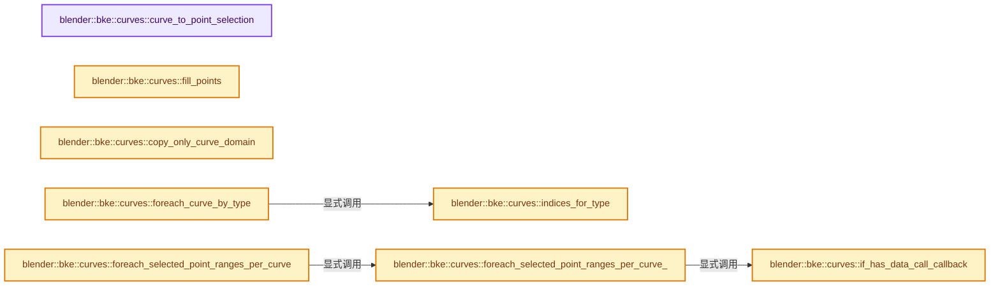
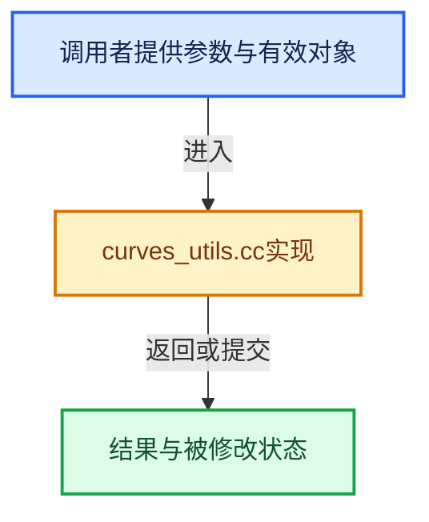

# 实现依赖专题：source/blender/blenkernel/intern/curves_utils.cc

[实现依赖导航](../../README.md) · [符号索引](../../../00-课程指南/02-源码与提交索引/符号依赖与实现索引.md)

本专题从正文实际调用进入，集中保存共享实现。函数有稳定锚点，可从调用处直接跳到对应完整函数；递归与互相调用通过回链组织。

## 本文件的实现关系






## 完整成员与函数实现

<a id="f-c3a92a799ceded39"></a>

### `blender::bke::curves::curve_to_point_selection`

实现位置：[source/blender/blenkernel/intern/curves_utils.cc](../../../../../../../source/blender/blenkernel/intern/curves_utils.cc) · L32—L41。

接口参数：

- `OffsetIndices<int> points_by_curve`
- `const IndexMask &curve_selection`
- `LinearAllocator<> &memory`

**教学注释版**

<!-- annotated:c7ae8df3846c0a -->

```cpp
IndexMask curve_to_point_selection(OffsetIndices<int> points_by_curve,
                                   const IndexMask &curve_selection,
                                   LinearAllocator<> &memory)
{
  Array<index_mask::IndexMask::Initializer> point_ranges(curve_selection.size());
  curve_selection.foreach_index(
      [&](const int curve, const int pos) { point_ranges[pos] = points_by_curve[curve]; },
      exec_mode::grain_size(2048));
  return IndexMask::from_initializers(point_ranges, memory);
}
```

<details>
<summary>核对原始源码：source/blender/blenkernel/intern/curves_utils.cc · L32—L41</summary>

<!-- original:c7ae8df3846c0a:source/blender/blenkernel/intern/curves_utils.cc:32:41 -->

```cpp
IndexMask curve_to_point_selection(OffsetIndices<int> points_by_curve,
                                   const IndexMask &curve_selection,
                                   LinearAllocator<> &memory)
{
  Array<index_mask::IndexMask::Initializer> point_ranges(curve_selection.size());
  curve_selection.foreach_index(
      [&](const int curve, const int pos) { point_ranges[pos] = points_by_curve[curve]; },
      exec_mode::grain_size(2048));
  return IndexMask::from_initializers(point_ranges, memory);
}
```

</details>

**结果出口**

- `return IndexMask::from_initializers(point_ranges, memory);`

**继续追踪实现**

- `curve_selection.size` → [blender::index_mask::IndexMask::size · L743](../../../04-虚拟数组与索引选择/09-分段存储与遍历.md#f-0163b32abc9a0d9c)。
- `curve_selection.foreach_index` → [blender::index_mask::IndexMask::foreach_index · L855](../../../04-虚拟数组与索引选择/09-分段存储与遍历.md#f-cd6cd317e2e2812c)。
- `exec_mode::grain_size` → [blender::exec_mode::grain_size · L79](../../01-BLI基础库/BLI_execution_mode.hh.md#f-0b4fc2f9fa6e66e7)。
- `IndexMask::from_initializers` → [blender::index_mask::IndexMask::from_initializers · L736](../../../04-虚拟数组与索引选择/10-IndexMask构建与并行.md#f-990c4edf7fabd209)。

<a id="f-79990671c7163cd7"></a>

### `blender::bke::curves::fill_points`

实现位置：[source/blender/blenkernel/intern/curves_utils.cc](../../../../../../../source/blender/blenkernel/intern/curves_utils.cc) · L56—L69。

接口参数：

- `const OffsetIndices<int> points_by_curve`
- `const IndexMask &curve_selection`
- `const GPointer value`
- `GMutableSpan dst`

**教学注释版**

<!-- annotated:93231adb469e69 -->

```cpp
void fill_points(const OffsetIndices<int> points_by_curve,
                 const IndexMask &curve_selection,
                 const GPointer value,
                 GMutableSpan dst)
{
  BLI_assert(*value.type() == dst.type());
  const CPPType &type = dst.type();
  curve_selection.foreach_index(
      [&](const int i) {
        const IndexRange points = points_by_curve[i];
        // [讲解] points.size：读取连续区间或分组的边界信息。
        type.fill_assign_n(value.get(), dst.slice(points).data(), points.size());
      },
      exec_mode::grain_size(512));
}
```

<details>
<summary>核对原始源码：source/blender/blenkernel/intern/curves_utils.cc · L56—L69</summary>

<!-- original:93231adb469e69:source/blender/blenkernel/intern/curves_utils.cc:56:69 -->

```cpp
void fill_points(const OffsetIndices<int> points_by_curve,
                 const IndexMask &curve_selection,
                 const GPointer value,
                 GMutableSpan dst)
{
  BLI_assert(*value.type() == dst.type());
  const CPPType &type = dst.type();
  curve_selection.foreach_index(
      [&](const int i) {
        const IndexRange points = points_by_curve[i];
        type.fill_assign_n(value.get(), dst.slice(points).data(), points.size());
      },
      exec_mode::grain_size(512));
}
```

</details>

**继续追踪实现**

- `BLI_assert` → [BLI_assert · L48](../../01-BLI基础库/BLI_assert.hh.md#m-57a88495704d)；[BLI_assert · L63](../../01-BLI基础库/BLI_assert.hh.md#m-d07050020cb5)。宏定义由构建条件选择。
- `value.type` → [blender::GPointer::type · L122](../../../03-内存分配与运行时类型/12-异构值存储实战.md#f-fab893bd990213d9)。
- `dst.type` → [blender::GMutableSpan::type · L182](../../../03-内存分配与运行时类型/11-GSpan与GArray.md#f-74385040046c86d5)。
- `curve_selection.foreach_index` → [blender::index_mask::IndexMask::foreach_index · L855](../../../04-虚拟数组与索引选择/09-分段存储与遍历.md#f-cd6cd317e2e2812c)。
- `type.fill_assign_n` → [blender::CPPType::fill_assign_n · L678](../../../03-内存分配与运行时类型/09-CPPType复制移动重定位.md#f-fd80e7c7f897917a)。
- `value.get` → [blender::GPointer::get · L117](../../../03-内存分配与运行时类型/12-异构值存储实战.md#f-d98a4f1af4104afe)；[blender::GPointer::get · L127](../../../03-内存分配与运行时类型/12-异构值存储实战.md#f-5cf9e563400cde6b)。同名重载需按实参类型选择。
- `dst.slice(points).data` → [调用协议](../../../00-课程指南/01-路线与规范/模板宏与动态分派协议.md)：接收对象类型依赖auto、返回值或模板实例；不按同名猜测目标。调用位置L66。
- `dst.slice` → [blender::GMutableSpan::slice · L227](../../../03-内存分配与运行时类型/11-GSpan与GArray.md#f-d7f8e350bc3a5156)；[blender::GMutableSpan::slice · L235](../../../03-内存分配与运行时类型/11-GSpan与GArray.md#f-b1101d4d9009fa75)。同名重载需按实参类型选择。
- `points.size` → [blender::IndexRange::size · L156](../../../01-基础容器与现代CPP/04-IndexRange连续整数区间.md#f-05f66c3ebb2fdfec)。
- `exec_mode::grain_size` → [blender::exec_mode::grain_size · L79](../../01-BLI基础库/BLI_execution_mode.hh.md#f-0b4fc2f9fa6e66e7)。

<a id="f-84cdd2c91f50ea76"></a>

### `blender::bke::curves::copy_only_curve_domain`

实现位置：[source/blender/blenkernel/intern/curves_utils.cc](../../../../../../../source/blender/blenkernel/intern/curves_utils.cc) · L71—L81。

接口参数：

- `const CurvesGeometry &src_curves`

**教学注释版**

<!-- annotated:78bd0d773b2e3c -->

```cpp
CurvesGeometry copy_only_curve_domain(const CurvesGeometry &src_curves)
{
  CurvesGeometry dst_curves(0, src_curves.curves_num());
  copy_attributes(src_curves.attributes(),
                  AttrDomain::Curve,
                  AttrDomain::Curve,
                  {},
                  dst_curves.attributes_for_write());
  dst_curves.runtime->type_counts = src_curves.runtime->type_counts;
  return dst_curves;
}
```

<details>
<summary>核对原始源码：source/blender/blenkernel/intern/curves_utils.cc · L71—L81</summary>

<!-- original:78bd0d773b2e3c:source/blender/blenkernel/intern/curves_utils.cc:71:81 -->

```cpp
CurvesGeometry copy_only_curve_domain(const CurvesGeometry &src_curves)
{
  CurvesGeometry dst_curves(0, src_curves.curves_num());
  copy_attributes(src_curves.attributes(),
                  AttrDomain::Curve,
                  AttrDomain::Curve,
                  {},
                  dst_curves.attributes_for_write());
  dst_curves.runtime->type_counts = src_curves.runtime->type_counts;
  return dst_curves;
}
```

</details>

**沿实际写入检查状态**

- `dst_curves.runtime->type_counts = src_curves.runtime->type_counts;`

**结果出口**

- `return dst_curves;`

**继续追踪实现**

- `src_curves.curves_num` → [blender::bke::CurvesGeometry::curves_num · L1005](../../../05-几何存储与拓扑映射/04-CurvesGeometry存储.md#f-eabb3f0e5d3c57be)。
- `copy_attributes` → [调用协议](../../../00-课程指南/01-路线与规范/模板宏与动态分派协议.md)：函数指针、局部可调用对象或未展开的宏；必须结合调用者环境。调用位置L74。
- `src_curves.attributes` → [blender::bke::CurvesGeometry::attributes · L1908](curves_geometry.cc.md#f-8e24fbf758862a22)。
- `dst_curves.attributes_for_write` → [blender::bke::CurvesGeometry::attributes_for_write · L1913](curves_geometry.cc.md#f-4930091b34fa9663)。

<a id="f-2224c691a1b71c86"></a>

### `blender::bke::curves::indices_for_type`

实现位置：[source/blender/blenkernel/intern/curves_utils.cc](../../../../../../../source/blender/blenkernel/intern/curves_utils.cc) · L83—L98。

接口参数：

- `const VArray<int8_t> &types`
- `const std::array<int, CURVE_TYPES_NUM> &type_counts`
- `const CurveType type`
- `const IndexMask &selection`
- `LinearAllocator<> &memory`

**教学注释版**

<!-- annotated:3a3de64aaa28da -->

```cpp
IndexMask indices_for_type(const VArray<int8_t> &types,
                           const std::array<int, CURVE_TYPES_NUM> &type_counts,
                           const CurveType type,
                           const IndexMask &selection,
                           LinearAllocator<> &memory)
{
  if (type_counts[type] == types.size()) {
    return selection;
  }
  if (types.is_single()) {
    return types.get_internal_single() == type ? IndexMask(types.size()) : IndexMask(0);
  }
  Span<int8_t> types_span = types.get_internal_span();
  return IndexMask::from_predicate(
      selection, memory, [&](const int index) { return types_span[index] == type; });
}
```

<details>
<summary>核对原始源码：source/blender/blenkernel/intern/curves_utils.cc · L83—L98</summary>

<!-- original:3a3de64aaa28da:source/blender/blenkernel/intern/curves_utils.cc:83:98 -->

```cpp
IndexMask indices_for_type(const VArray<int8_t> &types,
                           const std::array<int, CURVE_TYPES_NUM> &type_counts,
                           const CurveType type,
                           const IndexMask &selection,
                           LinearAllocator<> &memory)
{
  if (type_counts[type] == types.size()) {
    return selection;
  }
  if (types.is_single()) {
    return types.get_internal_single() == type ? IndexMask(types.size()) : IndexMask(0);
  }
  Span<int8_t> types_span = types.get_internal_span();
  return IndexMask::from_predicate(
      selection, memory, [&](const int index) { return types_span[index] == type; });
}
```

</details>

**结果出口**

- `return selection;`
- `return types.get_internal_single() == type ? IndexMask(types.size()) : IndexMask(0);`
- `return IndexMask::from_predicate(`

**继续追踪实现**

- `types.size` → [调用协议](../../../00-课程指南/01-路线与规范/模板宏与动态分派协议.md)：由接收对象具体类型或运行时策略提供实现。调用位置L89。
- `types.is_single` → [调用协议](../../../00-课程指南/01-路线与规范/模板宏与动态分派协议.md)：由接收对象具体类型或运行时策略提供实现。调用位置L92。
- `types.get_internal_single` → [调用协议](../../../00-课程指南/01-路线与规范/模板宏与动态分派协议.md)：由接收对象具体类型或运行时策略提供实现。调用位置L93。
- `IndexMask` → [blender::index_mask::IndexMask::IndexMask · L704](../../../04-虚拟数组与索引选择/09-分段存储与遍历.md#f-8c95440e4c5fec78)；[blender::index_mask::IndexMask::IndexMask · L709](../../../04-虚拟数组与索引选择/09-分段存储与遍历.md#f-fdd9dc18868bc0cd)；[blender::index_mask::IndexMask::IndexMask · L722](../../../04-虚拟数组与索引选择/09-分段存储与遍历.md#f-4b32f3ba3de66d05)。同名重载需按实参类型选择。
- `types.get_internal_span` → [调用协议](../../../00-课程指南/01-路线与规范/模板宏与动态分派协议.md)：由接收对象具体类型或运行时策略提供实现。调用位置L95。
- `IndexMask::from_predicate` → [blender::index_mask::IndexMask::from_predicate · L1073](../../../04-虚拟数组与索引选择/12-重构历史与基准练习.md#f-3864daa059098df8)。

<a id="f-8ac12f9090c8c231"></a>

### `blender::bke::curves::foreach_curve_by_type`

实现位置：[source/blender/blenkernel/intern/curves_utils.cc](../../../../../../../source/blender/blenkernel/intern/curves_utils.cc) · L100—L119。

接口参数：

- `const VArray<int8_t> &types`
- `const std::array<int, CURVE_TYPES_NUM> &counts`
- `const IndexMask &selection`
- `FunctionRef<void(IndexMask)> catmull_rom_fn`
- `IndexMask`
- `FunctionRef<void(IndexMask)> poly_fn`
- `IndexMask`
- `FunctionRef<void(IndexMask)> bezier_fn`
- `IndexMask`
- `FunctionRef<void(IndexMask)> nurbs_fn`
- `IndexMask`

**教学注释版**

<!-- annotated:3e2ce6683bcc5e -->

```cpp
void foreach_curve_by_type(const VArray<int8_t> &types,
                           const std::array<int, CURVE_TYPES_NUM> &counts,
                           const IndexMask &selection,
                           FunctionRef<void(IndexMask)> catmull_rom_fn,
                           FunctionRef<void(IndexMask)> poly_fn,
                           FunctionRef<void(IndexMask)> bezier_fn,
                           FunctionRef<void(IndexMask)> nurbs_fn)
{
  auto call_if_not_empty = [&](const CurveType type, FunctionRef<void(IndexMask)> fn) {
    IndexMaskMemory memory;
    const IndexMask mask = indices_for_type(types, counts, type, selection, memory);
    if (!mask.is_empty()) {
      fn(mask);
    }
  };
  call_if_not_empty(CURVE_TYPE_CATMULL_ROM, catmull_rom_fn);
  call_if_not_empty(CURVE_TYPE_POLY, poly_fn);
  call_if_not_empty(CURVE_TYPE_BEZIER, bezier_fn);
  call_if_not_empty(CURVE_TYPE_NURBS, nurbs_fn);
}
```

<details>
<summary>核对原始源码：source/blender/blenkernel/intern/curves_utils.cc · L100—L119</summary>

<!-- original:3e2ce6683bcc5e:source/blender/blenkernel/intern/curves_utils.cc:100:119 -->

```cpp
void foreach_curve_by_type(const VArray<int8_t> &types,
                           const std::array<int, CURVE_TYPES_NUM> &counts,
                           const IndexMask &selection,
                           FunctionRef<void(IndexMask)> catmull_rom_fn,
                           FunctionRef<void(IndexMask)> poly_fn,
                           FunctionRef<void(IndexMask)> bezier_fn,
                           FunctionRef<void(IndexMask)> nurbs_fn)
{
  auto call_if_not_empty = [&](const CurveType type, FunctionRef<void(IndexMask)> fn) {
    IndexMaskMemory memory;
    const IndexMask mask = indices_for_type(types, counts, type, selection, memory);
    if (!mask.is_empty()) {
      fn(mask);
    }
  };
  call_if_not_empty(CURVE_TYPE_CATMULL_ROM, catmull_rom_fn);
  call_if_not_empty(CURVE_TYPE_POLY, poly_fn);
  call_if_not_empty(CURVE_TYPE_BEZIER, bezier_fn);
  call_if_not_empty(CURVE_TYPE_NURBS, nurbs_fn);
}
```

</details>

**继续追踪实现**

- `indices_for_type` → [blender::bke::curves::indices_for_type · L83](curves_utils.cc.md#f-2224c691a1b71c86)。
- `mask.is_empty` → [blender::index_mask::IndexMask::is_empty · L748](../../../04-虚拟数组与索引选择/09-分段存储与遍历.md#f-190ac996386064f4)。
- `fn` → [调用协议](../../../00-课程指南/01-路线与规范/模板宏与动态分派协议.md)：局部可调用对象，须结合其初始化与捕获环境。调用位置L112。
- `call_if_not_empty` → [调用协议](../../../00-课程指南/01-路线与规范/模板宏与动态分派协议.md)：局部可调用对象，须结合其初始化与捕获环境。调用位置L115。

<a id="f-08b8638af0527335"></a>

### `blender::bke::curves::if_has_data_call_callback`

实现位置：[source/blender/blenkernel/intern/curves_utils.cc](../../../../../../../source/blender/blenkernel/intern/curves_utils.cc) · L121—L131。

接口参数：

- `const Span<int> offset_data`
- `const int begin`
- `const int end`
- `UnselectedCallback callback`

**教学注释版**

<!-- annotated:50206ec635d0e2 -->

```cpp
static void if_has_data_call_callback(const Span<int> offset_data,
                                      const int begin,
                                      const int end,
                                      UnselectedCallback callback)
{
  if (begin < end) {
    const IndexRange curves = IndexRange::from_begin_end(begin, end);
    const IndexRange points = IndexRange::from_begin_end(offset_data[begin], offset_data[end]);
    callback(curves, points);
  }
};
```

<details>
<summary>核对原始源码：source/blender/blenkernel/intern/curves_utils.cc · L121—L131</summary>

<!-- original:50206ec635d0e2:source/blender/blenkernel/intern/curves_utils.cc:121:131 -->

```cpp
static void if_has_data_call_callback(const Span<int> offset_data,
                                      const int begin,
                                      const int end,
                                      UnselectedCallback callback)
{
  if (begin < end) {
    const IndexRange curves = IndexRange::from_begin_end(begin, end);
    const IndexRange points = IndexRange::from_begin_end(offset_data[begin], offset_data[end]);
    callback(curves, points);
  }
};
```

</details>

**继续追踪实现**

- `IndexRange::from_begin_end` → [blender::IndexRange::from_begin_end · L78](../../../01-基础容器与现代CPP/04-IndexRange连续整数区间.md#f-a523839fb9650253)。
- `callback` → [调用协议](../../../00-课程指南/01-路线与规范/模板宏与动态分派协议.md)：局部可调用对象，须结合其初始化与捕获环境。调用位置L129。

<a id="f-c6adbea7e05397ab"></a>

### `blender::bke::curves::foreach_selected_point_ranges_per_curve_`

实现位置：[source/blender/blenkernel/intern/curves_utils.cc](../../../../../../../source/blender/blenkernel/intern/curves_utils.cc) · L133—L178。

接口参数：

- `const IndexMask &mask`
- `const OffsetIndices<int> points_by_curve`
- `const SelectedCallback selected_fn`
- `const Fn unselected_fn`

**教学注释版**

<!-- annotated:e0dc96da722612 -->

```cpp
template<typename Fn>
static void foreach_selected_point_ranges_per_curve_(const IndexMask &mask,
                                                     const OffsetIndices<int> points_by_curve,
                                                     const SelectedCallback selected_fn,
                                                     const Fn unselected_fn)
{
  Vector<IndexRange> ranges;
  Span<int> offset_data = points_by_curve.data();

  int curve_i = mask.is_empty() ? -1 : 0;

  int range_first = mask.is_empty() ? 0 : mask.first();
  int range_last = range_first - 1;

  mask.foreach_index([&](const int64_t index) {
    if (offset_data[curve_i + 1] <= index) {
      int first_unselected_curve = curve_i;
      if (range_last >= range_first) {
        // [讲解] ranges.append：在尾部建立新元素，必要时先扩大存储。
        ranges.append(IndexRange::from_begin_end_inclusive(range_first, range_last));
        selected_fn(curve_i, points_by_curve[curve_i], ranges);
        // [讲解] ranges.clear：销毁所有有效元素，把size变为0，但保留原分配或内嵌容量。
        ranges.clear();
        first_unselected_curve++;
      }
      do {
        ++curve_i;
      } while (offset_data[curve_i + 1] <= index);
      if constexpr (std::is_invocable_r_v<void, Fn, IndexRange, IndexRange>) {
        if_has_data_call_callback(offset_data, first_unselected_curve, curve_i, unselected_fn);
      }
      range_first = index;
    }
    else if (range_last + 1 != index) {
      ranges.append(IndexRange::from_begin_end_inclusive(range_first, range_last));
      range_first = index;
    }
    range_last = index;
  });

  if (range_last - range_first >= 0) {
    ranges.append(IndexRange::from_begin_end_inclusive(range_first, range_last));
    selected_fn(curve_i, points_by_curve[curve_i], ranges);
  }
  if constexpr (std::is_invocable_r_v<void, Fn, IndexRange, IndexRange>) {
    // [讲解] points_by_curve.size：读取连续区间或分组的边界信息。
    if_has_data_call_callback(offset_data, curve_i + 1, points_by_curve.size(), unselected_fn);
  }
}
```

<details>
<summary>核对原始源码：source/blender/blenkernel/intern/curves_utils.cc · L133—L178</summary>

<!-- original:e0dc96da722612:source/blender/blenkernel/intern/curves_utils.cc:133:178 -->

```cpp
template<typename Fn>
static void foreach_selected_point_ranges_per_curve_(const IndexMask &mask,
                                                     const OffsetIndices<int> points_by_curve,
                                                     const SelectedCallback selected_fn,
                                                     const Fn unselected_fn)
{
  Vector<IndexRange> ranges;
  Span<int> offset_data = points_by_curve.data();

  int curve_i = mask.is_empty() ? -1 : 0;

  int range_first = mask.is_empty() ? 0 : mask.first();
  int range_last = range_first - 1;

  mask.foreach_index([&](const int64_t index) {
    if (offset_data[curve_i + 1] <= index) {
      int first_unselected_curve = curve_i;
      if (range_last >= range_first) {
        ranges.append(IndexRange::from_begin_end_inclusive(range_first, range_last));
        selected_fn(curve_i, points_by_curve[curve_i], ranges);
        ranges.clear();
        first_unselected_curve++;
      }
      do {
        ++curve_i;
      } while (offset_data[curve_i + 1] <= index);
      if constexpr (std::is_invocable_r_v<void, Fn, IndexRange, IndexRange>) {
        if_has_data_call_callback(offset_data, first_unselected_curve, curve_i, unselected_fn);
      }
      range_first = index;
    }
    else if (range_last + 1 != index) {
      ranges.append(IndexRange::from_begin_end_inclusive(range_first, range_last));
      range_first = index;
    }
    range_last = index;
  });

  if (range_last - range_first >= 0) {
    ranges.append(IndexRange::from_begin_end_inclusive(range_first, range_last));
    selected_fn(curve_i, points_by_curve[curve_i], ranges);
  }
  if constexpr (std::is_invocable_r_v<void, Fn, IndexRange, IndexRange>) {
    if_has_data_call_callback(offset_data, curve_i + 1, points_by_curve.size(), unselected_fn);
  }
}
```

</details>

**沿实际写入检查状态**

- `range_first = index;`
- `range_last = index;`

**继续追踪实现**

- `points_by_curve.data` → [blender::offset_indices::OffsetIndices::data · L109](../../../05-几何存储与拓扑映射/02-OffsetIndices完整接口.md#f-aab71e7e2c02fc06)。
- `mask.is_empty` → [blender::index_mask::IndexMask::is_empty · L748](../../../04-虚拟数组与索引选择/09-分段存储与遍历.md#f-190ac996386064f4)。
- `mask.first` → [blender::index_mask::IndexMask::first · L768](../../../04-虚拟数组与索引选择/09-分段存储与遍历.md#f-0fdcf75a0be7ad37)。
- `mask.foreach_index` → [blender::index_mask::IndexMask::foreach_index · L855](../../../04-虚拟数组与索引选择/09-分段存储与遍历.md#f-cd6cd317e2e2812c)。
- `ranges.append` → [blender::Vector::append · L498](../../../01-基础容器与现代CPP/11-Vector插入删除与重排.md#f-5bde268a69e443ec)；[blender::Vector::append · L502](../../../01-基础容器与现代CPP/11-Vector插入删除与重排.md#f-591e0b15e6308532)。同名重载需按实参类型选择。
- `IndexRange::from_begin_end_inclusive` → [blender::IndexRange::from_begin_end_inclusive · L83](../../../01-基础容器与现代CPP/04-IndexRange连续整数区间.md#f-66cc5b933b552ea1)。
- `selected_fn` → [调用协议](../../../00-课程指南/01-路线与规范/模板宏与动态分派协议.md)：局部可调用对象，须结合其初始化与捕获环境。调用位置L152。
- `ranges.clear` → [blender::Vector::clear · L468](../../../01-基础容器与现代CPP/10-Vector扩容与增长.md#f-d051bebff5275a43)。
- `if_has_data_call_callback` → [blender::bke::curves::if_has_data_call_callback · L121](curves_utils.cc.md#f-08b8638af0527335)。
- `points_by_curve.size` → [blender::offset_indices::OffsetIndices::size · L67](../../../05-几何存储与拓扑映射/02-OffsetIndices完整接口.md#f-e238abc62ed42abd)。

<a id="f-baa97ab17a8255d6"></a>

### `blender::bke::curves::foreach_selected_point_ranges_per_curve`

实现位置：[source/blender/blenkernel/intern/curves_utils.cc](../../../../../../../source/blender/blenkernel/intern/curves_utils.cc) · L180—L185。

接口参数：

- `const IndexMask &mask`
- `const OffsetIndices<int> points_by_curve`
- `const SelectedCallback selected_fn`

**教学注释版**

<!-- annotated:ff61b20cd65c0e -->

```cpp
void foreach_selected_point_ranges_per_curve(const IndexMask &mask,
                                             const OffsetIndices<int> points_by_curve,
                                             const SelectedCallback selected_fn)
{
  foreach_selected_point_ranges_per_curve_<void()>(mask, points_by_curve, selected_fn, nullptr);
}
```

<details>
<summary>核对原始源码：source/blender/blenkernel/intern/curves_utils.cc · L180—L185</summary>

<!-- original:ff61b20cd65c0e:source/blender/blenkernel/intern/curves_utils.cc:180:185 -->

```cpp
void foreach_selected_point_ranges_per_curve(const IndexMask &mask,
                                             const OffsetIndices<int> points_by_curve,
                                             const SelectedCallback selected_fn)
{
  foreach_selected_point_ranges_per_curve_<void()>(mask, points_by_curve, selected_fn, nullptr);
}
```

</details>

**继续追踪实现**

- `foreach_selected_point_ranges_per_curve_<void()>` → [blender::bke::curves::foreach_selected_point_ranges_per_curve_ · L133](curves_utils.cc.md#f-c6adbea7e05397ab)。

<a id="f-f354501b54d0d24f"></a>

### `blender::bke::curves::foreach_selected_point_ranges_per_curve`

实现位置：[source/blender/blenkernel/intern/curves_utils.cc](../../../../../../../source/blender/blenkernel/intern/curves_utils.cc) · L187—L194。

接口参数：

- `const IndexMask &mask`
- `const OffsetIndices<int> points_by_curve`
- `const SelectedCallback selected_fn`
- `const UnselectedCallback unselected_fn`

**教学注释版**

<!-- annotated:1a2345bf4f2494 -->

```cpp
void foreach_selected_point_ranges_per_curve(const IndexMask &mask,
                                             const OffsetIndices<int> points_by_curve,
                                             const SelectedCallback selected_fn,
                                             const UnselectedCallback unselected_fn)
{
  foreach_selected_point_ranges_per_curve_<UnselectedCallback>(
      mask, points_by_curve, selected_fn, unselected_fn);
}
```

<details>
<summary>核对原始源码：source/blender/blenkernel/intern/curves_utils.cc · L187—L194</summary>

<!-- original:1a2345bf4f2494:source/blender/blenkernel/intern/curves_utils.cc:187:194 -->

```cpp
void foreach_selected_point_ranges_per_curve(const IndexMask &mask,
                                             const OffsetIndices<int> points_by_curve,
                                             const SelectedCallback selected_fn,
                                             const UnselectedCallback unselected_fn)
{
  foreach_selected_point_ranges_per_curve_<UnselectedCallback>(
      mask, points_by_curve, selected_fn, unselected_fn);
}
```

</details>

**继续追踪实现**

- `foreach_selected_point_ranges_per_curve_<UnselectedCallback>` → [blender::bke::curves::foreach_selected_point_ranges_per_curve_ · L133](curves_utils.cc.md#f-c6adbea7e05397ab)。

<a id="f-f73d286038bd1cd1"></a>

### `blender::bke::curves::nurbs::gather_custom_knots`

实现位置：[source/blender/blenkernel/intern/curves_utils.cc](../../../../../../../source/blender/blenkernel/intern/curves_utils.cc) · L260—L277。

接口参数：

- `const bke::CurvesGeometry &src`
- `const IndexMask &src_curves`
- `const int dst_curve_offset`
- `bke::CurvesGeometry &dst`

**教学注释版**

<!-- annotated:df97e81f5b2774 -->

```cpp
void gather_custom_knots(const bke::CurvesGeometry &src,
                         const IndexMask &src_curves,
                         const int dst_curve_offset,
                         bke::CurvesGeometry &dst)
{
  const OffsetIndices<int> src_knots_by_curve = src.nurbs_custom_knots_by_curve();
  const int start_offset = dst.nurbs_custom_knots_by_curve()[dst_curve_offset].start();
  Array<int> dst_offsets(src_curves.size() + 1);

  offset_indices::gather_selected_offsets(
      src_knots_by_curve, src_curves, start_offset, dst_offsets);

  array_utils::gather_group_to_group(src_knots_by_curve,
                                     // [讲解] dst_offsets.as_span：提供数组的借用访问入口。
                                     dst_offsets.as_span(),
                                     src_curves,
                                     src.nurbs_custom_knots(),
                                     dst.nurbs_custom_knots_for_write());
}
```

<details>
<summary>核对原始源码：source/blender/blenkernel/intern/curves_utils.cc · L260—L277</summary>

<!-- original:df97e81f5b2774:source/blender/blenkernel/intern/curves_utils.cc:260:277 -->

```cpp
void gather_custom_knots(const bke::CurvesGeometry &src,
                         const IndexMask &src_curves,
                         const int dst_curve_offset,
                         bke::CurvesGeometry &dst)
{
  const OffsetIndices<int> src_knots_by_curve = src.nurbs_custom_knots_by_curve();
  const int start_offset = dst.nurbs_custom_knots_by_curve()[dst_curve_offset].start();
  Array<int> dst_offsets(src_curves.size() + 1);

  offset_indices::gather_selected_offsets(
      src_knots_by_curve, src_curves, start_offset, dst_offsets);

  array_utils::gather_group_to_group(src_knots_by_curve,
                                     dst_offsets.as_span(),
                                     src_curves,
                                     src.nurbs_custom_knots(),
                                     dst.nurbs_custom_knots_for_write());
}
```

</details>

**继续追踪实现**

- `src.nurbs_custom_knots_by_curve` → [blender::bke::CurvesGeometry::nurbs_custom_knots_by_curve · L555](curves_geometry.cc.md#f-3fc61429012c4ef6)。
- `dst.nurbs_custom_knots_by_curve()[dst_curve_offset].start` → [调用协议](../../../00-课程指南/01-路线与规范/模板宏与动态分派协议.md)：接收对象类型依赖auto、返回值或模板实例；不按同名猜测目标。调用位置L266。
- `dst.nurbs_custom_knots_by_curve` → [blender::bke::CurvesGeometry::nurbs_custom_knots_by_curve · L555](curves_geometry.cc.md#f-3fc61429012c4ef6)。
- `src_curves.size` → [blender::index_mask::IndexMask::size · L743](../../../04-虚拟数组与索引选择/09-分段存储与遍历.md#f-0163b32abc9a0d9c)。
- `offset_indices::gather_selected_offsets` → [blender::offset_indices::gather_selected_offsets · L135](../../../05-几何存储与拓扑映射/05-邻接关系与前缀和.md#f-db58dc5f33a70276)；[blender::offset_indices::gather_selected_offsets · L152](../../../05-几何存储与拓扑映射/05-邻接关系与前缀和.md#f-81774b7fe5ae69aa)；[blender::offset_indices::gather_selected_offsets · L182](../../../05-几何存储与拓扑映射/02-OffsetIndices完整接口.md#f-7114c46ef264d80b)；[blender::offset_indices::gather_selected_offsets · L192](../../../05-几何存储与拓扑映射/02-OffsetIndices完整接口.md#f-25cd4510af788ad9)。同名重载需按实参类型选择。
- `array_utils::gather_group_to_group` → [blender::array_utils::gather_group_to_group · L277](../../../05-几何存储与拓扑映射/07-分组访问与反向索引.md#f-9a8d6622652e3b4f)；[blender::array_utils::gather_group_to_group · L291](../../../05-几何存储与拓扑映射/07-分组访问与反向索引.md#f-330167e6d0e14cf9)；[blender::array_utils::gather_group_to_group · L305](../../../05-几何存储与拓扑映射/07-分组访问与反向索引.md#f-01a9cb8bd5e4abab)。同名重载需按实参类型选择。
- `dst_offsets.as_span` → [blender::Array::as_span · L254](../../../01-基础容器与现代CPP/08-Array复制移动与销毁.md#f-05fc77056a242032)。
- `src.nurbs_custom_knots` → [blender::bke::CurvesGeometry::nurbs_custom_knots · L528](curves_geometry.cc.md#f-98278c23b44fbebb)。
- `dst.nurbs_custom_knots_for_write` → [blender::bke::CurvesGeometry::nurbs_custom_knots_for_write · L536](curves_geometry.cc.md#f-b4d54718411be479)。

<a id="f-7285bc772668517a"></a>

### `blender::bke::curves::nurbs::update_custom_knot_modes`

实现位置：[source/blender/blenkernel/intern/curves_utils.cc](../../../../../../../source/blender/blenkernel/intern/curves_utils.cc) · L279—L295。

接口参数：

- `const IndexMask &mask`
- `const KnotsMode mode_for_regular`
- `const KnotsMode mode_for_cyclic`
- `bke::CurvesGeometry &curves`

**教学注释版**

<!-- annotated:3ddd88d7940f7c -->

```cpp
void update_custom_knot_modes(const IndexMask &mask,
                              const KnotsMode mode_for_regular,
                              const KnotsMode mode_for_cyclic,
                              bke::CurvesGeometry &curves)
{
  const VArray<bool> cyclic = curves.cyclic();
  MutableSpan<int8_t> knot_modes = curves.nurbs_knots_modes_for_write();
  mask.foreach_index(
      [&](const int64_t curve) {
        int8_t &knot_mode = knot_modes[curve];
        if (knot_mode == NURBS_KNOT_MODE_CUSTOM) {
          knot_mode = cyclic[curve] ? mode_for_cyclic : mode_for_regular;
        }
      },
      exec_mode::grain_size(512));
  curves.nurbs_custom_knots_update_size();
}
```

<details>
<summary>核对原始源码：source/blender/blenkernel/intern/curves_utils.cc · L279—L295</summary>

<!-- original:3ddd88d7940f7c:source/blender/blenkernel/intern/curves_utils.cc:279:295 -->

```cpp
void update_custom_knot_modes(const IndexMask &mask,
                              const KnotsMode mode_for_regular,
                              const KnotsMode mode_for_cyclic,
                              bke::CurvesGeometry &curves)
{
  const VArray<bool> cyclic = curves.cyclic();
  MutableSpan<int8_t> knot_modes = curves.nurbs_knots_modes_for_write();
  mask.foreach_index(
      [&](const int64_t curve) {
        int8_t &knot_mode = knot_modes[curve];
        if (knot_mode == NURBS_KNOT_MODE_CUSTOM) {
          knot_mode = cyclic[curve] ? mode_for_cyclic : mode_for_regular;
        }
      },
      exec_mode::grain_size(512));
  curves.nurbs_custom_knots_update_size();
}
```

</details>

**沿实际写入检查状态**

- `knot_mode = cyclic[curve] ? mode_for_cyclic : mode_for_regular;`

**继续追踪实现**

- `curves.cyclic` → [blender::bke::CurvesGeometry::cyclic · L362](curves_geometry.cc.md#f-ec08c2a1d6f3bfea)。
- `curves.nurbs_knots_modes_for_write` → [blender::bke::CurvesGeometry::nurbs_knots_modes_for_write · L503](curves_geometry.cc.md#f-91d1b54ee2f8af59)。
- `mask.foreach_index` → [blender::index_mask::IndexMask::foreach_index · L855](../../../04-虚拟数组与索引选择/09-分段存储与遍历.md#f-cd6cd317e2e2812c)。
- `exec_mode::grain_size` → [blender::exec_mode::grain_size · L79](../../01-BLI基础库/BLI_execution_mode.hh.md#f-0b4fc2f9fa6e66e7)。
- `curves.nurbs_custom_knots_update_size` → [blender::bke::CurvesGeometry::nurbs_custom_knots_update_size · L587](curves_geometry.cc.md#f-d445d63e7e1b4649)。

<a id="f-30dd40b46714a0fd"></a>

### `blender::bke::curves::nurbs::copy_custom_knots`

实现位置：[source/blender/blenkernel/intern/curves_utils.cc](../../../../../../../source/blender/blenkernel/intern/curves_utils.cc) · L297—L315。

接口参数：

- `const bke::CurvesGeometry &src_curves`
- `const IndexMask &exclude_curves`
- `bke::CurvesGeometry &dst_curves`

**教学注释版**

<!-- annotated:e4a27bf44fd746 -->

```cpp
void copy_custom_knots(const bke::CurvesGeometry &src_curves,
                       const IndexMask &exclude_curves,
                       bke::CurvesGeometry &dst_curves)
{
  BLI_assert(src_curves.curves_num() == dst_curves.curves_num());

  if (src_curves.nurbs_has_custom_knots()) {
    /* Ensure excluded curves don't have NURBS_KNOT_MODE_CUSTOM set. */
    bke::curves::nurbs::update_custom_knot_modes(
        exclude_curves, NURBS_KNOT_MODE_NORMAL, NURBS_KNOT_MODE_NORMAL, dst_curves);
    IndexMaskMemory memory;
    bke::curves::nurbs::gather_custom_knots(
        src_curves,
        IndexMask::from_difference(
            src_curves.nurbs_custom_knot_curves(memory), exclude_curves, memory),
        0,
        dst_curves);
  }
}
```

<details>
<summary>核对原始源码：source/blender/blenkernel/intern/curves_utils.cc · L297—L315</summary>

<!-- original:e4a27bf44fd746:source/blender/blenkernel/intern/curves_utils.cc:297:315 -->

```cpp
void copy_custom_knots(const bke::CurvesGeometry &src_curves,
                       const IndexMask &exclude_curves,
                       bke::CurvesGeometry &dst_curves)
{
  BLI_assert(src_curves.curves_num() == dst_curves.curves_num());

  if (src_curves.nurbs_has_custom_knots()) {
    /* Ensure excluded curves don't have NURBS_KNOT_MODE_CUSTOM set. */
    bke::curves::nurbs::update_custom_knot_modes(
        exclude_curves, NURBS_KNOT_MODE_NORMAL, NURBS_KNOT_MODE_NORMAL, dst_curves);
    IndexMaskMemory memory;
    bke::curves::nurbs::gather_custom_knots(
        src_curves,
        IndexMask::from_difference(
            src_curves.nurbs_custom_knot_curves(memory), exclude_curves, memory),
        0,
        dst_curves);
  }
}
```

</details>

**继续追踪实现**

- `BLI_assert` → [BLI_assert · L48](../../01-BLI基础库/BLI_assert.hh.md#m-57a88495704d)；[BLI_assert · L63](../../01-BLI基础库/BLI_assert.hh.md#m-d07050020cb5)。宏定义由构建条件选择。
- `src_curves.curves_num` → [blender::bke::CurvesGeometry::curves_num · L1005](../../../05-几何存储与拓扑映射/04-CurvesGeometry存储.md#f-eabb3f0e5d3c57be)。
- `dst_curves.curves_num` → [blender::bke::CurvesGeometry::curves_num · L1005](../../../05-几何存储与拓扑映射/04-CurvesGeometry存储.md#f-eabb3f0e5d3c57be)。
- `src_curves.nurbs_has_custom_knots` → [blender::bke::CurvesGeometry::nurbs_has_custom_knots · L1009](../../../05-几何存储与拓扑映射/04-CurvesGeometry存储.md#f-462177a6bae60d14)。
- `bke::curves::nurbs::update_custom_knot_modes` → [blender::bke::curves::nurbs::update_custom_knot_modes · L279](curves_utils.cc.md#f-7285bc772668517a)。
- `bke::curves::nurbs::gather_custom_knots` → [blender::bke::curves::nurbs::gather_custom_knots · L260](curves_utils.cc.md#f-f73d286038bd1cd1)。
- `IndexMask::from_difference` → [blender::index_mask::IndexMask::from_difference · L718](../../../04-虚拟数组与索引选择/10-IndexMask构建与并行.md#f-2cf6879a7399cc50)。
- `src_curves.nurbs_custom_knot_curves` → [blender::bke::CurvesGeometry::nurbs_custom_knot_curves · L546](curves_geometry.cc.md#f-ac3ce557b065707d)。
