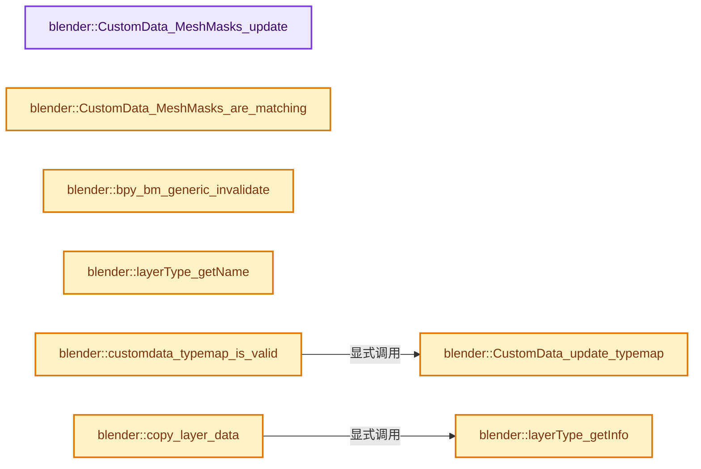
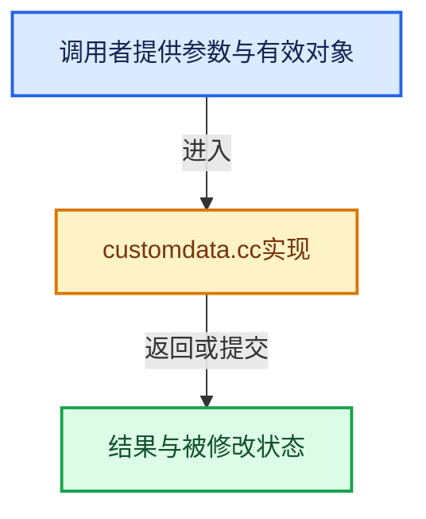

# 实现依赖专题：source/blender/blenkernel/intern/customdata.cc

[实现依赖导航](../../README.md) · [符号索引](../../../00-课程指南/02-源码与提交索引/符号依赖与实现索引.md)

本专题从正文实际调用进入，集中保存共享实现。函数有稳定锚点，可从调用处直接跳到对应完整函数；递归与互相调用通过回链组织。

## 本文件的实现关系






## 完整成员与函数实现

<a id="f-5a41f0d857270b16"></a>

### `blender::CustomData_MeshMasks_update`

实现位置：[source/blender/blenkernel/intern/customdata.cc](../../../../../../../source/blender/blenkernel/intern/customdata.cc) · L89—L97。

接口参数：

- `CustomData_MeshMasks *mask_dst`
- `const CustomData_MeshMasks *mask_src`

**教学注释版**

<!-- annotated:be7f27bbb650e6 -->

```cpp
void CustomData_MeshMasks_update(CustomData_MeshMasks *mask_dst,
                                 const CustomData_MeshMasks *mask_src)
{
  mask_dst->vmask |= mask_src->vmask;
  mask_dst->emask |= mask_src->emask;
  mask_dst->fmask |= mask_src->fmask;
  mask_dst->pmask |= mask_src->pmask;
  mask_dst->lmask |= mask_src->lmask;
}
```

<details>
<summary>核对原始源码：source/blender/blenkernel/intern/customdata.cc · L89—L97</summary>

<!-- original:be7f27bbb650e6:source/blender/blenkernel/intern/customdata.cc:89:97 -->

```cpp
void CustomData_MeshMasks_update(CustomData_MeshMasks *mask_dst,
                                 const CustomData_MeshMasks *mask_src)
{
  mask_dst->vmask |= mask_src->vmask;
  mask_dst->emask |= mask_src->emask;
  mask_dst->fmask |= mask_src->fmask;
  mask_dst->pmask |= mask_src->pmask;
  mask_dst->lmask |= mask_src->lmask;
}
```

</details>

**沿实际写入检查状态**

- `mask_dst->vmask |= mask_src->vmask;`
- `mask_dst->emask |= mask_src->emask;`
- `mask_dst->fmask |= mask_src->fmask;`
- `mask_dst->pmask |= mask_src->pmask;`
- `mask_dst->lmask |= mask_src->lmask;`

**继续追踪实现**

本实现没有需要继续展开的显式调用；检查返回表达式、对象转换和调用者前置条件。

<a id="f-24e91cd329d91924"></a>

### `blender::CustomData_MeshMasks_are_matching`

实现位置：[source/blender/blenkernel/intern/customdata.cc](../../../../../../../source/blender/blenkernel/intern/customdata.cc) · L99—L107。

接口参数：

- `const CustomData_MeshMasks *mask_ref`
- `const CustomData_MeshMasks *mask_required`

**教学注释版**

<!-- annotated:25e63509e77644 -->

```cpp
bool CustomData_MeshMasks_are_matching(const CustomData_MeshMasks *mask_ref,
                                       const CustomData_MeshMasks *mask_required)
{
  return (((mask_required->vmask & mask_ref->vmask) == mask_required->vmask) &&
          ((mask_required->emask & mask_ref->emask) == mask_required->emask) &&
          ((mask_required->fmask & mask_ref->fmask) == mask_required->fmask) &&
          ((mask_required->pmask & mask_ref->pmask) == mask_required->pmask) &&
          ((mask_required->lmask & mask_ref->lmask) == mask_required->lmask));
}
```

<details>
<summary>核对原始源码：source/blender/blenkernel/intern/customdata.cc · L99—L107</summary>

<!-- original:25e63509e77644:source/blender/blenkernel/intern/customdata.cc:99:107 -->

```cpp
bool CustomData_MeshMasks_are_matching(const CustomData_MeshMasks *mask_ref,
                                       const CustomData_MeshMasks *mask_required)
{
  return (((mask_required->vmask & mask_ref->vmask) == mask_required->vmask) &&
          ((mask_required->emask & mask_ref->emask) == mask_required->emask) &&
          ((mask_required->fmask & mask_ref->fmask) == mask_required->fmask) &&
          ((mask_required->pmask & mask_ref->pmask) == mask_required->pmask) &&
          ((mask_required->lmask & mask_ref->lmask) == mask_required->lmask));
}
```

</details>

**结果出口**

- `return (((mask_required->vmask & mask_ref->vmask) == mask_required->vmask) &&`

**继续追踪实现**

本实现没有需要继续展开的显式调用；检查返回表达式、对象转换和调用者前置条件。

<a id="f-83ee4b5c3f2db74e"></a>

### `blender::bpy_bm_generic_invalidate`

实现位置：[source/blender/blenkernel/intern/customdata.cc](../../../../../../../source/blender/blenkernel/intern/customdata.cc) · L719—L722。

接口参数：

- `struct BPy_BMGeneric *`

**教学注释版**

<!-- annotated:7ed1ed0a36760f -->

```cpp
void bpy_bm_generic_invalidate(struct BPy_BMGeneric * /*self*/)
{
  /* dummy */
}
```

<details>
<summary>核对原始源码：source/blender/blenkernel/intern/customdata.cc · L719—L722</summary>

<!-- original:7ed1ed0a36760f:source/blender/blenkernel/intern/customdata.cc:719:722 -->

```cpp
void bpy_bm_generic_invalidate(struct BPy_BMGeneric * /*self*/)
{
  /* dummy */
}
```

</details>

**继续追踪实现**

本实现没有需要继续展开的显式调用；检查返回表达式、对象转换和调用者前置条件。

<a id="f-0142d6dd32b30721"></a>

### `blender::layerType_getInfo`

实现位置：[source/blender/blenkernel/intern/customdata.cc](../../../../../../../source/blender/blenkernel/intern/customdata.cc) · L2076—L2083。

接口参数：

- `const eCustomDataType type`

**教学注释版**

<!-- annotated:721af73afd42a9 -->

```cpp
static const LayerTypeInfo *layerType_getInfo(const eCustomDataType type)
{
  if (type < 0 || type >= CD_NUMTYPES) {
    return nullptr;
  }

  return &LAYERTYPEINFO[type];
}
```

<details>
<summary>核对原始源码：source/blender/blenkernel/intern/customdata.cc · L2076—L2083</summary>

<!-- original:721af73afd42a9:source/blender/blenkernel/intern/customdata.cc:2076:2083 -->

```cpp
static const LayerTypeInfo *layerType_getInfo(const eCustomDataType type)
{
  if (type < 0 || type >= CD_NUMTYPES) {
    return nullptr;
  }

  return &LAYERTYPEINFO[type];
}
```

</details>

**结果出口**

- `return nullptr;`
- `return &LAYERTYPEINFO[type];`

**继续追踪实现**

本实现没有需要继续展开的显式调用；检查返回表达式、对象转换和调用者前置条件。

<a id="f-801fe8654ae822fd"></a>

### `blender::layerType_getName`

实现位置：[source/blender/blenkernel/intern/customdata.cc](../../../../../../../source/blender/blenkernel/intern/customdata.cc) · L2085—L2092。

接口参数：

- `const eCustomDataType type`

**教学注释版**

<!-- annotated:3fcd5270077dca -->

```cpp
static const char *layerType_getName(const eCustomDataType type)
{
  if (type < 0 || type >= CD_NUMTYPES) {
    return nullptr;
  }

  return LAYERTYPENAMES[type];
}
```

<details>
<summary>核对原始源码：source/blender/blenkernel/intern/customdata.cc · L2085—L2092</summary>

<!-- original:3fcd5270077dca:source/blender/blenkernel/intern/customdata.cc:2085:2092 -->

```cpp
static const char *layerType_getName(const eCustomDataType type)
{
  if (type < 0 || type >= CD_NUMTYPES) {
    return nullptr;
  }

  return LAYERTYPENAMES[type];
}
```

</details>

**结果出口**

- `return nullptr;`
- `return LAYERTYPENAMES[type];`

**继续追踪实现**

本实现没有需要继续展开的显式调用；检查返回表达式、对象转换和调用者前置条件。

<a id="f-3dab2a9f34d99eba"></a>

### `blender::CustomData_update_typemap`

实现位置：[source/blender/blenkernel/intern/customdata.cc](../../../../../../../source/blender/blenkernel/intern/customdata.cc) · L2149—L2164。

接口参数：

- `CustomData *data`

**教学注释版**

<!-- annotated:74719c9f056636 -->

```cpp
void CustomData_update_typemap(CustomData *data)
{
  int lasttype = -1;

  for (int i = 0; i < CD_NUMTYPES; i++) {
    data->typemap[i] = -1;
  }

  for (int i = 0; i < data->totlayer; i++) {
    const eCustomDataType type = eCustomDataType(data->layers[i].type);
    if (type != lasttype) {
      data->typemap[type] = i;
      lasttype = type;
    }
  }
}
```

<details>
<summary>核对原始源码：source/blender/blenkernel/intern/customdata.cc · L2149—L2164</summary>

<!-- original:74719c9f056636:source/blender/blenkernel/intern/customdata.cc:2149:2164 -->

```cpp
void CustomData_update_typemap(CustomData *data)
{
  int lasttype = -1;

  for (int i = 0; i < CD_NUMTYPES; i++) {
    data->typemap[i] = -1;
  }

  for (int i = 0; i < data->totlayer; i++) {
    const eCustomDataType type = eCustomDataType(data->layers[i].type);
    if (type != lasttype) {
      data->typemap[type] = i;
      lasttype = type;
    }
  }
}
```

</details>

**沿实际写入检查状态**

- `data->typemap[i] = -1;`
- `data->typemap[type] = i;`
- `lasttype = type;`

**继续追踪实现**

- `eCustomDataType` → [blender::eCustomDataType](../../08-其他Blender模块/makesdna/DNA_customdata_types.h.md#t-dfbf4a4ce0e1)。

<a id="f-840d804d7f740f96"></a>

### `blender::customdata_typemap_is_valid`

实现位置：[source/blender/blenkernel/intern/customdata.cc](../../../../../../../source/blender/blenkernel/intern/customdata.cc) · L2168—L2173。

接口参数：

- `const CustomData *data`

**教学注释版**

<!-- annotated:8eb44a1b1056fc -->

```cpp
static bool customdata_typemap_is_valid(const CustomData *data)
{
  CustomData data_copy = *data;
  CustomData_update_typemap(&data_copy);
  return (memcmp(data->typemap, data_copy.typemap, sizeof(data->typemap)) == 0);
}
```

<details>
<summary>核对原始源码：source/blender/blenkernel/intern/customdata.cc · L2168—L2173</summary>

<!-- original:8eb44a1b1056fc:source/blender/blenkernel/intern/customdata.cc:2168:2173 -->

```cpp
static bool customdata_typemap_is_valid(const CustomData *data)
{
  CustomData data_copy = *data;
  CustomData_update_typemap(&data_copy);
  return (memcmp(data->typemap, data_copy.typemap, sizeof(data->typemap)) == 0);
}
```

</details>

**结果出口**

- `return (memcmp(data->typemap, data_copy.typemap, sizeof(data->typemap)) == 0);`

**继续追踪实现**

- `CustomData_update_typemap` → [blender::CustomData_update_typemap · L2149](customdata.cc.md#f-3dab2a9f34d99eba)。
- `memcmp` → [外部契约](https://eel.is/c++draft/)：这个边界按实际表达式及所属类型核对参数、返回值、寿命与失败行为。这里提供接口入口，不声称已解释该第三方版本的内部实现。

<a id="f-30634e3ac3c7733c"></a>

### `blender::copy_layer_data`

实现位置：[source/blender/blenkernel/intern/customdata.cc](../../../../../../../source/blender/blenkernel/intern/customdata.cc) · L2176—L2188。

接口参数：

- `const eCustomDataType type`
- `const void *data`
- `const int totelem`

**教学注释版**

<!-- annotated:c2ccb3ce229af7 -->

```cpp
static void *copy_layer_data(const eCustomDataType type, const void *data, const int totelem)
{
  const LayerTypeInfo &type_info = *layerType_getInfo(type);
  const int64_t size_in_bytes = int64_t(totelem) * type_info.size;
  // [讲解] MEM_new_uninitialized_aligned：把公开MEM分配接口转交给当前选择的对齐分配后端。
  void *new_data = MEM_new_uninitialized_aligned(size_in_bytes, type_info.alignment, __func__);
  if (type_info.copy) {
    type_info.copy(data, new_data, totelem);
  }
  else {
    // [讲解] memcpy：复制字节，源与目标不应重叠。类型生命周期、对齐和可复制表示须由调用者证明，不是任意对象的复制构造。
    memcpy(new_data, data, size_in_bytes);
  }
  return new_data;
}
```

<details>
<summary>核对原始源码：source/blender/blenkernel/intern/customdata.cc · L2176—L2188</summary>

<!-- original:c2ccb3ce229af7:source/blender/blenkernel/intern/customdata.cc:2176:2188 -->

```cpp
static void *copy_layer_data(const eCustomDataType type, const void *data, const int totelem)
{
  const LayerTypeInfo &type_info = *layerType_getInfo(type);
  const int64_t size_in_bytes = int64_t(totelem) * type_info.size;
  void *new_data = MEM_new_uninitialized_aligned(size_in_bytes, type_info.alignment, __func__);
  if (type_info.copy) {
    type_info.copy(data, new_data, totelem);
  }
  else {
    memcpy(new_data, data, size_in_bytes);
  }
  return new_data;
}
```

</details>

**结果出口**

- `return new_data;`

**继续追踪实现**

- `layerType_getInfo` → [blender::layerType_getInfo · L2076](customdata.cc.md#f-0142d6dd32b30721)。
- `MEM_new_uninitialized_aligned` → [MEM_new_uninitialized_aligned · L134](../../07-Intern运行时与平台/guardedalloc/intern/mallocn.cc.md#f-9f3d21bd7da93c68)。
- `type_info.copy` → [blender::copy · L132](../../04-Nodes节点系统/texture/nodes/node_texture_output.cc.md#f-714039a6a87b6542)。
- `memcpy` → [外部契约](https://eel.is/c++draft/cstring.syn)：复制字节，源与目标不应重叠。类型生命周期、对齐和可复制表示须由调用者证明，不是任意对象的复制构造。

<a id="f-4c8fa6330e5599aa"></a>

### `blender::customdata_merge_internal`

实现位置：[source/blender/blenkernel/intern/customdata.cc](../../../../../../../source/blender/blenkernel/intern/customdata.cc) · L2199—L2283。

接口参数：

- `const CustomData *source`
- `CustomData *dest`
- `const eCustomDataMask mask`
- `const std::optional<eCDAllocType> alloctype`
- `const int totelem`

**教学注释版**

<!-- annotated:93c1f1d99f8473 -->

```cpp
static bool customdata_merge_internal(const CustomData *source,
                                      CustomData *dest,
                                      const eCustomDataMask mask,
                                      const std::optional<eCDAllocType> alloctype,
                                      const int totelem)
{
  bool changed = false;

  int last_type = -1;
  int last_active = 0;
  int last_render = 0;
  int current_type_layer_count = 0;
  int max_current_type_layer_count = -1;

  for (int i = 0; i < source->totlayer; i++) {
    const CustomDataLayer &src_layer = source->layers[i];
    const eCustomDataType type = eCustomDataType(src_layer.type);
    const eCustomDataLayer_Flag src_layer_flag = src_layer.flag;

    if (type != last_type) {
      /* Don't exceed layer count on destination. */
      const int layernum_dst = CustomData_number_of_layers(dest, type);
      current_type_layer_count = layernum_dst;
      max_current_type_layer_count = CustomData_layertype_layers_max(type);
      last_active = src_layer.active;
      last_render = src_layer.active_rnd;
      last_type = type;
    }
    else {
      current_type_layer_count++;
    }

    if (src_layer_flag & CD_FLAG_NOCOPY) {
      /* Don't merge this layer because it's not supposed to leave the source data. */
      continue;
    }
    if (!(mask & CD_TYPE_AS_MASK(type))) {
      /* Don't merge this layer because it does not match the type mask. */
      continue;
    }
    if ((max_current_type_layer_count != -1) &&
        (current_type_layer_count >= max_current_type_layer_count))
    {
      /* Don't merge this layer because the maximum amount of layers of this type is reached. */
      continue;
    }
    if (CustomData_get_named_layer_index(dest, type, src_layer.name) != -1) {
      /* Don't merge this layer because it exists in the destination already. */
      continue;
    }

    void *layer_data_to_assign = nullptr;
    const ImplicitSharingInfo *sharing_info_to_assign = nullptr;
    if (!alloctype.has_value()) {
      if (src_layer.data != nullptr) {
        if (src_layer.sharing_info == nullptr) {
          /* Can't share the layer, duplicate it instead. */
          layer_data_to_assign = copy_layer_data(type, src_layer.data, totelem);
        }
        else {
          /* Share the layer. */
          layer_data_to_assign = src_layer.data;
          sharing_info_to_assign = src_layer.sharing_info;
        }
      }
    }

    CustomDataLayer *new_layer = customData_add_layer__internal(dest,
                                                                type,
                                                                alloctype,
                                                                layer_data_to_assign,
                                                                sharing_info_to_assign,
                                                                totelem,
                                                                src_layer.name);

    new_layer->uid = src_layer.uid;
    new_layer->flag |= src_layer_flag & (CD_FLAG_EXTERNAL | CD_FLAG_IN_MEMORY);
    new_layer->active = last_active;
    new_layer->active_rnd = last_render;
    changed = true;
  }

  CustomData_update_typemap(dest);
  return changed;
}
```

<details>
<summary>核对原始源码：source/blender/blenkernel/intern/customdata.cc · L2199—L2283</summary>

<!-- original:93c1f1d99f8473:source/blender/blenkernel/intern/customdata.cc:2199:2283 -->

```cpp
static bool customdata_merge_internal(const CustomData *source,
                                      CustomData *dest,
                                      const eCustomDataMask mask,
                                      const std::optional<eCDAllocType> alloctype,
                                      const int totelem)
{
  bool changed = false;

  int last_type = -1;
  int last_active = 0;
  int last_render = 0;
  int current_type_layer_count = 0;
  int max_current_type_layer_count = -1;

  for (int i = 0; i < source->totlayer; i++) {
    const CustomDataLayer &src_layer = source->layers[i];
    const eCustomDataType type = eCustomDataType(src_layer.type);
    const eCustomDataLayer_Flag src_layer_flag = src_layer.flag;

    if (type != last_type) {
      /* Don't exceed layer count on destination. */
      const int layernum_dst = CustomData_number_of_layers(dest, type);
      current_type_layer_count = layernum_dst;
      max_current_type_layer_count = CustomData_layertype_layers_max(type);
      last_active = src_layer.active;
      last_render = src_layer.active_rnd;
      last_type = type;
    }
    else {
      current_type_layer_count++;
    }

    if (src_layer_flag & CD_FLAG_NOCOPY) {
      /* Don't merge this layer because it's not supposed to leave the source data. */
      continue;
    }
    if (!(mask & CD_TYPE_AS_MASK(type))) {
      /* Don't merge this layer because it does not match the type mask. */
      continue;
    }
    if ((max_current_type_layer_count != -1) &&
        (current_type_layer_count >= max_current_type_layer_count))
    {
      /* Don't merge this layer because the maximum amount of layers of this type is reached. */
      continue;
    }
    if (CustomData_get_named_layer_index(dest, type, src_layer.name) != -1) {
      /* Don't merge this layer because it exists in the destination already. */
      continue;
    }

    void *layer_data_to_assign = nullptr;
    const ImplicitSharingInfo *sharing_info_to_assign = nullptr;
    if (!alloctype.has_value()) {
      if (src_layer.data != nullptr) {
        if (src_layer.sharing_info == nullptr) {
          /* Can't share the layer, duplicate it instead. */
          layer_data_to_assign = copy_layer_data(type, src_layer.data, totelem);
        }
        else {
          /* Share the layer. */
          layer_data_to_assign = src_layer.data;
          sharing_info_to_assign = src_layer.sharing_info;
        }
      }
    }

    CustomDataLayer *new_layer = customData_add_layer__internal(dest,
                                                                type,
                                                                alloctype,
                                                                layer_data_to_assign,
                                                                sharing_info_to_assign,
                                                                totelem,
                                                                src_layer.name);

    new_layer->uid = src_layer.uid;
    new_layer->flag |= src_layer_flag & (CD_FLAG_EXTERNAL | CD_FLAG_IN_MEMORY);
    new_layer->active = last_active;
    new_layer->active_rnd = last_render;
    changed = true;
  }

  CustomData_update_typemap(dest);
  return changed;
}
```

</details>

**沿实际写入检查状态**

- `current_type_layer_count = layernum_dst;`
- `max_current_type_layer_count = CustomData_layertype_layers_max(type);`
- `last_active = src_layer.active;`
- `last_render = src_layer.active_rnd;`
- `last_type = type;`
- `layer_data_to_assign = copy_layer_data(type, src_layer.data, totelem);`
- `layer_data_to_assign = src_layer.data;`
- `sharing_info_to_assign = src_layer.sharing_info;`
- `new_layer->uid = src_layer.uid;`
- `new_layer->flag |= src_layer_flag & (CD_FLAG_EXTERNAL | CD_FLAG_IN_MEMORY);`
- `new_layer->active = last_active;`
- `new_layer->active_rnd = last_render;`
- `changed = true;`

**结果出口**

- `return changed;`

**继续追踪实现**

- `eCustomDataType` → [blender::eCustomDataType](../../08-其他Blender模块/makesdna/DNA_customdata_types.h.md#t-dfbf4a4ce0e1)。
- `CustomData_number_of_layers` → [blender::CustomData_number_of_layers · L3010](customdata.cc.md#f-32d0d8916c76103d)。
- `CustomData_layertype_layers_max` → [blender::CustomData_layertype_layers_max · L4026](customdata.cc.md#f-6a2b1b53f0aee550)。
- `CD_TYPE_AS_MASK` → [blender::CD_TYPE_AS_MASK · L94](../BKE_customdata.hh.md#f-f2cef00614e98db3)。
- `CustomData_get_named_layer_index` → [blender::CustomData_get_named_layer_index · L2575](customdata.cc.md#f-73565438765aba60)。
- `alloctype.has_value` → [外部契约](https://eel.is/c++draft/)：这个边界按实际表达式及所属类型核对参数、返回值、寿命与失败行为。这里提供接口入口，不声称已解释该第三方版本的内部实现。
- `copy_layer_data` → [blender::copy_layer_data · L2176](customdata.cc.md#f-30634e3ac3c7733c)。
- `customData_add_layer__internal` → [blender::customData_add_layer__internal · L2731](customdata.cc.md#f-4d19197eb6528df7)。
- `CustomData_update_typemap` → [blender::CustomData_update_typemap · L2149](customdata.cc.md#f-3dab2a9f34d99eba)。

<a id="f-7b8fdd555c16e357"></a>

### `blender::CustomData_merge`

实现位置：[source/blender/blenkernel/intern/customdata.cc](../../../../../../../source/blender/blenkernel/intern/customdata.cc) · L2285—L2291。

接口参数：

- `const CustomData *source`
- `CustomData *dest`
- `eCustomDataMask mask`
- `int totelem`

**教学注释版**

<!-- annotated:fc8afbc23b2ae2 -->

```cpp
bool CustomData_merge(const CustomData *source,
                      CustomData *dest,
                      eCustomDataMask mask,
                      int totelem)
{
  return customdata_merge_internal(source, dest, mask, std::nullopt, totelem);
}
```

<details>
<summary>核对原始源码：source/blender/blenkernel/intern/customdata.cc · L2285—L2291</summary>

<!-- original:fc8afbc23b2ae2:source/blender/blenkernel/intern/customdata.cc:2285:2291 -->

```cpp
bool CustomData_merge(const CustomData *source,
                      CustomData *dest,
                      eCustomDataMask mask,
                      int totelem)
{
  return customdata_merge_internal(source, dest, mask, std::nullopt, totelem);
}
```

</details>

**结果出口**

- `return customdata_merge_internal(source, dest, mask, std::nullopt, totelem);`

**继续追踪实现**

- `customdata_merge_internal` → [blender::customdata_merge_internal · L2199](customdata.cc.md#f-4c8fa6330e5599aa)。

<a id="f-c80a3bfefa0b9ed9"></a>

### `blender::CustomData_merge_layout`

实现位置：[source/blender/blenkernel/intern/customdata.cc](../../../../../../../source/blender/blenkernel/intern/customdata.cc) · L2293—L2300。

接口参数：

- `const CustomData *source`
- `CustomData *dest`
- `const eCustomDataMask mask`
- `const eCDAllocType alloctype`
- `const int totelem`

**教学注释版**

<!-- annotated:69fdd042850ce7 -->

```cpp
bool CustomData_merge_layout(const CustomData *source,
                             CustomData *dest,
                             const eCustomDataMask mask,
                             const eCDAllocType alloctype,
                             const int totelem)
{
  return customdata_merge_internal(source, dest, mask, alloctype, totelem);
}
```

<details>
<summary>核对原始源码：source/blender/blenkernel/intern/customdata.cc · L2293—L2300</summary>

<!-- original:69fdd042850ce7:source/blender/blenkernel/intern/customdata.cc:2293:2300 -->

```cpp
bool CustomData_merge_layout(const CustomData *source,
                             CustomData *dest,
                             const eCustomDataMask mask,
                             const eCDAllocType alloctype,
                             const int totelem)
{
  return customdata_merge_internal(source, dest, mask, alloctype, totelem);
}
```

</details>

**结果出口**

- `return customdata_merge_internal(source, dest, mask, alloctype, totelem);`

**继续追踪实现**

- `customdata_merge_internal` → [blender::customdata_merge_internal · L2199](customdata.cc.md#f-4c8fa6330e5599aa)。

<a id="f-6ebd0e952f4fe603"></a>

### `blender::CustomData_make_layer_sharing_info`

实现位置：[source/blender/blenkernel/intern/customdata.cc](../../../../../../../source/blender/blenkernel/intern/customdata.cc) · L2335—L2340。

接口参数：

- `const eCustomDataType type`
- `const void *data`
- `const int totelem`

**教学注释版**

<!-- annotated:419202b86ef0ea -->

```cpp
const ImplicitSharingInfo *CustomData_make_layer_sharing_info(const eCustomDataType type,
                                                              const void *data,
                                                              const int totelem)
{
  return MEM_new<CustomDataLayerImplicitSharing>(__func__, data, totelem, type);
}
```

<details>
<summary>核对原始源码：source/blender/blenkernel/intern/customdata.cc · L2335—L2340</summary>

<!-- original:419202b86ef0ea:source/blender/blenkernel/intern/customdata.cc:2335:2340 -->

```cpp
const ImplicitSharingInfo *CustomData_make_layer_sharing_info(const eCustomDataType type,
                                                              const void *data,
                                                              const int totelem)
{
  return MEM_new<CustomDataLayerImplicitSharing>(__func__, data, totelem, type);
}
```

</details>

**结果出口**

- `return MEM_new<CustomDataLayerImplicitSharing>(__func__, data, totelem, type);`

**继续追踪实现**

- `MEM_new<CustomDataLayerImplicitSharing>` → [MEM_new · L351](../../07-Intern运行时与平台/guardedalloc/MEM_guardedalloc.h.md#f-115f9b6784f89912)。

<a id="f-50956eeeb4c34088"></a>

### `blender::ensure_layer_data_is_mutable`

实现位置：[source/blender/blenkernel/intern/customdata.cc](../../../../../../../source/blender/blenkernel/intern/customdata.cc) · L2345—L2363。

接口参数：

- `CustomDataLayer &layer`
- `const int totelem`

**教学注释版**

<!-- annotated:db011d47e0083e -->

```cpp
static void ensure_layer_data_is_mutable(CustomDataLayer &layer, const int totelem)
{
  if (layer.data == nullptr) {
    return;
  }
  BLI_assert(layer.sharing_info != nullptr);
  if (layer.sharing_info->is_mutable()) {
    layer.sharing_info->tag_ensured_mutable();
  }
  else {
    const eCustomDataType type = eCustomDataType(layer.type);
    const void *old_data = layer.data;
    /* Copy the layer before removing the user because otherwise the data might be freed while
     * we're still copying from it here. */
    layer.data = copy_layer_data(type, old_data, totelem);
    layer.sharing_info->remove_user_and_delete_if_last();
    layer.sharing_info = CustomData_make_layer_sharing_info(type, layer.data, totelem);
  }
}
```

<details>
<summary>核对原始源码：source/blender/blenkernel/intern/customdata.cc · L2345—L2363</summary>

<!-- original:db011d47e0083e:source/blender/blenkernel/intern/customdata.cc:2345:2363 -->

```cpp
static void ensure_layer_data_is_mutable(CustomDataLayer &layer, const int totelem)
{
  if (layer.data == nullptr) {
    return;
  }
  BLI_assert(layer.sharing_info != nullptr);
  if (layer.sharing_info->is_mutable()) {
    layer.sharing_info->tag_ensured_mutable();
  }
  else {
    const eCustomDataType type = eCustomDataType(layer.type);
    const void *old_data = layer.data;
    /* Copy the layer before removing the user because otherwise the data might be freed while
     * we're still copying from it here. */
    layer.data = copy_layer_data(type, old_data, totelem);
    layer.sharing_info->remove_user_and_delete_if_last();
    layer.sharing_info = CustomData_make_layer_sharing_info(type, layer.data, totelem);
  }
}
```

</details>

**沿实际写入检查状态**

- `layer.data = copy_layer_data(type, old_data, totelem);`
- `layer.sharing_info = CustomData_make_layer_sharing_info(type, layer.data, totelem);`

**继续追踪实现**

- `BLI_assert` → [BLI_assert · L48](../../01-BLI基础库/BLI_assert.hh.md#m-57a88495704d)；[BLI_assert · L63](../../01-BLI基础库/BLI_assert.hh.md#m-d07050020cb5)。宏定义由构建条件选择。
- `layer.sharing_info->is_mutable` → [调用协议](../../../00-课程指南/01-路线与规范/模板宏与动态分派协议.md)：接收对象类型依赖auto、返回值或模板实例；不按同名猜测目标。调用位置L2351。
- `layer.sharing_info->tag_ensured_mutable` → [调用协议](../../../00-课程指南/01-路线与规范/模板宏与动态分派协议.md)：接收对象类型依赖auto、返回值或模板实例；不按同名猜测目标。调用位置L2352。
- `eCustomDataType` → [blender::eCustomDataType](../../08-其他Blender模块/makesdna/DNA_customdata_types.h.md#t-dfbf4a4ce0e1)。
- `copy_layer_data` → [blender::copy_layer_data · L2176](customdata.cc.md#f-30634e3ac3c7733c)。
- `layer.sharing_info->remove_user_and_delete_if_last` → [调用协议](../../../00-课程指南/01-路线与规范/模板宏与动态分派协议.md)：接收对象类型依赖auto、返回值或模板实例；不按同名猜测目标。调用位置L2360。
- `CustomData_make_layer_sharing_info` → [blender::CustomData_make_layer_sharing_info · L2335](customdata.cc.md#f-6ebd0e952f4fe603)。

<a id="f-43b850a456c4184c"></a>

### `blender::layer_is_mutable`

实现位置：[source/blender/blenkernel/intern/customdata.cc](../../../../../../../source/blender/blenkernel/intern/customdata.cc) · L2365—L2371。

接口参数：

- `CustomDataLayer &layer`

**教学注释版**

<!-- annotated:6214a50b4c5b97 -->

```cpp
[[maybe_unused]] static bool layer_is_mutable(CustomDataLayer &layer)
{
  if (!layer.data) {
    return true;
  }
  return layer.sharing_info->is_mutable();
}
```

<details>
<summary>核对原始源码：source/blender/blenkernel/intern/customdata.cc · L2365—L2371</summary>

<!-- original:6214a50b4c5b97:source/blender/blenkernel/intern/customdata.cc:2365:2371 -->

```cpp
[[maybe_unused]] static bool layer_is_mutable(CustomDataLayer &layer)
{
  if (!layer.data) {
    return true;
  }
  return layer.sharing_info->is_mutable();
}
```

</details>

**结果出口**

- `return true;`
- `return layer.sharing_info->is_mutable();`

**继续追踪实现**

- `layer.sharing_info->is_mutable` → [调用协议](../../../00-课程指南/01-路线与规范/模板宏与动态分派协议.md)：接收对象类型依赖auto、返回值或模板实例；不按同名猜测目标。调用位置L2370。

<a id="f-ceba78d8c4f0e0f5"></a>

### `blender::CustomData_realloc`

实现位置：[source/blender/blenkernel/intern/customdata.cc](../../../../../../../source/blender/blenkernel/intern/customdata.cc) · L2385—L2446。

接口参数：

- `CustomData *data`
- `const int old_size`
- `const int new_size`
- `const eCDAllocType alloctype`

**教学注释版**

<!-- annotated:818eed9a1adc44 -->

```cpp
void CustomData_realloc(CustomData *data,
                        const int old_size,
                        const int new_size,
                        const eCDAllocType alloctype)
{
  PRF_scope(ProfileCategory::Default);
  BLI_assert(new_size >= 0);
  for (int i = 0; i < data->totlayer; i++) {
    CustomDataLayer *layer = &data->layers[i];
    const LayerTypeInfo *typeInfo = layerType_getInfo(eCustomDataType(layer->type));
    const int64_t old_size_in_bytes = int64_t(old_size) * typeInfo->size;
    const int64_t new_size_in_bytes = int64_t(new_size) * typeInfo->size;

    // [讲解] MEM_new_uninitialized_aligned：把公开MEM分配接口转交给当前选择的对齐分配后端。
    void *new_layer_data = (new_size > 0) ? MEM_new_uninitialized_aligned(
                                                new_size_in_bytes, typeInfo->alignment, __func__) :
                                            nullptr;
    if (old_size_in_bytes > 0) {
      if (new_layer_data != nullptr) {
        /* Copy data to new array. */
        if (typeInfo->copy) {
          // [讲解] std::min：按比较关系选取较小值；截断范围时还需先满足非负和可表示范围，min本身不会证明边界安全。
          typeInfo->copy(layer->data, new_layer_data, std::min(old_size, new_size));
        }
        else {
          BLI_assert(layer->data != nullptr);
          // [讲解] memcpy：复制字节，源与目标不应重叠。类型生命周期、对齐和可复制表示须由调用者证明，不是任意对象的复制构造。
          memcpy(new_layer_data, layer->data, std::min(old_size_in_bytes, new_size_in_bytes));
        }
      }
      BLI_assert(layer->sharing_info != nullptr);
      layer->sharing_info->remove_user_and_delete_if_last();
      layer->sharing_info = nullptr;
    }
    /* Take ownership of new array. */
    layer->data = new_layer_data;
    if (layer->data) {
      layer->sharing_info = CustomData_make_layer_sharing_info(
          eCustomDataType(layer->type), layer->data, new_size);
    }

    if (new_size > old_size) {
      const int new_elements_num = new_size - old_size;
      void *new_elements_begin = POINTER_OFFSET(layer->data, old_size_in_bytes);
      switch (alloctype) {
        case CD_CONSTRUCT: {
          /* Initialize new values for non-trivial types. */
          if (typeInfo->construct) {
            typeInfo->construct(new_elements_begin, new_elements_num);
          }
          break;
        }
        case CD_SET_DEFAULT: {
          if (typeInfo->set_default_value) {
            typeInfo->set_default_value(new_elements_begin, new_elements_num);
          }
          else {
            // [讲解] memset：填充字节，不调用T构造函数，也不保证任意类型的全零表示是合法或期望值。
            memset(new_elements_begin, 0, typeInfo->size * new_elements_num);
          }
          break;
        }
      }
    }
  }
}
```

<details>
<summary>核对原始源码：source/blender/blenkernel/intern/customdata.cc · L2385—L2446</summary>

<!-- original:818eed9a1adc44:source/blender/blenkernel/intern/customdata.cc:2385:2446 -->

```cpp
void CustomData_realloc(CustomData *data,
                        const int old_size,
                        const int new_size,
                        const eCDAllocType alloctype)
{
  PRF_scope(ProfileCategory::Default);
  BLI_assert(new_size >= 0);
  for (int i = 0; i < data->totlayer; i++) {
    CustomDataLayer *layer = &data->layers[i];
    const LayerTypeInfo *typeInfo = layerType_getInfo(eCustomDataType(layer->type));
    const int64_t old_size_in_bytes = int64_t(old_size) * typeInfo->size;
    const int64_t new_size_in_bytes = int64_t(new_size) * typeInfo->size;

    void *new_layer_data = (new_size > 0) ? MEM_new_uninitialized_aligned(
                                                new_size_in_bytes, typeInfo->alignment, __func__) :
                                            nullptr;
    if (old_size_in_bytes > 0) {
      if (new_layer_data != nullptr) {
        /* Copy data to new array. */
        if (typeInfo->copy) {
          typeInfo->copy(layer->data, new_layer_data, std::min(old_size, new_size));
        }
        else {
          BLI_assert(layer->data != nullptr);
          memcpy(new_layer_data, layer->data, std::min(old_size_in_bytes, new_size_in_bytes));
        }
      }
      BLI_assert(layer->sharing_info != nullptr);
      layer->sharing_info->remove_user_and_delete_if_last();
      layer->sharing_info = nullptr;
    }
    /* Take ownership of new array. */
    layer->data = new_layer_data;
    if (layer->data) {
      layer->sharing_info = CustomData_make_layer_sharing_info(
          eCustomDataType(layer->type), layer->data, new_size);
    }

    if (new_size > old_size) {
      const int new_elements_num = new_size - old_size;
      void *new_elements_begin = POINTER_OFFSET(layer->data, old_size_in_bytes);
      switch (alloctype) {
        case CD_CONSTRUCT: {
          /* Initialize new values for non-trivial types. */
          if (typeInfo->construct) {
            typeInfo->construct(new_elements_begin, new_elements_num);
          }
          break;
        }
        case CD_SET_DEFAULT: {
          if (typeInfo->set_default_value) {
            typeInfo->set_default_value(new_elements_begin, new_elements_num);
          }
          else {
            memset(new_elements_begin, 0, typeInfo->size * new_elements_num);
          }
          break;
        }
      }
    }
  }
}
```

</details>

**沿实际写入检查状态**

- `layer->sharing_info = nullptr;`
- `layer->data = new_layer_data;`
- `layer->sharing_info = CustomData_make_layer_sharing_info(`

**继续追踪实现**

- `PRF_scope` → [PRF_scope · L51](../../07-Intern运行时与平台/profile/PRF_profile.hh.md#m-9f5e4ea0487b)；[PRF_scope · L90](../../07-Intern运行时与平台/profile/PRF_profile.hh.md#m-8fc74ae4419e)。宏定义由构建条件选择。
- `BLI_assert` → [BLI_assert · L48](../../01-BLI基础库/BLI_assert.hh.md#m-57a88495704d)；[BLI_assert · L63](../../01-BLI基础库/BLI_assert.hh.md#m-d07050020cb5)。宏定义由构建条件选择。
- `layerType_getInfo` → [blender::layerType_getInfo · L2076](customdata.cc.md#f-0142d6dd32b30721)。
- `eCustomDataType` → [blender::eCustomDataType](../../08-其他Blender模块/makesdna/DNA_customdata_types.h.md#t-dfbf4a4ce0e1)。
- `MEM_new_uninitialized_aligned` → [MEM_new_uninitialized_aligned · L134](../../07-Intern运行时与平台/guardedalloc/intern/mallocn.cc.md#f-9f3d21bd7da93c68)。
- `typeInfo->copy` → [blender::copy · L132](../../04-Nodes节点系统/texture/nodes/node_texture_output.cc.md#f-714039a6a87b6542)。
- `std::min` → [外部契约](https://eel.is/c++draft/alg.min.max)：按比较关系选取较小值；截断范围时还需先满足非负和可表示范围，min本身不会证明边界安全。
- `memcpy` → [外部契约](https://eel.is/c++draft/cstring.syn)：复制字节，源与目标不应重叠。类型生命周期、对齐和可复制表示须由调用者证明，不是任意对象的复制构造。
- `layer->sharing_info->remove_user_and_delete_if_last` → [调用协议](../../../00-课程指南/01-路线与规范/模板宏与动态分派协议.md)：接收对象类型依赖auto、返回值或模板实例；不按同名猜测目标。调用位置L2413。
- `CustomData_make_layer_sharing_info` → [blender::CustomData_make_layer_sharing_info · L2335](customdata.cc.md#f-6ebd0e952f4fe603)。
- `POINTER_OFFSET` → [POINTER_OFFSET · L316](../../01-BLI基础库/BLI_utildefines.hh.md#m-c812e199f26c)。宏定义由构建条件选择。
- `typeInfo->construct` → [blender::ResourceScope::construct · L219](../../../03-内存分配与运行时类型/05-ResourceScope销毁责任.md#f-5b24624bb64539d5)。
- `typeInfo->set_default_value` → [调用协议](../../../00-课程指南/01-路线与规范/模板宏与动态分派协议.md)：由接收对象具体类型或运行时策略提供实现。调用位置L2436。
- `memset` → [外部契约](https://eel.is/c++draft/cstring.syn)：填充字节，不调用T构造函数，也不保证任意类型的全零表示是合法或期望值。

<a id="f-f317525a89779ded"></a>

### `blender::CustomData_init_from`

实现位置：[source/blender/blenkernel/intern/customdata.cc](../../../../../../../source/blender/blenkernel/intern/customdata.cc) · L2448—L2460。

接口参数：

- `const CustomData *source`
- `CustomData *dest`
- `eCustomDataMask mask`
- `int totelem`

**教学注释版**

<!-- annotated:6b85cfec0c4123 -->

```cpp
void CustomData_init_from(const CustomData *source,
                          CustomData *dest,
                          eCustomDataMask mask,
                          int totelem)
{
  CustomData_reset(dest);

  if (source->external) {
    dest->external = MEM_dupalloc(source->external);
  }

  CustomData_merge(source, dest, mask, totelem);
}
```

<details>
<summary>核对原始源码：source/blender/blenkernel/intern/customdata.cc · L2448—L2460</summary>

<!-- original:6b85cfec0c4123:source/blender/blenkernel/intern/customdata.cc:2448:2460 -->

```cpp
void CustomData_init_from(const CustomData *source,
                          CustomData *dest,
                          eCustomDataMask mask,
                          int totelem)
{
  CustomData_reset(dest);

  if (source->external) {
    dest->external = MEM_dupalloc(source->external);
  }

  CustomData_merge(source, dest, mask, totelem);
}
```

</details>

**沿实际写入检查状态**

- `dest->external = MEM_dupalloc(source->external);`

**继续追踪实现**

- `CustomData_reset` → [blender::CustomData_reset · L2495](customdata.cc.md#f-b5d2fd143bcd64b1)。
- `MEM_dupalloc` → [MEM_dupalloc · L627](../../07-Intern运行时与平台/guardedalloc/MEM_guardedalloc.h.md#f-78a72b71e3c57010)。
- `CustomData_merge` → [blender::CustomData_merge · L2285](customdata.cc.md#f-7b8fdd555c16e357)。

<a id="f-eca3e47bb8d9590e"></a>

### `blender::CustomData_init_layout_from`

实现位置：[source/blender/blenkernel/intern/customdata.cc](../../../../../../../source/blender/blenkernel/intern/customdata.cc) · L2462—L2475。

接口参数：

- `const CustomData *source`
- `CustomData *dest`
- `eCustomDataMask mask`
- `eCDAllocType alloctype`
- `int totelem`

**教学注释版**

<!-- annotated:b791e46aecf166 -->

```cpp
void CustomData_init_layout_from(const CustomData *source,
                                 CustomData *dest,
                                 eCustomDataMask mask,
                                 eCDAllocType alloctype,
                                 int totelem)
{
  CustomData_reset(dest);

  if (source->external) {
    dest->external = MEM_dupalloc(source->external);
  }

  CustomData_merge_layout(source, dest, mask, alloctype, totelem);
}
```

<details>
<summary>核对原始源码：source/blender/blenkernel/intern/customdata.cc · L2462—L2475</summary>

<!-- original:b791e46aecf166:source/blender/blenkernel/intern/customdata.cc:2462:2475 -->

```cpp
void CustomData_init_layout_from(const CustomData *source,
                                 CustomData *dest,
                                 eCustomDataMask mask,
                                 eCDAllocType alloctype,
                                 int totelem)
{
  CustomData_reset(dest);

  if (source->external) {
    dest->external = MEM_dupalloc(source->external);
  }

  CustomData_merge_layout(source, dest, mask, alloctype, totelem);
}
```

</details>

**沿实际写入检查状态**

- `dest->external = MEM_dupalloc(source->external);`

**继续追踪实现**

- `CustomData_reset` → [blender::CustomData_reset · L2495](customdata.cc.md#f-b5d2fd143bcd64b1)。
- `MEM_dupalloc` → [MEM_dupalloc · L627](../../07-Intern运行时与平台/guardedalloc/MEM_guardedalloc.h.md#f-78a72b71e3c57010)。
- `CustomData_merge_layout` → [blender::CustomData_merge_layout · L2293](customdata.cc.md#f-c80a3bfefa0b9ed9)。

<a id="f-5149fd11e6ad3cf5"></a>

### `blender::customData_free_layer__internal`

实现位置：[source/blender/blenkernel/intern/customdata.cc](../../../../../../../source/blender/blenkernel/intern/customdata.cc) · L2477—L2485。

接口参数：

- `CustomDataLayer *layer`

**教学注释版**

<!-- annotated:8b841c112e526c -->

```cpp
static void customData_free_layer__internal(CustomDataLayer *layer)
{
  if (!layer->sharing_info) {
    BLI_assert(!layer->data);
    return;
  }
  layer->sharing_info->remove_user_and_delete_if_last();
  layer->sharing_info = nullptr;
}
```

<details>
<summary>核对原始源码：source/blender/blenkernel/intern/customdata.cc · L2477—L2485</summary>

<!-- original:8b841c112e526c:source/blender/blenkernel/intern/customdata.cc:2477:2485 -->

```cpp
static void customData_free_layer__internal(CustomDataLayer *layer)
{
  if (!layer->sharing_info) {
    BLI_assert(!layer->data);
    return;
  }
  layer->sharing_info->remove_user_and_delete_if_last();
  layer->sharing_info = nullptr;
}
```

</details>

**沿实际写入检查状态**

- `layer->sharing_info = nullptr;`

**继续追踪实现**

- `BLI_assert` → [BLI_assert · L48](../../01-BLI基础库/BLI_assert.hh.md#m-57a88495704d)；[BLI_assert · L63](../../01-BLI基础库/BLI_assert.hh.md#m-d07050020cb5)。宏定义由构建条件选择。
- `layer->sharing_info->remove_user_and_delete_if_last` → [调用协议](../../../00-课程指南/01-路线与规范/模板宏与动态分派协议.md)：接收对象类型依赖auto、返回值或模板实例；不按同名猜测目标。调用位置L2483。

<a id="f-40ad580285b51ee5"></a>

### `blender::CustomData_external_free`

实现位置：[source/blender/blenkernel/intern/customdata.cc](../../../../../../../source/blender/blenkernel/intern/customdata.cc) · L2487—L2493。

接口参数：

- `CustomData *data`

**教学注释版**

<!-- annotated:950fa00dfd8fa1 -->

```cpp
static void CustomData_external_free(CustomData *data)
{
  if (data->external) {
    MEM_delete(data->external);
    data->external = nullptr;
  }
}
```

<details>
<summary>核对原始源码：source/blender/blenkernel/intern/customdata.cc · L2487—L2493</summary>

<!-- original:950fa00dfd8fa1:source/blender/blenkernel/intern/customdata.cc:2487:2493 -->

```cpp
static void CustomData_external_free(CustomData *data)
{
  if (data->external) {
    MEM_delete(data->external);
    data->external = nullptr;
  }
}
```

</details>

**沿实际写入检查状态**

- `data->external = nullptr;`

**继续追踪实现**

- `MEM_delete` → [MEM_delete · L400](../../07-Intern运行时与平台/guardedalloc/MEM_guardedalloc.h.md#f-9049ffdd1682887c)。

<a id="f-b5d2fd143bcd64b1"></a>

### `blender::CustomData_reset`

实现位置：[source/blender/blenkernel/intern/customdata.cc](../../../../../../../source/blender/blenkernel/intern/customdata.cc) · L2495—L2499。

接口参数：

- `CustomData *data`

**教学注释版**

<!-- annotated:f5cd69d92a2b22 -->

```cpp
void CustomData_reset(CustomData *data)
{
  *data = CustomData{};
  std::fill_n(data->typemap, CD_NUMTYPES, -1);
}
```

<details>
<summary>核对原始源码：source/blender/blenkernel/intern/customdata.cc · L2495—L2499</summary>

<!-- original:f5cd69d92a2b22:source/blender/blenkernel/intern/customdata.cc:2495:2499 -->

```cpp
void CustomData_reset(CustomData *data)
{
  *data = CustomData{};
  std::fill_n(data->typemap, CD_NUMTYPES, -1);
}
```

</details>

**继续追踪实现**

- `std::fill_n` → [外部契约](https://eel.is/c++draft/)：这个边界按实际表达式及所属类型核对参数、返回值、寿命与失败行为。这里提供接口入口，不声称已解释该第三方版本的内部实现。

<a id="f-af45329c2d7b60ae"></a>

### `blender::CustomData_free`

实现位置：[source/blender/blenkernel/intern/customdata.cc](../../../../../../../source/blender/blenkernel/intern/customdata.cc) · L2501—L2513。

接口参数：

- `CustomData *data`

**教学注释版**

<!-- annotated:b521e22dfe5c07 -->

```cpp
void CustomData_free(CustomData *data)
{
  for (int i = 0; i < data->totlayer; i++) {
    customData_free_layer__internal(&data->layers[i]);
  }

  if (data->layers) {
    MEM_delete(data->layers);
  }

  CustomData_external_free(data);
  CustomData_reset(data);
}
```

<details>
<summary>核对原始源码：source/blender/blenkernel/intern/customdata.cc · L2501—L2513</summary>

<!-- original:b521e22dfe5c07:source/blender/blenkernel/intern/customdata.cc:2501:2513 -->

```cpp
void CustomData_free(CustomData *data)
{
  for (int i = 0; i < data->totlayer; i++) {
    customData_free_layer__internal(&data->layers[i]);
  }

  if (data->layers) {
    MEM_delete(data->layers);
  }

  CustomData_external_free(data);
  CustomData_reset(data);
}
```

</details>

**继续追踪实现**

- `customData_free_layer__internal` → [blender::customData_free_layer__internal · L2477](customdata.cc.md#f-5149fd11e6ad3cf5)。
- `MEM_delete` → [MEM_delete · L400](../../07-Intern运行时与平台/guardedalloc/MEM_guardedalloc.h.md#f-9049ffdd1682887c)。
- `CustomData_external_free` → [blender::CustomData_external_free · L2487](customdata.cc.md#f-40ad580285b51ee5)。
- `CustomData_reset` → [blender::CustomData_reset · L2495](customdata.cc.md#f-b5d2fd143bcd64b1)。

<a id="f-838086407c9f88be"></a>

### `blender::customData_pad_up_to_alignment`

实现位置：[source/blender/blenkernel/intern/customdata.cc](../../../../../../../source/blender/blenkernel/intern/customdata.cc) · L2515—L2518。

接口参数：

- `const int value`
- `const int alignment`

**教学注释版**

<!-- annotated:41913d577ab978 -->

```cpp
static int customData_pad_up_to_alignment(const int value, const int alignment)
{
  return (value + (alignment - 1)) & ~(alignment - 1);
}
```

<details>
<summary>核对原始源码：source/blender/blenkernel/intern/customdata.cc · L2515—L2518</summary>

<!-- original:41913d577ab978:source/blender/blenkernel/intern/customdata.cc:2515:2518 -->

```cpp
static int customData_pad_up_to_alignment(const int value, const int alignment)
{
  return (value + (alignment - 1)) & ~(alignment - 1);
}
```

</details>

**结果出口**

- `return (value + (alignment - 1)) & ~(alignment - 1);`

**继续追踪实现**

本实现没有需要继续展开的显式调用；检查返回表达式、对象转换和调用者前置条件。

<a id="f-4c5a49572297f3e4"></a>

### `blender::customData_update_offsets`

实现位置：[source/blender/blenkernel/intern/customdata.cc](../../../../../../../source/blender/blenkernel/intern/customdata.cc) · L2520—L2538。

接口参数：

- `CustomData *data`

**教学注释版**

<!-- annotated:0413b90c78ec9e -->

```cpp
static void customData_update_offsets(CustomData *data)
{
  const LayerTypeInfo *typeInfo;
  int offset = 0;
  /* Padding up is necessary for #pointer_can_point_to_instance, see #152145. */
  int max_alignment = 1;

  for (int i = 0; i < data->totlayer; i++) {
    typeInfo = layerType_getInfo(eCustomDataType(data->layers[i].type));
    offset = customData_pad_up_to_alignment(offset, typeInfo->alignment);

    data->layers[i].offset = offset;
    offset += typeInfo->size;
    // [讲解] std::max：按比较关系选取较大值。本讲解中的增长公式同时满足最低请求和几何增长；若保存返回引用，还需注意实参寿命。
    max_alignment = std::max(max_alignment, typeInfo->alignment);
  }

  data->totsize = customData_pad_up_to_alignment(offset, max_alignment);
  CustomData_update_typemap(data);
}
```

<details>
<summary>核对原始源码：source/blender/blenkernel/intern/customdata.cc · L2520—L2538</summary>

<!-- original:0413b90c78ec9e:source/blender/blenkernel/intern/customdata.cc:2520:2538 -->

```cpp
static void customData_update_offsets(CustomData *data)
{
  const LayerTypeInfo *typeInfo;
  int offset = 0;
  /* Padding up is necessary for #pointer_can_point_to_instance, see #152145. */
  int max_alignment = 1;

  for (int i = 0; i < data->totlayer; i++) {
    typeInfo = layerType_getInfo(eCustomDataType(data->layers[i].type));
    offset = customData_pad_up_to_alignment(offset, typeInfo->alignment);

    data->layers[i].offset = offset;
    offset += typeInfo->size;
    max_alignment = std::max(max_alignment, typeInfo->alignment);
  }

  data->totsize = customData_pad_up_to_alignment(offset, max_alignment);
  CustomData_update_typemap(data);
}
```

</details>

**沿实际写入检查状态**

- `typeInfo = layerType_getInfo(eCustomDataType(data->layers[i].type));`
- `offset = customData_pad_up_to_alignment(offset, typeInfo->alignment);`
- `data->layers[i].offset = offset;`
- `offset += typeInfo->size;`
- `max_alignment = std::max(max_alignment, typeInfo->alignment);`
- `data->totsize = customData_pad_up_to_alignment(offset, max_alignment);`

**继续追踪实现**

- `layerType_getInfo` → [blender::layerType_getInfo · L2076](customdata.cc.md#f-0142d6dd32b30721)。
- `eCustomDataType` → [blender::eCustomDataType](../../08-其他Blender模块/makesdna/DNA_customdata_types.h.md#t-dfbf4a4ce0e1)。
- `customData_pad_up_to_alignment` → [blender::customData_pad_up_to_alignment · L2515](customdata.cc.md#f-838086407c9f88be)。
- `std::max` → [外部契约](https://eel.is/c++draft/alg.min.max)：按比较关系选取较大值。本讲解中的增长公式同时满足最低请求和几何增长；若保存返回引用，还需注意实参寿命。
- `CustomData_update_typemap` → [blender::CustomData_update_typemap · L2149](customdata.cc.md#f-3dab2a9f34d99eba)。

<a id="f-052ef6bb76555269"></a>

### `blender::CustomData_get_layer_index__notypemap`

实现位置：[source/blender/blenkernel/intern/customdata.cc](../../../../../../../source/blender/blenkernel/intern/customdata.cc) · L2541—L2551。

接口参数：

- `const CustomData *data`
- `const eCustomDataType type`

**教学注释版**

<!-- annotated:ce3c5416ad21ce -->

```cpp
static int CustomData_get_layer_index__notypemap(const CustomData *data,
                                                 const eCustomDataType type)
{
  for (int i = 0; i < data->totlayer; i++) {
    if (data->layers[i].type == type) {
      return i;
    }
  }

  return -1;
}
```

<details>
<summary>核对原始源码：source/blender/blenkernel/intern/customdata.cc · L2541—L2551</summary>

<!-- original:ce3c5416ad21ce:source/blender/blenkernel/intern/customdata.cc:2541:2551 -->

```cpp
static int CustomData_get_layer_index__notypemap(const CustomData *data,
                                                 const eCustomDataType type)
{
  for (int i = 0; i < data->totlayer; i++) {
    if (data->layers[i].type == type) {
      return i;
    }
  }

  return -1;
}
```

</details>

**结果出口**

- `return i;`
- `return -1;`

**继续追踪实现**

本实现没有需要继续展开的显式调用；检查返回表达式、对象转换和调用者前置条件。

<a id="f-e6d99d20af929991"></a>

### `blender::CustomData_get_layer_index`

实现位置：[source/blender/blenkernel/intern/customdata.cc](../../../../../../../source/blender/blenkernel/intern/customdata.cc) · L2556—L2560。

接口参数：

- `const CustomData *data`
- `const eCustomDataType type`

**教学注释版**

<!-- annotated:d3a8e4cfb54af5 -->

```cpp
int CustomData_get_layer_index(const CustomData *data, const eCustomDataType type)
{
  BLI_assert(customdata_typemap_is_valid(data));
  return data->typemap[type];
}
```

<details>
<summary>核对原始源码：source/blender/blenkernel/intern/customdata.cc · L2556—L2560</summary>

<!-- original:d3a8e4cfb54af5:source/blender/blenkernel/intern/customdata.cc:2556:2560 -->

```cpp
int CustomData_get_layer_index(const CustomData *data, const eCustomDataType type)
{
  BLI_assert(customdata_typemap_is_valid(data));
  return data->typemap[type];
}
```

</details>

**结果出口**

- `return data->typemap[type];`

**继续追踪实现**

- `BLI_assert` → [BLI_assert · L48](../../01-BLI基础库/BLI_assert.hh.md#m-57a88495704d)；[BLI_assert · L63](../../01-BLI基础库/BLI_assert.hh.md#m-d07050020cb5)。宏定义由构建条件选择。
- `customdata_typemap_is_valid` → [blender::customdata_typemap_is_valid · L2168](customdata.cc.md#f-840d804d7f740f96)。

<a id="f-a5c18b99111c4b5f"></a>

### `blender::CustomData_get_layer_index_n`

实现位置：[source/blender/blenkernel/intern/customdata.cc](../../../../../../../source/blender/blenkernel/intern/customdata.cc) · L2562—L2573。

接口参数：

- `const CustomData *data`
- `const eCustomDataType type`
- `const int n`

**教学注释版**

<!-- annotated:da00f2842a9760 -->

```cpp
int CustomData_get_layer_index_n(const CustomData *data, const eCustomDataType type, const int n)
{
  BLI_assert(n >= 0);
  int i = CustomData_get_layer_index(data, type);

  if (i != -1) {
    /* If the value of n goes past the block of layers of the correct type, return -1. */
    i = (i + n < data->totlayer && data->layers[i + n].type == type) ? (i + n) : (-1);
  }

  return i;
}
```

<details>
<summary>核对原始源码：source/blender/blenkernel/intern/customdata.cc · L2562—L2573</summary>

<!-- original:da00f2842a9760:source/blender/blenkernel/intern/customdata.cc:2562:2573 -->

```cpp
int CustomData_get_layer_index_n(const CustomData *data, const eCustomDataType type, const int n)
{
  BLI_assert(n >= 0);
  int i = CustomData_get_layer_index(data, type);

  if (i != -1) {
    /* If the value of n goes past the block of layers of the correct type, return -1. */
    i = (i + n < data->totlayer && data->layers[i + n].type == type) ? (i + n) : (-1);
  }

  return i;
}
```

</details>

**沿实际写入检查状态**

- `i = (i + n < data->totlayer && data->layers[i + n].type == type) ? (i + n) : (-1);`

**结果出口**

- `return i;`

**继续追踪实现**

- `BLI_assert` → [BLI_assert · L48](../../01-BLI基础库/BLI_assert.hh.md#m-57a88495704d)；[BLI_assert · L63](../../01-BLI基础库/BLI_assert.hh.md#m-d07050020cb5)。宏定义由构建条件选择。
- `CustomData_get_layer_index` → [blender::CustomData_get_layer_index · L2556](customdata.cc.md#f-e6d99d20af929991)。

<a id="f-73565438765aba60"></a>

### `blender::CustomData_get_named_layer_index`

实现位置：[source/blender/blenkernel/intern/customdata.cc](../../../../../../../source/blender/blenkernel/intern/customdata.cc) · L2575—L2588。

接口参数：

- `const CustomData *data`
- `const eCustomDataType type`
- `const StringRef name`

**教学注释版**

<!-- annotated:e2c9000bf51837 -->

```cpp
int CustomData_get_named_layer_index(const CustomData *data,
                                     const eCustomDataType type,
                                     const StringRef name)
{
  for (int i = 0; i < data->totlayer; i++) {
    if (data->layers[i].type == type) {
      if (data->layers[i].name == name) {
        return i;
      }
    }
  }

  return -1;
}
```

<details>
<summary>核对原始源码：source/blender/blenkernel/intern/customdata.cc · L2575—L2588</summary>

<!-- original:e2c9000bf51837:source/blender/blenkernel/intern/customdata.cc:2575:2588 -->

```cpp
int CustomData_get_named_layer_index(const CustomData *data,
                                     const eCustomDataType type,
                                     const StringRef name)
{
  for (int i = 0; i < data->totlayer; i++) {
    if (data->layers[i].type == type) {
      if (data->layers[i].name == name) {
        return i;
      }
    }
  }

  return -1;
}
```

</details>

**结果出口**

- `return i;`
- `return -1;`

**继续追踪实现**

本实现没有需要继续展开的显式调用；检查返回表达式、对象转换和调用者前置条件。

<a id="f-43892ac7d0450607"></a>

### `blender::CustomData_get_active_layer_index`

实现位置：[source/blender/blenkernel/intern/customdata.cc](../../../../../../../source/blender/blenkernel/intern/customdata.cc) · L2601—L2606。

接口参数：

- `const CustomData *data`
- `const eCustomDataType type`

**教学注释版**

<!-- annotated:3c5a57597fcbc3 -->

```cpp
int CustomData_get_active_layer_index(const CustomData *data, const eCustomDataType type)
{
  const int layer_index = data->typemap[type];
  BLI_assert(customdata_typemap_is_valid(data));
  return (layer_index != -1) ? layer_index + data->layers[layer_index].active : -1;
}
```

<details>
<summary>核对原始源码：source/blender/blenkernel/intern/customdata.cc · L2601—L2606</summary>

<!-- original:3c5a57597fcbc3:source/blender/blenkernel/intern/customdata.cc:2601:2606 -->

```cpp
int CustomData_get_active_layer_index(const CustomData *data, const eCustomDataType type)
{
  const int layer_index = data->typemap[type];
  BLI_assert(customdata_typemap_is_valid(data));
  return (layer_index != -1) ? layer_index + data->layers[layer_index].active : -1;
}
```

</details>

**结果出口**

- `return (layer_index != -1) ? layer_index + data->layers[layer_index].active : -1;`

**继续追踪实现**

- `BLI_assert` → [BLI_assert · L48](../../01-BLI基础库/BLI_assert.hh.md#m-57a88495704d)；[BLI_assert · L63](../../01-BLI基础库/BLI_assert.hh.md#m-d07050020cb5)。宏定义由构建条件选择。
- `customdata_typemap_is_valid` → [blender::customdata_typemap_is_valid · L2168](customdata.cc.md#f-840d804d7f740f96)。

<a id="f-f6a7d625036fe683"></a>

### `blender::CustomData_get_render_layer_index`

实现位置：[source/blender/blenkernel/intern/customdata.cc](../../../../../../../source/blender/blenkernel/intern/customdata.cc) · L2608—L2613。

接口参数：

- `const CustomData *data`
- `const eCustomDataType type`

**教学注释版**

<!-- annotated:661b567ba6b5d1 -->

```cpp
int CustomData_get_render_layer_index(const CustomData *data, const eCustomDataType type)
{
  const int layer_index = data->typemap[type];
  BLI_assert(customdata_typemap_is_valid(data));
  return (layer_index != -1) ? layer_index + data->layers[layer_index].active_rnd : -1;
}
```

<details>
<summary>核对原始源码：source/blender/blenkernel/intern/customdata.cc · L2608—L2613</summary>

<!-- original:661b567ba6b5d1:source/blender/blenkernel/intern/customdata.cc:2608:2613 -->

```cpp
int CustomData_get_render_layer_index(const CustomData *data, const eCustomDataType type)
{
  const int layer_index = data->typemap[type];
  BLI_assert(customdata_typemap_is_valid(data));
  return (layer_index != -1) ? layer_index + data->layers[layer_index].active_rnd : -1;
}
```

</details>

**结果出口**

- `return (layer_index != -1) ? layer_index + data->layers[layer_index].active_rnd : -1;`

**继续追踪实现**

- `BLI_assert` → [BLI_assert · L48](../../01-BLI基础库/BLI_assert.hh.md#m-57a88495704d)；[BLI_assert · L63](../../01-BLI基础库/BLI_assert.hh.md#m-d07050020cb5)。宏定义由构建条件选择。
- `customdata_typemap_is_valid` → [blender::customdata_typemap_is_valid · L2168](customdata.cc.md#f-840d804d7f740f96)。

<a id="f-bc658244208de203"></a>

### `blender::CustomData_get_named_layer`

实现位置：[source/blender/blenkernel/intern/customdata.cc](../../../../../../../source/blender/blenkernel/intern/customdata.cc) · L2618—L2626。

接口参数：

- `const CustomData *data`
- `const eCustomDataType type`
- `const StringRef name`

**教学注释版**

<!-- annotated:fd8e2b9aa25730 -->

```cpp
int CustomData_get_named_layer(const CustomData *data,
                               const eCustomDataType type,
                               const StringRef name)
{
  const int named_index = CustomData_get_named_layer_index(data, type, name);
  const int layer_index = data->typemap[type];
  BLI_assert(customdata_typemap_is_valid(data));
  return (named_index != -1) ? named_index - layer_index : -1;
}
```

<details>
<summary>核对原始源码：source/blender/blenkernel/intern/customdata.cc · L2618—L2626</summary>

<!-- original:fd8e2b9aa25730:source/blender/blenkernel/intern/customdata.cc:2618:2626 -->

```cpp
int CustomData_get_named_layer(const CustomData *data,
                               const eCustomDataType type,
                               const StringRef name)
{
  const int named_index = CustomData_get_named_layer_index(data, type, name);
  const int layer_index = data->typemap[type];
  BLI_assert(customdata_typemap_is_valid(data));
  return (named_index != -1) ? named_index - layer_index : -1;
}
```

</details>

**结果出口**

- `return (named_index != -1) ? named_index - layer_index : -1;`

**继续追踪实现**

- `CustomData_get_named_layer_index` → [blender::CustomData_get_named_layer_index · L2575](customdata.cc.md#f-73565438765aba60)。
- `BLI_assert` → [BLI_assert · L48](../../01-BLI基础库/BLI_assert.hh.md#m-57a88495704d)；[BLI_assert · L63](../../01-BLI基础库/BLI_assert.hh.md#m-d07050020cb5)。宏定义由构建条件选择。
- `customdata_typemap_is_valid` → [blender::customdata_typemap_is_valid · L2168](customdata.cc.md#f-840d804d7f740f96)。

<a id="f-65322aa9bb4f07e1"></a>

### `blender::CustomData_get_active_layer`

实现位置：[source/blender/blenkernel/intern/customdata.cc](../../../../../../../source/blender/blenkernel/intern/customdata.cc) · L2628—L2633。

接口参数：

- `const CustomData *data`
- `const eCustomDataType type`

**教学注释版**

<!-- annotated:023db49c13aa69 -->

```cpp
int CustomData_get_active_layer(const CustomData *data, const eCustomDataType type)
{
  const int layer_index = data->typemap[type];
  BLI_assert(customdata_typemap_is_valid(data));
  return (layer_index != -1) ? data->layers[layer_index].active : -1;
}
```

<details>
<summary>核对原始源码：source/blender/blenkernel/intern/customdata.cc · L2628—L2633</summary>

<!-- original:023db49c13aa69:source/blender/blenkernel/intern/customdata.cc:2628:2633 -->

```cpp
int CustomData_get_active_layer(const CustomData *data, const eCustomDataType type)
{
  const int layer_index = data->typemap[type];
  BLI_assert(customdata_typemap_is_valid(data));
  return (layer_index != -1) ? data->layers[layer_index].active : -1;
}
```

</details>

**结果出口**

- `return (layer_index != -1) ? data->layers[layer_index].active : -1;`

**继续追踪实现**

- `BLI_assert` → [BLI_assert · L48](../../01-BLI基础库/BLI_assert.hh.md#m-57a88495704d)；[BLI_assert · L63](../../01-BLI基础库/BLI_assert.hh.md#m-d07050020cb5)。宏定义由构建条件选择。
- `customdata_typemap_is_valid` → [blender::customdata_typemap_is_valid · L2168](customdata.cc.md#f-840d804d7f740f96)。

<a id="f-f6e85375f8fb10a7"></a>

### `blender::CustomData_get_render_layer`

实现位置：[source/blender/blenkernel/intern/customdata.cc](../../../../../../../source/blender/blenkernel/intern/customdata.cc) · L2635—L2640。

接口参数：

- `const CustomData *data`
- `const eCustomDataType type`

**教学注释版**

<!-- annotated:c3f1f7b5338763 -->

```cpp
int CustomData_get_render_layer(const CustomData *data, const eCustomDataType type)
{
  const int layer_index = data->typemap[type];
  BLI_assert(customdata_typemap_is_valid(data));
  return (layer_index != -1) ? data->layers[layer_index].active_rnd : -1;
}
```

<details>
<summary>核对原始源码：source/blender/blenkernel/intern/customdata.cc · L2635—L2640</summary>

<!-- original:c3f1f7b5338763:source/blender/blenkernel/intern/customdata.cc:2635:2640 -->

```cpp
int CustomData_get_render_layer(const CustomData *data, const eCustomDataType type)
{
  const int layer_index = data->typemap[type];
  BLI_assert(customdata_typemap_is_valid(data));
  return (layer_index != -1) ? data->layers[layer_index].active_rnd : -1;
}
```

</details>

**结果出口**

- `return (layer_index != -1) ? data->layers[layer_index].active_rnd : -1;`

**继续追踪实现**

- `BLI_assert` → [BLI_assert · L48](../../01-BLI基础库/BLI_assert.hh.md#m-57a88495704d)；[BLI_assert · L63](../../01-BLI基础库/BLI_assert.hh.md#m-d07050020cb5)。宏定义由构建条件选择。
- `customdata_typemap_is_valid` → [blender::customdata_typemap_is_valid · L2168](customdata.cc.md#f-840d804d7f740f96)。

<a id="f-7270960aab2e3699"></a>

### `blender::CustomData_get_active_layer_name`

实现位置：[source/blender/blenkernel/intern/customdata.cc](../../../../../../../source/blender/blenkernel/intern/customdata.cc) · L2642—L2647。

接口参数：

- `const CustomData *data`
- `const eCustomDataType type`

**教学注释版**

<!-- annotated:0a141f0a3c5980 -->

```cpp
const char *CustomData_get_active_layer_name(const CustomData *data, const eCustomDataType type)
{
  /* Get the layer index of the active layer of this type. */
  const int layer_index = CustomData_get_active_layer_index(data, type);
  return layer_index < 0 ? nullptr : data->layers[layer_index].name;
}
```

<details>
<summary>核对原始源码：source/blender/blenkernel/intern/customdata.cc · L2642—L2647</summary>

<!-- original:0a141f0a3c5980:source/blender/blenkernel/intern/customdata.cc:2642:2647 -->

```cpp
const char *CustomData_get_active_layer_name(const CustomData *data, const eCustomDataType type)
{
  /* Get the layer index of the active layer of this type. */
  const int layer_index = CustomData_get_active_layer_index(data, type);
  return layer_index < 0 ? nullptr : data->layers[layer_index].name;
}
```

</details>

**结果出口**

- `return layer_index < 0 ? nullptr : data->layers[layer_index].name;`

**继续追踪实现**

- `CustomData_get_active_layer_index` → [blender::CustomData_get_active_layer_index · L2601](customdata.cc.md#f-43892ac7d0450607)。

<a id="f-46837f7f30739924"></a>

### `blender::CustomData_get_render_layer_name`

实现位置：[source/blender/blenkernel/intern/customdata.cc](../../../../../../../source/blender/blenkernel/intern/customdata.cc) · L2649—L2653。

接口参数：

- `const CustomData *data`
- `const eCustomDataType type`

**教学注释版**

<!-- annotated:d4a2313dadada8 -->

```cpp
const char *CustomData_get_render_layer_name(const CustomData *data, const eCustomDataType type)
{
  const int layer_index = CustomData_get_render_layer_index(data, type);
  return layer_index < 0 ? nullptr : data->layers[layer_index].name;
}
```

<details>
<summary>核对原始源码：source/blender/blenkernel/intern/customdata.cc · L2649—L2653</summary>

<!-- original:d4a2313dadada8:source/blender/blenkernel/intern/customdata.cc:2649:2653 -->

```cpp
const char *CustomData_get_render_layer_name(const CustomData *data, const eCustomDataType type)
{
  const int layer_index = CustomData_get_render_layer_index(data, type);
  return layer_index < 0 ? nullptr : data->layers[layer_index].name;
}
```

</details>

**结果出口**

- `return layer_index < 0 ? nullptr : data->layers[layer_index].name;`

**继续追踪实现**

- `CustomData_get_render_layer_index` → [blender::CustomData_get_render_layer_index · L2608](customdata.cc.md#f-f6a7d625036fe683)。

<a id="f-7a64c9afa5283dde"></a>

### `blender::CustomData_set_layer_active`

实现位置：[source/blender/blenkernel/intern/customdata.cc](../../../../../../../source/blender/blenkernel/intern/customdata.cc) · L2655—L2666。

接口参数：

- `CustomData *data`
- `const eCustomDataType type`
- `const int n`

**教学注释版**

<!-- annotated:61773ddc17cb64 -->

```cpp
void CustomData_set_layer_active(CustomData *data, const eCustomDataType type, const int n)
{
#ifndef NDEBUG
  const int layer_num = CustomData_number_of_layers(data, type);
#endif
  for (int i = 0; i < data->totlayer; i++) {
    if (data->layers[i].type == type) {
      BLI_assert(uint(n) < uint(layer_num));
      data->layers[i].active = n;
    }
  }
}
```

<details>
<summary>核对原始源码：source/blender/blenkernel/intern/customdata.cc · L2655—L2666</summary>

<!-- original:61773ddc17cb64:source/blender/blenkernel/intern/customdata.cc:2655:2666 -->

```cpp
void CustomData_set_layer_active(CustomData *data, const eCustomDataType type, const int n)
{
#ifndef NDEBUG
  const int layer_num = CustomData_number_of_layers(data, type);
#endif
  for (int i = 0; i < data->totlayer; i++) {
    if (data->layers[i].type == type) {
      BLI_assert(uint(n) < uint(layer_num));
      data->layers[i].active = n;
    }
  }
}
```

</details>

**沿实际写入检查状态**

- `data->layers[i].active = n;`

**继续追踪实现**

- `CustomData_number_of_layers` → [blender::CustomData_number_of_layers · L3010](customdata.cc.md#f-32d0d8916c76103d)。
- `BLI_assert` → [BLI_assert · L48](../../01-BLI基础库/BLI_assert.hh.md#m-57a88495704d)；[BLI_assert · L63](../../01-BLI基础库/BLI_assert.hh.md#m-d07050020cb5)。宏定义由构建条件选择。

<a id="f-0ea1616af75edc3a"></a>

### `blender::CustomData_set_layer_render`

实现位置：[source/blender/blenkernel/intern/customdata.cc](../../../../../../../source/blender/blenkernel/intern/customdata.cc) · L2668—L2679。

接口参数：

- `CustomData *data`
- `const eCustomDataType type`
- `const int n`

**教学注释版**

<!-- annotated:766909360ee491 -->

```cpp
void CustomData_set_layer_render(CustomData *data, const eCustomDataType type, const int n)
{
#ifndef NDEBUG
  const int layer_num = CustomData_number_of_layers(data, type);
#endif
  for (int i = 0; i < data->totlayer; i++) {
    if (data->layers[i].type == type) {
      BLI_assert(uint(n) < uint(layer_num));
      data->layers[i].active_rnd = n;
    }
  }
}
```

<details>
<summary>核对原始源码：source/blender/blenkernel/intern/customdata.cc · L2668—L2679</summary>

<!-- original:766909360ee491:source/blender/blenkernel/intern/customdata.cc:2668:2679 -->

```cpp
void CustomData_set_layer_render(CustomData *data, const eCustomDataType type, const int n)
{
#ifndef NDEBUG
  const int layer_num = CustomData_number_of_layers(data, type);
#endif
  for (int i = 0; i < data->totlayer; i++) {
    if (data->layers[i].type == type) {
      BLI_assert(uint(n) < uint(layer_num));
      data->layers[i].active_rnd = n;
    }
  }
}
```

</details>

**沿实际写入检查状态**

- `data->layers[i].active_rnd = n;`

**继续追踪实现**

- `CustomData_number_of_layers` → [blender::CustomData_number_of_layers · L3010](customdata.cc.md#f-32d0d8916c76103d)。
- `BLI_assert` → [BLI_assert · L48](../../01-BLI基础库/BLI_assert.hh.md#m-57a88495704d)；[BLI_assert · L63](../../01-BLI基础库/BLI_assert.hh.md#m-d07050020cb5)。宏定义由构建条件选择。

<a id="f-5889c81d2e3c8c55"></a>

### `blender::CustomData_set_layer_active_index`

实现位置：[source/blender/blenkernel/intern/customdata.cc](../../../../../../../source/blender/blenkernel/intern/customdata.cc) · L2681—L2695。

接口参数：

- `CustomData *data`
- `const eCustomDataType type`
- `const int n`

**教学注释版**

<!-- annotated:db117f13aab9fd -->

```cpp
void CustomData_set_layer_active_index(CustomData *data, const eCustomDataType type, const int n)
{
#ifndef NDEBUG
  const int layer_num = CustomData_number_of_layers(data, type);
#endif
  const int layer_index = n - data->typemap[type];
  BLI_assert(customdata_typemap_is_valid(data));

  for (int i = 0; i < data->totlayer; i++) {
    if (data->layers[i].type == type) {
      BLI_assert(uint(layer_index) < uint(layer_num));
      data->layers[i].active = layer_index;
    }
  }
}
```

<details>
<summary>核对原始源码：source/blender/blenkernel/intern/customdata.cc · L2681—L2695</summary>

<!-- original:db117f13aab9fd:source/blender/blenkernel/intern/customdata.cc:2681:2695 -->

```cpp
void CustomData_set_layer_active_index(CustomData *data, const eCustomDataType type, const int n)
{
#ifndef NDEBUG
  const int layer_num = CustomData_number_of_layers(data, type);
#endif
  const int layer_index = n - data->typemap[type];
  BLI_assert(customdata_typemap_is_valid(data));

  for (int i = 0; i < data->totlayer; i++) {
    if (data->layers[i].type == type) {
      BLI_assert(uint(layer_index) < uint(layer_num));
      data->layers[i].active = layer_index;
    }
  }
}
```

</details>

**沿实际写入检查状态**

- `data->layers[i].active = layer_index;`

**继续追踪实现**

- `CustomData_number_of_layers` → [blender::CustomData_number_of_layers · L3010](customdata.cc.md#f-32d0d8916c76103d)。
- `BLI_assert` → [BLI_assert · L48](../../01-BLI基础库/BLI_assert.hh.md#m-57a88495704d)；[BLI_assert · L63](../../01-BLI基础库/BLI_assert.hh.md#m-d07050020cb5)。宏定义由构建条件选择。
- `customdata_typemap_is_valid` → [blender::customdata_typemap_is_valid · L2168](customdata.cc.md#f-840d804d7f740f96)。

<a id="f-d31aca701132e82e"></a>

### `blender::CustomData_set_layer_render_index`

实现位置：[source/blender/blenkernel/intern/customdata.cc](../../../../../../../source/blender/blenkernel/intern/customdata.cc) · L2697—L2711。

接口参数：

- `CustomData *data`
- `const eCustomDataType type`
- `const int n`

**教学注释版**

<!-- annotated:f47313093b7bc6 -->

```cpp
void CustomData_set_layer_render_index(CustomData *data, const eCustomDataType type, const int n)
{
#ifndef NDEBUG
  const int layer_num = CustomData_number_of_layers(data, type);
#endif
  const int layer_index = n - data->typemap[type];
  BLI_assert(customdata_typemap_is_valid(data));

  for (int i = 0; i < data->totlayer; i++) {
    if (data->layers[i].type == type) {
      BLI_assert(uint(layer_index) < uint(layer_num));
      data->layers[i].active_rnd = layer_index;
    }
  }
}
```

<details>
<summary>核对原始源码：source/blender/blenkernel/intern/customdata.cc · L2697—L2711</summary>

<!-- original:f47313093b7bc6:source/blender/blenkernel/intern/customdata.cc:2697:2711 -->

```cpp
void CustomData_set_layer_render_index(CustomData *data, const eCustomDataType type, const int n)
{
#ifndef NDEBUG
  const int layer_num = CustomData_number_of_layers(data, type);
#endif
  const int layer_index = n - data->typemap[type];
  BLI_assert(customdata_typemap_is_valid(data));

  for (int i = 0; i < data->totlayer; i++) {
    if (data->layers[i].type == type) {
      BLI_assert(uint(layer_index) < uint(layer_num));
      data->layers[i].active_rnd = layer_index;
    }
  }
}
```

</details>

**沿实际写入检查状态**

- `data->layers[i].active_rnd = layer_index;`

**继续追踪实现**

- `CustomData_number_of_layers` → [blender::CustomData_number_of_layers · L3010](customdata.cc.md#f-32d0d8916c76103d)。
- `BLI_assert` → [BLI_assert · L48](../../01-BLI基础库/BLI_assert.hh.md#m-57a88495704d)；[BLI_assert · L63](../../01-BLI基础库/BLI_assert.hh.md#m-d07050020cb5)。宏定义由构建条件选择。
- `customdata_typemap_is_valid` → [blender::customdata_typemap_is_valid · L2168](customdata.cc.md#f-840d804d7f740f96)。

<a id="f-329e3e0f11b39831"></a>

### `blender::customData_resize`

实现位置：[source/blender/blenkernel/intern/customdata.cc](../../../../../../../source/blender/blenkernel/intern/customdata.cc) · L2724—L2729。

接口参数：

- `CustomData *data`
- `const int grow_amount`

**教学注释版**

<!-- annotated:03dd505d4d351b -->

```cpp
static void customData_resize(CustomData *data, const int grow_amount)
{
  data->layers = static_cast<CustomDataLayer *>(MEM_realloc_uninitialized(
      data->layers, (data->maxlayer + grow_amount) * sizeof(CustomDataLayer)));
  data->maxlayer += grow_amount;
}
```

<details>
<summary>核对原始源码：source/blender/blenkernel/intern/customdata.cc · L2724—L2729</summary>

<!-- original:03dd505d4d351b:source/blender/blenkernel/intern/customdata.cc:2724:2729 -->

```cpp
static void customData_resize(CustomData *data, const int grow_amount)
{
  data->layers = static_cast<CustomDataLayer *>(MEM_realloc_uninitialized(
      data->layers, (data->maxlayer + grow_amount) * sizeof(CustomDataLayer)));
  data->maxlayer += grow_amount;
}
```

</details>

**沿实际写入检查状态**

- `data->layers = static_cast<CustomDataLayer *>(MEM_realloc_uninitialized(`
- `data->maxlayer += grow_amount;`

**继续追踪实现**

- `MEM_realloc_uninitialized` → [MEM_realloc_uninitialized · L118](../../07-Intern运行时与平台/guardedalloc/MEM_guardedalloc.h.md#m-813b7cd3fcff)。宏定义由构建条件选择。

<a id="f-4d19197eb6528df7"></a>

### `blender::customData_add_layer__internal`

实现位置：[source/blender/blenkernel/intern/customdata.cc](../../../../../../../source/blender/blenkernel/intern/customdata.cc) · L2731—L2849。

接口参数：

- `CustomData *data`
- `const eCustomDataType type`
- `const std::optional<eCDAllocType> alloctype`
- `void *layer_data_to_assign`
- `const ImplicitSharingInfo *sharing_info_to_assign`
- `const int totelem`
- `StringRef name`

**教学注释版**

<!-- annotated:b728c664e3fbb8 -->

```cpp
static CustomDataLayer *customData_add_layer__internal(
    CustomData *data,
    const eCustomDataType type,
    const std::optional<eCDAllocType> alloctype,
    void *layer_data_to_assign,
    const ImplicitSharingInfo *sharing_info_to_assign,
    const int totelem,
    StringRef name)
{
  const LayerTypeInfo &type_info = *layerType_getInfo(type);
  eCustomDataLayer_Flag flag = {};

  /* Some layer types only support a single layer. */
  if (!type_info.defaultname && CustomData_has_layer(data, type)) {
    /* This function doesn't support dealing with existing layer data for these layer types when
     * the layer already exists. */
    BLI_assert(layer_data_to_assign == nullptr);
    return &data->layers[CustomData_get_layer_index(data, type)];
  }

  int index = data->totlayer;
  if (index >= data->maxlayer) {
    customData_resize(data, CUSTOMDATA_GROW);
  }

  data->totlayer++;

  /* Keep layers ordered by type. */
  for (; index > 0 && data->layers[index - 1].type > type; index--) {
    data->layers[index] = data->layers[index - 1];
  }

  CustomDataLayer &new_layer = data->layers[index];

  /* Clear remaining data on the layer. The original data on the layer has been moved to another
   * index. Without this, it can happen that information from the previous layer at that index
   * leaks into the new layer. */
  new_layer = CustomDataLayer{};

  const int64_t size_in_bytes = int64_t(totelem) * type_info.size;
  const char *alloc_name = layerType_getName(type);

  if (alloctype.has_value()) {
    switch (*alloctype) {
      case CD_SET_DEFAULT: {
        if (totelem > 0) {
          // [讲解] MEM_new_uninitialized_aligned：把公开MEM分配接口转交给当前选择的对齐分配后端。
          new_layer.data = MEM_new_uninitialized_aligned(
              size_in_bytes, type_info.alignment, alloc_name);
          if (type_info.set_default_value) {
            type_info.set_default_value(new_layer.data, totelem);
          }
          else {
            /* Alternatively, #MEM_new_array_zeroed is faster, but has no aligned version. */
            // [讲解] memset：填充字节，不调用T构造函数，也不保证任意类型的全零表示是合法或期望值。
            memset(new_layer.data, 0, size_in_bytes);
          }
        }
        break;
      }
      case CD_CONSTRUCT: {
        if (totelem > 0) {
          new_layer.data = MEM_new_uninitialized_aligned(
              size_in_bytes, type_info.alignment, alloc_name);
          if (type_info.construct) {
            type_info.construct(new_layer.data, totelem);
          }
        }
        break;
      }
    }
  }
  else {
    if (totelem == 0 && sharing_info_to_assign == nullptr) {
      MEM_SAFE_DELETE_VOID(layer_data_to_assign);
    }
    else {
      new_layer.data = layer_data_to_assign;
      new_layer.sharing_info = sharing_info_to_assign;
      if (new_layer.sharing_info) {
        new_layer.sharing_info->add_user();
      }
    }
  }

  if (new_layer.data != nullptr && new_layer.sharing_info == nullptr) {
    /* Make layer data shareable. */
    new_layer.sharing_info = CustomData_make_layer_sharing_info(type, new_layer.data, totelem);
  }

  new_layer.type = type;
  new_layer.flag = flag;

  /* Set default name if none exists. Note we only call DATA_()  once
   * we know there is a default name, to avoid overhead of locale lookups
   * in the depsgraph. */
  if (name.is_empty() && type_info.defaultname) {
    name = DATA_(type_info.defaultname);
  }

  if (!name.is_empty()) {
    name.copy_utf8_truncated(new_layer.name);
    CustomData_set_layer_unique_name(data, index);
  }
  else {
    new_layer.name[0] = '\0';
  }

  if (index > 0 && data->layers[index - 1].type == type) {
    new_layer.active = data->layers[index - 1].active;
    new_layer.active_rnd = data->layers[index - 1].active_rnd;
  }
  else {
    new_layer.active = 0;
    new_layer.active_rnd = 0;
  }

  customData_update_offsets(data);

  return &data->layers[index];
}
```

<details>
<summary>核对原始源码：source/blender/blenkernel/intern/customdata.cc · L2731—L2849</summary>

<!-- original:b728c664e3fbb8:source/blender/blenkernel/intern/customdata.cc:2731:2849 -->

```cpp
static CustomDataLayer *customData_add_layer__internal(
    CustomData *data,
    const eCustomDataType type,
    const std::optional<eCDAllocType> alloctype,
    void *layer_data_to_assign,
    const ImplicitSharingInfo *sharing_info_to_assign,
    const int totelem,
    StringRef name)
{
  const LayerTypeInfo &type_info = *layerType_getInfo(type);
  eCustomDataLayer_Flag flag = {};

  /* Some layer types only support a single layer. */
  if (!type_info.defaultname && CustomData_has_layer(data, type)) {
    /* This function doesn't support dealing with existing layer data for these layer types when
     * the layer already exists. */
    BLI_assert(layer_data_to_assign == nullptr);
    return &data->layers[CustomData_get_layer_index(data, type)];
  }

  int index = data->totlayer;
  if (index >= data->maxlayer) {
    customData_resize(data, CUSTOMDATA_GROW);
  }

  data->totlayer++;

  /* Keep layers ordered by type. */
  for (; index > 0 && data->layers[index - 1].type > type; index--) {
    data->layers[index] = data->layers[index - 1];
  }

  CustomDataLayer &new_layer = data->layers[index];

  /* Clear remaining data on the layer. The original data on the layer has been moved to another
   * index. Without this, it can happen that information from the previous layer at that index
   * leaks into the new layer. */
  new_layer = CustomDataLayer{};

  const int64_t size_in_bytes = int64_t(totelem) * type_info.size;
  const char *alloc_name = layerType_getName(type);

  if (alloctype.has_value()) {
    switch (*alloctype) {
      case CD_SET_DEFAULT: {
        if (totelem > 0) {
          new_layer.data = MEM_new_uninitialized_aligned(
              size_in_bytes, type_info.alignment, alloc_name);
          if (type_info.set_default_value) {
            type_info.set_default_value(new_layer.data, totelem);
          }
          else {
            /* Alternatively, #MEM_new_array_zeroed is faster, but has no aligned version. */
            memset(new_layer.data, 0, size_in_bytes);
          }
        }
        break;
      }
      case CD_CONSTRUCT: {
        if (totelem > 0) {
          new_layer.data = MEM_new_uninitialized_aligned(
              size_in_bytes, type_info.alignment, alloc_name);
          if (type_info.construct) {
            type_info.construct(new_layer.data, totelem);
          }
        }
        break;
      }
    }
  }
  else {
    if (totelem == 0 && sharing_info_to_assign == nullptr) {
      MEM_SAFE_DELETE_VOID(layer_data_to_assign);
    }
    else {
      new_layer.data = layer_data_to_assign;
      new_layer.sharing_info = sharing_info_to_assign;
      if (new_layer.sharing_info) {
        new_layer.sharing_info->add_user();
      }
    }
  }

  if (new_layer.data != nullptr && new_layer.sharing_info == nullptr) {
    /* Make layer data shareable. */
    new_layer.sharing_info = CustomData_make_layer_sharing_info(type, new_layer.data, totelem);
  }

  new_layer.type = type;
  new_layer.flag = flag;

  /* Set default name if none exists. Note we only call DATA_()  once
   * we know there is a default name, to avoid overhead of locale lookups
   * in the depsgraph. */
  if (name.is_empty() && type_info.defaultname) {
    name = DATA_(type_info.defaultname);
  }

  if (!name.is_empty()) {
    name.copy_utf8_truncated(new_layer.name);
    CustomData_set_layer_unique_name(data, index);
  }
  else {
    new_layer.name[0] = '\0';
  }

  if (index > 0 && data->layers[index - 1].type == type) {
    new_layer.active = data->layers[index - 1].active;
    new_layer.active_rnd = data->layers[index - 1].active_rnd;
  }
  else {
    new_layer.active = 0;
    new_layer.active_rnd = 0;
  }

  customData_update_offsets(data);

  return &data->layers[index];
}
```

</details>

**沿实际写入检查状态**

- `data->layers[index] = data->layers[index - 1];`
- `new_layer = CustomDataLayer{};`
- `new_layer.data = MEM_new_uninitialized_aligned(`
- `new_layer.data = layer_data_to_assign;`
- `new_layer.sharing_info = sharing_info_to_assign;`
- `new_layer.sharing_info = CustomData_make_layer_sharing_info(type, new_layer.data, totelem);`
- `new_layer.type = type;`
- `new_layer.flag = flag;`
- `name = DATA_(type_info.defaultname);`
- `new_layer.name[0] = '\0';`
- `new_layer.active = data->layers[index - 1].active;`
- `new_layer.active_rnd = data->layers[index - 1].active_rnd;`
- `new_layer.active = 0;`
- `new_layer.active_rnd = 0;`

**结果出口**

- `return &data->layers[CustomData_get_layer_index(data, type)];`
- `return &data->layers[index];`

**继续追踪实现**

- `layerType_getInfo` → [blender::layerType_getInfo · L2076](customdata.cc.md#f-0142d6dd32b30721)。
- `CustomData_has_layer` → [blender::CustomData_has_layer · L3005](customdata.cc.md#f-7333340531d48ea3)。
- `BLI_assert` → [BLI_assert · L48](../../01-BLI基础库/BLI_assert.hh.md#m-57a88495704d)；[BLI_assert · L63](../../01-BLI基础库/BLI_assert.hh.md#m-d07050020cb5)。宏定义由构建条件选择。
- `CustomData_get_layer_index` → [blender::CustomData_get_layer_index · L2556](customdata.cc.md#f-e6d99d20af929991)。
- `customData_resize` → [blender::customData_resize · L2724](customdata.cc.md#f-329e3e0f11b39831)。
- `layerType_getName` → [blender::layerType_getName · L2085](customdata.cc.md#f-801fe8654ae822fd)。
- `alloctype.has_value` → [外部契约](https://eel.is/c++draft/)：这个边界按实际表达式及所属类型核对参数、返回值、寿命与失败行为。这里提供接口入口，不声称已解释该第三方版本的内部实现。
- `MEM_new_uninitialized_aligned` → [MEM_new_uninitialized_aligned · L134](../../07-Intern运行时与平台/guardedalloc/intern/mallocn.cc.md#f-9f3d21bd7da93c68)。
- `type_info.set_default_value` → [调用协议](../../../00-课程指南/01-路线与规范/模板宏与动态分派协议.md)：由接收对象具体类型或运行时策略提供实现。调用位置L2780。
- `memset` → [外部契约](https://eel.is/c++draft/cstring.syn)：填充字节，不调用T构造函数，也不保证任意类型的全零表示是合法或期望值。
- `type_info.construct` → [blender::ResourceScope::construct · L219](../../../03-内存分配与运行时类型/05-ResourceScope销毁责任.md#f-5b24624bb64539d5)。
- `MEM_SAFE_DELETE_VOID` → [MEM_SAFE_DELETE_VOID · L448](../../07-Intern运行时与平台/guardedalloc/MEM_guardedalloc.h.md#m-66e7eff3d7bc)。宏定义由构建条件选择。
- `new_layer.sharing_info->add_user` → [调用协议](../../../00-课程指南/01-路线与规范/模板宏与动态分派协议.md)：接收对象类型依赖auto、返回值或模板实例；不按同名猜测目标。调用位置L2809。
- `CustomData_make_layer_sharing_info` → [blender::CustomData_make_layer_sharing_info · L2335](customdata.cc.md#f-6ebd0e952f4fe603)。
- `name.is_empty` → [blender::Bounds<T>::is_empty · L533](../../../12-空间数据结构与几何算法/07-Bounds与BVH对比.md#f-55ac376b3d0a0944)；[blender::GVArrayCommon::is_empty · L767](../../../04-虚拟数组与索引选择/05-GVArray运行时类型.md#f-c1da602ffc5555f9)；[blender::StringRefBase::is_empty · L201](../../../01-基础容器与现代CPP/15-StringRef字符串视图.md#f-9f6c3d2da1cb1796)；[blender::KDTreeNew<T>::is_empty · L498](../../../12-空间数据结构与几何算法/05-K近邻与范围查询.md#f-67f0ff91cf00b00b)。同名重载需按实参类型选择。
- `DATA_` → [DATA_ · L52](../../08-其他Blender模块/blentranslation/BLT_translation.hh.md#m-178736083f83)。宏定义由构建条件选择。
- `name.copy_utf8_truncated` → [blender::StringRefBase::copy_utf8_truncated · L28](../../01-BLI基础库/intern/string_ref.cc.md#f-5d01486bac37768d)；[blender::StringRefBase::copy_utf8_truncated · L256](../../../01-基础容器与现代CPP/15-StringRef字符串视图.md#f-b2a0157cbe286321)。同名重载需按实参类型选择。
- `CustomData_set_layer_unique_name` → [blender::CustomData_set_layer_unique_name · L4082](customdata.cc.md#f-60ae91ecfbbedb8f)。
- `customData_update_offsets` → [blender::customData_update_offsets · L2520](customdata.cc.md#f-4c5a49572297f3e4)。

<a id="f-4c7988e825541059"></a>

### `blender::CustomData_add_layer`

实现位置：[source/blender/blenkernel/intern/customdata.cc](../../../../../../../source/blender/blenkernel/intern/customdata.cc) · L2851—L2867。

接口参数：

- `CustomData *data`
- `const eCustomDataType type`
- `eCDAllocType alloctype`
- `const int totelem`

**教学注释版**

<!-- annotated:305b78688c21f7 -->

```cpp
void *CustomData_add_layer(CustomData *data,
                           const eCustomDataType type,
                           eCDAllocType alloctype,
                           const int totelem)
{
  const LayerTypeInfo *typeInfo = layerType_getInfo(type);

  CustomDataLayer *layer = customData_add_layer__internal(
      data, type, alloctype, nullptr, nullptr, totelem, typeInfo->defaultname);
  CustomData_update_typemap(data);

  if (layer) {
    return layer->data;
  }

  return nullptr;
}
```

<details>
<summary>核对原始源码：source/blender/blenkernel/intern/customdata.cc · L2851—L2867</summary>

<!-- original:305b78688c21f7:source/blender/blenkernel/intern/customdata.cc:2851:2867 -->

```cpp
void *CustomData_add_layer(CustomData *data,
                           const eCustomDataType type,
                           eCDAllocType alloctype,
                           const int totelem)
{
  const LayerTypeInfo *typeInfo = layerType_getInfo(type);

  CustomDataLayer *layer = customData_add_layer__internal(
      data, type, alloctype, nullptr, nullptr, totelem, typeInfo->defaultname);
  CustomData_update_typemap(data);

  if (layer) {
    return layer->data;
  }

  return nullptr;
}
```

</details>

**结果出口**

- `return layer->data;`
- `return nullptr;`

**继续追踪实现**

- `layerType_getInfo` → [blender::layerType_getInfo · L2076](customdata.cc.md#f-0142d6dd32b30721)。
- `customData_add_layer__internal` → [blender::customData_add_layer__internal · L2731](customdata.cc.md#f-4d19197eb6528df7)。
- `CustomData_update_typemap` → [blender::CustomData_update_typemap · L2149](customdata.cc.md#f-3dab2a9f34d99eba)。

<a id="f-86d78a7ca5858ad6"></a>

### `blender::CustomData_add_layer_with_data`

实现位置：[source/blender/blenkernel/intern/customdata.cc](../../../../../../../source/blender/blenkernel/intern/customdata.cc) · L2869—L2886。

接口参数：

- `CustomData *data`
- `const eCustomDataType type`
- `void *layer_data`
- `const int totelem`
- `const ImplicitSharingInfo *sharing_info`

**教学注释版**

<!-- annotated:02e2a329c89ae5 -->

```cpp
const void *CustomData_add_layer_with_data(CustomData *data,
                                           const eCustomDataType type,
                                           void *layer_data,
                                           const int totelem,
                                           const ImplicitSharingInfo *sharing_info)
{
  const LayerTypeInfo *typeInfo = layerType_getInfo(type);

  CustomDataLayer *layer = customData_add_layer__internal(
      data, type, std::nullopt, layer_data, sharing_info, totelem, typeInfo->defaultname);
  CustomData_update_typemap(data);

  if (layer) {
    return layer->data;
  }

  return nullptr;
}
```

<details>
<summary>核对原始源码：source/blender/blenkernel/intern/customdata.cc · L2869—L2886</summary>

<!-- original:02e2a329c89ae5:source/blender/blenkernel/intern/customdata.cc:2869:2886 -->

```cpp
const void *CustomData_add_layer_with_data(CustomData *data,
                                           const eCustomDataType type,
                                           void *layer_data,
                                           const int totelem,
                                           const ImplicitSharingInfo *sharing_info)
{
  const LayerTypeInfo *typeInfo = layerType_getInfo(type);

  CustomDataLayer *layer = customData_add_layer__internal(
      data, type, std::nullopt, layer_data, sharing_info, totelem, typeInfo->defaultname);
  CustomData_update_typemap(data);

  if (layer) {
    return layer->data;
  }

  return nullptr;
}
```

</details>

**结果出口**

- `return layer->data;`
- `return nullptr;`

**继续追踪实现**

- `layerType_getInfo` → [blender::layerType_getInfo · L2076](customdata.cc.md#f-0142d6dd32b30721)。
- `customData_add_layer__internal` → [blender::customData_add_layer__internal · L2731](customdata.cc.md#f-4d19197eb6528df7)。
- `CustomData_update_typemap` → [blender::CustomData_update_typemap · L2149](customdata.cc.md#f-3dab2a9f34d99eba)。

<a id="f-6cd4a60e28dc200e"></a>

### `blender::CustomData_add_layer_named`

实现位置：[source/blender/blenkernel/intern/customdata.cc](../../../../../../../source/blender/blenkernel/intern/customdata.cc) · L2888—L2902。

接口参数：

- `CustomData *data`
- `const eCustomDataType type`
- `const eCDAllocType alloctype`
- `const int totelem`
- `const StringRef name`

**教学注释版**

<!-- annotated:62fa49e77ba14c -->

```cpp
void *CustomData_add_layer_named(CustomData *data,
                                 const eCustomDataType type,
                                 const eCDAllocType alloctype,
                                 const int totelem,
                                 const StringRef name)
{
  CustomDataLayer *layer = customData_add_layer__internal(
      data, type, alloctype, nullptr, nullptr, totelem, name);
  CustomData_update_typemap(data);

  if (layer) {
    return layer->data;
  }
  return nullptr;
}
```

<details>
<summary>核对原始源码：source/blender/blenkernel/intern/customdata.cc · L2888—L2902</summary>

<!-- original:62fa49e77ba14c:source/blender/blenkernel/intern/customdata.cc:2888:2902 -->

```cpp
void *CustomData_add_layer_named(CustomData *data,
                                 const eCustomDataType type,
                                 const eCDAllocType alloctype,
                                 const int totelem,
                                 const StringRef name)
{
  CustomDataLayer *layer = customData_add_layer__internal(
      data, type, alloctype, nullptr, nullptr, totelem, name);
  CustomData_update_typemap(data);

  if (layer) {
    return layer->data;
  }
  return nullptr;
}
```

</details>

**结果出口**

- `return layer->data;`
- `return nullptr;`

**继续追踪实现**

- `customData_add_layer__internal` → [blender::customData_add_layer__internal · L2731](customdata.cc.md#f-4d19197eb6528df7)。
- `CustomData_update_typemap` → [blender::CustomData_update_typemap · L2149](customdata.cc.md#f-3dab2a9f34d99eba)。

<a id="f-e122ef89f247a13f"></a>

### `blender::CustomData_add_layer_named_with_data`

实现位置：[source/blender/blenkernel/intern/customdata.cc](../../../../../../../source/blender/blenkernel/intern/customdata.cc) · L2904—L2919。

接口参数：

- `CustomData *data`
- `eCustomDataType type`
- `void *layer_data`
- `int totelem`
- `const StringRef name`
- `const ImplicitSharingInfo *sharing_info`

**教学注释版**

<!-- annotated:9c852356ad9510 -->

```cpp
const void *CustomData_add_layer_named_with_data(CustomData *data,
                                                 eCustomDataType type,
                                                 void *layer_data,
                                                 int totelem,
                                                 const StringRef name,
                                                 const ImplicitSharingInfo *sharing_info)
{
  CustomDataLayer *layer = customData_add_layer__internal(
      data, type, std::nullopt, layer_data, sharing_info, totelem, name);
  CustomData_update_typemap(data);

  if (layer) {
    return layer->data;
  }
  return nullptr;
}
```

<details>
<summary>核对原始源码：source/blender/blenkernel/intern/customdata.cc · L2904—L2919</summary>

<!-- original:9c852356ad9510:source/blender/blenkernel/intern/customdata.cc:2904:2919 -->

```cpp
const void *CustomData_add_layer_named_with_data(CustomData *data,
                                                 eCustomDataType type,
                                                 void *layer_data,
                                                 int totelem,
                                                 const StringRef name,
                                                 const ImplicitSharingInfo *sharing_info)
{
  CustomDataLayer *layer = customData_add_layer__internal(
      data, type, std::nullopt, layer_data, sharing_info, totelem, name);
  CustomData_update_typemap(data);

  if (layer) {
    return layer->data;
  }
  return nullptr;
}
```

</details>

**结果出口**

- `return layer->data;`
- `return nullptr;`

**继续追踪实现**

- `customData_add_layer__internal` → [blender::customData_add_layer__internal · L2731](customdata.cc.md#f-4d19197eb6528df7)。
- `CustomData_update_typemap` → [blender::CustomData_update_typemap · L2149](customdata.cc.md#f-3dab2a9f34d99eba)。

<a id="f-77b56960fe480952"></a>

### `blender::CustomData_free_layer`

实现位置：[source/blender/blenkernel/intern/customdata.cc](../../../../../../../source/blender/blenkernel/intern/customdata.cc) · L2921—L2965。

接口参数：

- `CustomData *data`
- `const eCustomDataType type`
- `const int index`

**教学注释版**

<!-- annotated:0f394947ec03a2 -->

```cpp
bool CustomData_free_layer(CustomData *data, const eCustomDataType type, const int index)
{
  const int index_first = CustomData_get_layer_index(data, type);
  const int n = index - index_first;

  BLI_assert(index >= index_first);
  if ((index_first == -1) || (n < 0)) {
    return false;
  }
  BLI_assert(data->layers[index].type == type);

  customData_free_layer__internal(&data->layers[index]);

  for (int i = index + 1; i < data->totlayer; i++) {
    data->layers[i - 1] = data->layers[i];
  }

  data->totlayer--;

  /* if layer was last of type in array, set new active layer */
  int i = CustomData_get_layer_index__notypemap(data, type);

  if (i != -1) {
    /* don't decrement zero index */
    const int index_nonzero = n ? n : 1;
    CustomDataLayer *layer;

    for (layer = &data->layers[i]; i < data->totlayer && layer->type == type; i++, layer++) {
      if (layer->active >= index_nonzero) {
        layer->active--;
      }
      if (layer->active_rnd >= index_nonzero) {
        layer->active_rnd--;
      }
    }
  }

  if (data->totlayer <= data->maxlayer - CUSTOMDATA_GROW) {
    customData_resize(data, -CUSTOMDATA_GROW);
  }

  customData_update_offsets(data);

  return true;
}
```

<details>
<summary>核对原始源码：source/blender/blenkernel/intern/customdata.cc · L2921—L2965</summary>

<!-- original:0f394947ec03a2:source/blender/blenkernel/intern/customdata.cc:2921:2965 -->

```cpp
bool CustomData_free_layer(CustomData *data, const eCustomDataType type, const int index)
{
  const int index_first = CustomData_get_layer_index(data, type);
  const int n = index - index_first;

  BLI_assert(index >= index_first);
  if ((index_first == -1) || (n < 0)) {
    return false;
  }
  BLI_assert(data->layers[index].type == type);

  customData_free_layer__internal(&data->layers[index]);

  for (int i = index + 1; i < data->totlayer; i++) {
    data->layers[i - 1] = data->layers[i];
  }

  data->totlayer--;

  /* if layer was last of type in array, set new active layer */
  int i = CustomData_get_layer_index__notypemap(data, type);

  if (i != -1) {
    /* don't decrement zero index */
    const int index_nonzero = n ? n : 1;
    CustomDataLayer *layer;

    for (layer = &data->layers[i]; i < data->totlayer && layer->type == type; i++, layer++) {
      if (layer->active >= index_nonzero) {
        layer->active--;
      }
      if (layer->active_rnd >= index_nonzero) {
        layer->active_rnd--;
      }
    }
  }

  if (data->totlayer <= data->maxlayer - CUSTOMDATA_GROW) {
    customData_resize(data, -CUSTOMDATA_GROW);
  }

  customData_update_offsets(data);

  return true;
}
```

</details>

**结果出口**

- `return false;`
- `return true;`

**继续追踪实现**

- `CustomData_get_layer_index` → [blender::CustomData_get_layer_index · L2556](customdata.cc.md#f-e6d99d20af929991)。
- `BLI_assert` → [BLI_assert · L48](../../01-BLI基础库/BLI_assert.hh.md#m-57a88495704d)；[BLI_assert · L63](../../01-BLI基础库/BLI_assert.hh.md#m-d07050020cb5)。宏定义由构建条件选择。
- `customData_free_layer__internal` → [blender::customData_free_layer__internal · L2477](customdata.cc.md#f-5149fd11e6ad3cf5)。
- `CustomData_get_layer_index__notypemap` → [blender::CustomData_get_layer_index__notypemap · L2541](customdata.cc.md#f-052ef6bb76555269)。
- `customData_resize` → [blender::customData_resize · L2724](customdata.cc.md#f-329e3e0f11b39831)。
- `customData_update_offsets` → [blender::customData_update_offsets · L2520](customdata.cc.md#f-4c5a49572297f3e4)。

<a id="f-640da6a9fadc5bf4"></a>

### `blender::CustomData_free_layer_named`

实现位置：[source/blender/blenkernel/intern/customdata.cc](../../../../../../../source/blender/blenkernel/intern/customdata.cc) · L2967—L2977。

接口参数：

- `CustomData *data`
- `const StringRef name`

**教学注释版**

<!-- annotated:9998f5f62e36db -->

```cpp
bool CustomData_free_layer_named(CustomData *data, const StringRef name)
{
  for (const int i : IndexRange(data->totlayer)) {
    const CustomDataLayer &layer = data->layers[i];
    if (StringRef(layer.name) == name) {
      CustomData_free_layer(data, eCustomDataType(layer.type), i);
      return true;
    }
  }
  return false;
}
```

<details>
<summary>核对原始源码：source/blender/blenkernel/intern/customdata.cc · L2967—L2977</summary>

<!-- original:9998f5f62e36db:source/blender/blenkernel/intern/customdata.cc:2967:2977 -->

```cpp
bool CustomData_free_layer_named(CustomData *data, const StringRef name)
{
  for (const int i : IndexRange(data->totlayer)) {
    const CustomDataLayer &layer = data->layers[i];
    if (StringRef(layer.name) == name) {
      CustomData_free_layer(data, eCustomDataType(layer.type), i);
      return true;
    }
  }
  return false;
}
```

</details>

**结果出口**

- `return true;`
- `return false;`

**继续追踪实现**

- `IndexRange` → [blender::IndexRange](../../01-BLI基础库/BLI_index_range.hh.md#t-caa3466d6776)；[blender::gpu::shader::parser::IndexRange](../../08-其他Blender模块/gpu/shader_tool/utils.hh.md#t-82d2bd4ea71c)；[blender::IndexRange](../../08-其他Blender模块/makesdna/DNA_node_types.h.md#t-0448cc889d39)。
- `StringRef` → [blender::StringRef::StringRef · L555](../../../01-基础容器与现代CPP/15-StringRef字符串视图.md#f-f6aca324a36faa7e)；[blender::StringRef::StringRef · L560](../../../01-基础容器与现代CPP/15-StringRef字符串视图.md#f-ab9714781ca51bac)；[blender::StringRef::StringRef · L565](../../../01-基础容器与现代CPP/15-StringRef字符串视图.md#f-95f0b483bbdd7739)；[blender::StringRef::StringRef · L570](../../../01-基础容器与现代CPP/15-StringRef字符串视图.md#f-808d05699cb33334)；[blender::StringRef::StringRef · L631](../../../01-基础容器与现代CPP/15-StringRef字符串视图.md#f-37788e5f3fa3b736)；[blender::StringRef::StringRef · L641](../../../01-基础容器与现代CPP/15-StringRef字符串视图.md#f-11abd0510fb6b926)；[blender::StringRef::StringRef · L646](../../../01-基础容器与现代CPP/15-StringRef字符串视图.md#f-8437dbd8a582eefd)；[blender::StringRef::StringRef · L651](../../../01-基础容器与现代CPP/15-StringRef字符串视图.md#f-70bcb338de0db978)。同名重载需按实参类型选择。
- `CustomData_free_layer` → [blender::CustomData_free_layer · L2921](customdata.cc.md#f-77b56960fe480952)。
- `eCustomDataType` → [blender::eCustomDataType](../../08-其他Blender模块/makesdna/DNA_customdata_types.h.md#t-dfbf4a4ce0e1)。

<a id="f-54464fd63c2facd7"></a>

### `blender::CustomData_free_layer_active`

实现位置：[source/blender/blenkernel/intern/customdata.cc](../../../../../../../source/blender/blenkernel/intern/customdata.cc) · L2979—L2986。

接口参数：

- `CustomData *data`
- `const eCustomDataType type`

**教学注释版**

<!-- annotated:b7d2b9004054d7 -->

```cpp
bool CustomData_free_layer_active(CustomData *data, const eCustomDataType type)
{
  const int index = CustomData_get_active_layer_index(data, type);
  if (index == -1) {
    return false;
  }
  return CustomData_free_layer(data, type, index);
}
```

<details>
<summary>核对原始源码：source/blender/blenkernel/intern/customdata.cc · L2979—L2986</summary>

<!-- original:b7d2b9004054d7:source/blender/blenkernel/intern/customdata.cc:2979:2986 -->

```cpp
bool CustomData_free_layer_active(CustomData *data, const eCustomDataType type)
{
  const int index = CustomData_get_active_layer_index(data, type);
  if (index == -1) {
    return false;
  }
  return CustomData_free_layer(data, type, index);
}
```

</details>

**结果出口**

- `return false;`
- `return CustomData_free_layer(data, type, index);`

**继续追踪实现**

- `CustomData_get_active_layer_index` → [blender::CustomData_get_active_layer_index · L2601](customdata.cc.md#f-43892ac7d0450607)。
- `CustomData_free_layer` → [blender::CustomData_free_layer · L2921](customdata.cc.md#f-77b56960fe480952)。

<a id="f-13fed7d5cd3b8b69"></a>

### `blender::CustomData_free_layers`

实现位置：[source/blender/blenkernel/intern/customdata.cc](../../../../../../../source/blender/blenkernel/intern/customdata.cc) · L2988—L2996。

接口参数：

- `CustomData *data`
- `const eCustomDataType type`

**教学注释版**

<!-- annotated:03331e49b3998b -->

```cpp
bool CustomData_free_layers(CustomData *data, const eCustomDataType type)
{
  const int index = CustomData_get_layer_index(data, type);
  bool any_removed = false;
  while (CustomData_free_layer(data, type, index)) {
    any_removed = true;
  }
  return any_removed;
}
```

<details>
<summary>核对原始源码：source/blender/blenkernel/intern/customdata.cc · L2988—L2996</summary>

<!-- original:03331e49b3998b:source/blender/blenkernel/intern/customdata.cc:2988:2996 -->

```cpp
bool CustomData_free_layers(CustomData *data, const eCustomDataType type)
{
  const int index = CustomData_get_layer_index(data, type);
  bool any_removed = false;
  while (CustomData_free_layer(data, type, index)) {
    any_removed = true;
  }
  return any_removed;
}
```

</details>

**沿实际写入检查状态**

- `any_removed = true;`

**结果出口**

- `return any_removed;`

**继续追踪实现**

- `CustomData_get_layer_index` → [blender::CustomData_get_layer_index · L2556](customdata.cc.md#f-e6d99d20af929991)。
- `CustomData_free_layer` → [blender::CustomData_free_layer · L2921](customdata.cc.md#f-77b56960fe480952)。

<a id="f-5faa0eea3d0b58c5"></a>

### `blender::CustomData_has_layer_named`

实现位置：[source/blender/blenkernel/intern/customdata.cc](../../../../../../../source/blender/blenkernel/intern/customdata.cc) · L2998—L3003。

接口参数：

- `const CustomData *data`
- `const eCustomDataType type`
- `const StringRef name`

**教学注释版**

<!-- annotated:b31e2dea03cfab -->

```cpp
bool CustomData_has_layer_named(const CustomData *data,
                                const eCustomDataType type,
                                const StringRef name)
{
  return CustomData_get_named_layer_index(data, type, name) != -1;
}
```

<details>
<summary>核对原始源码：source/blender/blenkernel/intern/customdata.cc · L2998—L3003</summary>

<!-- original:b31e2dea03cfab:source/blender/blenkernel/intern/customdata.cc:2998:3003 -->

```cpp
bool CustomData_has_layer_named(const CustomData *data,
                                const eCustomDataType type,
                                const StringRef name)
{
  return CustomData_get_named_layer_index(data, type, name) != -1;
}
```

</details>

**结果出口**

- `return CustomData_get_named_layer_index(data, type, name) != -1;`

**继续追踪实现**

- `CustomData_get_named_layer_index` → [blender::CustomData_get_named_layer_index · L2575](customdata.cc.md#f-73565438765aba60)。

<a id="f-7333340531d48ea3"></a>

### `blender::CustomData_has_layer`

实现位置：[source/blender/blenkernel/intern/customdata.cc](../../../../../../../source/blender/blenkernel/intern/customdata.cc) · L3005—L3008。

接口参数：

- `const CustomData *data`
- `const eCustomDataType type`

**教学注释版**

<!-- annotated:8649d32646b5cd -->

```cpp
bool CustomData_has_layer(const CustomData *data, const eCustomDataType type)
{
  return (CustomData_get_layer_index(data, type) != -1);
}
```

<details>
<summary>核对原始源码：source/blender/blenkernel/intern/customdata.cc · L3005—L3008</summary>

<!-- original:8649d32646b5cd:source/blender/blenkernel/intern/customdata.cc:3005:3008 -->

```cpp
bool CustomData_has_layer(const CustomData *data, const eCustomDataType type)
{
  return (CustomData_get_layer_index(data, type) != -1);
}
```

</details>

**结果出口**

- `return (CustomData_get_layer_index(data, type) != -1);`

**继续追踪实现**

- `CustomData_get_layer_index` → [blender::CustomData_get_layer_index · L2556](customdata.cc.md#f-e6d99d20af929991)。

<a id="f-32d0d8916c76103d"></a>

### `blender::CustomData_number_of_layers`

实现位置：[source/blender/blenkernel/intern/customdata.cc](../../../../../../../source/blender/blenkernel/intern/customdata.cc) · L3010—L3021。

接口参数：

- `const CustomData *data`
- `const eCustomDataType type`

**教学注释版**

<!-- annotated:52d7d017b13c87 -->

```cpp
int CustomData_number_of_layers(const CustomData *data, const eCustomDataType type)
{
  int number = 0;

  for (int i = 0; i < data->totlayer; i++) {
    if (data->layers[i].type == type) {
      number++;
    }
  }

  return number;
}
```

<details>
<summary>核对原始源码：source/blender/blenkernel/intern/customdata.cc · L3010—L3021</summary>

<!-- original:52d7d017b13c87:source/blender/blenkernel/intern/customdata.cc:3010:3021 -->

```cpp
int CustomData_number_of_layers(const CustomData *data, const eCustomDataType type)
{
  int number = 0;

  for (int i = 0; i < data->totlayer; i++) {
    if (data->layers[i].type == type) {
      number++;
    }
  }

  return number;
}
```

</details>

**结果出口**

- `return number;`

**继续追踪实现**

本实现没有需要继续展开的显式调用；检查返回表达式、对象转换和调用者前置条件。

<a id="f-3f0e97dc94c6bcda"></a>

### `blender::CustomData_number_of_layers_typemask`

实现位置：[source/blender/blenkernel/intern/customdata.cc](../../../../../../../source/blender/blenkernel/intern/customdata.cc) · L3036—L3047。

接口参数：

- `const CustomData *data`
- `const eCustomDataMask mask`

**教学注释版**

<!-- annotated:87052dc3cfd8bf -->

```cpp
int CustomData_number_of_layers_typemask(const CustomData *data, const eCustomDataMask mask)
{
  int number = 0;

  for (int i = 0; i < data->totlayer; i++) {
    if (mask & CD_TYPE_AS_MASK(eCustomDataType(data->layers[i].type))) {
      number++;
    }
  }

  return number;
}
```

<details>
<summary>核对原始源码：source/blender/blenkernel/intern/customdata.cc · L3036—L3047</summary>

<!-- original:87052dc3cfd8bf:source/blender/blenkernel/intern/customdata.cc:3036:3047 -->

```cpp
int CustomData_number_of_layers_typemask(const CustomData *data, const eCustomDataMask mask)
{
  int number = 0;

  for (int i = 0; i < data->totlayer; i++) {
    if (mask & CD_TYPE_AS_MASK(eCustomDataType(data->layers[i].type))) {
      number++;
    }
  }

  return number;
}
```

</details>

**结果出口**

- `return number;`

**继续追踪实现**

- `CD_TYPE_AS_MASK` → [blender::CD_TYPE_AS_MASK · L94](../BKE_customdata.hh.md#f-f2cef00614e98db3)。
- `eCustomDataType` → [blender::eCustomDataType](../../08-其他Blender模块/makesdna/DNA_customdata_types.h.md#t-dfbf4a4ce0e1)。

<a id="f-f4b6f8cd9d49fdaf"></a>

### `blender::CustomData_set_only_copy`

实现位置：[source/blender/blenkernel/intern/customdata.cc](../../../../../../../source/blender/blenkernel/intern/customdata.cc) · L3049—L3056。

接口参数：

- `const CustomData *data`
- `const eCustomDataMask mask`

**教学注释版**

<!-- annotated:553202d1609708 -->

```cpp
void CustomData_set_only_copy(const CustomData *data, const eCustomDataMask mask)
{
  for (int i = 0; i < data->totlayer; i++) {
    if (!(mask & CD_TYPE_AS_MASK(eCustomDataType(data->layers[i].type)))) {
      data->layers[i].flag |= CD_FLAG_NOCOPY;
    }
  }
}
```

<details>
<summary>核对原始源码：source/blender/blenkernel/intern/customdata.cc · L3049—L3056</summary>

<!-- original:553202d1609708:source/blender/blenkernel/intern/customdata.cc:3049:3056 -->

```cpp
void CustomData_set_only_copy(const CustomData *data, const eCustomDataMask mask)
{
  for (int i = 0; i < data->totlayer; i++) {
    if (!(mask & CD_TYPE_AS_MASK(eCustomDataType(data->layers[i].type)))) {
      data->layers[i].flag |= CD_FLAG_NOCOPY;
    }
  }
}
```

</details>

**沿实际写入检查状态**

- `data->layers[i].flag |= CD_FLAG_NOCOPY;`

**继续追踪实现**

- `CD_TYPE_AS_MASK` → [blender::CD_TYPE_AS_MASK · L94](../BKE_customdata.hh.md#f-f2cef00614e98db3)。
- `eCustomDataType` → [blender::eCustomDataType](../../08-其他Blender模块/makesdna/DNA_customdata_types.h.md#t-dfbf4a4ce0e1)。

<a id="f-d9a6ac88907e9c52"></a>

### `blender::CustomData_copy_elements`

实现位置：[source/blender/blenkernel/intern/customdata.cc](../../../../../../../source/blender/blenkernel/intern/customdata.cc) · L3058—L3071。

接口参数：

- `const eCustomDataType type`
- `const void *src_data`
- `void *dst_data`
- `const int count`

**教学注释版**

<!-- annotated:361a5c1f3890db -->

```cpp
void CustomData_copy_elements(const eCustomDataType type,
                              const void *src_data,
                              void *dst_data,
                              const int count)
{
  const LayerTypeInfo *typeInfo = layerType_getInfo(type);

  if (typeInfo->copy) {
    typeInfo->copy(src_data, dst_data, count);
  }
  else {
    // [讲解] memcpy：复制字节，源与目标不应重叠。类型生命周期、对齐和可复制表示须由调用者证明，不是任意对象的复制构造。
    memcpy(dst_data, src_data, size_t(count) * typeInfo->size);
  }
}
```

<details>
<summary>核对原始源码：source/blender/blenkernel/intern/customdata.cc · L3058—L3071</summary>

<!-- original:361a5c1f3890db:source/blender/blenkernel/intern/customdata.cc:3058:3071 -->

```cpp
void CustomData_copy_elements(const eCustomDataType type,
                              const void *src_data,
                              void *dst_data,
                              const int count)
{
  const LayerTypeInfo *typeInfo = layerType_getInfo(type);

  if (typeInfo->copy) {
    typeInfo->copy(src_data, dst_data, count);
  }
  else {
    memcpy(dst_data, src_data, size_t(count) * typeInfo->size);
  }
}
```

</details>

**继续追踪实现**

- `layerType_getInfo` → [blender::layerType_getInfo · L2076](customdata.cc.md#f-0142d6dd32b30721)。
- `typeInfo->copy` → [blender::copy · L132](../../04-Nodes节点系统/texture/nodes/node_texture_output.cc.md#f-714039a6a87b6542)。
- `memcpy` → [外部契约](https://eel.is/c++draft/cstring.syn)：复制字节，源与目标不应重叠。类型生命周期、对齐和可复制表示须由调用者证明，不是任意对象的复制构造。

<a id="f-2d3761327c5e8de4"></a>

### `blender::CustomData_copy_data_layer`

实现位置：[source/blender/blenkernel/intern/customdata.cc](../../../../../../../source/blender/blenkernel/intern/customdata.cc) · L3073—L3113。

接口参数：

- `const CustomData *source`
- `CustomData *dest`
- `const int src_layer_index`
- `const int dst_layer_index`
- `const int src_index`
- `const int dst_index`
- `const int count`

**教学注释版**

<!-- annotated:401fa548140168 -->

```cpp
void CustomData_copy_data_layer(const CustomData *source,
                                CustomData *dest,
                                const int src_layer_index,
                                const int dst_layer_index,
                                const int src_index,
                                const int dst_index,
                                const int count)
{
  const LayerTypeInfo *typeInfo;

  BLI_assert(layer_is_mutable(dest->layers[dst_layer_index]));

  const void *src_data = source->layers[src_layer_index].data;
  void *dst_data = dest->layers[dst_layer_index].data;

  typeInfo = layerType_getInfo(eCustomDataType(source->layers[src_layer_index].type));

  const size_t src_offset = size_t(src_index) * typeInfo->size;
  const size_t dst_offset = size_t(dst_index) * typeInfo->size;

  if (!count || !src_data || !dst_data) {
    if (count && !(src_data == nullptr && dst_data == nullptr)) {
      CLOG_WARN(&LOG,
                "null data for %s type (%p --> %p), skipping",
                layerType_getName(eCustomDataType(source->layers[src_layer_index].type)),
                (void *)src_data,
                (void *)dst_data);
    }
    return;
  }

  if (typeInfo->copy) {
    typeInfo->copy(
        POINTER_OFFSET(src_data, src_offset), POINTER_OFFSET(dst_data, dst_offset), count);
  }
  else {
    // [讲解] memcpy：复制字节，源与目标不应重叠。类型生命周期、对齐和可复制表示须由调用者证明，不是任意对象的复制构造。
    memcpy(POINTER_OFFSET(dst_data, dst_offset),
           POINTER_OFFSET(src_data, src_offset),
           size_t(count) * typeInfo->size);
  }
}
```

<details>
<summary>核对原始源码：source/blender/blenkernel/intern/customdata.cc · L3073—L3113</summary>

<!-- original:401fa548140168:source/blender/blenkernel/intern/customdata.cc:3073:3113 -->

```cpp
void CustomData_copy_data_layer(const CustomData *source,
                                CustomData *dest,
                                const int src_layer_index,
                                const int dst_layer_index,
                                const int src_index,
                                const int dst_index,
                                const int count)
{
  const LayerTypeInfo *typeInfo;

  BLI_assert(layer_is_mutable(dest->layers[dst_layer_index]));

  const void *src_data = source->layers[src_layer_index].data;
  void *dst_data = dest->layers[dst_layer_index].data;

  typeInfo = layerType_getInfo(eCustomDataType(source->layers[src_layer_index].type));

  const size_t src_offset = size_t(src_index) * typeInfo->size;
  const size_t dst_offset = size_t(dst_index) * typeInfo->size;

  if (!count || !src_data || !dst_data) {
    if (count && !(src_data == nullptr && dst_data == nullptr)) {
      CLOG_WARN(&LOG,
                "null data for %s type (%p --> %p), skipping",
                layerType_getName(eCustomDataType(source->layers[src_layer_index].type)),
                (void *)src_data,
                (void *)dst_data);
    }
    return;
  }

  if (typeInfo->copy) {
    typeInfo->copy(
        POINTER_OFFSET(src_data, src_offset), POINTER_OFFSET(dst_data, dst_offset), count);
  }
  else {
    memcpy(POINTER_OFFSET(dst_data, dst_offset),
           POINTER_OFFSET(src_data, src_offset),
           size_t(count) * typeInfo->size);
  }
}
```

</details>

**沿实际写入检查状态**

- `typeInfo = layerType_getInfo(eCustomDataType(source->layers[src_layer_index].type));`

**继续追踪实现**

- `BLI_assert` → [BLI_assert · L48](../../01-BLI基础库/BLI_assert.hh.md#m-57a88495704d)；[BLI_assert · L63](../../01-BLI基础库/BLI_assert.hh.md#m-d07050020cb5)。宏定义由构建条件选择。
- `layer_is_mutable` → [blender::layer_is_mutable · L2365](customdata.cc.md#f-43b850a456c4184c)。
- `layerType_getInfo` → [blender::layerType_getInfo · L2076](customdata.cc.md#f-0142d6dd32b30721)。
- `eCustomDataType` → [blender::eCustomDataType](../../08-其他Blender模块/makesdna/DNA_customdata_types.h.md#t-dfbf4a4ce0e1)。
- `CLOG_WARN` → [CLOG_WARN · L189](../../07-Intern运行时与平台/clog/CLG_log.h.md#m-9da21a06cdbe)。宏定义由构建条件选择。
- `layerType_getName` → [blender::layerType_getName · L2085](customdata.cc.md#f-801fe8654ae822fd)。
- `typeInfo->copy` → [blender::copy · L132](../../04-Nodes节点系统/texture/nodes/node_texture_output.cc.md#f-714039a6a87b6542)。
- `POINTER_OFFSET` → [POINTER_OFFSET · L316](../../01-BLI基础库/BLI_utildefines.hh.md#m-c812e199f26c)。宏定义由构建条件选择。
- `memcpy` → [外部契约](https://eel.is/c++draft/cstring.syn)：复制字节，源与目标不应重叠。类型生命周期、对齐和可复制表示须由调用者证明，不是任意对象的复制构造。

<a id="f-02b97940f7d20d25"></a>

### `blender::CustomData_copy_data`

实现位置：[source/blender/blenkernel/intern/customdata.cc](../../../../../../../source/blender/blenkernel/intern/customdata.cc) · L3115—L3148。

接口参数：

- `const CustomData *source`
- `CustomData *dest`
- `const int source_index`
- `const int dest_index`
- `const int count`

**教学注释版**

<!-- annotated:20b23411f908af -->

```cpp
void CustomData_copy_data(const CustomData *source,
                          CustomData *dest,
                          const int source_index,
                          const int dest_index,
                          const int count)
{
  /* copies a layer at a time */
  int dest_i = 0;
  for (int src_i = 0; src_i < source->totlayer; src_i++) {

    /* find the first dest layer with type >= the source type
     * (this should work because layers are ordered by type)
     */
    while (dest_i < dest->totlayer && dest->layers[dest_i].type < source->layers[src_i].type) {
      dest_i++;
    }

    /* if there are no more dest layers, we're done */
    if (dest_i >= dest->totlayer) {
      return;
    }

    /* if we found a matching layer, copy the data */
    if (dest->layers[dest_i].type == source->layers[src_i].type) {
      CustomData_copy_data_layer(source, dest, src_i, dest_i, source_index, dest_index, count);

      /* if there are multiple source & dest layers of the same type,
       * we don't want to copy all source layers to the same dest, so
       * increment dest_i
       */
      dest_i++;
    }
  }
}
```

<details>
<summary>核对原始源码：source/blender/blenkernel/intern/customdata.cc · L3115—L3148</summary>

<!-- original:20b23411f908af:source/blender/blenkernel/intern/customdata.cc:3115:3148 -->

```cpp
void CustomData_copy_data(const CustomData *source,
                          CustomData *dest,
                          const int source_index,
                          const int dest_index,
                          const int count)
{
  /* copies a layer at a time */
  int dest_i = 0;
  for (int src_i = 0; src_i < source->totlayer; src_i++) {

    /* find the first dest layer with type >= the source type
     * (this should work because layers are ordered by type)
     */
    while (dest_i < dest->totlayer && dest->layers[dest_i].type < source->layers[src_i].type) {
      dest_i++;
    }

    /* if there are no more dest layers, we're done */
    if (dest_i >= dest->totlayer) {
      return;
    }

    /* if we found a matching layer, copy the data */
    if (dest->layers[dest_i].type == source->layers[src_i].type) {
      CustomData_copy_data_layer(source, dest, src_i, dest_i, source_index, dest_index, count);

      /* if there are multiple source & dest layers of the same type,
       * we don't want to copy all source layers to the same dest, so
       * increment dest_i
       */
      dest_i++;
    }
  }
}
```

</details>

**继续追踪实现**

- `CustomData_copy_data_layer` → [blender::CustomData_copy_data_layer · L3073](customdata.cc.md#f-2d3761327c5e8de4)。

<a id="f-642e6b4074b28808"></a>

### `blender::CustomData_copy_layer_type_data`

实现位置：[source/blender/blenkernel/intern/customdata.cc](../../../../../../../source/blender/blenkernel/intern/customdata.cc) · L3150—L3172。

接口参数：

- `const CustomData *source`
- `CustomData *destination`
- `const eCustomDataType type`
- `int source_index`
- `int destination_index`
- `int count`

**教学注释版**

<!-- annotated:7db7b7882a3337 -->

```cpp
void CustomData_copy_layer_type_data(const CustomData *source,
                                     CustomData *destination,
                                     const eCustomDataType type,
                                     int source_index,
                                     int destination_index,
                                     int count)
{
  const int source_layer_index = CustomData_get_layer_index(source, type);
  if (source_layer_index == -1) {
    return;
  }
  const int destinaiton_layer_index = CustomData_get_layer_index(destination, type);
  if (destinaiton_layer_index == -1) {
    return;
  }
  CustomData_copy_data_layer(source,
                             destination,
                             source_layer_index,
                             destinaiton_layer_index,
                             source_index,
                             destination_index,
                             count);
}
```

<details>
<summary>核对原始源码：source/blender/blenkernel/intern/customdata.cc · L3150—L3172</summary>

<!-- original:7db7b7882a3337:source/blender/blenkernel/intern/customdata.cc:3150:3172 -->

```cpp
void CustomData_copy_layer_type_data(const CustomData *source,
                                     CustomData *destination,
                                     const eCustomDataType type,
                                     int source_index,
                                     int destination_index,
                                     int count)
{
  const int source_layer_index = CustomData_get_layer_index(source, type);
  if (source_layer_index == -1) {
    return;
  }
  const int destinaiton_layer_index = CustomData_get_layer_index(destination, type);
  if (destinaiton_layer_index == -1) {
    return;
  }
  CustomData_copy_data_layer(source,
                             destination,
                             source_layer_index,
                             destinaiton_layer_index,
                             source_index,
                             destination_index,
                             count);
}
```

</details>

**继续追踪实现**

- `CustomData_get_layer_index` → [blender::CustomData_get_layer_index · L2556](customdata.cc.md#f-e6d99d20af929991)。
- `CustomData_copy_data_layer` → [blender::CustomData_copy_data_layer · L3073](customdata.cc.md#f-2d3761327c5e8de4)。

<a id="f-830795f3b3d6f9c4"></a>

### `blender::CustomData_free_elem`

实现位置：[source/blender/blenkernel/intern/customdata.cc](../../../../../../../source/blender/blenkernel/intern/customdata.cc) · L3174—L3186。

接口参数：

- `CustomData *data`
- `const int index`
- `const int count`

**教学注释版**

<!-- annotated:7aa6b4dc6f1e4e -->

```cpp
void CustomData_free_elem(CustomData *data, const int index, const int count)
{
  for (int i = 0; i < data->totlayer; i++) {
    const LayerTypeInfo *typeInfo = layerType_getInfo(eCustomDataType(data->layers[i].type));

    if (typeInfo->free) {
      size_t offset = size_t(index) * typeInfo->size;
      BLI_assert(layer_is_mutable(data->layers[i]));

      // [讲解] typeInfo->free：这个边界按实际表达式及所属类型核对参数、返回值、寿命与失败行为。这里提供接口入口，不声称已解释该第三方版本的内部实现。
      typeInfo->free(POINTER_OFFSET(data->layers[i].data, offset), count);
    }
  }
}
```

<details>
<summary>核对原始源码：source/blender/blenkernel/intern/customdata.cc · L3174—L3186</summary>

<!-- original:7aa6b4dc6f1e4e:source/blender/blenkernel/intern/customdata.cc:3174:3186 -->

```cpp
void CustomData_free_elem(CustomData *data, const int index, const int count)
{
  for (int i = 0; i < data->totlayer; i++) {
    const LayerTypeInfo *typeInfo = layerType_getInfo(eCustomDataType(data->layers[i].type));

    if (typeInfo->free) {
      size_t offset = size_t(index) * typeInfo->size;
      BLI_assert(layer_is_mutable(data->layers[i]));

      typeInfo->free(POINTER_OFFSET(data->layers[i].data, offset), count);
    }
  }
}
```

</details>

**继续追踪实现**

- `layerType_getInfo` → [blender::layerType_getInfo · L2076](customdata.cc.md#f-0142d6dd32b30721)。
- `eCustomDataType` → [blender::eCustomDataType](../../08-其他Blender模块/makesdna/DNA_customdata_types.h.md#t-dfbf4a4ce0e1)。
- `BLI_assert` → [BLI_assert · L48](../../01-BLI基础库/BLI_assert.hh.md#m-57a88495704d)；[BLI_assert · L63](../../01-BLI基础库/BLI_assert.hh.md#m-d07050020cb5)。宏定义由构建条件选择。
- `layer_is_mutable` → [blender::layer_is_mutable · L2365](customdata.cc.md#f-43b850a456c4184c)。
- `typeInfo->free` → [外部契约](https://eel.is/c++draft/)：这个边界按实际表达式及所属类型核对参数、返回值、寿命与失败行为。这里提供接口入口，不声称已解释该第三方版本的内部实现。
- `POINTER_OFFSET` → [POINTER_OFFSET · L316](../../01-BLI基础库/BLI_utildefines.hh.md#m-c812e199f26c)。宏定义由构建条件选择。

<a id="f-78310dc61e827f17"></a>

### `blender::CustomData_interp`

实现位置：[source/blender/blenkernel/intern/customdata.cc](../../../../../../../source/blender/blenkernel/intern/customdata.cc) · L3190—L3268。

接口参数：

- `const CustomData *source`
- `CustomData *dest`
- `const int *src_indices`
- `const float *weights`
- `int count`
- `int dest_index`

**教学注释版**

<!-- annotated:9ce52062388101 -->

```cpp
void CustomData_interp(const CustomData *source,
                       CustomData *dest,
                       const int *src_indices,
                       const float *weights,
                       int count,
                       int dest_index)
{
  if (count <= 0) {
    return;
  }

  const void *source_buf[SOURCE_BUF_SIZE];
  const void **sources = source_buf;

  /* Slow fallback in case we're interpolating a ridiculous number of elements. */
  if (count > SOURCE_BUF_SIZE) {
    sources = MEM_new_array_uninitialized<const void *>(size_t(count), __func__);
  }

  /* If no weights are given, generate default ones to produce an average result. */
  float default_weights_buf[SOURCE_BUF_SIZE];
  float *default_weights = nullptr;
  if (weights == nullptr) {
    default_weights = (count > SOURCE_BUF_SIZE) ?
                          MEM_new_array_uninitialized<float>(size_t(count), __func__) :
                          default_weights_buf;
    std::fill_n(default_weights, count, 1.0f / count);
    weights = default_weights;
  }

  /* interpolates a layer at a time */
  int dest_i = 0;
  for (int src_i = 0; src_i < source->totlayer; src_i++) {
    const LayerTypeInfo *typeInfo = layerType_getInfo(eCustomDataType(source->layers[src_i].type));
    if (!typeInfo->interp) {
      continue;
    }

    /* find the first dest layer with type >= the source type
     * (this should work because layers are ordered by type)
     */
    while (dest_i < dest->totlayer && dest->layers[dest_i].type < source->layers[src_i].type) {
      dest_i++;
    }

    /* if there are no more dest layers, we're done */
    if (dest_i >= dest->totlayer) {
      break;
    }

    /* if we found a matching layer, copy the data */
    if (dest->layers[dest_i].type == source->layers[src_i].type) {
      void *src_data = source->layers[src_i].data;

      for (int j = 0; j < count; j++) {
        sources[j] = POINTER_OFFSET(src_data, size_t(src_indices[j]) * typeInfo->size);
      }

      typeInfo->interp(
          sources,
          weights,
          count,
          POINTER_OFFSET(dest->layers[dest_i].data, size_t(dest_index) * typeInfo->size));

      /* if there are multiple source & dest layers of the same type,
       * we don't want to copy all source layers to the same dest, so
       * increment dest_i
       */
      dest_i++;
    }
  }

  if (count > SOURCE_BUF_SIZE) {
    MEM_delete(sources);
  }
  if (!ELEM(default_weights, nullptr, default_weights_buf)) {
    MEM_delete(default_weights);
  }
}
```

<details>
<summary>核对原始源码：source/blender/blenkernel/intern/customdata.cc · L3190—L3268</summary>

<!-- original:9ce52062388101:source/blender/blenkernel/intern/customdata.cc:3190:3268 -->

```cpp
void CustomData_interp(const CustomData *source,
                       CustomData *dest,
                       const int *src_indices,
                       const float *weights,
                       int count,
                       int dest_index)
{
  if (count <= 0) {
    return;
  }

  const void *source_buf[SOURCE_BUF_SIZE];
  const void **sources = source_buf;

  /* Slow fallback in case we're interpolating a ridiculous number of elements. */
  if (count > SOURCE_BUF_SIZE) {
    sources = MEM_new_array_uninitialized<const void *>(size_t(count), __func__);
  }

  /* If no weights are given, generate default ones to produce an average result. */
  float default_weights_buf[SOURCE_BUF_SIZE];
  float *default_weights = nullptr;
  if (weights == nullptr) {
    default_weights = (count > SOURCE_BUF_SIZE) ?
                          MEM_new_array_uninitialized<float>(size_t(count), __func__) :
                          default_weights_buf;
    std::fill_n(default_weights, count, 1.0f / count);
    weights = default_weights;
  }

  /* interpolates a layer at a time */
  int dest_i = 0;
  for (int src_i = 0; src_i < source->totlayer; src_i++) {
    const LayerTypeInfo *typeInfo = layerType_getInfo(eCustomDataType(source->layers[src_i].type));
    if (!typeInfo->interp) {
      continue;
    }

    /* find the first dest layer with type >= the source type
     * (this should work because layers are ordered by type)
     */
    while (dest_i < dest->totlayer && dest->layers[dest_i].type < source->layers[src_i].type) {
      dest_i++;
    }

    /* if there are no more dest layers, we're done */
    if (dest_i >= dest->totlayer) {
      break;
    }

    /* if we found a matching layer, copy the data */
    if (dest->layers[dest_i].type == source->layers[src_i].type) {
      void *src_data = source->layers[src_i].data;

      for (int j = 0; j < count; j++) {
        sources[j] = POINTER_OFFSET(src_data, size_t(src_indices[j]) * typeInfo->size);
      }

      typeInfo->interp(
          sources,
          weights,
          count,
          POINTER_OFFSET(dest->layers[dest_i].data, size_t(dest_index) * typeInfo->size));

      /* if there are multiple source & dest layers of the same type,
       * we don't want to copy all source layers to the same dest, so
       * increment dest_i
       */
      dest_i++;
    }
  }

  if (count > SOURCE_BUF_SIZE) {
    MEM_delete(sources);
  }
  if (!ELEM(default_weights, nullptr, default_weights_buf)) {
    MEM_delete(default_weights);
  }
}
```

</details>

**沿实际写入检查状态**

- `sources = MEM_new_array_uninitialized<const void *>(size_t(count), __func__);`
- `default_weights = (count > SOURCE_BUF_SIZE) ?`
- `weights = default_weights;`
- `sources[j] = POINTER_OFFSET(src_data, size_t(src_indices[j]) * typeInfo->size);`

**继续追踪实现**

- `MEM_new_array_uninitialized<const void *>` → [MEM_new_array_uninitialized · L608](../../07-Intern运行时与平台/guardedalloc/MEM_guardedalloc.h.md#f-b7103eae8eb57b05)；[MEM_new_array_uninitialized · L129](../../07-Intern运行时与平台/guardedalloc/intern/mallocn.cc.md#f-bf6ef4ddcfb6e5df)。同名重载需按实参类型选择。
- `MEM_new_array_uninitialized<float>` → [MEM_new_array_uninitialized · L608](../../07-Intern运行时与平台/guardedalloc/MEM_guardedalloc.h.md#f-b7103eae8eb57b05)；[MEM_new_array_uninitialized · L129](../../07-Intern运行时与平台/guardedalloc/intern/mallocn.cc.md#f-bf6ef4ddcfb6e5df)。同名重载需按实参类型选择。
- `std::fill_n` → [外部契约](https://eel.is/c++draft/)：这个边界按实际表达式及所属类型核对参数、返回值、寿命与失败行为。这里提供接口入口，不声称已解释该第三方版本的内部实现。
- `layerType_getInfo` → [blender::layerType_getInfo · L2076](customdata.cc.md#f-0142d6dd32b30721)。
- `eCustomDataType` → [blender::eCustomDataType](../../08-其他Blender模块/makesdna/DNA_customdata_types.h.md#t-dfbf4a4ce0e1)。
- `POINTER_OFFSET` → [POINTER_OFFSET · L316](../../01-BLI基础库/BLI_utildefines.hh.md#m-c812e199f26c)。宏定义由构建条件选择。
- `typeInfo->interp` → [调用协议](../../../00-课程指南/01-路线与规范/模板宏与动态分派协议.md)：由接收对象具体类型或运行时策略提供实现。调用位置L3248。
- `MEM_delete` → [MEM_delete · L400](../../07-Intern运行时与平台/guardedalloc/MEM_guardedalloc.h.md#f-9049ffdd1682887c)。
- `ELEM` → [ELEM · L88](../../07-Intern运行时与平台/ghost/intern/GHOST_utildefines.hh.md#m-d28724a15928)；[ELEM · L135](../../01-BLI基础库/BLI_utildefines.hh.md#m-d6572de7cae0)。宏定义由构建条件选择。

<a id="f-9bd581dc92652a3a"></a>

### `blender::CustomData_swap_corners`

实现位置：[source/blender/blenkernel/intern/customdata.cc](../../../../../../../source/blender/blenkernel/intern/customdata.cc) · L3270—L3281。

接口参数：

- `CustomData *data`
- `const int index`
- `const int *corner_indices`

**教学注释版**

<!-- annotated:2d4a0dd8554de0 -->

```cpp
void CustomData_swap_corners(CustomData *data, const int index, const int *corner_indices)
{
  for (int i = 0; i < data->totlayer; i++) {
    const LayerTypeInfo *typeInfo = layerType_getInfo(eCustomDataType(data->layers[i].type));

    if (typeInfo->swap) {
      const size_t offset = size_t(index) * typeInfo->size;

      typeInfo->swap(POINTER_OFFSET(data->layers[i].data, offset), corner_indices);
    }
  }
}
```

<details>
<summary>核对原始源码：source/blender/blenkernel/intern/customdata.cc · L3270—L3281</summary>

<!-- original:2d4a0dd8554de0:source/blender/blenkernel/intern/customdata.cc:3270:3281 -->

```cpp
void CustomData_swap_corners(CustomData *data, const int index, const int *corner_indices)
{
  for (int i = 0; i < data->totlayer; i++) {
    const LayerTypeInfo *typeInfo = layerType_getInfo(eCustomDataType(data->layers[i].type));

    if (typeInfo->swap) {
      const size_t offset = size_t(index) * typeInfo->size;

      typeInfo->swap(POINTER_OFFSET(data->layers[i].data, offset), corner_indices);
    }
  }
}
```

</details>

**继续追踪实现**

- `layerType_getInfo` → [blender::layerType_getInfo · L2076](customdata.cc.md#f-0142d6dd32b30721)。
- `eCustomDataType` → [blender::eCustomDataType](../../08-其他Blender模块/makesdna/DNA_customdata_types.h.md#t-dfbf4a4ce0e1)。
- `typeInfo->swap` → [swap · L61](../../01-BLI基础库/intern/sort.cc.md#m-43784d4732ac)。宏定义由构建条件选择。
- `POINTER_OFFSET` → [POINTER_OFFSET · L316](../../01-BLI基础库/BLI_utildefines.hh.md#m-c812e199f26c)。宏定义由构建条件选择。

<a id="f-414ddd34f4a44a07"></a>

### `blender::CustomData_get_for_write`

实现位置：[source/blender/blenkernel/intern/customdata.cc](../../../../../../../source/blender/blenkernel/intern/customdata.cc) · L3283—L3294。

接口参数：

- `CustomData *data`
- `const int index`
- `const eCustomDataType type`
- `int totelem`

**教学注释版**

<!-- annotated:a19ba6de240c69 -->

```cpp
void *CustomData_get_for_write(CustomData *data,
                               const int index,
                               const eCustomDataType type,
                               int totelem)
{
  BLI_assert(index >= 0);
  void *layer_data = CustomData_get_layer_for_write(data, type, totelem);
  if (!layer_data) {
    return nullptr;
  }
  return POINTER_OFFSET(layer_data, size_t(index) * layerType_getInfo(type)->size);
}
```

<details>
<summary>核对原始源码：source/blender/blenkernel/intern/customdata.cc · L3283—L3294</summary>

<!-- original:a19ba6de240c69:source/blender/blenkernel/intern/customdata.cc:3283:3294 -->

```cpp
void *CustomData_get_for_write(CustomData *data,
                               const int index,
                               const eCustomDataType type,
                               int totelem)
{
  BLI_assert(index >= 0);
  void *layer_data = CustomData_get_layer_for_write(data, type, totelem);
  if (!layer_data) {
    return nullptr;
  }
  return POINTER_OFFSET(layer_data, size_t(index) * layerType_getInfo(type)->size);
}
```

</details>

**结果出口**

- `return nullptr;`
- `return POINTER_OFFSET(layer_data, size_t(index) * layerType_getInfo(type)->size);`

**继续追踪实现**

- `BLI_assert` → [BLI_assert · L48](../../01-BLI基础库/BLI_assert.hh.md#m-57a88495704d)；[BLI_assert · L63](../../01-BLI基础库/BLI_assert.hh.md#m-d07050020cb5)。宏定义由构建条件选择。
- `CustomData_get_layer_for_write` → [blender::CustomData_get_layer_for_write · L3318](customdata.cc.md#f-6af158905e2c1274)。
- `POINTER_OFFSET` → [POINTER_OFFSET · L316](../../01-BLI基础库/BLI_utildefines.hh.md#m-c812e199f26c)。宏定义由构建条件选择。
- `layerType_getInfo` → [blender::layerType_getInfo · L2076](customdata.cc.md#f-0142d6dd32b30721)。

<a id="f-f0c3921244d13f75"></a>

### `blender::CustomData_get_n_for_write`

实现位置：[source/blender/blenkernel/intern/customdata.cc](../../../../../../../source/blender/blenkernel/intern/customdata.cc) · L3296—L3306。

接口参数：

- `CustomData *data`
- `const eCustomDataType type`
- `const int index`
- `const int n`
- `int totelem`

**教学注释版**

<!-- annotated:fc0e532ce2eeb3 -->

```cpp
void *CustomData_get_n_for_write(
    CustomData *data, const eCustomDataType type, const int index, const int n, int totelem)
{
  BLI_assert(index >= 0);
  void *layer_data = CustomData_get_layer_n_for_write(data, type, n, totelem);
  if (!layer_data) {
    return nullptr;
  }

  return POINTER_OFFSET(layer_data, size_t(index) * layerType_getInfo(type)->size);
}
```

<details>
<summary>核对原始源码：source/blender/blenkernel/intern/customdata.cc · L3296—L3306</summary>

<!-- original:fc0e532ce2eeb3:source/blender/blenkernel/intern/customdata.cc:3296:3306 -->

```cpp
void *CustomData_get_n_for_write(
    CustomData *data, const eCustomDataType type, const int index, const int n, int totelem)
{
  BLI_assert(index >= 0);
  void *layer_data = CustomData_get_layer_n_for_write(data, type, n, totelem);
  if (!layer_data) {
    return nullptr;
  }

  return POINTER_OFFSET(layer_data, size_t(index) * layerType_getInfo(type)->size);
}
```

</details>

**结果出口**

- `return nullptr;`
- `return POINTER_OFFSET(layer_data, size_t(index) * layerType_getInfo(type)->size);`

**继续追踪实现**

- `BLI_assert` → [BLI_assert · L48](../../01-BLI基础库/BLI_assert.hh.md#m-57a88495704d)；[BLI_assert · L63](../../01-BLI基础库/BLI_assert.hh.md#m-d07050020cb5)。宏定义由构建条件选择。
- `CustomData_get_layer_n_for_write` → [blender::CustomData_get_layer_n_for_write · L3340](customdata.cc.md#f-5008e6a9e9497c36)。
- `POINTER_OFFSET` → [POINTER_OFFSET · L316](../../01-BLI基础库/BLI_utildefines.hh.md#m-c812e199f26c)。宏定义由构建条件选择。
- `layerType_getInfo` → [blender::layerType_getInfo · L2076](customdata.cc.md#f-0142d6dd32b30721)。

<a id="f-add1273f3ef3e57b"></a>

### `blender::CustomData_get_layer`

实现位置：[source/blender/blenkernel/intern/customdata.cc](../../../../../../../source/blender/blenkernel/intern/customdata.cc) · L3308—L3316。

接口参数：

- `const CustomData *data`
- `const eCustomDataType type`

**教学注释版**

<!-- annotated:953711f1c8a4f0 -->

```cpp
const void *CustomData_get_layer(const CustomData *data, const eCustomDataType type)
{
  int layer_index = CustomData_get_active_layer_index(data, type);
  if (layer_index == -1) {
    return nullptr;
  }

  return data->layers[layer_index].data;
}
```

<details>
<summary>核对原始源码：source/blender/blenkernel/intern/customdata.cc · L3308—L3316</summary>

<!-- original:953711f1c8a4f0:source/blender/blenkernel/intern/customdata.cc:3308:3316 -->

```cpp
const void *CustomData_get_layer(const CustomData *data, const eCustomDataType type)
{
  int layer_index = CustomData_get_active_layer_index(data, type);
  if (layer_index == -1) {
    return nullptr;
  }

  return data->layers[layer_index].data;
}
```

</details>

**结果出口**

- `return nullptr;`
- `return data->layers[layer_index].data;`

**继续追踪实现**

- `CustomData_get_active_layer_index` → [blender::CustomData_get_active_layer_index · L2601](customdata.cc.md#f-43892ac7d0450607)。

<a id="f-6af158905e2c1274"></a>

### `blender::CustomData_get_layer_for_write`

实现位置：[source/blender/blenkernel/intern/customdata.cc](../../../../../../../source/blender/blenkernel/intern/customdata.cc) · L3318—L3329。

接口参数：

- `CustomData *data`
- `const eCustomDataType type`
- `const int totelem`

**教学注释版**

<!-- annotated:6bc83b711168de -->

```cpp
void *CustomData_get_layer_for_write(CustomData *data,
                                     const eCustomDataType type,
                                     const int totelem)
{
  const int layer_index = CustomData_get_active_layer_index(data, type);
  if (layer_index == -1) {
    return nullptr;
  }
  CustomDataLayer &layer = data->layers[layer_index];
  ensure_layer_data_is_mutable(layer, totelem);
  return layer.data;
}
```

<details>
<summary>核对原始源码：source/blender/blenkernel/intern/customdata.cc · L3318—L3329</summary>

<!-- original:6bc83b711168de:source/blender/blenkernel/intern/customdata.cc:3318:3329 -->

```cpp
void *CustomData_get_layer_for_write(CustomData *data,
                                     const eCustomDataType type,
                                     const int totelem)
{
  const int layer_index = CustomData_get_active_layer_index(data, type);
  if (layer_index == -1) {
    return nullptr;
  }
  CustomDataLayer &layer = data->layers[layer_index];
  ensure_layer_data_is_mutable(layer, totelem);
  return layer.data;
}
```

</details>

**结果出口**

- `return nullptr;`
- `return layer.data;`

**继续追踪实现**

- `CustomData_get_active_layer_index` → [blender::CustomData_get_active_layer_index · L2601](customdata.cc.md#f-43892ac7d0450607)。
- `ensure_layer_data_is_mutable` → [blender::ensure_layer_data_is_mutable · L2345](customdata.cc.md#f-50956eeeb4c34088)。

<a id="f-5008e6a9e9497c36"></a>

### `blender::CustomData_get_layer_n_for_write`

实现位置：[source/blender/blenkernel/intern/customdata.cc](../../../../../../../source/blender/blenkernel/intern/customdata.cc) · L3340—L3352。

接口参数：

- `CustomData *data`
- `const eCustomDataType type`
- `const int n`
- `const int totelem`

**教学注释版**

<!-- annotated:1d18fe648cc982 -->

```cpp
void *CustomData_get_layer_n_for_write(CustomData *data,
                                       const eCustomDataType type,
                                       const int n,
                                       const int totelem)
{
  const int layer_index = CustomData_get_layer_index_n(data, type, n);
  if (layer_index == -1) {
    return nullptr;
  }
  CustomDataLayer &layer = data->layers[layer_index];
  ensure_layer_data_is_mutable(layer, totelem);
  return layer.data;
}
```

<details>
<summary>核对原始源码：source/blender/blenkernel/intern/customdata.cc · L3340—L3352</summary>

<!-- original:1d18fe648cc982:source/blender/blenkernel/intern/customdata.cc:3340:3352 -->

```cpp
void *CustomData_get_layer_n_for_write(CustomData *data,
                                       const eCustomDataType type,
                                       const int n,
                                       const int totelem)
{
  const int layer_index = CustomData_get_layer_index_n(data, type, n);
  if (layer_index == -1) {
    return nullptr;
  }
  CustomDataLayer &layer = data->layers[layer_index];
  ensure_layer_data_is_mutable(layer, totelem);
  return layer.data;
}
```

</details>

**结果出口**

- `return nullptr;`
- `return layer.data;`

**继续追踪实现**

- `CustomData_get_layer_index_n` → [blender::CustomData_get_layer_index_n · L2562](customdata.cc.md#f-a5c18b99111c4b5f)。
- `ensure_layer_data_is_mutable` → [blender::ensure_layer_data_is_mutable · L2345](customdata.cc.md#f-50956eeeb4c34088)。

<a id="f-f519d69d5f872718"></a>

### `blender::CustomData_get_layer_named`

实现位置：[source/blender/blenkernel/intern/customdata.cc](../../../../../../../source/blender/blenkernel/intern/customdata.cc) · L3354—L3363。

接口参数：

- `const CustomData *data`
- `const eCustomDataType type`
- `const StringRef name`

**教学注释版**

<!-- annotated:6252b28ea7dc3b -->

```cpp
const void *CustomData_get_layer_named(const CustomData *data,
                                       const eCustomDataType type,
                                       const StringRef name)
{
  int layer_index = CustomData_get_named_layer_index(data, type, name);
  if (layer_index == -1) {
    return nullptr;
  }
  return data->layers[layer_index].data;
}
```

<details>
<summary>核对原始源码：source/blender/blenkernel/intern/customdata.cc · L3354—L3363</summary>

<!-- original:6252b28ea7dc3b:source/blender/blenkernel/intern/customdata.cc:3354:3363 -->

```cpp
const void *CustomData_get_layer_named(const CustomData *data,
                                       const eCustomDataType type,
                                       const StringRef name)
{
  int layer_index = CustomData_get_named_layer_index(data, type, name);
  if (layer_index == -1) {
    return nullptr;
  }
  return data->layers[layer_index].data;
}
```

</details>

**结果出口**

- `return nullptr;`
- `return data->layers[layer_index].data;`

**继续追踪实现**

- `CustomData_get_named_layer_index` → [blender::CustomData_get_named_layer_index · L2575](customdata.cc.md#f-73565438765aba60)。

<a id="f-705c2eebfa5f1f86"></a>

### `blender::CustomData_get_layer_named_for_write`

实现位置：[source/blender/blenkernel/intern/customdata.cc](../../../../../../../source/blender/blenkernel/intern/customdata.cc) · L3365—L3377。

接口参数：

- `CustomData *data`
- `const eCustomDataType type`
- `const StringRef name`
- `const int totelem`

**教学注释版**

<!-- annotated:e1eb7623837f83 -->

```cpp
void *CustomData_get_layer_named_for_write(CustomData *data,
                                           const eCustomDataType type,
                                           const StringRef name,
                                           const int totelem)
{
  const int layer_index = CustomData_get_named_layer_index(data, type, name);
  if (layer_index == -1) {
    return nullptr;
  }
  CustomDataLayer &layer = data->layers[layer_index];
  ensure_layer_data_is_mutable(layer, totelem);
  return layer.data;
}
```

<details>
<summary>核对原始源码：source/blender/blenkernel/intern/customdata.cc · L3365—L3377</summary>

<!-- original:e1eb7623837f83:source/blender/blenkernel/intern/customdata.cc:3365:3377 -->

```cpp
void *CustomData_get_layer_named_for_write(CustomData *data,
                                           const eCustomDataType type,
                                           const StringRef name,
                                           const int totelem)
{
  const int layer_index = CustomData_get_named_layer_index(data, type, name);
  if (layer_index == -1) {
    return nullptr;
  }
  CustomDataLayer &layer = data->layers[layer_index];
  ensure_layer_data_is_mutable(layer, totelem);
  return layer.data;
}
```

</details>

**结果出口**

- `return nullptr;`
- `return layer.data;`

**继续追踪实现**

- `CustomData_get_named_layer_index` → [blender::CustomData_get_named_layer_index · L2575](customdata.cc.md#f-73565438765aba60)。
- `ensure_layer_data_is_mutable` → [blender::ensure_layer_data_is_mutable · L2345](customdata.cc.md#f-50956eeeb4c34088)。

<a id="f-e0e230c6120acc9a"></a>

### `blender::CustomData_get_offset`

实现位置：[source/blender/blenkernel/intern/customdata.cc](../../../../../../../source/blender/blenkernel/intern/customdata.cc) · L3379—L3386。

接口参数：

- `const CustomData *data`
- `const eCustomDataType type`

**教学注释版**

<!-- annotated:d19f6172f8370e -->

```cpp
int CustomData_get_offset(const CustomData *data, const eCustomDataType type)
{
  int layer_index = CustomData_get_active_layer_index(data, type);
  if (layer_index == -1) {
    return -1;
  }
  return data->layers[layer_index].offset;
}
```

<details>
<summary>核对原始源码：source/blender/blenkernel/intern/customdata.cc · L3379—L3386</summary>

<!-- original:d19f6172f8370e:source/blender/blenkernel/intern/customdata.cc:3379:3386 -->

```cpp
int CustomData_get_offset(const CustomData *data, const eCustomDataType type)
{
  int layer_index = CustomData_get_active_layer_index(data, type);
  if (layer_index == -1) {
    return -1;
  }
  return data->layers[layer_index].offset;
}
```

</details>

**结果出口**

- `return -1;`
- `return data->layers[layer_index].offset;`

**继续追踪实现**

- `CustomData_get_active_layer_index` → [blender::CustomData_get_active_layer_index · L2601](customdata.cc.md#f-43892ac7d0450607)。

<a id="f-46b812b051a02779"></a>

### `blender::CustomData_get_n_offset`

实现位置：[source/blender/blenkernel/intern/customdata.cc](../../../../../../../source/blender/blenkernel/intern/customdata.cc) · L3388—L3396。

接口参数：

- `const CustomData *data`
- `const eCustomDataType type`
- `const int n`

**教学注释版**

<!-- annotated:2654488c6be271 -->

```cpp
int CustomData_get_n_offset(const CustomData *data, const eCustomDataType type, const int n)
{
  int layer_index = CustomData_get_layer_index_n(data, type, n);
  if (layer_index == -1) {
    return -1;
  }

  return data->layers[layer_index].offset;
}
```

<details>
<summary>核对原始源码：source/blender/blenkernel/intern/customdata.cc · L3388—L3396</summary>

<!-- original:2654488c6be271:source/blender/blenkernel/intern/customdata.cc:3388:3396 -->

```cpp
int CustomData_get_n_offset(const CustomData *data, const eCustomDataType type, const int n)
{
  int layer_index = CustomData_get_layer_index_n(data, type, n);
  if (layer_index == -1) {
    return -1;
  }

  return data->layers[layer_index].offset;
}
```

</details>

**结果出口**

- `return -1;`
- `return data->layers[layer_index].offset;`

**继续追踪实现**

- `CustomData_get_layer_index_n` → [blender::CustomData_get_layer_index_n · L2562](customdata.cc.md#f-a5c18b99111c4b5f)。

<a id="f-fe199f3da62e9c30"></a>

### `blender::CustomData_get_offset_named`

实现位置：[source/blender/blenkernel/intern/customdata.cc](../../../../../../../source/blender/blenkernel/intern/customdata.cc) · L3398—L3408。

接口参数：

- `const CustomData *data`
- `const eCustomDataType type`
- `const StringRef name`

**教学注释版**

<!-- annotated:0c20596a864923 -->

```cpp
int CustomData_get_offset_named(const CustomData *data,
                                const eCustomDataType type,
                                const StringRef name)
{
  int layer_index = CustomData_get_named_layer_index(data, type, name);
  if (layer_index == -1) {
    return -1;
  }

  return data->layers[layer_index].offset;
}
```

<details>
<summary>核对原始源码：source/blender/blenkernel/intern/customdata.cc · L3398—L3408</summary>

<!-- original:0c20596a864923:source/blender/blenkernel/intern/customdata.cc:3398:3408 -->

```cpp
int CustomData_get_offset_named(const CustomData *data,
                                const eCustomDataType type,
                                const StringRef name)
{
  int layer_index = CustomData_get_named_layer_index(data, type, name);
  if (layer_index == -1) {
    return -1;
  }

  return data->layers[layer_index].offset;
}
```

</details>

**结果出口**

- `return -1;`
- `return data->layers[layer_index].offset;`

**继续追踪实现**

- `CustomData_get_named_layer_index` → [blender::CustomData_get_named_layer_index · L2575](customdata.cc.md#f-73565438765aba60)。

<a id="f-f85e839c0f6c69d0"></a>

### `blender::CustomData_set_layer_name`

实现位置：[source/blender/blenkernel/intern/customdata.cc](../../../../../../../source/blender/blenkernel/intern/customdata.cc) · L3410—L3423。

接口参数：

- `CustomData *data`
- `const eCustomDataType type`
- `const int n`
- `const StringRef name`

**教学注释版**

<!-- annotated:b77fbecbb5c52c -->

```cpp
bool CustomData_set_layer_name(CustomData *data,
                               const eCustomDataType type,
                               const int n,
                               const StringRef name)
{
  const int layer_index = CustomData_get_layer_index_n(data, type, n);
  if (layer_index == -1) {
    return false;
  }

  name.copy_utf8_truncated(data->layers[layer_index].name);

  return true;
}
```

<details>
<summary>核对原始源码：source/blender/blenkernel/intern/customdata.cc · L3410—L3423</summary>

<!-- original:b77fbecbb5c52c:source/blender/blenkernel/intern/customdata.cc:3410:3423 -->

```cpp
bool CustomData_set_layer_name(CustomData *data,
                               const eCustomDataType type,
                               const int n,
                               const StringRef name)
{
  const int layer_index = CustomData_get_layer_index_n(data, type, n);
  if (layer_index == -1) {
    return false;
  }

  name.copy_utf8_truncated(data->layers[layer_index].name);

  return true;
}
```

</details>

**结果出口**

- `return false;`
- `return true;`

**继续追踪实现**

- `CustomData_get_layer_index_n` → [blender::CustomData_get_layer_index_n · L2562](customdata.cc.md#f-a5c18b99111c4b5f)。
- `name.copy_utf8_truncated` → [blender::StringRefBase::copy_utf8_truncated · L28](../../01-BLI基础库/intern/string_ref.cc.md#f-5d01486bac37768d)；[blender::StringRefBase::copy_utf8_truncated · L256](../../../01-基础容器与现代CPP/15-StringRef字符串视图.md#f-b2a0157cbe286321)。同名重载需按实参类型选择。

<a id="f-e8c5ba73e472d8e2"></a>

### `blender::CustomData_get_layer_name`

实现位置：[source/blender/blenkernel/intern/customdata.cc](../../../../../../../source/blender/blenkernel/intern/customdata.cc) · L3425—L3432。

接口参数：

- `const CustomData *data`
- `const eCustomDataType type`
- `const int n`

**教学注释版**

<!-- annotated:ecb769ed7394e4 -->

```cpp
const char *CustomData_get_layer_name(const CustomData *data,
                                      const eCustomDataType type,
                                      const int n)
{
  const int layer_index = CustomData_get_layer_index_n(data, type, n);

  return (layer_index == -1) ? nullptr : data->layers[layer_index].name;
}
```

<details>
<summary>核对原始源码：source/blender/blenkernel/intern/customdata.cc · L3425—L3432</summary>

<!-- original:ecb769ed7394e4:source/blender/blenkernel/intern/customdata.cc:3425:3432 -->

```cpp
const char *CustomData_get_layer_name(const CustomData *data,
                                      const eCustomDataType type,
                                      const int n)
{
  const int layer_index = CustomData_get_layer_index_n(data, type, n);

  return (layer_index == -1) ? nullptr : data->layers[layer_index].name;
}
```

</details>

**结果出口**

- `return (layer_index == -1) ? nullptr : data->layers[layer_index].name;`

**继续追踪实现**

- `CustomData_get_layer_index_n` → [blender::CustomData_get_layer_index_n · L2562](customdata.cc.md#f-a5c18b99111c4b5f)。

<a id="f-c036b3a7e4f11622"></a>

### `blender::CustomData_bmesh_init_pool`

实现位置：[source/blender/blenkernel/intern/customdata.cc](../../../../../../../source/blender/blenkernel/intern/customdata.cc) · L3436—L3466。

接口参数：

- `CustomData *data`
- `const int totelem`
- `const char htype`

**教学注释版**

<!-- annotated:e10f73f0795956 -->

```cpp
void CustomData_bmesh_init_pool(CustomData *data, const int totelem, const char htype)
{
  int chunksize;

  /* Dispose old pools before calling here to avoid leaks */
  BLI_assert(data->pool == nullptr);

  switch (htype) {
    case BM_VERT:
      chunksize = bm_mesh_chunksize_default.totvert;
      break;
    case BM_EDGE:
      chunksize = bm_mesh_chunksize_default.totedge;
      break;
    case BM_LOOP:
      chunksize = bm_mesh_chunksize_default.totloop;
      break;
    case BM_FACE:
      chunksize = bm_mesh_chunksize_default.totface;
      break;
    default:
      BLI_assert_unreachable();
      chunksize = 512;
      break;
  }

  /* If there are no layers, no pool is needed just yet */
  if (data->totlayer) {
    data->pool = BLI_mempool_create(data->totsize, totelem, chunksize, BLI_MEMPOOL_NOP);
  }
}
```

<details>
<summary>核对原始源码：source/blender/blenkernel/intern/customdata.cc · L3436—L3466</summary>

<!-- original:e10f73f0795956:source/blender/blenkernel/intern/customdata.cc:3436:3466 -->

```cpp
void CustomData_bmesh_init_pool(CustomData *data, const int totelem, const char htype)
{
  int chunksize;

  /* Dispose old pools before calling here to avoid leaks */
  BLI_assert(data->pool == nullptr);

  switch (htype) {
    case BM_VERT:
      chunksize = bm_mesh_chunksize_default.totvert;
      break;
    case BM_EDGE:
      chunksize = bm_mesh_chunksize_default.totedge;
      break;
    case BM_LOOP:
      chunksize = bm_mesh_chunksize_default.totloop;
      break;
    case BM_FACE:
      chunksize = bm_mesh_chunksize_default.totface;
      break;
    default:
      BLI_assert_unreachable();
      chunksize = 512;
      break;
  }

  /* If there are no layers, no pool is needed just yet */
  if (data->totlayer) {
    data->pool = BLI_mempool_create(data->totsize, totelem, chunksize, BLI_MEMPOOL_NOP);
  }
}
```

</details>

**沿实际写入检查状态**

- `chunksize = bm_mesh_chunksize_default.totvert;`
- `chunksize = bm_mesh_chunksize_default.totedge;`
- `chunksize = bm_mesh_chunksize_default.totloop;`
- `chunksize = bm_mesh_chunksize_default.totface;`
- `chunksize = 512;`
- `data->pool = BLI_mempool_create(data->totsize, totelem, chunksize, BLI_MEMPOOL_NOP);`

**继续追踪实现**

- `BLI_assert` → [BLI_assert · L48](../../01-BLI基础库/BLI_assert.hh.md#m-57a88495704d)；[BLI_assert · L63](../../01-BLI基础库/BLI_assert.hh.md#m-d07050020cb5)。宏定义由构建条件选择。
- `BLI_assert_unreachable` → [BLI_assert_unreachable · L77](../../01-BLI基础库/BLI_assert.hh.md#m-7a2d91a67d8e)。宏定义由构建条件选择。
- `BLI_mempool_create` → [blender::BLI_mempool_create · L320](../../01-BLI基础库/intern/BLI_mempool.cc.md#f-90a2c14d1b30f9cf)。

<a id="f-3e04244b1bf25aef"></a>

### `blender::CustomData_bmesh_merge_layout`

实现位置：[source/blender/blenkernel/intern/customdata.cc](../../../../../../../source/blender/blenkernel/intern/customdata.cc) · L3468—L3560。

接口参数：

- `const CustomData *source`
- `CustomData *dest`
- `eCustomDataMask mask`
- `eCDAllocType alloctype`
- `BMesh *bm`
- `const char htype`

**教学注释版**

<!-- annotated:25e5dcce091ee5 -->

```cpp
bool CustomData_bmesh_merge_layout(const CustomData *source,
                                   CustomData *dest,
                                   eCustomDataMask mask,
                                   eCDAllocType alloctype,
                                   BMesh *bm,
                                   const char htype)
{

  if (CustomData_number_of_layers_typemask(source, mask) == 0) {
    return false;
  }

  /* copy old layer description so that old data can be copied into
   * the new allocation */
  CustomData destold = *dest;
  if (destold.layers) {
    destold.layers = MEM_dupalloc(destold.layers);
  }

  if (CustomData_merge_layout(source, dest, mask, alloctype, 0) == false) {
    if (destold.layers) {
      MEM_delete(destold.layers);
    }
    return false;
  }

  const BMCustomDataCopyMap map = CustomData_bmesh_copy_map_calc(destold, *dest);

  int iter_type;
  int totelem;
  switch (htype) {
    case BM_VERT:
      iter_type = BM_VERTS_OF_MESH;
      totelem = bm->totvert;
      break;
    case BM_EDGE:
      iter_type = BM_EDGES_OF_MESH;
      totelem = bm->totedge;
      break;
    case BM_LOOP:
      iter_type = BM_LOOPS_OF_FACE;
      totelem = bm->totloop;
      break;
    case BM_FACE:
      iter_type = BM_FACES_OF_MESH;
      totelem = bm->totface;
      break;
    default: /* should never happen */
      BLI_assert_msg(0, "invalid type given");
      iter_type = BM_VERTS_OF_MESH;
      totelem = bm->totvert;
      break;
  }

  dest->pool = nullptr;
  CustomData_bmesh_init_pool(dest, totelem, htype);

  if (iter_type != BM_LOOPS_OF_FACE) {
    BMHeader *h;
    BMIter iter;
    /* Ensure all current elements follow new customdata layout. */
    BM_ITER_MESH (h, &iter, bm, iter_type) {
      void *tmp = nullptr;
      CustomData_bmesh_copy_block(*dest, map, h->data, &tmp);
      CustomData_bmesh_free_block(&destold, &h->data);
      h->data = tmp;
    }
  }
  else {
    BMFace *f;
    BMLoop *l;
    BMIter iter;
    BMIter liter;

    /* Ensure all current elements follow new customdata layout. */
    BM_ITER_MESH (f, &iter, bm, BM_FACES_OF_MESH) {
      BM_ITER_ELEM (l, &liter, f, BM_LOOPS_OF_FACE) {
        void *tmp = nullptr;
        CustomData_bmesh_copy_block(*dest, map, l->head.data, &tmp);
        CustomData_bmesh_free_block(&destold, &l->head.data);
        l->head.data = tmp;
      }
    }
  }

  if (destold.pool) {
    BLI_mempool_destroy(destold.pool);
  }
  if (destold.layers) {
    MEM_delete(destold.layers);
  }
  return true;
}
```

<details>
<summary>核对原始源码：source/blender/blenkernel/intern/customdata.cc · L3468—L3560</summary>

<!-- original:25e5dcce091ee5:source/blender/blenkernel/intern/customdata.cc:3468:3560 -->

```cpp
bool CustomData_bmesh_merge_layout(const CustomData *source,
                                   CustomData *dest,
                                   eCustomDataMask mask,
                                   eCDAllocType alloctype,
                                   BMesh *bm,
                                   const char htype)
{

  if (CustomData_number_of_layers_typemask(source, mask) == 0) {
    return false;
  }

  /* copy old layer description so that old data can be copied into
   * the new allocation */
  CustomData destold = *dest;
  if (destold.layers) {
    destold.layers = MEM_dupalloc(destold.layers);
  }

  if (CustomData_merge_layout(source, dest, mask, alloctype, 0) == false) {
    if (destold.layers) {
      MEM_delete(destold.layers);
    }
    return false;
  }

  const BMCustomDataCopyMap map = CustomData_bmesh_copy_map_calc(destold, *dest);

  int iter_type;
  int totelem;
  switch (htype) {
    case BM_VERT:
      iter_type = BM_VERTS_OF_MESH;
      totelem = bm->totvert;
      break;
    case BM_EDGE:
      iter_type = BM_EDGES_OF_MESH;
      totelem = bm->totedge;
      break;
    case BM_LOOP:
      iter_type = BM_LOOPS_OF_FACE;
      totelem = bm->totloop;
      break;
    case BM_FACE:
      iter_type = BM_FACES_OF_MESH;
      totelem = bm->totface;
      break;
    default: /* should never happen */
      BLI_assert_msg(0, "invalid type given");
      iter_type = BM_VERTS_OF_MESH;
      totelem = bm->totvert;
      break;
  }

  dest->pool = nullptr;
  CustomData_bmesh_init_pool(dest, totelem, htype);

  if (iter_type != BM_LOOPS_OF_FACE) {
    BMHeader *h;
    BMIter iter;
    /* Ensure all current elements follow new customdata layout. */
    BM_ITER_MESH (h, &iter, bm, iter_type) {
      void *tmp = nullptr;
      CustomData_bmesh_copy_block(*dest, map, h->data, &tmp);
      CustomData_bmesh_free_block(&destold, &h->data);
      h->data = tmp;
    }
  }
  else {
    BMFace *f;
    BMLoop *l;
    BMIter iter;
    BMIter liter;

    /* Ensure all current elements follow new customdata layout. */
    BM_ITER_MESH (f, &iter, bm, BM_FACES_OF_MESH) {
      BM_ITER_ELEM (l, &liter, f, BM_LOOPS_OF_FACE) {
        void *tmp = nullptr;
        CustomData_bmesh_copy_block(*dest, map, l->head.data, &tmp);
        CustomData_bmesh_free_block(&destold, &l->head.data);
        l->head.data = tmp;
      }
    }
  }

  if (destold.pool) {
    BLI_mempool_destroy(destold.pool);
  }
  if (destold.layers) {
    MEM_delete(destold.layers);
  }
  return true;
}
```

</details>

**沿实际写入检查状态**

- `destold.layers = MEM_dupalloc(destold.layers);`
- `iter_type = BM_VERTS_OF_MESH;`
- `totelem = bm->totvert;`
- `iter_type = BM_EDGES_OF_MESH;`
- `totelem = bm->totedge;`
- `iter_type = BM_LOOPS_OF_FACE;`
- `totelem = bm->totloop;`
- `iter_type = BM_FACES_OF_MESH;`
- `totelem = bm->totface;`
- `dest->pool = nullptr;`
- `h->data = tmp;`
- `l->head.data = tmp;`

**结果出口**

- `return false;`
- `return true;`

**继续追踪实现**

- `CustomData_number_of_layers_typemask` → [blender::CustomData_number_of_layers_typemask · L3036](customdata.cc.md#f-3f0e97dc94c6bcda)。
- `MEM_dupalloc` → [MEM_dupalloc · L627](../../07-Intern运行时与平台/guardedalloc/MEM_guardedalloc.h.md#f-78a72b71e3c57010)。
- `CustomData_merge_layout` → [blender::CustomData_merge_layout · L2293](customdata.cc.md#f-c80a3bfefa0b9ed9)。
- `MEM_delete` → [MEM_delete · L400](../../07-Intern运行时与平台/guardedalloc/MEM_guardedalloc.h.md#f-9049ffdd1682887c)。
- `CustomData_bmesh_copy_map_calc` → [blender::CustomData_bmesh_copy_map_calc · L3644](customdata.cc.md#f-82f64dd33aeecd93)。
- `BLI_assert_msg` → [BLI_assert_msg · L55](../../01-BLI基础库/BLI_assert.hh.md#m-695eed20dceb)；[BLI_assert_msg · L64](../../01-BLI基础库/BLI_assert.hh.md#m-7de5563de4db)。宏定义由构建条件选择。
- `CustomData_bmesh_init_pool` → [blender::CustomData_bmesh_init_pool · L3436](customdata.cc.md#f-c036b3a7e4f11622)。
- `BM_ITER_MESH` → [BM_ITER_MESH · L72](../../08-其他Blender模块/bmesh/intern/bmesh_iterators.hh.md#m-cfc837c73218)。宏定义由构建条件选择。
- `CustomData_bmesh_copy_block` → [blender::CustomData_bmesh_copy_block · L3681](customdata.cc.md#f-d681531939b43aec)；[blender::CustomData_bmesh_copy_block · L3716](customdata.cc.md#f-37799c7d006e0906)。同名重载需按实参类型选择。
- `CustomData_bmesh_free_block` → [blender::CustomData_bmesh_free_block · L3562](customdata.cc.md#f-58fcd46fa669559a)。
- `BM_ITER_ELEM` → [BM_ITER_ELEM · L97](../../08-其他Blender模块/bmesh/intern/bmesh_iterators.hh.md#m-751d15be7ee4)。宏定义由构建条件选择。
- `BLI_mempool_destroy` → [blender::BLI_mempool_destroy · L844](../../01-BLI基础库/intern/BLI_mempool.cc.md#f-6f09741326791f2d)。

<a id="f-58fcd46fa669559a"></a>

### `blender::CustomData_bmesh_free_block`

实现位置：[source/blender/blenkernel/intern/customdata.cc](../../../../../../../source/blender/blenkernel/intern/customdata.cc) · L3562—L3582。

接口参数：

- `CustomData *data`
- `void **block`

**教学注释版**

<!-- annotated:cf338fa498f9aa -->

```cpp
void CustomData_bmesh_free_block(CustomData *data, void **block)
{
  if (*block == nullptr) {
    return;
  }

  for (int i = 0; i < data->totlayer; i++) {
    const LayerTypeInfo *typeInfo = layerType_getInfo(eCustomDataType(data->layers[i].type));

    if (typeInfo->free) {
      int offset = data->layers[i].offset;
      // [讲解] typeInfo->free：这个边界按实际表达式及所属类型核对参数、返回值、寿命与失败行为。这里提供接口入口，不声称已解释该第三方版本的内部实现。
      typeInfo->free(POINTER_OFFSET(*block, offset), 1);
    }
  }

  if (data->totsize) {
    BLI_mempool_free(data->pool, *block);
  }

  *block = nullptr;
}
```

<details>
<summary>核对原始源码：source/blender/blenkernel/intern/customdata.cc · L3562—L3582</summary>

<!-- original:cf338fa498f9aa:source/blender/blenkernel/intern/customdata.cc:3562:3582 -->

```cpp
void CustomData_bmesh_free_block(CustomData *data, void **block)
{
  if (*block == nullptr) {
    return;
  }

  for (int i = 0; i < data->totlayer; i++) {
    const LayerTypeInfo *typeInfo = layerType_getInfo(eCustomDataType(data->layers[i].type));

    if (typeInfo->free) {
      int offset = data->layers[i].offset;
      typeInfo->free(POINTER_OFFSET(*block, offset), 1);
    }
  }

  if (data->totsize) {
    BLI_mempool_free(data->pool, *block);
  }

  *block = nullptr;
}
```

</details>

**继续追踪实现**

- `layerType_getInfo` → [blender::layerType_getInfo · L2076](customdata.cc.md#f-0142d6dd32b30721)。
- `eCustomDataType` → [blender::eCustomDataType](../../08-其他Blender模块/makesdna/DNA_customdata_types.h.md#t-dfbf4a4ce0e1)。
- `typeInfo->free` → [外部契约](https://eel.is/c++draft/)：这个边界按实际表达式及所属类型核对参数、返回值、寿命与失败行为。这里提供接口入口，不声称已解释该第三方版本的内部实现。
- `POINTER_OFFSET` → [POINTER_OFFSET · L316](../../01-BLI基础库/BLI_utildefines.hh.md#m-c812e199f26c)。宏定义由构建条件选择。
- `BLI_mempool_free` → [blender::BLI_mempool_free · L437](../../01-BLI基础库/intern/BLI_mempool.cc.md#f-b7800fad621bf306)。

<a id="f-9c1636ce060a3cc2"></a>

### `blender::CustomData_bmesh_alloc_block`

实现位置：[source/blender/blenkernel/intern/customdata.cc](../../../../../../../source/blender/blenkernel/intern/customdata.cc) · L3601—L3613。

接口参数：

- `CustomData *data`
- `void **block`

**教学注释版**

<!-- annotated:6a8b11b7a4bf21 -->

```cpp
void CustomData_bmesh_alloc_block(CustomData *data, void **block)
{
  if (*block) {
    CustomData_bmesh_free_block(data, block);
  }

  if (data->totsize > 0) {
    *block = BLI_mempool_alloc(data->pool);
  }
  else {
    *block = nullptr;
  }
}
```

<details>
<summary>核对原始源码：source/blender/blenkernel/intern/customdata.cc · L3601—L3613</summary>

<!-- original:6a8b11b7a4bf21:source/blender/blenkernel/intern/customdata.cc:3601:3613 -->

```cpp
void CustomData_bmesh_alloc_block(CustomData *data, void **block)
{
  if (*block) {
    CustomData_bmesh_free_block(data, block);
  }

  if (data->totsize > 0) {
    *block = BLI_mempool_alloc(data->pool);
  }
  else {
    *block = nullptr;
  }
}
```

</details>

**继续追踪实现**

- `CustomData_bmesh_free_block` → [blender::CustomData_bmesh_free_block · L3562](customdata.cc.md#f-58fcd46fa669559a)。
- `BLI_mempool_alloc` → [blender::BLI_mempool_alloc · L387](../../01-BLI基础库/intern/BLI_mempool.cc.md#f-2e4ccb76db23671b)；[blender::BLI_mempool_alloc · L33](../../01-BLI基础库/BLI_mempool.hh.md#f-3a0a9f741b9d9972)。同名重载需按实参类型选择。

<a id="f-a8927dbdf67199a7"></a>

### `blender::CustomData_data_set_default_value`

实现位置：[source/blender/blenkernel/intern/customdata.cc](../../../../../../../source/blender/blenkernel/intern/customdata.cc) · L3615—L3624。

接口参数：

- `const eCustomDataType type`
- `void *elem`

**教学注释版**

<!-- annotated:a4a8bf587fec93 -->

```cpp
void CustomData_data_set_default_value(const eCustomDataType type, void *elem)
{
  const LayerTypeInfo *typeInfo = layerType_getInfo(type);
  if (typeInfo->set_default_value) {
    typeInfo->set_default_value(elem, 1);
  }
  else {
    // [讲解] memset：填充字节，不调用T构造函数，也不保证任意类型的全零表示是合法或期望值。
    memset(elem, 0, typeInfo->size);
  }
}
```

<details>
<summary>核对原始源码：source/blender/blenkernel/intern/customdata.cc · L3615—L3624</summary>

<!-- original:a4a8bf587fec93:source/blender/blenkernel/intern/customdata.cc:3615:3624 -->

```cpp
void CustomData_data_set_default_value(const eCustomDataType type, void *elem)
{
  const LayerTypeInfo *typeInfo = layerType_getInfo(type);
  if (typeInfo->set_default_value) {
    typeInfo->set_default_value(elem, 1);
  }
  else {
    memset(elem, 0, typeInfo->size);
  }
}
```

</details>

**继续追踪实现**

- `layerType_getInfo` → [blender::layerType_getInfo · L2076](customdata.cc.md#f-0142d6dd32b30721)。
- `typeInfo->set_default_value` → [调用协议](../../../00-课程指南/01-路线与规范/模板宏与动态分派协议.md)：由接收对象具体类型或运行时策略提供实现。调用位置L3619。
- `memset` → [外部契约](https://eel.is/c++draft/cstring.syn)：填充字节，不调用T构造函数，也不保证任意类型的全零表示是合法或期望值。

<a id="f-05d6934d995107f2"></a>

### `blender::CustomData_bmesh_set_default_n`

实现位置：[source/blender/blenkernel/intern/customdata.cc](../../../../../../../source/blender/blenkernel/intern/customdata.cc) · L3626—L3631。

接口参数：

- `CustomData *data`
- `void **block`
- `const int n`

**教学注释版**

<!-- annotated:e4d9df714770a5 -->

```cpp
static void CustomData_bmesh_set_default_n(CustomData *data, void **block, const int n)
{
  const int offset = data->layers[n].offset;
  CustomData_data_set_default_value(eCustomDataType(data->layers[n].type),
                                    POINTER_OFFSET(*block, offset));
}
```

<details>
<summary>核对原始源码：source/blender/blenkernel/intern/customdata.cc · L3626—L3631</summary>

<!-- original:e4d9df714770a5:source/blender/blenkernel/intern/customdata.cc:3626:3631 -->

```cpp
static void CustomData_bmesh_set_default_n(CustomData *data, void **block, const int n)
{
  const int offset = data->layers[n].offset;
  CustomData_data_set_default_value(eCustomDataType(data->layers[n].type),
                                    POINTER_OFFSET(*block, offset));
}
```

</details>

**继续追踪实现**

- `CustomData_data_set_default_value` → [blender::CustomData_data_set_default_value · L3615](customdata.cc.md#f-a8927dbdf67199a7)。
- `eCustomDataType` → [blender::eCustomDataType](../../08-其他Blender模块/makesdna/DNA_customdata_types.h.md#t-dfbf4a4ce0e1)。
- `POINTER_OFFSET` → [POINTER_OFFSET · L316](../../01-BLI基础库/BLI_utildefines.hh.md#m-c812e199f26c)。宏定义由构建条件选择。

<a id="f-82166db810769532"></a>

### `blender::CustomData_bmesh_set_default`

实现位置：[source/blender/blenkernel/intern/customdata.cc](../../../../../../../source/blender/blenkernel/intern/customdata.cc) · L3633—L3642。

接口参数：

- `CustomData *data`
- `void **block`

**教学注释版**

<!-- annotated:f28c0d02ed734c -->

```cpp
void CustomData_bmesh_set_default(CustomData *data, void **block)
{
  if (*block == nullptr) {
    CustomData_bmesh_alloc_block(data, block);
  }

  for (int i = 0; i < data->totlayer; i++) {
    CustomData_bmesh_set_default_n(data, block, i);
  }
}
```

<details>
<summary>核对原始源码：source/blender/blenkernel/intern/customdata.cc · L3633—L3642</summary>

<!-- original:f28c0d02ed734c:source/blender/blenkernel/intern/customdata.cc:3633:3642 -->

```cpp
void CustomData_bmesh_set_default(CustomData *data, void **block)
{
  if (*block == nullptr) {
    CustomData_bmesh_alloc_block(data, block);
  }

  for (int i = 0; i < data->totlayer; i++) {
    CustomData_bmesh_set_default_n(data, block, i);
  }
}
```

</details>

**继续追踪实现**

- `CustomData_bmesh_alloc_block` → [blender::CustomData_bmesh_alloc_block · L3601](customdata.cc.md#f-9c1636ce060a3cc2)。
- `CustomData_bmesh_set_default_n` → [blender::CustomData_bmesh_set_default_n · L3626](customdata.cc.md#f-05d6934d995107f2)。

<a id="f-82f64dd33aeecd93"></a>

### `blender::CustomData_bmesh_copy_map_calc`

实现位置：[source/blender/blenkernel/intern/customdata.cc](../../../../../../../source/blender/blenkernel/intern/customdata.cc) · L3644—L3679。

接口参数：

- `const CustomData &src`
- `const CustomData &dst`
- `const eCustomDataMask mask_exclude`

**教学注释版**

<!-- annotated:5dcebd5edc4b6f -->

```cpp
BMCustomDataCopyMap CustomData_bmesh_copy_map_calc(const CustomData &src,
                                                   const CustomData &dst,
                                                   const eCustomDataMask mask_exclude)
{
  BMCustomDataCopyMap map;
  for (const CustomDataLayer &layer_dst : Span(dst.layers, dst.totlayer)) {
    const int dst_offset = layer_dst.offset;
    const eCustomDataType dst_type = eCustomDataType(layer_dst.type);
    const LayerTypeInfo &type_info = *layerType_getInfo(dst_type);

    const int src_offset = CustomData_get_offset_named(&src, dst_type, layer_dst.name);
    if (src_offset == -1 || CD_TYPE_AS_MASK(dst_type) & mask_exclude) {
      if (type_info.set_default_value) {
        map.defaults.append({type_info.set_default_value, dst_offset});
      }
      else {
        map.trivial_defaults.append({type_info.size, dst_offset});
      }
    }
    else {
      if (type_info.copy) {
        map.copies.append({type_info.copy, src_offset, dst_offset});
      }
      else {
        /* NOTE: A way to improve performance of copies (by reducing the number of `memcpy`
         * calls) would be combining contiguous chunks in the source and result format. */
        map.trivial_copies.append({type_info.size, src_offset, dst_offset});
      }
    }

    if (type_info.free) {
      map.free.append({type_info.free, dst_offset});
    }
  }
  return map;
}
```

<details>
<summary>核对原始源码：source/blender/blenkernel/intern/customdata.cc · L3644—L3679</summary>

<!-- original:5dcebd5edc4b6f:source/blender/blenkernel/intern/customdata.cc:3644:3679 -->

```cpp
BMCustomDataCopyMap CustomData_bmesh_copy_map_calc(const CustomData &src,
                                                   const CustomData &dst,
                                                   const eCustomDataMask mask_exclude)
{
  BMCustomDataCopyMap map;
  for (const CustomDataLayer &layer_dst : Span(dst.layers, dst.totlayer)) {
    const int dst_offset = layer_dst.offset;
    const eCustomDataType dst_type = eCustomDataType(layer_dst.type);
    const LayerTypeInfo &type_info = *layerType_getInfo(dst_type);

    const int src_offset = CustomData_get_offset_named(&src, dst_type, layer_dst.name);
    if (src_offset == -1 || CD_TYPE_AS_MASK(dst_type) & mask_exclude) {
      if (type_info.set_default_value) {
        map.defaults.append({type_info.set_default_value, dst_offset});
      }
      else {
        map.trivial_defaults.append({type_info.size, dst_offset});
      }
    }
    else {
      if (type_info.copy) {
        map.copies.append({type_info.copy, src_offset, dst_offset});
      }
      else {
        /* NOTE: A way to improve performance of copies (by reducing the number of `memcpy`
         * calls) would be combining contiguous chunks in the source and result format. */
        map.trivial_copies.append({type_info.size, src_offset, dst_offset});
      }
    }

    if (type_info.free) {
      map.free.append({type_info.free, dst_offset});
    }
  }
  return map;
}
```

</details>

**结果出口**

- `return map;`

**继续追踪实现**

- `Span` → [blender::Span · L214](../../../01-基础容器与现代CPP/15-StringRef字符串视图.md#f-eea723436ab634ed)。
- `eCustomDataType` → [blender::eCustomDataType](../../08-其他Blender模块/makesdna/DNA_customdata_types.h.md#t-dfbf4a4ce0e1)。
- `layerType_getInfo` → [blender::layerType_getInfo · L2076](customdata.cc.md#f-0142d6dd32b30721)。
- `CustomData_get_offset_named` → [blender::CustomData_get_offset_named · L3398](customdata.cc.md#f-fe199f3da62e9c30)。
- `CD_TYPE_AS_MASK` → [blender::CD_TYPE_AS_MASK · L94](../BKE_customdata.hh.md#f-f2cef00614e98db3)。
- `map.defaults.append` → [调用协议](../../../00-课程指南/01-路线与规范/模板宏与动态分派协议.md)：接收对象类型依赖auto、返回值或模板实例；不按同名猜测目标。调用位置L3657。
- `map.trivial_defaults.append` → [调用协议](../../../00-课程指南/01-路线与规范/模板宏与动态分派协议.md)：接收对象类型依赖auto、返回值或模板实例；不按同名猜测目标。调用位置L3660。
- `map.copies.append` → [调用协议](../../../00-课程指南/01-路线与规范/模板宏与动态分派协议.md)：接收对象类型依赖auto、返回值或模板实例；不按同名猜测目标。调用位置L3665。
- `map.trivial_copies.append` → [调用协议](../../../00-课程指南/01-路线与规范/模板宏与动态分派协议.md)：接收对象类型依赖auto、返回值或模板实例；不按同名猜测目标。调用位置L3670。
- `map.free.append` → [调用协议](../../../00-课程指南/01-路线与规范/模板宏与动态分派协议.md)：接收对象类型依赖auto、返回值或模板实例；不按同名猜测目标。调用位置L3675。

<a id="f-d681531939b43aec"></a>

### `blender::CustomData_bmesh_copy_block`

实现位置：[source/blender/blenkernel/intern/customdata.cc](../../../../../../../source/blender/blenkernel/intern/customdata.cc) · L3681—L3714。

接口参数：

- `CustomData &dst_data`
- `const BMCustomDataCopyMap &copy_map`
- `const void *src_block`
- `void **dst_block`

**教学注释版**

<!-- annotated:66ca739a3c3c04 -->

```cpp
void CustomData_bmesh_copy_block(CustomData &dst_data,
                                 const BMCustomDataCopyMap &copy_map,
                                 const void *src_block,
                                 void **dst_block)
{
  if (*dst_block) {
    for (const BMCustomDataCopyMap::Free &info : copy_map.free) {
      info.fn(POINTER_OFFSET(*dst_block, info.dst_offset), 1);
    }
  }
  else {
    if (dst_data.totsize == 0) {
      return;
    }
    *dst_block = BLI_mempool_alloc(dst_data.pool);
  }

  for (const BMCustomDataCopyMap::TrivialCopy &info : copy_map.trivial_copies) {
    // [讲解] memcpy：复制字节，源与目标不应重叠。类型生命周期、对齐和可复制表示须由调用者证明，不是任意对象的复制构造。
    memcpy(POINTER_OFFSET(*dst_block, info.dst_offset),
           POINTER_OFFSET(src_block, info.src_offset),
           info.size);
  }
  for (const BMCustomDataCopyMap::Copy &info : copy_map.copies) {
    info.fn(POINTER_OFFSET(src_block, info.src_offset),
            POINTER_OFFSET(*dst_block, info.dst_offset),
            1);
  }
  for (const BMCustomDataCopyMap::TrivialDefault &info : copy_map.trivial_defaults) {
    // [讲解] memset：填充字节，不调用T构造函数，也不保证任意类型的全零表示是合法或期望值。
    memset(POINTER_OFFSET(*dst_block, info.dst_offset), 0, info.size);
  }
  for (const BMCustomDataCopyMap::Default &info : copy_map.defaults) {
    info.fn(POINTER_OFFSET(*dst_block, info.dst_offset), 1);
  }
}
```

<details>
<summary>核对原始源码：source/blender/blenkernel/intern/customdata.cc · L3681—L3714</summary>

<!-- original:66ca739a3c3c04:source/blender/blenkernel/intern/customdata.cc:3681:3714 -->

```cpp
void CustomData_bmesh_copy_block(CustomData &dst_data,
                                 const BMCustomDataCopyMap &copy_map,
                                 const void *src_block,
                                 void **dst_block)
{
  if (*dst_block) {
    for (const BMCustomDataCopyMap::Free &info : copy_map.free) {
      info.fn(POINTER_OFFSET(*dst_block, info.dst_offset), 1);
    }
  }
  else {
    if (dst_data.totsize == 0) {
      return;
    }
    *dst_block = BLI_mempool_alloc(dst_data.pool);
  }

  for (const BMCustomDataCopyMap::TrivialCopy &info : copy_map.trivial_copies) {
    memcpy(POINTER_OFFSET(*dst_block, info.dst_offset),
           POINTER_OFFSET(src_block, info.src_offset),
           info.size);
  }
  for (const BMCustomDataCopyMap::Copy &info : copy_map.copies) {
    info.fn(POINTER_OFFSET(src_block, info.src_offset),
            POINTER_OFFSET(*dst_block, info.dst_offset),
            1);
  }
  for (const BMCustomDataCopyMap::TrivialDefault &info : copy_map.trivial_defaults) {
    memset(POINTER_OFFSET(*dst_block, info.dst_offset), 0, info.size);
  }
  for (const BMCustomDataCopyMap::Default &info : copy_map.defaults) {
    info.fn(POINTER_OFFSET(*dst_block, info.dst_offset), 1);
  }
}
```

</details>

**继续追踪实现**

- `info.fn` → [调用协议](../../../00-课程指南/01-路线与规范/模板宏与动态分派协议.md)：接收对象类型依赖auto、返回值或模板实例；不按同名猜测目标。调用位置L3688。
- `POINTER_OFFSET` → [POINTER_OFFSET · L316](../../01-BLI基础库/BLI_utildefines.hh.md#m-c812e199f26c)。宏定义由构建条件选择。
- `BLI_mempool_alloc` → [blender::BLI_mempool_alloc · L387](../../01-BLI基础库/intern/BLI_mempool.cc.md#f-2e4ccb76db23671b)；[blender::BLI_mempool_alloc · L33](../../01-BLI基础库/BLI_mempool.hh.md#f-3a0a9f741b9d9972)。同名重载需按实参类型选择。
- `memcpy` → [外部契约](https://eel.is/c++draft/cstring.syn)：复制字节，源与目标不应重叠。类型生命周期、对齐和可复制表示须由调用者证明，不是任意对象的复制构造。
- `memset` → [外部契约](https://eel.is/c++draft/cstring.syn)：填充字节，不调用T构造函数，也不保证任意类型的全零表示是合法或期望值。

<a id="f-37799c7d006e0906"></a>

### `blender::CustomData_bmesh_copy_block`

实现位置：[source/blender/blenkernel/intern/customdata.cc](../../../../../../../source/blender/blenkernel/intern/customdata.cc) · L3716—L3743。

接口参数：

- `CustomData &data`
- `void *src_block`
- `void **dst_block`

**教学注释版**

<!-- annotated:d02ea67a2ffb0c -->

```cpp
void CustomData_bmesh_copy_block(CustomData &data, void *src_block, void **dst_block)
{
  if (*dst_block) {
    for (const CustomDataLayer &layer : Span(data.layers, data.totlayer)) {
      const LayerTypeInfo &info = *layerType_getInfo(eCustomDataType(layer.type));
      if (info.free) {
        // [讲解] info.free：这个边界按实际表达式及所属类型核对参数、返回值、寿命与失败行为。这里提供接口入口，不声称已解释该第三方版本的内部实现。
        info.free(POINTER_OFFSET(*dst_block, layer.offset), 1);
      }
    }
  }
  else {
    if (data.totsize == 0) {
      return;
    }
    *dst_block = BLI_mempool_alloc(data.pool);
  }

  for (const CustomDataLayer &layer : Span(data.layers, data.totlayer)) {
    const int offset = layer.offset;
    const LayerTypeInfo &info = *layerType_getInfo(eCustomDataType(layer.type));
    if (info.copy) {
      info.copy(POINTER_OFFSET(src_block, offset), POINTER_OFFSET(*dst_block, offset), 1);
    }
    else {
      // [讲解] memcpy：复制字节，源与目标不应重叠。类型生命周期、对齐和可复制表示须由调用者证明，不是任意对象的复制构造。
      memcpy(POINTER_OFFSET(*dst_block, offset), POINTER_OFFSET(src_block, offset), info.size);
    }
  }
}
```

<details>
<summary>核对原始源码：source/blender/blenkernel/intern/customdata.cc · L3716—L3743</summary>

<!-- original:d02ea67a2ffb0c:source/blender/blenkernel/intern/customdata.cc:3716:3743 -->

```cpp
void CustomData_bmesh_copy_block(CustomData &data, void *src_block, void **dst_block)
{
  if (*dst_block) {
    for (const CustomDataLayer &layer : Span(data.layers, data.totlayer)) {
      const LayerTypeInfo &info = *layerType_getInfo(eCustomDataType(layer.type));
      if (info.free) {
        info.free(POINTER_OFFSET(*dst_block, layer.offset), 1);
      }
    }
  }
  else {
    if (data.totsize == 0) {
      return;
    }
    *dst_block = BLI_mempool_alloc(data.pool);
  }

  for (const CustomDataLayer &layer : Span(data.layers, data.totlayer)) {
    const int offset = layer.offset;
    const LayerTypeInfo &info = *layerType_getInfo(eCustomDataType(layer.type));
    if (info.copy) {
      info.copy(POINTER_OFFSET(src_block, offset), POINTER_OFFSET(*dst_block, offset), 1);
    }
    else {
      memcpy(POINTER_OFFSET(*dst_block, offset), POINTER_OFFSET(src_block, offset), info.size);
    }
  }
}
```

</details>

**继续追踪实现**

- `Span` → [blender::Span · L214](../../../01-基础容器与现代CPP/15-StringRef字符串视图.md#f-eea723436ab634ed)。
- `layerType_getInfo` → [blender::layerType_getInfo · L2076](customdata.cc.md#f-0142d6dd32b30721)。
- `eCustomDataType` → [blender::eCustomDataType](../../08-其他Blender模块/makesdna/DNA_customdata_types.h.md#t-dfbf4a4ce0e1)。
- `info.free` → [外部契约](https://eel.is/c++draft/)：这个边界按实际表达式及所属类型核对参数、返回值、寿命与失败行为。这里提供接口入口，不声称已解释该第三方版本的内部实现。
- `POINTER_OFFSET` → [POINTER_OFFSET · L316](../../01-BLI基础库/BLI_utildefines.hh.md#m-c812e199f26c)。宏定义由构建条件选择。
- `BLI_mempool_alloc` → [blender::BLI_mempool_alloc · L387](../../01-BLI基础库/intern/BLI_mempool.cc.md#f-2e4ccb76db23671b)；[blender::BLI_mempool_alloc · L33](../../01-BLI基础库/BLI_mempool.hh.md#f-3a0a9f741b9d9972)。同名重载需按实参类型选择。
- `info.copy` → [blender::copy · L132](../../04-Nodes节点系统/texture/nodes/node_texture_output.cc.md#f-714039a6a87b6542)。
- `memcpy` → [外部契约](https://eel.is/c++draft/cstring.syn)：复制字节，源与目标不应重叠。类型生命周期、对齐和可复制表示须由调用者证明，不是任意对象的复制构造。

<a id="f-35f239034780edea"></a>

### `blender::CustomData_bmesh_get`

实现位置：[source/blender/blenkernel/intern/customdata.cc](../../../../../../../source/blender/blenkernel/intern/customdata.cc) · L3745—L3753。

接口参数：

- `const CustomData *data`
- `void *block`
- `const eCustomDataType type`

**教学注释版**

<!-- annotated:4e92a9e73b7472 -->

```cpp
void *CustomData_bmesh_get(const CustomData *data, void *block, const eCustomDataType type)
{
  int layer_index = CustomData_get_active_layer_index(data, type);
  if (layer_index == -1) {
    return nullptr;
  }

  return POINTER_OFFSET(block, data->layers[layer_index].offset);
}
```

<details>
<summary>核对原始源码：source/blender/blenkernel/intern/customdata.cc · L3745—L3753</summary>

<!-- original:4e92a9e73b7472:source/blender/blenkernel/intern/customdata.cc:3745:3753 -->

```cpp
void *CustomData_bmesh_get(const CustomData *data, void *block, const eCustomDataType type)
{
  int layer_index = CustomData_get_active_layer_index(data, type);
  if (layer_index == -1) {
    return nullptr;
  }

  return POINTER_OFFSET(block, data->layers[layer_index].offset);
}
```

</details>

**结果出口**

- `return nullptr;`
- `return POINTER_OFFSET(block, data->layers[layer_index].offset);`

**继续追踪实现**

- `CustomData_get_active_layer_index` → [blender::CustomData_get_active_layer_index · L2601](customdata.cc.md#f-43892ac7d0450607)。
- `POINTER_OFFSET` → [POINTER_OFFSET · L316](../../01-BLI基础库/BLI_utildefines.hh.md#m-c812e199f26c)。宏定义由构建条件选择。

<a id="f-078d92617d985106"></a>

### `blender::CustomData_bmesh_get_n`

实现位置：[source/blender/blenkernel/intern/customdata.cc](../../../../../../../source/blender/blenkernel/intern/customdata.cc) · L3755—L3766。

接口参数：

- `const CustomData *data`
- `void *block`
- `const eCustomDataType type`
- `const int n`

**教学注释版**

<!-- annotated:7af4e87a885a90 -->

```cpp
void *CustomData_bmesh_get_n(const CustomData *data,
                             void *block,
                             const eCustomDataType type,
                             const int n)
{
  int layer_index = CustomData_get_layer_index(data, type);
  if (layer_index == -1) {
    return nullptr;
  }

  return POINTER_OFFSET(block, data->layers[layer_index + n].offset);
}
```

<details>
<summary>核对原始源码：source/blender/blenkernel/intern/customdata.cc · L3755—L3766</summary>

<!-- original:7af4e87a885a90:source/blender/blenkernel/intern/customdata.cc:3755:3766 -->

```cpp
void *CustomData_bmesh_get_n(const CustomData *data,
                             void *block,
                             const eCustomDataType type,
                             const int n)
{
  int layer_index = CustomData_get_layer_index(data, type);
  if (layer_index == -1) {
    return nullptr;
  }

  return POINTER_OFFSET(block, data->layers[layer_index + n].offset);
}
```

</details>

**结果出口**

- `return nullptr;`
- `return POINTER_OFFSET(block, data->layers[layer_index + n].offset);`

**继续追踪实现**

- `CustomData_get_layer_index` → [blender::CustomData_get_layer_index · L2556](customdata.cc.md#f-e6d99d20af929991)。
- `POINTER_OFFSET` → [POINTER_OFFSET · L316](../../01-BLI基础库/BLI_utildefines.hh.md#m-c812e199f26c)。宏定义由构建条件选择。

<a id="f-77d142519574142b"></a>

### `blender::CustomData_layer_has_math`

实现位置：[source/blender/blenkernel/intern/customdata.cc](../../../../../../../source/blender/blenkernel/intern/customdata.cc) · L3777—L3788。

接口参数：

- `const CustomData *data`
- `const int layer_n`

**教学注释版**

<!-- annotated:95850a30d499d0 -->

```cpp
bool CustomData_layer_has_math(const CustomData *data, const int layer_n)
{
  const LayerTypeInfo *typeInfo = layerType_getInfo(eCustomDataType(data->layers[layer_n].type));

  if (typeInfo->equal && typeInfo->add && typeInfo->multiply && typeInfo->initminmax &&
      typeInfo->dominmax)
  {
    return true;
  }

  return false;
}
```

<details>
<summary>核对原始源码：source/blender/blenkernel/intern/customdata.cc · L3777—L3788</summary>

<!-- original:95850a30d499d0:source/blender/blenkernel/intern/customdata.cc:3777:3788 -->

```cpp
bool CustomData_layer_has_math(const CustomData *data, const int layer_n)
{
  const LayerTypeInfo *typeInfo = layerType_getInfo(eCustomDataType(data->layers[layer_n].type));

  if (typeInfo->equal && typeInfo->add && typeInfo->multiply && typeInfo->initminmax &&
      typeInfo->dominmax)
  {
    return true;
  }

  return false;
}
```

</details>

**结果出口**

- `return true;`
- `return false;`

**继续追踪实现**

- `layerType_getInfo` → [blender::layerType_getInfo · L2076](customdata.cc.md#f-0142d6dd32b30721)。
- `eCustomDataType` → [blender::eCustomDataType](../../08-其他Blender模块/makesdna/DNA_customdata_types.h.md#t-dfbf4a4ce0e1)。

<a id="f-da6b02f3dcf0eb02"></a>

### `blender::CustomData_layer_has_interp`

实现位置：[source/blender/blenkernel/intern/customdata.cc](../../../../../../../source/blender/blenkernel/intern/customdata.cc) · L3790—L3799。

接口参数：

- `const CustomData *data`
- `const int layer_n`

**教学注释版**

<!-- annotated:d2308425d47247 -->

```cpp
bool CustomData_layer_has_interp(const CustomData *data, const int layer_n)
{
  const LayerTypeInfo *typeInfo = layerType_getInfo(eCustomDataType(data->layers[layer_n].type));

  if (typeInfo->interp) {
    return true;
  }

  return false;
}
```

<details>
<summary>核对原始源码：source/blender/blenkernel/intern/customdata.cc · L3790—L3799</summary>

<!-- original:d2308425d47247:source/blender/blenkernel/intern/customdata.cc:3790:3799 -->

```cpp
bool CustomData_layer_has_interp(const CustomData *data, const int layer_n)
{
  const LayerTypeInfo *typeInfo = layerType_getInfo(eCustomDataType(data->layers[layer_n].type));

  if (typeInfo->interp) {
    return true;
  }

  return false;
}
```

</details>

**结果出口**

- `return true;`
- `return false;`

**继续追踪实现**

- `layerType_getInfo` → [blender::layerType_getInfo · L2076](customdata.cc.md#f-0142d6dd32b30721)。
- `eCustomDataType` → [blender::eCustomDataType](../../08-其他Blender模块/makesdna/DNA_customdata_types.h.md#t-dfbf4a4ce0e1)。

<a id="f-130cbbd65a50d1ac"></a>

### `blender::CustomData_has_math`

实现位置：[source/blender/blenkernel/intern/customdata.cc](../../../../../../../source/blender/blenkernel/intern/customdata.cc) · L3801—L3811。

接口参数：

- `const CustomData *data`

**教学注释版**

<!-- annotated:4a291a1c9fe34b -->

```cpp
bool CustomData_has_math(const CustomData *data)
{
  /* interpolates a layer at a time */
  for (int i = 0; i < data->totlayer; i++) {
    if (CustomData_layer_has_math(data, i)) {
      return true;
    }
  }

  return false;
}
```

<details>
<summary>核对原始源码：source/blender/blenkernel/intern/customdata.cc · L3801—L3811</summary>

<!-- original:4a291a1c9fe34b:source/blender/blenkernel/intern/customdata.cc:3801:3811 -->

```cpp
bool CustomData_has_math(const CustomData *data)
{
  /* interpolates a layer at a time */
  for (int i = 0; i < data->totlayer; i++) {
    if (CustomData_layer_has_math(data, i)) {
      return true;
    }
  }

  return false;
}
```

</details>

**结果出口**

- `return true;`
- `return false;`

**继续追踪实现**

- `CustomData_layer_has_math` → [blender::CustomData_layer_has_math · L3777](customdata.cc.md#f-77d142519574142b)。

<a id="f-a57be682abc76788"></a>

### `blender::CustomData_bmesh_has_free`

实现位置：[source/blender/blenkernel/intern/customdata.cc](../../../../../../../source/blender/blenkernel/intern/customdata.cc) · L3813—L3822。

接口参数：

- `const CustomData *data`

**教学注释版**

<!-- annotated:5bd63d3299c958 -->

```cpp
bool CustomData_bmesh_has_free(const CustomData *data)
{
  for (int i = 0; i < data->totlayer; i++) {
    const LayerTypeInfo *typeInfo = layerType_getInfo(eCustomDataType(data->layers[i].type));
    if (typeInfo->free) {
      return true;
    }
  }
  return false;
}
```

<details>
<summary>核对原始源码：source/blender/blenkernel/intern/customdata.cc · L3813—L3822</summary>

<!-- original:5bd63d3299c958:source/blender/blenkernel/intern/customdata.cc:3813:3822 -->

```cpp
bool CustomData_bmesh_has_free(const CustomData *data)
{
  for (int i = 0; i < data->totlayer; i++) {
    const LayerTypeInfo *typeInfo = layerType_getInfo(eCustomDataType(data->layers[i].type));
    if (typeInfo->free) {
      return true;
    }
  }
  return false;
}
```

</details>

**结果出口**

- `return true;`
- `return false;`

**继续追踪实现**

- `layerType_getInfo` → [blender::layerType_getInfo · L2076](customdata.cc.md#f-0142d6dd32b30721)。
- `eCustomDataType` → [blender::eCustomDataType](../../08-其他Blender模块/makesdna/DNA_customdata_types.h.md#t-dfbf4a4ce0e1)。

<a id="f-794d5c79b0e8c321"></a>

### `blender::CustomData_has_interp`

实现位置：[source/blender/blenkernel/intern/customdata.cc](../../../../../../../source/blender/blenkernel/intern/customdata.cc) · L3824—L3834。

接口参数：

- `const CustomData *data`

**教学注释版**

<!-- annotated:265355d8cf3e07 -->

```cpp
bool CustomData_has_interp(const CustomData *data)
{
  /* interpolates a layer at a time */
  for (int i = 0; i < data->totlayer; i++) {
    if (CustomData_layer_has_interp(data, i)) {
      return true;
    }
  }

  return false;
}
```

<details>
<summary>核对原始源码：source/blender/blenkernel/intern/customdata.cc · L3824—L3834</summary>

<!-- original:265355d8cf3e07:source/blender/blenkernel/intern/customdata.cc:3824:3834 -->

```cpp
bool CustomData_has_interp(const CustomData *data)
{
  /* interpolates a layer at a time */
  for (int i = 0; i < data->totlayer; i++) {
    if (CustomData_layer_has_interp(data, i)) {
      return true;
    }
  }

  return false;
}
```

</details>

**结果出口**

- `return true;`
- `return false;`

**继续追踪实现**

- `CustomData_layer_has_interp` → [blender::CustomData_layer_has_interp · L3790](customdata.cc.md#f-da6b02f3dcf0eb02)。

<a id="f-6af7c7cd70d5bb32"></a>

### `blender::CustomData_data_copy_value`

实现位置：[source/blender/blenkernel/intern/customdata.cc](../../../../../../../source/blender/blenkernel/intern/customdata.cc) · L3836—L3850。

接口参数：

- `const eCustomDataType type`
- `const void *source`
- `void *dest`

**教学注释版**

<!-- annotated:3c734a003bb830 -->

```cpp
void CustomData_data_copy_value(const eCustomDataType type, const void *source, void *dest)
{
  const LayerTypeInfo *typeInfo = layerType_getInfo(type);

  if (!dest) {
    return;
  }

  if (typeInfo->copy) {
    typeInfo->copy(source, dest, 1);
  }
  else {
    // [讲解] memcpy：复制字节，源与目标不应重叠。类型生命周期、对齐和可复制表示须由调用者证明，不是任意对象的复制构造。
    memcpy(dest, source, typeInfo->size);
  }
}
```

<details>
<summary>核对原始源码：source/blender/blenkernel/intern/customdata.cc · L3836—L3850</summary>

<!-- original:3c734a003bb830:source/blender/blenkernel/intern/customdata.cc:3836:3850 -->

```cpp
void CustomData_data_copy_value(const eCustomDataType type, const void *source, void *dest)
{
  const LayerTypeInfo *typeInfo = layerType_getInfo(type);

  if (!dest) {
    return;
  }

  if (typeInfo->copy) {
    typeInfo->copy(source, dest, 1);
  }
  else {
    memcpy(dest, source, typeInfo->size);
  }
}
```

</details>

**继续追踪实现**

- `layerType_getInfo` → [blender::layerType_getInfo · L2076](customdata.cc.md#f-0142d6dd32b30721)。
- `typeInfo->copy` → [blender::copy · L132](../../04-Nodes节点系统/texture/nodes/node_texture_output.cc.md#f-714039a6a87b6542)。
- `memcpy` → [外部契约](https://eel.is/c++draft/cstring.syn)：复制字节，源与目标不应重叠。类型生命周期、对齐和可复制表示须由调用者证明，不是任意对象的复制构造。

<a id="f-9c44e5087570523f"></a>

### `blender::CustomData_data_equals`

实现位置：[source/blender/blenkernel/intern/customdata.cc](../../../../../../../source/blender/blenkernel/intern/customdata.cc) · L3873—L3882。

接口参数：

- `const eCustomDataType type`
- `const void *data1`
- `const void *data2`

**教学注释版**

<!-- annotated:1a2e48921a8af0 -->

```cpp
bool CustomData_data_equals(const eCustomDataType type, const void *data1, const void *data2)
{
  const LayerTypeInfo *typeInfo = layerType_getInfo(type);

  if (typeInfo->equal) {
    return typeInfo->equal(data1, data2);
  }

  return !memcmp(data1, data2, typeInfo->size);
}
```

<details>
<summary>核对原始源码：source/blender/blenkernel/intern/customdata.cc · L3873—L3882</summary>

<!-- original:1a2e48921a8af0:source/blender/blenkernel/intern/customdata.cc:3873:3882 -->

```cpp
bool CustomData_data_equals(const eCustomDataType type, const void *data1, const void *data2)
{
  const LayerTypeInfo *typeInfo = layerType_getInfo(type);

  if (typeInfo->equal) {
    return typeInfo->equal(data1, data2);
  }

  return !memcmp(data1, data2, typeInfo->size);
}
```

</details>

**结果出口**

- `return typeInfo->equal(data1, data2);`
- `return !memcmp(data1, data2, typeInfo->size);`

**继续追踪实现**

- `layerType_getInfo` → [blender::layerType_getInfo · L2076](customdata.cc.md#f-0142d6dd32b30721)。
- `typeInfo->equal` → [调用协议](../../../00-课程指南/01-路线与规范/模板宏与动态分派协议.md)：由接收对象具体类型或运行时策略提供实现。调用位置L3878。
- `memcmp` → [外部契约](https://eel.is/c++draft/)：这个边界按实际表达式及所属类型核对参数、返回值、寿命与失败行为。这里提供接口入口，不声称已解释该第三方版本的内部实现。

<a id="f-4bf61db6ed5370aa"></a>

### `blender::CustomData_bmesh_interp_n`

实现位置：[source/blender/blenkernel/intern/customdata.cc](../../../../../../../source/blender/blenkernel/intern/customdata.cc) · L3938—L3952。

接口参数：

- `CustomData *data`
- `const void **src_blocks_ofs`
- `const float *weights`
- `int count`
- `void *dst_block_ofs`
- `int n`

**教学注释版**

<!-- annotated:623eabec409d2b -->

```cpp
void CustomData_bmesh_interp_n(CustomData *data,
                               const void **src_blocks_ofs,
                               const float *weights,
                               int count,
                               void *dst_block_ofs,
                               int n)
{
  BLI_assert(weights != nullptr);
  BLI_assert(count > 0);

  CustomDataLayer *layer = &data->layers[n];
  const LayerTypeInfo *typeInfo = layerType_getInfo(eCustomDataType(layer->type));

  typeInfo->interp(src_blocks_ofs, weights, count, dst_block_ofs);
}
```

<details>
<summary>核对原始源码：source/blender/blenkernel/intern/customdata.cc · L3938—L3952</summary>

<!-- original:623eabec409d2b:source/blender/blenkernel/intern/customdata.cc:3938:3952 -->

```cpp
void CustomData_bmesh_interp_n(CustomData *data,
                               const void **src_blocks_ofs,
                               const float *weights,
                               int count,
                               void *dst_block_ofs,
                               int n)
{
  BLI_assert(weights != nullptr);
  BLI_assert(count > 0);

  CustomDataLayer *layer = &data->layers[n];
  const LayerTypeInfo *typeInfo = layerType_getInfo(eCustomDataType(layer->type));

  typeInfo->interp(src_blocks_ofs, weights, count, dst_block_ofs);
}
```

</details>

**继续追踪实现**

- `BLI_assert` → [BLI_assert · L48](../../01-BLI基础库/BLI_assert.hh.md#m-57a88495704d)；[BLI_assert · L63](../../01-BLI基础库/BLI_assert.hh.md#m-d07050020cb5)。宏定义由构建条件选择。
- `layerType_getInfo` → [blender::layerType_getInfo · L2076](customdata.cc.md#f-0142d6dd32b30721)。
- `eCustomDataType` → [blender::eCustomDataType](../../08-其他Blender模块/makesdna/DNA_customdata_types.h.md#t-dfbf4a4ce0e1)。
- `typeInfo->interp` → [调用协议](../../../00-课程指南/01-路线与规范/模板宏与动态分派协议.md)：由接收对象具体类型或运行时策略提供实现。调用位置L3951。

<a id="f-098f274d067755f3"></a>

### `blender::CustomData_bmesh_interp`

实现位置：[source/blender/blenkernel/intern/customdata.cc](../../../../../../../source/blender/blenkernel/intern/customdata.cc) · L3954—L3999。

接口参数：

- `CustomData *data`
- `const void **src_blocks`
- `const float *weights`
- `int count`
- `void *dst_block`

**教学注释版**

<!-- annotated:0b462e86132504 -->

```cpp
void CustomData_bmesh_interp(
    CustomData *data, const void **src_blocks, const float *weights, int count, void *dst_block)
{
  if (count <= 0) {
    return;
  }

  void *source_buf[SOURCE_BUF_SIZE];
  const void **sources = const_cast<const void **>(source_buf);

  /* Slow fallback in case we're interpolating a ridiculous number of elements. */
  if (count > SOURCE_BUF_SIZE) {
    sources = MEM_new_array_uninitialized<const void *>(size_t(count), __func__);
  }

  /* If no weights are given, generate default ones to produce an average result. */
  float default_weights_buf[SOURCE_BUF_SIZE];
  float *default_weights = nullptr;
  if (weights == nullptr) {
    default_weights = (count > SOURCE_BUF_SIZE) ?
                          MEM_new_array_uninitialized<float>(size_t(count), __func__) :
                          default_weights_buf;
    std::fill_n(default_weights, count, 1.0f / count);
    weights = default_weights;
  }

  /* interpolates a layer at a time */
  for (int i = 0; i < data->totlayer; i++) {
    CustomDataLayer *layer = &data->layers[i];
    const LayerTypeInfo *typeInfo = layerType_getInfo(eCustomDataType(layer->type));
    if (typeInfo->interp) {
      for (int j = 0; j < count; j++) {
        sources[j] = POINTER_OFFSET(src_blocks[j], layer->offset);
      }
      CustomData_bmesh_interp_n(
          data, sources, weights, count, POINTER_OFFSET(dst_block, layer->offset), i);
    }
  }

  if (count > SOURCE_BUF_SIZE) {
    MEM_delete(sources);
  }
  if (!ELEM(default_weights, nullptr, default_weights_buf)) {
    MEM_delete(default_weights);
  }
}
```

<details>
<summary>核对原始源码：source/blender/blenkernel/intern/customdata.cc · L3954—L3999</summary>

<!-- original:0b462e86132504:source/blender/blenkernel/intern/customdata.cc:3954:3999 -->

```cpp
void CustomData_bmesh_interp(
    CustomData *data, const void **src_blocks, const float *weights, int count, void *dst_block)
{
  if (count <= 0) {
    return;
  }

  void *source_buf[SOURCE_BUF_SIZE];
  const void **sources = const_cast<const void **>(source_buf);

  /* Slow fallback in case we're interpolating a ridiculous number of elements. */
  if (count > SOURCE_BUF_SIZE) {
    sources = MEM_new_array_uninitialized<const void *>(size_t(count), __func__);
  }

  /* If no weights are given, generate default ones to produce an average result. */
  float default_weights_buf[SOURCE_BUF_SIZE];
  float *default_weights = nullptr;
  if (weights == nullptr) {
    default_weights = (count > SOURCE_BUF_SIZE) ?
                          MEM_new_array_uninitialized<float>(size_t(count), __func__) :
                          default_weights_buf;
    std::fill_n(default_weights, count, 1.0f / count);
    weights = default_weights;
  }

  /* interpolates a layer at a time */
  for (int i = 0; i < data->totlayer; i++) {
    CustomDataLayer *layer = &data->layers[i];
    const LayerTypeInfo *typeInfo = layerType_getInfo(eCustomDataType(layer->type));
    if (typeInfo->interp) {
      for (int j = 0; j < count; j++) {
        sources[j] = POINTER_OFFSET(src_blocks[j], layer->offset);
      }
      CustomData_bmesh_interp_n(
          data, sources, weights, count, POINTER_OFFSET(dst_block, layer->offset), i);
    }
  }

  if (count > SOURCE_BUF_SIZE) {
    MEM_delete(sources);
  }
  if (!ELEM(default_weights, nullptr, default_weights_buf)) {
    MEM_delete(default_weights);
  }
}
```

</details>

**沿实际写入检查状态**

- `sources = MEM_new_array_uninitialized<const void *>(size_t(count), __func__);`
- `default_weights = (count > SOURCE_BUF_SIZE) ?`
- `weights = default_weights;`
- `sources[j] = POINTER_OFFSET(src_blocks[j], layer->offset);`

**继续追踪实现**

- `MEM_new_array_uninitialized<const void *>` → [MEM_new_array_uninitialized · L608](../../07-Intern运行时与平台/guardedalloc/MEM_guardedalloc.h.md#f-b7103eae8eb57b05)；[MEM_new_array_uninitialized · L129](../../07-Intern运行时与平台/guardedalloc/intern/mallocn.cc.md#f-bf6ef4ddcfb6e5df)。同名重载需按实参类型选择。
- `MEM_new_array_uninitialized<float>` → [MEM_new_array_uninitialized · L608](../../07-Intern运行时与平台/guardedalloc/MEM_guardedalloc.h.md#f-b7103eae8eb57b05)；[MEM_new_array_uninitialized · L129](../../07-Intern运行时与平台/guardedalloc/intern/mallocn.cc.md#f-bf6ef4ddcfb6e5df)。同名重载需按实参类型选择。
- `std::fill_n` → [外部契约](https://eel.is/c++draft/)：这个边界按实际表达式及所属类型核对参数、返回值、寿命与失败行为。这里提供接口入口，不声称已解释该第三方版本的内部实现。
- `layerType_getInfo` → [blender::layerType_getInfo · L2076](customdata.cc.md#f-0142d6dd32b30721)。
- `eCustomDataType` → [blender::eCustomDataType](../../08-其他Blender模块/makesdna/DNA_customdata_types.h.md#t-dfbf4a4ce0e1)。
- `POINTER_OFFSET` → [POINTER_OFFSET · L316](../../01-BLI基础库/BLI_utildefines.hh.md#m-c812e199f26c)。宏定义由构建条件选择。
- `CustomData_bmesh_interp_n` → [blender::CustomData_bmesh_interp_n · L3938](customdata.cc.md#f-4bf61db6ed5370aa)。
- `MEM_delete` → [MEM_delete · L400](../../07-Intern运行时与平台/guardedalloc/MEM_guardedalloc.h.md#f-9049ffdd1682887c)。
- `ELEM` → [ELEM · L88](../../07-Intern运行时与平台/ghost/intern/GHOST_utildefines.hh.md#m-d28724a15928)；[ELEM · L135](../../01-BLI基础库/BLI_utildefines.hh.md#m-d6572de7cae0)。宏定义由构建条件选择。

<a id="f-5a32f4bddfe23041"></a>

### `blender::CustomData_sizeof`

实现位置：[source/blender/blenkernel/intern/customdata.cc](../../../../../../../source/blender/blenkernel/intern/customdata.cc) · L4001—L4006。

接口参数：

- `const eCustomDataType type`

**教学注释版**

<!-- annotated:f2f830dc56004a -->

```cpp
int CustomData_sizeof(const eCustomDataType type)
{
  const LayerTypeInfo *typeInfo = layerType_getInfo(type);

  return typeInfo->size;
}
```

<details>
<summary>核对原始源码：source/blender/blenkernel/intern/customdata.cc · L4001—L4006</summary>

<!-- original:f2f830dc56004a:source/blender/blenkernel/intern/customdata.cc:4001:4006 -->

```cpp
int CustomData_sizeof(const eCustomDataType type)
{
  const LayerTypeInfo *typeInfo = layerType_getInfo(type);

  return typeInfo->size;
}
```

</details>

**结果出口**

- `return typeInfo->size;`

**继续追踪实现**

- `layerType_getInfo` → [blender::layerType_getInfo · L2076](customdata.cc.md#f-0142d6dd32b30721)。

<a id="f-6a2b1b53f0aee550"></a>

### `blender::CustomData_layertype_layers_max`

实现位置：[source/blender/blenkernel/intern/customdata.cc](../../../../../../../source/blender/blenkernel/intern/customdata.cc) · L4026—L4039。

接口参数：

- `const eCustomDataType type`

**教学注释版**

<!-- annotated:69b8130ae030df -->

```cpp
int CustomData_layertype_layers_max(const eCustomDataType type)
{
  const LayerTypeInfo *typeInfo = layerType_getInfo(type);

  /* Same test as for singleton above. */
  if (typeInfo->defaultname == nullptr) {
    return 1;
  }
  if (typeInfo->layers_max == nullptr) {
    return -1;
  }

  return typeInfo->layers_max();
}
```

<details>
<summary>核对原始源码：source/blender/blenkernel/intern/customdata.cc · L4026—L4039</summary>

<!-- original:69b8130ae030df:source/blender/blenkernel/intern/customdata.cc:4026:4039 -->

```cpp
int CustomData_layertype_layers_max(const eCustomDataType type)
{
  const LayerTypeInfo *typeInfo = layerType_getInfo(type);

  /* Same test as for singleton above. */
  if (typeInfo->defaultname == nullptr) {
    return 1;
  }
  if (typeInfo->layers_max == nullptr) {
    return -1;
  }

  return typeInfo->layers_max();
}
```

</details>

**结果出口**

- `return 1;`
- `return -1;`
- `return typeInfo->layers_max();`

**继续追踪实现**

- `layerType_getInfo` → [blender::layerType_getInfo · L2076](customdata.cc.md#f-0142d6dd32b30721)。
- `typeInfo->layers_max` → [调用协议](../../../00-课程指南/01-路线与规范/模板宏与动态分派协议.md)：由接收对象具体类型或运行时策略提供实现。调用位置L4038。

<a id="f-037b6352b62c700f"></a>

### `blender::cd_layer_find_dupe`

实现位置：[source/blender/blenkernel/intern/customdata.cc](../../../../../../../source/blender/blenkernel/intern/customdata.cc) · L4041—L4067。

接口参数：

- `CustomData *data`
- `const StringRef name`
- `const eCustomDataType type`
- `const int index`

**教学注释版**

<!-- annotated:ba7cbdc3b5506c -->

```cpp
static bool cd_layer_find_dupe(CustomData *data,
                               const StringRef name,
                               const eCustomDataType type,
                               const int index)
{
  /* see if there is a duplicate */
  for (int i = 0; i < data->totlayer; i++) {
    if (i != index) {
      CustomDataLayer *layer = &data->layers[i];

      if (CD_TYPE_AS_MASK(type) & CD_MASK_PROP_ALL) {
        if ((CD_TYPE_AS_MASK(eCustomDataType(layer->type)) & CD_MASK_PROP_ALL) &&
            layer->name == name)
        {
          return true;
        }
      }
      else {
        if (i != index && layer->type == type && layer->name == name) {
          return true;
        }
      }
    }
  }

  return false;
}
```

<details>
<summary>核对原始源码：source/blender/blenkernel/intern/customdata.cc · L4041—L4067</summary>

<!-- original:ba7cbdc3b5506c:source/blender/blenkernel/intern/customdata.cc:4041:4067 -->

```cpp
static bool cd_layer_find_dupe(CustomData *data,
                               const StringRef name,
                               const eCustomDataType type,
                               const int index)
{
  /* see if there is a duplicate */
  for (int i = 0; i < data->totlayer; i++) {
    if (i != index) {
      CustomDataLayer *layer = &data->layers[i];

      if (CD_TYPE_AS_MASK(type) & CD_MASK_PROP_ALL) {
        if ((CD_TYPE_AS_MASK(eCustomDataType(layer->type)) & CD_MASK_PROP_ALL) &&
            layer->name == name)
        {
          return true;
        }
      }
      else {
        if (i != index && layer->type == type && layer->name == name) {
          return true;
        }
      }
    }
  }

  return false;
}
```

</details>

**结果出口**

- `return true;`
- `return false;`

**继续追踪实现**

- `CD_TYPE_AS_MASK` → [blender::CD_TYPE_AS_MASK · L94](../BKE_customdata.hh.md#f-f2cef00614e98db3)。
- `eCustomDataType` → [blender::eCustomDataType](../../08-其他Blender模块/makesdna/DNA_customdata_types.h.md#t-dfbf4a4ce0e1)。

<a id="f-865252b72096f4de"></a>

### `blender::CustomData_name_maxncpy_calc`

实现位置：[source/blender/blenkernel/intern/customdata.cc](../../../../../../../source/blender/blenkernel/intern/customdata.cc) · L4069—L4080。

接口参数：

- `const StringRef name`

**教学注释版**

<!-- annotated:cc078f48cb612e -->

```cpp
int CustomData_name_maxncpy_calc(const StringRef name)
{
  if (name.startswith(".")) {
    return MAX_CUSTOMDATA_LAYER_NAME_NO_PREFIX;
  }
  for (const StringRef prefix : {UV_PINNED_NAME "."}) {
    if (name.startswith(prefix)) {
      return MAX_CUSTOMDATA_LAYER_NAME;
    }
  }
  return MAX_CUSTOMDATA_LAYER_NAME_NO_PREFIX;
}
```

<details>
<summary>核对原始源码：source/blender/blenkernel/intern/customdata.cc · L4069—L4080</summary>

<!-- original:cc078f48cb612e:source/blender/blenkernel/intern/customdata.cc:4069:4080 -->

```cpp
int CustomData_name_maxncpy_calc(const StringRef name)
{
  if (name.startswith(".")) {
    return MAX_CUSTOMDATA_LAYER_NAME_NO_PREFIX;
  }
  for (const StringRef prefix : {UV_PINNED_NAME "."}) {
    if (name.startswith(prefix)) {
      return MAX_CUSTOMDATA_LAYER_NAME;
    }
  }
  return MAX_CUSTOMDATA_LAYER_NAME_NO_PREFIX;
}
```

</details>

**结果出口**

- `return MAX_CUSTOMDATA_LAYER_NAME_NO_PREFIX;`
- `return MAX_CUSTOMDATA_LAYER_NAME;`

**继续追踪实现**

- `name.startswith` → [blender::StringRefBase::startswith · L269](../../../01-基础容器与现代CPP/15-StringRef字符串视图.md#f-78237ccfe249bfa5)。

<a id="f-60ae91ecfbbedb8f"></a>

### `blender::CustomData_set_layer_unique_name`

实现位置：[source/blender/blenkernel/intern/customdata.cc](../../../../../../../source/blender/blenkernel/intern/customdata.cc) · L4082—L4108。

接口参数：

- `CustomData *data`
- `const int index`

**教学注释版**

<!-- annotated:2f6c13c5f42fc8 -->

```cpp
void CustomData_set_layer_unique_name(CustomData *data, const int index)
{
  CustomDataLayer *nlayer = &data->layers[index];
  const LayerTypeInfo *typeInfo = layerType_getInfo(eCustomDataType(nlayer->type));

  if (!typeInfo->defaultname) {
    return;
  }

  const int name_maxncpy = CustomData_name_maxncpy_calc(nlayer->name);

  /* Set default name if none specified. Note we only call DATA_() when
   * needed to avoid overhead of locale lookups in the depsgraph. */
  if (nlayer->name[0] == '\0') {
    STRNCPY_UTF8(nlayer->name, DATA_(typeInfo->defaultname));
  }

  const char *defname = ""; /* Dummy argument, never used as `name` is never zero length. */
  BLI_uniquename_cb(
      [&](const StringRef name) {
        return cd_layer_find_dupe(data, name, eCustomDataType(nlayer->type), index);
      },
      defname,
      '.',
      nlayer->name,
      name_maxncpy);
}
```

<details>
<summary>核对原始源码：source/blender/blenkernel/intern/customdata.cc · L4082—L4108</summary>

<!-- original:2f6c13c5f42fc8:source/blender/blenkernel/intern/customdata.cc:4082:4108 -->

```cpp
void CustomData_set_layer_unique_name(CustomData *data, const int index)
{
  CustomDataLayer *nlayer = &data->layers[index];
  const LayerTypeInfo *typeInfo = layerType_getInfo(eCustomDataType(nlayer->type));

  if (!typeInfo->defaultname) {
    return;
  }

  const int name_maxncpy = CustomData_name_maxncpy_calc(nlayer->name);

  /* Set default name if none specified. Note we only call DATA_() when
   * needed to avoid overhead of locale lookups in the depsgraph. */
  if (nlayer->name[0] == '\0') {
    STRNCPY_UTF8(nlayer->name, DATA_(typeInfo->defaultname));
  }

  const char *defname = ""; /* Dummy argument, never used as `name` is never zero length. */
  BLI_uniquename_cb(
      [&](const StringRef name) {
        return cd_layer_find_dupe(data, name, eCustomDataType(nlayer->type), index);
      },
      defname,
      '.',
      nlayer->name,
      name_maxncpy);
}
```

</details>

**结果出口**

- `return cd_layer_find_dupe(data, name, eCustomDataType(nlayer->type), index);`

**继续追踪实现**

- `layerType_getInfo` → [blender::layerType_getInfo · L2076](customdata.cc.md#f-0142d6dd32b30721)。
- `eCustomDataType` → [blender::eCustomDataType](../../08-其他Blender模块/makesdna/DNA_customdata_types.h.md#t-dfbf4a4ce0e1)。
- `CustomData_name_maxncpy_calc` → [blender::CustomData_name_maxncpy_calc · L4069](customdata.cc.md#f-865252b72096f4de)。
- `STRNCPY_UTF8` → [STRNCPY_UTF8 · L335](../../01-BLI基础库/BLI_string_utf8.hh.md#m-222967f0ab6a)。宏定义由构建条件选择。
- `DATA_` → [DATA_ · L52](../../08-其他Blender模块/blentranslation/BLT_translation.hh.md#m-178736083f83)。宏定义由构建条件选择。
- `BLI_uniquename_cb` → [blender::BLI_uniquename_cb · L421](../../01-BLI基础库/intern/string_utils.cc.md#f-651b82b9010ddef4)；[blender::BLI_uniquename_cb · L459](../../01-BLI基础库/intern/string_utils.cc.md#f-0e0b6725b5b90a92)。同名重载需按实参类型选择。
- `cd_layer_find_dupe` → [blender::cd_layer_find_dupe · L4041](customdata.cc.md#f-037b6352b62c700f)。

<a id="f-85af64a10aec9ed4"></a>

### `blender::CustomData_verify_versions`

实现位置：[source/blender/blenkernel/intern/customdata.cc](../../../../../../../source/blender/blenkernel/intern/customdata.cc) · L4110—L4155。

接口参数：

- `CustomData *data`
- `const int index`

**教学注释版**

<!-- annotated:5fa3e6b295a5d2 -->

```cpp
bool CustomData_verify_versions(CustomData *data, const int index)
{
  const LayerTypeInfo *typeInfo;
  CustomDataLayer *layer = &data->layers[index];
  bool keeplayer = true;

  if (layer->type >= CD_NUMTYPES) {
    keeplayer = false; /* unknown layer type from future version */
  }
  else {
    typeInfo = layerType_getInfo(eCustomDataType(layer->type));

    if (!typeInfo->defaultname && (index > 0) && data->layers[index - 1].type == layer->type) {
      keeplayer = false; /* multiple layers of which we only support one */
    }
    /* This is a preemptive fix for cases that should not happen
     * (layers that should not be written in .blend files),
     * but can happen due to bugs (see e.g. #62318).
     * Also for forward compatibility, in future,
     * we may put into `.blend` file some currently un-written data types,
     * this should cover that case as well.
     * Better to be safe here, and fix issue on the fly rather than crash... */
    /* 0 structnum is used in writing code to tag layer types that should not be written. */
    else if (typeInfo->structnum == 0 &&
             /* XXX Not sure why those three are exception, maybe that should be fixed? */
             !ELEM(layer->type,
                   CD_PAINT_MASK,
                   CD_FACEMAP,
                   CD_MTEXPOLY,
                   CD_SCULPT_FACE_SETS,
                   CD_CREASE))
    {
      keeplayer = false;
      CLOG_WARN(&LOG, ".blend file read: removing a data layer that should not have been written");
    }
  }

  if (!keeplayer) {
    for (int i = index + 1; i < data->totlayer; i++) {
      data->layers[i - 1] = data->layers[i];
    }
    data->totlayer--;
  }

  return keeplayer;
}
```

<details>
<summary>核对原始源码：source/blender/blenkernel/intern/customdata.cc · L4110—L4155</summary>

<!-- original:5fa3e6b295a5d2:source/blender/blenkernel/intern/customdata.cc:4110:4155 -->

```cpp
bool CustomData_verify_versions(CustomData *data, const int index)
{
  const LayerTypeInfo *typeInfo;
  CustomDataLayer *layer = &data->layers[index];
  bool keeplayer = true;

  if (layer->type >= CD_NUMTYPES) {
    keeplayer = false; /* unknown layer type from future version */
  }
  else {
    typeInfo = layerType_getInfo(eCustomDataType(layer->type));

    if (!typeInfo->defaultname && (index > 0) && data->layers[index - 1].type == layer->type) {
      keeplayer = false; /* multiple layers of which we only support one */
    }
    /* This is a preemptive fix for cases that should not happen
     * (layers that should not be written in .blend files),
     * but can happen due to bugs (see e.g. #62318).
     * Also for forward compatibility, in future,
     * we may put into `.blend` file some currently un-written data types,
     * this should cover that case as well.
     * Better to be safe here, and fix issue on the fly rather than crash... */
    /* 0 structnum is used in writing code to tag layer types that should not be written. */
    else if (typeInfo->structnum == 0 &&
             /* XXX Not sure why those three are exception, maybe that should be fixed? */
             !ELEM(layer->type,
                   CD_PAINT_MASK,
                   CD_FACEMAP,
                   CD_MTEXPOLY,
                   CD_SCULPT_FACE_SETS,
                   CD_CREASE))
    {
      keeplayer = false;
      CLOG_WARN(&LOG, ".blend file read: removing a data layer that should not have been written");
    }
  }

  if (!keeplayer) {
    for (int i = index + 1; i < data->totlayer; i++) {
      data->layers[i - 1] = data->layers[i];
    }
    data->totlayer--;
  }

  return keeplayer;
}
```

</details>

**沿实际写入检查状态**

- `keeplayer = false; /* unknown layer type from future version */`
- `typeInfo = layerType_getInfo(eCustomDataType(layer->type));`
- `keeplayer = false; /* multiple layers of which we only support one */`
- `keeplayer = false;`

**结果出口**

- `return keeplayer;`

**继续追踪实现**

- `layerType_getInfo` → [blender::layerType_getInfo · L2076](customdata.cc.md#f-0142d6dd32b30721)。
- `eCustomDataType` → [blender::eCustomDataType](../../08-其他Blender模块/makesdna/DNA_customdata_types.h.md#t-dfbf4a4ce0e1)。
- `ELEM` → [ELEM · L88](../../07-Intern运行时与平台/ghost/intern/GHOST_utildefines.hh.md#m-d28724a15928)；[ELEM · L135](../../01-BLI基础库/BLI_utildefines.hh.md#m-d6572de7cae0)。宏定义由构建条件选择。
- `CLOG_WARN` → [CLOG_WARN · L189](../../07-Intern运行时与平台/clog/CLG_log.h.md#m-9da21a06cdbe)。宏定义由构建条件选择。

<a id="f-b6d19dc79dac949b"></a>

### `blender::CustomData_layer_ensure_data_exists`

实现位置：[source/blender/blenkernel/intern/customdata.cc](../../../../../../../source/blender/blenkernel/intern/customdata.cc) · L4157—L4191。

接口参数：

- `CustomDataLayer *layer`
- `size_t count`

**教学注释版**

<!-- annotated:f8dbfa46f9af10 -->

```cpp
static bool CustomData_layer_ensure_data_exists(CustomDataLayer *layer, size_t count)
{
  BLI_assert(layer);
  const LayerTypeInfo *typeInfo = layerType_getInfo(eCustomDataType(layer->type));
  BLI_assert(typeInfo);

  if (layer->data || count == 0) {
    return false;
  }

  switch (layer->type) {
    /* When more instances of corrupt files are found, add them here. */
    case CD_PROP_BOOL:   /* See #84935. */
    case CD_MLOOPUV:     /* See #90620. */
    case CD_PROP_FLOAT2: /* See #90620. */
      layer->data = MEM_new_array_zeroed(
          count, typeInfo->size, layerType_getName(eCustomDataType(layer->type)));
      BLI_assert(layer->data);
      if (typeInfo->set_default_value) {
        typeInfo->set_default_value(layer->data, count);
      }
      return true;
      break;

    case CD_MTEXPOLY:
      /* TODO: Investigate multiple test failures on cycles, e.g. cycles_shadow_catcher_cpu. */
      break;

    default:
      /* Log an error so we can collect instances of bad files. */
      CLOG_WARN(&LOG, "CustomDataLayer->data is null for type %d.", layer->type);
      break;
  }
  return false;
}
```

<details>
<summary>核对原始源码：source/blender/blenkernel/intern/customdata.cc · L4157—L4191</summary>

<!-- original:f8dbfa46f9af10:source/blender/blenkernel/intern/customdata.cc:4157:4191 -->

```cpp
static bool CustomData_layer_ensure_data_exists(CustomDataLayer *layer, size_t count)
{
  BLI_assert(layer);
  const LayerTypeInfo *typeInfo = layerType_getInfo(eCustomDataType(layer->type));
  BLI_assert(typeInfo);

  if (layer->data || count == 0) {
    return false;
  }

  switch (layer->type) {
    /* When more instances of corrupt files are found, add them here. */
    case CD_PROP_BOOL:   /* See #84935. */
    case CD_MLOOPUV:     /* See #90620. */
    case CD_PROP_FLOAT2: /* See #90620. */
      layer->data = MEM_new_array_zeroed(
          count, typeInfo->size, layerType_getName(eCustomDataType(layer->type)));
      BLI_assert(layer->data);
      if (typeInfo->set_default_value) {
        typeInfo->set_default_value(layer->data, count);
      }
      return true;
      break;

    case CD_MTEXPOLY:
      /* TODO: Investigate multiple test failures on cycles, e.g. cycles_shadow_catcher_cpu. */
      break;

    default:
      /* Log an error so we can collect instances of bad files. */
      CLOG_WARN(&LOG, "CustomDataLayer->data is null for type %d.", layer->type);
      break;
  }
  return false;
}
```

</details>

**沿实际写入检查状态**

- `layer->data = MEM_new_array_zeroed(`

**结果出口**

- `return false;`
- `return true;`

**继续追踪实现**

- `BLI_assert` → [BLI_assert · L48](../../01-BLI基础库/BLI_assert.hh.md#m-57a88495704d)；[BLI_assert · L63](../../01-BLI基础库/BLI_assert.hh.md#m-d07050020cb5)。宏定义由构建条件选择。
- `layerType_getInfo` → [blender::layerType_getInfo · L2076](customdata.cc.md#f-0142d6dd32b30721)。
- `eCustomDataType` → [blender::eCustomDataType](../../08-其他Blender模块/makesdna/DNA_customdata_types.h.md#t-dfbf4a4ce0e1)。
- `MEM_new_array_zeroed` → [MEM_new_array_zeroed · L566](../../07-Intern运行时与平台/guardedalloc/MEM_guardedalloc.h.md#f-3a0cf63fb5216500)；[MEM_new_array_zeroed · L119](../../07-Intern运行时与平台/guardedalloc/intern/mallocn.cc.md#f-6825557da566fdbe)。同名重载需按实参类型选择。
- `layerType_getName` → [blender::layerType_getName · L2085](customdata.cc.md#f-801fe8654ae822fd)。
- `typeInfo->set_default_value` → [调用协议](../../../00-课程指南/01-路线与规范/模板宏与动态分派协议.md)：由接收对象具体类型或运行时策略提供实现。调用位置L4176。
- `CLOG_WARN` → [CLOG_WARN · L189](../../07-Intern运行时与平台/clog/CLG_log.h.md#m-9da21a06cdbe)。宏定义由构建条件选择。

<a id="f-375487c490551770"></a>

### `blender::customdata_external_filename`

实现位置：[source/blender/blenkernel/intern/customdata.cc](../../../../../../../source/blender/blenkernel/intern/customdata.cc) · L4199—L4211。

接口参数：

- `char filepath[FILE_MAX]`
- `StringRefNull basepath`
- `ID *id`
- `CustomDataExternal *external`

**教学注释版**

<!-- annotated:6739d780ce730c -->

```cpp
static void customdata_external_filename(char filepath[FILE_MAX],
                                         StringRefNull basepath,
                                         ID *id,
                                         CustomDataExternal *external)
{
  BLI_strncpy(filepath, external->filepath, FILE_MAX);
  if (basepath.is_empty()) {
    BLI_path_abs(filepath, ID_BLEND_PATH_FROM_GLOBAL(id));
  }
  else {
    BLI_path_abs(filepath, basepath.c_str());
  }
}
```

<details>
<summary>核对原始源码：source/blender/blenkernel/intern/customdata.cc · L4199—L4211</summary>

<!-- original:6739d780ce730c:source/blender/blenkernel/intern/customdata.cc:4199:4211 -->

```cpp
static void customdata_external_filename(char filepath[FILE_MAX],
                                         StringRefNull basepath,
                                         ID *id,
                                         CustomDataExternal *external)
{
  BLI_strncpy(filepath, external->filepath, FILE_MAX);
  if (basepath.is_empty()) {
    BLI_path_abs(filepath, ID_BLEND_PATH_FROM_GLOBAL(id));
  }
  else {
    BLI_path_abs(filepath, basepath.c_str());
  }
}
```

</details>

**继续追踪实现**

- `BLI_strncpy` → [blender::BLI_strncpy · L70](../../01-BLI基础库/intern/string.cc.md#f-6324147b0d116da1)。
- `basepath.is_empty` → [blender::Bounds<T>::is_empty · L533](../../../12-空间数据结构与几何算法/07-Bounds与BVH对比.md#f-55ac376b3d0a0944)；[blender::GVArrayCommon::is_empty · L767](../../../04-虚拟数组与索引选择/05-GVArray运行时类型.md#f-c1da602ffc5555f9)；[blender::StringRefBase::is_empty · L201](../../../01-基础容器与现代CPP/15-StringRef字符串视图.md#f-9f6c3d2da1cb1796)；[blender::KDTreeNew<T>::is_empty · L498](../../../12-空间数据结构与几何算法/05-K近邻与范围查询.md#f-67f0ff91cf00b00b)。同名重载需按实参类型选择。
- `BLI_path_abs` → [BLI_path_abs · L1164](../../01-BLI基础库/intern/path_utils.cc.md#f-002380948c1caeb6)。
- `ID_BLEND_PATH_FROM_GLOBAL` → [ID_BLEND_PATH_FROM_GLOBAL · L691](../../08-其他Blender模块/makesdna/DNA_ID.h.md#m-2b76f08bf41b)。宏定义由构建条件选择。
- `basepath.c_str` → [blender::StringRefNull::c_str · L544](../../../01-基础容器与现代CPP/15-StringRef字符串视图.md#f-4a8bbfe1e6d00757)。

<a id="f-543e54648df24374"></a>

### `blender::CustomData_external_read`

实现位置：[source/blender/blenkernel/intern/customdata.cc](../../../../../../../source/blender/blenkernel/intern/customdata.cc) · L4231—L4306。

接口参数：

- `CustomData *data`
- `StringRefNull basepath`
- `ID *id`
- `eCustomDataMask mask`
- `const int totelem`

**教学注释版**

<!-- annotated:c7df9eced19c56 -->

```cpp
void CustomData_external_read(
    CustomData *data, StringRefNull basepath, ID *id, eCustomDataMask mask, const int totelem)
{
  CustomDataExternal *external = data->external;
  CustomDataLayer *layer;
  char filepath[FILE_MAX];
  int update = 0;

  if (!external) {
    return;
  }

  for (int i = 0; i < data->totlayer; i++) {
    layer = &data->layers[i];
    const LayerTypeInfo *typeInfo = layerType_getInfo(eCustomDataType(layer->type));

    if (!(mask & CD_TYPE_AS_MASK(eCustomDataType(layer->type)))) {
      /* pass */
    }
    else if (layer->flag & CD_FLAG_IN_MEMORY) {
      /* pass */
    }
    else if ((layer->flag & CD_FLAG_EXTERNAL) && typeInfo->read) {
      update = 1;
    }
  }

  if (!update) {
    return;
  }

  customdata_external_filename(filepath, basepath, id, external);

  CDataFile *cdf = cdf_create(CDF_TYPE_MESH);
  if (!cdf_read_open(cdf, filepath)) {
    cdf_free(cdf);
    CLOG_ERROR(&LOG,
               "Failed to read %s layer from %s.",
               layerType_getName(eCustomDataType(layer->type)),
               filepath);
    return;
  }

  for (int i = 0; i < data->totlayer; i++) {
    layer = &data->layers[i];
    const LayerTypeInfo *typeInfo = layerType_getInfo(eCustomDataType(layer->type));

    if (!(mask & CD_TYPE_AS_MASK(eCustomDataType(layer->type)))) {
      /* pass */
    }
    else if (layer->flag & CD_FLAG_IN_MEMORY) {
      /* pass */
    }
    else if ((layer->flag & CD_FLAG_EXTERNAL) && typeInfo->read) {
      const CDataFileLayer *blay = cdf_layer_find(cdf, layer->type, layer->name);

      if (blay) {
        if (cdf_read_layer(cdf, blay)) {
          if (typeInfo->read(cdf, layer->data, totelem)) {
            /* pass */
          }
          else {
            break;
          }
          layer->flag |= CD_FLAG_IN_MEMORY;
        }
        else {
          break;
        }
      }
    }
  }

  cdf_read_close(cdf);
  cdf_free(cdf);
}
```

<details>
<summary>核对原始源码：source/blender/blenkernel/intern/customdata.cc · L4231—L4306</summary>

<!-- original:c7df9eced19c56:source/blender/blenkernel/intern/customdata.cc:4231:4306 -->

```cpp
void CustomData_external_read(
    CustomData *data, StringRefNull basepath, ID *id, eCustomDataMask mask, const int totelem)
{
  CustomDataExternal *external = data->external;
  CustomDataLayer *layer;
  char filepath[FILE_MAX];
  int update = 0;

  if (!external) {
    return;
  }

  for (int i = 0; i < data->totlayer; i++) {
    layer = &data->layers[i];
    const LayerTypeInfo *typeInfo = layerType_getInfo(eCustomDataType(layer->type));

    if (!(mask & CD_TYPE_AS_MASK(eCustomDataType(layer->type)))) {
      /* pass */
    }
    else if (layer->flag & CD_FLAG_IN_MEMORY) {
      /* pass */
    }
    else if ((layer->flag & CD_FLAG_EXTERNAL) && typeInfo->read) {
      update = 1;
    }
  }

  if (!update) {
    return;
  }

  customdata_external_filename(filepath, basepath, id, external);

  CDataFile *cdf = cdf_create(CDF_TYPE_MESH);
  if (!cdf_read_open(cdf, filepath)) {
    cdf_free(cdf);
    CLOG_ERROR(&LOG,
               "Failed to read %s layer from %s.",
               layerType_getName(eCustomDataType(layer->type)),
               filepath);
    return;
  }

  for (int i = 0; i < data->totlayer; i++) {
    layer = &data->layers[i];
    const LayerTypeInfo *typeInfo = layerType_getInfo(eCustomDataType(layer->type));

    if (!(mask & CD_TYPE_AS_MASK(eCustomDataType(layer->type)))) {
      /* pass */
    }
    else if (layer->flag & CD_FLAG_IN_MEMORY) {
      /* pass */
    }
    else if ((layer->flag & CD_FLAG_EXTERNAL) && typeInfo->read) {
      const CDataFileLayer *blay = cdf_layer_find(cdf, layer->type, layer->name);

      if (blay) {
        if (cdf_read_layer(cdf, blay)) {
          if (typeInfo->read(cdf, layer->data, totelem)) {
            /* pass */
          }
          else {
            break;
          }
          layer->flag |= CD_FLAG_IN_MEMORY;
        }
        else {
          break;
        }
      }
    }
  }

  cdf_read_close(cdf);
  cdf_free(cdf);
}
```

</details>

**沿实际写入检查状态**

- `layer = &data->layers[i];`
- `update = 1;`
- `layer->flag |= CD_FLAG_IN_MEMORY;`

**继续追踪实现**

- `layerType_getInfo` → [blender::layerType_getInfo · L2076](customdata.cc.md#f-0142d6dd32b30721)。
- `eCustomDataType` → [blender::eCustomDataType](../../08-其他Blender模块/makesdna/DNA_customdata_types.h.md#t-dfbf4a4ce0e1)。
- `CD_TYPE_AS_MASK` → [blender::CD_TYPE_AS_MASK · L94](../BKE_customdata.hh.md#f-f2cef00614e98db3)。
- `customdata_external_filename` → [blender::customdata_external_filename · L4199](customdata.cc.md#f-375487c490551770)。
- `cdf_create` → [blender::cdf_create · L93](customdata_file.cc.md#f-3b8c43d95180b09d)。
- `cdf_read_open` → [blender::cdf_read_open · L260](customdata_file.cc.md#f-12667d31f7312727)。
- `cdf_free` → [blender::cdf_free · L102](customdata_file.cc.md#f-6701a2c1646a65de)。
- `CLOG_ERROR` → [CLOG_ERROR · L188](../../07-Intern运行时与平台/clog/CLG_log.h.md#m-081575cdc8d0)。宏定义由构建条件选择。
- `layerType_getName` → [blender::layerType_getName · L2085](customdata.cc.md#f-801fe8654ae822fd)。
- `cdf_layer_find` → [blender::cdf_layer_find · L399](customdata_file.cc.md#f-02271d24bdabbe81)。
- `cdf_read_layer` → [blender::cdf_read_layer · L284](customdata_file.cc.md#f-027c997af4e1b2cf)。
- `typeInfo->read` → [调用协议](../../../00-课程指南/01-路线与规范/模板宏与动态分派协议.md)：由接收对象具体类型或运行时策略提供实现。调用位置L4289。
- `cdf_read_close` → [blender::cdf_read_close · L315](customdata_file.cc.md#f-b877bf685f9bcd44)。

<a id="f-a450b736c3613253"></a>

### `blender::CustomData_external_write`

实现位置：[source/blender/blenkernel/intern/customdata.cc](../../../../../../../source/blender/blenkernel/intern/customdata.cc) · L4308—L4413。

接口参数：

- `CustomData *data`
- `StringRefNull basepath`
- `ID *id`
- `eCustomDataMask mask`
- `const int totelem`
- `const int free`

**教学注释版**

<!-- annotated:2fb994bcfc6016 -->

```cpp
void CustomData_external_write(CustomData *data,
                               StringRefNull basepath,
                               ID *id,
                               eCustomDataMask mask,
                               const int totelem,
                               const int free)
{
  CustomDataExternal *external = data->external;
  int update = 0;
  char filepath[FILE_MAX];

  if (!external) {
    return;
  }

  /* test if there is anything to write */
  for (int i = 0; i < data->totlayer; i++) {
    CustomDataLayer *layer = &data->layers[i];
    const LayerTypeInfo *typeInfo = layerType_getInfo(eCustomDataType(layer->type));

    if (!(mask & CD_TYPE_AS_MASK(eCustomDataType(layer->type)))) {
      /* pass */
    }
    else if ((layer->flag & CD_FLAG_EXTERNAL) && typeInfo->write) {
      update = 1;
    }
  }

  if (!update) {
    return;
  }

  /* make sure data is read before we try to write */
  CustomData_external_read(data, basepath, id, mask, totelem);
  customdata_external_filename(filepath, basepath, id, external);

  CDataFile *cdf = cdf_create(CDF_TYPE_MESH);

  for (int i = 0; i < data->totlayer; i++) {
    CustomDataLayer *layer = &data->layers[i];
    const LayerTypeInfo *typeInfo = layerType_getInfo(eCustomDataType(layer->type));

    if ((layer->flag & CD_FLAG_EXTERNAL) && typeInfo->filesize) {
      if (layer->flag & CD_FLAG_IN_MEMORY) {
        cdf_layer_add(
            cdf, layer->type, layer->name, typeInfo->filesize(cdf, layer->data, totelem));
      }
      else {
        cdf_free(cdf);
        return; /* read failed for a layer! */
      }
    }
  }

  if (!cdf_write_open(cdf, filepath)) {
    CLOG_ERROR(&LOG, "Failed to open %s for writing.", filepath);
    cdf_free(cdf);
    return;
  }

  int i;
  for (i = 0; i < data->totlayer; i++) {
    CustomDataLayer *layer = &data->layers[i];
    const LayerTypeInfo *typeInfo = layerType_getInfo(eCustomDataType(layer->type));

    if ((layer->flag & CD_FLAG_EXTERNAL) && typeInfo->write) {
      CDataFileLayer *blay = cdf_layer_find(cdf, layer->type, layer->name);

      if (cdf_write_layer(cdf, blay)) {
        if (typeInfo->write(cdf, layer->data, totelem)) {
          /* pass */
        }
        else {
          break;
        }
      }
      else {
        break;
      }
    }
  }

  if (i != data->totlayer) {
    CLOG_ERROR(&LOG, "Failed to write data to %s.", filepath);
    cdf_write_close(cdf);
    cdf_free(cdf);
    return;
  }

  for (i = 0; i < data->totlayer; i++) {
    CustomDataLayer *layer = &data->layers[i];
    const LayerTypeInfo *typeInfo = layerType_getInfo(eCustomDataType(layer->type));

    if ((layer->flag & CD_FLAG_EXTERNAL) && typeInfo->write) {
      if (free) {
        if (typeInfo->free) {
          // [讲解] typeInfo->free：这个边界按实际表达式及所属类型核对参数、返回值、寿命与失败行为。这里提供接口入口，不声称已解释该第三方版本的内部实现。
          typeInfo->free(layer->data, totelem);
        }
        layer->flag &= ~CD_FLAG_IN_MEMORY;
      }
    }
  }

  cdf_write_close(cdf);
  cdf_free(cdf);
}
```

<details>
<summary>核对原始源码：source/blender/blenkernel/intern/customdata.cc · L4308—L4413</summary>

<!-- original:2fb994bcfc6016:source/blender/blenkernel/intern/customdata.cc:4308:4413 -->

```cpp
void CustomData_external_write(CustomData *data,
                               StringRefNull basepath,
                               ID *id,
                               eCustomDataMask mask,
                               const int totelem,
                               const int free)
{
  CustomDataExternal *external = data->external;
  int update = 0;
  char filepath[FILE_MAX];

  if (!external) {
    return;
  }

  /* test if there is anything to write */
  for (int i = 0; i < data->totlayer; i++) {
    CustomDataLayer *layer = &data->layers[i];
    const LayerTypeInfo *typeInfo = layerType_getInfo(eCustomDataType(layer->type));

    if (!(mask & CD_TYPE_AS_MASK(eCustomDataType(layer->type)))) {
      /* pass */
    }
    else if ((layer->flag & CD_FLAG_EXTERNAL) && typeInfo->write) {
      update = 1;
    }
  }

  if (!update) {
    return;
  }

  /* make sure data is read before we try to write */
  CustomData_external_read(data, basepath, id, mask, totelem);
  customdata_external_filename(filepath, basepath, id, external);

  CDataFile *cdf = cdf_create(CDF_TYPE_MESH);

  for (int i = 0; i < data->totlayer; i++) {
    CustomDataLayer *layer = &data->layers[i];
    const LayerTypeInfo *typeInfo = layerType_getInfo(eCustomDataType(layer->type));

    if ((layer->flag & CD_FLAG_EXTERNAL) && typeInfo->filesize) {
      if (layer->flag & CD_FLAG_IN_MEMORY) {
        cdf_layer_add(
            cdf, layer->type, layer->name, typeInfo->filesize(cdf, layer->data, totelem));
      }
      else {
        cdf_free(cdf);
        return; /* read failed for a layer! */
      }
    }
  }

  if (!cdf_write_open(cdf, filepath)) {
    CLOG_ERROR(&LOG, "Failed to open %s for writing.", filepath);
    cdf_free(cdf);
    return;
  }

  int i;
  for (i = 0; i < data->totlayer; i++) {
    CustomDataLayer *layer = &data->layers[i];
    const LayerTypeInfo *typeInfo = layerType_getInfo(eCustomDataType(layer->type));

    if ((layer->flag & CD_FLAG_EXTERNAL) && typeInfo->write) {
      CDataFileLayer *blay = cdf_layer_find(cdf, layer->type, layer->name);

      if (cdf_write_layer(cdf, blay)) {
        if (typeInfo->write(cdf, layer->data, totelem)) {
          /* pass */
        }
        else {
          break;
        }
      }
      else {
        break;
      }
    }
  }

  if (i != data->totlayer) {
    CLOG_ERROR(&LOG, "Failed to write data to %s.", filepath);
    cdf_write_close(cdf);
    cdf_free(cdf);
    return;
  }

  for (i = 0; i < data->totlayer; i++) {
    CustomDataLayer *layer = &data->layers[i];
    const LayerTypeInfo *typeInfo = layerType_getInfo(eCustomDataType(layer->type));

    if ((layer->flag & CD_FLAG_EXTERNAL) && typeInfo->write) {
      if (free) {
        if (typeInfo->free) {
          typeInfo->free(layer->data, totelem);
        }
        layer->flag &= ~CD_FLAG_IN_MEMORY;
      }
    }
  }

  cdf_write_close(cdf);
  cdf_free(cdf);
}
```

</details>

**沿实际写入检查状态**

- `update = 1;`
- `layer->flag &= ~CD_FLAG_IN_MEMORY;`

**继续追踪实现**

- `layerType_getInfo` → [blender::layerType_getInfo · L2076](customdata.cc.md#f-0142d6dd32b30721)。
- `eCustomDataType` → [blender::eCustomDataType](../../08-其他Blender模块/makesdna/DNA_customdata_types.h.md#t-dfbf4a4ce0e1)。
- `CD_TYPE_AS_MASK` → [blender::CD_TYPE_AS_MASK · L94](../BKE_customdata.hh.md#f-f2cef00614e98db3)。
- `CustomData_external_read` → [blender::CustomData_external_read · L4231](customdata.cc.md#f-543e54648df24374)。
- `customdata_external_filename` → [blender::customdata_external_filename · L4199](customdata.cc.md#f-375487c490551770)。
- `cdf_create` → [blender::cdf_create · L93](customdata_file.cc.md#f-3b8c43d95180b09d)。
- `cdf_layer_add` → [blender::cdf_layer_add · L415](customdata_file.cc.md#f-5244991babc6320d)。
- `typeInfo->filesize` → [调用协议](../../../00-课程指南/01-路线与规范/模板宏与动态分派协议.md)：由接收对象具体类型或运行时策略提供实现。调用位置L4353。
- `cdf_free` → [blender::cdf_free · L102](customdata_file.cc.md#f-6701a2c1646a65de)。
- `cdf_write_open` → [blender::cdf_write_open · L323](customdata_file.cc.md#f-dc028bc07755fe11)。
- `CLOG_ERROR` → [CLOG_ERROR · L188](../../07-Intern运行时与平台/clog/CLG_log.h.md#m-081575cdc8d0)。宏定义由构建条件选择。
- `cdf_layer_find` → [blender::cdf_layer_find · L399](customdata_file.cc.md#f-02271d24bdabbe81)。
- `cdf_write_layer` → [blender::cdf_write_layer · L369](customdata_file.cc.md#f-e5f5b9e7866874ef)。
- `typeInfo->write` → [blender::bNodeTreeInterface::write · L1750](node_tree_interface.cc.md#f-f452b38f3e8d1b9c)。
- `cdf_write_close` → [blender::cdf_write_close · L384](customdata_file.cc.md#f-42dc49068ef46c1c)。
- `typeInfo->free` → [外部契约](https://eel.is/c++draft/)：这个边界按实际表达式及所属类型核对参数、返回值、寿命与失败行为。这里提供接口入口，不声称已解释该第三方版本的内部实现。

<a id="f-bc9eee4c1c5cbcf3"></a>

### `blender::CustomData_external_add`

实现位置：[source/blender/blenkernel/intern/customdata.cc](../../../../../../../source/blender/blenkernel/intern/customdata.cc) · L4415—L4441。

接口参数：

- `CustomData *data`
- `ID *`
- `const eCustomDataType type`
- `const int`
- `const char *filepath`

**教学注释版**

<!-- annotated:0f1424ef70ceea -->

```cpp
void CustomData_external_add(CustomData *data,
                             ID * /*id*/,
                             const eCustomDataType type,
                             const int /*totelem*/,
                             const char *filepath)
{
  CustomDataExternal *external = data->external;

  int layer_index = CustomData_get_active_layer_index(data, type);
  if (layer_index == -1) {
    return;
  }

  CustomDataLayer *layer = &data->layers[layer_index];

  if (layer->flag & CD_FLAG_EXTERNAL) {
    return;
  }

  if (!external) {
    external = MEM_new<CustomDataExternal>(__func__);
    data->external = external;
  }
  STRNCPY(external->filepath, filepath);

  layer->flag |= CD_FLAG_EXTERNAL | CD_FLAG_IN_MEMORY;
}
```

<details>
<summary>核对原始源码：source/blender/blenkernel/intern/customdata.cc · L4415—L4441</summary>

<!-- original:0f1424ef70ceea:source/blender/blenkernel/intern/customdata.cc:4415:4441 -->

```cpp
void CustomData_external_add(CustomData *data,
                             ID * /*id*/,
                             const eCustomDataType type,
                             const int /*totelem*/,
                             const char *filepath)
{
  CustomDataExternal *external = data->external;

  int layer_index = CustomData_get_active_layer_index(data, type);
  if (layer_index == -1) {
    return;
  }

  CustomDataLayer *layer = &data->layers[layer_index];

  if (layer->flag & CD_FLAG_EXTERNAL) {
    return;
  }

  if (!external) {
    external = MEM_new<CustomDataExternal>(__func__);
    data->external = external;
  }
  STRNCPY(external->filepath, filepath);

  layer->flag |= CD_FLAG_EXTERNAL | CD_FLAG_IN_MEMORY;
}
```

</details>

**沿实际写入检查状态**

- `external = MEM_new<CustomDataExternal>(__func__);`
- `data->external = external;`
- `layer->flag |= CD_FLAG_EXTERNAL | CD_FLAG_IN_MEMORY;`

**继续追踪实现**

- `CustomData_get_active_layer_index` → [blender::CustomData_get_active_layer_index · L2601](customdata.cc.md#f-43892ac7d0450607)。
- `MEM_new<CustomDataExternal>` → [MEM_new · L351](../../07-Intern运行时与平台/guardedalloc/MEM_guardedalloc.h.md#f-115f9b6784f89912)。
- `STRNCPY` → [blender::STRNCPY · L690](../../01-BLI基础库/BLI_string.hh.md#f-6b2d861724026be6)。

<a id="f-fa4fc636dd1438c4"></a>

### `blender::CustomData_external_test`

实现位置：[source/blender/blenkernel/intern/customdata.cc](../../../../../../../source/blender/blenkernel/intern/customdata.cc) · L4471—L4480。

接口参数：

- `CustomData *data`
- `const eCustomDataType type`

**教学注释版**

<!-- annotated:042cf656655ab9 -->

```cpp
bool CustomData_external_test(CustomData *data, const eCustomDataType type)
{
  int layer_index = CustomData_get_active_layer_index(data, type);
  if (layer_index == -1) {
    return false;
  }

  CustomDataLayer *layer = &data->layers[layer_index];
  return (layer->flag & CD_FLAG_EXTERNAL) != 0;
}
```

<details>
<summary>核对原始源码：source/blender/blenkernel/intern/customdata.cc · L4471—L4480</summary>

<!-- original:042cf656655ab9:source/blender/blenkernel/intern/customdata.cc:4471:4480 -->

```cpp
bool CustomData_external_test(CustomData *data, const eCustomDataType type)
{
  int layer_index = CustomData_get_active_layer_index(data, type);
  if (layer_index == -1) {
    return false;
  }

  CustomDataLayer *layer = &data->layers[layer_index];
  return (layer->flag & CD_FLAG_EXTERNAL) != 0;
}
```

</details>

**结果出口**

- `return false;`
- `return (layer->flag & CD_FLAG_EXTERNAL) != 0;`

**继续追踪实现**

- `CustomData_get_active_layer_index` → [blender::CustomData_get_active_layer_index · L2601](customdata.cc.md#f-43892ac7d0450607)。

<a id="f-7fbdac92e31c00ee"></a>

### `blender::CustomData_data_transfer`

实现位置：[source/blender/blenkernel/intern/customdata.cc](../../../../../../../source/blender/blenkernel/intern/customdata.cc) · L4604—L4698。

接口参数：

- `const MeshPairRemap *me_remap`
- `CustomDataTransferLayerMap *laymap`

**教学注释版**

<!-- annotated:18e779bc6b8b3e -->

```cpp
void CustomData_data_transfer(const MeshPairRemap *me_remap, CustomDataTransferLayerMap *laymap)
{
  MeshPairRemapItem *mapit = me_remap->items;
  const int totelem = me_remap->items_num;

  const int data_type = laymap->data_type;
  GVArraySpan data_src_span;
  const void *data_src = [&]() -> const void * {
    if (std::holds_alternative<const void *>(laymap->data_src)) {
      return std::get<const void *>(laymap->data_src);
    }
    data_src_span = std::get<GVArray>(laymap->data_src);
    return data_src_span.data();
  }();
  void *data_dst = [&]() -> void * {
    if (std::holds_alternative<void *>(laymap->data_dst)) {
      return std::get<void *>(laymap->data_dst);
    }
    return std::get<GMutableVArraySpan>(laymap->data_dst).data();
  }();

  size_t data_step;
  size_t data_size;
  size_t data_offset;

  cd_datatransfer_interp interp = nullptr;

  size_t tmp_buff_size = 32;
  const void **tmp_data_src = nullptr;

  /* NOTE: null data_src may happen and be valid (see vgroups...). */
  if (!data_dst) {
    return;
  }

  if (data_src) {
    tmp_data_src = MEM_new_array_uninitialized<const void *>(tmp_buff_size, __func__);
  }

  if (int(data_type) & CD_FAKE) {
    data_step = laymap->elem_size;
    data_size = laymap->data_size;
    data_offset = laymap->data_offset;
  }
  else {
    const LayerTypeInfo *type_info = layerType_getInfo(eCustomDataType(data_type));

    /* NOTE: we can use 'fake' CDLayers for crease :/. */
    data_size = size_t(type_info->size);
    data_step = laymap->elem_size ? laymap->elem_size : data_size;
    data_offset = laymap->data_offset;
  }

  interp = laymap->interp ? laymap->interp : customdata_data_transfer_interp_generic;

  for (int i = 0; i < totelem; i++, data_dst = POINTER_OFFSET(data_dst, data_step), mapit++) {
    const int sources_num = mapit->sources_num;
    const float mix_factor = laymap->mix_factor *
                             (laymap->mix_weights ? laymap->mix_weights[i] : 1.0f);

    if (!sources_num) {
      /* No sources for this element, skip it. */
      continue;
    }

    if (tmp_data_src) {
      if (sources_num > tmp_buff_size) [[unlikely]] {
        tmp_buff_size = size_t(sources_num);
        tmp_data_src = static_cast<const void **>(MEM_realloc_uninitialized(
            (void *)tmp_data_src, sizeof(*tmp_data_src) * tmp_buff_size));
      }

      for (int j = 0; j < sources_num; j++) {
        const size_t src_idx = size_t(mapit->indices_src[j]);
        tmp_data_src[j] = POINTER_OFFSET(data_src, (data_step * src_idx) + data_offset);
      }
    }

    interp(laymap,
           POINTER_OFFSET(data_dst, data_offset),
           tmp_data_src,
           mapit->weights_src,
           sources_num,
           mix_factor);
  }

  if (laymap->tag_modified_fn) {
    laymap->tag_modified_fn();
  }
  if (std::holds_alternative<GMutableVArraySpan>(laymap->data_dst)) {
    std::get<GMutableVArraySpan>(laymap->data_dst).save();
  }

  MEM_SAFE_DELETE(tmp_data_src);
}
```

<details>
<summary>核对原始源码：source/blender/blenkernel/intern/customdata.cc · L4604—L4698</summary>

<!-- original:18e779bc6b8b3e:source/blender/blenkernel/intern/customdata.cc:4604:4698 -->

```cpp
void CustomData_data_transfer(const MeshPairRemap *me_remap, CustomDataTransferLayerMap *laymap)
{
  MeshPairRemapItem *mapit = me_remap->items;
  const int totelem = me_remap->items_num;

  const int data_type = laymap->data_type;
  GVArraySpan data_src_span;
  const void *data_src = [&]() -> const void * {
    if (std::holds_alternative<const void *>(laymap->data_src)) {
      return std::get<const void *>(laymap->data_src);
    }
    data_src_span = std::get<GVArray>(laymap->data_src);
    return data_src_span.data();
  }();
  void *data_dst = [&]() -> void * {
    if (std::holds_alternative<void *>(laymap->data_dst)) {
      return std::get<void *>(laymap->data_dst);
    }
    return std::get<GMutableVArraySpan>(laymap->data_dst).data();
  }();

  size_t data_step;
  size_t data_size;
  size_t data_offset;

  cd_datatransfer_interp interp = nullptr;

  size_t tmp_buff_size = 32;
  const void **tmp_data_src = nullptr;

  /* NOTE: null data_src may happen and be valid (see vgroups...). */
  if (!data_dst) {
    return;
  }

  if (data_src) {
    tmp_data_src = MEM_new_array_uninitialized<const void *>(tmp_buff_size, __func__);
  }

  if (int(data_type) & CD_FAKE) {
    data_step = laymap->elem_size;
    data_size = laymap->data_size;
    data_offset = laymap->data_offset;
  }
  else {
    const LayerTypeInfo *type_info = layerType_getInfo(eCustomDataType(data_type));

    /* NOTE: we can use 'fake' CDLayers for crease :/. */
    data_size = size_t(type_info->size);
    data_step = laymap->elem_size ? laymap->elem_size : data_size;
    data_offset = laymap->data_offset;
  }

  interp = laymap->interp ? laymap->interp : customdata_data_transfer_interp_generic;

  for (int i = 0; i < totelem; i++, data_dst = POINTER_OFFSET(data_dst, data_step), mapit++) {
    const int sources_num = mapit->sources_num;
    const float mix_factor = laymap->mix_factor *
                             (laymap->mix_weights ? laymap->mix_weights[i] : 1.0f);

    if (!sources_num) {
      /* No sources for this element, skip it. */
      continue;
    }

    if (tmp_data_src) {
      if (sources_num > tmp_buff_size) [[unlikely]] {
        tmp_buff_size = size_t(sources_num);
        tmp_data_src = static_cast<const void **>(MEM_realloc_uninitialized(
            (void *)tmp_data_src, sizeof(*tmp_data_src) * tmp_buff_size));
      }

      for (int j = 0; j < sources_num; j++) {
        const size_t src_idx = size_t(mapit->indices_src[j]);
        tmp_data_src[j] = POINTER_OFFSET(data_src, (data_step * src_idx) + data_offset);
      }
    }

    interp(laymap,
           POINTER_OFFSET(data_dst, data_offset),
           tmp_data_src,
           mapit->weights_src,
           sources_num,
           mix_factor);
  }

  if (laymap->tag_modified_fn) {
    laymap->tag_modified_fn();
  }
  if (std::holds_alternative<GMutableVArraySpan>(laymap->data_dst)) {
    std::get<GMutableVArraySpan>(laymap->data_dst).save();
  }

  MEM_SAFE_DELETE(tmp_data_src);
}
```

</details>

**沿实际写入检查状态**

- `data_src_span = std::get<GVArray>(laymap->data_src);`
- `tmp_data_src = MEM_new_array_uninitialized<const void *>(tmp_buff_size, __func__);`
- `data_step = laymap->elem_size;`
- `data_size = laymap->data_size;`
- `data_offset = laymap->data_offset;`
- `data_size = size_t(type_info->size);`
- `data_step = laymap->elem_size ? laymap->elem_size : data_size;`
- `interp = laymap->interp ? laymap->interp : customdata_data_transfer_interp_generic;`
- `tmp_buff_size = size_t(sources_num);`
- `tmp_data_src = static_cast<const void **>(MEM_realloc_uninitialized(`
- `tmp_data_src[j] = POINTER_OFFSET(data_src, (data_step * src_idx) + data_offset);`

**结果出口**

- `return std::get<const void *>(laymap->data_src);`
- `return data_src_span.data();`
- `return std::get<void *>(laymap->data_dst);`
- `return std::get<GMutableVArraySpan>(laymap->data_dst).data();`

**继续追踪实现**

- `[&]() -> const void * { if (std::holds_alternative<const void *>(laymap->data_src)) { return std::get<const void *>(laymap->data_src); } data_src_span = std::get<GVArray>(laymap->data_src); return data_src_span.data(); }` → [调用协议](../../../00-课程指南/01-路线与规范/模板宏与动态分派协议.md)：函数指针、局部可调用对象或未展开的宏；必须结合调用者环境。调用位置L4611。
- `std::holds_alternative<const void *>` → [外部契约](https://eel.is/c++draft/)：这个边界按实际表达式及所属类型核对参数、返回值、寿命与失败行为。这里提供接口入口，不声称已解释该第三方版本的内部实现。
- `std::get<const void *>` → [外部契约](https://eel.is/c++draft/)：这个边界按实际表达式及所属类型核对参数、返回值、寿命与失败行为。这里提供接口入口，不声称已解释该第三方版本的内部实现。
- `std::get<GVArray>` → [外部契约](https://eel.is/c++draft/)：这个边界按实际表达式及所属类型核对参数、返回值、寿命与失败行为。这里提供接口入口，不声称已解释该第三方版本的内部实现。
- `data_src_span.data` → [blender::StringRefBase::data · L209](../../../01-基础容器与现代CPP/15-StringRef字符串视图.md#f-cced1a1ccd124155)。
- `[&]() -> void * { if (std::holds_alternative<void *>(laymap->data_dst)) { return std::get<void *>(laymap->data_dst); } return std::get<GMutableVArraySpan>(laymap->data_dst).data(); }` → [调用协议](../../../00-课程指南/01-路线与规范/模板宏与动态分派协议.md)：函数指针、局部可调用对象或未展开的宏；必须结合调用者环境。调用位置L4618。
- `std::holds_alternative<void *>` → [外部契约](https://eel.is/c++draft/)：这个边界按实际表达式及所属类型核对参数、返回值、寿命与失败行为。这里提供接口入口，不声称已解释该第三方版本的内部实现。
- `std::get<void *>` → [外部契约](https://eel.is/c++draft/)：这个边界按实际表达式及所属类型核对参数、返回值、寿命与失败行为。这里提供接口入口，不声称已解释该第三方版本的内部实现。
- `std::get<GMutableVArraySpan>(laymap->data_dst).data` → [外部契约](https://eel.is/c++draft/)：这个边界按实际表达式及所属类型核对参数、返回值、寿命与失败行为。这里提供接口入口，不声称已解释该第三方版本的内部实现。
- `std::get<GMutableVArraySpan>` → [外部契约](https://eel.is/c++draft/)：这个边界按实际表达式及所属类型核对参数、返回值、寿命与失败行为。这里提供接口入口，不声称已解释该第三方版本的内部实现。
- `MEM_new_array_uninitialized<const void *>` → [MEM_new_array_uninitialized · L608](../../07-Intern运行时与平台/guardedalloc/MEM_guardedalloc.h.md#f-b7103eae8eb57b05)；[MEM_new_array_uninitialized · L129](../../07-Intern运行时与平台/guardedalloc/intern/mallocn.cc.md#f-bf6ef4ddcfb6e5df)。同名重载需按实参类型选择。
- `layerType_getInfo` → [blender::layerType_getInfo · L2076](customdata.cc.md#f-0142d6dd32b30721)。
- `eCustomDataType` → [blender::eCustomDataType](../../08-其他Blender模块/makesdna/DNA_customdata_types.h.md#t-dfbf4a4ce0e1)。
- `POINTER_OFFSET` → [POINTER_OFFSET · L316](../../01-BLI基础库/BLI_utildefines.hh.md#m-c812e199f26c)。宏定义由构建条件选择。
- `MEM_realloc_uninitialized` → [MEM_realloc_uninitialized · L118](../../07-Intern运行时与平台/guardedalloc/MEM_guardedalloc.h.md#m-813b7cd3fcff)。宏定义由构建条件选择。
- `interp` → [调用协议](../../../00-课程指南/01-路线与规范/模板宏与动态分派协议.md)：局部可调用对象，须结合其初始化与捕获环境。调用位置L4682。
- `laymap->tag_modified_fn` → [调用协议](../../../00-课程指南/01-路线与规范/模板宏与动态分派协议.md)：由接收对象具体类型或运行时策略提供实现。调用位置L4691。
- `std::holds_alternative<GMutableVArraySpan>` → [外部契约](https://eel.is/c++draft/)：这个边界按实际表达式及所属类型核对参数、返回值、寿命与失败行为。这里提供接口入口，不声称已解释该第三方版本的内部实现。
- `std::get<GMutableVArraySpan>(laymap->data_dst).save` → [外部契约](https://eel.is/c++draft/)：这个边界按实际表达式及所属类型核对参数、返回值、寿命与失败行为。这里提供接口入口，不声称已解释该第三方版本的内部实现。
- `MEM_SAFE_DELETE` → [MEM_SAFE_DELETE · L436](../../07-Intern运行时与平台/guardedalloc/MEM_guardedalloc.h.md#m-eadb3bc5b902)。宏定义由构建条件选择。

<a id="f-00f671e6dc3e6680"></a>

### `blender::get_type_file_write_info`

实现位置：[source/blender/blenkernel/intern/customdata.cc](../../../../../../../source/blender/blenkernel/intern/customdata.cc) · L4706—L4714。

接口参数：

- `const eCustomDataType type`
- `const char **r_struct_name`
- `int *r_struct_num`

**教学注释版**

<!-- annotated:d23566f08a9568 -->

```cpp
static void get_type_file_write_info(const eCustomDataType type,
                                     const char **r_struct_name,
                                     int *r_struct_num)
{
  const LayerTypeInfo *typeInfo = layerType_getInfo(type);

  *r_struct_name = typeInfo->structname;
  *r_struct_num = typeInfo->structnum;
}
```

<details>
<summary>核对原始源码：source/blender/blenkernel/intern/customdata.cc · L4706—L4714</summary>

<!-- original:d23566f08a9568:source/blender/blenkernel/intern/customdata.cc:4706:4714 -->

```cpp
static void get_type_file_write_info(const eCustomDataType type,
                                     const char **r_struct_name,
                                     int *r_struct_num)
{
  const LayerTypeInfo *typeInfo = layerType_getInfo(type);

  *r_struct_name = typeInfo->structname;
  *r_struct_num = typeInfo->structnum;
}
```

</details>

**继续追踪实现**

- `layerType_getInfo` → [blender::layerType_getInfo · L2076](customdata.cc.md#f-0142d6dd32b30721)。

<a id="f-dcc81dc3ae68b598"></a>

### `blender::CustomData_blend_write_prepare`

实现位置：[source/blender/blenkernel/intern/customdata.cc](../../../../../../../source/blender/blenkernel/intern/customdata.cc) · L4716—L4744。

接口参数：

- `CustomData &data`
- `Vector<CustomDataLayer, 16> &layers_to_write`

**教学注释版**

<!-- annotated:12259d2a849781 -->

```cpp
void CustomData_blend_write_prepare(CustomData &data, Vector<CustomDataLayer, 16> &layers_to_write)
{
  using namespace blender::bke;
  for (const CustomDataLayer &layer : Span(data.layers, data.totlayer)) {
    if (layer.flag & CD_FLAG_NOCOPY) {
      continue;
    }
    /* Generic attribute types are stored in #AttributeStorage (except for BMesh but that is
     * runtime only). */
    BLI_assert((CD_TYPE_AS_MASK(eCustomDataType(layer.type)) & CD_MASK_PROP_ALL) == 0);
    // [讲解] layers_to_write.append：在尾部建立新元素，必要时先扩大存储。
    layers_to_write.append(layer);
  }
  // [讲解] layers_to_write.size：用end_减begin_得到活元素数量。
  data.totlayer = layers_to_write.size();
  data.maxlayer = data.totlayer;
  std::fill_n(data.typemap, CD_NUMTYPES, 0);
  data.totsize = 0;
  if (layers_to_write.is_empty()) {
    data.layers = nullptr;
  }

  /* NOTE: `data->layers` may be null, this happens when adding
   * a legacy #MPoly struct to a mesh with no other face attributes.
   * This leaves us with no unique ID for DNA to identify the old
   * data with when loading the file. */
  if (!data.layers && layers_to_write.size() > 0) {
    /* We just need an address that's unique. */
    data.layers = reinterpret_cast<CustomDataLayer *>(&data.layers);
  }
}
```

<details>
<summary>核对原始源码：source/blender/blenkernel/intern/customdata.cc · L4716—L4744</summary>

<!-- original:12259d2a849781:source/blender/blenkernel/intern/customdata.cc:4716:4744 -->

```cpp
void CustomData_blend_write_prepare(CustomData &data, Vector<CustomDataLayer, 16> &layers_to_write)
{
  using namespace blender::bke;
  for (const CustomDataLayer &layer : Span(data.layers, data.totlayer)) {
    if (layer.flag & CD_FLAG_NOCOPY) {
      continue;
    }
    /* Generic attribute types are stored in #AttributeStorage (except for BMesh but that is
     * runtime only). */
    BLI_assert((CD_TYPE_AS_MASK(eCustomDataType(layer.type)) & CD_MASK_PROP_ALL) == 0);
    layers_to_write.append(layer);
  }
  data.totlayer = layers_to_write.size();
  data.maxlayer = data.totlayer;
  std::fill_n(data.typemap, CD_NUMTYPES, 0);
  data.totsize = 0;
  if (layers_to_write.is_empty()) {
    data.layers = nullptr;
  }

  /* NOTE: `data->layers` may be null, this happens when adding
   * a legacy #MPoly struct to a mesh with no other face attributes.
   * This leaves us with no unique ID for DNA to identify the old
   * data with when loading the file. */
  if (!data.layers && layers_to_write.size() > 0) {
    /* We just need an address that's unique. */
    data.layers = reinterpret_cast<CustomDataLayer *>(&data.layers);
  }
}
```

</details>

**沿实际写入检查状态**

- `data.totlayer = layers_to_write.size();`
- `data.maxlayer = data.totlayer;`
- `data.totsize = 0;`
- `data.layers = nullptr;`
- `data.layers = reinterpret_cast<CustomDataLayer *>(&data.layers);`

**继续追踪实现**

- `Span` → [blender::Span · L214](../../../01-基础容器与现代CPP/15-StringRef字符串视图.md#f-eea723436ab634ed)。
- `BLI_assert` → [BLI_assert · L48](../../01-BLI基础库/BLI_assert.hh.md#m-57a88495704d)；[BLI_assert · L63](../../01-BLI基础库/BLI_assert.hh.md#m-d07050020cb5)。宏定义由构建条件选择。
- `CD_TYPE_AS_MASK` → [blender::CD_TYPE_AS_MASK · L94](../BKE_customdata.hh.md#f-f2cef00614e98db3)。
- `eCustomDataType` → [blender::eCustomDataType](../../08-其他Blender模块/makesdna/DNA_customdata_types.h.md#t-dfbf4a4ce0e1)。
- `layers_to_write.append` → [blender::Vector::append · L498](../../../01-基础容器与现代CPP/11-Vector插入删除与重排.md#f-5bde268a69e443ec)；[blender::Vector::append · L502](../../../01-基础容器与现代CPP/11-Vector插入删除与重排.md#f-591e0b15e6308532)。同名重载需按实参类型选择。
- `layers_to_write.size` → [blender::Vector::size · L780](../../../01-基础容器与现代CPP/11-Vector插入删除与重排.md#f-714773731767349c)。
- `std::fill_n` → [外部契约](https://eel.is/c++draft/)：这个边界按实际表达式及所属类型核对参数、返回值、寿命与失败行为。这里提供接口入口，不声称已解释该第三方版本的内部实现。
- `layers_to_write.is_empty` → [blender::Vector::is_empty · L792](../../../01-基础容器与现代CPP/11-Vector插入删除与重排.md#f-937bbd9cb80bdcc8)。

<a id="f-e207888e72155795"></a>

### `blender::write_mdisps`

实现位置：[source/blender/blenkernel/intern/customdata.cc](../../../../../../../source/blender/blenkernel/intern/customdata.cc) · L4746—L4767。

接口参数：

- `BlendWriter *writer`
- `const int count`
- `const MDisps *mdlist`
- `const int external`

**教学注释版**

<!-- annotated:73424fde640ae1 -->

```cpp
static void write_mdisps(BlendWriter *writer,
                         const int count,
                         const MDisps *mdlist,
                         const int external)
{
  if (mdlist) {
    writer->write_struct_array(count, mdlist);
    for (int i = 0; i < count; i++) {
      const MDisps *md = &mdlist[i];
      if (md->disps) {
        if (!external) {
          writer->write_float3_array(md->totdisp, &md->disps[0][0]);
        }
      }

      if (md->hidden) {
        writer->write_int8_array(BLI_BITMAP_SIZE(md->totdisp) * sizeof(BLI_bitmap),
                                 reinterpret_cast<const int8_t *>(md->hidden));
      }
    }
  }
}
```

<details>
<summary>核对原始源码：source/blender/blenkernel/intern/customdata.cc · L4746—L4767</summary>

<!-- original:73424fde640ae1:source/blender/blenkernel/intern/customdata.cc:4746:4767 -->

```cpp
static void write_mdisps(BlendWriter *writer,
                         const int count,
                         const MDisps *mdlist,
                         const int external)
{
  if (mdlist) {
    writer->write_struct_array(count, mdlist);
    for (int i = 0; i < count; i++) {
      const MDisps *md = &mdlist[i];
      if (md->disps) {
        if (!external) {
          writer->write_float3_array(md->totdisp, &md->disps[0][0]);
        }
      }

      if (md->hidden) {
        writer->write_int8_array(BLI_BITMAP_SIZE(md->totdisp) * sizeof(BLI_bitmap),
                                 reinterpret_cast<const int8_t *>(md->hidden));
      }
    }
  }
}
```

</details>

**继续追踪实现**

- `writer->write_struct_array` → [blender::BlendWriter::write_struct_array · L267](../../08-其他Blender模块/blenloader/BLO_read_write.hh.md#f-0dbd1649a1c88312)。
- `writer->write_float3_array` → [blender::BlendWriter::write_float3_array · L2339](../../08-其他Blender模块/blenloader/intern/writefile.cc.md#f-69ff03ba40bad67d)。
- `writer->write_int8_array` → [blender::BlendWriter::write_int8_array · L2304](../../08-其他Blender模块/blenloader/intern/writefile.cc.md#f-5eea8dd3a1631ac8)。
- `BLI_BITMAP_SIZE` → [BLI_BITMAP_SIZE · L34](../../01-BLI基础库/BLI_bitmap.hh.md#m-6e3426a89e18)。宏定义由构建条件选择。

<a id="f-0cf31438bebf9a5a"></a>

### `blender::write_grid_paint_mask`

实现位置：[source/blender/blenkernel/intern/customdata.cc](../../../../../../../source/blender/blenkernel/intern/customdata.cc) · L4769—L4783。

接口参数：

- `BlendWriter *writer`
- `int count`
- `const GridPaintMask *grid_paint_mask`

**教学注释版**

<!-- annotated:8b0bb4ac57c914 -->

```cpp
static void write_grid_paint_mask(BlendWriter *writer,
                                  int count,
                                  const GridPaintMask *grid_paint_mask)
{
  if (grid_paint_mask) {
    writer->write_struct_array(count, grid_paint_mask);
    for (int i = 0; i < count; i++) {
      const GridPaintMask *gpm = &grid_paint_mask[i];
      if (gpm->data) {
        const uint32_t gridsize = uint32_t(CCG_grid_size(gpm->level));
        writer->write_float_array(gridsize * gridsize, gpm->data);
      }
    }
  }
}
```

<details>
<summary>核对原始源码：source/blender/blenkernel/intern/customdata.cc · L4769—L4783</summary>

<!-- original:8b0bb4ac57c914:source/blender/blenkernel/intern/customdata.cc:4769:4783 -->

```cpp
static void write_grid_paint_mask(BlendWriter *writer,
                                  int count,
                                  const GridPaintMask *grid_paint_mask)
{
  if (grid_paint_mask) {
    writer->write_struct_array(count, grid_paint_mask);
    for (int i = 0; i < count; i++) {
      const GridPaintMask *gpm = &grid_paint_mask[i];
      if (gpm->data) {
        const uint32_t gridsize = uint32_t(CCG_grid_size(gpm->level));
        writer->write_float_array(gridsize * gridsize, gpm->data);
      }
    }
  }
}
```

</details>

**继续追踪实现**

- `writer->write_struct_array` → [blender::BlendWriter::write_struct_array · L267](../../08-其他Blender模块/blenloader/BLO_read_write.hh.md#f-0dbd1649a1c88312)。
- `CCG_grid_size` → [blender::CCG_grid_size · L106](../BKE_ccg.hh.md#f-45602d289eac69e2)。
- `writer->write_float_array` → [blender::BlendWriter::write_float_array · L2329](../../08-其他Blender模块/blenloader/intern/writefile.cc.md#f-566325287e562d57)。

<a id="f-c4eda8e0ce748c71"></a>

### `blender::blend_write_layer_data`

实现位置：[source/blender/blenkernel/intern/customdata.cc](../../../../../../../source/blender/blenkernel/intern/customdata.cc) · L4785—L4824。

接口参数：

- `BlendWriter *writer`
- `const CustomDataLayer &layer`
- `const int count`

**教学注释版**

<!-- annotated:86e316b37cdb82 -->

```cpp
static void blend_write_layer_data(BlendWriter *writer,
                                   const CustomDataLayer &layer,
                                   const int count)
{
  switch (layer.type) {
    case CD_MDEFORMVERT:
      BKE_defvert_blend_write(writer, count, static_cast<const MDeformVert *>(layer.data));
      break;
    case CD_MDISPS:
      write_mdisps(
          writer, count, static_cast<const MDisps *>(layer.data), layer.flag & CD_FLAG_EXTERNAL);
      break;
    case CD_PAINT_MASK:
      writer->write_float_array(count, static_cast<const float *>(layer.data));
      break;
    case CD_GRID_PAINT_MASK:
      write_grid_paint_mask(writer, count, static_cast<const GridPaintMask *>(layer.data));
      break;
    case CD_PROP_BOOL:
      BLI_STATIC_ASSERT(sizeof(bool) == sizeof(uint8_t),
                        "bool type is expected to have the same size as uint8_t")
      writer->write_uint8_array(count, static_cast<const uint8_t *>(layer.data));
      break;
    default: {
      const char *structname;
      int structnum;
      get_type_file_write_info(eCustomDataType(layer.type), &structname, &structnum);
      if (structnum > 0) {
        int datasize = structnum * count;
        writer->write_struct_array_by_name(structname, datasize, layer.data);
      }
      else if (!writer->is_undo()) { /* Do not warn on undo. */
        printf("%s error: layer '%s':%d - can't be written to file\n",
               __func__,
               structname,
               layer.type);
      }
    }
  }
}
```

<details>
<summary>核对原始源码：source/blender/blenkernel/intern/customdata.cc · L4785—L4824</summary>

<!-- original:86e316b37cdb82:source/blender/blenkernel/intern/customdata.cc:4785:4824 -->

```cpp
static void blend_write_layer_data(BlendWriter *writer,
                                   const CustomDataLayer &layer,
                                   const int count)
{
  switch (layer.type) {
    case CD_MDEFORMVERT:
      BKE_defvert_blend_write(writer, count, static_cast<const MDeformVert *>(layer.data));
      break;
    case CD_MDISPS:
      write_mdisps(
          writer, count, static_cast<const MDisps *>(layer.data), layer.flag & CD_FLAG_EXTERNAL);
      break;
    case CD_PAINT_MASK:
      writer->write_float_array(count, static_cast<const float *>(layer.data));
      break;
    case CD_GRID_PAINT_MASK:
      write_grid_paint_mask(writer, count, static_cast<const GridPaintMask *>(layer.data));
      break;
    case CD_PROP_BOOL:
      BLI_STATIC_ASSERT(sizeof(bool) == sizeof(uint8_t),
                        "bool type is expected to have the same size as uint8_t")
      writer->write_uint8_array(count, static_cast<const uint8_t *>(layer.data));
      break;
    default: {
      const char *structname;
      int structnum;
      get_type_file_write_info(eCustomDataType(layer.type), &structname, &structnum);
      if (structnum > 0) {
        int datasize = structnum * count;
        writer->write_struct_array_by_name(structname, datasize, layer.data);
      }
      else if (!writer->is_undo()) { /* Do not warn on undo. */
        printf("%s error: layer '%s':%d - can't be written to file\n",
               __func__,
               structname,
               layer.type);
      }
    }
  }
}
```

</details>

**继续追踪实现**

- `BKE_defvert_blend_write` → [blender::BKE_defvert_blend_write · L1604](deform.cc.md#f-7216961469b3a09c)。
- `write_mdisps` → [blender::write_mdisps · L4746](customdata.cc.md#f-e207888e72155795)。
- `writer->write_float_array` → [blender::BlendWriter::write_float_array · L2329](../../08-其他Blender模块/blenloader/intern/writefile.cc.md#f-566325287e562d57)。
- `write_grid_paint_mask` → [blender::write_grid_paint_mask · L4769](customdata.cc.md#f-0cf31438bebf9a5a)。
- `BLI_STATIC_ASSERT(sizeof(bool) == sizeof(uint8_t), "bool type is expected to have the same size as uint8_t") writer->write_uint8_array` → [调用协议](../../../00-课程指南/01-路线与规范/模板宏与动态分派协议.md)：接收对象类型依赖auto、返回值或模板实例；不按同名猜测目标。调用位置L4804。
- `BLI_STATIC_ASSERT` → [BLI_STATIC_ASSERT · L68](../../01-BLI基础库/BLI_assert.hh.md#m-2847bd43464c)；[BLI_STATIC_ASSERT · L37](../../08-其他Blender模块/gpu/GPU_shader_shared_utils.hh.md#m-84775b53af8c)；[BLI_STATIC_ASSERT · L58](../../08-其他Blender模块/gpu/GPU_shader_shared_utils.hh.md#m-4227322768f0)。宏定义由构建条件选择。
- `get_type_file_write_info` → [blender::get_type_file_write_info · L4706](customdata.cc.md#f-00f671e6dc3e6680)。
- `eCustomDataType` → [blender::eCustomDataType](../../08-其他Blender模块/makesdna/DNA_customdata_types.h.md#t-dfbf4a4ce0e1)。
- `writer->write_struct_array_by_name` → [blender::BlendWriter::write_struct_array_by_name · L2215](../../08-其他Blender模块/blenloader/intern/writefile.cc.md#f-8882e5a35fb6e892)。
- `writer->is_undo` → [blender::BlendWriter::is_undo · L2199](../../08-其他Blender模块/blenloader/intern/writefile.cc.md#f-575a0be6b62031df)。
- `printf` → [外部契约](https://eel.is/c++draft/)：这个边界按实际表达式及所属类型核对参数、返回值、寿命与失败行为。这里提供接口入口，不声称已解释该第三方版本的内部实现。

<a id="f-125208f466b1dce7"></a>

### `blender::CustomData_blend_write`

实现位置：[source/blender/blenkernel/intern/customdata.cc](../../../../../../../source/blender/blenkernel/intern/customdata.cc) · L4826—L4850。

接口参数：

- `BlendWriter *writer`
- `CustomData *data`
- `Span<CustomDataLayer> layers_to_write`
- `int count`
- `eCustomDataMask cddata_mask`
- `ID *id`

**教学注释版**

<!-- annotated:6db6c74e8cb7e3 -->

```cpp
void CustomData_blend_write(BlendWriter *writer,
                            CustomData *data,
                            Span<CustomDataLayer> layers_to_write,
                            int count,
                            eCustomDataMask cddata_mask,
                            ID *id)
{
  /* write external customdata (not for undo) */
  if (data->external && !writer->is_undo()) {
    CustomData_external_write(data, writer->filepath(), id, cddata_mask, count, 0);
  }

  for (const CustomDataLayer &layer : layers_to_write) {
    const size_t size_in_bytes = CustomData_sizeof(eCustomDataType(layer.type)) * count;
    writer->write_shared(layer.data, size_in_bytes, layer.sharing_info, [&]() {
      blend_write_layer_data(writer, layer, count);
    });
  }

  // [讲解] layers_to_write.data：返回借用范围的地址。
  writer->write_struct_array_at_address(data->totlayer, data->layers, layers_to_write.data());

  if (data->external) {
    writer->write_struct(data->external);
  }
}
```

<details>
<summary>核对原始源码：source/blender/blenkernel/intern/customdata.cc · L4826—L4850</summary>

<!-- original:6db6c74e8cb7e3:source/blender/blenkernel/intern/customdata.cc:4826:4850 -->

```cpp
void CustomData_blend_write(BlendWriter *writer,
                            CustomData *data,
                            Span<CustomDataLayer> layers_to_write,
                            int count,
                            eCustomDataMask cddata_mask,
                            ID *id)
{
  /* write external customdata (not for undo) */
  if (data->external && !writer->is_undo()) {
    CustomData_external_write(data, writer->filepath(), id, cddata_mask, count, 0);
  }

  for (const CustomDataLayer &layer : layers_to_write) {
    const size_t size_in_bytes = CustomData_sizeof(eCustomDataType(layer.type)) * count;
    writer->write_shared(layer.data, size_in_bytes, layer.sharing_info, [&]() {
      blend_write_layer_data(writer, layer, count);
    });
  }

  writer->write_struct_array_at_address(data->totlayer, data->layers, layers_to_write.data());

  if (data->external) {
    writer->write_struct(data->external);
  }
}
```

</details>

**继续追踪实现**

- `writer->is_undo` → [blender::BlendWriter::is_undo · L2199](../../08-其他Blender模块/blenloader/intern/writefile.cc.md#f-575a0be6b62031df)。
- `CustomData_external_write` → [blender::CustomData_external_write · L4308](customdata.cc.md#f-a450b736c3613253)。
- `writer->filepath` → [blender::BlendWriter::filepath · L2379](../../08-其他Blender模块/blenloader/intern/writefile.cc.md#f-8ff84fc4bd6b7040)。
- `CustomData_sizeof` → [blender::CustomData_sizeof · L4001](customdata.cc.md#f-5a32f4bddfe23041)。
- `eCustomDataType` → [blender::eCustomDataType](../../08-其他Blender模块/makesdna/DNA_customdata_types.h.md#t-dfbf4a4ce0e1)。
- `writer->write_shared` → [blender::BlendWriter::write_shared · L2384](../../08-其他Blender模块/blenloader/intern/writefile.cc.md#f-e666f6767154bed1)。
- `blend_write_layer_data` → [blender::blend_write_layer_data · L4785](customdata.cc.md#f-c4eda8e0ce748c71)。
- `writer->write_struct_array_at_address` → [blender::BlendWriter::write_struct_array_at_address · L285](../../08-其他Blender模块/blenloader/BLO_read_write.hh.md#f-dd80985dc6c1b835)。
- `layers_to_write.data` → [blender::Span::data · L219](../../../01-基础容器与现代CPP/05-Span只读连续视图.md#f-10c5889198935800)。
- `writer->write_struct` → [blender::BlendWriter::write_struct · L236](../../08-其他Blender模块/blenloader/BLO_read_write.hh.md#f-65ffd01269f4b779)。

<a id="f-6e6e78c289ea697f"></a>

### `blender::blend_read_mdisps`

实现位置：[source/blender/blenkernel/intern/customdata.cc](../../../../../../../source/blender/blenkernel/intern/customdata.cc) · L4852—L4879。

接口参数：

- `BlendDataReader *reader`
- `const int count`
- `MDisps *mdisps`
- `const int external`

**教学注释版**

<!-- annotated:e59bff6062bea5 -->

```cpp
static void blend_read_mdisps(BlendDataReader *reader,
                              const int count,
                              MDisps *mdisps,
                              const int external)
{
  if (mdisps) {
    for (int i = 0; i < count; i++) {
      MDisps &md = mdisps[i];

      bool ok = true;
      if (md.disps) {
        ok &= BLO_read_array(reader, reinterpret_cast<float **>(&md.disps), md.totdisp, 3);
      }
      if (md.hidden) {
        ok &= BLO_read_array(reader,
                             reinterpret_cast<int8_t **>(&md.hidden),
                             BLI_BITMAP_SIZE(md.totdisp) * sizeof(BLI_bitmap));
      }
      if (!external && !ok) {
        md.totdisp = 0;
      }

      if (!external && !md.disps) {
        md.totdisp = 0;
      }
    }
  }
}
```

<details>
<summary>核对原始源码：source/blender/blenkernel/intern/customdata.cc · L4852—L4879</summary>

<!-- original:e59bff6062bea5:source/blender/blenkernel/intern/customdata.cc:4852:4879 -->

```cpp
static void blend_read_mdisps(BlendDataReader *reader,
                              const int count,
                              MDisps *mdisps,
                              const int external)
{
  if (mdisps) {
    for (int i = 0; i < count; i++) {
      MDisps &md = mdisps[i];

      bool ok = true;
      if (md.disps) {
        ok &= BLO_read_array(reader, reinterpret_cast<float **>(&md.disps), md.totdisp, 3);
      }
      if (md.hidden) {
        ok &= BLO_read_array(reader,
                             reinterpret_cast<int8_t **>(&md.hidden),
                             BLI_BITMAP_SIZE(md.totdisp) * sizeof(BLI_bitmap));
      }
      if (!external && !ok) {
        md.totdisp = 0;
      }

      if (!external && !md.disps) {
        md.totdisp = 0;
      }
    }
  }
}
```

</details>

**沿实际写入检查状态**

- `ok &= BLO_read_array(reader, reinterpret_cast<float **>(&md.disps), md.totdisp, 3);`
- `ok &= BLO_read_array(reader,`
- `md.totdisp = 0;`

**继续追踪实现**

- `BLO_read_array` → [blender::BLO_read_array · L560](../../08-其他Blender模块/blenloader/BLO_read_write.hh.md#f-72510af36964431f)。
- `BLI_BITMAP_SIZE` → [BLI_BITMAP_SIZE · L34](../../01-BLI基础库/BLI_bitmap.hh.md#m-6e3426a89e18)。宏定义由构建条件选择。

<a id="f-807ec67f4f4d0f08"></a>

### `blender::blend_read_paint_mask`

实现位置：[source/blender/blenkernel/intern/customdata.cc](../../../../../../../source/blender/blenkernel/intern/customdata.cc) · L4881—L4894。

接口参数：

- `BlendDataReader *reader`
- `int count`
- `GridPaintMask *grid_paint_mask`

**教学注释版**

<!-- annotated:aa39694baac934 -->

```cpp
static void blend_read_paint_mask(BlendDataReader *reader,
                                  int count,
                                  GridPaintMask *grid_paint_mask)
{
  if (grid_paint_mask) {
    for (int i = 0; i < count; i++) {
      GridPaintMask *gpm = &grid_paint_mask[i];
      if (gpm->data) {
        const int gridsize = CCG_grid_size(gpm->level);
        (void)BLO_read_array(reader, &gpm->data, int64_t(gridsize) * gridsize);
      }
    }
  }
}
```

<details>
<summary>核对原始源码：source/blender/blenkernel/intern/customdata.cc · L4881—L4894</summary>

<!-- original:aa39694baac934:source/blender/blenkernel/intern/customdata.cc:4881:4894 -->

```cpp
static void blend_read_paint_mask(BlendDataReader *reader,
                                  int count,
                                  GridPaintMask *grid_paint_mask)
{
  if (grid_paint_mask) {
    for (int i = 0; i < count; i++) {
      GridPaintMask *gpm = &grid_paint_mask[i];
      if (gpm->data) {
        const int gridsize = CCG_grid_size(gpm->level);
        (void)BLO_read_array(reader, &gpm->data, int64_t(gridsize) * gridsize);
      }
    }
  }
}
```

</details>

**继续追踪实现**

- `CCG_grid_size` → [blender::CCG_grid_size · L106](../BKE_ccg.hh.md#f-45602d289eac69e2)。
- `BLO_read_array` → [blender::BLO_read_array · L560](../../08-其他Blender模块/blenloader/BLO_read_write.hh.md#f-72510af36964431f)。

<a id="f-39140a73861faefb"></a>

### `blender::blend_read_layer_data`

实现位置：[source/blender/blenkernel/intern/customdata.cc](../../../../../../../source/blender/blenkernel/intern/customdata.cc) · L4896—L4950。

接口参数：

- `BlendDataReader *reader`
- `CustomDataLayer &layer`
- `const int count`

**教学注释版**

<!-- annotated:660444be1467bf -->

```cpp
static void blend_read_layer_data(BlendDataReader *reader, CustomDataLayer &layer, const int count)
{
  /* Note: result of #BLO_read_array can be discarded because
   * #CustomData_layer_ensure_data_exists allocates the array if missing. */
  switch (layer.type) {
    case CD_MDEFORMVERT:
      if (BLO_read_array(reader, reinterpret_cast<MDeformVert **>(&layer.data), count)) {
        BKE_defvert_blend_read(reader, count, static_cast<MDeformVert *>(layer.data));
      }
      break;
    case CD_MDISPS:
      if (BLO_read_array(reader, reinterpret_cast<MDisps **>(&layer.data), count)) {
        blend_read_mdisps(
            reader, count, static_cast<MDisps *>(layer.data), layer.flag & CD_FLAG_EXTERNAL);
      }
      break;
    case CD_PAINT_MASK:
      (void)BLO_read_array(reader, reinterpret_cast<float **>(&layer.data), count);
      break;
    case CD_GRID_PAINT_MASK:
      if (BLO_read_array(reader, reinterpret_cast<GridPaintMask **>(&layer.data), count)) {
        blend_read_paint_mask(reader, count, static_cast<GridPaintMask *>(layer.data));
      }
      break;
    case CD_PROP_BOOL:
      BLI_STATIC_ASSERT(sizeof(bool) == sizeof(uint8_t),
                        "bool type is expected to have the same size as uint8_t")
      (void)BLO_read_array(reader, reinterpret_cast<uint8_t **>(&layer.data), count);
      break;
    default: {
      const char *structname;
      int structnum;
      get_type_file_write_info(eCustomDataType(layer.type), &structname, &structnum);
      if (structnum > 0) {
        const int data_num = structnum * count;
        layer.data = BLO_read_struct_by_name_array(reader, structname, data_num, layer.data);
      }
      else {
        /* Can happen with deprecated types of customdata. */
        const size_t elem_size = CustomData_sizeof(eCustomDataType(layer.type));
        (void)BLO_read_array(
            reader, reinterpret_cast<std::byte **>(&layer.data), count, elem_size);
      }
    }
  }

  if (CustomData_layer_ensure_data_exists(&layer, count)) {
    /* Under normal operations, this shouldn't happen, but...
     * For a CD_PROP_BOOL example, see #84935.
     * For a CD_MLOOPUV example, see #90620. */
    CLOG_WARN(&LOG,
              "Allocated custom data layer that was not saved correctly for layer.type = %d.",
              layer.type);
  }
}
```

<details>
<summary>核对原始源码：source/blender/blenkernel/intern/customdata.cc · L4896—L4950</summary>

<!-- original:660444be1467bf:source/blender/blenkernel/intern/customdata.cc:4896:4950 -->

```cpp
static void blend_read_layer_data(BlendDataReader *reader, CustomDataLayer &layer, const int count)
{
  /* Note: result of #BLO_read_array can be discarded because
   * #CustomData_layer_ensure_data_exists allocates the array if missing. */
  switch (layer.type) {
    case CD_MDEFORMVERT:
      if (BLO_read_array(reader, reinterpret_cast<MDeformVert **>(&layer.data), count)) {
        BKE_defvert_blend_read(reader, count, static_cast<MDeformVert *>(layer.data));
      }
      break;
    case CD_MDISPS:
      if (BLO_read_array(reader, reinterpret_cast<MDisps **>(&layer.data), count)) {
        blend_read_mdisps(
            reader, count, static_cast<MDisps *>(layer.data), layer.flag & CD_FLAG_EXTERNAL);
      }
      break;
    case CD_PAINT_MASK:
      (void)BLO_read_array(reader, reinterpret_cast<float **>(&layer.data), count);
      break;
    case CD_GRID_PAINT_MASK:
      if (BLO_read_array(reader, reinterpret_cast<GridPaintMask **>(&layer.data), count)) {
        blend_read_paint_mask(reader, count, static_cast<GridPaintMask *>(layer.data));
      }
      break;
    case CD_PROP_BOOL:
      BLI_STATIC_ASSERT(sizeof(bool) == sizeof(uint8_t),
                        "bool type is expected to have the same size as uint8_t")
      (void)BLO_read_array(reader, reinterpret_cast<uint8_t **>(&layer.data), count);
      break;
    default: {
      const char *structname;
      int structnum;
      get_type_file_write_info(eCustomDataType(layer.type), &structname, &structnum);
      if (structnum > 0) {
        const int data_num = structnum * count;
        layer.data = BLO_read_struct_by_name_array(reader, structname, data_num, layer.data);
      }
      else {
        /* Can happen with deprecated types of customdata. */
        const size_t elem_size = CustomData_sizeof(eCustomDataType(layer.type));
        (void)BLO_read_array(
            reader, reinterpret_cast<std::byte **>(&layer.data), count, elem_size);
      }
    }
  }

  if (CustomData_layer_ensure_data_exists(&layer, count)) {
    /* Under normal operations, this shouldn't happen, but...
     * For a CD_PROP_BOOL example, see #84935.
     * For a CD_MLOOPUV example, see #90620. */
    CLOG_WARN(&LOG,
              "Allocated custom data layer that was not saved correctly for layer.type = %d.",
              layer.type);
  }
}
```

</details>

**沿实际写入检查状态**

- `layer.data = BLO_read_struct_by_name_array(reader, structname, data_num, layer.data);`

**继续追踪实现**

- `BLO_read_array` → [blender::BLO_read_array · L560](../../08-其他Blender模块/blenloader/BLO_read_write.hh.md#f-72510af36964431f)。
- `BKE_defvert_blend_read` → [blender::BKE_defvert_blend_read · L1621](deform.cc.md#f-bbdea50fd243433d)。
- `blend_read_mdisps` → [blender::blend_read_mdisps · L4852](customdata.cc.md#f-6e6e78c289ea697f)。
- `blend_read_paint_mask` → [blender::blend_read_paint_mask · L4881](customdata.cc.md#f-807ec67f4f4d0f08)。
- `BLI_STATIC_ASSERT(sizeof(bool) == sizeof(uint8_t), "bool type is expected to have the same size as uint8_t")` → [BLI_STATIC_ASSERT · L68](../../01-BLI基础库/BLI_assert.hh.md#m-2847bd43464c)；[BLI_STATIC_ASSERT · L37](../../08-其他Blender模块/gpu/GPU_shader_shared_utils.hh.md#m-84775b53af8c)；[BLI_STATIC_ASSERT · L58](../../08-其他Blender模块/gpu/GPU_shader_shared_utils.hh.md#m-4227322768f0)。宏定义由构建条件选择。
- `BLI_STATIC_ASSERT` → [BLI_STATIC_ASSERT · L68](../../01-BLI基础库/BLI_assert.hh.md#m-2847bd43464c)；[BLI_STATIC_ASSERT · L37](../../08-其他Blender模块/gpu/GPU_shader_shared_utils.hh.md#m-84775b53af8c)；[BLI_STATIC_ASSERT · L58](../../08-其他Blender模块/gpu/GPU_shader_shared_utils.hh.md#m-4227322768f0)。宏定义由构建条件选择。
- `get_type_file_write_info` → [blender::get_type_file_write_info · L4706](customdata.cc.md#f-00f671e6dc3e6680)。
- `eCustomDataType` → [blender::eCustomDataType](../../08-其他Blender模块/makesdna/DNA_customdata_types.h.md#t-dfbf4a4ce0e1)。
- `BLO_read_struct_by_name_array` → [BLO_read_struct_by_name_array · L6298](../../08-其他Blender模块/blenloader/intern/readfile.cc.md#f-e8bddf45332c44e2)。
- `CustomData_sizeof` → [blender::CustomData_sizeof · L4001](customdata.cc.md#f-5a32f4bddfe23041)。
- `CustomData_layer_ensure_data_exists` → [blender::CustomData_layer_ensure_data_exists · L4157](customdata.cc.md#f-b6d19dc79dac949b)。
- `CLOG_WARN` → [CLOG_WARN · L189](../../07-Intern运行时与平台/clog/CLG_log.h.md#m-9da21a06cdbe)。宏定义由构建条件选择。

<a id="f-2181b5f20a9d0db1"></a>

### `blender::CustomData_blend_read`

实现位置：[source/blender/blenkernel/intern/customdata.cc](../../../../../../../source/blender/blenkernel/intern/customdata.cc) · L4952—L5001。

接口参数：

- `BlendDataReader *reader`
- `CustomData *data`
- `const int count`

**教学注释版**

<!-- annotated:2cb8b4e4b34162 -->

```cpp
void CustomData_blend_read(BlendDataReader *reader, CustomData *data, const int count)
{
  BLO_read_array_and_validate_size(reader, &data->layers, &data->totlayer);

  /* Annoying workaround for bug #31079 loading legacy files with
   * no polygons _but_ have stale custom-data. */
  if (count == 0 && data->layers == nullptr && data->totlayer != 0) [[unlikely]] {
    CustomData_reset(data);
    return;
  }
  /* There was a short time (Blender 500 sub 33) where the custom data struct was saved in an
   * invalid state (see @11d2f48882). This check is unfortunate, but avoids crashing when trying to
   * load the invalid data (see e.g. #143720). */
  if (data->layers == nullptr && data->totlayer != 0) [[unlikely]] {
    CustomData_reset(data);
    return;
  }

  BLO_read_struct(reader, CustomDataExternal, &data->external);

  int i = 0;
  while (i < data->totlayer) {
    CustomDataLayer *layer = &data->layers[i];

    if (layer->flag & CD_FLAG_EXTERNAL) {
      layer->flag &= ~CD_FLAG_IN_MEMORY;
    }
    layer->sharing_info = nullptr;

    if (CustomData_verify_versions(data, i)) {
      layer->sharing_info = BLO_read_shared(
          reader, &layer->data, [&]() -> const ImplicitSharingInfo * {
            blend_read_layer_data(reader, *layer, count);
            if (layer->data == nullptr) {
              return nullptr;
            }
            return CustomData_make_layer_sharing_info(
                eCustomDataType(layer->type), layer->data, count);
          });
      i++;
    }
  }

  /* Ensure allocated size is set to the size of the read array. While this should always be the
   * case (see #CustomData_blend_write_prepare), there can be some corruption in rare cases (e.g.
   * files saved between ff3d535bc2a63092 and 945f32e66d6ada2a). */
  data->maxlayer = data->totlayer;

  CustomData_update_typemap(data);
}
```

<details>
<summary>核对原始源码：source/blender/blenkernel/intern/customdata.cc · L4952—L5001</summary>

<!-- original:2cb8b4e4b34162:source/blender/blenkernel/intern/customdata.cc:4952:5001 -->

```cpp
void CustomData_blend_read(BlendDataReader *reader, CustomData *data, const int count)
{
  BLO_read_array_and_validate_size(reader, &data->layers, &data->totlayer);

  /* Annoying workaround for bug #31079 loading legacy files with
   * no polygons _but_ have stale custom-data. */
  if (count == 0 && data->layers == nullptr && data->totlayer != 0) [[unlikely]] {
    CustomData_reset(data);
    return;
  }
  /* There was a short time (Blender 500 sub 33) where the custom data struct was saved in an
   * invalid state (see @11d2f48882). This check is unfortunate, but avoids crashing when trying to
   * load the invalid data (see e.g. #143720). */
  if (data->layers == nullptr && data->totlayer != 0) [[unlikely]] {
    CustomData_reset(data);
    return;
  }

  BLO_read_struct(reader, CustomDataExternal, &data->external);

  int i = 0;
  while (i < data->totlayer) {
    CustomDataLayer *layer = &data->layers[i];

    if (layer->flag & CD_FLAG_EXTERNAL) {
      layer->flag &= ~CD_FLAG_IN_MEMORY;
    }
    layer->sharing_info = nullptr;

    if (CustomData_verify_versions(data, i)) {
      layer->sharing_info = BLO_read_shared(
          reader, &layer->data, [&]() -> const ImplicitSharingInfo * {
            blend_read_layer_data(reader, *layer, count);
            if (layer->data == nullptr) {
              return nullptr;
            }
            return CustomData_make_layer_sharing_info(
                eCustomDataType(layer->type), layer->data, count);
          });
      i++;
    }
  }

  /* Ensure allocated size is set to the size of the read array. While this should always be the
   * case (see #CustomData_blend_write_prepare), there can be some corruption in rare cases (e.g.
   * files saved between ff3d535bc2a63092 and 945f32e66d6ada2a). */
  data->maxlayer = data->totlayer;

  CustomData_update_typemap(data);
}
```

</details>

**沿实际写入检查状态**

- `layer->flag &= ~CD_FLAG_IN_MEMORY;`
- `layer->sharing_info = nullptr;`
- `layer->sharing_info = BLO_read_shared(`
- `data->maxlayer = data->totlayer;`

**结果出口**

- `return nullptr;`
- `return CustomData_make_layer_sharing_info(`

**继续追踪实现**

- `BLO_read_array_and_validate_size` → [blender::BLO_read_array_and_validate_size · L571](../../08-其他Blender模块/blenloader/BLO_read_write.hh.md#f-645e9600b66d0b15)。
- `CustomData_reset` → [blender::CustomData_reset · L2495](customdata.cc.md#f-b5d2fd143bcd64b1)。
- `BLO_read_struct` → [BLO_read_struct · L477](../../08-其他Blender模块/blenloader/BLO_read_write.hh.md#m-d307fd6f7c0e)。宏定义由构建条件选择。
- `CustomData_verify_versions` → [blender::CustomData_verify_versions · L4110](customdata.cc.md#f-85af64a10aec9ed4)。
- `BLO_read_shared` → [blender::BLO_read_shared · L630](../../08-其他Blender模块/blenloader/BLO_read_write.hh.md#f-80b03c9e038d30eb)。
- `blend_read_layer_data` → [blender::blend_read_layer_data · L4896](customdata.cc.md#f-39140a73861faefb)。
- `CustomData_make_layer_sharing_info` → [blender::CustomData_make_layer_sharing_info · L2335](customdata.cc.md#f-6ebd0e952f4fe603)。
- `eCustomDataType` → [blender::eCustomDataType](../../08-其他Blender模块/makesdna/DNA_customdata_types.h.md#t-dfbf4a4ce0e1)。
- `CustomData_update_typemap` → [blender::CustomData_update_typemap · L2149](customdata.cc.md#f-3dab2a9f34d99eba)。

<a id="f-8816dc4a9c4b168c"></a>

### `blender::bke::custom_data_type_to_volume_grid_type`

实现位置：[source/blender/blenkernel/intern/customdata.cc](../../../../../../../source/blender/blenkernel/intern/customdata.cc) · L5046—L5060。

接口参数：

- `const eCustomDataType type`

**教学注释版**

<!-- annotated:9642ccc59a5acb -->

```cpp
std::optional<VolumeGridType> custom_data_type_to_volume_grid_type(const eCustomDataType type)
{
  switch (type) {
    case CD_PROP_FLOAT:
      return VOLUME_GRID_FLOAT;
    case CD_PROP_FLOAT3:
      return VOLUME_GRID_VECTOR_FLOAT;
    case CD_PROP_INT32:
      return VOLUME_GRID_INT;
    case CD_PROP_BOOL:
      return VOLUME_GRID_BOOLEAN;
    default:
      return std::nullopt;
  }
}
```

<details>
<summary>核对原始源码：source/blender/blenkernel/intern/customdata.cc · L5046—L5060</summary>

<!-- original:9642ccc59a5acb:source/blender/blenkernel/intern/customdata.cc:5046:5060 -->

```cpp
std::optional<VolumeGridType> custom_data_type_to_volume_grid_type(const eCustomDataType type)
{
  switch (type) {
    case CD_PROP_FLOAT:
      return VOLUME_GRID_FLOAT;
    case CD_PROP_FLOAT3:
      return VOLUME_GRID_VECTOR_FLOAT;
    case CD_PROP_INT32:
      return VOLUME_GRID_INT;
    case CD_PROP_BOOL:
      return VOLUME_GRID_BOOLEAN;
    default:
      return std::nullopt;
  }
}
```

</details>

**结果出口**

- `return VOLUME_GRID_FLOAT;`
- `return VOLUME_GRID_VECTOR_FLOAT;`
- `return VOLUME_GRID_INT;`
- `return VOLUME_GRID_BOOLEAN;`
- `return std::nullopt;`

**继续追踪实现**

本实现没有需要继续展开的显式调用；检查返回表达式、对象转换和调用者前置条件。

<a id="f-f4e2ed15d90c7c87"></a>

### `blender::CustomData_get_elem_size`

实现位置：[source/blender/blenkernel/intern/customdata.cc](../../../../../../../source/blender/blenkernel/intern/customdata.cc) · L5082—L5085。

接口参数：

- `const CustomDataLayer *layer`

**教学注释版**

<!-- annotated:a052406cd68bf8 -->

```cpp
size_t CustomData_get_elem_size(const CustomDataLayer *layer)
{
  return LAYERTYPEINFO[layer->type].size;
}
```

<details>
<summary>核对原始源码：source/blender/blenkernel/intern/customdata.cc · L5082—L5085</summary>

<!-- original:a052406cd68bf8:source/blender/blenkernel/intern/customdata.cc:5082:5085 -->

```cpp
size_t CustomData_get_elem_size(const CustomDataLayer *layer)
{
  return LAYERTYPEINFO[layer->type].size;
}
```

</details>

**结果出口**

- `return LAYERTYPEINFO[layer->type].size;`

**继续追踪实现**

本实现没有需要继续展开的显式调用；检查返回表达式、对象转换和调用者前置条件。

<a id="f-586f99101fad9075"></a>

### `blender::CustomData_count_memory`

实现位置：[source/blender/blenkernel/intern/customdata.cc](../../../../../../../source/blender/blenkernel/intern/customdata.cc) · L5087—L5096。

接口参数：

- `const CustomData &data`
- `const int totelem`
- `MemoryCounter &memory`

**教学注释版**

<!-- annotated:8b17189c183504 -->

```cpp
void CustomData_count_memory(const CustomData &data, const int totelem, MemoryCounter &memory)
{
  for (const CustomDataLayer &layer : Span{data.layers, data.totlayer}) {
    memory.add_shared(layer.sharing_info, [&](MemoryCounter &shared_memory) {
      /* Not quite correct for all types, but this is only a rough approximation anyway. */
      const int64_t elem_size = CustomData_get_elem_size(&layer);
      shared_memory.add(totelem * elem_size);
    });
  }
}
```

<details>
<summary>核对原始源码：source/blender/blenkernel/intern/customdata.cc · L5087—L5096</summary>

<!-- original:8b17189c183504:source/blender/blenkernel/intern/customdata.cc:5087:5096 -->

```cpp
void CustomData_count_memory(const CustomData &data, const int totelem, MemoryCounter &memory)
{
  for (const CustomDataLayer &layer : Span{data.layers, data.totlayer}) {
    memory.add_shared(layer.sharing_info, [&](MemoryCounter &shared_memory) {
      /* Not quite correct for all types, but this is only a rough approximation anyway. */
      const int64_t elem_size = CustomData_get_elem_size(&layer);
      shared_memory.add(totelem * elem_size);
    });
  }
}
```

</details>

**继续追踪实现**

- `memory.add_shared` → [blender::memory_counter::MemoryCounter::add_shared · L20](../../01-BLI基础库/intern/memory_counter.cc.md#f-0a7db687f64344cf)；[blender::memory_counter::MemoryCounter::add_shared · L38](../../01-BLI基础库/intern/memory_counter.cc.md#f-63a65a1c4c176990)。同名重载需按实参类型选择。
- `CustomData_get_elem_size` → [blender::CustomData_get_elem_size · L5082](customdata.cc.md#f-f4e2ed15d90c7c87)。
- `shared_memory.add` → [blender::memory_counter::MemoryCounter::add · L15](../../01-BLI基础库/intern/memory_counter.cc.md#f-b875c2cf95d527c4)。
