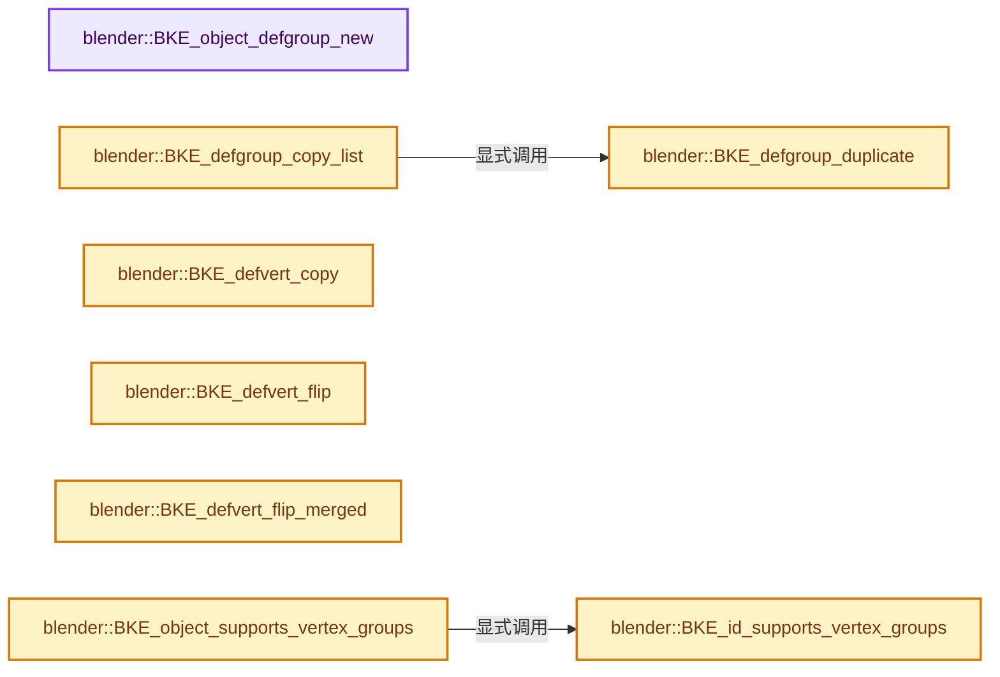
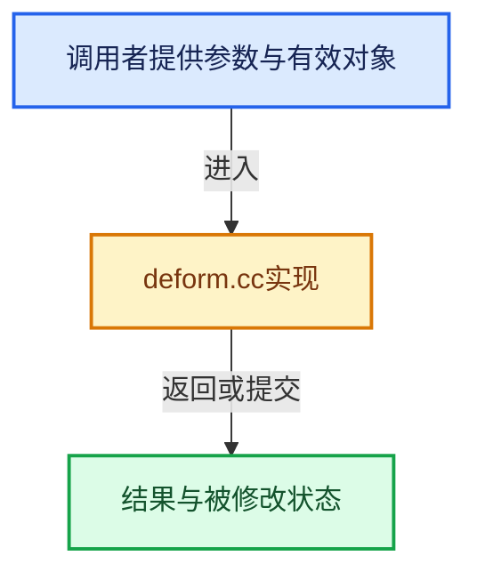

# 实现依赖专题：source/blender/blenkernel/intern/deform.cc

[实现依赖导航](../../README.md) · [符号索引](../../../00-课程指南/02-源码与提交索引/符号依赖与实现索引.md)

本专题从正文实际调用进入，集中保存共享实现。函数有稳定锚点，可从调用处直接跳到对应完整函数；递归与互相调用通过回链组织。

## 本文件的实现关系






## 完整成员与函数实现

<a id="f-04ecee4c92a3f378"></a>

### `blender::BKE_object_defgroup_new`

实现位置：[source/blender/blenkernel/intern/deform.cc](../../../../../../../source/blender/blenkernel/intern/deform.cc) · L51—L73。

接口参数：

- `Object *ob`
- `const StringRef name`

**教学注释版**

<!-- annotated:9f62be61af3abd -->

```cpp
bDeformGroup *BKE_object_defgroup_new(Object *ob, const StringRef name)
{
  bDeformGroup *defgroup;

  BLI_assert(OB_TYPE_SUPPORT_VGROUP(ob->type));

  defgroup = MEM_new<bDeformGroup>(__func__);

  name.copy_utf8_truncated(defgroup->name);

  ListBaseT<bDeformGroup> *defbase = BKE_object_defgroup_list_mutable(ob);

  BLI_addtail(defbase, defgroup);
  BKE_object_defgroup_unique_name(defgroup, ob);

  if (ob->type == OB_GREASE_PENCIL) {
    bke::greasepencil::validate_drawing_vertex_groups(*id_cast<GreasePencil *>(ob->data));
  }

  BKE_object_batch_cache_dirty_tag(ob);

  return defgroup;
}
```

<details>
<summary>核对原始源码：source/blender/blenkernel/intern/deform.cc · L51—L73</summary>

<!-- original:9f62be61af3abd:source/blender/blenkernel/intern/deform.cc:51:73 -->

```cpp
bDeformGroup *BKE_object_defgroup_new(Object *ob, const StringRef name)
{
  bDeformGroup *defgroup;

  BLI_assert(OB_TYPE_SUPPORT_VGROUP(ob->type));

  defgroup = MEM_new<bDeformGroup>(__func__);

  name.copy_utf8_truncated(defgroup->name);

  ListBaseT<bDeformGroup> *defbase = BKE_object_defgroup_list_mutable(ob);

  BLI_addtail(defbase, defgroup);
  BKE_object_defgroup_unique_name(defgroup, ob);

  if (ob->type == OB_GREASE_PENCIL) {
    bke::greasepencil::validate_drawing_vertex_groups(*id_cast<GreasePencil *>(ob->data));
  }

  BKE_object_batch_cache_dirty_tag(ob);

  return defgroup;
}
```

</details>

**沿实际写入检查状态**

- `defgroup = MEM_new<bDeformGroup>(__func__);`

**结果出口**

- `return defgroup;`

**继续追踪实现**

- `BLI_assert` → [BLI_assert · L48](../../01-BLI基础库/BLI_assert.hh.md#m-57a88495704d)；[BLI_assert · L63](../../01-BLI基础库/BLI_assert.hh.md#m-d07050020cb5)。宏定义由构建条件选择。
- `OB_TYPE_SUPPORT_VGROUP` → [OB_TYPE_SUPPORT_VGROUP · L734](../../08-其他Blender模块/makesdna/DNA_object_types.h.md#m-418d8ceae920)。宏定义由构建条件选择。
- `MEM_new<bDeformGroup>` → [MEM_new · L351](../../07-Intern运行时与平台/guardedalloc/MEM_guardedalloc.h.md#f-115f9b6784f89912)。
- `name.copy_utf8_truncated` → [blender::StringRefBase::copy_utf8_truncated · L28](../../01-BLI基础库/intern/string_ref.cc.md#f-5d01486bac37768d)；[blender::StringRefBase::copy_utf8_truncated · L256](../../../01-基础容器与现代CPP/15-StringRef字符串视图.md#f-b2a0157cbe286321)。同名重载需按实参类型选择。
- `BKE_object_defgroup_list_mutable` → [blender::BKE_object_defgroup_list_mutable · L602](deform.cc.md#f-44acd6000881023d)。
- `BLI_addtail` → [blender::BLI_addtail · L118](../../01-BLI基础库/intern/listbase.cc.md#f-4fb027713fa3115b)。
- `BKE_object_defgroup_unique_name` → [blender::BKE_object_defgroup_unique_name · L758](deform.cc.md#f-0396aa9001a114a7)。
- `bke::greasepencil::validate_drawing_vertex_groups` → [blender::bke::greasepencil::validate_drawing_vertex_groups · L26](grease_pencil_vertex_groups.cc.md#f-eacafd3f78cf4dfa)。
- `id_cast<GreasePencil *>` → [blender::id_cast · L1417](../../08-其他Blender模块/makesdna/DNA_ID.h.md#f-6c8ac6412850ac5a)。
- `BKE_object_batch_cache_dirty_tag` → [blender::BKE_object_batch_cache_dirty_tag · L331](object_update.cc.md#f-baf3fb231ac79e37)。

<a id="f-abb39694bedcca18"></a>

### `blender::BKE_defgroup_copy_list`

实现位置：[source/blender/blenkernel/intern/deform.cc](../../../../../../../source/blender/blenkernel/intern/deform.cc) · L75—L83。

接口参数：

- `ListBaseT<bDeformGroup> *outbase`
- `const ListBaseT<bDeformGroup> *inbase`

**教学注释版**

<!-- annotated:495f77665a69ee -->

```cpp
void BKE_defgroup_copy_list(ListBaseT<bDeformGroup> *outbase,
                            const ListBaseT<bDeformGroup> *inbase)
{
  outbase->clear_no_delete();
  for (const bDeformGroup &defgroup : *inbase) {
    bDeformGroup *defgroupn = BKE_defgroup_duplicate(&defgroup);
    BLI_addtail(outbase, defgroupn);
  }
}
```

<details>
<summary>核对原始源码：source/blender/blenkernel/intern/deform.cc · L75—L83</summary>

<!-- original:495f77665a69ee:source/blender/blenkernel/intern/deform.cc:75:83 -->

```cpp
void BKE_defgroup_copy_list(ListBaseT<bDeformGroup> *outbase,
                            const ListBaseT<bDeformGroup> *inbase)
{
  outbase->clear_no_delete();
  for (const bDeformGroup &defgroup : *inbase) {
    bDeformGroup *defgroupn = BKE_defgroup_duplicate(&defgroup);
    BLI_addtail(outbase, defgroupn);
  }
}
```

</details>

**继续追踪实现**

- `outbase->clear_no_delete` → [blender::ListBaseT::clear_no_delete · L68](../../08-其他Blender模块/makesdna/DNA_listBase.h.md#f-431defdf189ae643)。
- `BKE_defgroup_duplicate` → [blender::BKE_defgroup_duplicate · L85](deform.cc.md#f-587558241392133e)。
- `BLI_addtail` → [blender::BLI_addtail · L118](../../01-BLI基础库/intern/listbase.cc.md#f-4fb027713fa3115b)。

<a id="f-587558241392133e"></a>

### `blender::BKE_defgroup_duplicate`

实现位置：[source/blender/blenkernel/intern/deform.cc](../../../../../../../source/blender/blenkernel/intern/deform.cc) · L85—L100。

接口参数：

- `const bDeformGroup *ingroup`

**教学注释版**

<!-- annotated:4889ab3e491fee -->

```cpp
bDeformGroup *BKE_defgroup_duplicate(const bDeformGroup *ingroup)
{
  if (!ingroup) {
    BLI_assert(0);
    return nullptr;
  }

  bDeformGroup *outgroup = MEM_new<bDeformGroup>(__func__);

  /* For now, just copy everything over. */
  // [讲解] memcpy：复制字节，源与目标不应重叠。类型生命周期、对齐和可复制表示须由调用者证明，不是任意对象的复制构造。
  memcpy(outgroup, ingroup, sizeof(bDeformGroup));

  outgroup->next = outgroup->prev = nullptr;

  return outgroup;
}
```

<details>
<summary>核对原始源码：source/blender/blenkernel/intern/deform.cc · L85—L100</summary>

<!-- original:4889ab3e491fee:source/blender/blenkernel/intern/deform.cc:85:100 -->

```cpp
bDeformGroup *BKE_defgroup_duplicate(const bDeformGroup *ingroup)
{
  if (!ingroup) {
    BLI_assert(0);
    return nullptr;
  }

  bDeformGroup *outgroup = MEM_new<bDeformGroup>(__func__);

  /* For now, just copy everything over. */
  memcpy(outgroup, ingroup, sizeof(bDeformGroup));

  outgroup->next = outgroup->prev = nullptr;

  return outgroup;
}
```

</details>

**沿实际写入检查状态**

- `outgroup->next = outgroup->prev = nullptr;`

**结果出口**

- `return nullptr;`
- `return outgroup;`

**继续追踪实现**

- `BLI_assert` → [BLI_assert · L48](../../01-BLI基础库/BLI_assert.hh.md#m-57a88495704d)；[BLI_assert · L63](../../01-BLI基础库/BLI_assert.hh.md#m-d07050020cb5)。宏定义由构建条件选择。
- `MEM_new<bDeformGroup>` → [MEM_new · L351](../../07-Intern运行时与平台/guardedalloc/MEM_guardedalloc.h.md#f-115f9b6784f89912)。
- `memcpy` → [外部契约](https://eel.is/c++draft/cstring.syn)：复制字节，源与目标不应重叠。类型生命周期、对齐和可复制表示须由调用者证明，不是任意对象的复制构造。

<a id="f-c9b2597112a4d2aa"></a>

### `blender::BKE_defvert_copy`

实现位置：[source/blender/blenkernel/intern/deform.cc](../../../../../../../source/blender/blenkernel/intern/deform.cc) · L130—L151。

接口参数：

- `MDeformVert *dvert_dst`
- `const MDeformVert *dvert_src`

**教学注释版**

<!-- annotated:7c14f893cbf543 -->

```cpp
void BKE_defvert_copy(MDeformVert *dvert_dst, const MDeformVert *dvert_src)
{
  if (dvert_dst->totweight == dvert_src->totweight) {
    if (dvert_src->totweight) {
      // [讲解] memcpy：复制字节，源与目标不应重叠。类型生命周期、对齐和可复制表示须由调用者证明，不是任意对象的复制构造。
      memcpy(dvert_dst->dw, dvert_src->dw, dvert_src->totweight * sizeof(MDeformWeight));
    }
  }
  else {
    if (dvert_dst->dw) {
      MEM_delete(dvert_dst->dw);
    }

    if (dvert_src->totweight) {
      dvert_dst->dw = MEM_dupalloc(dvert_src->dw);
    }
    else {
      dvert_dst->dw = nullptr;
    }

    dvert_dst->totweight = dvert_src->totweight;
  }
}
```

<details>
<summary>核对原始源码：source/blender/blenkernel/intern/deform.cc · L130—L151</summary>

<!-- original:7c14f893cbf543:source/blender/blenkernel/intern/deform.cc:130:151 -->

```cpp
void BKE_defvert_copy(MDeformVert *dvert_dst, const MDeformVert *dvert_src)
{
  if (dvert_dst->totweight == dvert_src->totweight) {
    if (dvert_src->totweight) {
      memcpy(dvert_dst->dw, dvert_src->dw, dvert_src->totweight * sizeof(MDeformWeight));
    }
  }
  else {
    if (dvert_dst->dw) {
      MEM_delete(dvert_dst->dw);
    }

    if (dvert_src->totweight) {
      dvert_dst->dw = MEM_dupalloc(dvert_src->dw);
    }
    else {
      dvert_dst->dw = nullptr;
    }

    dvert_dst->totweight = dvert_src->totweight;
  }
}
```

</details>

**沿实际写入检查状态**

- `dvert_dst->dw = MEM_dupalloc(dvert_src->dw);`
- `dvert_dst->dw = nullptr;`
- `dvert_dst->totweight = dvert_src->totweight;`

**继续追踪实现**

- `memcpy` → [外部契约](https://eel.is/c++draft/cstring.syn)：复制字节，源与目标不应重叠。类型生命周期、对齐和可复制表示须由调用者证明，不是任意对象的复制构造。
- `MEM_delete` → [MEM_delete · L400](../../07-Intern运行时与平台/guardedalloc/MEM_guardedalloc.h.md#f-9049ffdd1682887c)。
- `MEM_dupalloc` → [MEM_dupalloc · L627](../../07-Intern运行时与平台/guardedalloc/MEM_guardedalloc.h.md#f-78a72b71e3c57010)。

<a id="f-b853a8c083362f43"></a>

### `blender::BKE_defvert_flip`

实现位置：[source/blender/blenkernel/intern/deform.cc](../../../../../../../source/blender/blenkernel/intern/deform.cc) · L418—L430。

接口参数：

- `MDeformVert *dvert`
- `const int *flip_map`
- `const int flip_map_num`

**教学注释版**

<!-- annotated:cc1e4fb1c99e3a -->

```cpp
void BKE_defvert_flip(MDeformVert *dvert, const int *flip_map, const int flip_map_num)
{
  MDeformWeight *dw;
  int i;

  for (dw = dvert->dw, i = 0; i < dvert->totweight; dw++, i++) {
    if (dw->def_nr < flip_map_num) {
      if (flip_map[dw->def_nr] >= 0) {
        dw->def_nr = flip_map[dw->def_nr];
      }
    }
  }
}
```

<details>
<summary>核对原始源码：source/blender/blenkernel/intern/deform.cc · L418—L430</summary>

<!-- original:cc1e4fb1c99e3a:source/blender/blenkernel/intern/deform.cc:418:430 -->

```cpp
void BKE_defvert_flip(MDeformVert *dvert, const int *flip_map, const int flip_map_num)
{
  MDeformWeight *dw;
  int i;

  for (dw = dvert->dw, i = 0; i < dvert->totweight; dw++, i++) {
    if (dw->def_nr < flip_map_num) {
      if (flip_map[dw->def_nr] >= 0) {
        dw->def_nr = flip_map[dw->def_nr];
      }
    }
  }
}
```

</details>

**沿实际写入检查状态**

- `dw->def_nr = flip_map[dw->def_nr];`

**继续追踪实现**

本实现没有需要继续展开的显式调用；检查返回表达式、对象转换和调用者前置条件。

<a id="f-9001792aeddc65a9"></a>

### `blender::BKE_defvert_flip_merged`

实现位置：[source/blender/blenkernel/intern/deform.cc](../../../../../../../source/blender/blenkernel/intern/deform.cc) · L432—L455。

接口参数：

- `MDeformVert *dvert`
- `const int *flip_map`
- `const int flip_map_num`

**教学注释版**

<!-- annotated:a4aa01437b8f65 -->

```cpp
void BKE_defvert_flip_merged(MDeformVert *dvert, const int *flip_map, const int flip_map_num)
{
  MDeformWeight *dw, *dw_cpy;
  float weight;
  int i, totweight = dvert->totweight;

  /* copy weights */
  for (dw = dvert->dw, i = 0; i < totweight; dw++, i++) {
    if (dw->def_nr < flip_map_num) {
      if (flip_map[dw->def_nr] >= 0) {
        /* error checkers complain of this but we'll never get nullptr return */
        dw_cpy = BKE_defvert_ensure_index(dvert, flip_map[dw->def_nr]);
        dw = &dvert->dw[i]; /* in case array got realloced */

        /* distribute weights: if only one of the vertex groups was
         * assigned this will halve the weights, otherwise it gets
         * evened out. this keeps it proportional to other groups */
        weight = 0.5f * (dw_cpy->weight + dw->weight);
        dw_cpy->weight = weight;
        dw->weight = weight;
      }
    }
  }
}
```

<details>
<summary>核对原始源码：source/blender/blenkernel/intern/deform.cc · L432—L455</summary>

<!-- original:a4aa01437b8f65:source/blender/blenkernel/intern/deform.cc:432:455 -->

```cpp
void BKE_defvert_flip_merged(MDeformVert *dvert, const int *flip_map, const int flip_map_num)
{
  MDeformWeight *dw, *dw_cpy;
  float weight;
  int i, totweight = dvert->totweight;

  /* copy weights */
  for (dw = dvert->dw, i = 0; i < totweight; dw++, i++) {
    if (dw->def_nr < flip_map_num) {
      if (flip_map[dw->def_nr] >= 0) {
        /* error checkers complain of this but we'll never get nullptr return */
        dw_cpy = BKE_defvert_ensure_index(dvert, flip_map[dw->def_nr]);
        dw = &dvert->dw[i]; /* in case array got realloced */

        /* distribute weights: if only one of the vertex groups was
         * assigned this will halve the weights, otherwise it gets
         * evened out. this keeps it proportional to other groups */
        weight = 0.5f * (dw_cpy->weight + dw->weight);
        dw_cpy->weight = weight;
        dw->weight = weight;
      }
    }
  }
}
```

</details>

**沿实际写入检查状态**

- `dw_cpy = BKE_defvert_ensure_index(dvert, flip_map[dw->def_nr]);`
- `dw = &dvert->dw[i]; /* in case array got realloced */`
- `weight = 0.5f * (dw_cpy->weight + dw->weight);`
- `dw_cpy->weight = weight;`
- `dw->weight = weight;`

**继续追踪实现**

- `BKE_defvert_ensure_index` → [blender::BKE_defvert_ensure_index · L830](deform.cc.md#f-d2d225cb4a79b4a7)。

<a id="f-c1c3401e9ffccb67"></a>

### `blender::BKE_id_supports_vertex_groups`

实现位置：[source/blender/blenkernel/intern/deform.cc](../../../../../../../source/blender/blenkernel/intern/deform.cc) · L457—L463。

接口参数：

- `const ID *id`

**教学注释版**

<!-- annotated:863097c4dea3cc -->

```cpp
bool BKE_id_supports_vertex_groups(const ID *id)
{
  if (id == nullptr) {
    return false;
  }
  return ELEM(GS(id->name), ID_ME, ID_LT, ID_GD_LEGACY, ID_GP);
}
```

<details>
<summary>核对原始源码：source/blender/blenkernel/intern/deform.cc · L457—L463</summary>

<!-- original:863097c4dea3cc:source/blender/blenkernel/intern/deform.cc:457:463 -->

```cpp
bool BKE_id_supports_vertex_groups(const ID *id)
{
  if (id == nullptr) {
    return false;
  }
  return ELEM(GS(id->name), ID_ME, ID_LT, ID_GD_LEGACY, ID_GP);
}
```

</details>

**结果出口**

- `return false;`
- `return ELEM(GS(id->name), ID_ME, ID_LT, ID_GD_LEGACY, ID_GP);`

**继续追踪实现**

- `ELEM` → [ELEM · L88](../../07-Intern运行时与平台/ghost/intern/GHOST_utildefines.hh.md#m-d28724a15928)；[ELEM · L135](../../01-BLI基础库/BLI_utildefines.hh.md#m-d6572de7cae0)。宏定义由构建条件选择。
- `GS` → [blender::GS · L410](../../08-其他Blender模块/makesdna/DNA_ID.h.md#f-c3ff509f79f21b05)。

<a id="f-ad12b3e8aa234a36"></a>

### `blender::BKE_object_supports_vertex_groups`

实现位置：[source/blender/blenkernel/intern/deform.cc](../../../../../../../source/blender/blenkernel/intern/deform.cc) · L465—L470。

接口参数：

- `const Object *ob`

**教学注释版**

<!-- annotated:365bfeff118d0d -->

```cpp
bool BKE_object_supports_vertex_groups(const Object *ob)
{
  const ID *id = static_cast<const ID *>(ob->data);

  return BKE_id_supports_vertex_groups(id);
}
```

<details>
<summary>核对原始源码：source/blender/blenkernel/intern/deform.cc · L465—L470</summary>

<!-- original:365bfeff118d0d:source/blender/blenkernel/intern/deform.cc:465:470 -->

```cpp
bool BKE_object_supports_vertex_groups(const Object *ob)
{
  const ID *id = static_cast<const ID *>(ob->data);

  return BKE_id_supports_vertex_groups(id);
}
```

</details>

**结果出口**

- `return BKE_id_supports_vertex_groups(id);`

**继续追踪实现**

- `BKE_id_supports_vertex_groups` → [blender::BKE_id_supports_vertex_groups · L457](deform.cc.md#f-c1c3401e9ffccb67)。

<a id="f-a27f669a0eb5b3ab"></a>

### `blender::BKE_id_defgroup_list_get`

实现位置：[source/blender/blenkernel/intern/deform.cc](../../../../../../../source/blender/blenkernel/intern/deform.cc) · L472—L496。

接口参数：

- `const ID *id`

**教学注释版**

<!-- annotated:dd116bc4856c12 -->

```cpp
const ListBaseT<bDeformGroup> *BKE_id_defgroup_list_get(const ID *id)
{
  switch (GS(id->name)) {
    case ID_ME: {
      const Mesh *mesh = id_cast<const Mesh *>(id);
      return &mesh->vertex_group_names;
    }
    case ID_LT: {
      const Lattice *lt = id_cast<const Lattice *>(id);
      return &lt->vertex_group_names;
    }
    case ID_GD_LEGACY: {
      const bGPdata *gpd = id_cast<const bGPdata *>(id);
      return &gpd->vertex_group_names;
    }
    case ID_GP: {
      const GreasePencil *grease_pencil = id_cast<const GreasePencil *>(id);
      return &grease_pencil->vertex_group_names;
    }
    default: {
      BLI_assert_unreachable();
    }
  }
  return nullptr;
}
```

<details>
<summary>核对原始源码：source/blender/blenkernel/intern/deform.cc · L472—L496</summary>

<!-- original:dd116bc4856c12:source/blender/blenkernel/intern/deform.cc:472:496 -->

```cpp
const ListBaseT<bDeformGroup> *BKE_id_defgroup_list_get(const ID *id)
{
  switch (GS(id->name)) {
    case ID_ME: {
      const Mesh *mesh = id_cast<const Mesh *>(id);
      return &mesh->vertex_group_names;
    }
    case ID_LT: {
      const Lattice *lt = id_cast<const Lattice *>(id);
      return &lt->vertex_group_names;
    }
    case ID_GD_LEGACY: {
      const bGPdata *gpd = id_cast<const bGPdata *>(id);
      return &gpd->vertex_group_names;
    }
    case ID_GP: {
      const GreasePencil *grease_pencil = id_cast<const GreasePencil *>(id);
      return &grease_pencil->vertex_group_names;
    }
    default: {
      BLI_assert_unreachable();
    }
  }
  return nullptr;
}
```

</details>

**结果出口**

- `return &mesh->vertex_group_names;`
- `return &lt->vertex_group_names;`
- `return &gpd->vertex_group_names;`
- `return &grease_pencil->vertex_group_names;`
- `return nullptr;`

**继续追踪实现**

- `GS` → [blender::GS · L410](../../08-其他Blender模块/makesdna/DNA_ID.h.md#f-c3ff509f79f21b05)。
- `id_cast<const Mesh *>` → [blender::id_cast · L1417](../../08-其他Blender模块/makesdna/DNA_ID.h.md#f-6c8ac6412850ac5a)。
- `id_cast<const Lattice *>` → [blender::id_cast · L1417](../../08-其他Blender模块/makesdna/DNA_ID.h.md#f-6c8ac6412850ac5a)。
- `id_cast<const bGPdata *>` → [blender::id_cast · L1417](../../08-其他Blender模块/makesdna/DNA_ID.h.md#f-6c8ac6412850ac5a)。
- `id_cast<const GreasePencil *>` → [blender::id_cast · L1417](../../08-其他Blender模块/makesdna/DNA_ID.h.md#f-6c8ac6412850ac5a)。
- `BLI_assert_unreachable` → [BLI_assert_unreachable · L77](../../01-BLI基础库/BLI_assert.hh.md#m-7a2d91a67d8e)。宏定义由构建条件选择。

<a id="f-26f4ef32fd8f59d4"></a>

### `blender::object_defgroup_active_index_get_p`

实现位置：[source/blender/blenkernel/intern/deform.cc](../../../../../../../source/blender/blenkernel/intern/deform.cc) · L498—L522。

接口参数：

- `const Object *ob`

**教学注释版**

<!-- annotated:429451665e8315 -->

```cpp
static const int *object_defgroup_active_index_get_p(const Object *ob)
{
  BLI_assert(BKE_object_supports_vertex_groups(ob));
  switch (ob->type) {
    case OB_MESH: {
      const Mesh *mesh = id_cast<const Mesh *>(ob->data);
      return &mesh->vertex_group_active_index;
    }
    case OB_LATTICE: {
      const Lattice *lattice = id_cast<const Lattice *>(ob->data);
      return &lattice->vertex_group_active_index;
    }
    case OB_GPENCIL_LEGACY: {
      const bGPdata *gpd = id_cast<const bGPdata *>(ob->data);
      return &gpd->vertex_group_active_index;
    }
    case OB_GREASE_PENCIL: {
      const GreasePencil *grease_pencil = id_cast<const GreasePencil *>(ob->data);
      return &grease_pencil->vertex_group_active_index;
    }
    default:
      break;
  }
  return nullptr;
}
```

<details>
<summary>核对原始源码：source/blender/blenkernel/intern/deform.cc · L498—L522</summary>

<!-- original:429451665e8315:source/blender/blenkernel/intern/deform.cc:498:522 -->

```cpp
static const int *object_defgroup_active_index_get_p(const Object *ob)
{
  BLI_assert(BKE_object_supports_vertex_groups(ob));
  switch (ob->type) {
    case OB_MESH: {
      const Mesh *mesh = id_cast<const Mesh *>(ob->data);
      return &mesh->vertex_group_active_index;
    }
    case OB_LATTICE: {
      const Lattice *lattice = id_cast<const Lattice *>(ob->data);
      return &lattice->vertex_group_active_index;
    }
    case OB_GPENCIL_LEGACY: {
      const bGPdata *gpd = id_cast<const bGPdata *>(ob->data);
      return &gpd->vertex_group_active_index;
    }
    case OB_GREASE_PENCIL: {
      const GreasePencil *grease_pencil = id_cast<const GreasePencil *>(ob->data);
      return &grease_pencil->vertex_group_active_index;
    }
    default:
      break;
  }
  return nullptr;
}
```

</details>

**结果出口**

- `return &mesh->vertex_group_active_index;`
- `return &lattice->vertex_group_active_index;`
- `return &gpd->vertex_group_active_index;`
- `return &grease_pencil->vertex_group_active_index;`
- `return nullptr;`

**继续追踪实现**

- `BLI_assert` → [BLI_assert · L48](../../01-BLI基础库/BLI_assert.hh.md#m-57a88495704d)；[BLI_assert · L63](../../01-BLI基础库/BLI_assert.hh.md#m-d07050020cb5)。宏定义由构建条件选择。
- `BKE_object_supports_vertex_groups` → [blender::BKE_object_supports_vertex_groups · L465](deform.cc.md#f-ad12b3e8aa234a36)。
- `id_cast<const Mesh *>` → [blender::id_cast · L1417](../../08-其他Blender模块/makesdna/DNA_ID.h.md#f-6c8ac6412850ac5a)。
- `id_cast<const Lattice *>` → [blender::id_cast · L1417](../../08-其他Blender模块/makesdna/DNA_ID.h.md#f-6c8ac6412850ac5a)。
- `id_cast<const bGPdata *>` → [blender::id_cast · L1417](../../08-其他Blender模块/makesdna/DNA_ID.h.md#f-6c8ac6412850ac5a)。
- `id_cast<const GreasePencil *>` → [blender::id_cast · L1417](../../08-其他Blender模块/makesdna/DNA_ID.h.md#f-6c8ac6412850ac5a)。

<a id="f-be991e068962eef3"></a>

### `blender::BKE_id_defgroup_list_get_mutable`

实现位置：[source/blender/blenkernel/intern/deform.cc](../../../../../../../source/blender/blenkernel/intern/deform.cc) · L524—L528。

接口参数：

- `ID *id`

**教学注释版**

<!-- annotated:9e13907a1b0147 -->

```cpp
ListBaseT<bDeformGroup> *BKE_id_defgroup_list_get_mutable(ID *id)
{
  /* Cast away const just for the accessor. */
  return const_cast<ListBaseT<bDeformGroup> *>(BKE_id_defgroup_list_get(id));
}
```

<details>
<summary>核对原始源码：source/blender/blenkernel/intern/deform.cc · L524—L528</summary>

<!-- original:9e13907a1b0147:source/blender/blenkernel/intern/deform.cc:524:528 -->

```cpp
ListBaseT<bDeformGroup> *BKE_id_defgroup_list_get_mutable(ID *id)
{
  /* Cast away const just for the accessor. */
  return const_cast<ListBaseT<bDeformGroup> *>(BKE_id_defgroup_list_get(id));
}
```

</details>

**结果出口**

- `return const_cast<ListBaseT<bDeformGroup> *>(BKE_id_defgroup_list_get(id));`

**继续追踪实现**

- `BKE_id_defgroup_list_get` → [blender::BKE_id_defgroup_list_get · L472](deform.cc.md#f-a27f669a0eb5b3ab)。

<a id="f-004e1942a859c423"></a>

### `blender::BKE_object_defgroup_find_name`

实现位置：[source/blender/blenkernel/intern/deform.cc](../../../../../../../source/blender/blenkernel/intern/deform.cc) · L530—L542。

接口参数：

- `const Object *ob`
- `const StringRef name`

**教学注释版**

<!-- annotated:d3a947d5ca6283 -->

```cpp
bDeformGroup *BKE_object_defgroup_find_name(const Object *ob, const StringRef name)
{
  if (name.is_empty()) {
    return nullptr;
  }
  const ListBaseT<bDeformGroup> *defbase = BKE_object_defgroup_list(ob);
  for (bDeformGroup &group : *defbase) {
    if (name == group.name) {
      return &group;
    }
  }
  return nullptr;
}
```

<details>
<summary>核对原始源码：source/blender/blenkernel/intern/deform.cc · L530—L542</summary>

<!-- original:d3a947d5ca6283:source/blender/blenkernel/intern/deform.cc:530:542 -->

```cpp
bDeformGroup *BKE_object_defgroup_find_name(const Object *ob, const StringRef name)
{
  if (name.is_empty()) {
    return nullptr;
  }
  const ListBaseT<bDeformGroup> *defbase = BKE_object_defgroup_list(ob);
  for (bDeformGroup &group : *defbase) {
    if (name == group.name) {
      return &group;
    }
  }
  return nullptr;
}
```

</details>

**结果出口**

- `return nullptr;`
- `return &group;`

**继续追踪实现**

- `name.is_empty` → [blender::Bounds<T>::is_empty · L533](../../../12-空间数据结构与几何算法/07-Bounds与BVH对比.md#f-55ac376b3d0a0944)；[blender::GVArrayCommon::is_empty · L767](../../../04-虚拟数组与索引选择/05-GVArray运行时类型.md#f-c1da602ffc5555f9)；[blender::StringRefBase::is_empty · L201](../../../01-基础容器与现代CPP/15-StringRef字符串视图.md#f-9f6c3d2da1cb1796)；[blender::KDTreeNew<T>::is_empty · L498](../../../12-空间数据结构与几何算法/05-K近邻与范围查询.md#f-67f0ff91cf00b00b)。同名重载需按实参类型选择。
- `BKE_object_defgroup_list` → [blender::BKE_object_defgroup_list · L591](deform.cc.md#f-26f2f33daee59e8d)。

<a id="f-41ba0c2309b689c8"></a>

### `blender::BKE_defgroup_name_index`

实现位置：[source/blender/blenkernel/intern/deform.cc](../../../../../../../source/blender/blenkernel/intern/deform.cc) · L544—L555。

接口参数：

- `const ListBaseT<bDeformGroup> *defbase`
- `const StringRef name`

**教学注释版**

<!-- annotated:8f4b8ed9249328 -->

```cpp
int BKE_defgroup_name_index(const ListBaseT<bDeformGroup> *defbase, const StringRef name)
{
  if (name.is_empty()) {
    return -1;
  }
  for (const auto [index, group] : defbase->enumerate()) {
    if (name == group.name) {
      return index;
    }
  }
  return -1;
}
```

<details>
<summary>核对原始源码：source/blender/blenkernel/intern/deform.cc · L544—L555</summary>

<!-- original:8f4b8ed9249328:source/blender/blenkernel/intern/deform.cc:544:555 -->

```cpp
int BKE_defgroup_name_index(const ListBaseT<bDeformGroup> *defbase, const StringRef name)
{
  if (name.is_empty()) {
    return -1;
  }
  for (const auto [index, group] : defbase->enumerate()) {
    if (name == group.name) {
      return index;
    }
  }
  return -1;
}
```

</details>

**结果出口**

- `return -1;`
- `return index;`

**继续追踪实现**

- `name.is_empty` → [blender::Bounds<T>::is_empty · L533](../../../12-空间数据结构与几何算法/07-Bounds与BVH对比.md#f-55ac376b3d0a0944)；[blender::GVArrayCommon::is_empty · L767](../../../04-虚拟数组与索引选择/05-GVArray运行时类型.md#f-c1da602ffc5555f9)；[blender::StringRefBase::is_empty · L201](../../../01-基础容器与现代CPP/15-StringRef字符串视图.md#f-9f6c3d2da1cb1796)；[blender::KDTreeNew<T>::is_empty · L498](../../../12-空间数据结构与几何算法/05-K近邻与范围查询.md#f-67f0ff91cf00b00b)。同名重载需按实参类型选择。
- `defbase->enumerate` → [blender::ListBaseT::enumerate · L152](../../08-其他Blender模块/makesdna/DNA_listBase.h.md#f-73544c49caea6d30)；[blender::ListBaseT::enumerate · L157](../../08-其他Blender模块/makesdna/DNA_listBase.h.md#f-b4ef4f7169c0afd0)。同名重载需按实参类型选择。

<a id="f-886667bbd10fa710"></a>

### `blender::BKE_id_defgroup_name_index`

实现位置：[source/blender/blenkernel/intern/deform.cc](../../../../../../../source/blender/blenkernel/intern/deform.cc) · L557—L560。

接口参数：

- `const ID *id`
- `const StringRef name`

**教学注释版**

<!-- annotated:e994d2c8cef221 -->

```cpp
int BKE_id_defgroup_name_index(const ID *id, const StringRef name)
{
  return BKE_defgroup_name_index(BKE_id_defgroup_list_get(id), name);
}
```

<details>
<summary>核对原始源码：source/blender/blenkernel/intern/deform.cc · L557—L560</summary>

<!-- original:e994d2c8cef221:source/blender/blenkernel/intern/deform.cc:557:560 -->

```cpp
int BKE_id_defgroup_name_index(const ID *id, const StringRef name)
{
  return BKE_defgroup_name_index(BKE_id_defgroup_list_get(id), name);
}
```

</details>

**结果出口**

- `return BKE_defgroup_name_index(BKE_id_defgroup_list_get(id), name);`

**继续追踪实现**

- `BKE_defgroup_name_index` → [blender::BKE_defgroup_name_index · L544](deform.cc.md#f-41ba0c2309b689c8)。
- `BKE_id_defgroup_list_get` → [blender::BKE_id_defgroup_list_get · L472](deform.cc.md#f-a27f669a0eb5b3ab)。

<a id="f-0b0203eeb86c4a39"></a>

### `blender::BKE_defgroup_listbase_name_find`

实现位置：[source/blender/blenkernel/intern/deform.cc](../../../../../../../source/blender/blenkernel/intern/deform.cc) · L562—L583。

接口参数：

- `ListBaseT<bDeformGroup> *defbase`
- `const StringRef name`
- `int *r_index`
- `bDeformGroup **r_group`

**教学注释版**

<!-- annotated:3ff2810ea2ad1f -->

```cpp
bool BKE_defgroup_listbase_name_find(ListBaseT<bDeformGroup> *defbase,
                                     const StringRef name,
                                     int *r_index,
                                     bDeformGroup **r_group)
{
  if (name.is_empty()) {
    return false;
  }

  for (const auto [index, group] : defbase->enumerate()) {
    if (name == group.name) {
      if (r_index != nullptr) {
        *r_index = index;
      }
      if (r_group != nullptr) {
        *r_group = &group;
      }
      return true;
    }
  }
  return false;
}
```

<details>
<summary>核对原始源码：source/blender/blenkernel/intern/deform.cc · L562—L583</summary>

<!-- original:3ff2810ea2ad1f:source/blender/blenkernel/intern/deform.cc:562:583 -->

```cpp
bool BKE_defgroup_listbase_name_find(ListBaseT<bDeformGroup> *defbase,
                                     const StringRef name,
                                     int *r_index,
                                     bDeformGroup **r_group)
{
  if (name.is_empty()) {
    return false;
  }

  for (const auto [index, group] : defbase->enumerate()) {
    if (name == group.name) {
      if (r_index != nullptr) {
        *r_index = index;
      }
      if (r_group != nullptr) {
        *r_group = &group;
      }
      return true;
    }
  }
  return false;
}
```

</details>

**结果出口**

- `return false;`
- `return true;`

**继续追踪实现**

- `name.is_empty` → [blender::Bounds<T>::is_empty · L533](../../../12-空间数据结构与几何算法/07-Bounds与BVH对比.md#f-55ac376b3d0a0944)；[blender::GVArrayCommon::is_empty · L767](../../../04-虚拟数组与索引选择/05-GVArray运行时类型.md#f-c1da602ffc5555f9)；[blender::StringRefBase::is_empty · L201](../../../01-基础容器与现代CPP/15-StringRef字符串视图.md#f-9f6c3d2da1cb1796)；[blender::KDTreeNew<T>::is_empty · L498](../../../12-空间数据结构与几何算法/05-K近邻与范围查询.md#f-67f0ff91cf00b00b)。同名重载需按实参类型选择。
- `defbase->enumerate` → [blender::ListBaseT::enumerate · L152](../../08-其他Blender模块/makesdna/DNA_listBase.h.md#f-73544c49caea6d30)；[blender::ListBaseT::enumerate · L157](../../08-其他Blender模块/makesdna/DNA_listBase.h.md#f-b4ef4f7169c0afd0)。同名重载需按实参类型选择。

<a id="f-26f2f33daee59e8d"></a>

### `blender::BKE_object_defgroup_list`

实现位置：[source/blender/blenkernel/intern/deform.cc](../../../../../../../source/blender/blenkernel/intern/deform.cc) · L591—L595。

接口参数：

- `const Object *ob`

**教学注释版**

<!-- annotated:3a28148d687382 -->

```cpp
const ListBaseT<bDeformGroup> *BKE_object_defgroup_list(const Object *ob)
{
  BLI_assert(BKE_object_supports_vertex_groups(ob));
  return BKE_id_defgroup_list_get(static_cast<const ID *>(ob->data));
}
```

<details>
<summary>核对原始源码：source/blender/blenkernel/intern/deform.cc · L591—L595</summary>

<!-- original:3a28148d687382:source/blender/blenkernel/intern/deform.cc:591:595 -->

```cpp
const ListBaseT<bDeformGroup> *BKE_object_defgroup_list(const Object *ob)
{
  BLI_assert(BKE_object_supports_vertex_groups(ob));
  return BKE_id_defgroup_list_get(static_cast<const ID *>(ob->data));
}
```

</details>

**结果出口**

- `return BKE_id_defgroup_list_get(static_cast<const ID *>(ob->data));`

**继续追踪实现**

- `BLI_assert` → [BLI_assert · L48](../../01-BLI基础库/BLI_assert.hh.md#m-57a88495704d)；[BLI_assert · L63](../../01-BLI基础库/BLI_assert.hh.md#m-d07050020cb5)。宏定义由构建条件选择。
- `BKE_object_supports_vertex_groups` → [blender::BKE_object_supports_vertex_groups · L465](deform.cc.md#f-ad12b3e8aa234a36)。
- `BKE_id_defgroup_list_get` → [blender::BKE_id_defgroup_list_get · L472](deform.cc.md#f-a27f669a0eb5b3ab)。

<a id="f-ad856e5bba5cd758"></a>

### `blender::BKE_object_defgroup_name_index`

实现位置：[source/blender/blenkernel/intern/deform.cc](../../../../../../../source/blender/blenkernel/intern/deform.cc) · L597—L600。

接口参数：

- `const Object *ob`
- `const StringRef name`

**教学注释版**

<!-- annotated:cd7edda44aad3d -->

```cpp
int BKE_object_defgroup_name_index(const Object *ob, const StringRef name)
{
  return BKE_id_defgroup_name_index(ob->data, name);
}
```

<details>
<summary>核对原始源码：source/blender/blenkernel/intern/deform.cc · L597—L600</summary>

<!-- original:cd7edda44aad3d:source/blender/blenkernel/intern/deform.cc:597:600 -->

```cpp
int BKE_object_defgroup_name_index(const Object *ob, const StringRef name)
{
  return BKE_id_defgroup_name_index(ob->data, name);
}
```

</details>

**结果出口**

- `return BKE_id_defgroup_name_index(ob->data, name);`

**继续追踪实现**

- `BKE_id_defgroup_name_index` → [blender::BKE_id_defgroup_name_index · L557](deform.cc.md#f-886667bbd10fa710)。

<a id="f-44acd6000881023d"></a>

### `blender::BKE_object_defgroup_list_mutable`

实现位置：[source/blender/blenkernel/intern/deform.cc](../../../../../../../source/blender/blenkernel/intern/deform.cc) · L602—L606。

接口参数：

- `Object *ob`

**教学注释版**

<!-- annotated:90afc154e01957 -->

```cpp
ListBaseT<bDeformGroup> *BKE_object_defgroup_list_mutable(Object *ob)
{
  BLI_assert(BKE_object_supports_vertex_groups(ob));
  return BKE_id_defgroup_list_get_mutable(ob->data);
}
```

<details>
<summary>核对原始源码：source/blender/blenkernel/intern/deform.cc · L602—L606</summary>

<!-- original:90afc154e01957:source/blender/blenkernel/intern/deform.cc:602:606 -->

```cpp
ListBaseT<bDeformGroup> *BKE_object_defgroup_list_mutable(Object *ob)
{
  BLI_assert(BKE_object_supports_vertex_groups(ob));
  return BKE_id_defgroup_list_get_mutable(ob->data);
}
```

</details>

**结果出口**

- `return BKE_id_defgroup_list_get_mutable(ob->data);`

**继续追踪实现**

- `BLI_assert` → [BLI_assert · L48](../../01-BLI基础库/BLI_assert.hh.md#m-57a88495704d)；[BLI_assert · L63](../../01-BLI基础库/BLI_assert.hh.md#m-d07050020cb5)。宏定义由构建条件选择。
- `BKE_object_supports_vertex_groups` → [blender::BKE_object_supports_vertex_groups · L465](deform.cc.md#f-ad12b3e8aa234a36)。
- `BKE_id_defgroup_list_get_mutable` → [blender::BKE_id_defgroup_list_get_mutable · L524](deform.cc.md#f-be991e068962eef3)。

<a id="f-2c43dbe7747d64a1"></a>

### `blender::BKE_object_defgroup_count`

实现位置：[source/blender/blenkernel/intern/deform.cc](../../../../../../../source/blender/blenkernel/intern/deform.cc) · L608—L611。

接口参数：

- `const Object *ob`

**教学注释版**

<!-- annotated:29c4b5d265472d -->

```cpp
int BKE_object_defgroup_count(const Object *ob)
{
  return BLI_listbase_count(BKE_object_defgroup_list(ob));
}
```

<details>
<summary>核对原始源码：source/blender/blenkernel/intern/deform.cc · L608—L611</summary>

<!-- original:29c4b5d265472d:source/blender/blenkernel/intern/deform.cc:608:611 -->

```cpp
int BKE_object_defgroup_count(const Object *ob)
{
  return BLI_listbase_count(BKE_object_defgroup_list(ob));
}
```

</details>

**结果出口**

- `return BLI_listbase_count(BKE_object_defgroup_list(ob));`

**继续追踪实现**

- `BLI_listbase_count` → [blender::BLI_listbase_count · L531](../../01-BLI基础库/intern/listbase.cc.md#f-da3c4037e01d7006)。
- `BKE_object_defgroup_list` → [blender::BKE_object_defgroup_list · L591](deform.cc.md#f-26f2f33daee59e8d)。

<a id="f-40a8a7738f44a93a"></a>

### `blender::BKE_object_defgroup_active_index_get`

实现位置：[source/blender/blenkernel/intern/deform.cc](../../../../../../../source/blender/blenkernel/intern/deform.cc) · L613—L616。

接口参数：

- `const Object *ob`

**教学注释版**

<!-- annotated:df78e6d074c073 -->

```cpp
int BKE_object_defgroup_active_index_get(const Object *ob)
{
  return *object_defgroup_active_index_get_p(ob);
}
```

<details>
<summary>核对原始源码：source/blender/blenkernel/intern/deform.cc · L613—L616</summary>

<!-- original:df78e6d074c073:source/blender/blenkernel/intern/deform.cc:613:616 -->

```cpp
int BKE_object_defgroup_active_index_get(const Object *ob)
{
  return *object_defgroup_active_index_get_p(ob);
}
```

</details>

**结果出口**

- `return *object_defgroup_active_index_get_p(ob);`

**继续追踪实现**

- `object_defgroup_active_index_get_p` → [blender::object_defgroup_active_index_get_p · L498](deform.cc.md#f-26f4ef32fd8f59d4)。

<a id="f-ce6a7bad4f150255"></a>

### `blender::BKE_object_defgroup_active_index_set`

实现位置：[source/blender/blenkernel/intern/deform.cc](../../../../../../../source/blender/blenkernel/intern/deform.cc) · L618—L623。

接口参数：

- `Object *ob`
- `const int new_index`

**教学注释版**

<!-- annotated:357d4da64f3293 -->

```cpp
void BKE_object_defgroup_active_index_set(Object *ob, const int new_index)
{
  /* Cast away const just for the accessor. */
  int *index = const_cast<int *>(object_defgroup_active_index_get_p(ob));
  *index = new_index;
}
```

<details>
<summary>核对原始源码：source/blender/blenkernel/intern/deform.cc · L618—L623</summary>

<!-- original:357d4da64f3293:source/blender/blenkernel/intern/deform.cc:618:623 -->

```cpp
void BKE_object_defgroup_active_index_set(Object *ob, const int new_index)
{
  /* Cast away const just for the accessor. */
  int *index = const_cast<int *>(object_defgroup_active_index_get_p(ob));
  *index = new_index;
}
```

</details>

**继续追踪实现**

- `object_defgroup_active_index_get_p` → [blender::object_defgroup_active_index_get_p · L498](deform.cc.md#f-26f4ef32fd8f59d4)。

<a id="f-4838df5585e84bdf"></a>

### `blender::object_defgroup_unlocked_flip_map_ex`

实现位置：[source/blender/blenkernel/intern/deform.cc](../../../../../../../source/blender/blenkernel/intern/deform.cc) · L625—L671。

接口参数：

- `const Object *ob`
- `const bool use_default`
- `const bool use_only_unlocked`
- `int *r_flip_map_num`

**教学注释版**

<!-- annotated:4d297078b03e6b -->

```cpp
static int *object_defgroup_unlocked_flip_map_ex(const Object *ob,
                                                 const bool use_default,
                                                 const bool use_only_unlocked,
                                                 int *r_flip_map_num)
{
  const ListBaseT<bDeformGroup> *defbase = BKE_object_defgroup_list(ob);
  const int defbase_num = defbase->count();
  *r_flip_map_num = defbase_num;

  if (defbase_num == 0) {
    return nullptr;
  }

  bDeformGroup *dg;
  char name_flip[sizeof(dg->name)];
  int i, flip_num;
  int *map = MEM_new_array_uninitialized<int>(size_t(defbase_num), __func__);

  for (i = 0; i < defbase_num; i++) {
    map[i] = -1;
  }

  for (dg = defbase->first(), i = 0; dg; dg = dg->next, i++) {
    if (map[i] == -1) { /* may be calculated previously */

      /* in case no valid value is found, use this */
      if (use_default) {
        map[i] = i;
      }

      if (use_only_unlocked && (dg->flag & DG_LOCK_WEIGHT)) {
        continue;
      }

      BLI_string_flip_side_name(name_flip, dg->name, false, sizeof(name_flip));

      if (!STREQ(name_flip, dg->name)) {
        flip_num = BKE_object_defgroup_name_index(ob, name_flip);
        if (flip_num != -1) {
          map[i] = flip_num;
          map[flip_num] = i; /* save an extra lookup */
        }
      }
    }
  }
  return map;
}
```

<details>
<summary>核对原始源码：source/blender/blenkernel/intern/deform.cc · L625—L671</summary>

<!-- original:4d297078b03e6b:source/blender/blenkernel/intern/deform.cc:625:671 -->

```cpp
static int *object_defgroup_unlocked_flip_map_ex(const Object *ob,
                                                 const bool use_default,
                                                 const bool use_only_unlocked,
                                                 int *r_flip_map_num)
{
  const ListBaseT<bDeformGroup> *defbase = BKE_object_defgroup_list(ob);
  const int defbase_num = defbase->count();
  *r_flip_map_num = defbase_num;

  if (defbase_num == 0) {
    return nullptr;
  }

  bDeformGroup *dg;
  char name_flip[sizeof(dg->name)];
  int i, flip_num;
  int *map = MEM_new_array_uninitialized<int>(size_t(defbase_num), __func__);

  for (i = 0; i < defbase_num; i++) {
    map[i] = -1;
  }

  for (dg = defbase->first(), i = 0; dg; dg = dg->next, i++) {
    if (map[i] == -1) { /* may be calculated previously */

      /* in case no valid value is found, use this */
      if (use_default) {
        map[i] = i;
      }

      if (use_only_unlocked && (dg->flag & DG_LOCK_WEIGHT)) {
        continue;
      }

      BLI_string_flip_side_name(name_flip, dg->name, false, sizeof(name_flip));

      if (!STREQ(name_flip, dg->name)) {
        flip_num = BKE_object_defgroup_name_index(ob, name_flip);
        if (flip_num != -1) {
          map[i] = flip_num;
          map[flip_num] = i; /* save an extra lookup */
        }
      }
    }
  }
  return map;
}
```

</details>

**沿实际写入检查状态**

- `map[i] = -1;`
- `map[i] = i;`
- `flip_num = BKE_object_defgroup_name_index(ob, name_flip);`
- `map[i] = flip_num;`
- `map[flip_num] = i; /* save an extra lookup */`

**结果出口**

- `return nullptr;`
- `return map;`

**继续追踪实现**

- `BKE_object_defgroup_list` → [blender::BKE_object_defgroup_list · L591](deform.cc.md#f-26f2f33daee59e8d)。
- `defbase->count` → [blender::ListBaseT::count · L92](../../08-其他Blender模块/makesdna/DNA_listBase.h.md#f-7d243d006ac4c693)。
- `MEM_new_array_uninitialized<int>` → [MEM_new_array_uninitialized · L608](../../07-Intern运行时与平台/guardedalloc/MEM_guardedalloc.h.md#f-b7103eae8eb57b05)；[MEM_new_array_uninitialized · L129](../../07-Intern运行时与平台/guardedalloc/intern/mallocn.cc.md#f-bf6ef4ddcfb6e5df)。同名重载需按实参类型选择。
- `defbase->first` → [blender::ListBaseT::first · L102](../../08-其他Blender模块/makesdna/DNA_listBase.h.md#f-3d12ff35da057c9e)；[blender::ListBaseT::first · L106](../../08-其他Blender模块/makesdna/DNA_listBase.h.md#f-0df87c3480e059f9)。同名重载需按实参类型选择。
- `BLI_string_flip_side_name` → [blender::BLI_string_flip_side_name · L297](../../01-BLI基础库/intern/string_utils.cc.md#f-9a2252551f4dd7fb)。
- `STREQ` → [STREQ · L112](../../07-Intern运行时与平台/ghost/intern/GHOST_utildefines.hh.md#m-9549fb6aafd2)；[STREQ · L451](../../01-BLI基础库/BLI_utildefines.hh.md#m-c7b745bcfad2)；[STREQ · L55](../../07-Intern运行时与平台/clog/clog.cc.md#m-96e78f386894)。宏定义由构建条件选择。
- `BKE_object_defgroup_name_index` → [blender::BKE_object_defgroup_name_index · L597](deform.cc.md#f-ad856e5bba5cd758)。

<a id="f-14dfd255d46d3504"></a>

### `blender::BKE_object_defgroup_flip_map`

实现位置：[source/blender/blenkernel/intern/deform.cc](../../../../../../../source/blender/blenkernel/intern/deform.cc) · L673—L676。

接口参数：

- `const Object *ob`
- `const bool use_default`
- `int *r_flip_map_num`

**教学注释版**

<!-- annotated:fe384943987cd6 -->

```cpp
int *BKE_object_defgroup_flip_map(const Object *ob, const bool use_default, int *r_flip_map_num)
{
  return object_defgroup_unlocked_flip_map_ex(ob, use_default, false, r_flip_map_num);
}
```

<details>
<summary>核对原始源码：source/blender/blenkernel/intern/deform.cc · L673—L676</summary>

<!-- original:fe384943987cd6:source/blender/blenkernel/intern/deform.cc:673:676 -->

```cpp
int *BKE_object_defgroup_flip_map(const Object *ob, const bool use_default, int *r_flip_map_num)
{
  return object_defgroup_unlocked_flip_map_ex(ob, use_default, false, r_flip_map_num);
}
```

</details>

**结果出口**

- `return object_defgroup_unlocked_flip_map_ex(ob, use_default, false, r_flip_map_num);`

**继续追踪实现**

- `object_defgroup_unlocked_flip_map_ex` → [blender::object_defgroup_unlocked_flip_map_ex · L625](deform.cc.md#f-4838df5585e84bdf)。

<a id="f-23ec5bc02a38f043"></a>

### `blender::defgroup_find_name_dupe`

实现位置：[source/blender/blenkernel/intern/deform.cc](../../../../../../../source/blender/blenkernel/intern/deform.cc) · L743—L756。

接口参数：

- `const StringRef name`
- `bDeformGroup *dg`
- `Object *ob`

**教学注释版**

<!-- annotated:d157ccc57f67c1 -->

```cpp
static bool defgroup_find_name_dupe(const StringRef name, bDeformGroup *dg, Object *ob)
{
  const ListBaseT<bDeformGroup> *defbase = BKE_object_defgroup_list(ob);

  for (bDeformGroup &curdef : *defbase) {
    if (dg != &curdef) {
      if (curdef.name == name) {
        return true;
      }
    }
  }

  return false;
}
```

<details>
<summary>核对原始源码：source/blender/blenkernel/intern/deform.cc · L743—L756</summary>

<!-- original:d157ccc57f67c1:source/blender/blenkernel/intern/deform.cc:743:756 -->

```cpp
static bool defgroup_find_name_dupe(const StringRef name, bDeformGroup *dg, Object *ob)
{
  const ListBaseT<bDeformGroup> *defbase = BKE_object_defgroup_list(ob);

  for (bDeformGroup &curdef : *defbase) {
    if (dg != &curdef) {
      if (curdef.name == name) {
        return true;
      }
    }
  }

  return false;
}
```

</details>

**结果出口**

- `return true;`
- `return false;`

**继续追踪实现**

- `BKE_object_defgroup_list` → [blender::BKE_object_defgroup_list · L591](deform.cc.md#f-26f2f33daee59e8d)。

<a id="f-0396aa9001a114a7"></a>

### `blender::BKE_object_defgroup_unique_name`

实现位置：[source/blender/blenkernel/intern/deform.cc](../../../../../../../source/blender/blenkernel/intern/deform.cc) · L758—L765。

接口参数：

- `bDeformGroup *dg`
- `Object *ob`

**教学注释版**

<!-- annotated:c2f9460e0ee2b1 -->

```cpp
void BKE_object_defgroup_unique_name(bDeformGroup *dg, Object *ob)
{
  BLI_uniquename_cb([&](const StringRef name) { return defgroup_find_name_dupe(name, dg, ob); },
                    DATA_("Group"),
                    '.',
                    dg->name,
                    sizeof(dg->name));
}
```

<details>
<summary>核对原始源码：source/blender/blenkernel/intern/deform.cc · L758—L765</summary>

<!-- original:c2f9460e0ee2b1:source/blender/blenkernel/intern/deform.cc:758:765 -->

```cpp
void BKE_object_defgroup_unique_name(bDeformGroup *dg, Object *ob)
{
  BLI_uniquename_cb([&](const StringRef name) { return defgroup_find_name_dupe(name, dg, ob); },
                    DATA_("Group"),
                    '.',
                    dg->name,
                    sizeof(dg->name));
}
```

</details>

**继续追踪实现**

- `BLI_uniquename_cb` → [blender::BLI_uniquename_cb · L421](../../01-BLI基础库/intern/string_utils.cc.md#f-651b82b9010ddef4)；[blender::BLI_uniquename_cb · L459](../../01-BLI基础库/intern/string_utils.cc.md#f-0e0b6725b5b90a92)。同名重载需按实参类型选择。
- `defgroup_find_name_dupe` → [blender::defgroup_find_name_dupe · L743](deform.cc.md#f-23ec5bc02a38f043)。
- `DATA_` → [DATA_ · L52](../../08-其他Blender模块/blentranslation/BLT_translation.hh.md#m-178736083f83)。宏定义由构建条件选择。

<a id="f-c117fcd05c4fd453"></a>

### `blender::BKE_defvert_find_weight`

实现位置：[source/blender/blenkernel/intern/deform.cc](../../../../../../../source/blender/blenkernel/intern/deform.cc) · L779—L783。

接口参数：

- `const MDeformVert *dvert`
- `const int defgroup`

**教学注释版**

<!-- annotated:becc4283640864 -->

```cpp
float BKE_defvert_find_weight(const MDeformVert *dvert, const int defgroup)
{
  MDeformWeight *dw = BKE_defvert_find_index(dvert, defgroup);
  return dw ? dw->weight : 0.0f;
}
```

<details>
<summary>核对原始源码：source/blender/blenkernel/intern/deform.cc · L779—L783</summary>

<!-- original:becc4283640864:source/blender/blenkernel/intern/deform.cc:779:783 -->

```cpp
float BKE_defvert_find_weight(const MDeformVert *dvert, const int defgroup)
{
  MDeformWeight *dw = BKE_defvert_find_index(dvert, defgroup);
  return dw ? dw->weight : 0.0f;
}
```

</details>

**结果出口**

- `return dw ? dw->weight : 0.0f;`

**继续追踪实现**

- `BKE_defvert_find_index` → [blender::BKE_defvert_find_index · L811](deform.cc.md#f-d8c22e4305ac3d34)。

<a id="f-bcfeaa449f8510e6"></a>

### `blender::BKE_defvert_array_find_weight_safe`

实现位置：[source/blender/blenkernel/intern/deform.cc](../../../../../../../source/blender/blenkernel/intern/deform.cc) · L785—L809。

接口参数：

- `const MDeformVert *dvert`
- `const int index`
- `const int defgroup`
- `const bool invert`

**教学注释版**

<!-- annotated:2c5d2947cbcc61 -->

```cpp
float BKE_defvert_array_find_weight_safe(const MDeformVert *dvert,
                                         const int index,
                                         const int defgroup,
                                         const bool invert)
{
  /* Invalid defgroup index means the vgroup selected is invalid,
   * does not exist, in that case it is OK to return 1.0
   * (i.e. maximum weight, as if no vgroup was selected).
   * But in case of valid defgroup and nullptr dvert data pointer, it means that vgroup **is**
   * valid, and just totally empty, so we shall return '0.0' (or '1.0' if inverted) value then! */
  if (defgroup == -1) {
    return 1.0f;
  }
  if (dvert == nullptr) {
    return invert ? 1.0 : 0.0f;
  }

  float weight = BKE_defvert_find_weight(dvert + index, defgroup);

  if (invert) {
    weight = 1.0f - weight;
  }

  return weight;
}
```

<details>
<summary>核对原始源码：source/blender/blenkernel/intern/deform.cc · L785—L809</summary>

<!-- original:2c5d2947cbcc61:source/blender/blenkernel/intern/deform.cc:785:809 -->

```cpp
float BKE_defvert_array_find_weight_safe(const MDeformVert *dvert,
                                         const int index,
                                         const int defgroup,
                                         const bool invert)
{
  /* Invalid defgroup index means the vgroup selected is invalid,
   * does not exist, in that case it is OK to return 1.0
   * (i.e. maximum weight, as if no vgroup was selected).
   * But in case of valid defgroup and nullptr dvert data pointer, it means that vgroup **is**
   * valid, and just totally empty, so we shall return '0.0' (or '1.0' if inverted) value then! */
  if (defgroup == -1) {
    return 1.0f;
  }
  if (dvert == nullptr) {
    return invert ? 1.0 : 0.0f;
  }

  float weight = BKE_defvert_find_weight(dvert + index, defgroup);

  if (invert) {
    weight = 1.0f - weight;
  }

  return weight;
}
```

</details>

**沿实际写入检查状态**

- `weight = 1.0f - weight;`

**结果出口**

- `return 1.0f;`
- `return invert ? 1.0 : 0.0f;`
- `return weight;`

**继续追踪实现**

- `BKE_defvert_find_weight` → [blender::BKE_defvert_find_weight · L779](deform.cc.md#f-c117fcd05c4fd453)。

<a id="f-d8c22e4305ac3d34"></a>

### `blender::BKE_defvert_find_index`

实现位置：[source/blender/blenkernel/intern/deform.cc](../../../../../../../source/blender/blenkernel/intern/deform.cc) · L811—L828。

接口参数：

- `const MDeformVert *dvert`
- `const int defgroup`

**教学注释版**

<!-- annotated:b5bfa2787db113 -->

```cpp
MDeformWeight *BKE_defvert_find_index(const MDeformVert *dvert, const int defgroup)
{
  if (dvert && defgroup >= 0) {
    MDeformWeight *dw = dvert->dw;
    uint i;

    for (i = dvert->totweight; i != 0; i--, dw++) {
      if (dw->def_nr == defgroup) {
        return dw;
      }
    }
  }
  else {
    BLI_assert(0);
  }

  return nullptr;
}
```

<details>
<summary>核对原始源码：source/blender/blenkernel/intern/deform.cc · L811—L828</summary>

<!-- original:b5bfa2787db113:source/blender/blenkernel/intern/deform.cc:811:828 -->

```cpp
MDeformWeight *BKE_defvert_find_index(const MDeformVert *dvert, const int defgroup)
{
  if (dvert && defgroup >= 0) {
    MDeformWeight *dw = dvert->dw;
    uint i;

    for (i = dvert->totweight; i != 0; i--, dw++) {
      if (dw->def_nr == defgroup) {
        return dw;
      }
    }
  }
  else {
    BLI_assert(0);
  }

  return nullptr;
}
```

</details>

**结果出口**

- `return dw;`
- `return nullptr;`

**继续追踪实现**

- `BLI_assert` → [BLI_assert · L48](../../01-BLI基础库/BLI_assert.hh.md#m-57a88495704d)；[BLI_assert · L63](../../01-BLI基础库/BLI_assert.hh.md#m-d07050020cb5)。宏定义由构建条件选择。

<a id="f-d2d225cb4a79b4a7"></a>

### `blender::BKE_defvert_ensure_index`

实现位置：[source/blender/blenkernel/intern/deform.cc](../../../../../../../source/blender/blenkernel/intern/deform.cc) · L830—L859。

接口参数：

- `MDeformVert *dvert`
- `const int defgroup`

**教学注释版**

<!-- annotated:84d1f4a8bf4e1f -->

```cpp
MDeformWeight *BKE_defvert_ensure_index(MDeformVert *dvert, const int defgroup)
{
  MDeformWeight *dw_new;

  /* do this check always, this function is used to check for it */
  if (!dvert || defgroup < 0) {
    BLI_assert(0);
    return nullptr;
  }

  dw_new = BKE_defvert_find_index(dvert, defgroup);
  if (dw_new) {
    return dw_new;
  }

  dw_new = MEM_new_array_uninitialized<MDeformWeight>(size_t(dvert->totweight) + 1, __func__);
  if (dvert->dw) {
    // [讲解] memcpy：复制字节，源与目标不应重叠。类型生命周期、对齐和可复制表示须由调用者证明，不是任意对象的复制构造。
    memcpy(dw_new, dvert->dw, sizeof(MDeformWeight) * dvert->totweight);
    MEM_delete(dvert->dw);
  }
  dvert->dw = dw_new;
  dw_new += dvert->totweight;
  dw_new->weight = 0.0f;
  dw_new->def_nr = defgroup;
  /* Group index */

  dvert->totweight++;

  return dw_new;
}
```

<details>
<summary>核对原始源码：source/blender/blenkernel/intern/deform.cc · L830—L859</summary>

<!-- original:84d1f4a8bf4e1f:source/blender/blenkernel/intern/deform.cc:830:859 -->

```cpp
MDeformWeight *BKE_defvert_ensure_index(MDeformVert *dvert, const int defgroup)
{
  MDeformWeight *dw_new;

  /* do this check always, this function is used to check for it */
  if (!dvert || defgroup < 0) {
    BLI_assert(0);
    return nullptr;
  }

  dw_new = BKE_defvert_find_index(dvert, defgroup);
  if (dw_new) {
    return dw_new;
  }

  dw_new = MEM_new_array_uninitialized<MDeformWeight>(size_t(dvert->totweight) + 1, __func__);
  if (dvert->dw) {
    memcpy(dw_new, dvert->dw, sizeof(MDeformWeight) * dvert->totweight);
    MEM_delete(dvert->dw);
  }
  dvert->dw = dw_new;
  dw_new += dvert->totweight;
  dw_new->weight = 0.0f;
  dw_new->def_nr = defgroup;
  /* Group index */

  dvert->totweight++;

  return dw_new;
}
```

</details>

**沿实际写入检查状态**

- `dw_new = BKE_defvert_find_index(dvert, defgroup);`
- `dw_new = MEM_new_array_uninitialized<MDeformWeight>(size_t(dvert->totweight) + 1, __func__);`
- `dvert->dw = dw_new;`
- `dw_new += dvert->totweight;`
- `dw_new->weight = 0.0f;`
- `dw_new->def_nr = defgroup;`

**结果出口**

- `return nullptr;`
- `return dw_new;`

**继续追踪实现**

- `BLI_assert` → [BLI_assert · L48](../../01-BLI基础库/BLI_assert.hh.md#m-57a88495704d)；[BLI_assert · L63](../../01-BLI基础库/BLI_assert.hh.md#m-d07050020cb5)。宏定义由构建条件选择。
- `BKE_defvert_find_index` → [blender::BKE_defvert_find_index · L811](deform.cc.md#f-d8c22e4305ac3d34)。
- `MEM_new_array_uninitialized<MDeformWeight>` → [MEM_new_array_uninitialized · L608](../../07-Intern运行时与平台/guardedalloc/MEM_guardedalloc.h.md#f-b7103eae8eb57b05)；[MEM_new_array_uninitialized · L129](../../07-Intern运行时与平台/guardedalloc/intern/mallocn.cc.md#f-bf6ef4ddcfb6e5df)。同名重载需按实参类型选择。
- `memcpy` → [外部契约](https://eel.is/c++draft/cstring.syn)：复制字节，源与目标不应重叠。类型生命周期、对齐和可复制表示须由调用者证明，不是任意对象的复制构造。
- `MEM_delete` → [MEM_delete · L400](../../07-Intern运行时与平台/guardedalloc/MEM_guardedalloc.h.md#f-9049ffdd1682887c)。

<a id="f-5c47b354ad3bd1c2"></a>

### `blender::BKE_defvert_add_index_notest`

实现位置：[source/blender/blenkernel/intern/deform.cc](../../../../../../../source/blender/blenkernel/intern/deform.cc) · L861—L883。

接口参数：

- `MDeformVert *dvert`
- `const int defgroup`
- `const float weight`

**教学注释版**

<!-- annotated:fecbd20f1eb2a0 -->

```cpp
void BKE_defvert_add_index_notest(MDeformVert *dvert, const int defgroup, const float weight)
{
  /* TODO: merge with #BKE_defvert_ensure_index! */

  MDeformWeight *dw_new;

  /* do this check always, this function is used to check for it */
  if (!dvert || defgroup < 0) {
    BLI_assert(0);
    return;
  }

  dw_new = MEM_new_array_zeroed<MDeformWeight>(size_t(dvert->totweight) + 1, __func__);
  if (dvert->dw) {
    // [讲解] memcpy：复制字节，源与目标不应重叠。类型生命周期、对齐和可复制表示须由调用者证明，不是任意对象的复制构造。
    memcpy(dw_new, dvert->dw, sizeof(MDeformWeight) * dvert->totweight);
    MEM_delete(dvert->dw);
  }
  dvert->dw = dw_new;
  dw_new += dvert->totweight;
  dw_new->weight = weight;
  dw_new->def_nr = defgroup;
  dvert->totweight++;
}
```

<details>
<summary>核对原始源码：source/blender/blenkernel/intern/deform.cc · L861—L883</summary>

<!-- original:fecbd20f1eb2a0:source/blender/blenkernel/intern/deform.cc:861:883 -->

```cpp
void BKE_defvert_add_index_notest(MDeformVert *dvert, const int defgroup, const float weight)
{
  /* TODO: merge with #BKE_defvert_ensure_index! */

  MDeformWeight *dw_new;

  /* do this check always, this function is used to check for it */
  if (!dvert || defgroup < 0) {
    BLI_assert(0);
    return;
  }

  dw_new = MEM_new_array_zeroed<MDeformWeight>(size_t(dvert->totweight) + 1, __func__);
  if (dvert->dw) {
    memcpy(dw_new, dvert->dw, sizeof(MDeformWeight) * dvert->totweight);
    MEM_delete(dvert->dw);
  }
  dvert->dw = dw_new;
  dw_new += dvert->totweight;
  dw_new->weight = weight;
  dw_new->def_nr = defgroup;
  dvert->totweight++;
}
```

</details>

**沿实际写入检查状态**

- `dw_new = MEM_new_array_zeroed<MDeformWeight>(size_t(dvert->totweight) + 1, __func__);`
- `dvert->dw = dw_new;`
- `dw_new += dvert->totweight;`
- `dw_new->weight = weight;`
- `dw_new->def_nr = defgroup;`

**继续追踪实现**

- `BLI_assert` → [BLI_assert · L48](../../01-BLI基础库/BLI_assert.hh.md#m-57a88495704d)；[BLI_assert · L63](../../01-BLI基础库/BLI_assert.hh.md#m-d07050020cb5)。宏定义由构建条件选择。
- `MEM_new_array_zeroed<MDeformWeight>` → [MEM_new_array_zeroed · L566](../../07-Intern运行时与平台/guardedalloc/MEM_guardedalloc.h.md#f-3a0cf63fb5216500)；[MEM_new_array_zeroed · L119](../../07-Intern运行时与平台/guardedalloc/intern/mallocn.cc.md#f-6825557da566fdbe)。同名重载需按实参类型选择。
- `memcpy` → [外部契约](https://eel.is/c++draft/cstring.syn)：复制字节，源与目标不应重叠。类型生命周期、对齐和可复制表示须由调用者证明，不是任意对象的复制构造。
- `MEM_delete` → [MEM_delete · L400](../../07-Intern运行时与平台/guardedalloc/MEM_guardedalloc.h.md#f-9049ffdd1682887c)。

<a id="f-ece6b12afaa3769e"></a>

### `blender::BKE_defvert_remove_group`

实现位置：[source/blender/blenkernel/intern/deform.cc](../../../../../../../source/blender/blenkernel/intern/deform.cc) · L885—L916。

接口参数：

- `MDeformVert *dvert`
- `MDeformWeight *dw`

**教学注释版**

<!-- annotated:35912eea7e1627 -->

```cpp
void BKE_defvert_remove_group(MDeformVert *dvert, MDeformWeight *dw)
{
  if (!dvert || !dw) [[unlikely]] {
    return;
  }
  /* Ensure `dw` is part of `dvert` (security check). */
  if (uintptr_t(dw - dvert->dw) >= uintptr_t(dvert->totweight)) [[unlikely]] {
    /* Assert as an invalid `dw` (while supported) isn't likely to do what the caller expected. */
    BLI_assert_unreachable();
    return;
  }

  const int i = dw - dvert->dw;
  dvert->totweight--;
  /* If there are still other deform weights attached to this vert then remove
   * this deform weight, and reshuffle the others. */
  if (dvert->totweight) {
    BLI_assert(dvert->dw != nullptr);

    if (i != dvert->totweight) {
      dvert->dw[i] = dvert->dw[dvert->totweight];
    }

    dvert->dw = static_cast<MDeformWeight *>(
        MEM_realloc_uninitialized(dvert->dw, sizeof(MDeformWeight) * dvert->totweight));
  }
  else {
    /* If there are no other deform weights left then just remove this one. */
    MEM_delete(dvert->dw);
    dvert->dw = nullptr;
  }
}
```

<details>
<summary>核对原始源码：source/blender/blenkernel/intern/deform.cc · L885—L916</summary>

<!-- original:35912eea7e1627:source/blender/blenkernel/intern/deform.cc:885:916 -->

```cpp
void BKE_defvert_remove_group(MDeformVert *dvert, MDeformWeight *dw)
{
  if (!dvert || !dw) [[unlikely]] {
    return;
  }
  /* Ensure `dw` is part of `dvert` (security check). */
  if (uintptr_t(dw - dvert->dw) >= uintptr_t(dvert->totweight)) [[unlikely]] {
    /* Assert as an invalid `dw` (while supported) isn't likely to do what the caller expected. */
    BLI_assert_unreachable();
    return;
  }

  const int i = dw - dvert->dw;
  dvert->totweight--;
  /* If there are still other deform weights attached to this vert then remove
   * this deform weight, and reshuffle the others. */
  if (dvert->totweight) {
    BLI_assert(dvert->dw != nullptr);

    if (i != dvert->totweight) {
      dvert->dw[i] = dvert->dw[dvert->totweight];
    }

    dvert->dw = static_cast<MDeformWeight *>(
        MEM_realloc_uninitialized(dvert->dw, sizeof(MDeformWeight) * dvert->totweight));
  }
  else {
    /* If there are no other deform weights left then just remove this one. */
    MEM_delete(dvert->dw);
    dvert->dw = nullptr;
  }
}
```

</details>

**沿实际写入检查状态**

- `dvert->dw[i] = dvert->dw[dvert->totweight];`
- `dvert->dw = static_cast<MDeformWeight *>(`
- `dvert->dw = nullptr;`

**继续追踪实现**

- `BLI_assert_unreachable` → [BLI_assert_unreachable · L77](../../01-BLI基础库/BLI_assert.hh.md#m-7a2d91a67d8e)。宏定义由构建条件选择。
- `BLI_assert` → [BLI_assert · L48](../../01-BLI基础库/BLI_assert.hh.md#m-57a88495704d)；[BLI_assert · L63](../../01-BLI基础库/BLI_assert.hh.md#m-d07050020cb5)。宏定义由构建条件选择。
- `MEM_realloc_uninitialized` → [MEM_realloc_uninitialized · L118](../../07-Intern运行时与平台/guardedalloc/MEM_guardedalloc.h.md#m-813b7cd3fcff)。宏定义由构建条件选择。
- `MEM_delete` → [MEM_delete · L400](../../07-Intern运行时与平台/guardedalloc/MEM_guardedalloc.h.md#f-9049ffdd1682887c)。

<a id="f-b838f638844bd559"></a>

### `blender::BKE_defvert_clear`

实现位置：[source/blender/blenkernel/intern/deform.cc](../../../../../../../source/blender/blenkernel/intern/deform.cc) · L918—L923。

接口参数：

- `MDeformVert *dvert`

**教学注释版**

<!-- annotated:3fd55b915e1072 -->

```cpp
void BKE_defvert_clear(MDeformVert *dvert)
{
  MEM_SAFE_DELETE(dvert->dw);

  dvert->totweight = 0;
}
```

<details>
<summary>核对原始源码：source/blender/blenkernel/intern/deform.cc · L918—L923</summary>

<!-- original:3fd55b915e1072:source/blender/blenkernel/intern/deform.cc:918:923 -->

```cpp
void BKE_defvert_clear(MDeformVert *dvert)
{
  MEM_SAFE_DELETE(dvert->dw);

  dvert->totweight = 0;
}
```

</details>

**沿实际写入检查状态**

- `dvert->totweight = 0;`

**继续追踪实现**

- `MEM_SAFE_DELETE` → [MEM_SAFE_DELETE · L436](../../07-Intern运行时与平台/guardedalloc/MEM_guardedalloc.h.md#m-eadb3bc5b902)。宏定义由构建条件选择。

<a id="f-8da08361597d28ff"></a>

### `blender::BKE_defvert_is_weight_zero`

实现位置：[source/blender/blenkernel/intern/deform.cc](../../../../../../../source/blender/blenkernel/intern/deform.cc) · L941—L953。

接口参数：

- `const MDeformVert *dvert`
- `const int defgroup_tot`

**教学注释版**

<!-- annotated:2f98e75bc190bd -->

```cpp
bool BKE_defvert_is_weight_zero(const MDeformVert *dvert, const int defgroup_tot)
{
  MDeformWeight *dw = dvert->dw;
  for (int i = dvert->totweight; i != 0; i--, dw++) {
    if (dw->weight != 0.0f) {
      /* check the group is in-range, happens on rare situations */
      if (dw->def_nr < defgroup_tot) [[likely]] {
        return false;
      }
    }
  }
  return true;
}
```

<details>
<summary>核对原始源码：source/blender/blenkernel/intern/deform.cc · L941—L953</summary>

<!-- original:2f98e75bc190bd:source/blender/blenkernel/intern/deform.cc:941:953 -->

```cpp
bool BKE_defvert_is_weight_zero(const MDeformVert *dvert, const int defgroup_tot)
{
  MDeformWeight *dw = dvert->dw;
  for (int i = dvert->totweight; i != 0; i--, dw++) {
    if (dw->weight != 0.0f) {
      /* check the group is in-range, happens on rare situations */
      if (dw->def_nr < defgroup_tot) [[likely]] {
        return false;
      }
    }
  }
  return true;
}
```

</details>

**结果出口**

- `return false;`
- `return true;`

**继续追踪实现**

本实现没有需要继续展开的显式调用；检查返回表达式、对象转换和调用者前置条件。

<a id="f-1493141440fc245b"></a>

### `blender::BKE_defvert_total_selected_weight`

实现位置：[source/blender/blenkernel/intern/deform.cc](../../../../../../../source/blender/blenkernel/intern/deform.cc) · L955—L975。

接口参数：

- `const MDeformVert *dv`
- `int defbase_num`
- `const bool *defbase_sel`

**教学注释版**

<!-- annotated:634f9b715c3fe0 -->

```cpp
float BKE_defvert_total_selected_weight(const MDeformVert *dv,
                                        int defbase_num,
                                        const bool *defbase_sel)
{
  float total = 0.0f;
  const MDeformWeight *dw = dv->dw;

  if (defbase_sel == nullptr) {
    return total;
  }

  for (int i = dv->totweight; i != 0; i--, dw++) {
    if (dw->def_nr < defbase_num) {
      if (defbase_sel[dw->def_nr]) {
        total += dw->weight;
      }
    }
  }

  return total;
}
```

<details>
<summary>核对原始源码：source/blender/blenkernel/intern/deform.cc · L955—L975</summary>

<!-- original:634f9b715c3fe0:source/blender/blenkernel/intern/deform.cc:955:975 -->

```cpp
float BKE_defvert_total_selected_weight(const MDeformVert *dv,
                                        int defbase_num,
                                        const bool *defbase_sel)
{
  float total = 0.0f;
  const MDeformWeight *dw = dv->dw;

  if (defbase_sel == nullptr) {
    return total;
  }

  for (int i = dv->totweight; i != 0; i--, dw++) {
    if (dw->def_nr < defbase_num) {
      if (defbase_sel[dw->def_nr]) {
        total += dw->weight;
      }
    }
  }

  return total;
}
```

</details>

**沿实际写入检查状态**

- `total += dw->weight;`

**结果出口**

- `return total;`

**继续追踪实现**

本实现没有需要继续展开的显式调用；检查返回表达式、对象转换和调用者前置条件。

<a id="f-a8c8aec40a330373"></a>

### `blender::BKE_defvert_multipaint_collective_weight`

实现位置：[source/blender/blenkernel/intern/deform.cc](../../../../../../../source/blender/blenkernel/intern/deform.cc) · L977—L992。

接口参数：

- `const MDeformVert *dv`
- `const int defbase_num`
- `const bool *defbase_sel`
- `const int defbase_sel_num`
- `const bool is_normalized`

**教学注释版**

<!-- annotated:1f2c402b0bfca2 -->

```cpp
float BKE_defvert_multipaint_collective_weight(const MDeformVert *dv,
                                               const int defbase_num,
                                               const bool *defbase_sel,
                                               const int defbase_sel_num,
                                               const bool is_normalized)
{
  float total = BKE_defvert_total_selected_weight(dv, defbase_num, defbase_sel);

  /* in multipaint, get the average if auto normalize is inactive
   * get the sum if it is active */
  if (!is_normalized) {
    total /= defbase_sel_num;
  }

  return total;
}
```

<details>
<summary>核对原始源码：source/blender/blenkernel/intern/deform.cc · L977—L992</summary>

<!-- original:1f2c402b0bfca2:source/blender/blenkernel/intern/deform.cc:977:992 -->

```cpp
float BKE_defvert_multipaint_collective_weight(const MDeformVert *dv,
                                               const int defbase_num,
                                               const bool *defbase_sel,
                                               const int defbase_sel_num,
                                               const bool is_normalized)
{
  float total = BKE_defvert_total_selected_weight(dv, defbase_num, defbase_sel);

  /* in multipaint, get the average if auto normalize is inactive
   * get the sum if it is active */
  if (!is_normalized) {
    total /= defbase_sel_num;
  }

  return total;
}
```

</details>

**结果出口**

- `return total;`

**继续追踪实现**

- `BKE_defvert_total_selected_weight` → [blender::BKE_defvert_total_selected_weight · L955](deform.cc.md#f-1493141440fc245b)。

<a id="f-2ed0e071b91ce1eb"></a>

### `blender::BKE_defvert_calc_lock_relative_weight`

实现位置：[source/blender/blenkernel/intern/deform.cc](../../../../../../../source/blender/blenkernel/intern/deform.cc) · L994—L1020。

接口参数：

- `float weight`
- `float locked_weight`
- `float unlocked_weight`

**教学注释版**

<!-- annotated:badce9182184ab -->

```cpp
float BKE_defvert_calc_lock_relative_weight(float weight,
                                            float locked_weight,
                                            float unlocked_weight)
{
  /* First try normalizing unlocked weights. */
  if (unlocked_weight > 0.0f) {
    return weight / unlocked_weight;
  }

  /* If no unlocked weight exists, take locked into account. */
  if (locked_weight <= 0.0f) {
    return weight;
  }

  /* handle division by zero */
  if (locked_weight >= 1.0f - VERTEX_WEIGHT_LOCK_EPSILON) {
    if (weight != 0.0f) {
      return 1.0f;
    }

    /* resolve 0/0 to 0 */
    return 0.0f;
  }

  /* non-degenerate division */
  return weight / (1.0f - locked_weight);
}
```

<details>
<summary>核对原始源码：source/blender/blenkernel/intern/deform.cc · L994—L1020</summary>

<!-- original:badce9182184ab:source/blender/blenkernel/intern/deform.cc:994:1020 -->

```cpp
float BKE_defvert_calc_lock_relative_weight(float weight,
                                            float locked_weight,
                                            float unlocked_weight)
{
  /* First try normalizing unlocked weights. */
  if (unlocked_weight > 0.0f) {
    return weight / unlocked_weight;
  }

  /* If no unlocked weight exists, take locked into account. */
  if (locked_weight <= 0.0f) {
    return weight;
  }

  /* handle division by zero */
  if (locked_weight >= 1.0f - VERTEX_WEIGHT_LOCK_EPSILON) {
    if (weight != 0.0f) {
      return 1.0f;
    }

    /* resolve 0/0 to 0 */
    return 0.0f;
  }

  /* non-degenerate division */
  return weight / (1.0f - locked_weight);
}
```

</details>

**结果出口**

- `return weight / unlocked_weight;`
- `return weight;`
- `return 1.0f;`
- `return 0.0f;`
- `return weight / (1.0f - locked_weight);`

**继续追踪实现**

本实现没有需要继续展开的显式调用；检查返回表达式、对象转换和调用者前置条件。

<a id="f-bbe2d0c0f5c9f830"></a>

### `blender::BKE_defvert_lock_relative_weight`

实现位置：[source/blender/blenkernel/intern/deform.cc](../../../../../../../source/blender/blenkernel/intern/deform.cc) · L1022—L1037。

接口参数：

- `const float weight`
- `const MDeformVert *dv`
- `const int defbase_num`
- `const bool *defbase_locked`
- `const bool *defbase_unlocked`

**教学注释版**

<!-- annotated:3c91c047004514 -->

```cpp
float BKE_defvert_lock_relative_weight(const float weight,
                                       const MDeformVert *dv,
                                       const int defbase_num,
                                       const bool *defbase_locked,
                                       const bool *defbase_unlocked)
{
  float unlocked = BKE_defvert_total_selected_weight(dv, defbase_num, defbase_unlocked);

  if (unlocked > 0.0f) {
    return weight / unlocked;
  }

  float locked = BKE_defvert_total_selected_weight(dv, defbase_num, defbase_locked);

  return BKE_defvert_calc_lock_relative_weight(weight, locked, unlocked);
}
```

<details>
<summary>核对原始源码：source/blender/blenkernel/intern/deform.cc · L1022—L1037</summary>

<!-- original:3c91c047004514:source/blender/blenkernel/intern/deform.cc:1022:1037 -->

```cpp
float BKE_defvert_lock_relative_weight(const float weight,
                                       const MDeformVert *dv,
                                       const int defbase_num,
                                       const bool *defbase_locked,
                                       const bool *defbase_unlocked)
{
  float unlocked = BKE_defvert_total_selected_weight(dv, defbase_num, defbase_unlocked);

  if (unlocked > 0.0f) {
    return weight / unlocked;
  }

  float locked = BKE_defvert_total_selected_weight(dv, defbase_num, defbase_locked);

  return BKE_defvert_calc_lock_relative_weight(weight, locked, unlocked);
}
```

</details>

**结果出口**

- `return weight / unlocked;`
- `return BKE_defvert_calc_lock_relative_weight(weight, locked, unlocked);`

**继续追踪实现**

- `BKE_defvert_total_selected_weight` → [blender::BKE_defvert_total_selected_weight · L955](deform.cc.md#f-1493141440fc245b)。
- `BKE_defvert_calc_lock_relative_weight` → [blender::BKE_defvert_calc_lock_relative_weight · L994](deform.cc.md#f-2ed0e071b91ce1eb)。

<a id="f-ade1444147c424d8"></a>

### `blender::BKE_defvert_array_copy`

实现位置：[source/blender/blenkernel/intern/deform.cc](../../../../../../../source/blender/blenkernel/intern/deform.cc) · L1043—L1059。

接口参数：

- `MDeformVert *dst`
- `const MDeformVert *src`
- `int totvert`

**教学注释版**

<!-- annotated:3deae504b1dd43 -->

```cpp
void BKE_defvert_array_copy(MDeformVert *dst, const MDeformVert *src, int totvert)
{
  /* Assumes dst is already set up */

  if (!src || !dst) {
    return;
  }

  // [讲解] memcpy：复制字节，源与目标不应重叠。类型生命周期、对齐和可复制表示须由调用者证明，不是任意对象的复制构造。
  memcpy(dst, src, totvert * sizeof(MDeformVert));

  for (int i = 0; i < totvert; i++) {
    if (src[i].dw) {
      dst[i].dw = MEM_new_array_uninitialized<MDeformWeight>(size_t(src[i].totweight), __func__);
      memcpy(dst[i].dw, src[i].dw, sizeof(MDeformWeight) * src[i].totweight);
    }
  }
}
```

<details>
<summary>核对原始源码：source/blender/blenkernel/intern/deform.cc · L1043—L1059</summary>

<!-- original:3deae504b1dd43:source/blender/blenkernel/intern/deform.cc:1043:1059 -->

```cpp
void BKE_defvert_array_copy(MDeformVert *dst, const MDeformVert *src, int totvert)
{
  /* Assumes dst is already set up */

  if (!src || !dst) {
    return;
  }

  memcpy(dst, src, totvert * sizeof(MDeformVert));

  for (int i = 0; i < totvert; i++) {
    if (src[i].dw) {
      dst[i].dw = MEM_new_array_uninitialized<MDeformWeight>(size_t(src[i].totweight), __func__);
      memcpy(dst[i].dw, src[i].dw, sizeof(MDeformWeight) * src[i].totweight);
    }
  }
}
```

</details>

**沿实际写入检查状态**

- `dst[i].dw = MEM_new_array_uninitialized<MDeformWeight>(size_t(src[i].totweight), __func__);`

**继续追踪实现**

- `memcpy` → [外部契约](https://eel.is/c++draft/cstring.syn)：复制字节，源与目标不应重叠。类型生命周期、对齐和可复制表示须由调用者证明，不是任意对象的复制构造。
- `MEM_new_array_uninitialized<MDeformWeight>` → [MEM_new_array_uninitialized · L608](../../07-Intern运行时与平台/guardedalloc/MEM_guardedalloc.h.md#f-b7103eae8eb57b05)；[MEM_new_array_uninitialized · L129](../../07-Intern运行时与平台/guardedalloc/intern/mallocn.cc.md#f-bf6ef4ddcfb6e5df)。同名重载需按实参类型选择。

<a id="f-8b24a93939083468"></a>

### `blender::BKE_defvert_extract_vgroup_to_vertweights`

实现位置：[source/blender/blenkernel/intern/deform.cc](../../../../../../../source/blender/blenkernel/intern/deform.cc) · L1094—L1111。

接口参数：

- `const MDeformVert *dvert`
- `const int defgroup`
- `const int verts_num`
- `const bool invert_vgroup`
- `float *r_weights`

**教学注释版**

<!-- annotated:ab8cb16ec56c63 -->

```cpp
void BKE_defvert_extract_vgroup_to_vertweights(const MDeformVert *dvert,
                                               const int defgroup,
                                               const int verts_num,
                                               const bool invert_vgroup,
                                               float *r_weights)
{
  if (dvert && defgroup != -1) {
    int i = verts_num;

    while (i--) {
      const float w = BKE_defvert_find_weight(&dvert[i], defgroup);
      r_weights[i] = invert_vgroup ? (1.0f - w) : w;
    }
  }
  else {
    std::fill_n(r_weights, verts_num, invert_vgroup ? 1.0f : 0.0f);
  }
}
```

<details>
<summary>核对原始源码：source/blender/blenkernel/intern/deform.cc · L1094—L1111</summary>

<!-- original:ab8cb16ec56c63:source/blender/blenkernel/intern/deform.cc:1094:1111 -->

```cpp
void BKE_defvert_extract_vgroup_to_vertweights(const MDeformVert *dvert,
                                               const int defgroup,
                                               const int verts_num,
                                               const bool invert_vgroup,
                                               float *r_weights)
{
  if (dvert && defgroup != -1) {
    int i = verts_num;

    while (i--) {
      const float w = BKE_defvert_find_weight(&dvert[i], defgroup);
      r_weights[i] = invert_vgroup ? (1.0f - w) : w;
    }
  }
  else {
    std::fill_n(r_weights, verts_num, invert_vgroup ? 1.0f : 0.0f);
  }
}
```

</details>

**沿实际写入检查状态**

- `r_weights[i] = invert_vgroup ? (1.0f - w) : w;`

**继续追踪实现**

- `BKE_defvert_find_weight` → [blender::BKE_defvert_find_weight · L779](deform.cc.md#f-c117fcd05c4fd453)。
- `std::fill_n` → [外部契约](https://eel.is/c++draft/)：这个边界按实际表达式及所属类型核对参数、返回值、寿命与失败行为。这里提供接口入口，不声称已解释该第三方版本的内部实现。

<a id="f-97264a44762595f7"></a>

### `blender::BKE_defvert_extract_vgroup_to_edgeweights`

实现位置：[source/blender/blenkernel/intern/deform.cc](../../../../../../../source/blender/blenkernel/intern/deform.cc) · L1113—L1138。

接口参数：

- `const MDeformVert *dvert`
- `const int defgroup`
- `const int verts_num`
- `Span<int2> edges`
- `const bool invert_vgroup`
- `float *r_weights`

**教学注释版**

<!-- annotated:fed31b744c4643 -->

```cpp
void BKE_defvert_extract_vgroup_to_edgeweights(const MDeformVert *dvert,
                                               const int defgroup,
                                               const int verts_num,
                                               Span<int2> edges,
                                               const bool invert_vgroup,
                                               float *r_weights)
{
  if (!dvert || defgroup == -1) [[unlikely]] {
    // [讲解] edges.size：查询视图长度或生成对应有效索引区间。
    std::fill_n(r_weights, edges.size(), 0.0f);
    return;
  }

  int i = edges.size();
  float *tmp_weights = MEM_new_array_uninitialized<float>(size_t(verts_num), __func__);

  BKE_defvert_extract_vgroup_to_vertweights(
      dvert, defgroup, verts_num, invert_vgroup, tmp_weights);

  while (i--) {
    const int2 &edge = edges[i];

    r_weights[i] = (tmp_weights[edge[0]] + tmp_weights[edge[1]]) * 0.5f;
  }

  MEM_delete(tmp_weights);
}
```

<details>
<summary>核对原始源码：source/blender/blenkernel/intern/deform.cc · L1113—L1138</summary>

<!-- original:fed31b744c4643:source/blender/blenkernel/intern/deform.cc:1113:1138 -->

```cpp
void BKE_defvert_extract_vgroup_to_edgeweights(const MDeformVert *dvert,
                                               const int defgroup,
                                               const int verts_num,
                                               Span<int2> edges,
                                               const bool invert_vgroup,
                                               float *r_weights)
{
  if (!dvert || defgroup == -1) [[unlikely]] {
    std::fill_n(r_weights, edges.size(), 0.0f);
    return;
  }

  int i = edges.size();
  float *tmp_weights = MEM_new_array_uninitialized<float>(size_t(verts_num), __func__);

  BKE_defvert_extract_vgroup_to_vertweights(
      dvert, defgroup, verts_num, invert_vgroup, tmp_weights);

  while (i--) {
    const int2 &edge = edges[i];

    r_weights[i] = (tmp_weights[edge[0]] + tmp_weights[edge[1]]) * 0.5f;
  }

  MEM_delete(tmp_weights);
}
```

</details>

**沿实际写入检查状态**

- `r_weights[i] = (tmp_weights[edge[0]] + tmp_weights[edge[1]]) * 0.5f;`

**继续追踪实现**

- `std::fill_n` → [外部契约](https://eel.is/c++draft/)：这个边界按实际表达式及所属类型核对参数、返回值、寿命与失败行为。这里提供接口入口，不声称已解释该第三方版本的内部实现。
- `edges.size` → [blender::Span::size · L256](../../../01-基础容器与现代CPP/05-Span只读连续视图.md#f-5f80fa006089c998)。
- `MEM_new_array_uninitialized<float>` → [MEM_new_array_uninitialized · L608](../../07-Intern运行时与平台/guardedalloc/MEM_guardedalloc.h.md#f-b7103eae8eb57b05)；[MEM_new_array_uninitialized · L129](../../07-Intern运行时与平台/guardedalloc/intern/mallocn.cc.md#f-bf6ef4ddcfb6e5df)。同名重载需按实参类型选择。
- `BKE_defvert_extract_vgroup_to_vertweights` → [blender::BKE_defvert_extract_vgroup_to_vertweights · L1094](deform.cc.md#f-8b24a93939083468)。
- `MEM_delete` → [MEM_delete · L400](../../07-Intern运行时与平台/guardedalloc/MEM_guardedalloc.h.md#f-9049ffdd1682887c)。

<a id="f-f6c45cb1476a0b89"></a>

### `blender::BKE_defvert_extract_vgroup_to_loopweights`

实现位置：[source/blender/blenkernel/intern/deform.cc](../../../../../../../source/blender/blenkernel/intern/deform.cc) · L1140—L1163。

接口参数：

- `const MDeformVert *dvert`
- `const int defgroup`
- `const int verts_num`
- `const Span<int> corner_verts`
- `const bool invert_vgroup`
- `float *r_weights`

**教学注释版**

<!-- annotated:5b7208400e1957 -->

```cpp
void BKE_defvert_extract_vgroup_to_loopweights(const MDeformVert *dvert,
                                               const int defgroup,
                                               const int verts_num,
                                               const Span<int> corner_verts,
                                               const bool invert_vgroup,
                                               float *r_weights)
{
  if (!dvert || defgroup == -1) [[unlikely]] {
    // [讲解] corner_verts.size：查询视图长度或生成对应有效索引区间。
    std::fill_n(r_weights, corner_verts.size(), 0.0f);
    return;
  }

  int i = corner_verts.size();
  float *tmp_weights = MEM_new_array_uninitialized<float>(size_t(verts_num), __func__);

  BKE_defvert_extract_vgroup_to_vertweights(
      dvert, defgroup, verts_num, invert_vgroup, tmp_weights);

  while (i--) {
    r_weights[i] = tmp_weights[corner_verts[i]];
  }

  MEM_delete(tmp_weights);
}
```

<details>
<summary>核对原始源码：source/blender/blenkernel/intern/deform.cc · L1140—L1163</summary>

<!-- original:5b7208400e1957:source/blender/blenkernel/intern/deform.cc:1140:1163 -->

```cpp
void BKE_defvert_extract_vgroup_to_loopweights(const MDeformVert *dvert,
                                               const int defgroup,
                                               const int verts_num,
                                               const Span<int> corner_verts,
                                               const bool invert_vgroup,
                                               float *r_weights)
{
  if (!dvert || defgroup == -1) [[unlikely]] {
    std::fill_n(r_weights, corner_verts.size(), 0.0f);
    return;
  }

  int i = corner_verts.size();
  float *tmp_weights = MEM_new_array_uninitialized<float>(size_t(verts_num), __func__);

  BKE_defvert_extract_vgroup_to_vertweights(
      dvert, defgroup, verts_num, invert_vgroup, tmp_weights);

  while (i--) {
    r_weights[i] = tmp_weights[corner_verts[i]];
  }

  MEM_delete(tmp_weights);
}
```

</details>

**沿实际写入检查状态**

- `r_weights[i] = tmp_weights[corner_verts[i]];`

**继续追踪实现**

- `std::fill_n` → [外部契约](https://eel.is/c++draft/)：这个边界按实际表达式及所属类型核对参数、返回值、寿命与失败行为。这里提供接口入口，不声称已解释该第三方版本的内部实现。
- `corner_verts.size` → [blender::Span::size · L256](../../../01-基础容器与现代CPP/05-Span只读连续视图.md#f-5f80fa006089c998)。
- `MEM_new_array_uninitialized<float>` → [MEM_new_array_uninitialized · L608](../../07-Intern运行时与平台/guardedalloc/MEM_guardedalloc.h.md#f-b7103eae8eb57b05)；[MEM_new_array_uninitialized · L129](../../07-Intern运行时与平台/guardedalloc/intern/mallocn.cc.md#f-bf6ef4ddcfb6e5df)。同名重载需按实参类型选择。
- `BKE_defvert_extract_vgroup_to_vertweights` → [blender::BKE_defvert_extract_vgroup_to_vertweights · L1094](deform.cc.md#f-8b24a93939083468)。
- `MEM_delete` → [MEM_delete · L400](../../07-Intern运行时与平台/guardedalloc/MEM_guardedalloc.h.md#f-9049ffdd1682887c)。

<a id="f-d2c2bde0c68a47b3"></a>

### `blender::BKE_defvert_extract_vgroup_to_faceweights`

实现位置：[source/blender/blenkernel/intern/deform.cc](../../../../../../../source/blender/blenkernel/intern/deform.cc) · L1165—L1197。

接口参数：

- `const MDeformVert *dvert`
- `const int defgroup`
- `const int verts_num`
- `const Span<int> corner_verts`
- `const OffsetIndices<int> faces`
- `const bool invert_vgroup`
- `float *r_weights`

**教学注释版**

<!-- annotated:3181220a5b54bf -->

```cpp
void BKE_defvert_extract_vgroup_to_faceweights(const MDeformVert *dvert,
                                               const int defgroup,
                                               const int verts_num,
                                               const Span<int> corner_verts,
                                               const OffsetIndices<int> faces,
                                               const bool invert_vgroup,
                                               float *r_weights)
{
  if (!dvert || defgroup == -1) [[unlikely]] {
    // [讲解] faces.size：读取连续区间或分组的边界信息。
    std::fill_n(r_weights, faces.size(), 0.0f);
    return;
  }

  int i = faces.size();
  float *tmp_weights = MEM_new_array_uninitialized<float>(size_t(verts_num), __func__);

  BKE_defvert_extract_vgroup_to_vertweights(
      dvert, defgroup, verts_num, invert_vgroup, tmp_weights);

  while (i--) {
    const IndexRange face = faces[i];
    // [讲解] face.start：读取连续区间或分组的边界信息。
    const int *corner_vert = &corner_verts[face.start()];
    int j = face.size();
    float w = 0.0f;

    for (; j--; corner_vert++) {
      w += tmp_weights[*corner_vert];
    }
    r_weights[i] = w / float(face.size());
  }

  MEM_delete(tmp_weights);
}
```

<details>
<summary>核对原始源码：source/blender/blenkernel/intern/deform.cc · L1165—L1197</summary>

<!-- original:3181220a5b54bf:source/blender/blenkernel/intern/deform.cc:1165:1197 -->

```cpp
void BKE_defvert_extract_vgroup_to_faceweights(const MDeformVert *dvert,
                                               const int defgroup,
                                               const int verts_num,
                                               const Span<int> corner_verts,
                                               const OffsetIndices<int> faces,
                                               const bool invert_vgroup,
                                               float *r_weights)
{
  if (!dvert || defgroup == -1) [[unlikely]] {
    std::fill_n(r_weights, faces.size(), 0.0f);
    return;
  }

  int i = faces.size();
  float *tmp_weights = MEM_new_array_uninitialized<float>(size_t(verts_num), __func__);

  BKE_defvert_extract_vgroup_to_vertweights(
      dvert, defgroup, verts_num, invert_vgroup, tmp_weights);

  while (i--) {
    const IndexRange face = faces[i];
    const int *corner_vert = &corner_verts[face.start()];
    int j = face.size();
    float w = 0.0f;

    for (; j--; corner_vert++) {
      w += tmp_weights[*corner_vert];
    }
    r_weights[i] = w / float(face.size());
  }

  MEM_delete(tmp_weights);
}
```

</details>

**沿实际写入检查状态**

- `w += tmp_weights[*corner_vert];`
- `r_weights[i] = w / float(face.size());`

**继续追踪实现**

- `std::fill_n` → [外部契约](https://eel.is/c++draft/)：这个边界按实际表达式及所属类型核对参数、返回值、寿命与失败行为。这里提供接口入口，不声称已解释该第三方版本的内部实现。
- `faces.size` → [blender::offset_indices::OffsetIndices::size · L67](../../../05-几何存储与拓扑映射/02-OffsetIndices完整接口.md#f-e238abc62ed42abd)。
- `MEM_new_array_uninitialized<float>` → [MEM_new_array_uninitialized · L608](../../07-Intern运行时与平台/guardedalloc/MEM_guardedalloc.h.md#f-b7103eae8eb57b05)；[MEM_new_array_uninitialized · L129](../../07-Intern运行时与平台/guardedalloc/intern/mallocn.cc.md#f-bf6ef4ddcfb6e5df)。同名重载需按实参类型选择。
- `BKE_defvert_extract_vgroup_to_vertweights` → [blender::BKE_defvert_extract_vgroup_to_vertweights · L1094](deform.cc.md#f-8b24a93939083468)。
- `face.start` → [blender::IndexRange::start · L243](../../../01-基础容器与现代CPP/04-IndexRange连续整数区间.md#f-99d2195bd9cfd1f0)。
- `face.size` → [blender::IndexRange::size · L156](../../../01-基础容器与现代CPP/04-IndexRange连续整数区间.md#f-05f66c3ebb2fdfec)。
- `MEM_delete` → [MEM_delete · L400](../../07-Intern运行时与平台/guardedalloc/MEM_guardedalloc.h.md#f-9049ffdd1682887c)。

<a id="f-906fcabe9e6df5dc"></a>

### `blender::data_transfer_layersmapping_vgroups_multisrc_to_dst`

实现位置：[source/blender/blenkernel/intern/deform.cc](../../../../../../../source/blender/blenkernel/intern/deform.cc) · L1264—L1395。

接口参数：

- `Vector<CustomDataTransferLayerMap> *r_map`
- `const int mix_mode`
- `const float mix_factor`
- `const float *mix_weights`
- `const bool use_create`
- `const bool use_delete`
- `Object *ob_dst`
- `const Mesh &mesh_src`
- `Mesh &mesh_dst`
- `const bool`
- `const int tolayers`
- `const bool *use_layers_src`
- `const int num_layers_src`

**教学注释版**

<!-- annotated:48a686bf9b9c0c -->

```cpp
static bool data_transfer_layersmapping_vgroups_multisrc_to_dst(
    Vector<CustomDataTransferLayerMap> *r_map,
    const int mix_mode,
    const float mix_factor,
    const float *mix_weights,
    const bool use_create,
    const bool use_delete,
    Object *ob_dst,
    const Mesh &mesh_src,
    Mesh &mesh_dst,
    const bool /*use_dupref_dst*/,
    const int tolayers,
    const bool *use_layers_src,
    const int num_layers_src)
{
  int idx_src;
  int idx_dst;
  const ListBaseT<bDeformGroup> *src_list = &mesh_src.vertex_group_names;
  ListBaseT<bDeformGroup> *dst_defbase = &mesh_dst.vertex_group_names;

  const int tot_dst = dst_defbase->count();

  const size_t elem_size = sizeof(MDeformVert);

  switch (tolayers) {
    case DT_LAYERS_INDEX_DST:
      idx_dst = tot_dst;

      /* Find last source actually used! */
      idx_src = num_layers_src;
      while (idx_src-- && !use_layers_src[idx_src]) {
        /* pass */
      }
      idx_src++;

      if (idx_dst < idx_src) {
        if (use_create) {
          /* Create as much vgroups as necessary! */
          for (; idx_dst < idx_src; idx_dst++) {
            BKE_object_defgroup_add(ob_dst);
          }
        }
        else {
          /* Otherwise, just try to map what we can with existing dst vgroups. */
          idx_src = idx_dst;
        }
      }
      else if (use_delete && idx_dst > idx_src) {
        while (idx_dst-- > idx_src) {
          BKE_object_defgroup_remove(ob_dst, dst_defbase->last());
        }
      }
      if (r_map) {
        while (idx_src--) {
          if (!use_layers_src[idx_src]) {
            continue;
          }
          data_transfer_layersmapping_add_item(r_map,
                                               CD_FAKE_MDEFORMVERT,
                                               mix_mode,
                                               mix_factor,
                                               mix_weights,
                                               mesh_src.deform_verts().data(),
                                               mesh_dst.deform_verts_for_write().data(),
                                               idx_src,
                                               idx_src,
                                               elem_size,
                                               0,
                                               0,
                                               vgroups_datatransfer_interp,
                                               nullptr);
        }
      }
      break;
    case DT_LAYERS_NAME_DST: {
      bDeformGroup *dg_src, *dg_dst;

      if (use_delete) {
        /* Remove all unused dst vgroups first, simpler in this case. */
        for (dg_dst = dst_defbase->first(); dg_dst;) {
          bDeformGroup *dg_dst_next = dg_dst->next;

          if (BKE_id_defgroup_name_index(&mesh_src.id, dg_dst->name) == -1) {
            BKE_object_defgroup_remove(ob_dst, dg_dst);
          }
          dg_dst = dg_dst_next;
        }
      }

      for (idx_src = 0, dg_src = src_list->first(); idx_src < num_layers_src;
           idx_src++, dg_src = dg_src->next)
      {
        if (!use_layers_src[idx_src]) {
          continue;
        }

        idx_dst = BKE_object_defgroup_name_index(ob_dst, dg_src->name);
        if (idx_dst == -1) {
          if (use_create) {
            BKE_object_defgroup_add_name(ob_dst, dg_src->name);
            idx_dst = BKE_object_defgroup_active_index_get(ob_dst) - 1;
          }
          else {
            /* If we are not allowed to create missing dst vgroups, just skip matching src one. */
            continue;
          }
        }
        if (r_map) {
          data_transfer_layersmapping_add_item(r_map,
                                               CD_FAKE_MDEFORMVERT,
                                               mix_mode,
                                               mix_factor,
                                               mix_weights,
                                               mesh_src.deform_verts().data(),
                                               mesh_dst.deform_verts_for_write().data(),
                                               idx_src,
                                               idx_dst,
                                               elem_size,
                                               0,
                                               0,
                                               vgroups_datatransfer_interp,
                                               nullptr);
        }
      }
      break;
    }
    default:
      return false;
  }

  return true;
}
```

<details>
<summary>核对原始源码：source/blender/blenkernel/intern/deform.cc · L1264—L1395</summary>

<!-- original:48a686bf9b9c0c:source/blender/blenkernel/intern/deform.cc:1264:1395 -->

```cpp
static bool data_transfer_layersmapping_vgroups_multisrc_to_dst(
    Vector<CustomDataTransferLayerMap> *r_map,
    const int mix_mode,
    const float mix_factor,
    const float *mix_weights,
    const bool use_create,
    const bool use_delete,
    Object *ob_dst,
    const Mesh &mesh_src,
    Mesh &mesh_dst,
    const bool /*use_dupref_dst*/,
    const int tolayers,
    const bool *use_layers_src,
    const int num_layers_src)
{
  int idx_src;
  int idx_dst;
  const ListBaseT<bDeformGroup> *src_list = &mesh_src.vertex_group_names;
  ListBaseT<bDeformGroup> *dst_defbase = &mesh_dst.vertex_group_names;

  const int tot_dst = dst_defbase->count();

  const size_t elem_size = sizeof(MDeformVert);

  switch (tolayers) {
    case DT_LAYERS_INDEX_DST:
      idx_dst = tot_dst;

      /* Find last source actually used! */
      idx_src = num_layers_src;
      while (idx_src-- && !use_layers_src[idx_src]) {
        /* pass */
      }
      idx_src++;

      if (idx_dst < idx_src) {
        if (use_create) {
          /* Create as much vgroups as necessary! */
          for (; idx_dst < idx_src; idx_dst++) {
            BKE_object_defgroup_add(ob_dst);
          }
        }
        else {
          /* Otherwise, just try to map what we can with existing dst vgroups. */
          idx_src = idx_dst;
        }
      }
      else if (use_delete && idx_dst > idx_src) {
        while (idx_dst-- > idx_src) {
          BKE_object_defgroup_remove(ob_dst, dst_defbase->last());
        }
      }
      if (r_map) {
        while (idx_src--) {
          if (!use_layers_src[idx_src]) {
            continue;
          }
          data_transfer_layersmapping_add_item(r_map,
                                               CD_FAKE_MDEFORMVERT,
                                               mix_mode,
                                               mix_factor,
                                               mix_weights,
                                               mesh_src.deform_verts().data(),
                                               mesh_dst.deform_verts_for_write().data(),
                                               idx_src,
                                               idx_src,
                                               elem_size,
                                               0,
                                               0,
                                               vgroups_datatransfer_interp,
                                               nullptr);
        }
      }
      break;
    case DT_LAYERS_NAME_DST: {
      bDeformGroup *dg_src, *dg_dst;

      if (use_delete) {
        /* Remove all unused dst vgroups first, simpler in this case. */
        for (dg_dst = dst_defbase->first(); dg_dst;) {
          bDeformGroup *dg_dst_next = dg_dst->next;

          if (BKE_id_defgroup_name_index(&mesh_src.id, dg_dst->name) == -1) {
            BKE_object_defgroup_remove(ob_dst, dg_dst);
          }
          dg_dst = dg_dst_next;
        }
      }

      for (idx_src = 0, dg_src = src_list->first(); idx_src < num_layers_src;
           idx_src++, dg_src = dg_src->next)
      {
        if (!use_layers_src[idx_src]) {
          continue;
        }

        idx_dst = BKE_object_defgroup_name_index(ob_dst, dg_src->name);
        if (idx_dst == -1) {
          if (use_create) {
            BKE_object_defgroup_add_name(ob_dst, dg_src->name);
            idx_dst = BKE_object_defgroup_active_index_get(ob_dst) - 1;
          }
          else {
            /* If we are not allowed to create missing dst vgroups, just skip matching src one. */
            continue;
          }
        }
        if (r_map) {
          data_transfer_layersmapping_add_item(r_map,
                                               CD_FAKE_MDEFORMVERT,
                                               mix_mode,
                                               mix_factor,
                                               mix_weights,
                                               mesh_src.deform_verts().data(),
                                               mesh_dst.deform_verts_for_write().data(),
                                               idx_src,
                                               idx_dst,
                                               elem_size,
                                               0,
                                               0,
                                               vgroups_datatransfer_interp,
                                               nullptr);
        }
      }
      break;
    }
    default:
      return false;
  }

  return true;
}
```

</details>

**沿实际写入检查状态**

- `idx_dst = tot_dst;`
- `idx_src = num_layers_src;`
- `idx_src = idx_dst;`
- `dg_dst = dg_dst_next;`
- `idx_dst = BKE_object_defgroup_name_index(ob_dst, dg_src->name);`
- `idx_dst = BKE_object_defgroup_active_index_get(ob_dst) - 1;`

**结果出口**

- `return false;`
- `return true;`

**继续追踪实现**

- `dst_defbase->count` → [blender::ListBaseT::count · L92](../../08-其他Blender模块/makesdna/DNA_listBase.h.md#f-7d243d006ac4c693)。
- `BKE_object_defgroup_add` → [blender::BKE_object_defgroup_add · L117](object_deform.cc.md#f-65454a953f2aa1af)。
- `BKE_object_defgroup_remove` → [blender::BKE_object_defgroup_remove · L378](object_deform.cc.md#f-39dbd4223f5e30e9)。
- `dst_defbase->last` → [blender::ListBaseT::last · L110](../../08-其他Blender模块/makesdna/DNA_listBase.h.md#f-7b7d35c25b6d06a4)；[blender::ListBaseT::last · L114](../../08-其他Blender模块/makesdna/DNA_listBase.h.md#f-1376db91ee7f5ddb)。同名重载需按实参类型选择。
- `data_transfer_layersmapping_add_item` → [blender::data_transfer_layersmapping_add_item · L491](data_transfer.cc.md#f-b8bb3e958bc522ce)；[blender::data_transfer_layersmapping_add_item · L537](data_transfer.cc.md#f-73b61d8534192dbf)。同名重载需按实参类型选择。
- `mesh_src.deform_verts().data` → [调用协议](../../../00-课程指南/01-路线与规范/模板宏与动态分派协议.md)：接收对象类型依赖auto、返回值或模板实例；不按同名猜测目标。调用位置L1326。
- `mesh_src.deform_verts` → [Mesh::deform_verts · L1266](../../../05-几何存储与拓扑映射/03-MPoly迁移与兼容.md#f-4c0433aad24aa301)。
- `mesh_dst.deform_verts_for_write().data` → [调用协议](../../../00-课程指南/01-路线与规范/模板宏与动态分派协议.md)：接收对象类型依赖auto、返回值或模板实例；不按同名猜测目标。调用位置L1327。
- `mesh_dst.deform_verts_for_write` → [Mesh::deform_verts_for_write · L1275](../../../05-几何存储与拓扑映射/03-MPoly迁移与兼容.md#f-7f671db4897482dc)。
- `dst_defbase->first` → [blender::ListBaseT::first · L102](../../08-其他Blender模块/makesdna/DNA_listBase.h.md#f-3d12ff35da057c9e)；[blender::ListBaseT::first · L106](../../08-其他Blender模块/makesdna/DNA_listBase.h.md#f-0df87c3480e059f9)。同名重载需按实参类型选择。
- `BKE_id_defgroup_name_index` → [blender::BKE_id_defgroup_name_index · L557](deform.cc.md#f-886667bbd10fa710)。
- `src_list->first` → [blender::ListBaseT::first · L102](../../08-其他Blender模块/makesdna/DNA_listBase.h.md#f-3d12ff35da057c9e)；[blender::ListBaseT::first · L106](../../08-其他Blender模块/makesdna/DNA_listBase.h.md#f-0df87c3480e059f9)。同名重载需按实参类型选择。
- `BKE_object_defgroup_name_index` → [blender::BKE_object_defgroup_name_index · L597](deform.cc.md#f-ad856e5bba5cd758)。
- `BKE_object_defgroup_add_name` → [blender::BKE_object_defgroup_add_name · L103](object_deform.cc.md#f-24549590d5f51a9f)。
- `BKE_object_defgroup_active_index_get` → [blender::BKE_object_defgroup_active_index_get · L613](deform.cc.md#f-40a8a7738f44a93a)。

<a id="f-4a667c1428d1efdf"></a>

### `blender::data_transfer_layersmapping_vgroups`

实现位置：[source/blender/blenkernel/intern/deform.cc](../../../../../../../source/blender/blenkernel/intern/deform.cc) · L1397—L1550。

接口参数：

- `Vector<CustomDataTransferLayerMap> *r_map`
- `const int mix_mode`
- `const float mix_factor`
- `const float *mix_weights`
- `const bool use_create`
- `const bool use_delete`
- `Object *ob_src`
- `Object *ob_dst`
- `const Mesh &mesh_src`
- `Mesh &mesh_dst`
- `const bool use_dupref_dst`
- `const int fromlayers`
- `const int tolayers`

**教学注释版**

<!-- annotated:61726c2cb204a2 -->

```cpp
bool data_transfer_layersmapping_vgroups(Vector<CustomDataTransferLayerMap> *r_map,
                                         const int mix_mode,
                                         const float mix_factor,
                                         const float *mix_weights,
                                         const bool use_create,
                                         const bool use_delete,
                                         Object *ob_src,
                                         Object *ob_dst,
                                         const Mesh &mesh_src,
                                         Mesh &mesh_dst,
                                         const bool use_dupref_dst,
                                         const int fromlayers,
                                         const int tolayers)
{
  int idx_src, idx_dst;

  const size_t elem_size = sizeof(MDeformVert);

  /* NOTE:
   * We may have to handle data layout itself while having nullptr data itself,
   * and even have to support nullptr data_src in transfer data code
   * (we always create a data_dst, though).
   */

  const ListBaseT<bDeformGroup> *src_defbase = BKE_object_defgroup_list(ob_src);
  if (src_defbase->is_empty()) {
    if (use_delete) {
      BKE_object_defgroup_remove_all(ob_dst);
    }
    return true;
  }

  if (fromlayers == DT_LAYERS_ACTIVE_SRC || fromlayers >= 0) {
    /* NOTE: use_delete has not much meaning in this case, ignored. */

    if (fromlayers >= 0) {
      idx_src = fromlayers;
      if (idx_src >= src_defbase->count()) {
        /* This can happen when vgroups are removed from source object...
         * Remapping would be really tricky here, we'd need to go over all objects in
         * Main every time we delete a vgroup... for now, simpler and safer to abort. */
        return false;
      }
    }
    else if ((idx_src = BKE_object_defgroup_active_index_get(ob_src) - 1) == -1) {
      return false;
    }

    if (tolayers >= 0) {
      /* NOTE: in this case we assume layer exists! */
      idx_dst = tolayers;
      const ListBaseT<bDeformGroup> *dst_defbase = BKE_object_defgroup_list(ob_dst);
      BLI_assert(idx_dst < dst_defbase->count());
      UNUSED_VARS_NDEBUG(dst_defbase);
    }
    else if (tolayers == DT_LAYERS_ACTIVE_DST) {
      idx_dst = BKE_object_defgroup_active_index_get(ob_dst) - 1;
      if (idx_dst == -1) {
        bDeformGroup *dg_src;
        if (!use_create) {
          return true;
        }
        dg_src = static_cast<bDeformGroup *>(BLI_findlink(src_defbase, idx_src));
        BKE_object_defgroup_add_name(ob_dst, dg_src->name);
        idx_dst = BKE_object_defgroup_active_index_get(ob_dst) - 1;
      }
    }
    else if (tolayers == DT_LAYERS_INDEX_DST) {
      int num = src_defbase->count();
      idx_dst = idx_src;
      if (num <= idx_dst) {
        if (!use_create) {
          return true;
        }
        /* Create as much vgroups as necessary! */
        for (; num <= idx_dst; num++) {
          BKE_object_defgroup_add(ob_dst);
        }
      }
    }
    else if (tolayers == DT_LAYERS_NAME_DST) {
      bDeformGroup *dg_src = static_cast<bDeformGroup *>(BLI_findlink(src_defbase, idx_src));
      idx_dst = BKE_object_defgroup_name_index(ob_dst, dg_src->name);
      if (idx_dst == -1) {
        if (!use_create) {
          return true;
        }
        BKE_object_defgroup_add_name(ob_dst, dg_src->name);
        idx_dst = BKE_object_defgroup_active_index_get(ob_dst) - 1;
      }
    }
    else {
      return false;
    }

    if (r_map) {
      data_transfer_layersmapping_add_item(r_map,
                                           CD_FAKE_MDEFORMVERT,
                                           mix_mode,
                                           mix_factor,
                                           mix_weights,
                                           mesh_src.deform_verts().data(),
                                           mesh_dst.deform_verts_for_write().data(),
                                           idx_src,
                                           idx_dst,
                                           elem_size,
                                           0,
                                           0,
                                           vgroups_datatransfer_interp,
                                           nullptr);
    }
  }
  else {
    int num_src, num_sel_unused;
    bool *use_layers_src = nullptr;
    bool ret = false;

    switch (fromlayers) {
      case DT_LAYERS_ALL_SRC:
        use_layers_src = BKE_object_defgroup_subset_from_select_type(
            ob_src, WT_VGROUP_ALL, &num_src, &num_sel_unused);
        break;
      case DT_LAYERS_VGROUP_SRC_BONE_SELECT:
        use_layers_src = BKE_object_defgroup_subset_from_select_type(
            ob_src, WT_VGROUP_BONE_SELECT, &num_src, &num_sel_unused);
        break;
      case DT_LAYERS_VGROUP_SRC_BONE_DEFORM:
        use_layers_src = BKE_object_defgroup_subset_from_select_type(
            ob_src, WT_VGROUP_BONE_DEFORM, &num_src, &num_sel_unused);
        break;
    }

    if (use_layers_src) {
      ret = data_transfer_layersmapping_vgroups_multisrc_to_dst(r_map,
                                                                mix_mode,
                                                                mix_factor,
                                                                mix_weights,
                                                                use_create,
                                                                use_delete,
                                                                ob_dst,
                                                                mesh_src,
                                                                mesh_dst,
                                                                use_dupref_dst,
                                                                tolayers,
                                                                use_layers_src,
                                                                num_src);
    }

    MEM_SAFE_DELETE(use_layers_src);
    return ret;
  }

  return true;
}
```

<details>
<summary>核对原始源码：source/blender/blenkernel/intern/deform.cc · L1397—L1550</summary>

<!-- original:61726c2cb204a2:source/blender/blenkernel/intern/deform.cc:1397:1550 -->

```cpp
bool data_transfer_layersmapping_vgroups(Vector<CustomDataTransferLayerMap> *r_map,
                                         const int mix_mode,
                                         const float mix_factor,
                                         const float *mix_weights,
                                         const bool use_create,
                                         const bool use_delete,
                                         Object *ob_src,
                                         Object *ob_dst,
                                         const Mesh &mesh_src,
                                         Mesh &mesh_dst,
                                         const bool use_dupref_dst,
                                         const int fromlayers,
                                         const int tolayers)
{
  int idx_src, idx_dst;

  const size_t elem_size = sizeof(MDeformVert);

  /* NOTE:
   * We may have to handle data layout itself while having nullptr data itself,
   * and even have to support nullptr data_src in transfer data code
   * (we always create a data_dst, though).
   */

  const ListBaseT<bDeformGroup> *src_defbase = BKE_object_defgroup_list(ob_src);
  if (src_defbase->is_empty()) {
    if (use_delete) {
      BKE_object_defgroup_remove_all(ob_dst);
    }
    return true;
  }

  if (fromlayers == DT_LAYERS_ACTIVE_SRC || fromlayers >= 0) {
    /* NOTE: use_delete has not much meaning in this case, ignored. */

    if (fromlayers >= 0) {
      idx_src = fromlayers;
      if (idx_src >= src_defbase->count()) {
        /* This can happen when vgroups are removed from source object...
         * Remapping would be really tricky here, we'd need to go over all objects in
         * Main every time we delete a vgroup... for now, simpler and safer to abort. */
        return false;
      }
    }
    else if ((idx_src = BKE_object_defgroup_active_index_get(ob_src) - 1) == -1) {
      return false;
    }

    if (tolayers >= 0) {
      /* NOTE: in this case we assume layer exists! */
      idx_dst = tolayers;
      const ListBaseT<bDeformGroup> *dst_defbase = BKE_object_defgroup_list(ob_dst);
      BLI_assert(idx_dst < dst_defbase->count());
      UNUSED_VARS_NDEBUG(dst_defbase);
    }
    else if (tolayers == DT_LAYERS_ACTIVE_DST) {
      idx_dst = BKE_object_defgroup_active_index_get(ob_dst) - 1;
      if (idx_dst == -1) {
        bDeformGroup *dg_src;
        if (!use_create) {
          return true;
        }
        dg_src = static_cast<bDeformGroup *>(BLI_findlink(src_defbase, idx_src));
        BKE_object_defgroup_add_name(ob_dst, dg_src->name);
        idx_dst = BKE_object_defgroup_active_index_get(ob_dst) - 1;
      }
    }
    else if (tolayers == DT_LAYERS_INDEX_DST) {
      int num = src_defbase->count();
      idx_dst = idx_src;
      if (num <= idx_dst) {
        if (!use_create) {
          return true;
        }
        /* Create as much vgroups as necessary! */
        for (; num <= idx_dst; num++) {
          BKE_object_defgroup_add(ob_dst);
        }
      }
    }
    else if (tolayers == DT_LAYERS_NAME_DST) {
      bDeformGroup *dg_src = static_cast<bDeformGroup *>(BLI_findlink(src_defbase, idx_src));
      idx_dst = BKE_object_defgroup_name_index(ob_dst, dg_src->name);
      if (idx_dst == -1) {
        if (!use_create) {
          return true;
        }
        BKE_object_defgroup_add_name(ob_dst, dg_src->name);
        idx_dst = BKE_object_defgroup_active_index_get(ob_dst) - 1;
      }
    }
    else {
      return false;
    }

    if (r_map) {
      data_transfer_layersmapping_add_item(r_map,
                                           CD_FAKE_MDEFORMVERT,
                                           mix_mode,
                                           mix_factor,
                                           mix_weights,
                                           mesh_src.deform_verts().data(),
                                           mesh_dst.deform_verts_for_write().data(),
                                           idx_src,
                                           idx_dst,
                                           elem_size,
                                           0,
                                           0,
                                           vgroups_datatransfer_interp,
                                           nullptr);
    }
  }
  else {
    int num_src, num_sel_unused;
    bool *use_layers_src = nullptr;
    bool ret = false;

    switch (fromlayers) {
      case DT_LAYERS_ALL_SRC:
        use_layers_src = BKE_object_defgroup_subset_from_select_type(
            ob_src, WT_VGROUP_ALL, &num_src, &num_sel_unused);
        break;
      case DT_LAYERS_VGROUP_SRC_BONE_SELECT:
        use_layers_src = BKE_object_defgroup_subset_from_select_type(
            ob_src, WT_VGROUP_BONE_SELECT, &num_src, &num_sel_unused);
        break;
      case DT_LAYERS_VGROUP_SRC_BONE_DEFORM:
        use_layers_src = BKE_object_defgroup_subset_from_select_type(
            ob_src, WT_VGROUP_BONE_DEFORM, &num_src, &num_sel_unused);
        break;
    }

    if (use_layers_src) {
      ret = data_transfer_layersmapping_vgroups_multisrc_to_dst(r_map,
                                                                mix_mode,
                                                                mix_factor,
                                                                mix_weights,
                                                                use_create,
                                                                use_delete,
                                                                ob_dst,
                                                                mesh_src,
                                                                mesh_dst,
                                                                use_dupref_dst,
                                                                tolayers,
                                                                use_layers_src,
                                                                num_src);
    }

    MEM_SAFE_DELETE(use_layers_src);
    return ret;
  }

  return true;
}
```

</details>

**沿实际写入检查状态**

- `idx_src = fromlayers;`
- `idx_dst = tolayers;`
- `idx_dst = BKE_object_defgroup_active_index_get(ob_dst) - 1;`
- `dg_src = static_cast<bDeformGroup *>(BLI_findlink(src_defbase, idx_src));`
- `idx_dst = idx_src;`
- `idx_dst = BKE_object_defgroup_name_index(ob_dst, dg_src->name);`
- `use_layers_src = BKE_object_defgroup_subset_from_select_type(`
- `ret = data_transfer_layersmapping_vgroups_multisrc_to_dst(r_map,`

**结果出口**

- `return true;`
- `return false;`
- `return ret;`

**继续追踪实现**

- `BKE_object_defgroup_list` → [blender::BKE_object_defgroup_list · L591](deform.cc.md#f-26f2f33daee59e8d)。
- `src_defbase->is_empty` → [blender::ListBaseT::is_empty · L54](../../08-其他Blender模块/makesdna/DNA_listBase.h.md#f-189938e5bf0f989b)。
- `BKE_object_defgroup_remove_all` → [blender::BKE_object_defgroup_remove_all · L436](object_deform.cc.md#f-b4ae7addd5e334b5)。
- `src_defbase->count` → [blender::ListBaseT::count · L92](../../08-其他Blender模块/makesdna/DNA_listBase.h.md#f-7d243d006ac4c693)。
- `BKE_object_defgroup_active_index_get` → [blender::BKE_object_defgroup_active_index_get · L613](deform.cc.md#f-40a8a7738f44a93a)。
- `BLI_assert` → [BLI_assert · L48](../../01-BLI基础库/BLI_assert.hh.md#m-57a88495704d)；[BLI_assert · L63](../../01-BLI基础库/BLI_assert.hh.md#m-d07050020cb5)。宏定义由构建条件选择。
- `dst_defbase->count` → [blender::ListBaseT::count · L92](../../08-其他Blender模块/makesdna/DNA_listBase.h.md#f-7d243d006ac4c693)。
- `UNUSED_VARS_NDEBUG` → [UNUSED_VARS_NDEBUG · L526](../../01-BLI基础库/BLI_utildefines.hh.md#m-fea439f7d366)；[UNUSED_VARS_NDEBUG · L528](../../01-BLI基础库/BLI_utildefines.hh.md#m-a8f8cfac06c0)。宏定义由构建条件选择。
- `BLI_findlink` → [blender::BLI_findlink · L541](../../01-BLI基础库/intern/listbase.cc.md#f-6d3fd65974b4e808)。
- `BKE_object_defgroup_add_name` → [blender::BKE_object_defgroup_add_name · L103](object_deform.cc.md#f-24549590d5f51a9f)。
- `BKE_object_defgroup_add` → [blender::BKE_object_defgroup_add · L117](object_deform.cc.md#f-65454a953f2aa1af)。
- `BKE_object_defgroup_name_index` → [blender::BKE_object_defgroup_name_index · L597](deform.cc.md#f-ad856e5bba5cd758)。
- `data_transfer_layersmapping_add_item` → [blender::data_transfer_layersmapping_add_item · L491](data_transfer.cc.md#f-b8bb3e958bc522ce)；[blender::data_transfer_layersmapping_add_item · L537](data_transfer.cc.md#f-73b61d8534192dbf)。同名重载需按实参类型选择。
- `mesh_src.deform_verts().data` → [调用协议](../../../00-课程指南/01-路线与规范/模板宏与动态分派协议.md)：接收对象类型依赖auto、返回值或模板实例；不按同名猜测目标。调用位置L1498。
- `mesh_src.deform_verts` → [Mesh::deform_verts · L1266](../../../05-几何存储与拓扑映射/03-MPoly迁移与兼容.md#f-4c0433aad24aa301)。
- `mesh_dst.deform_verts_for_write().data` → [调用协议](../../../00-课程指南/01-路线与规范/模板宏与动态分派协议.md)：接收对象类型依赖auto、返回值或模板实例；不按同名猜测目标。调用位置L1499。
- `mesh_dst.deform_verts_for_write` → [Mesh::deform_verts_for_write · L1275](../../../05-几何存储与拓扑映射/03-MPoly迁移与兼容.md#f-7f671db4897482dc)。
- `BKE_object_defgroup_subset_from_select_type` → [blender::BKE_object_defgroup_subset_from_select_type · L767](object_deform.cc.md#f-ca1a5355ddd41385)。
- `data_transfer_layersmapping_vgroups_multisrc_to_dst` → [blender::data_transfer_layersmapping_vgroups_multisrc_to_dst · L1264](deform.cc.md#f-906fcabe9e6df5dc)。
- `MEM_SAFE_DELETE` → [MEM_SAFE_DELETE · L436](../../07-Intern运行时与平台/guardedalloc/MEM_guardedalloc.h.md#m-eadb3bc5b902)。宏定义由构建条件选择。

<a id="f-78eb2228b5b9335f"></a>

### `blender::BKE_defbase_blend_write`

实现位置：[source/blender/blenkernel/intern/deform.cc](../../../../../../../source/blender/blenkernel/intern/deform.cc) · L1597—L1602。

接口参数：

- `BlendWriter *writer`
- `const ListBaseT<bDeformGroup> *defbase`

**教学注释版**

<!-- annotated:62a35967be93d1 -->

```cpp
void BKE_defbase_blend_write(BlendWriter *writer, const ListBaseT<bDeformGroup> *defbase)
{
  for (bDeformGroup &defgroup : *defbase) {
    writer->write_struct(&defgroup);
  }
}
```

<details>
<summary>核对原始源码：source/blender/blenkernel/intern/deform.cc · L1597—L1602</summary>

<!-- original:62a35967be93d1:source/blender/blenkernel/intern/deform.cc:1597:1602 -->

```cpp
void BKE_defbase_blend_write(BlendWriter *writer, const ListBaseT<bDeformGroup> *defbase)
{
  for (bDeformGroup &defgroup : *defbase) {
    writer->write_struct(&defgroup);
  }
}
```

</details>

**继续追踪实现**

- `writer->write_struct` → [blender::BlendWriter::write_struct · L236](../../08-其他Blender模块/blenloader/BLO_read_write.hh.md#f-65ffd01269f4b779)。

<a id="f-7216961469b3a09c"></a>

### `blender::BKE_defvert_blend_write`

实现位置：[source/blender/blenkernel/intern/deform.cc](../../../../../../../source/blender/blenkernel/intern/deform.cc) · L1604—L1619。

接口参数：

- `BlendWriter *writer`
- `int count`
- `const MDeformVert *dvlist`

**教学注释版**

<!-- annotated:7a24438997ccf5 -->

```cpp
void BKE_defvert_blend_write(BlendWriter *writer, int count, const MDeformVert *dvlist)
{
  if (dvlist == nullptr) {
    return;
  }

  /* Write the dvert list */
  writer->write_struct_array(count, dvlist);

  /* Write deformation data for each dvert */
  for (int i = 0; i < count; i++) {
    if (dvlist[i].dw) {
      writer->write_struct_array(dvlist[i].totweight, dvlist[i].dw);
    }
  }
}
```

<details>
<summary>核对原始源码：source/blender/blenkernel/intern/deform.cc · L1604—L1619</summary>

<!-- original:7a24438997ccf5:source/blender/blenkernel/intern/deform.cc:1604:1619 -->

```cpp
void BKE_defvert_blend_write(BlendWriter *writer, int count, const MDeformVert *dvlist)
{
  if (dvlist == nullptr) {
    return;
  }

  /* Write the dvert list */
  writer->write_struct_array(count, dvlist);

  /* Write deformation data for each dvert */
  for (int i = 0; i < count; i++) {
    if (dvlist[i].dw) {
      writer->write_struct_array(dvlist[i].totweight, dvlist[i].dw);
    }
  }
}
```

</details>

**继续追踪实现**

- `writer->write_struct_array` → [blender::BlendWriter::write_struct_array · L267](../../08-其他Blender模块/blenloader/BLO_read_write.hh.md#f-0dbd1649a1c88312)。

<a id="f-bbdea50fd243433d"></a>

### `blender::BKE_defvert_blend_read`

实现位置：[source/blender/blenkernel/intern/deform.cc](../../../../../../../source/blender/blenkernel/intern/deform.cc) · L1621—L1644。

接口参数：

- `BlendDataReader *reader`
- `int count`
- `MDeformVert *mdverts`

**教学注释版**

<!-- annotated:7c7a5dcd9146b7 -->

```cpp
void BKE_defvert_blend_read(BlendDataReader *reader, int count, MDeformVert *mdverts)
{
  if (mdverts == nullptr) {
    return;
  }

  for (int i = count; i > 0; i--, mdverts++) {
    /* Convert to vertex group allocation system. */
    MDeformWeight *dw = mdverts->dw;
    BLO_read_array_and_validate_size(reader, &dw, &mdverts->totweight);
    if (dw) {
      void *dw_tmp = MEM_new_array_uninitialized<MDeformWeight>(size_t(mdverts->totweight),
                                                                __func__);
      const size_t dw_len = sizeof(MDeformWeight) * mdverts->totweight;
      // [讲解] memcpy：复制字节，源与目标不应重叠。类型生命周期、对齐和可复制表示须由调用者证明，不是任意对象的复制构造。
      memcpy(dw_tmp, dw, dw_len);
      mdverts->dw = static_cast<MDeformWeight *>(dw_tmp);
      MEM_delete(dw);
    }
    else {
      mdverts->dw = nullptr;
      mdverts->totweight = 0;
    }
  }
}
```

<details>
<summary>核对原始源码：source/blender/blenkernel/intern/deform.cc · L1621—L1644</summary>

<!-- original:7c7a5dcd9146b7:source/blender/blenkernel/intern/deform.cc:1621:1644 -->

```cpp
void BKE_defvert_blend_read(BlendDataReader *reader, int count, MDeformVert *mdverts)
{
  if (mdverts == nullptr) {
    return;
  }

  for (int i = count; i > 0; i--, mdverts++) {
    /* Convert to vertex group allocation system. */
    MDeformWeight *dw = mdverts->dw;
    BLO_read_array_and_validate_size(reader, &dw, &mdverts->totweight);
    if (dw) {
      void *dw_tmp = MEM_new_array_uninitialized<MDeformWeight>(size_t(mdverts->totweight),
                                                                __func__);
      const size_t dw_len = sizeof(MDeformWeight) * mdverts->totweight;
      memcpy(dw_tmp, dw, dw_len);
      mdverts->dw = static_cast<MDeformWeight *>(dw_tmp);
      MEM_delete(dw);
    }
    else {
      mdverts->dw = nullptr;
      mdverts->totweight = 0;
    }
  }
}
```

</details>

**沿实际写入检查状态**

- `mdverts->dw = static_cast<MDeformWeight *>(dw_tmp);`
- `mdverts->dw = nullptr;`
- `mdverts->totweight = 0;`

**继续追踪实现**

- `BLO_read_array_and_validate_size` → [blender::BLO_read_array_and_validate_size · L571](../../08-其他Blender模块/blenloader/BLO_read_write.hh.md#f-645e9600b66d0b15)。
- `MEM_new_array_uninitialized<MDeformWeight>` → [MEM_new_array_uninitialized · L608](../../07-Intern运行时与平台/guardedalloc/MEM_guardedalloc.h.md#f-b7103eae8eb57b05)；[MEM_new_array_uninitialized · L129](../../07-Intern运行时与平台/guardedalloc/intern/mallocn.cc.md#f-bf6ef4ddcfb6e5df)。同名重载需按实参类型选择。
- `memcpy` → [外部契约](https://eel.is/c++draft/cstring.syn)：复制字节，源与目标不应重叠。类型生命周期、对齐和可复制表示须由调用者证明，不是任意对象的复制构造。
- `MEM_delete` → [MEM_delete · L400](../../07-Intern运行时与平台/guardedalloc/MEM_guardedalloc.h.md#f-9049ffdd1682887c)。

<a id="f-f393c344c435ea02"></a>

### `blender::bke::varray_for_deform_verts`

实现位置：[source/blender/blenkernel/intern/deform.cc](../../../../../../../source/blender/blenkernel/intern/deform.cc) · L1748—L1751。

接口参数：

- `Span<MDeformVert> dverts`
- `const int defgroup_index`

**教学注释版**

<!-- annotated:82e5f8a7bcd96d -->

```cpp
VArray<float> varray_for_deform_verts(Span<MDeformVert> dverts, const int defgroup_index)
{
  return VArray<float>::from<VArrayImpl_For_VertexWeights>(dverts, defgroup_index);
}
```

<details>
<summary>核对原始源码：source/blender/blenkernel/intern/deform.cc · L1748—L1751</summary>

<!-- original:82e5f8a7bcd96d:source/blender/blenkernel/intern/deform.cc:1748:1751 -->

```cpp
VArray<float> varray_for_deform_verts(Span<MDeformVert> dverts, const int defgroup_index)
{
  return VArray<float>::from<VArrayImpl_For_VertexWeights>(dverts, defgroup_index);
}
```

</details>

**结果出口**

- `return VArray<float>::from<VArrayImpl_For_VertexWeights>(dverts, defgroup_index);`

**继续追踪实现**

- `VArray<float>::from<VArrayImpl_For_VertexWeights>` → [blender::VArray::VArray · L729](../../../04-虚拟数组与索引选择/03-单值与Span表示.md#f-d7ae0ad405cffa83)；[blender::VArray::VArray · L731](../../../04-虚拟数组与索引选择/03-单值与Span表示.md#f-23fc37534533119a)；[blender::VArray::VArray · L733](../../../04-虚拟数组与索引选择/03-单值与Span表示.md#f-69612c15887be77d)；[blender::VArray::VArray · L735](../../../04-虚拟数组与索引选择/03-单值与Span表示.md#f-75f0a06e36786df7)；[blender::VArray::VArray · L740](../../../04-虚拟数组与索引选择/03-单值与Span表示.md#f-2f6f2caa2a2d034f)。同名重载需按实参类型选择。

<a id="f-d919764a24976874"></a>

### `blender::bke::varray_for_mutable_deform_verts`

实现位置：[source/blender/blenkernel/intern/deform.cc](../../../../../../../source/blender/blenkernel/intern/deform.cc) · L1752—L1756。

接口参数：

- `MutableSpan<MDeformVert> dverts`
- `const int defgroup_index`

**教学注释版**

<!-- annotated:2b3b139a63c26f -->

```cpp
VMutableArray<float> varray_for_mutable_deform_verts(MutableSpan<MDeformVert> dverts,
                                                     const int defgroup_index)
{
  return VMutableArray<float>::from<VArrayImpl_For_VertexWeights>(dverts, defgroup_index);
}
```

<details>
<summary>核对原始源码：source/blender/blenkernel/intern/deform.cc · L1752—L1756</summary>

<!-- original:2b3b139a63c26f:source/blender/blenkernel/intern/deform.cc:1752:1756 -->

```cpp
VMutableArray<float> varray_for_mutable_deform_verts(MutableSpan<MDeformVert> dverts,
                                                     const int defgroup_index)
{
  return VMutableArray<float>::from<VArrayImpl_For_VertexWeights>(dverts, defgroup_index);
}
```

</details>

**结果出口**

- `return VMutableArray<float>::from<VArrayImpl_For_VertexWeights>(dverts, defgroup_index);`

**继续追踪实现**

- `VMutableArray<float>::from<VArrayImpl_For_VertexWeights>` → [blender::VMutableArray::VMutableArray · L820](../../../04-虚拟数组与索引选择/03-单值与Span表示.md#f-7d00cfe7e0f39894)；[blender::VMutableArray::VMutableArray · L822](../../../04-虚拟数组与索引选择/03-单值与Span表示.md#f-6aa931086ad8c337)；[blender::VMutableArray::VMutableArray · L824](../../../04-虚拟数组与索引选择/03-单值与Span表示.md#f-501f53822265efe6)。同名重载需按实参类型选择。

<a id="f-42eb2479d5254ae6"></a>

### `blender::bke::remove_defgroup_index`

实现位置：[source/blender/blenkernel/intern/deform.cc](../../../../../../../source/blender/blenkernel/intern/deform.cc) · L1758—L1772。

接口参数：

- `MutableSpan<MDeformVert> dverts`
- `const int defgroup_index`

**教学注释版**

<!-- annotated:6a320fd22c3fec -->

```cpp
void remove_defgroup_index(MutableSpan<MDeformVert> dverts, const int defgroup_index)
{
  PRF_scope(ProfileCategory::Default);
  // [讲解] dverts.index_range：查询视图长度或生成对应有效索引区间。
  threading::parallel_for(dverts.index_range(), 1024, [&](IndexRange range) {
    // [讲解] dverts.slice：建立原连续范围的子视图。
    for (MDeformVert &dvert : dverts.slice(range)) {
      MDeformWeight *weight = BKE_defvert_find_index(&dvert, defgroup_index);
      BKE_defvert_remove_group(&dvert, weight);
      for (MDeformWeight &weight : MutableSpan(dvert.dw, dvert.totweight)) {
        if (weight.def_nr > defgroup_index) {
          weight.def_nr--;
        }
      }
    }
  });
}
```

<details>
<summary>核对原始源码：source/blender/blenkernel/intern/deform.cc · L1758—L1772</summary>

<!-- original:6a320fd22c3fec:source/blender/blenkernel/intern/deform.cc:1758:1772 -->

```cpp
void remove_defgroup_index(MutableSpan<MDeformVert> dverts, const int defgroup_index)
{
  PRF_scope(ProfileCategory::Default);
  threading::parallel_for(dverts.index_range(), 1024, [&](IndexRange range) {
    for (MDeformVert &dvert : dverts.slice(range)) {
      MDeformWeight *weight = BKE_defvert_find_index(&dvert, defgroup_index);
      BKE_defvert_remove_group(&dvert, weight);
      for (MDeformWeight &weight : MutableSpan(dvert.dw, dvert.totweight)) {
        if (weight.def_nr > defgroup_index) {
          weight.def_nr--;
        }
      }
    }
  });
}
```

</details>

**继续追踪实现**

- `PRF_scope` → [PRF_scope · L51](../../07-Intern运行时与平台/profile/PRF_profile.hh.md#m-9f5e4ea0487b)；[PRF_scope · L90](../../07-Intern运行时与平台/profile/PRF_profile.hh.md#m-8fc74ae4419e)。宏定义由构建条件选择。
- `threading::parallel_for` → [blender::threading::parallel_for · L68](../../../11-Depsgraph与并行任务系统/07-任务池与TBB接入.md#f-838294754c24426c)。
- `dverts.index_range` → [blender::MutableSpan::index_range · L676](../../../01-基础容器与现代CPP/06-MutableSpan可写视图.md#f-f9a9d59a69ca64b5)。
- `dverts.slice` → [blender::MutableSpan::slice · L579](../../../01-基础容器与现代CPP/06-MutableSpan可写视图.md#f-6808b4aefbf58808)；[blender::MutableSpan::slice · L587](../../../01-基础容器与现代CPP/06-MutableSpan可写视图.md#f-c05b010821861e4f)。同名重载需按实参类型选择。
- `BKE_defvert_find_index` → [blender::BKE_defvert_find_index · L811](deform.cc.md#f-d8c22e4305ac3d34)。
- `BKE_defvert_remove_group` → [blender::BKE_defvert_remove_group · L885](deform.cc.md#f-ece6b12afaa3769e)。
- `MutableSpan` → [blender::MutableSpan::MutableSpan · L462](../../../01-基础容器与现代CPP/06-MutableSpan可写视图.md#f-0f07034aaffc3384)；[blender::MutableSpan::MutableSpan · L464](../../../01-基础容器与现代CPP/06-MutableSpan可写视图.md#f-39977234ad0ce192)；[blender::MutableSpan::MutableSpan · L466](../../../01-基础容器与现代CPP/06-MutableSpan可写视图.md#f-ee249b5042dd38aa)；[blender::MutableSpan::MutableSpan · L468](../../../01-基础容器与现代CPP/06-MutableSpan可写视图.md#f-479c5f85921e531f)；[blender::MutableSpan::MutableSpan · L477](../../../01-基础容器与现代CPP/06-MutableSpan可写视图.md#f-afcce5325e6f19e0)。同名重载需按实参类型选择。

<a id="f-5979a1ab6515ae01"></a>

### `blender::bke::gather_deform_verts`

实现位置：[source/blender/blenkernel/intern/deform.cc](../../../../../../../source/blender/blenkernel/intern/deform.cc) · L1774—L1779。

接口参数：

- `const Span<MDeformVert> src`
- `const Span<int> indices`
- `MutableSpan<MDeformVert> dst`

**教学注释版**

<!-- annotated:33a801eb87b17c -->

```cpp
void gather_deform_verts(const Span<MDeformVert> src,
                         const Span<int> indices,
                         MutableSpan<MDeformVert> dst)
{
  // [讲解] indices.size：查询视图长度或生成对应有效索引区间。
  gather_deform_verts(src, indices, IndexMask(indices.size()), dst);
}
```

<details>
<summary>核对原始源码：source/blender/blenkernel/intern/deform.cc · L1774—L1779</summary>

<!-- original:33a801eb87b17c:source/blender/blenkernel/intern/deform.cc:1774:1779 -->

```cpp
void gather_deform_verts(const Span<MDeformVert> src,
                         const Span<int> indices,
                         MutableSpan<MDeformVert> dst)
{
  gather_deform_verts(src, indices, IndexMask(indices.size()), dst);
}
```

</details>

**继续追踪实现**

- `gather_deform_verts` → [blender::bke::gather_deform_verts · L1774](deform.cc.md#f-5979a1ab6515ae01)；[blender::bke::gather_deform_verts · L1780](deform.cc.md#f-bef6314a5f0a3486)；[blender::bke::gather_deform_verts · L1795](deform.cc.md#f-db825705eab06d08)。同名重载需按实参类型选择。
- `IndexMask` → [blender::index_mask::IndexMask::IndexMask · L704](../../../04-虚拟数组与索引选择/09-分段存储与遍历.md#f-8c95440e4c5fec78)；[blender::index_mask::IndexMask::IndexMask · L709](../../../04-虚拟数组与索引选择/09-分段存储与遍历.md#f-fdd9dc18868bc0cd)；[blender::index_mask::IndexMask::IndexMask · L722](../../../04-虚拟数组与索引选择/09-分段存储与遍历.md#f-4b32f3ba3de66d05)。同名重载需按实参类型选择。
- `indices.size` → [blender::Span::size · L256](../../../01-基础容器与现代CPP/05-Span只读连续视图.md#f-5f80fa006089c998)。

<a id="f-bef6314a5f0a3486"></a>

### `blender::bke::gather_deform_verts`

实现位置：[source/blender/blenkernel/intern/deform.cc](../../../../../../../source/blender/blenkernel/intern/deform.cc) · L1780—L1794。

接口参数：

- `const Span<MDeformVert> src`
- `const Span<int> indices`
- `const IndexMask &dst_mask`
- `MutableSpan<MDeformVert> dst`

**教学注释版**

<!-- annotated:22ea980969055f -->

```cpp
void gather_deform_verts(const Span<MDeformVert> src,
                         const Span<int> indices,
                         const IndexMask &dst_mask,
                         MutableSpan<MDeformVert> dst)
{
  PRF_scope(ProfileCategory::Default);
  dst_mask.foreach_index(
      [&](const int64_t dst_i) {
        const int src_i = indices[dst_i];
        dst[dst_i].dw = MEM_dupalloc(src[src_i].dw);
        dst[dst_i].totweight = src[src_i].totweight;
        dst[dst_i].flag = src[src_i].flag;
      },
      exec_mode::grain_size(512));
}
```

<details>
<summary>核对原始源码：source/blender/blenkernel/intern/deform.cc · L1780—L1794</summary>

<!-- original:22ea980969055f:source/blender/blenkernel/intern/deform.cc:1780:1794 -->

```cpp
void gather_deform_verts(const Span<MDeformVert> src,
                         const Span<int> indices,
                         const IndexMask &dst_mask,
                         MutableSpan<MDeformVert> dst)
{
  PRF_scope(ProfileCategory::Default);
  dst_mask.foreach_index(
      [&](const int64_t dst_i) {
        const int src_i = indices[dst_i];
        dst[dst_i].dw = MEM_dupalloc(src[src_i].dw);
        dst[dst_i].totweight = src[src_i].totweight;
        dst[dst_i].flag = src[src_i].flag;
      },
      exec_mode::grain_size(512));
}
```

</details>

**沿实际写入检查状态**

- `dst[dst_i].dw = MEM_dupalloc(src[src_i].dw);`
- `dst[dst_i].totweight = src[src_i].totweight;`
- `dst[dst_i].flag = src[src_i].flag;`

**继续追踪实现**

- `PRF_scope` → [PRF_scope · L51](../../07-Intern运行时与平台/profile/PRF_profile.hh.md#m-9f5e4ea0487b)；[PRF_scope · L90](../../07-Intern运行时与平台/profile/PRF_profile.hh.md#m-8fc74ae4419e)。宏定义由构建条件选择。
- `dst_mask.foreach_index` → [blender::index_mask::IndexMask::foreach_index · L855](../../../04-虚拟数组与索引选择/09-分段存储与遍历.md#f-cd6cd317e2e2812c)。
- `MEM_dupalloc` → [MEM_dupalloc · L627](../../07-Intern运行时与平台/guardedalloc/MEM_guardedalloc.h.md#f-78a72b71e3c57010)。
- `exec_mode::grain_size` → [blender::exec_mode::grain_size · L79](../../01-BLI基础库/BLI_execution_mode.hh.md#f-0b4fc2f9fa6e66e7)。

<a id="f-db825705eab06d08"></a>

### `blender::bke::gather_deform_verts`

实现位置：[source/blender/blenkernel/intern/deform.cc](../../../../../../../source/blender/blenkernel/intern/deform.cc) · L1795—L1807。

接口参数：

- `const Span<MDeformVert> src`
- `const IndexMask &indices`
- `MutableSpan<MDeformVert> dst`

**教学注释版**

<!-- annotated:181b45552aec42 -->

```cpp
void gather_deform_verts(const Span<MDeformVert> src,
                         const IndexMask &indices,
                         MutableSpan<MDeformVert> dst)
{
  PRF_scope(ProfileCategory::Default);
  indices.foreach_index(
      [&](const int64_t src_i, const int64_t dst_i) {
        dst[dst_i].dw = MEM_dupalloc(src[src_i].dw);
        dst[dst_i].totweight = src[src_i].totweight;
        dst[dst_i].flag = src[src_i].flag;
      },
      exec_mode::grain_size(512));
}
```

<details>
<summary>核对原始源码：source/blender/blenkernel/intern/deform.cc · L1795—L1807</summary>

<!-- original:181b45552aec42:source/blender/blenkernel/intern/deform.cc:1795:1807 -->

```cpp
void gather_deform_verts(const Span<MDeformVert> src,
                         const IndexMask &indices,
                         MutableSpan<MDeformVert> dst)
{
  PRF_scope(ProfileCategory::Default);
  indices.foreach_index(
      [&](const int64_t src_i, const int64_t dst_i) {
        dst[dst_i].dw = MEM_dupalloc(src[src_i].dw);
        dst[dst_i].totweight = src[src_i].totweight;
        dst[dst_i].flag = src[src_i].flag;
      },
      exec_mode::grain_size(512));
}
```

</details>

**沿实际写入检查状态**

- `dst[dst_i].dw = MEM_dupalloc(src[src_i].dw);`
- `dst[dst_i].totweight = src[src_i].totweight;`
- `dst[dst_i].flag = src[src_i].flag;`

**继续追踪实现**

- `PRF_scope` → [PRF_scope · L51](../../07-Intern运行时与平台/profile/PRF_profile.hh.md#m-9f5e4ea0487b)；[PRF_scope · L90](../../07-Intern运行时与平台/profile/PRF_profile.hh.md#m-8fc74ae4419e)。宏定义由构建条件选择。
- `indices.foreach_index` → [blender::index_mask::IndexMask::foreach_index · L855](../../../04-虚拟数组与索引选择/09-分段存储与遍历.md#f-cd6cd317e2e2812c)。
- `MEM_dupalloc` → [MEM_dupalloc · L627](../../07-Intern运行时与平台/guardedalloc/MEM_guardedalloc.h.md#f-78a72b71e3c57010)。
- `exec_mode::grain_size` → [blender::exec_mode::grain_size · L79](../../01-BLI基础库/BLI_execution_mode.hh.md#f-0b4fc2f9fa6e66e7)。

<a id="f-acfe78bcfb3ff818"></a>

### `blender::bke::mix_deform_verts`

实现位置：[source/blender/blenkernel/intern/deform.cc](../../../../../../../source/blender/blenkernel/intern/deform.cc) · L1809—L1845。

接口参数：

- `const Span<MDeformVert> src`
- `const Span<int> indices`
- `const Span<float> weights`
- `MDeformWeightSet &dw_buffer`

**教学注释版**

<!-- annotated:473bd6344c988c -->

```cpp
MDeformVert mix_deform_verts(const Span<MDeformVert> src,
                             const Span<int> indices,
                             const Span<float> weights,
                             MDeformWeightSet &dw_buffer)
{
  // [讲解] weights.is_empty：查询视图长度或生成对应有效索引区间。
  BLI_assert(weights.is_empty() || indices.size() == weights.size());
  MDeformVert dst_dvert{};

  // [讲解] indices.size：查询视图长度或生成对应有效索引区间。
  if (indices.size() == 1) {
    // [讲解] indices.first：按视图边界访问元素。
    const MDeformVert &src_dvert = src[indices.first()];
    dst_dvert.dw = MEM_new_array_uninitialized<MDeformWeight>(src_dvert.totweight, __func__);
    std::copy_n(src_dvert.dw, src_dvert.totweight, dst_dvert.dw);
    dst_dvert.totweight = src_dvert.totweight;
    return dst_dvert;
  }

  dw_buffer.clear_and_keep_capacity();
  BLI_assert(!indices.is_empty());
  const float src_num_inv = math::rcp(float(indices.size()));
  // [讲解] indices.index_range：查询视图长度或生成对应有效索引区间。
  for (const int i : indices.index_range()) {
    const MDeformVert &src_dvert = src[indices[i]];
    for (const MDeformWeight &src_weight : Span(src_dvert.dw, src_dvert.totweight)) {
      const int weight_i = dw_buffer.index_of_or_add(MDeformWeight{src_weight.def_nr, 0.0f});
      const float factor = weights.is_empty() ? src_num_inv : weights[i];
      const_cast<MDeformWeight &>(dw_buffer[weight_i]).weight += src_weight.weight * factor;
    }
  }

  std::sort(const_cast<MDeformWeight *>(dw_buffer.begin()),
            const_cast<MDeformWeight *>(dw_buffer.end()),
            [](const auto &a, const auto &b) { return a.def_nr < b.def_nr; });

  dst_dvert.dw = MEM_new_array_uninitialized<MDeformWeight>(dw_buffer.size(), __func__);
  dst_dvert.totweight = dw_buffer.size();
  std::copy(dw_buffer.begin(), dw_buffer.end(), dst_dvert.dw);
  return dst_dvert;
}
```

<details>
<summary>核对原始源码：source/blender/blenkernel/intern/deform.cc · L1809—L1845</summary>

<!-- original:473bd6344c988c:source/blender/blenkernel/intern/deform.cc:1809:1845 -->

```cpp
MDeformVert mix_deform_verts(const Span<MDeformVert> src,
                             const Span<int> indices,
                             const Span<float> weights,
                             MDeformWeightSet &dw_buffer)
{
  BLI_assert(weights.is_empty() || indices.size() == weights.size());
  MDeformVert dst_dvert{};

  if (indices.size() == 1) {
    const MDeformVert &src_dvert = src[indices.first()];
    dst_dvert.dw = MEM_new_array_uninitialized<MDeformWeight>(src_dvert.totweight, __func__);
    std::copy_n(src_dvert.dw, src_dvert.totweight, dst_dvert.dw);
    dst_dvert.totweight = src_dvert.totweight;
    return dst_dvert;
  }

  dw_buffer.clear_and_keep_capacity();
  BLI_assert(!indices.is_empty());
  const float src_num_inv = math::rcp(float(indices.size()));
  for (const int i : indices.index_range()) {
    const MDeformVert &src_dvert = src[indices[i]];
    for (const MDeformWeight &src_weight : Span(src_dvert.dw, src_dvert.totweight)) {
      const int weight_i = dw_buffer.index_of_or_add(MDeformWeight{src_weight.def_nr, 0.0f});
      const float factor = weights.is_empty() ? src_num_inv : weights[i];
      const_cast<MDeformWeight &>(dw_buffer[weight_i]).weight += src_weight.weight * factor;
    }
  }

  std::sort(const_cast<MDeformWeight *>(dw_buffer.begin()),
            const_cast<MDeformWeight *>(dw_buffer.end()),
            [](const auto &a, const auto &b) { return a.def_nr < b.def_nr; });

  dst_dvert.dw = MEM_new_array_uninitialized<MDeformWeight>(dw_buffer.size(), __func__);
  dst_dvert.totweight = dw_buffer.size();
  std::copy(dw_buffer.begin(), dw_buffer.end(), dst_dvert.dw);
  return dst_dvert;
}
```

</details>

**沿实际写入检查状态**

- `dst_dvert.dw = MEM_new_array_uninitialized<MDeformWeight>(src_dvert.totweight, __func__);`
- `dst_dvert.totweight = src_dvert.totweight;`
- `dst_dvert.dw = MEM_new_array_uninitialized<MDeformWeight>(dw_buffer.size(), __func__);`
- `dst_dvert.totweight = dw_buffer.size();`

**结果出口**

- `return dst_dvert;`

**继续追踪实现**

- `BLI_assert` → [BLI_assert · L48](../../01-BLI基础库/BLI_assert.hh.md#m-57a88495704d)；[BLI_assert · L63](../../01-BLI基础库/BLI_assert.hh.md#m-d07050020cb5)。宏定义由构建条件选择。
- `weights.is_empty` → [blender::Span::is_empty · L264](../../../01-基础容器与现代CPP/05-Span只读连续视图.md#f-8cc1d7ba8feb50e6)。
- `indices.size` → [blender::Span::size · L256](../../../01-基础容器与现代CPP/05-Span只读连续视图.md#f-5f80fa006089c998)。
- `weights.size` → [blender::Span::size · L256](../../../01-基础容器与现代CPP/05-Span只读连续视图.md#f-5f80fa006089c998)。
- `indices.first` → [blender::Span::first · L319](../../../01-基础容器与现代CPP/05-Span只读连续视图.md#f-d8c9bcc3e9757248)。
- `MEM_new_array_uninitialized<MDeformWeight>` → [MEM_new_array_uninitialized · L608](../../07-Intern运行时与平台/guardedalloc/MEM_guardedalloc.h.md#f-b7103eae8eb57b05)；[MEM_new_array_uninitialized · L129](../../07-Intern运行时与平台/guardedalloc/intern/mallocn.cc.md#f-bf6ef4ddcfb6e5df)。同名重载需按实参类型选择。
- `std::copy_n` → [外部契约](https://eel.is/c++draft/)：这个边界按实际表达式及所属类型核对参数、返回值、寿命与失败行为。这里提供接口入口，不声称已解释该第三方版本的内部实现。
- `dw_buffer.clear_and_keep_capacity` → [调用协议](../../../00-课程指南/01-路线与规范/模板宏与动态分派协议.md)：由接收对象具体类型或运行时策略提供实现。调用位置L1825。
- `indices.is_empty` → [blender::Span::is_empty · L264](../../../01-基础容器与现代CPP/05-Span只读连续视图.md#f-8cc1d7ba8feb50e6)。
- `math::rcp` → [blender::math::rcp · L403](../../01-BLI基础库/BLI_math_vector.hh.md#f-e187fc1a1e97a02d)；[blender::math::rcp · L160](../../01-BLI基础库/BLI_math_base.hh.md#f-034c4463ce7f9151)。同名重载需按实参类型选择。
- `indices.index_range` → [blender::Span::index_range · L405](../../../01-基础容器与现代CPP/05-Span只读连续视图.md#f-caaa9b06e13e53e0)。
- `Span` → [blender::Span](../../01-BLI基础库/BLI_span.hh.md#t-8765a8e0c1d5)；[blender::Span](../../01-BLI基础库/BLI_index_range.hh.md#t-86091874a1c0)；[blender::Span](../../08-其他Blender模块/makesdna/DNA_pointcloud_types.h.md#t-112aa6ed842c)；[blender::Span](../../08-其他Blender模块/makesdna/DNA_node_types.h.md#t-49ec6fbb9b69)；[blender::Span](../../08-其他Blender模块/makesdna/DNA_mesh_types.h.md#t-184fd48fb638)；[blender::Span](../../08-其他Blender模块/makesdna/DNA_anim_types.h.md#t-d841071994c2)；[blender::Span](../../08-其他Blender模块/makesrna/RNA_path_fwd.hh.md#t-4dbb08969e41)。
- `dw_buffer.index_of_or_add` → [blender::VectorSet::index_of_or_add · L505](../../../01-基础容器与现代CPP/14-VectorSet稳定索引与去重.md#f-f2628fdd122b5270)；[blender::VectorSet::index_of_or_add · L509](../../../01-基础容器与现代CPP/14-VectorSet稳定索引与去重.md#f-7134ab7d140dfd6a)。同名重载需按实参类型选择。
- `std::sort` → [外部契约](https://eel.is/c++draft/)：这个边界按实际表达式及所属类型核对参数、返回值、寿命与失败行为。这里提供接口入口，不声称已解释该第三方版本的内部实现。
- `dw_buffer.begin` → [blender::bke::AttributeStorage::begin · L317](../../../05-几何存储与拓扑映射/10-布局兼容与几何实战.md#f-70f7155955ff8b3f)；[blender::bke::AttributeStorage::begin · L327](../../../05-几何存储与拓扑映射/10-布局兼容与几何实战.md#f-a8a145499157c9cc)。同名重载需按实参类型选择。
- `dw_buffer.end` → [blender::bke::AttributeStorage::end · L322](../../../05-几何存储与拓扑映射/10-布局兼容与几何实战.md#f-5d715f2bee737620)；[blender::bke::AttributeStorage::end · L335](../../../05-几何存储与拓扑映射/10-布局兼容与几何实战.md#f-77457cb350c01404)。同名重载需按实参类型选择。
- `dw_buffer.size` → [调用协议](../../../00-课程指南/01-路线与规范/模板宏与动态分派协议.md)：由接收对象具体类型或运行时策略提供实现。调用位置L1841。
- `std::copy` → [外部契约](https://eel.is/c++draft/)：这个边界按实际表达式及所属类型核对参数、返回值、寿命与失败行为。这里提供接口入口，不声称已解释该第三方版本的内部实现。
