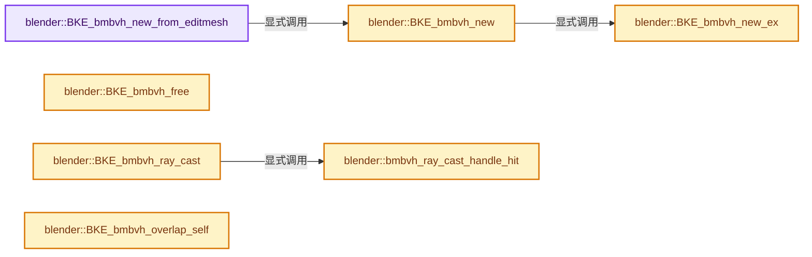
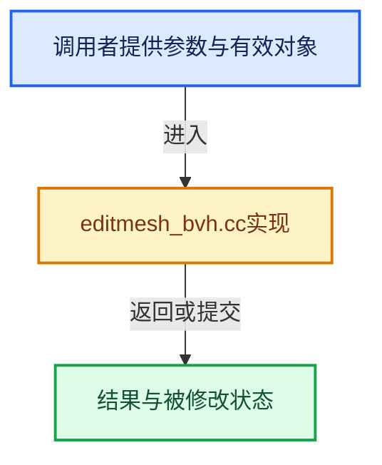

# 实现依赖专题：source/blender/blenkernel/intern/editmesh_bvh.cc

[实现依赖导航](../../README.md) · [符号索引](../../../00-课程指南/02-源码与提交索引/符号依赖与实现索引.md)

本专题从正文实际调用进入，集中保存共享实现。函数有稳定锚点，可从调用处直接跳到对应完整函数；递归与互相调用通过回链组织。

## 本文件的实现关系






## 完整成员与函数实现

<a id="f-1a21cb276029cf96"></a>

### `blender::BKE_bmbvh_new_from_editmesh`

实现位置：[source/blender/blenkernel/intern/editmesh_bvh.cc](../../../../../../../source/blender/blenkernel/intern/editmesh_bvh.cc) · L34—L38。

接口参数：

- `BMEditMesh *em`
- `BMesh *bm`
- `int flag`
- `const float3 *cos_cage`
- `const bool cos_cage_free`

**教学注释版**

<!-- annotated:3c18fcfb62ddd7 -->

```cpp
BMBVHTree *BKE_bmbvh_new_from_editmesh(
    BMEditMesh *em, BMesh *bm, int flag, const float3 *cos_cage, const bool cos_cage_free)
{
  return BKE_bmbvh_new(bm, em->looptris, flag, cos_cage, cos_cage_free);
}
```

<details>
<summary>核对原始源码：source/blender/blenkernel/intern/editmesh_bvh.cc · L34—L38</summary>

<!-- original:3c18fcfb62ddd7:source/blender/blenkernel/intern/editmesh_bvh.cc:34:38 -->

```cpp
BMBVHTree *BKE_bmbvh_new_from_editmesh(
    BMEditMesh *em, BMesh *bm, int flag, const float3 *cos_cage, const bool cos_cage_free)
{
  return BKE_bmbvh_new(bm, em->looptris, flag, cos_cage, cos_cage_free);
}
```

</details>

**结果出口**

- `return BKE_bmbvh_new(bm, em->looptris, flag, cos_cage, cos_cage_free);`

**继续追踪实现**

- `BKE_bmbvh_new` → [blender::BKE_bmbvh_new · L144](editmesh_bvh.cc.md#f-a6f4a6cf944f41d2)。

<a id="f-5af8f5c715af6a3b"></a>

### `blender::BKE_bmbvh_new_ex`

实现位置：[source/blender/blenkernel/intern/editmesh_bvh.cc](../../../../../../../source/blender/blenkernel/intern/editmesh_bvh.cc) · L40—L132。

接口参数：

- `BMesh *bm`
- `const Span<std::array<BMLoop *, 3>> looptris`
- `int flag`
- `const float3 *cos_cage`
- `const bool cos_cage_free`
- `bool (*test_fn)(BMFace *, void *user_data)`
- `BMFace *`
- `void *user_data`
- `void *user_data`

**教学注释版**

<!-- annotated:622275feb03ad8 -->

```cpp
BMBVHTree *BKE_bmbvh_new_ex(BMesh *bm,
                            const Span<std::array<BMLoop *, 3>> looptris,
                            int flag,
                            const float3 *cos_cage,
                            const bool cos_cage_free,
                            bool (*test_fn)(BMFace *, void *user_data),
                            void *user_data)
{
  /* could become argument */
  const float epsilon = FLT_EPSILON * 2.0f;

  BMBVHTree *bmtree = MEM_new<BMBVHTree>("BMBVHTree");
  float cos[3][3];
  int tottri;

  /* avoid testing every tri */
  BMFace *f_test, *f_test_prev;
  bool test_fn_ret;

  /* BKE_editmesh_looptris_calc() must be called already */
  // [讲解] looptris.size：查询视图长度或生成对应有效索引区间。
  BLI_assert(looptris.size() != 0 || bm->totface == 0);

  if (cos_cage) {
    BM_mesh_elem_index_ensure(bm, BM_VERT);
  }

  bmtree->looptris = looptris;
  bmtree->bm = bm;
  bmtree->cos_cage = cos_cage;
  bmtree->cos_cage_free = cos_cage_free;
  bmtree->flag = flag;

  if (test_fn) {
    /* callback must do... */
    BLI_assert(!(flag & (BMBVH_RESPECT_SELECT | BMBVH_RESPECT_HIDDEN)));

    f_test_prev = nullptr;
    test_fn_ret = false;

    tottri = 0;
    // [讲解] looptris.index_range：查询视图长度或生成对应有效索引区间。
    for (const int i : looptris.index_range()) {
      f_test = looptris[i][0]->f;
      if (f_test != f_test_prev) {
        test_fn_ret = test_fn(f_test, user_data);
        f_test_prev = f_test;
      }

      if (test_fn_ret) {
        tottri++;
      }
    }
  }
  else {
    tottri = looptris.size();
  }

  bmtree->tree = BLI_bvhtree_new(tottri, epsilon, 8, 8);

  f_test_prev = nullptr;
  test_fn_ret = false;

  for (const int i : looptris.index_range()) {
    if (test_fn) {
      /* NOTE: the arrays won't align now! Take care. */
      f_test = looptris[i][0]->f;
      if (f_test != f_test_prev) {
        test_fn_ret = test_fn(f_test, user_data);
        f_test_prev = f_test;
      }

      if (!test_fn_ret) {
        continue;
      }
    }

    if (cos_cage) {
      copy_v3_v3(cos[0], cos_cage[BM_elem_index_get(looptris[i][0]->v)]);
      copy_v3_v3(cos[1], cos_cage[BM_elem_index_get(looptris[i][1]->v)]);
      copy_v3_v3(cos[2], cos_cage[BM_elem_index_get(looptris[i][2]->v)]);
    }
    else {
      copy_v3_v3(cos[0], looptris[i][0]->v->co);
      copy_v3_v3(cos[1], looptris[i][1]->v->co);
      copy_v3_v3(cos[2], looptris[i][2]->v->co);
    }

    BLI_bvhtree_insert(bmtree->tree, i, reinterpret_cast<float *>(cos), 3);
  }

  BLI_bvhtree_balance(bmtree->tree);

  return bmtree;
}
```

<details>
<summary>核对原始源码：source/blender/blenkernel/intern/editmesh_bvh.cc · L40—L132</summary>

<!-- original:622275feb03ad8:source/blender/blenkernel/intern/editmesh_bvh.cc:40:132 -->

```cpp
BMBVHTree *BKE_bmbvh_new_ex(BMesh *bm,
                            const Span<std::array<BMLoop *, 3>> looptris,
                            int flag,
                            const float3 *cos_cage,
                            const bool cos_cage_free,
                            bool (*test_fn)(BMFace *, void *user_data),
                            void *user_data)
{
  /* could become argument */
  const float epsilon = FLT_EPSILON * 2.0f;

  BMBVHTree *bmtree = MEM_new<BMBVHTree>("BMBVHTree");
  float cos[3][3];
  int tottri;

  /* avoid testing every tri */
  BMFace *f_test, *f_test_prev;
  bool test_fn_ret;

  /* BKE_editmesh_looptris_calc() must be called already */
  BLI_assert(looptris.size() != 0 || bm->totface == 0);

  if (cos_cage) {
    BM_mesh_elem_index_ensure(bm, BM_VERT);
  }

  bmtree->looptris = looptris;
  bmtree->bm = bm;
  bmtree->cos_cage = cos_cage;
  bmtree->cos_cage_free = cos_cage_free;
  bmtree->flag = flag;

  if (test_fn) {
    /* callback must do... */
    BLI_assert(!(flag & (BMBVH_RESPECT_SELECT | BMBVH_RESPECT_HIDDEN)));

    f_test_prev = nullptr;
    test_fn_ret = false;

    tottri = 0;
    for (const int i : looptris.index_range()) {
      f_test = looptris[i][0]->f;
      if (f_test != f_test_prev) {
        test_fn_ret = test_fn(f_test, user_data);
        f_test_prev = f_test;
      }

      if (test_fn_ret) {
        tottri++;
      }
    }
  }
  else {
    tottri = looptris.size();
  }

  bmtree->tree = BLI_bvhtree_new(tottri, epsilon, 8, 8);

  f_test_prev = nullptr;
  test_fn_ret = false;

  for (const int i : looptris.index_range()) {
    if (test_fn) {
      /* NOTE: the arrays won't align now! Take care. */
      f_test = looptris[i][0]->f;
      if (f_test != f_test_prev) {
        test_fn_ret = test_fn(f_test, user_data);
        f_test_prev = f_test;
      }

      if (!test_fn_ret) {
        continue;
      }
    }

    if (cos_cage) {
      copy_v3_v3(cos[0], cos_cage[BM_elem_index_get(looptris[i][0]->v)]);
      copy_v3_v3(cos[1], cos_cage[BM_elem_index_get(looptris[i][1]->v)]);
      copy_v3_v3(cos[2], cos_cage[BM_elem_index_get(looptris[i][2]->v)]);
    }
    else {
      copy_v3_v3(cos[0], looptris[i][0]->v->co);
      copy_v3_v3(cos[1], looptris[i][1]->v->co);
      copy_v3_v3(cos[2], looptris[i][2]->v->co);
    }

    BLI_bvhtree_insert(bmtree->tree, i, reinterpret_cast<float *>(cos), 3);
  }

  BLI_bvhtree_balance(bmtree->tree);

  return bmtree;
}
```

</details>

**沿实际写入检查状态**

- `bmtree->looptris = looptris;`
- `bmtree->bm = bm;`
- `bmtree->cos_cage = cos_cage;`
- `bmtree->cos_cage_free = cos_cage_free;`
- `bmtree->flag = flag;`
- `f_test_prev = nullptr;`
- `test_fn_ret = false;`
- `tottri = 0;`
- `f_test = looptris[i][0]->f;`
- `test_fn_ret = test_fn(f_test, user_data);`
- `f_test_prev = f_test;`
- `tottri = looptris.size();`
- `bmtree->tree = BLI_bvhtree_new(tottri, epsilon, 8, 8);`

**结果出口**

- `return bmtree;`

**继续追踪实现**

- `MEM_new<BMBVHTree>` → [MEM_new · L351](../../07-Intern运行时与平台/guardedalloc/MEM_guardedalloc.h.md#f-115f9b6784f89912)。
- `BLI_assert` → [BLI_assert · L48](../../01-BLI基础库/BLI_assert.hh.md#m-57a88495704d)；[BLI_assert · L63](../../01-BLI基础库/BLI_assert.hh.md#m-d07050020cb5)。宏定义由构建条件选择。
- `looptris.size` → [blender::Span::size · L256](../../../01-基础容器与现代CPP/05-Span只读连续视图.md#f-5f80fa006089c998)。
- `BM_mesh_elem_index_ensure` → [blender::BM_mesh_elem_index_ensure · L453](../../08-其他Blender模块/bmesh/intern/bmesh_mesh.cc.md#f-bd47fe96d72a16e4)。
- `looptris.index_range` → [blender::Span::index_range · L405](../../../01-基础容器与现代CPP/05-Span只读连续视图.md#f-caaa9b06e13e53e0)。
- `test_fn` → [调用协议](../../../00-课程指南/01-路线与规范/模板宏与动态分派协议.md)：局部可调用对象，须结合其初始化与捕获环境。调用位置L83。
- `BLI_bvhtree_new` → [blender::BLI_bvhtree_new · L864](../../01-BLI基础库/intern/BLI_kdopbvh.cc.md#f-4ec9d64950b835b8)。
- `copy_v3_v3` → [blender::copy_v3_v3 · L47](../../01-BLI基础库/intern/math_vector_inline.cc.md#f-037a0d5fa5060bd6)。
- `BM_elem_index_get` → [BM_elem_index_get · L120](../../08-其他Blender模块/bmesh/intern/bmesh_inline.hh.md#m-201981cdc62d)。宏定义由构建条件选择。
- `BLI_bvhtree_insert` → [blender::BLI_bvhtree_insert · L988](../../01-BLI基础库/intern/BLI_kdopbvh.cc.md#f-00e2c6f8e338e6a0)。
- `BLI_bvhtree_balance` → [blender::BLI_bvhtree_balance · L946](../../01-BLI基础库/intern/BLI_kdopbvh.cc.md#f-623c82143d96130e)。

<a id="f-a6f4a6cf944f41d2"></a>

### `blender::BKE_bmbvh_new`

实现位置：[source/blender/blenkernel/intern/editmesh_bvh.cc](../../../../../../../source/blender/blenkernel/intern/editmesh_bvh.cc) · L144—L165。

接口参数：

- `BMesh *bm`
- `const Span<std::array<BMLoop *, 3>> looptris`
- `int flag`
- `const float3 *cos_cage`
- `const bool cos_cage_free`

**教学注释版**

<!-- annotated:aab2239dcde018 -->

```cpp
BMBVHTree *BKE_bmbvh_new(BMesh *bm,
                         const Span<std::array<BMLoop *, 3>> looptris,
                         int flag,
                         const float3 *cos_cage,
                         const bool cos_cage_free)
{
  bool (*test_fn)(BMFace *, void *user_data);

  if (flag & BMBVH_RESPECT_SELECT) {
    test_fn = bm_face_is_select;
  }
  else if (flag & BMBVH_RESPECT_HIDDEN) {
    test_fn = bm_face_is_not_hidden;
  }
  else {
    test_fn = nullptr;
  }

  flag &= ~(BMBVH_RESPECT_SELECT | BMBVH_RESPECT_HIDDEN);

  return BKE_bmbvh_new_ex(bm, looptris, flag, cos_cage, cos_cage_free, test_fn, nullptr);
}
```

<details>
<summary>核对原始源码：source/blender/blenkernel/intern/editmesh_bvh.cc · L144—L165</summary>

<!-- original:aab2239dcde018:source/blender/blenkernel/intern/editmesh_bvh.cc:144:165 -->

```cpp
BMBVHTree *BKE_bmbvh_new(BMesh *bm,
                         const Span<std::array<BMLoop *, 3>> looptris,
                         int flag,
                         const float3 *cos_cage,
                         const bool cos_cage_free)
{
  bool (*test_fn)(BMFace *, void *user_data);

  if (flag & BMBVH_RESPECT_SELECT) {
    test_fn = bm_face_is_select;
  }
  else if (flag & BMBVH_RESPECT_HIDDEN) {
    test_fn = bm_face_is_not_hidden;
  }
  else {
    test_fn = nullptr;
  }

  flag &= ~(BMBVH_RESPECT_SELECT | BMBVH_RESPECT_HIDDEN);

  return BKE_bmbvh_new_ex(bm, looptris, flag, cos_cage, cos_cage_free, test_fn, nullptr);
}
```

</details>

**沿实际写入检查状态**

- `test_fn = bm_face_is_select;`
- `test_fn = bm_face_is_not_hidden;`
- `test_fn = nullptr;`
- `flag &= ~(BMBVH_RESPECT_SELECT | BMBVH_RESPECT_HIDDEN);`

**结果出口**

- `return BKE_bmbvh_new_ex(bm, looptris, flag, cos_cage, cos_cage_free, test_fn, nullptr);`

**继续追踪实现**

- `BKE_bmbvh_new_ex` → [blender::BKE_bmbvh_new_ex · L40](editmesh_bvh.cc.md#f-5af8f5c715af6a3b)。

<a id="f-262ad054309e1e98"></a>

### `blender::BKE_bmbvh_free`

实现位置：[source/blender/blenkernel/intern/editmesh_bvh.cc](../../../../../../../source/blender/blenkernel/intern/editmesh_bvh.cc) · L167—L176。

接口参数：

- `BMBVHTree *bmtree`

**教学注释版**

<!-- annotated:6cb46f9fd3a5fe -->

```cpp
void BKE_bmbvh_free(BMBVHTree *bmtree)
{
  BLI_bvhtree_free(bmtree->tree);

  if (bmtree->cos_cage && bmtree->cos_cage_free) {
    MEM_delete(bmtree->cos_cage);
  }

  MEM_delete(bmtree);
}
```

<details>
<summary>核对原始源码：source/blender/blenkernel/intern/editmesh_bvh.cc · L167—L176</summary>

<!-- original:6cb46f9fd3a5fe:source/blender/blenkernel/intern/editmesh_bvh.cc:167:176 -->

```cpp
void BKE_bmbvh_free(BMBVHTree *bmtree)
{
  BLI_bvhtree_free(bmtree->tree);

  if (bmtree->cos_cage && bmtree->cos_cage_free) {
    MEM_delete(bmtree->cos_cage);
  }

  MEM_delete(bmtree);
}
```

</details>

**继续追踪实现**

- `BLI_bvhtree_free` → [blender::BLI_bvhtree_free · L935](../../01-BLI基础库/intern/BLI_kdopbvh.cc.md#f-7dcbdb0a7d2476fe)。
- `MEM_delete` → [MEM_delete · L400](../../07-Intern运行时与平台/guardedalloc/MEM_guardedalloc.h.md#f-9049ffdd1682887c)。

<a id="f-5a5a408b130df34d"></a>

### `blender::bmbvh_ray_cast_handle_hit`

实现位置：[source/blender/blenkernel/intern/editmesh_bvh.cc](../../../../../../../source/blender/blenkernel/intern/editmesh_bvh.cc) · L219—L245。

接口参数：

- `const BMBVHTree *bmtree`
- `RayCastUserData *bmcb_data`
- `const BVHTreeRayHit *hit`
- `float *r_dist`
- `float r_hitout[3]`
- `float r_cagehit[3]`

**教学注释版**

<!-- annotated:f4f6e39eaf8a0d -->

```cpp
static BMFace *bmbvh_ray_cast_handle_hit(const BMBVHTree *bmtree,
                                         RayCastUserData *bmcb_data,
                                         const BVHTreeRayHit *hit,
                                         float *r_dist,
                                         float r_hitout[3],
                                         float r_cagehit[3])
{
  if (r_hitout) {
    if (bmtree->flag & BMBVH_RETURN_ORIG) {
      const std::array<BMLoop *, 3> &ltri = bmtree->looptris[hit->index];
      interp_v3_v3v3v3_uv(r_hitout, ltri[0]->v->co, ltri[1]->v->co, ltri[2]->v->co, bmcb_data->uv);
    }
    else {
      copy_v3_v3(r_hitout, hit->co);
    }

    if (r_cagehit) {
      copy_v3_v3(r_cagehit, hit->co);
    }
  }

  if (r_dist) {
    *r_dist = hit->dist;
  }

  return bmtree->looptris[hit->index][0]->f;
}
```

<details>
<summary>核对原始源码：source/blender/blenkernel/intern/editmesh_bvh.cc · L219—L245</summary>

<!-- original:f4f6e39eaf8a0d:source/blender/blenkernel/intern/editmesh_bvh.cc:219:245 -->

```cpp
static BMFace *bmbvh_ray_cast_handle_hit(const BMBVHTree *bmtree,
                                         RayCastUserData *bmcb_data,
                                         const BVHTreeRayHit *hit,
                                         float *r_dist,
                                         float r_hitout[3],
                                         float r_cagehit[3])
{
  if (r_hitout) {
    if (bmtree->flag & BMBVH_RETURN_ORIG) {
      const std::array<BMLoop *, 3> &ltri = bmtree->looptris[hit->index];
      interp_v3_v3v3v3_uv(r_hitout, ltri[0]->v->co, ltri[1]->v->co, ltri[2]->v->co, bmcb_data->uv);
    }
    else {
      copy_v3_v3(r_hitout, hit->co);
    }

    if (r_cagehit) {
      copy_v3_v3(r_cagehit, hit->co);
    }
  }

  if (r_dist) {
    *r_dist = hit->dist;
  }

  return bmtree->looptris[hit->index][0]->f;
}
```

</details>

**结果出口**

- `return bmtree->looptris[hit->index][0]->f;`

**继续追踪实现**

- `interp_v3_v3v3v3_uv` → [blender::interp_v3_v3v3v3_uv · L166](../../01-BLI基础库/intern/math_vector.cc.md#f-722a988a221ad545)。
- `copy_v3_v3` → [blender::copy_v3_v3 · L47](../../01-BLI基础库/intern/math_vector_inline.cc.md#f-037a0d5fa5060bd6)。

<a id="f-d5b7e3826ab16a8b"></a>

### `blender::BKE_bmbvh_ray_cast`

实现位置：[source/blender/blenkernel/intern/editmesh_bvh.cc](../../../../../../../source/blender/blenkernel/intern/editmesh_bvh.cc) · L287—L317。

接口参数：

- `const BMBVHTree *bmtree`
- `const float co[3]`
- `const float dir[3]`
- `const float radius`
- `float *r_dist`
- `float r_hitout[3]`
- `float r_cagehit[3]`

**教学注释版**

<!-- annotated:14f9d52b2b6c71 -->

```cpp
BMFace *BKE_bmbvh_ray_cast(const BMBVHTree *bmtree,
                           const float co[3],
                           const float dir[3],
                           const float radius,
                           float *r_dist,
                           float r_hitout[3],
                           float r_cagehit[3])
{
  BVHTreeRayHit hit;
  RayCastUserData bmcb_data;
  const float dist = r_dist ? *r_dist : FLT_MAX;

  if (bmtree->cos_cage) {
    BLI_assert(!(bmtree->bm->elem_index_dirty & BM_VERT));
  }

  hit.dist = dist;
  hit.index = -1;

  /* ok to leave 'uv' uninitialized */
  bmcb_data.looptris = bmtree->looptris;
  bmcb_data.cos_cage = bmtree->cos_cage;

  BLI_bvhtree_ray_cast(bmtree->tree, co, dir, radius, &hit, bmbvh_ray_cast_cb, &bmcb_data);

  if (hit.index != -1 && hit.dist != dist) {
    return bmbvh_ray_cast_handle_hit(bmtree, &bmcb_data, &hit, r_dist, r_hitout, r_cagehit);
  }

  return nullptr;
}
```

<details>
<summary>核对原始源码：source/blender/blenkernel/intern/editmesh_bvh.cc · L287—L317</summary>

<!-- original:14f9d52b2b6c71:source/blender/blenkernel/intern/editmesh_bvh.cc:287:317 -->

```cpp
BMFace *BKE_bmbvh_ray_cast(const BMBVHTree *bmtree,
                           const float co[3],
                           const float dir[3],
                           const float radius,
                           float *r_dist,
                           float r_hitout[3],
                           float r_cagehit[3])
{
  BVHTreeRayHit hit;
  RayCastUserData bmcb_data;
  const float dist = r_dist ? *r_dist : FLT_MAX;

  if (bmtree->cos_cage) {
    BLI_assert(!(bmtree->bm->elem_index_dirty & BM_VERT));
  }

  hit.dist = dist;
  hit.index = -1;

  /* ok to leave 'uv' uninitialized */
  bmcb_data.looptris = bmtree->looptris;
  bmcb_data.cos_cage = bmtree->cos_cage;

  BLI_bvhtree_ray_cast(bmtree->tree, co, dir, radius, &hit, bmbvh_ray_cast_cb, &bmcb_data);

  if (hit.index != -1 && hit.dist != dist) {
    return bmbvh_ray_cast_handle_hit(bmtree, &bmcb_data, &hit, r_dist, r_hitout, r_cagehit);
  }

  return nullptr;
}
```

</details>

**沿实际写入检查状态**

- `hit.dist = dist;`
- `hit.index = -1;`
- `bmcb_data.looptris = bmtree->looptris;`
- `bmcb_data.cos_cage = bmtree->cos_cage;`

**结果出口**

- `return bmbvh_ray_cast_handle_hit(bmtree, &bmcb_data, &hit, r_dist, r_hitout, r_cagehit);`
- `return nullptr;`

**继续追踪实现**

- `BLI_assert` → [BLI_assert · L48](../../01-BLI基础库/BLI_assert.hh.md#m-57a88495704d)；[BLI_assert · L63](../../01-BLI基础库/BLI_assert.hh.md#m-d07050020cb5)。宏定义由构建条件选择。
- `BLI_bvhtree_ray_cast` → [blender::BLI_bvhtree_ray_cast · L2024](../../01-BLI基础库/intern/BLI_kdopbvh.cc.md#f-08a730292e373fbd)。
- `bmbvh_ray_cast_handle_hit` → [blender::bmbvh_ray_cast_handle_hit · L219](editmesh_bvh.cc.md#f-5a5a408b130df34d)。

<a id="f-d76bdd000079e8fa"></a>

### `blender::BKE_bmbvh_overlap_self`

实现位置：[source/blender/blenkernel/intern/editmesh_bvh.cc](../../../../../../../source/blender/blenkernel/intern/editmesh_bvh.cc) · L574—L584。

接口参数：

- `const BMBVHTree *bmtree`
- `uint *r_overlap_tot`

**教学注释版**

<!-- annotated:4abd5a1d5141c1 -->

```cpp
BVHTreeOverlap *BKE_bmbvh_overlap_self(const BMBVHTree *bmtree, uint *r_overlap_tot)
{
  BMBVHTree_OverlapData data;

  data.tree_pair[0] = bmtree;
  data.tree_pair[1] = bmtree;
  data.epsilon = BLI_bvhtree_get_epsilon(bmtree->tree);

  return BLI_bvhtree_overlap(
      bmtree->tree, bmtree->tree, r_overlap_tot, bmbvh_overlap_self_cb, &data);
}
```

<details>
<summary>核对原始源码：source/blender/blenkernel/intern/editmesh_bvh.cc · L574—L584</summary>

<!-- original:4abd5a1d5141c1:source/blender/blenkernel/intern/editmesh_bvh.cc:574:584 -->

```cpp
BVHTreeOverlap *BKE_bmbvh_overlap_self(const BMBVHTree *bmtree, uint *r_overlap_tot)
{
  BMBVHTree_OverlapData data;

  data.tree_pair[0] = bmtree;
  data.tree_pair[1] = bmtree;
  data.epsilon = BLI_bvhtree_get_epsilon(bmtree->tree);

  return BLI_bvhtree_overlap(
      bmtree->tree, bmtree->tree, r_overlap_tot, bmbvh_overlap_self_cb, &data);
}
```

</details>

**沿实际写入检查状态**

- `data.tree_pair[0] = bmtree;`
- `data.tree_pair[1] = bmtree;`
- `data.epsilon = BLI_bvhtree_get_epsilon(bmtree->tree);`

**结果出口**

- `return BLI_bvhtree_overlap(`

**继续追踪实现**

- `BLI_bvhtree_get_epsilon` → [blender::BLI_bvhtree_get_epsilon · L1053](../../01-BLI基础库/intern/BLI_kdopbvh.cc.md#f-65fb6578a78d4c5b)。
- `BLI_bvhtree_overlap` → [blender::BLI_bvhtree_overlap · L1433](../../01-BLI基础库/intern/BLI_kdopbvh.cc.md#f-8728854ac8dc9a94)。
