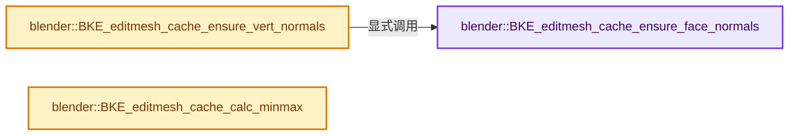

# 实现依赖专题：source/blender/blenkernel/intern/editmesh_cache.cc

[实现依赖导航](../../README.md) · [符号索引](../../../00-课程指南/02-源码与提交索引/符号依赖与实现索引.md)

本专题从正文实际调用进入，集中保存共享实现。函数有稳定锚点，可从调用处直接跳到对应完整函数；递归与互相调用通过回链组织。

## 本文件的实现关系




## 完整成员与函数实现

<a id="f-c3b455cd07eef7b3"></a>

### `blender::BKE_editmesh_cache_ensure_face_normals`

实现位置：[source/blender/blenkernel/intern/editmesh_cache.cc](../../../../../../../source/blender/blenkernel/intern/editmesh_cache.cc) · L24—L42。

接口参数：

- `BMesh &bm`
- `bke::EditMeshData &emd`

**教学注释版**

<!-- annotated:c60fcf0d171b67 -->

```cpp
Span<float3> BKE_editmesh_cache_ensure_face_normals(BMesh &bm, bke::EditMeshData &emd)
{
  if (emd.vert_positions.is_empty() || !emd.face_normals.is_empty()) {
    return emd.face_normals;
  }

  emd.face_normals.reinitialize(bm.totface);

  BM_mesh_elem_index_ensure(&bm, BM_VERT);
  BMFace *efa;
  BMIter fiter;
  int i;
  BM_ITER_MESH_INDEX (efa, &fiter, &bm, BM_FACES_OF_MESH, i) {
    BM_elem_index_set(efa, i); /* set_inline */
    BM_face_calc_normal_vcos(&bm, efa, emd.face_normals[i], emd.vert_positions);
  }
  bm.elem_index_dirty &= ~BM_FACE;
  return emd.face_normals;
}
```

<details>
<summary>核对原始源码：source/blender/blenkernel/intern/editmesh_cache.cc · L24—L42</summary>

<!-- original:c60fcf0d171b67:source/blender/blenkernel/intern/editmesh_cache.cc:24:42 -->

```cpp
Span<float3> BKE_editmesh_cache_ensure_face_normals(BMesh &bm, bke::EditMeshData &emd)
{
  if (emd.vert_positions.is_empty() || !emd.face_normals.is_empty()) {
    return emd.face_normals;
  }

  emd.face_normals.reinitialize(bm.totface);

  BM_mesh_elem_index_ensure(&bm, BM_VERT);
  BMFace *efa;
  BMIter fiter;
  int i;
  BM_ITER_MESH_INDEX (efa, &fiter, &bm, BM_FACES_OF_MESH, i) {
    BM_elem_index_set(efa, i); /* set_inline */
    BM_face_calc_normal_vcos(&bm, efa, emd.face_normals[i], emd.vert_positions);
  }
  bm.elem_index_dirty &= ~BM_FACE;
  return emd.face_normals;
}
```

</details>

**沿实际写入检查状态**

- `bm.elem_index_dirty &= ~BM_FACE;`

**结果出口**

- `return emd.face_normals;`

**继续追踪实现**

- `emd.vert_positions.is_empty` → [调用协议](../../../00-课程指南/01-路线与规范/模板宏与动态分派协议.md)：接收对象类型依赖auto、返回值或模板实例；不按同名猜测目标。调用位置L26。
- `emd.face_normals.is_empty` → [调用协议](../../../00-课程指南/01-路线与规范/模板宏与动态分派协议.md)：接收对象类型依赖auto、返回值或模板实例；不按同名猜测目标。调用位置L26。
- `emd.face_normals.reinitialize` → [调用协议](../../../00-课程指南/01-路线与规范/模板宏与动态分派协议.md)：接收对象类型依赖auto、返回值或模板实例；不按同名猜测目标。调用位置L30。
- `BM_mesh_elem_index_ensure` → [blender::BM_mesh_elem_index_ensure · L453](../../08-其他Blender模块/bmesh/intern/bmesh_mesh.cc.md#f-bd47fe96d72a16e4)。
- `BM_ITER_MESH_INDEX` → [BM_ITER_MESH_INDEX · L76](../../08-其他Blender模块/bmesh/intern/bmesh_iterators.hh.md#m-6a0cac4538f9)。宏定义由构建条件选择。
- `BM_elem_index_set` → [BM_elem_index_set · L121](../../08-其他Blender模块/bmesh/intern/bmesh_inline.hh.md#m-7bd559c53007)。宏定义由构建条件选择。
- `BM_face_calc_normal_vcos` → [blender::BM_face_calc_normal_vcos · L856](../../08-其他Blender模块/bmesh/intern/bmesh_polygon.cc.md#f-8deec290603c99ba)。

<a id="f-5c832267611cf64c"></a>

### `blender::BKE_editmesh_cache_ensure_vert_normals`

实现位置：[source/blender/blenkernel/intern/editmesh_cache.cc](../../../../../../../source/blender/blenkernel/intern/editmesh_cache.cc) · L44—L58。

接口参数：

- `BMesh &bm`
- `bke::EditMeshData &emd`

**教学注释版**

<!-- annotated:eb8a6e5fe16a08 -->

```cpp
Span<float3> BKE_editmesh_cache_ensure_vert_normals(BMesh &bm, bke::EditMeshData &emd)
{
  if (emd.vert_positions.is_empty() || !emd.vert_normals.is_empty()) {
    return emd.vert_normals;
  }

  /* Calculate vertex normals from face normals. */
  const Span<float3> face_normals = BKE_editmesh_cache_ensure_face_normals(bm, emd);

  emd.vert_normals.reinitialize(bm.totvert);

  BM_mesh_elem_index_ensure(&bm, BM_FACE);
  BM_verts_calc_normal_vcos(&bm, face_normals, emd.vert_positions, emd.vert_normals);
  return emd.vert_normals;
}
```

<details>
<summary>核对原始源码：source/blender/blenkernel/intern/editmesh_cache.cc · L44—L58</summary>

<!-- original:eb8a6e5fe16a08:source/blender/blenkernel/intern/editmesh_cache.cc:44:58 -->

```cpp
Span<float3> BKE_editmesh_cache_ensure_vert_normals(BMesh &bm, bke::EditMeshData &emd)
{
  if (emd.vert_positions.is_empty() || !emd.vert_normals.is_empty()) {
    return emd.vert_normals;
  }

  /* Calculate vertex normals from face normals. */
  const Span<float3> face_normals = BKE_editmesh_cache_ensure_face_normals(bm, emd);

  emd.vert_normals.reinitialize(bm.totvert);

  BM_mesh_elem_index_ensure(&bm, BM_FACE);
  BM_verts_calc_normal_vcos(&bm, face_normals, emd.vert_positions, emd.vert_normals);
  return emd.vert_normals;
}
```

</details>

**结果出口**

- `return emd.vert_normals;`

**继续追踪实现**

- `emd.vert_positions.is_empty` → [调用协议](../../../00-课程指南/01-路线与规范/模板宏与动态分派协议.md)：接收对象类型依赖auto、返回值或模板实例；不按同名猜测目标。调用位置L46。
- `emd.vert_normals.is_empty` → [调用协议](../../../00-课程指南/01-路线与规范/模板宏与动态分派协议.md)：接收对象类型依赖auto、返回值或模板实例；不按同名猜测目标。调用位置L46。
- `BKE_editmesh_cache_ensure_face_normals` → [blender::BKE_editmesh_cache_ensure_face_normals · L24](editmesh_cache.cc.md#f-c3b455cd07eef7b3)。
- `emd.vert_normals.reinitialize` → [调用协议](../../../00-课程指南/01-路线与规范/模板宏与动态分派协议.md)：接收对象类型依赖auto、返回值或模板实例；不按同名猜测目标。调用位置L53。
- `BM_mesh_elem_index_ensure` → [blender::BM_mesh_elem_index_ensure · L453](../../08-其他Blender模块/bmesh/intern/bmesh_mesh.cc.md#f-bd47fe96d72a16e4)。
- `BM_verts_calc_normal_vcos` → [blender::BM_verts_calc_normal_vcos · L311](../../08-其他Blender模块/bmesh/intern/bmesh_mesh_normals.cc.md#f-fd11edf310770425)。

<a id="f-eabf52399317fe7a"></a>

### `blender::BKE_editmesh_cache_calc_minmax`

实现位置：[source/blender/blenkernel/intern/editmesh_cache.cc](../../../../../../../source/blender/blenkernel/intern/editmesh_cache.cc) · L91—L110。

接口参数：

- `BMesh &bm`
- `const bke::EditMeshData &emd`

**教学注释版**

<!-- annotated:cde8eb5e87fd6b -->

```cpp
std::optional<Bounds<float3>> BKE_editmesh_cache_calc_minmax(BMesh &bm,
                                                             const bke::EditMeshData &emd)
{
  if (bm.totvert == 0) {
    return std::nullopt;
  }

  if (emd.vert_positions.is_empty()) {
    BMVert *eve;
    BMIter iter;
    float3 min(std::numeric_limits<float>::max());
    float3 max(std::numeric_limits<float>::lowest());
    BM_ITER_MESH (eve, &iter, &bm, BM_VERTS_OF_MESH) {
      minmax_v3v3_v3(min, max, eve->co);
    }
    return Bounds<float3>{min, max};
  }

  return bounds::min_max(emd.vert_positions.as_span());
}
```

<details>
<summary>核对原始源码：source/blender/blenkernel/intern/editmesh_cache.cc · L91—L110</summary>

<!-- original:cde8eb5e87fd6b:source/blender/blenkernel/intern/editmesh_cache.cc:91:110 -->

```cpp
std::optional<Bounds<float3>> BKE_editmesh_cache_calc_minmax(BMesh &bm,
                                                             const bke::EditMeshData &emd)
{
  if (bm.totvert == 0) {
    return std::nullopt;
  }

  if (emd.vert_positions.is_empty()) {
    BMVert *eve;
    BMIter iter;
    float3 min(std::numeric_limits<float>::max());
    float3 max(std::numeric_limits<float>::lowest());
    BM_ITER_MESH (eve, &iter, &bm, BM_VERTS_OF_MESH) {
      minmax_v3v3_v3(min, max, eve->co);
    }
    return Bounds<float3>{min, max};
  }

  return bounds::min_max(emd.vert_positions.as_span());
}
```

</details>

**结果出口**

- `return std::nullopt;`
- `return Bounds<float3>{min, max};`
- `return bounds::min_max(emd.vert_positions.as_span());`

**继续追踪实现**

- `emd.vert_positions.is_empty` → [调用协议](../../../00-课程指南/01-路线与规范/模板宏与动态分派协议.md)：接收对象类型依赖auto、返回值或模板实例；不按同名猜测目标。调用位置L98。
- `BM_ITER_MESH` → [BM_ITER_MESH · L72](../../08-其他Blender模块/bmesh/intern/bmesh_iterators.hh.md#m-cfc837c73218)。宏定义由构建条件选择。
- `minmax_v3v3_v3` → [blender::minmax_v3v3_v3 · L716](../../01-BLI基础库/intern/math_vector.cc.md#f-9d9c3397f2360838)。
- `bounds::min_max` → [blender::bounds::min_max · L55](../../../12-空间数据结构与几何算法/07-Bounds与BVH对比.md#f-8ec8264a27aee526)；[blender::bounds::min_max · L142](../../../12-空间数据结构与几何算法/07-Bounds与BVH对比.md#f-54be182a0edebcb6)；[blender::bounds::min_max · L159](../../../12-空间数据结构与几何算法/07-Bounds与BVH对比.md#f-c05654b35c75b0ff)；[blender::bounds::min_max · L212](../../../12-空间数据结构与几何算法/07-Bounds与BVH对比.md#f-6c1add8352426e55)。同名重载需按实参类型选择。
- `emd.vert_positions.as_span` → [调用协议](../../../00-课程指南/01-路线与规范/模板宏与动态分派协议.md)：接收对象类型依赖auto、返回值或模板实例；不按同名猜测目标。调用位置L109。
