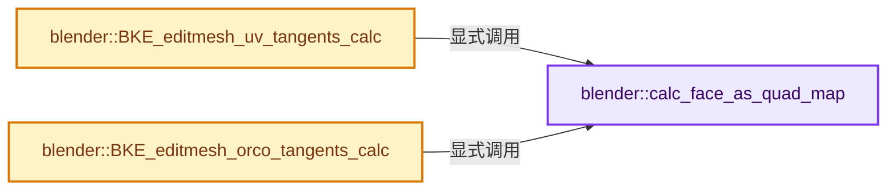
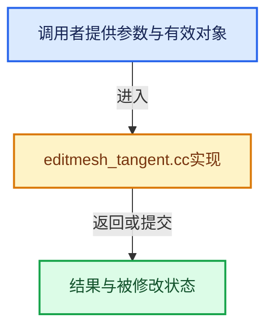

# 实现依赖专题：source/blender/blenkernel/intern/editmesh_tangent.cc

[实现依赖导航](../../README.md) · [符号索引](../../../00-课程指南/02-源码与提交索引/符号依赖与实现索引.md)

本专题从正文实际调用进入，集中保存共享实现。函数有稳定锚点，可从调用处直接跳到对应完整函数；递归与互相调用通过回链组织。

## 本文件的实现关系






## 完整成员与函数实现

<a id="f-1958076f2b3cbae9"></a>

### `blender::calc_face_as_quad_map`

实现位置：[source/blender/blenkernel/intern/editmesh_tangent.cc](../../../../../../../source/blender/blenkernel/intern/editmesh_tangent.cc) · L151—L180。

接口参数：

- `const Span<std::array<BMLoop *, 3>> looptris`
- `BMesh &bm`
- `int &totface`
- `int &num_face_as_quad_map`
- `int *&face_as_quad_map`

**教学注释版**

<!-- annotated:dbce675a569df4 -->

```cpp
static void calc_face_as_quad_map(const Span<std::array<BMLoop *, 3>> looptris,
                                  BMesh &bm,
                                  int &totface,
                                  int &num_face_as_quad_map,
                                  int *&face_as_quad_map)
{
#ifdef USE_LOOPTRI_DETECT_QUADS
  // [讲解] looptris.size：查询视图长度或生成对应有效索引区间。
  if (looptris.size() != bm.totface) {
    /* Over allocate, since we don't know how many ngon or quads we have. */

    /* map fake face index to looptri */
    face_as_quad_map = MEM_new_array_uninitialized<int>(size_t(totface), __func__);
    int i, j;
    for (i = 0, j = 0; j < totface; i++, j++) {
      face_as_quad_map[i] = j;
      /* step over all quads */
      if (looptris[j][0]->f->len == 4) {
        j++; /* Skips the next looptri. */
      }
    }
    num_face_as_quad_map = i;
  }
  else {
    num_face_as_quad_map = totface;
  }
#else
  num_face_as_quad_map = totface;
  face_as_quad_map = nullptr;
#endif
}
```

<details>
<summary>核对原始源码：source/blender/blenkernel/intern/editmesh_tangent.cc · L151—L180</summary>

<!-- original:dbce675a569df4:source/blender/blenkernel/intern/editmesh_tangent.cc:151:180 -->

```cpp
static void calc_face_as_quad_map(const Span<std::array<BMLoop *, 3>> looptris,
                                  BMesh &bm,
                                  int &totface,
                                  int &num_face_as_quad_map,
                                  int *&face_as_quad_map)
{
#ifdef USE_LOOPTRI_DETECT_QUADS
  if (looptris.size() != bm.totface) {
    /* Over allocate, since we don't know how many ngon or quads we have. */

    /* map fake face index to looptri */
    face_as_quad_map = MEM_new_array_uninitialized<int>(size_t(totface), __func__);
    int i, j;
    for (i = 0, j = 0; j < totface; i++, j++) {
      face_as_quad_map[i] = j;
      /* step over all quads */
      if (looptris[j][0]->f->len == 4) {
        j++; /* Skips the next looptri. */
      }
    }
    num_face_as_quad_map = i;
  }
  else {
    num_face_as_quad_map = totface;
  }
#else
  num_face_as_quad_map = totface;
  face_as_quad_map = nullptr;
#endif
}
```

</details>

**沿实际写入检查状态**

- `face_as_quad_map = MEM_new_array_uninitialized<int>(size_t(totface), __func__);`
- `face_as_quad_map[i] = j;`
- `num_face_as_quad_map = i;`
- `num_face_as_quad_map = totface;`
- `face_as_quad_map = nullptr;`

**继续追踪实现**

- `looptris.size` → [blender::Span::size · L256](../../../01-基础容器与现代CPP/05-Span只读连续视图.md#f-5f80fa006089c998)。
- `MEM_new_array_uninitialized<int>` → [MEM_new_array_uninitialized · L608](../../07-Intern运行时与平台/guardedalloc/MEM_guardedalloc.h.md#f-b7103eae8eb57b05)；[MEM_new_array_uninitialized · L129](../../07-Intern运行时与平台/guardedalloc/intern/mallocn.cc.md#f-bf6ef4ddcfb6e5df)。同名重载需按实参类型选择。

<a id="f-f8d9a8fbf17e14c8"></a>

### `blender::BKE_editmesh_uv_tangents_calc`

实现位置：[source/blender/blenkernel/intern/editmesh_tangent.cc](../../../../../../../source/blender/blenkernel/intern/editmesh_tangent.cc) · L182—L233。

接口参数：

- `BMesh *bm`
- `const Span<std::array<BMLoop *, 3>> looptris`
- `const Span<float3> face_normals`
- `const Span<float3> corner_normals`
- `const Span<StringRef> uv_names`

**教学注释版**

<!-- annotated:1c3fea772e742c -->

```cpp
Array<Array<float4>> BKE_editmesh_uv_tangents_calc(BMesh *bm,
                                                   const Span<std::array<BMLoop *, 3>> looptris,
                                                   const Span<float3> face_normals,
                                                   const Span<float3> corner_normals,
                                                   const Span<StringRef> uv_names)
{
  // [讲解] looptris.is_empty：查询视图长度或生成对应有效索引区间。
  if (looptris.is_empty()) {
    return {};
  }

  // [讲解] looptris.size：查询视图长度或生成对应有效索引区间。
  int totface = looptris.size();
  int num_face_as_quad_map;
  int *face_as_quad_map = nullptr;
  calc_face_as_quad_map(looptris, *bm, totface, num_face_as_quad_map, face_as_quad_map);

  Array<Array<float4>> result(uv_names.size());

  /* needed for indexing loop-tangents */
  int htype_index = BM_LOOP;
  if (!face_normals.is_empty()) {
    /* needed for face normal lookups */
    htype_index |= BM_FACE;
  }
  BM_mesh_elem_index_ensure(bm, htype_index);

  // [讲解] uv_names.index_range：查询视图长度或生成对应有效索引区间。
  threading::parallel_for(uv_names.index_range(), 1, [&](const IndexRange range) {
    for (const int n : range) {
      SGLSLEditMeshToTangent mesh2tangent{};
      mesh2tangent.numTessFaces = looptris.size();
      mesh2tangent.face_as_quad_map = face_as_quad_map;
      mesh2tangent.num_face_as_quad_map = num_face_as_quad_map;
      mesh2tangent.face_normals = face_normals;
      /* NOTE: we assume we do have tessellated loop normals at this point
       * (in case it is object-enabled), have to check this is valid. */
      mesh2tangent.corner_normals = corner_normals;
      mesh2tangent.cd_loop_uv_offset = CustomData_get_offset_named(
          &bm->ldata, CD_PROP_FLOAT2, uv_names[n]);
      BLI_assert(mesh2tangent.cd_loop_uv_offset != -1);

      mesh2tangent.looptris = looptris;
      result[n].reinitialize(bm->totloop);
      mesh2tangent.tangent = reinterpret_cast<float (*)[4]>(result[n].data());

      mikk::Mikktspace<SGLSLEditMeshToTangent> mikk(mesh2tangent);
      mikk.genTangSpace();
    }
  });

  MEM_SAFE_DELETE(face_as_quad_map);

  return result;
}
```

<details>
<summary>核对原始源码：source/blender/blenkernel/intern/editmesh_tangent.cc · L182—L233</summary>

<!-- original:1c3fea772e742c:source/blender/blenkernel/intern/editmesh_tangent.cc:182:233 -->

```cpp
Array<Array<float4>> BKE_editmesh_uv_tangents_calc(BMesh *bm,
                                                   const Span<std::array<BMLoop *, 3>> looptris,
                                                   const Span<float3> face_normals,
                                                   const Span<float3> corner_normals,
                                                   const Span<StringRef> uv_names)
{
  if (looptris.is_empty()) {
    return {};
  }

  int totface = looptris.size();
  int num_face_as_quad_map;
  int *face_as_quad_map = nullptr;
  calc_face_as_quad_map(looptris, *bm, totface, num_face_as_quad_map, face_as_quad_map);

  Array<Array<float4>> result(uv_names.size());

  /* needed for indexing loop-tangents */
  int htype_index = BM_LOOP;
  if (!face_normals.is_empty()) {
    /* needed for face normal lookups */
    htype_index |= BM_FACE;
  }
  BM_mesh_elem_index_ensure(bm, htype_index);

  threading::parallel_for(uv_names.index_range(), 1, [&](const IndexRange range) {
    for (const int n : range) {
      SGLSLEditMeshToTangent mesh2tangent{};
      mesh2tangent.numTessFaces = looptris.size();
      mesh2tangent.face_as_quad_map = face_as_quad_map;
      mesh2tangent.num_face_as_quad_map = num_face_as_quad_map;
      mesh2tangent.face_normals = face_normals;
      /* NOTE: we assume we do have tessellated loop normals at this point
       * (in case it is object-enabled), have to check this is valid. */
      mesh2tangent.corner_normals = corner_normals;
      mesh2tangent.cd_loop_uv_offset = CustomData_get_offset_named(
          &bm->ldata, CD_PROP_FLOAT2, uv_names[n]);
      BLI_assert(mesh2tangent.cd_loop_uv_offset != -1);

      mesh2tangent.looptris = looptris;
      result[n].reinitialize(bm->totloop);
      mesh2tangent.tangent = reinterpret_cast<float (*)[4]>(result[n].data());

      mikk::Mikktspace<SGLSLEditMeshToTangent> mikk(mesh2tangent);
      mikk.genTangSpace();
    }
  });

  MEM_SAFE_DELETE(face_as_quad_map);

  return result;
}
```

</details>

**沿实际写入检查状态**

- `htype_index |= BM_FACE;`
- `mesh2tangent.numTessFaces = looptris.size();`
- `mesh2tangent.face_as_quad_map = face_as_quad_map;`
- `mesh2tangent.num_face_as_quad_map = num_face_as_quad_map;`
- `mesh2tangent.face_normals = face_normals;`
- `mesh2tangent.corner_normals = corner_normals;`
- `mesh2tangent.cd_loop_uv_offset = CustomData_get_offset_named(`
- `mesh2tangent.looptris = looptris;`
- `mesh2tangent.tangent = reinterpret_cast<float (*)[4]>(result[n].data());`

**结果出口**

- `return {};`
- `return result;`

**继续追踪实现**

- `looptris.is_empty` → [blender::Span::is_empty · L264](../../../01-基础容器与现代CPP/05-Span只读连续视图.md#f-8cc1d7ba8feb50e6)。
- `looptris.size` → [blender::Span::size · L256](../../../01-基础容器与现代CPP/05-Span只读连续视图.md#f-5f80fa006089c998)。
- `calc_face_as_quad_map` → [blender::calc_face_as_quad_map · L151](editmesh_tangent.cc.md#f-1958076f2b3cbae9)。
- `uv_names.size` → [blender::Span::size · L256](../../../01-基础容器与现代CPP/05-Span只读连续视图.md#f-5f80fa006089c998)。
- `face_normals.is_empty` → [blender::Span::is_empty · L264](../../../01-基础容器与现代CPP/05-Span只读连续视图.md#f-8cc1d7ba8feb50e6)。
- `BM_mesh_elem_index_ensure` → [blender::BM_mesh_elem_index_ensure · L453](../../08-其他Blender模块/bmesh/intern/bmesh_mesh.cc.md#f-bd47fe96d72a16e4)。
- `threading::parallel_for` → [blender::threading::parallel_for · L68](../../../11-Depsgraph与并行任务系统/07-任务池与TBB接入.md#f-838294754c24426c)。
- `uv_names.index_range` → [blender::Span::index_range · L405](../../../01-基础容器与现代CPP/05-Span只读连续视图.md#f-caaa9b06e13e53e0)。
- `CustomData_get_offset_named` → [blender::CustomData_get_offset_named · L3398](customdata.cc.md#f-fe199f3da62e9c30)。
- `BLI_assert` → [BLI_assert · L48](../../01-BLI基础库/BLI_assert.hh.md#m-57a88495704d)；[BLI_assert · L63](../../01-BLI基础库/BLI_assert.hh.md#m-d07050020cb5)。宏定义由构建条件选择。
- `result[n].reinitialize` → [调用协议](../../../00-课程指南/01-路线与规范/模板宏与动态分派协议.md)：接收对象类型依赖auto、返回值或模板实例；不按同名猜测目标。调用位置L222。
- `result[n].data` → [调用协议](../../../00-课程指南/01-路线与规范/模板宏与动态分派协议.md)：接收对象类型依赖auto、返回值或模板实例；不按同名猜测目标。调用位置L223。
- `mikk.genTangSpace` → [mikk::Mikktspace::genTangSpace · L147](../../07-Intern运行时与平台/mikktspace/mikktspace.hh.md#f-5bcf7b1a910d5339)。
- `MEM_SAFE_DELETE` → [MEM_SAFE_DELETE · L436](../../07-Intern运行时与平台/guardedalloc/MEM_guardedalloc.h.md#m-eadb3bc5b902)。宏定义由构建条件选择。

<a id="f-5526ef67ffc09ad3"></a>

### `blender::BKE_editmesh_orco_tangents_calc`

实现位置：[source/blender/blenkernel/intern/editmesh_tangent.cc](../../../../../../../source/blender/blenkernel/intern/editmesh_tangent.cc) · L235—L281。

接口参数：

- `BMesh *bm`
- `const Span<std::array<BMLoop *, 3>> looptris`
- `const Span<float3> face_normals`
- `const Span<float3> corner_normals`
- `const Span<float3> vert_orco`

**教学注释版**

<!-- annotated:05b5c172e5be5c -->

```cpp
Array<float4> BKE_editmesh_orco_tangents_calc(BMesh *bm,
                                              const Span<std::array<BMLoop *, 3>> looptris,
                                              const Span<float3> face_normals,
                                              const Span<float3> corner_normals,
                                              const Span<float3> vert_orco)
{
  // [讲解] looptris.is_empty：查询视图长度或生成对应有效索引区间。
  if (looptris.is_empty()) {
    return {};
  }

  // [讲解] looptris.size：查询视图长度或生成对应有效索引区间。
  int totface = looptris.size();
  int num_face_as_quad_map;
  int *face_as_quad_map = nullptr;
  calc_face_as_quad_map(looptris, *bm, totface, num_face_as_quad_map, face_as_quad_map);

  Array<float4> result(bm->totloop);

  /* needed for indexing loop-tangents */
  int htype_index = BM_LOOP;
  /* needed for orco lookups */
  htype_index |= BM_VERT;
  if (!face_normals.is_empty()) {
    /* needed for face normal lookups */
    htype_index |= BM_FACE;
  }
  BM_mesh_elem_index_ensure(bm, htype_index);

  SGLSLEditMeshToTangent mesh2tangent{};
  mesh2tangent.numTessFaces = looptris.size();
  mesh2tangent.face_as_quad_map = face_as_quad_map;
  mesh2tangent.num_face_as_quad_map = num_face_as_quad_map;
  mesh2tangent.face_normals = face_normals;
  /* NOTE: we assume we do have tessellated loop normals at this point
   * (in case it is object-enabled), have to check this is valid. */
  mesh2tangent.corner_normals = corner_normals;
  mesh2tangent.cd_loop_uv_offset = -1;
  mesh2tangent.orco = vert_orco;

  mesh2tangent.looptris = looptris;
  // [讲解] result.data：提供数组的借用访问入口。
  mesh2tangent.tangent = reinterpret_cast<float (*)[4]>(result.data());
  mikk::Mikktspace<SGLSLEditMeshToTangent> mikk(mesh2tangent);
  mikk.genTangSpace();

  MEM_SAFE_DELETE(face_as_quad_map);

  return result;
}
```

<details>
<summary>核对原始源码：source/blender/blenkernel/intern/editmesh_tangent.cc · L235—L281</summary>

<!-- original:05b5c172e5be5c:source/blender/blenkernel/intern/editmesh_tangent.cc:235:281 -->

```cpp
Array<float4> BKE_editmesh_orco_tangents_calc(BMesh *bm,
                                              const Span<std::array<BMLoop *, 3>> looptris,
                                              const Span<float3> face_normals,
                                              const Span<float3> corner_normals,
                                              const Span<float3> vert_orco)
{
  if (looptris.is_empty()) {
    return {};
  }

  int totface = looptris.size();
  int num_face_as_quad_map;
  int *face_as_quad_map = nullptr;
  calc_face_as_quad_map(looptris, *bm, totface, num_face_as_quad_map, face_as_quad_map);

  Array<float4> result(bm->totloop);

  /* needed for indexing loop-tangents */
  int htype_index = BM_LOOP;
  /* needed for orco lookups */
  htype_index |= BM_VERT;
  if (!face_normals.is_empty()) {
    /* needed for face normal lookups */
    htype_index |= BM_FACE;
  }
  BM_mesh_elem_index_ensure(bm, htype_index);

  SGLSLEditMeshToTangent mesh2tangent{};
  mesh2tangent.numTessFaces = looptris.size();
  mesh2tangent.face_as_quad_map = face_as_quad_map;
  mesh2tangent.num_face_as_quad_map = num_face_as_quad_map;
  mesh2tangent.face_normals = face_normals;
  /* NOTE: we assume we do have tessellated loop normals at this point
   * (in case it is object-enabled), have to check this is valid. */
  mesh2tangent.corner_normals = corner_normals;
  mesh2tangent.cd_loop_uv_offset = -1;
  mesh2tangent.orco = vert_orco;

  mesh2tangent.looptris = looptris;
  mesh2tangent.tangent = reinterpret_cast<float (*)[4]>(result.data());
  mikk::Mikktspace<SGLSLEditMeshToTangent> mikk(mesh2tangent);
  mikk.genTangSpace();

  MEM_SAFE_DELETE(face_as_quad_map);

  return result;
}
```

</details>

**沿实际写入检查状态**

- `htype_index |= BM_VERT;`
- `htype_index |= BM_FACE;`
- `mesh2tangent.numTessFaces = looptris.size();`
- `mesh2tangent.face_as_quad_map = face_as_quad_map;`
- `mesh2tangent.num_face_as_quad_map = num_face_as_quad_map;`
- `mesh2tangent.face_normals = face_normals;`
- `mesh2tangent.corner_normals = corner_normals;`
- `mesh2tangent.cd_loop_uv_offset = -1;`
- `mesh2tangent.orco = vert_orco;`
- `mesh2tangent.looptris = looptris;`
- `mesh2tangent.tangent = reinterpret_cast<float (*)[4]>(result.data());`

**结果出口**

- `return {};`
- `return result;`

**继续追踪实现**

- `looptris.is_empty` → [blender::Span::is_empty · L264](../../../01-基础容器与现代CPP/05-Span只读连续视图.md#f-8cc1d7ba8feb50e6)。
- `looptris.size` → [blender::Span::size · L256](../../../01-基础容器与现代CPP/05-Span只读连续视图.md#f-5f80fa006089c998)。
- `calc_face_as_quad_map` → [blender::calc_face_as_quad_map · L151](editmesh_tangent.cc.md#f-1958076f2b3cbae9)。
- `face_normals.is_empty` → [blender::Span::is_empty · L264](../../../01-基础容器与现代CPP/05-Span只读连续视图.md#f-8cc1d7ba8feb50e6)。
- `BM_mesh_elem_index_ensure` → [blender::BM_mesh_elem_index_ensure · L453](../../08-其他Blender模块/bmesh/intern/bmesh_mesh.cc.md#f-bd47fe96d72a16e4)。
- `result.data` → [blender::Array::data · L323](../../../01-基础容器与现代CPP/08-Array复制移动与销毁.md#f-95648c799002f4ba)；[blender::Array::data · L327](../../../01-基础容器与现代CPP/08-Array复制移动与销毁.md#f-50c18301f8c40f9e)。同名重载需按实参类型选择。
- `mikk.genTangSpace` → [mikk::Mikktspace::genTangSpace · L147](../../07-Intern运行时与平台/mikktspace/mikktspace.hh.md#f-5bcf7b1a910d5339)。
- `MEM_SAFE_DELETE` → [MEM_SAFE_DELETE · L436](../../07-Intern运行时与平台/guardedalloc/MEM_guardedalloc.h.md#m-eadb3bc5b902)。宏定义由构建条件选择。
