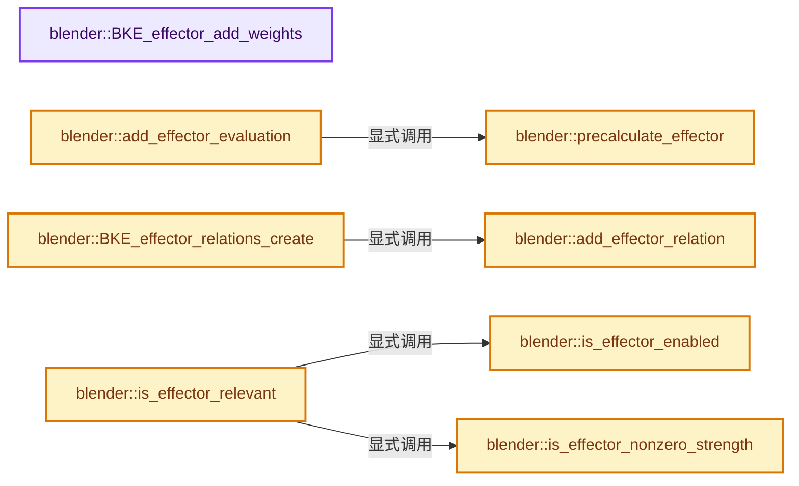
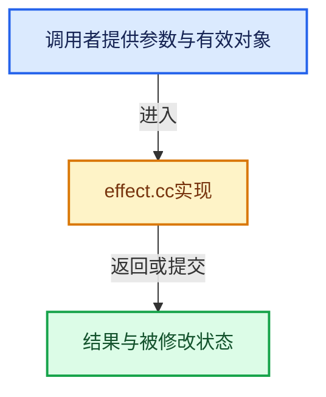

# 实现依赖专题：source/blender/blenkernel/intern/effect.cc

[实现依赖导航](../../README.md) · [符号索引](../../../00-课程指南/02-源码与提交索引/符号依赖与实现索引.md)

本专题从正文实际调用进入，集中保存共享实现。函数有稳定锚点，可从调用处直接跳到对应完整函数；递归与互相调用通过回链组织。

## 本文件的实现关系






## 完整成员与函数实现

<a id="f-ce184d2946a57299"></a>

### `blender::BKE_effector_add_weights`

实现位置：[source/blender/blenkernel/intern/effect.cc](../../../../../../../source/blender/blenkernel/intern/effect.cc) · L63—L75。

接口参数：

- `Collection *collection`

**教学注释版**

<!-- annotated:2c77ea10a5c8bb -->

```cpp
EffectorWeights *BKE_effector_add_weights(Collection *collection)
{
  EffectorWeights *weights = MEM_new<EffectorWeights>("EffectorWeights");
  for (int i = 0; i < NUM_PFIELD_TYPES; i++) {
    weights->weight[i] = 1.0f;
  }

  weights->global_gravity = 1.0f;

  weights->group = collection;

  return weights;
}
```

<details>
<summary>核对原始源码：source/blender/blenkernel/intern/effect.cc · L63—L75</summary>

<!-- original:2c77ea10a5c8bb:source/blender/blenkernel/intern/effect.cc:63:75 -->

```cpp
EffectorWeights *BKE_effector_add_weights(Collection *collection)
{
  EffectorWeights *weights = MEM_new<EffectorWeights>("EffectorWeights");
  for (int i = 0; i < NUM_PFIELD_TYPES; i++) {
    weights->weight[i] = 1.0f;
  }

  weights->global_gravity = 1.0f;

  weights->group = collection;

  return weights;
}
```

</details>

**沿实际写入检查状态**

- `weights->weight[i] = 1.0f;`
- `weights->global_gravity = 1.0f;`
- `weights->group = collection;`

**结果出口**

- `return weights;`

**继续追踪实现**

- `MEM_new<EffectorWeights>` → [MEM_new · L351](../../07-Intern运行时与平台/guardedalloc/MEM_guardedalloc.h.md#f-115f9b6784f89912)。

<a id="f-146d22d20b673487"></a>

### `blender::precalculate_effector`

实现位置：[source/blender/blenkernel/intern/effect.cc](../../../../../../../source/blender/blenkernel/intern/effect.cc) · L136—L170。

接口参数：

- `Depsgraph *depsgraph`
- `EffectorCache *eff`

**教学注释版**

<!-- annotated:af610f1571ca03 -->

```cpp
static void precalculate_effector(Depsgraph *depsgraph, EffectorCache *eff)
{
  float ctime = DEG_get_ctime(depsgraph);
  uint cfra = uint(ctime >= 0 ? ctime : -ctime);

  eff->rng = BLI_rng_new(eff->pd->seed + cfra);

  if (eff->pd->forcefield == PFIELD_GUIDE && eff->ob->type == OB_CURVES_LEGACY) {
    Curve *cu = id_cast<Curve *>(eff->ob->data);
    if (cu->flag & CU_PATH) {
      if (eff->ob->runtime->curve_cache == nullptr ||
          eff->ob->runtime->curve_cache->anim_path_accum_length == nullptr)
      {
        BKE_displist_make_curveTypes(depsgraph, eff->scene, eff->ob, false);
      }

      if (eff->ob->runtime->curve_cache->anim_path_accum_length) {
        BKE_where_on_path(
            eff->ob, 0.0, eff->guide_loc, eff->guide_dir, nullptr, &eff->guide_radius, nullptr);
        mul_m4_v3(eff->ob->object_to_world().ptr(), eff->guide_loc);
        mul_mat3_m4_v3(eff->ob->object_to_world().ptr(), eff->guide_dir);
      }
    }
  }
  else if (eff->pd->shape == PFIELD_SHAPE_SURFACE) {
    eff->surmd = reinterpret_cast<SurfaceModifierData *>(
        BKE_modifiers_findby_type(eff->ob, eModifierType_Surface));
    if (eff->ob->type == OB_CURVES_LEGACY) {
      eff->flag |= PE_USE_NORMAL_DATA;
    }
  }
  else if (eff->psys) {
    psys_update_particle_tree(eff->psys, ctime);
  }
}
```

<details>
<summary>核对原始源码：source/blender/blenkernel/intern/effect.cc · L136—L170</summary>

<!-- original:af610f1571ca03:source/blender/blenkernel/intern/effect.cc:136:170 -->

```cpp
static void precalculate_effector(Depsgraph *depsgraph, EffectorCache *eff)
{
  float ctime = DEG_get_ctime(depsgraph);
  uint cfra = uint(ctime >= 0 ? ctime : -ctime);

  eff->rng = BLI_rng_new(eff->pd->seed + cfra);

  if (eff->pd->forcefield == PFIELD_GUIDE && eff->ob->type == OB_CURVES_LEGACY) {
    Curve *cu = id_cast<Curve *>(eff->ob->data);
    if (cu->flag & CU_PATH) {
      if (eff->ob->runtime->curve_cache == nullptr ||
          eff->ob->runtime->curve_cache->anim_path_accum_length == nullptr)
      {
        BKE_displist_make_curveTypes(depsgraph, eff->scene, eff->ob, false);
      }

      if (eff->ob->runtime->curve_cache->anim_path_accum_length) {
        BKE_where_on_path(
            eff->ob, 0.0, eff->guide_loc, eff->guide_dir, nullptr, &eff->guide_radius, nullptr);
        mul_m4_v3(eff->ob->object_to_world().ptr(), eff->guide_loc);
        mul_mat3_m4_v3(eff->ob->object_to_world().ptr(), eff->guide_dir);
      }
    }
  }
  else if (eff->pd->shape == PFIELD_SHAPE_SURFACE) {
    eff->surmd = reinterpret_cast<SurfaceModifierData *>(
        BKE_modifiers_findby_type(eff->ob, eModifierType_Surface));
    if (eff->ob->type == OB_CURVES_LEGACY) {
      eff->flag |= PE_USE_NORMAL_DATA;
    }
  }
  else if (eff->psys) {
    psys_update_particle_tree(eff->psys, ctime);
  }
}
```

</details>

**沿实际写入检查状态**

- `eff->rng = BLI_rng_new(eff->pd->seed + cfra);`
- `eff->surmd = reinterpret_cast<SurfaceModifierData *>(`
- `eff->flag |= PE_USE_NORMAL_DATA;`

**继续追踪实现**

- `DEG_get_ctime` → [blender::DEG_get_ctime · L105](../../06-Depsgraph依赖图/intern/depsgraph_query.cc.md#f-156dee0918a22f2f)。
- `BLI_rng_new` → [调用协议](../../../00-课程指南/01-路线与规范/模板宏与动态分派协议.md)：函数指针、局部可调用对象或未展开的宏；必须结合调用者环境。调用位置L141。
- `id_cast<Curve *>` → [blender::id_cast · L1417](../../08-其他Blender模块/makesdna/DNA_ID.h.md#f-6c8ac6412850ac5a)。
- `BKE_displist_make_curveTypes` → [blender::BKE_displist_make_curveTypes · L1688](displist.cc.md#f-104e42208a4d8e29)。
- `BKE_where_on_path` → [blender::BKE_where_on_path · L232](anim_path.cc.md#f-d78027205b64c9ed)。
- `mul_m4_v3` → [blender::mul_m4_v3 · L677](../../01-BLI基础库/intern/math_matrix_c.cc.md#f-14a8c267710d47a3)。
- `eff->ob->object_to_world().ptr` → [调用协议](../../../00-课程指南/01-路线与规范/模板宏与动态分派协议.md)：接收对象类型依赖auto、返回值或模板实例；不按同名猜测目标。调用位置L155。
- `eff->ob->object_to_world` → [调用协议](../../../00-课程指南/01-路线与规范/模板宏与动态分派协议.md)：接收对象类型依赖auto、返回值或模板实例；不按同名猜测目标。调用位置L155。
- `mul_mat3_m4_v3` → [blender::mul_mat3_m4_v3 · L738](../../01-BLI基础库/intern/math_matrix_c.cc.md#f-85a92f87ede557ca)。
- `BKE_modifiers_findby_type` → [blender::BKE_modifiers_findby_type · L256](modifier.cc.md#f-9f6b6b9b4343d30f)。
- `psys_update_particle_tree` → [psys_update_particle_tree · L1368](particle_system.cc.md#f-d995cc110084b1f2)。

<a id="f-fef38716c2d1e8a5"></a>

### `blender::add_effector_relation`

实现位置：[source/blender/blenkernel/intern/effect.cc](../../../../../../../source/blender/blenkernel/intern/effect.cc) · L172—L183。

接口参数：

- `ListBaseT<EffectorRelation> *relations`
- `Object *ob`
- `ParticleSystem *psys`
- `PartDeflect *pd`

**教学注释版**

<!-- annotated:ccf5cecf768758 -->

```cpp
static void add_effector_relation(ListBaseT<EffectorRelation> *relations,
                                  Object *ob,
                                  ParticleSystem *psys,
                                  PartDeflect *pd)
{
  EffectorRelation *relation = MEM_new_zeroed<EffectorRelation>("EffectorRelation");
  relation->ob = ob;
  relation->psys = psys;
  relation->pd = pd;

  BLI_addtail(relations, relation);
}
```

<details>
<summary>核对原始源码：source/blender/blenkernel/intern/effect.cc · L172—L183</summary>

<!-- original:ccf5cecf768758:source/blender/blenkernel/intern/effect.cc:172:183 -->

```cpp
static void add_effector_relation(ListBaseT<EffectorRelation> *relations,
                                  Object *ob,
                                  ParticleSystem *psys,
                                  PartDeflect *pd)
{
  EffectorRelation *relation = MEM_new_zeroed<EffectorRelation>("EffectorRelation");
  relation->ob = ob;
  relation->psys = psys;
  relation->pd = pd;

  BLI_addtail(relations, relation);
}
```

</details>

**沿实际写入检查状态**

- `relation->ob = ob;`
- `relation->psys = psys;`
- `relation->pd = pd;`

**继续追踪实现**

- `MEM_new_zeroed<EffectorRelation>` → [MEM_new_zeroed · L550](../../07-Intern运行时与平台/guardedalloc/MEM_guardedalloc.h.md#f-eeb1e2a7f57dd231)；[MEM_new_zeroed · L114](../../07-Intern运行时与平台/guardedalloc/intern/mallocn.cc.md#f-e04cf01c64c8b180)。同名重载需按实参类型选择。
- `BLI_addtail` → [blender::BLI_addtail · L118](../../01-BLI基础库/intern/listbase.cc.md#f-4fb027713fa3115b)。

<a id="f-39c33c0461cfd3e9"></a>

### `blender::add_effector_evaluation`

实现位置：[source/blender/blenkernel/intern/effect.cc](../../../../../../../source/blender/blenkernel/intern/effect.cc) · L185—L206。

接口参数：

- `ListBaseT<EffectorCache> **effectors`
- `Depsgraph *depsgraph`
- `Scene *scene`
- `Object *ob`
- `ParticleSystem *psys`
- `PartDeflect *pd`

**教学注释版**

<!-- annotated:c1156057b48e5f -->

```cpp
static void add_effector_evaluation(ListBaseT<EffectorCache> **effectors,
                                    Depsgraph *depsgraph,
                                    Scene *scene,
                                    Object *ob,
                                    ParticleSystem *psys,
                                    PartDeflect *pd)
{
  if (*effectors == nullptr) {
    *effectors = MEM_new_zeroed<ListBaseT<EffectorCache>>("effector effectors");
  }

  EffectorCache *eff = MEM_new_zeroed<EffectorCache>("EffectorCache");
  eff->depsgraph = depsgraph;
  eff->scene = scene;
  eff->ob = ob;
  eff->psys = psys;
  eff->pd = pd;
  eff->frame = -1;
  BLI_addtail(*effectors, eff);

  precalculate_effector(depsgraph, eff);
}
```

<details>
<summary>核对原始源码：source/blender/blenkernel/intern/effect.cc · L185—L206</summary>

<!-- original:c1156057b48e5f:source/blender/blenkernel/intern/effect.cc:185:206 -->

```cpp
static void add_effector_evaluation(ListBaseT<EffectorCache> **effectors,
                                    Depsgraph *depsgraph,
                                    Scene *scene,
                                    Object *ob,
                                    ParticleSystem *psys,
                                    PartDeflect *pd)
{
  if (*effectors == nullptr) {
    *effectors = MEM_new_zeroed<ListBaseT<EffectorCache>>("effector effectors");
  }

  EffectorCache *eff = MEM_new_zeroed<EffectorCache>("EffectorCache");
  eff->depsgraph = depsgraph;
  eff->scene = scene;
  eff->ob = ob;
  eff->psys = psys;
  eff->pd = pd;
  eff->frame = -1;
  BLI_addtail(*effectors, eff);

  precalculate_effector(depsgraph, eff);
}
```

</details>

**沿实际写入检查状态**

- `eff->depsgraph = depsgraph;`
- `eff->scene = scene;`
- `eff->ob = ob;`
- `eff->psys = psys;`
- `eff->pd = pd;`
- `eff->frame = -1;`

**继续追踪实现**

- `MEM_new_zeroed<ListBaseT<EffectorCache>>` → [MEM_new_zeroed · L550](../../07-Intern运行时与平台/guardedalloc/MEM_guardedalloc.h.md#f-eeb1e2a7f57dd231)；[MEM_new_zeroed · L114](../../07-Intern运行时与平台/guardedalloc/intern/mallocn.cc.md#f-e04cf01c64c8b180)。同名重载需按实参类型选择。
- `MEM_new_zeroed<EffectorCache>` → [MEM_new_zeroed · L550](../../07-Intern运行时与平台/guardedalloc/MEM_guardedalloc.h.md#f-eeb1e2a7f57dd231)；[MEM_new_zeroed · L114](../../07-Intern运行时与平台/guardedalloc/intern/mallocn.cc.md#f-e04cf01c64c8b180)。同名重载需按实参类型选择。
- `BLI_addtail` → [blender::BLI_addtail · L118](../../01-BLI基础库/intern/listbase.cc.md#f-4fb027713fa3115b)。
- `precalculate_effector` → [blender::precalculate_effector · L136](effect.cc.md#f-146d22d20b673487)。

<a id="f-1477df4db1885cac"></a>

### `blender::BKE_effector_relations_create`

实现位置：[source/blender/blenkernel/intern/effect.cc](../../../../../../../source/blender/blenkernel/intern/effect.cc) · L208—L247。

接口参数：

- `Depsgraph *depsgraph`
- `const Scene *scene`
- `ViewLayer *view_layer`
- `Collection *collection`

**教学注释版**

<!-- annotated:f8d170528662ce -->

```cpp
ListBaseT<EffectorRelation> *BKE_effector_relations_create(Depsgraph *depsgraph,
                                                           const Scene *scene,
                                                           ViewLayer *view_layer,
                                                           Collection *collection)
{
  Base *base = BKE_collection_or_layer_objects(
      *DEG_get_bmain(depsgraph), scene, view_layer, collection);
  const bool for_render = (DEG_get_mode(depsgraph) == DAG_EVAL_RENDER);
  const int base_flag = (for_render) ? BASE_ENABLED_RENDER : BASE_ENABLED_VIEWPORT;

  ListBaseT<EffectorRelation> *relations = MEM_new_zeroed<ListBaseT<EffectorRelation>>(
      "effector relations");

  for (; base; base = base->next) {
    if (!(base->flag & base_flag)) {
      continue;
    }

    Object *ob = base->object;

    if (ob->pd && ob->pd->forcefield) {
      add_effector_relation(relations, ob, nullptr, ob->pd);
    }

    for (ParticleSystem &psys : ob->particlesystem) {
      ParticleSettings *part = psys.part;

      if (psys_check_enabled(ob, &psys, for_render)) {
        if (part->pd && part->pd->forcefield) {
          add_effector_relation(relations, ob, &psys, part->pd);
        }
        if (part->pd2 && part->pd2->forcefield) {
          add_effector_relation(relations, ob, &psys, part->pd2);
        }
      }
    }
  }

  return relations;
}
```

<details>
<summary>核对原始源码：source/blender/blenkernel/intern/effect.cc · L208—L247</summary>

<!-- original:f8d170528662ce:source/blender/blenkernel/intern/effect.cc:208:247 -->

```cpp
ListBaseT<EffectorRelation> *BKE_effector_relations_create(Depsgraph *depsgraph,
                                                           const Scene *scene,
                                                           ViewLayer *view_layer,
                                                           Collection *collection)
{
  Base *base = BKE_collection_or_layer_objects(
      *DEG_get_bmain(depsgraph), scene, view_layer, collection);
  const bool for_render = (DEG_get_mode(depsgraph) == DAG_EVAL_RENDER);
  const int base_flag = (for_render) ? BASE_ENABLED_RENDER : BASE_ENABLED_VIEWPORT;

  ListBaseT<EffectorRelation> *relations = MEM_new_zeroed<ListBaseT<EffectorRelation>>(
      "effector relations");

  for (; base; base = base->next) {
    if (!(base->flag & base_flag)) {
      continue;
    }

    Object *ob = base->object;

    if (ob->pd && ob->pd->forcefield) {
      add_effector_relation(relations, ob, nullptr, ob->pd);
    }

    for (ParticleSystem &psys : ob->particlesystem) {
      ParticleSettings *part = psys.part;

      if (psys_check_enabled(ob, &psys, for_render)) {
        if (part->pd && part->pd->forcefield) {
          add_effector_relation(relations, ob, &psys, part->pd);
        }
        if (part->pd2 && part->pd2->forcefield) {
          add_effector_relation(relations, ob, &psys, part->pd2);
        }
      }
    }
  }

  return relations;
}
```

</details>

**结果出口**

- `return relations;`

**继续追踪实现**

- `BKE_collection_or_layer_objects` → [blender::BKE_collection_or_layer_objects · L1037](collection.cc.md#f-6cc69d7a817742df)。
- `DEG_get_bmain` → [blender::DEG_get_bmain · L93](../../06-Depsgraph依赖图/intern/depsgraph_query.cc.md#f-9dfed3e433db8080)。
- `DEG_get_mode` → [blender::DEG_get_mode · L99](../../06-Depsgraph依赖图/intern/depsgraph_query.cc.md#f-fa117f51322cd95c)。
- `MEM_new_zeroed<ListBaseT<EffectorRelation>>` → [MEM_new_zeroed · L550](../../07-Intern运行时与平台/guardedalloc/MEM_guardedalloc.h.md#f-eeb1e2a7f57dd231)；[MEM_new_zeroed · L114](../../07-Intern运行时与平台/guardedalloc/intern/mallocn.cc.md#f-e04cf01c64c8b180)。同名重载需按实参类型选择。
- `add_effector_relation` → [blender::add_effector_relation · L172](effect.cc.md#f-fef38716c2d1e8a5)。
- `psys_check_enabled` → [psys_check_enabled · L706](particle.cc.md#f-ecccf7e9e00a9741)。

<a id="f-95c3af9dc4e47d7b"></a>

### `blender::is_effector_enabled`

实现位置：[source/blender/blenkernel/intern/effect.cc](../../../../../../../source/blender/blenkernel/intern/effect.cc) · L258—L276。

接口参数：

- `PartDeflect *pd`
- `bool use_rotation`

**教学注释版**

<!-- annotated:dc16274c5b8c91 -->

```cpp
static bool is_effector_enabled(PartDeflect *pd, bool use_rotation)
{
  switch (pd->forcefield) {
    case PFIELD_BOID:
    case PFIELD_GUIDE:
      return true;

    case PFIELD_TEXTURE:
      return (pd->flag & PFIELD_DO_LOCATION) != 0 && pd->tex != nullptr;

    default:
      if (use_rotation) {
        return (pd->flag & (PFIELD_DO_LOCATION | PFIELD_DO_ROTATION)) != 0;
      }
      else {
        return (pd->flag & PFIELD_DO_LOCATION) != 0;
      }
  }
}
```

<details>
<summary>核对原始源码：source/blender/blenkernel/intern/effect.cc · L258—L276</summary>

<!-- original:dc16274c5b8c91:source/blender/blenkernel/intern/effect.cc:258:276 -->

```cpp
static bool is_effector_enabled(PartDeflect *pd, bool use_rotation)
{
  switch (pd->forcefield) {
    case PFIELD_BOID:
    case PFIELD_GUIDE:
      return true;

    case PFIELD_TEXTURE:
      return (pd->flag & PFIELD_DO_LOCATION) != 0 && pd->tex != nullptr;

    default:
      if (use_rotation) {
        return (pd->flag & (PFIELD_DO_LOCATION | PFIELD_DO_ROTATION)) != 0;
      }
      else {
        return (pd->flag & PFIELD_DO_LOCATION) != 0;
      }
  }
}
```

</details>

**结果出口**

- `return true;`
- `return (pd->flag & PFIELD_DO_LOCATION) != 0 && pd->tex != nullptr;`
- `return (pd->flag & (PFIELD_DO_LOCATION | PFIELD_DO_ROTATION)) != 0;`
- `return (pd->flag & PFIELD_DO_LOCATION) != 0;`

**继续追踪实现**

本实现没有需要继续展开的显式调用；检查返回表达式、对象转换和调用者前置条件。

<a id="f-8751820ab66b09fe"></a>

### `blender::is_effector_nonzero_strength`

实现位置：[source/blender/blenkernel/intern/effect.cc](../../../../../../../source/blender/blenkernel/intern/effect.cc) · L279—L307。

接口参数：

- `PartDeflect *pd`

**教学注释版**

<!-- annotated:141d144b826745 -->

```cpp
static bool is_effector_nonzero_strength(PartDeflect *pd)
{
  if (pd->f_strength != 0.0f) {
    return true;
  }

  if (pd->forcefield == PFIELD_TEXTURE) {
    return false;
  }

  if (pd->f_noise > 0.0f || pd->f_flow != 0.0f) {
    return true;
  }

  switch (pd->forcefield) {
    case PFIELD_BOID:
    case PFIELD_GUIDE:
      return true;

    case PFIELD_VORTEX:
      return pd->shape != PFIELD_SHAPE_POINT;

    case PFIELD_DRAG:
      return pd->f_damp != 0.0f;

    default:
      return false;
  }
}
```

<details>
<summary>核对原始源码：source/blender/blenkernel/intern/effect.cc · L279—L307</summary>

<!-- original:141d144b826745:source/blender/blenkernel/intern/effect.cc:279:307 -->

```cpp
static bool is_effector_nonzero_strength(PartDeflect *pd)
{
  if (pd->f_strength != 0.0f) {
    return true;
  }

  if (pd->forcefield == PFIELD_TEXTURE) {
    return false;
  }

  if (pd->f_noise > 0.0f || pd->f_flow != 0.0f) {
    return true;
  }

  switch (pd->forcefield) {
    case PFIELD_BOID:
    case PFIELD_GUIDE:
      return true;

    case PFIELD_VORTEX:
      return pd->shape != PFIELD_SHAPE_POINT;

    case PFIELD_DRAG:
      return pd->f_damp != 0.0f;

    default:
      return false;
  }
}
```

</details>

**结果出口**

- `return true;`
- `return false;`
- `return pd->shape != PFIELD_SHAPE_POINT;`
- `return pd->f_damp != 0.0f;`

**继续追踪实现**

本实现没有需要继续展开的显式调用；检查返回表达式、对象转换和调用者前置条件。

<a id="f-f105293a304afcd3"></a>

### `blender::is_effector_relevant`

实现位置：[source/blender/blenkernel/intern/effect.cc](../../../../../../../source/blender/blenkernel/intern/effect.cc) · L310—L314。

接口参数：

- `PartDeflect *pd`
- `EffectorWeights *weights`
- `bool use_rotation`

**教学注释版**

<!-- annotated:255baa0e029d93 -->

```cpp
static bool is_effector_relevant(PartDeflect *pd, EffectorWeights *weights, bool use_rotation)
{
  return (weights->weight[pd->forcefield] != 0.0f) && is_effector_enabled(pd, use_rotation) &&
         is_effector_nonzero_strength(pd);
}
```

<details>
<summary>核对原始源码：source/blender/blenkernel/intern/effect.cc · L310—L314</summary>

<!-- original:255baa0e029d93:source/blender/blenkernel/intern/effect.cc:310:314 -->

```cpp
static bool is_effector_relevant(PartDeflect *pd, EffectorWeights *weights, bool use_rotation)
{
  return (weights->weight[pd->forcefield] != 0.0f) && is_effector_enabled(pd, use_rotation) &&
         is_effector_nonzero_strength(pd);
}
```

</details>

**结果出口**

- `return (weights->weight[pd->forcefield] != 0.0f) && is_effector_enabled(pd, use_rotation) &&`

**继续追踪实现**

- `is_effector_enabled` → [blender::is_effector_enabled · L258](effect.cc.md#f-95c3af9dc4e47d7b)。
- `is_effector_nonzero_strength` → [blender::is_effector_nonzero_strength · L279](effect.cc.md#f-8751820ab66b09fe)。

<a id="f-a898c2a45455f9c7"></a>

### `blender::BKE_effectors_create`

实现位置：[source/blender/blenkernel/intern/effect.cc](../../../../../../../source/blender/blenkernel/intern/effect.cc) · L316—L369。

接口参数：

- `Depsgraph *depsgraph`
- `Object *ob_src`
- `ParticleSystem *psys_src`
- `EffectorWeights *weights`
- `bool use_rotation`

**教学注释版**

<!-- annotated:7e7b550aabe5f9 -->

```cpp
ListBaseT<EffectorCache> *BKE_effectors_create(Depsgraph *depsgraph,
                                               Object *ob_src,
                                               ParticleSystem *psys_src,
                                               EffectorWeights *weights,
                                               bool use_rotation)
{
  Scene *scene = DEG_get_evaluated_scene(depsgraph);
  ListBaseT<EffectorRelation> *relations = DEG_get_effector_relations(depsgraph, weights->group);
  ListBaseT<EffectorCache> *effectors = nullptr;

  if (!relations) {
    return nullptr;
  }

  for (EffectorRelation &relation : *relations) {
    /* Get evaluated object. */
    Object *ob = DEG_get_evaluated(depsgraph, relation.ob);

    if (relation.psys) {
      /* Get evaluated particle system. */
      ParticleSystem *psys = static_cast<ParticleSystem *>(BLI_findstring(
          &ob->particlesystem, relation.psys->name, offsetof(ParticleSystem, name)));
      ParticleSettings *part = psys->part;

      if (psys == psys_src && (part->flag & PART_SELF_EFFECT) == 0) {
        continue;
      }

      PartDeflect *pd = (relation.pd == relation.psys->part->pd) ? part->pd : part->pd2;

      if (!is_effector_relevant(pd, weights, use_rotation)) {
        continue;
      }

      add_effector_evaluation(&effectors, depsgraph, scene, ob, psys, pd);
    }
    else {
      /* Object effector. */
      if (ob == ob_src) {
        continue;
      }
      if (!is_effector_relevant(ob->pd, weights, use_rotation)) {
        continue;
      }
      if (ob->pd->shape == PFIELD_SHAPE_POINTS && BKE_object_get_evaluated_mesh(ob) == nullptr) {
        continue;
      }

      add_effector_evaluation(&effectors, depsgraph, scene, ob, nullptr, ob->pd);
    }
  }

  return effectors;
}
```

<details>
<summary>核对原始源码：source/blender/blenkernel/intern/effect.cc · L316—L369</summary>

<!-- original:7e7b550aabe5f9:source/blender/blenkernel/intern/effect.cc:316:369 -->

```cpp
ListBaseT<EffectorCache> *BKE_effectors_create(Depsgraph *depsgraph,
                                               Object *ob_src,
                                               ParticleSystem *psys_src,
                                               EffectorWeights *weights,
                                               bool use_rotation)
{
  Scene *scene = DEG_get_evaluated_scene(depsgraph);
  ListBaseT<EffectorRelation> *relations = DEG_get_effector_relations(depsgraph, weights->group);
  ListBaseT<EffectorCache> *effectors = nullptr;

  if (!relations) {
    return nullptr;
  }

  for (EffectorRelation &relation : *relations) {
    /* Get evaluated object. */
    Object *ob = DEG_get_evaluated(depsgraph, relation.ob);

    if (relation.psys) {
      /* Get evaluated particle system. */
      ParticleSystem *psys = static_cast<ParticleSystem *>(BLI_findstring(
          &ob->particlesystem, relation.psys->name, offsetof(ParticleSystem, name)));
      ParticleSettings *part = psys->part;

      if (psys == psys_src && (part->flag & PART_SELF_EFFECT) == 0) {
        continue;
      }

      PartDeflect *pd = (relation.pd == relation.psys->part->pd) ? part->pd : part->pd2;

      if (!is_effector_relevant(pd, weights, use_rotation)) {
        continue;
      }

      add_effector_evaluation(&effectors, depsgraph, scene, ob, psys, pd);
    }
    else {
      /* Object effector. */
      if (ob == ob_src) {
        continue;
      }
      if (!is_effector_relevant(ob->pd, weights, use_rotation)) {
        continue;
      }
      if (ob->pd->shape == PFIELD_SHAPE_POINTS && BKE_object_get_evaluated_mesh(ob) == nullptr) {
        continue;
      }

      add_effector_evaluation(&effectors, depsgraph, scene, ob, nullptr, ob->pd);
    }
  }

  return effectors;
}
```

</details>

**结果出口**

- `return nullptr;`
- `return effectors;`

**继续追踪实现**

- `DEG_get_evaluated_scene` → [blender::DEG_get_evaluated_scene · L212](../../06-Depsgraph依赖图/intern/depsgraph_query.cc.md#f-be7729d26a71d3fd)。
- `DEG_get_effector_relations` → [blender::DEG_get_effector_relations · L61](../../06-Depsgraph依赖图/intern/depsgraph_physics.cc.md#f-af37b2f2a52301db)。
- `DEG_get_evaluated` → [blender::DEG_get_evaluated · L106](../../06-Depsgraph依赖图/DEG_depsgraph_query.hh.md#f-e70143fa875363bf)；[blender::DEG_get_evaluated · L112](../../06-Depsgraph依赖图/DEG_depsgraph_query.hh.md#f-129df72cfb5a1bad)。同名重载需按实参类型选择。
- `BLI_findstring` → [blender::BLI_findstring · L615](../../01-BLI基础库/intern/listbase.cc.md#f-d913b13b2651348e)。
- `is_effector_relevant` → [blender::is_effector_relevant · L310](effect.cc.md#f-f105293a304afcd3)。
- `add_effector_evaluation` → [blender::add_effector_evaluation · L185](effect.cc.md#f-39c33c0461cfd3e9)。
- `BKE_object_get_evaluated_mesh` → [blender::BKE_object_get_evaluated_mesh · L4436](object.cc.md#f-51b5453b29547868)。

<a id="f-f2d6b72c063db590"></a>

### `blender::BKE_effectors_free`

实现位置：[source/blender/blenkernel/intern/effect.cc](../../../../../../../source/blender/blenkernel/intern/effect.cc) · L371—L386。

接口参数：

- `ListBaseT<EffectorCache> *lb`

**教学注释版**

<!-- annotated:e4754f8c6cd54b -->

```cpp
void BKE_effectors_free(ListBaseT<EffectorCache> *lb)
{
  if (lb) {
    for (EffectorCache &eff : *lb) {
      if (eff.rng) {
        BLI_rng_free(eff.rng);
      }
      if (eff.guide_data) {
        MEM_delete(eff.guide_data);
      }
    }

    lb->free_no_destruct();
    MEM_delete(lb);
  }
}
```

<details>
<summary>核对原始源码：source/blender/blenkernel/intern/effect.cc · L371—L386</summary>

<!-- original:e4754f8c6cd54b:source/blender/blenkernel/intern/effect.cc:371:386 -->

```cpp
void BKE_effectors_free(ListBaseT<EffectorCache> *lb)
{
  if (lb) {
    for (EffectorCache &eff : *lb) {
      if (eff.rng) {
        BLI_rng_free(eff.rng);
      }
      if (eff.guide_data) {
        MEM_delete(eff.guide_data);
      }
    }

    lb->free_no_destruct();
    MEM_delete(lb);
  }
}
```

</details>

**继续追踪实现**

- `BLI_rng_free` → [RNG::BLI_rng_free · L55](../../01-BLI基础库/intern/rand.cc.md#f-366aa1dd842611e9)。
- `MEM_delete` → [MEM_delete · L400](../../07-Intern运行时与平台/guardedalloc/MEM_guardedalloc.h.md#f-9049ffdd1682887c)。
- `lb->free_no_destruct` → [blender::ListBaseT::free_no_destruct · L78](../../08-其他Blender模块/makesdna/DNA_listBase.h.md#f-8656670edd0f6b7e)。

<a id="f-a29862c2d3f8ec6a"></a>

### `blender::pd_point_from_particle`

实现位置：[source/blender/blenkernel/intern/effect.cc](../../../../../../../source/blender/blenkernel/intern/effect.cc) · L388—L422。

接口参数：

- `ParticleSimulationData *sim`
- `ParticleData *pa`
- `ParticleKey *state`
- `EffectedPoint *point`

**教学注释版**

<!-- annotated:91e4c6320d1521 -->

```cpp
void pd_point_from_particle(ParticleSimulationData *sim,
                            ParticleData *pa,
                            ParticleKey *state,
                            EffectedPoint *point)
{
  ParticleSettings *part = sim->psys->part;
  point->loc = state->co;
  point->vel = state->vel;
  point->index = pa - sim->psys->particles;
  point->size = pa->size;
  point->charge = 0.0f;

  if (part->pd && part->pd->forcefield == PFIELD_CHARGE) {
    point->charge += part->pd->f_strength;
  }

  if (part->pd2 && part->pd2->forcefield == PFIELD_CHARGE) {
    point->charge += part->pd2->f_strength;
  }

  point->vel_to_sec = 1.0f;
  point->vel_to_frame = psys_get_timestep(sim);

  point->flag = 0;

  if (sim->psys->part->flag & PART_ROT_DYN) {
    point->ave = state->ave;
    point->rot = state->rot;
  }
  else {
    point->ave = point->rot = nullptr;
  }

  point->psys = sim->psys;
}
```

<details>
<summary>核对原始源码：source/blender/blenkernel/intern/effect.cc · L388—L422</summary>

<!-- original:91e4c6320d1521:source/blender/blenkernel/intern/effect.cc:388:422 -->

```cpp
void pd_point_from_particle(ParticleSimulationData *sim,
                            ParticleData *pa,
                            ParticleKey *state,
                            EffectedPoint *point)
{
  ParticleSettings *part = sim->psys->part;
  point->loc = state->co;
  point->vel = state->vel;
  point->index = pa - sim->psys->particles;
  point->size = pa->size;
  point->charge = 0.0f;

  if (part->pd && part->pd->forcefield == PFIELD_CHARGE) {
    point->charge += part->pd->f_strength;
  }

  if (part->pd2 && part->pd2->forcefield == PFIELD_CHARGE) {
    point->charge += part->pd2->f_strength;
  }

  point->vel_to_sec = 1.0f;
  point->vel_to_frame = psys_get_timestep(sim);

  point->flag = 0;

  if (sim->psys->part->flag & PART_ROT_DYN) {
    point->ave = state->ave;
    point->rot = state->rot;
  }
  else {
    point->ave = point->rot = nullptr;
  }

  point->psys = sim->psys;
}
```

</details>

**沿实际写入检查状态**

- `point->loc = state->co;`
- `point->vel = state->vel;`
- `point->index = pa - sim->psys->particles;`
- `point->size = pa->size;`
- `point->charge = 0.0f;`
- `point->charge += part->pd->f_strength;`
- `point->charge += part->pd2->f_strength;`
- `point->vel_to_sec = 1.0f;`
- `point->vel_to_frame = psys_get_timestep(sim);`
- `point->flag = 0;`
- `point->ave = state->ave;`
- `point->rot = state->rot;`
- `point->ave = point->rot = nullptr;`
- `point->psys = sim->psys;`

**继续追踪实现**

- `psys_get_timestep` → [psys_get_timestep · L4485](particle.cc.md#f-da326b8185e150b0)。

<a id="f-c6a0e283b271201a"></a>

### `blender::pd_point_from_loc`

实现位置：[source/blender/blenkernel/intern/effect.cc](../../../../../../../source/blender/blenkernel/intern/effect.cc) · L424—L438。

接口参数：

- `Scene *scene`
- `float *loc`
- `float *vel`
- `int index`
- `EffectedPoint *point`

**教学注释版**

<!-- annotated:abe207caf62611 -->

```cpp
void pd_point_from_loc(Scene *scene, float *loc, float *vel, int index, EffectedPoint *point)
{
  point->loc = loc;
  point->vel = vel;
  point->index = index;
  point->size = 0.0f;

  point->vel_to_sec = float(scene->r.frs_sec);
  point->vel_to_frame = 1.0f;

  point->flag = 0;

  point->ave = point->rot = nullptr;
  point->psys = nullptr;
}
```

<details>
<summary>核对原始源码：source/blender/blenkernel/intern/effect.cc · L424—L438</summary>

<!-- original:abe207caf62611:source/blender/blenkernel/intern/effect.cc:424:438 -->

```cpp
void pd_point_from_loc(Scene *scene, float *loc, float *vel, int index, EffectedPoint *point)
{
  point->loc = loc;
  point->vel = vel;
  point->index = index;
  point->size = 0.0f;

  point->vel_to_sec = float(scene->r.frs_sec);
  point->vel_to_frame = 1.0f;

  point->flag = 0;

  point->ave = point->rot = nullptr;
  point->psys = nullptr;
}
```

</details>

**沿实际写入检查状态**

- `point->loc = loc;`
- `point->vel = vel;`
- `point->index = index;`
- `point->size = 0.0f;`
- `point->vel_to_sec = float(scene->r.frs_sec);`
- `point->vel_to_frame = 1.0f;`
- `point->flag = 0;`
- `point->ave = point->rot = nullptr;`
- `point->psys = nullptr;`

**继续追踪实现**

本实现没有需要继续展开的显式调用；检查返回表达式、对象转换和调用者前置条件。

<a id="f-440b094688529619"></a>

### `blender::pd_point_from_soft`

实现位置：[source/blender/blenkernel/intern/effect.cc](../../../../../../../source/blender/blenkernel/intern/effect.cc) · L439—L454。

接口参数：

- `Scene *scene`
- `float *loc`
- `float *vel`
- `int index`
- `EffectedPoint *point`

**教学注释版**

<!-- annotated:6c4e6b803f804f -->

```cpp
void pd_point_from_soft(Scene *scene, float *loc, float *vel, int index, EffectedPoint *point)
{
  point->loc = loc;
  point->vel = vel;
  point->index = index;
  point->size = 0.0f;

  point->vel_to_sec = float(scene->r.frs_sec);
  point->vel_to_frame = 1.0f;

  point->flag = PE_WIND_AS_SPEED;

  point->ave = point->rot = nullptr;

  point->psys = nullptr;
}
```

<details>
<summary>核对原始源码：source/blender/blenkernel/intern/effect.cc · L439—L454</summary>

<!-- original:6c4e6b803f804f:source/blender/blenkernel/intern/effect.cc:439:454 -->

```cpp
void pd_point_from_soft(Scene *scene, float *loc, float *vel, int index, EffectedPoint *point)
{
  point->loc = loc;
  point->vel = vel;
  point->index = index;
  point->size = 0.0f;

  point->vel_to_sec = float(scene->r.frs_sec);
  point->vel_to_frame = 1.0f;

  point->flag = PE_WIND_AS_SPEED;

  point->ave = point->rot = nullptr;

  point->psys = nullptr;
}
```

</details>

**沿实际写入检查状态**

- `point->loc = loc;`
- `point->vel = vel;`
- `point->index = index;`
- `point->size = 0.0f;`
- `point->vel_to_sec = float(scene->r.frs_sec);`
- `point->vel_to_frame = 1.0f;`
- `point->flag = PE_WIND_AS_SPEED;`
- `point->ave = point->rot = nullptr;`
- `point->psys = nullptr;`

**继续追踪实现**

本实现没有需要继续展开的显式调用；检查返回表达式、对象转换和调用者前置条件。

<a id="f-f1baba367555b874"></a>

### `blender::eff_calc_visibility`

实现位置：[source/blender/blenkernel/intern/effect.cc](../../../../../../../source/blender/blenkernel/intern/effect.cc) · L473—L536。

接口参数：

- `ListBaseT<ColliderCache> *colliders`
- `EffectorCache *eff`
- `EffectorData *efd`
- `EffectedPoint *point`

**教学注释版**

<!-- annotated:6badf69cd190b9 -->

```cpp
static float eff_calc_visibility(ListBaseT<ColliderCache> *colliders,
                                 EffectorCache *eff,
                                 EffectorData *efd,
                                 EffectedPoint *point)
{
  const int raycast_flag = BVH_RAYCAST_DEFAULT & ~BVH_RAYCAST_WATERTIGHT;
  ListBaseT<ColliderCache> *colls = colliders;
  float norm[3], len = 0.0;
  float visibility = 1.0, absorption = 0.0;

  if (!(eff->pd->flag & PFIELD_VISIBILITY)) {
    return visibility;
  }
  if (!colls) {
    colls = BKE_collider_cache_create(eff->depsgraph, eff->ob, nullptr);
  }
  if (!colls) {
    return visibility;
  }

  negate_v3_v3(norm, efd->vec_to_point);
  len = normalize_v3(norm);

  /* check all collision objects */
  for (ColliderCache &col : *colls) {
    CollisionModifierData *collmd = col.collmd;

    if (col.ob == eff->ob) {
      continue;
    }
    if (collmd->bvhtree) {
      BVHTreeRayHit hit;

      hit.index = -1;
      hit.dist = len + FLT_EPSILON;

      /* check if the way is blocked */
      if (BLI_bvhtree_ray_cast_ex(collmd->bvhtree,
                                  point->loc,
                                  norm,
                                  0.0f,
                                  &hit,
                                  eff_tri_ray_hit,
                                  nullptr,
                                  raycast_flag) != -1)
      {
        absorption = col.ob->pd->absorption;

        /* visibility is only between 0 and 1, calculated from 1-absorption */
        visibility *= std::clamp(1.0f - absorption, 0.0f, 1.0f);

        if (visibility <= 0.0f) {
          break;
        }
      }
    }
  }

  if (!colliders) {
    BKE_collider_cache_free(&colls);
  }

  return visibility;
}
```

<details>
<summary>核对原始源码：source/blender/blenkernel/intern/effect.cc · L473—L536</summary>

<!-- original:6badf69cd190b9:source/blender/blenkernel/intern/effect.cc:473:536 -->

```cpp
static float eff_calc_visibility(ListBaseT<ColliderCache> *colliders,
                                 EffectorCache *eff,
                                 EffectorData *efd,
                                 EffectedPoint *point)
{
  const int raycast_flag = BVH_RAYCAST_DEFAULT & ~BVH_RAYCAST_WATERTIGHT;
  ListBaseT<ColliderCache> *colls = colliders;
  float norm[3], len = 0.0;
  float visibility = 1.0, absorption = 0.0;

  if (!(eff->pd->flag & PFIELD_VISIBILITY)) {
    return visibility;
  }
  if (!colls) {
    colls = BKE_collider_cache_create(eff->depsgraph, eff->ob, nullptr);
  }
  if (!colls) {
    return visibility;
  }

  negate_v3_v3(norm, efd->vec_to_point);
  len = normalize_v3(norm);

  /* check all collision objects */
  for (ColliderCache &col : *colls) {
    CollisionModifierData *collmd = col.collmd;

    if (col.ob == eff->ob) {
      continue;
    }
    if (collmd->bvhtree) {
      BVHTreeRayHit hit;

      hit.index = -1;
      hit.dist = len + FLT_EPSILON;

      /* check if the way is blocked */
      if (BLI_bvhtree_ray_cast_ex(collmd->bvhtree,
                                  point->loc,
                                  norm,
                                  0.0f,
                                  &hit,
                                  eff_tri_ray_hit,
                                  nullptr,
                                  raycast_flag) != -1)
      {
        absorption = col.ob->pd->absorption;

        /* visibility is only between 0 and 1, calculated from 1-absorption */
        visibility *= std::clamp(1.0f - absorption, 0.0f, 1.0f);

        if (visibility <= 0.0f) {
          break;
        }
      }
    }
  }

  if (!colliders) {
    BKE_collider_cache_free(&colls);
  }

  return visibility;
}
```

</details>

**沿实际写入检查状态**

- `colls = BKE_collider_cache_create(eff->depsgraph, eff->ob, nullptr);`
- `len = normalize_v3(norm);`
- `hit.index = -1;`
- `hit.dist = len + FLT_EPSILON;`
- `absorption = col.ob->pd->absorption;`
- `visibility *= std::clamp(1.0f - absorption, 0.0f, 1.0f);`

**结果出口**

- `return visibility;`

**继续追踪实现**

- `BKE_collider_cache_create` → [blender::BKE_collider_cache_create · L1331](collision.cc.md#f-8af9dca5f3e38132)。
- `negate_v3_v3` → [blender::negate_v3_v3 · L578](../../01-BLI基础库/intern/math_vector_inline.cc.md#f-b680e10c32373391)。
- `normalize_v3` → [blender::normalize_v3 · L933](../../01-BLI基础库/intern/math_vector_inline.cc.md#f-5f3257e657ef732c)。
- `BLI_bvhtree_ray_cast_ex` → [blender::BLI_bvhtree_ray_cast_ex · L1979](../../01-BLI基础库/intern/BLI_kdopbvh.cc.md#f-08d53e516a08936a)。
- `std::clamp` → [外部契约](https://eel.is/c++draft/)：这个边界按实际表达式及所属类型核对参数、返回值、寿命与失败行为。这里提供接口入口，不声称已解释该第三方版本的内部实现。
- `BKE_collider_cache_free` → [blender::BKE_collider_cache_free · L1370](collision.cc.md#f-6ee8f880d664b78d)。

<a id="f-08a616554a63542d"></a>

### `blender::wind_func`

实现位置：[source/blender/blenkernel/intern/effect.cc](../../../../../../../source/blender/blenkernel/intern/effect.cc) · L539—L552。

接口参数：

- `RNG *rng`
- `float strength`

**教学注释版**

<!-- annotated:63fb028f4ce2a6 -->

```cpp
static float wind_func(RNG *rng, float strength)
{
  int random = (BLI_rng_get_int(rng) + 1) % 128; /* max 2357 */
  float force = BLI_rng_get_float(rng) + 1.0f;
  float ret;
  float sign = 0;

  /* Dividing by 2 is not giving equal sign distribution. */
  sign = (float(random) > 64.0f) ? 1.0f : -1.0f;

  ret = sign * (float(random) / force) * strength / 128.0f;

  return ret;
}
```

<details>
<summary>核对原始源码：source/blender/blenkernel/intern/effect.cc · L539—L552</summary>

<!-- original:63fb028f4ce2a6:source/blender/blenkernel/intern/effect.cc:539:552 -->

```cpp
static float wind_func(RNG *rng, float strength)
{
  int random = (BLI_rng_get_int(rng) + 1) % 128; /* max 2357 */
  float force = BLI_rng_get_float(rng) + 1.0f;
  float ret;
  float sign = 0;

  /* Dividing by 2 is not giving equal sign distribution. */
  sign = (float(random) > 64.0f) ? 1.0f : -1.0f;

  ret = sign * (float(random) / force) * strength / 128.0f;

  return ret;
}
```

</details>

**沿实际写入检查状态**

- `sign = (float(random) > 64.0f) ? 1.0f : -1.0f;`
- `ret = sign * (float(random) / force) * strength / 128.0f;`

**结果出口**

- `return ret;`

**继续追踪实现**

- `BLI_rng_get_int` → [RNG::BLI_rng_get_int · L75](../../01-BLI基础库/intern/rand.cc.md#f-b205a58a7f2c93cb)。
- `BLI_rng_get_float` → [RNG::BLI_rng_get_float · L90](../../01-BLI基础库/intern/rand.cc.md#f-964cd94e36f95d8f)。

<a id="f-aa9a67927a21fdad"></a>

### `blender::falloff_func`

实现位置：[source/blender/blenkernel/intern/effect.cc](../../../../../../../source/blender/blenkernel/intern/effect.cc) · L557—L574。

接口参数：

- `float fac`
- `int usemin`
- `float mindist`
- `int usemax`
- `float maxdist`
- `float power`

**教学注释版**

<!-- annotated:146a4cfbc7a4c3 -->

```cpp
static float falloff_func(
    float fac, int usemin, float mindist, int usemax, float maxdist, float power)
{
  /* first quick checks */
  if (usemax && fac > maxdist) {
    return 0.0f;
  }

  if (usemin && fac < mindist) {
    return 1.0f;
  }

  if (!usemin) {
    mindist = 0.0;
  }

  return pow(double(1.0f + fac - mindist), double(-power));
}
```

<details>
<summary>核对原始源码：source/blender/blenkernel/intern/effect.cc · L557—L574</summary>

<!-- original:146a4cfbc7a4c3:source/blender/blenkernel/intern/effect.cc:557:574 -->

```cpp
static float falloff_func(
    float fac, int usemin, float mindist, int usemax, float maxdist, float power)
{
  /* first quick checks */
  if (usemax && fac > maxdist) {
    return 0.0f;
  }

  if (usemin && fac < mindist) {
    return 1.0f;
  }

  if (!usemin) {
    mindist = 0.0;
  }

  return pow(double(1.0f + fac - mindist), double(-power));
}
```

</details>

**沿实际写入检查状态**

- `mindist = 0.0;`

**结果出口**

- `return 0.0f;`
- `return 1.0f;`
- `return pow(double(1.0f + fac - mindist), double(-power));`

**继续追踪实现**

- `pow` → [外部契约](https://eel.is/c++draft/)：这个边界按实际表达式及所属类型核对参数、返回值、寿命与失败行为。这里提供接口入口，不声称已解释该第三方版本的内部实现。

<a id="f-eba82ab0dc3b1921"></a>

### `blender::falloff_func_dist`

实现位置：[source/blender/blenkernel/intern/effect.cc](../../../../../../../source/blender/blenkernel/intern/effect.cc) · L576—L584。

接口参数：

- `PartDeflect *pd`
- `float fac`

**教学注释版**

<!-- annotated:26a5923fe691f0 -->

```cpp
static float falloff_func_dist(PartDeflect *pd, float fac)
{
  return falloff_func(fac,
                      pd->flag & PFIELD_USEMIN,
                      pd->mindist,
                      pd->flag & PFIELD_USEMAX,
                      pd->maxdist,
                      pd->f_power);
}
```

<details>
<summary>核对原始源码：source/blender/blenkernel/intern/effect.cc · L576—L584</summary>

<!-- original:26a5923fe691f0:source/blender/blenkernel/intern/effect.cc:576:584 -->

```cpp
static float falloff_func_dist(PartDeflect *pd, float fac)
{
  return falloff_func(fac,
                      pd->flag & PFIELD_USEMIN,
                      pd->mindist,
                      pd->flag & PFIELD_USEMAX,
                      pd->maxdist,
                      pd->f_power);
}
```

</details>

**结果出口**

- `return falloff_func(fac,`

**继续追踪实现**

- `falloff_func` → [blender::falloff_func · L557](effect.cc.md#f-aa9a67927a21fdad)。

<a id="f-e8d738731e3742a2"></a>

### `blender::falloff_func_rad`

实现位置：[source/blender/blenkernel/intern/effect.cc](../../../../../../../source/blender/blenkernel/intern/effect.cc) · L586—L594。

接口参数：

- `PartDeflect *pd`
- `float fac`

**教学注释版**

<!-- annotated:fb422264c65544 -->

```cpp
static float falloff_func_rad(PartDeflect *pd, float fac)
{
  return falloff_func(fac,
                      pd->flag & PFIELD_USEMINR,
                      pd->minrad,
                      pd->flag & PFIELD_USEMAXR,
                      pd->maxrad,
                      pd->f_power_r);
}
```

<details>
<summary>核对原始源码：source/blender/blenkernel/intern/effect.cc · L586—L594</summary>

<!-- original:fb422264c65544:source/blender/blenkernel/intern/effect.cc:586:594 -->

```cpp
static float falloff_func_rad(PartDeflect *pd, float fac)
{
  return falloff_func(fac,
                      pd->flag & PFIELD_USEMINR,
                      pd->minrad,
                      pd->flag & PFIELD_USEMAXR,
                      pd->maxrad,
                      pd->f_power_r);
}
```

</details>

**结果出口**

- `return falloff_func(fac,`

**继续追踪实现**

- `falloff_func` → [blender::falloff_func · L557](effect.cc.md#f-aa9a67927a21fdad)。

<a id="f-668745f582afbb64"></a>

### `blender::effector_falloff`

实现位置：[source/blender/blenkernel/intern/effect.cc](../../../../../../../source/blender/blenkernel/intern/effect.cc) · L596—L643。

接口参数：

- `EffectorCache *eff`
- `EffectorData *efd`
- `EffectedPoint *`
- `EffectorWeights *weights`

**教学注释版**

<!-- annotated:c20375ed29f407 -->

```cpp
float effector_falloff(EffectorCache *eff,
                       EffectorData *efd,
                       EffectedPoint * /*point*/,
                       EffectorWeights *weights)
{
  float temp[3];
  float falloff = weights ? weights->weight[0] * weights->weight[eff->pd->forcefield] : 1.0f;
  float fac, r_fac;

  fac = dot_v3v3(efd->nor, efd->vec_to_point2);

  if (eff->pd->zdir == PFIELD_Z_POS && fac < 0.0f) {
    falloff = 0.0f;
  }
  else if (eff->pd->zdir == PFIELD_Z_NEG && fac > 0.0f) {
    falloff = 0.0f;
  }
  else {
    switch (eff->pd->falloff) {
      case PFIELD_FALL_SPHERE:
        falloff *= falloff_func_dist(eff->pd, efd->distance);
        break;

      case PFIELD_FALL_TUBE:
        falloff *= falloff_func_dist(eff->pd, fabsf(fac));
        if (falloff == 0.0f) {
          break;
        }

        madd_v3_v3v3fl(temp, efd->vec_to_point2, efd->nor, -fac);
        r_fac = len_v3(temp);
        falloff *= falloff_func_rad(eff->pd, r_fac);
        break;
      case PFIELD_FALL_CONE:
        falloff *= falloff_func_dist(eff->pd, fabsf(fac));
        if (falloff == 0.0f) {
          break;
        }

        r_fac = RAD2DEGF(safe_acosf(fac / len_v3(efd->vec_to_point2)));
        falloff *= falloff_func_rad(eff->pd, r_fac);

        break;
    }
  }

  return falloff;
}
```

<details>
<summary>核对原始源码：source/blender/blenkernel/intern/effect.cc · L596—L643</summary>

<!-- original:c20375ed29f407:source/blender/blenkernel/intern/effect.cc:596:643 -->

```cpp
float effector_falloff(EffectorCache *eff,
                       EffectorData *efd,
                       EffectedPoint * /*point*/,
                       EffectorWeights *weights)
{
  float temp[3];
  float falloff = weights ? weights->weight[0] * weights->weight[eff->pd->forcefield] : 1.0f;
  float fac, r_fac;

  fac = dot_v3v3(efd->nor, efd->vec_to_point2);

  if (eff->pd->zdir == PFIELD_Z_POS && fac < 0.0f) {
    falloff = 0.0f;
  }
  else if (eff->pd->zdir == PFIELD_Z_NEG && fac > 0.0f) {
    falloff = 0.0f;
  }
  else {
    switch (eff->pd->falloff) {
      case PFIELD_FALL_SPHERE:
        falloff *= falloff_func_dist(eff->pd, efd->distance);
        break;

      case PFIELD_FALL_TUBE:
        falloff *= falloff_func_dist(eff->pd, fabsf(fac));
        if (falloff == 0.0f) {
          break;
        }

        madd_v3_v3v3fl(temp, efd->vec_to_point2, efd->nor, -fac);
        r_fac = len_v3(temp);
        falloff *= falloff_func_rad(eff->pd, r_fac);
        break;
      case PFIELD_FALL_CONE:
        falloff *= falloff_func_dist(eff->pd, fabsf(fac));
        if (falloff == 0.0f) {
          break;
        }

        r_fac = RAD2DEGF(safe_acosf(fac / len_v3(efd->vec_to_point2)));
        falloff *= falloff_func_rad(eff->pd, r_fac);

        break;
    }
  }

  return falloff;
}
```

</details>

**沿实际写入检查状态**

- `fac = dot_v3v3(efd->nor, efd->vec_to_point2);`
- `falloff = 0.0f;`
- `falloff *= falloff_func_dist(eff->pd, efd->distance);`
- `falloff *= falloff_func_dist(eff->pd, fabsf(fac));`
- `r_fac = len_v3(temp);`
- `falloff *= falloff_func_rad(eff->pd, r_fac);`
- `r_fac = RAD2DEGF(safe_acosf(fac / len_v3(efd->vec_to_point2)));`

**结果出口**

- `return falloff;`

**继续追踪实现**

- `dot_v3v3` → [blender::dot_v3v3 · L646](../../01-BLI基础库/intern/math_vector_inline.cc.md#f-c88befa67d07591a)。
- `falloff_func_dist` → [blender::falloff_func_dist · L576](effect.cc.md#f-eba82ab0dc3b1921)。
- `fabsf` → [fabsf · L21](../../07-Intern运行时与平台/cycles/kernel/svm/radial_tiling_shared.h.md#m-02cc4c69cfb3)；[fabsf · L43](../../07-Intern运行时与平台/cycles/kernel/svm/radial_tiling_shared.h.md#m-04effe61803b)；[fabsf · L74](../../07-Intern运行时与平台/cycles/kernel/svm/radial_tiling_shared.h.md#m-927dd4eba7dc)；[fabsf · L25](../../01-BLI基础库/intern/radial_tiling_shared.hh.md#m-8348d6b3d08f)；[fabsf · L47](../../01-BLI基础库/intern/radial_tiling_shared.hh.md#m-13b7e0b6d84f)；[fabsf · L78](../../01-BLI基础库/intern/radial_tiling_shared.hh.md#m-326c83464a0d)；[fabsf · L21](../../07-Intern运行时与平台/cycles/kernel/osl/shaders/node_radial_tiling_shared.h.md#m-7c3ee12fc119)；[fabsf · L43](../../07-Intern运行时与平台/cycles/kernel/osl/shaders/node_radial_tiling_shared.h.md#m-9112db0e2dd1)；[fabsf · L74](../../07-Intern运行时与平台/cycles/kernel/osl/shaders/node_radial_tiling_shared.h.md#m-ee4e61908a6f)；[fabsf · L167](../../07-Intern运行时与平台/cycles/kernel/device/oneapi/compat.h.md#m-b039ee6c1601)；[fabsf · L265](../../07-Intern运行时与平台/cycles/kernel/device/metal/compat.h.md#m-6b21869e9f3f)。宏定义由构建条件选择。
- `madd_v3_v3v3fl` → [blender::madd_v3_v3v3fl · L514](../../01-BLI基础库/intern/math_vector_inline.cc.md#f-862faf7c108f3bb8)。
- `len_v3` → [blender::len_v3 · L781](../../01-BLI基础库/intern/math_vector_inline.cc.md#f-4ad88eb0aa8d70ab)。
- `falloff_func_rad` → [blender::falloff_func_rad · L586](effect.cc.md#f-e8d738731e3742a2)。
- `RAD2DEGF` → [RAD2DEGF · L74](../../01-BLI基础库/BLI_math_constants.hh.md#m-cc180957cc06)；[RAD2DEGF · L16](../../07-Intern运行时与平台/cycles/app/cycles_xml.h.md#m-fc8274f087d2)。宏定义由构建条件选择。
- `safe_acosf` → [blender::safe_acosf · L55](../../01-BLI基础库/intern/math_base_safe_inline.cc.md#f-ea1b330e846761a7)。

<a id="f-3a4de0acf4cd5bc8"></a>

### `blender::closest_point_on_surface`

实现位置：[source/blender/blenkernel/intern/effect.cc](../../../../../../../source/blender/blenkernel/intern/effect.cc) · L645—L696。

接口参数：

- `SurfaceModifierData *surmd`
- `const float co[3]`
- `float surface_co[3]`
- `float surface_nor[3]`
- `float surface_vel[3]`

**教学注释版**

<!-- annotated:76f214f182e9a9 -->

```cpp
bool closest_point_on_surface(SurfaceModifierData *surmd,
                              const float co[3],
                              float surface_co[3],
                              float surface_nor[3],
                              float surface_vel[3])
{
  if (surmd == nullptr || surmd->runtime.bvhtree == nullptr) {
    return false;
  }
  const std::optional<bke::bvh::ClosestPointResult> nearest =
      surmd->runtime.bvhtree->closest_point(float3(co));
  if (!nearest) {
    return false;
  }

  copy_v3_v3(surface_co, nearest->position);

  const Mesh &mesh = *surmd->runtime.mesh;
  const Span<float3> positions = mesh.vert_positions();
  const float (*velocities)[3] = surmd->runtime.vert_velocities;

  if (mesh.faces_num > 0) {
    const int3 &tri = mesh.corner_tris()[nearest->index];
    const Span<int> corner_verts = mesh.corner_verts();
    const int verts[3] = {corner_verts[tri[0]], corner_verts[tri[1]], corner_verts[tri[2]]};

    if (surface_nor) {
      normal_tri_v3(surface_nor, positions[verts[0]], positions[verts[1]], positions[verts[2]]);
    }
    if (surface_vel) {
      copy_v3_v3(surface_vel, velocities[verts[0]]);
      add_v3_v3(surface_vel, velocities[verts[1]]);
      add_v3_v3(surface_vel, velocities[verts[2]]);
      mul_v3_fl(surface_vel, (1.0f / 3.0f));
    }
  }
  else {
    /* The tree contains the mesh edges. Match old behavior which returned the edge direction. */
    const int2 edge = mesh.edges()[nearest->index];

    if (surface_nor) {
      sub_v3_v3v3(surface_nor, positions[edge[0]], positions[edge[1]]);
      normalize_v3(surface_nor);
    }
    if (surface_vel) {
      copy_v3_v3(surface_vel, velocities[edge[0]]);
      add_v3_v3(surface_vel, velocities[edge[1]]);
      mul_v3_fl(surface_vel, 0.5f);
    }
  }
  return true;
}
```

<details>
<summary>核对原始源码：source/blender/blenkernel/intern/effect.cc · L645—L696</summary>

<!-- original:76f214f182e9a9:source/blender/blenkernel/intern/effect.cc:645:696 -->

```cpp
bool closest_point_on_surface(SurfaceModifierData *surmd,
                              const float co[3],
                              float surface_co[3],
                              float surface_nor[3],
                              float surface_vel[3])
{
  if (surmd == nullptr || surmd->runtime.bvhtree == nullptr) {
    return false;
  }
  const std::optional<bke::bvh::ClosestPointResult> nearest =
      surmd->runtime.bvhtree->closest_point(float3(co));
  if (!nearest) {
    return false;
  }

  copy_v3_v3(surface_co, nearest->position);

  const Mesh &mesh = *surmd->runtime.mesh;
  const Span<float3> positions = mesh.vert_positions();
  const float (*velocities)[3] = surmd->runtime.vert_velocities;

  if (mesh.faces_num > 0) {
    const int3 &tri = mesh.corner_tris()[nearest->index];
    const Span<int> corner_verts = mesh.corner_verts();
    const int verts[3] = {corner_verts[tri[0]], corner_verts[tri[1]], corner_verts[tri[2]]};

    if (surface_nor) {
      normal_tri_v3(surface_nor, positions[verts[0]], positions[verts[1]], positions[verts[2]]);
    }
    if (surface_vel) {
      copy_v3_v3(surface_vel, velocities[verts[0]]);
      add_v3_v3(surface_vel, velocities[verts[1]]);
      add_v3_v3(surface_vel, velocities[verts[2]]);
      mul_v3_fl(surface_vel, (1.0f / 3.0f));
    }
  }
  else {
    /* The tree contains the mesh edges. Match old behavior which returned the edge direction. */
    const int2 edge = mesh.edges()[nearest->index];

    if (surface_nor) {
      sub_v3_v3v3(surface_nor, positions[edge[0]], positions[edge[1]]);
      normalize_v3(surface_nor);
    }
    if (surface_vel) {
      copy_v3_v3(surface_vel, velocities[edge[0]]);
      add_v3_v3(surface_vel, velocities[edge[1]]);
      mul_v3_fl(surface_vel, 0.5f);
    }
  }
  return true;
}
```

</details>

**结果出口**

- `return false;`
- `return true;`

**继续追踪实现**

- `surmd->runtime.bvhtree->closest_point` → [调用协议](../../../00-课程指南/01-路线与规范/模板宏与动态分派协议.md)：接收对象类型依赖auto、返回值或模板实例；不按同名猜测目标。调用位置L655。
- `float3` → [float3 · L641](../../08-其他Blender模块/compositor/algorithms/intern/smaa.cc.md#m-0ea8254cfdb4)。宏定义由构建条件选择。
- `copy_v3_v3` → [blender::copy_v3_v3 · L47](../../01-BLI基础库/intern/math_vector_inline.cc.md#f-037a0d5fa5060bd6)。
- `mesh.vert_positions` → [Mesh::vert_positions · L1193](../../../05-几何存储与拓扑映射/03-MPoly迁移与兼容.md#f-ae4177e5c5f2b371)。
- `mesh.corner_tris` → [blender::Mesh::corner_tris · L264](../../../06-隐式共享与缓存系统/10-局部更新与失效修复.md#f-9bb421790000fc20)。
- `mesh.corner_verts` → [Mesh::corner_verts · L1238](../../../05-几何存储与拓扑映射/03-MPoly迁移与兼容.md#f-a59c61f583b64bc4)。
- `normal_tri_v3` → [blender::normal_tri_v3 · L45](../../01-BLI基础库/intern/math_geom.cc.md#f-f574cdfe156b33d2)。
- `add_v3_v3` → [blender::add_v3_v3 · L286](../../01-BLI基础库/intern/math_vector_inline.cc.md#f-e7930c6fdefe462c)。
- `mul_v3_fl` → [blender::mul_v3_fl · L414](../../01-BLI基础库/intern/math_vector_inline.cc.md#f-00165156a06d1224)。
- `mesh.edges` → [Mesh::edges · L1205](../../../05-几何存储与拓扑映射/03-MPoly迁移与兼容.md#f-7232f6756b674d12)。
- `sub_v3_v3v3` → [blender::sub_v3_v3v3 · L360](../../01-BLI基础库/intern/math_vector_inline.cc.md#f-23781c252db8b30c)。
- `normalize_v3` → [blender::normalize_v3 · L933](../../01-BLI基础库/intern/math_vector_inline.cc.md#f-5f3257e657ef732c)。

<a id="f-d62bbe968ab599e0"></a>

### `blender::get_effector_data`

实现位置：[source/blender/blenkernel/intern/effect.cc](../../../../../../../source/blender/blenkernel/intern/effect.cc) · L697—L832。

接口参数：

- `EffectorCache *eff`
- `EffectorData *efd`
- `EffectedPoint *point`
- `int real_velocity`

**教学注释版**

<!-- annotated:088c5d1da67f28 -->

```cpp
bool get_effector_data(EffectorCache *eff,
                       EffectorData *efd,
                       EffectedPoint *point,
                       int real_velocity)
{
  float cfra = DEG_get_ctime(eff->depsgraph);
  bool ret = false;

  /* In case surface object is in Edit mode when loading the .blend,
   * surface modifier is never executed and bvhtree never built, see #48415. */
  if (eff->pd && eff->pd->shape == PFIELD_SHAPE_SURFACE && eff->surmd &&
      eff->surmd->runtime.bvhtree)
  {
    /* closest point in the object surface is an effector */
    float vec[3];

    /* using velocity corrected location allows for easier sliding over effector surface */
    copy_v3_v3(vec, point->vel);
    mul_v3_fl(vec, point->vel_to_frame);
    add_v3_v3(vec, point->loc);

    ret = closest_point_on_surface(
        eff->surmd, vec, efd->loc, efd->nor, real_velocity ? efd->vel : nullptr);

    efd->size = 0.0f;
  }
  else if (eff->pd && eff->pd->shape == PFIELD_SHAPE_POINTS) {
    /* TODO: hair and points object support */
    const Mesh *mesh_eval = BKE_object_get_evaluated_mesh(eff->ob);
    if (mesh_eval != nullptr) {
      const Span<float3> positions = mesh_eval->vert_positions();
      const Span<float3> vert_normals = mesh_eval->vert_normals();
      copy_v3_v3(efd->loc, positions[*efd->index]);
      copy_v3_v3(efd->nor, vert_normals[*efd->index]);

      mul_m4_v3(eff->ob->object_to_world().ptr(), efd->loc);
      mul_mat3_m4_v3(eff->ob->object_to_world().ptr(), efd->nor);

      normalize_v3(efd->nor);

      efd->size = 0.0f;

      ret = true;
    }
  }
  else if (eff->psys) {
    ParticleData *pa = eff->psys->particles + *efd->index;
    ParticleKey state;

    /* exclude the particle itself for self effecting particles */
    if (eff->psys == point->psys && *efd->index == point->index) {
      /* pass */
    }
    else {
      ParticleSimulationData sim = {nullptr};
      sim.depsgraph = eff->depsgraph;
      sim.scene = eff->scene;
      sim.ob = eff->ob;
      sim.psys = eff->psys;

      /* TODO: time from actual previous calculated frame (step might not be 1) */
      state.time = cfra - 1.0f;
      ret = psys_get_particle_state(&sim, *efd->index, &state, false);

      /* TODO */
      // if (eff->pd->forcefiled == PFIELD_HARMONIC && ret==0) {
      //  if (pa->dietime < eff->psys->cfra)
      //      eff->flag |= PE_VELOCITY_TO_IMPULSE;
      //}

      copy_v3_v3(efd->loc, state.co);

      /* rather than use the velocity use rotated x-axis (defaults to velocity) */
      efd->nor[0] = 1.0f;
      efd->nor[1] = efd->nor[2] = 0.0f;
      mul_qt_v3(state.rot, efd->nor);

      if (real_velocity) {
        copy_v3_v3(efd->vel, state.vel);
      }
      efd->size = pa->size;
    }
  }
  else {
    /* use center of object for distance calculus */
    const Object *ob = eff->ob;

    /* Use z-axis as normal. */
    normalize_v3_v3(efd->nor, ob->object_to_world().ptr()[2]);

    if (eff->pd && ELEM(eff->pd->shape, PFIELD_SHAPE_PLANE, PFIELD_SHAPE_LINE)) {
      float temp[3], translate[3];
      sub_v3_v3v3(temp, point->loc, ob->object_to_world().location());
      project_v3_v3v3(translate, temp, efd->nor);

      /* for vortex the shape chooses between old / new force */
      if (eff->pd->forcefield == PFIELD_VORTEX || eff->pd->shape == PFIELD_SHAPE_LINE) {
        add_v3_v3v3(efd->loc, ob->object_to_world().location(), translate);
      }
      else { /* Normally `efd->loc` is closest point on effector XY-plane. */
        sub_v3_v3v3(efd->loc, point->loc, translate);
      }
    }
    else {
      copy_v3_v3(efd->loc, ob->object_to_world().location());
    }

    zero_v3(efd->vel);
    efd->size = 0.0f;

    ret = true;
  }

  if (ret) {
    sub_v3_v3v3(efd->vec_to_point, point->loc, efd->loc);
    efd->distance = len_v3(efd->vec_to_point);

    /* Rest length for harmonic effector,
     * will have to see later if this could be extended to other effectors. */
    if (eff->pd && eff->pd->forcefield == PFIELD_HARMONIC && eff->pd->f_size) {
      mul_v3_fl(efd->vec_to_point, (efd->distance - eff->pd->f_size) / efd->distance);
    }

    if (eff->flag & PE_USE_NORMAL_DATA) {
      copy_v3_v3(efd->vec_to_point2, efd->vec_to_point);
      copy_v3_v3(efd->nor2, efd->nor);
    }
    else {
      /* for some effectors we need the object center every time */
      sub_v3_v3v3(efd->vec_to_point2, point->loc, eff->ob->object_to_world().location());
      normalize_v3_v3(efd->nor2, eff->ob->object_to_world().ptr()[2]);
    }
  }

  return ret;
}
```

<details>
<summary>核对原始源码：source/blender/blenkernel/intern/effect.cc · L697—L832</summary>

<!-- original:088c5d1da67f28:source/blender/blenkernel/intern/effect.cc:697:832 -->

```cpp
bool get_effector_data(EffectorCache *eff,
                       EffectorData *efd,
                       EffectedPoint *point,
                       int real_velocity)
{
  float cfra = DEG_get_ctime(eff->depsgraph);
  bool ret = false;

  /* In case surface object is in Edit mode when loading the .blend,
   * surface modifier is never executed and bvhtree never built, see #48415. */
  if (eff->pd && eff->pd->shape == PFIELD_SHAPE_SURFACE && eff->surmd &&
      eff->surmd->runtime.bvhtree)
  {
    /* closest point in the object surface is an effector */
    float vec[3];

    /* using velocity corrected location allows for easier sliding over effector surface */
    copy_v3_v3(vec, point->vel);
    mul_v3_fl(vec, point->vel_to_frame);
    add_v3_v3(vec, point->loc);

    ret = closest_point_on_surface(
        eff->surmd, vec, efd->loc, efd->nor, real_velocity ? efd->vel : nullptr);

    efd->size = 0.0f;
  }
  else if (eff->pd && eff->pd->shape == PFIELD_SHAPE_POINTS) {
    /* TODO: hair and points object support */
    const Mesh *mesh_eval = BKE_object_get_evaluated_mesh(eff->ob);
    if (mesh_eval != nullptr) {
      const Span<float3> positions = mesh_eval->vert_positions();
      const Span<float3> vert_normals = mesh_eval->vert_normals();
      copy_v3_v3(efd->loc, positions[*efd->index]);
      copy_v3_v3(efd->nor, vert_normals[*efd->index]);

      mul_m4_v3(eff->ob->object_to_world().ptr(), efd->loc);
      mul_mat3_m4_v3(eff->ob->object_to_world().ptr(), efd->nor);

      normalize_v3(efd->nor);

      efd->size = 0.0f;

      ret = true;
    }
  }
  else if (eff->psys) {
    ParticleData *pa = eff->psys->particles + *efd->index;
    ParticleKey state;

    /* exclude the particle itself for self effecting particles */
    if (eff->psys == point->psys && *efd->index == point->index) {
      /* pass */
    }
    else {
      ParticleSimulationData sim = {nullptr};
      sim.depsgraph = eff->depsgraph;
      sim.scene = eff->scene;
      sim.ob = eff->ob;
      sim.psys = eff->psys;

      /* TODO: time from actual previous calculated frame (step might not be 1) */
      state.time = cfra - 1.0f;
      ret = psys_get_particle_state(&sim, *efd->index, &state, false);

      /* TODO */
      // if (eff->pd->forcefiled == PFIELD_HARMONIC && ret==0) {
      //  if (pa->dietime < eff->psys->cfra)
      //      eff->flag |= PE_VELOCITY_TO_IMPULSE;
      //}

      copy_v3_v3(efd->loc, state.co);

      /* rather than use the velocity use rotated x-axis (defaults to velocity) */
      efd->nor[0] = 1.0f;
      efd->nor[1] = efd->nor[2] = 0.0f;
      mul_qt_v3(state.rot, efd->nor);

      if (real_velocity) {
        copy_v3_v3(efd->vel, state.vel);
      }
      efd->size = pa->size;
    }
  }
  else {
    /* use center of object for distance calculus */
    const Object *ob = eff->ob;

    /* Use z-axis as normal. */
    normalize_v3_v3(efd->nor, ob->object_to_world().ptr()[2]);

    if (eff->pd && ELEM(eff->pd->shape, PFIELD_SHAPE_PLANE, PFIELD_SHAPE_LINE)) {
      float temp[3], translate[3];
      sub_v3_v3v3(temp, point->loc, ob->object_to_world().location());
      project_v3_v3v3(translate, temp, efd->nor);

      /* for vortex the shape chooses between old / new force */
      if (eff->pd->forcefield == PFIELD_VORTEX || eff->pd->shape == PFIELD_SHAPE_LINE) {
        add_v3_v3v3(efd->loc, ob->object_to_world().location(), translate);
      }
      else { /* Normally `efd->loc` is closest point on effector XY-plane. */
        sub_v3_v3v3(efd->loc, point->loc, translate);
      }
    }
    else {
      copy_v3_v3(efd->loc, ob->object_to_world().location());
    }

    zero_v3(efd->vel);
    efd->size = 0.0f;

    ret = true;
  }

  if (ret) {
    sub_v3_v3v3(efd->vec_to_point, point->loc, efd->loc);
    efd->distance = len_v3(efd->vec_to_point);

    /* Rest length for harmonic effector,
     * will have to see later if this could be extended to other effectors. */
    if (eff->pd && eff->pd->forcefield == PFIELD_HARMONIC && eff->pd->f_size) {
      mul_v3_fl(efd->vec_to_point, (efd->distance - eff->pd->f_size) / efd->distance);
    }

    if (eff->flag & PE_USE_NORMAL_DATA) {
      copy_v3_v3(efd->vec_to_point2, efd->vec_to_point);
      copy_v3_v3(efd->nor2, efd->nor);
    }
    else {
      /* for some effectors we need the object center every time */
      sub_v3_v3v3(efd->vec_to_point2, point->loc, eff->ob->object_to_world().location());
      normalize_v3_v3(efd->nor2, eff->ob->object_to_world().ptr()[2]);
    }
  }

  return ret;
}
```

</details>

**沿实际写入检查状态**

- `ret = closest_point_on_surface(`
- `efd->size = 0.0f;`
- `ret = true;`
- `sim.depsgraph = eff->depsgraph;`
- `sim.scene = eff->scene;`
- `sim.ob = eff->ob;`
- `sim.psys = eff->psys;`
- `state.time = cfra - 1.0f;`
- `ret = psys_get_particle_state(&sim, *efd->index, &state, false);`
- `efd->nor[0] = 1.0f;`
- `efd->nor[1] = efd->nor[2] = 0.0f;`
- `efd->size = pa->size;`
- `efd->distance = len_v3(efd->vec_to_point);`

**结果出口**

- `return ret;`

**继续追踪实现**

- `DEG_get_ctime` → [blender::DEG_get_ctime · L105](../../06-Depsgraph依赖图/intern/depsgraph_query.cc.md#f-156dee0918a22f2f)。
- `copy_v3_v3` → [blender::copy_v3_v3 · L47](../../01-BLI基础库/intern/math_vector_inline.cc.md#f-037a0d5fa5060bd6)。
- `mul_v3_fl` → [blender::mul_v3_fl · L414](../../01-BLI基础库/intern/math_vector_inline.cc.md#f-00165156a06d1224)。
- `add_v3_v3` → [blender::add_v3_v3 · L286](../../01-BLI基础库/intern/math_vector_inline.cc.md#f-e7930c6fdefe462c)。
- `closest_point_on_surface` → [blender::closest_point_on_surface · L645](effect.cc.md#f-3a4de0acf4cd5bc8)。
- `BKE_object_get_evaluated_mesh` → [blender::BKE_object_get_evaluated_mesh · L4436](object.cc.md#f-51b5453b29547868)。
- `mesh_eval->vert_positions` → [Mesh::vert_positions · L1193](../../../05-几何存储与拓扑映射/03-MPoly迁移与兼容.md#f-ae4177e5c5f2b371)。
- `mesh_eval->vert_normals` → [blender::Mesh::vert_normals · L349](../../../06-隐式共享与缓存系统/08-法线缓存的真实依赖.md#f-e9a9d50dc8e15fba)。
- `mul_m4_v3` → [blender::mul_m4_v3 · L677](../../01-BLI基础库/intern/math_matrix_c.cc.md#f-14a8c267710d47a3)。
- `eff->ob->object_to_world().ptr` → [调用协议](../../../00-课程指南/01-路线与规范/模板宏与动态分派协议.md)：接收对象类型依赖auto、返回值或模板实例；不按同名猜测目标。调用位置L732。
- `eff->ob->object_to_world` → [调用协议](../../../00-课程指南/01-路线与规范/模板宏与动态分派协议.md)：接收对象类型依赖auto、返回值或模板实例；不按同名猜测目标。调用位置L732。
- `mul_mat3_m4_v3` → [blender::mul_mat3_m4_v3 · L738](../../01-BLI基础库/intern/math_matrix_c.cc.md#f-85a92f87ede557ca)。
- `normalize_v3` → [blender::normalize_v3 · L933](../../01-BLI基础库/intern/math_vector_inline.cc.md#f-5f3257e657ef732c)。
- `psys_get_particle_state` → [psys_get_particle_state · L4897](particle.cc.md#f-1b07e801823be7b7)。
- `mul_qt_v3` → [blender::mul_qt_v3 · L77](../../01-BLI基础库/intern/math_rotation_c.cc.md#f-de1eaa8cb3a56e7b)。
- `normalize_v3_v3` → [blender::normalize_v3_v3 · L895](../../01-BLI基础库/intern/math_vector_inline.cc.md#f-ebb89b456f034ce2)。
- `ob->object_to_world().ptr` → [调用协议](../../../00-课程指南/01-路线与规范/模板宏与动态分派协议.md)：接收对象类型依赖auto、返回值或模板实例；不按同名猜测目标。调用位置L785。
- `ob->object_to_world` → [blender::Object::object_to_world · L5761](object.cc.md#f-12fc20026327d50c)。
- `ELEM` → [ELEM · L88](../../07-Intern运行时与平台/ghost/intern/GHOST_utildefines.hh.md#m-d28724a15928)；[ELEM · L135](../../01-BLI基础库/BLI_utildefines.hh.md#m-d6572de7cae0)。宏定义由构建条件选择。
- `sub_v3_v3v3` → [blender::sub_v3_v3v3 · L360](../../01-BLI基础库/intern/math_vector_inline.cc.md#f-23781c252db8b30c)。
- `ob->object_to_world().location` → [调用协议](../../../00-课程指南/01-路线与规范/模板宏与动态分派协议.md)：接收对象类型依赖auto、返回值或模板实例；不按同名猜测目标。调用位置L789。
- `project_v3_v3v3` → [blender::project_v3_v3v3 · L495](../../01-BLI基础库/intern/math_vector.cc.md#f-650605f97ccd5047)。
- `add_v3_v3v3` → [blender::add_v3_v3v3 · L300](../../01-BLI基础库/intern/math_vector_inline.cc.md#f-7343b459d0d3db69)。
- `zero_v3` → [blender::zero_v3 · L26](../../01-BLI基础库/intern/math_vector_inline.cc.md#f-13235b08fdecb098)。
- `len_v3` → [blender::len_v3 · L781](../../01-BLI基础库/intern/math_vector_inline.cc.md#f-4ad88eb0aa8d70ab)。
- `eff->ob->object_to_world().location` → [调用协议](../../../00-课程指南/01-路线与规范/模板宏与动态分派协议.md)：接收对象类型依赖auto、返回值或模板实例；不按同名猜测目标。调用位置L826。

<a id="f-65234c4d6d253628"></a>

### `blender::get_effector_tot`

实现位置：[source/blender/blenkernel/intern/effect.cc](../../../../../../../source/blender/blenkernel/intern/effect.cc) · L833—L879。

接口参数：

- `EffectorCache *eff`
- `EffectorData *efd`
- `EffectedPoint *point`
- `int *tot`
- `int *p`
- `int *step`

**教学注释版**

<!-- annotated:0858d1c76eb060 -->

```cpp
static void get_effector_tot(
    EffectorCache *eff, EffectorData *efd, EffectedPoint *point, int *tot, int *p, int *step)
{
  *p = 0;
  efd->index = p;

  if (eff->pd->shape == PFIELD_SHAPE_POINTS) {
    /* TODO: hair and points object support */
    const Mesh *mesh_eval = BKE_object_get_evaluated_mesh(eff->ob);
    *tot = mesh_eval != nullptr ? mesh_eval->verts_num : 1;

    if (*tot && eff->pd->forcefield == PFIELD_HARMONIC && point->index >= 0) {
      *p = point->index % *tot;
      *tot = *p + 1;
    }
  }
  else if (eff->psys) {
    *tot = eff->psys->totpart;

    if (eff->pd->forcefield == PFIELD_CHARGE) {
      /* Only the charge of the effected particle is used for
       * interaction, not fall-offs. If the fall-offs aren't the
       * same this will be nonphysical, but for animation this
       * could be the wanted behavior. If you want physical
       * correctness the fall-off should be spherical 2.0 anyways.
       */
      efd->charge = eff->pd->f_strength;
    }
    else if (eff->pd->forcefield == PFIELD_HARMONIC &&
             (eff->pd->flag & PFIELD_MULTIPLE_SPRINGS) == 0)
    {
      /* every particle is mapped to only one harmonic effector particle */
      *p = point->index % eff->psys->totpart;
      *tot = *p + 1;
    }

    if (eff->psys->part->effector_amount) {
      int totpart = eff->psys->totpart;
      int amount = eff->psys->part->effector_amount;

      *step = (totpart > amount) ? int(ceil(float(totpart) / float(amount))) : 1;
    }
  }
  else {
    *tot = 1;
  }
}
```

<details>
<summary>核对原始源码：source/blender/blenkernel/intern/effect.cc · L833—L879</summary>

<!-- original:0858d1c76eb060:source/blender/blenkernel/intern/effect.cc:833:879 -->

```cpp
static void get_effector_tot(
    EffectorCache *eff, EffectorData *efd, EffectedPoint *point, int *tot, int *p, int *step)
{
  *p = 0;
  efd->index = p;

  if (eff->pd->shape == PFIELD_SHAPE_POINTS) {
    /* TODO: hair and points object support */
    const Mesh *mesh_eval = BKE_object_get_evaluated_mesh(eff->ob);
    *tot = mesh_eval != nullptr ? mesh_eval->verts_num : 1;

    if (*tot && eff->pd->forcefield == PFIELD_HARMONIC && point->index >= 0) {
      *p = point->index % *tot;
      *tot = *p + 1;
    }
  }
  else if (eff->psys) {
    *tot = eff->psys->totpart;

    if (eff->pd->forcefield == PFIELD_CHARGE) {
      /* Only the charge of the effected particle is used for
       * interaction, not fall-offs. If the fall-offs aren't the
       * same this will be nonphysical, but for animation this
       * could be the wanted behavior. If you want physical
       * correctness the fall-off should be spherical 2.0 anyways.
       */
      efd->charge = eff->pd->f_strength;
    }
    else if (eff->pd->forcefield == PFIELD_HARMONIC &&
             (eff->pd->flag & PFIELD_MULTIPLE_SPRINGS) == 0)
    {
      /* every particle is mapped to only one harmonic effector particle */
      *p = point->index % eff->psys->totpart;
      *tot = *p + 1;
    }

    if (eff->psys->part->effector_amount) {
      int totpart = eff->psys->totpart;
      int amount = eff->psys->part->effector_amount;

      *step = (totpart > amount) ? int(ceil(float(totpart) / float(amount))) : 1;
    }
  }
  else {
    *tot = 1;
  }
}
```

</details>

**沿实际写入检查状态**

- `efd->index = p;`
- `efd->charge = eff->pd->f_strength;`

**继续追踪实现**

- `BKE_object_get_evaluated_mesh` → [blender::BKE_object_get_evaluated_mesh · L4436](object.cc.md#f-51b5453b29547868)。
- `ceil` → [外部契约](https://eel.is/c++draft/)：这个边界按实际表达式及所属类型核对参数、返回值、寿命与失败行为。这里提供接口入口，不声称已解释该第三方版本的内部实现。

<a id="f-555e739c977e8466"></a>

### `blender::do_texture_effector`

实现位置：[source/blender/blenkernel/intern/effect.cc](../../../../../../../source/blender/blenkernel/intern/effect.cc) · L880—L971。

接口参数：

- `EffectorCache *eff`
- `EffectorData *efd`
- `EffectedPoint *point`
- `float *total_force`

**教学注释版**

<!-- annotated:71e6d31d3e1b6c -->

```cpp
static void do_texture_effector(EffectorCache *eff,
                                EffectorData *efd,
                                EffectedPoint *point,
                                float *total_force)
{
  TexResult result[4];
  float tex_co[3], strength, force[3];
  float nabla = eff->pd->tex_nabla;
  int hasrgb;
  short mode = eff->pd->tex_mode;

  if (!eff->pd->tex) {
    return;
  }

  strength = eff->pd->f_strength * efd->falloff;

  copy_v3_v3(tex_co, point->loc);

  if (eff->pd->flag & PFIELD_TEX_OBJECT) {
    mul_m4_v3(eff->ob->world_to_object().ptr(), tex_co);

    if (eff->pd->flag & PFIELD_TEX_2D) {
      tex_co[2] = 0.0f;
    }
  }
  else if (eff->pd->flag & PFIELD_TEX_2D) {
    float fac = -dot_v3v3(tex_co, efd->nor);
    madd_v3_v3fl(tex_co, efd->nor, fac);
  }

  hasrgb = multitex_ext(eff->pd->tex, tex_co, result, 0, nullptr, true, false);

  if (hasrgb && mode == PFIELD_TEX_RGB) {
    force[0] = (0.5f - result->trgba[0]) * strength;
    force[1] = (0.5f - result->trgba[1]) * strength;
    force[2] = (0.5f - result->trgba[2]) * strength;
  }
  else if (nabla != 0) {
    strength /= nabla;

    tex_co[0] += nabla;
    multitex_ext(eff->pd->tex, tex_co, result + 1, 0, nullptr, true, false);

    tex_co[0] -= nabla;
    tex_co[1] += nabla;
    multitex_ext(eff->pd->tex, tex_co, result + 2, 0, nullptr, true, false);

    tex_co[1] -= nabla;
    tex_co[2] += nabla;
    multitex_ext(eff->pd->tex, tex_co, result + 3, 0, nullptr, true, false);

    if (mode == PFIELD_TEX_GRAD || !hasrgb) { /* if we don't have rgb fall back to grad */
      /* generate intensity if texture only has rgb value */
      if (hasrgb & TEX_RGB) {
        for (int i = 0; i < 4; i++) {
          result[i].tin = (1.0f / 3.0f) *
                          (result[i].trgba[0] + result[i].trgba[1] + result[i].trgba[2]);
        }
      }
      force[0] = (result[0].tin - result[1].tin) * strength;
      force[1] = (result[0].tin - result[2].tin) * strength;
      force[2] = (result[0].tin - result[3].tin) * strength;
    }
    else { /*PFIELD_TEX_CURL*/
      float dbdy, dgdz, drdz, dbdx, dgdx, drdy;

      dbdy = result[2].trgba[2] - result[0].trgba[2];
      dgdz = result[3].trgba[1] - result[0].trgba[1];
      drdz = result[3].trgba[0] - result[0].trgba[0];
      dbdx = result[1].trgba[2] - result[0].trgba[2];
      dgdx = result[1].trgba[1] - result[0].trgba[1];
      drdy = result[2].trgba[0] - result[0].trgba[0];

      force[0] = (dbdy - dgdz) * strength;
      force[1] = (drdz - dbdx) * strength;
      force[2] = (dgdx - drdy) * strength;
    }
  }
  else {
    zero_v3(force);
  }

  if (eff->pd->flag & PFIELD_TEX_2D) {
    float fac = -dot_v3v3(force, efd->nor);
    madd_v3_v3fl(force, efd->nor, fac);
  }

  if (eff->pd->flag & PFIELD_DO_LOCATION) {
    add_v3_v3(total_force, force);
  }
}
```

<details>
<summary>核对原始源码：source/blender/blenkernel/intern/effect.cc · L880—L971</summary>

<!-- original:71e6d31d3e1b6c:source/blender/blenkernel/intern/effect.cc:880:971 -->

```cpp
static void do_texture_effector(EffectorCache *eff,
                                EffectorData *efd,
                                EffectedPoint *point,
                                float *total_force)
{
  TexResult result[4];
  float tex_co[3], strength, force[3];
  float nabla = eff->pd->tex_nabla;
  int hasrgb;
  short mode = eff->pd->tex_mode;

  if (!eff->pd->tex) {
    return;
  }

  strength = eff->pd->f_strength * efd->falloff;

  copy_v3_v3(tex_co, point->loc);

  if (eff->pd->flag & PFIELD_TEX_OBJECT) {
    mul_m4_v3(eff->ob->world_to_object().ptr(), tex_co);

    if (eff->pd->flag & PFIELD_TEX_2D) {
      tex_co[2] = 0.0f;
    }
  }
  else if (eff->pd->flag & PFIELD_TEX_2D) {
    float fac = -dot_v3v3(tex_co, efd->nor);
    madd_v3_v3fl(tex_co, efd->nor, fac);
  }

  hasrgb = multitex_ext(eff->pd->tex, tex_co, result, 0, nullptr, true, false);

  if (hasrgb && mode == PFIELD_TEX_RGB) {
    force[0] = (0.5f - result->trgba[0]) * strength;
    force[1] = (0.5f - result->trgba[1]) * strength;
    force[2] = (0.5f - result->trgba[2]) * strength;
  }
  else if (nabla != 0) {
    strength /= nabla;

    tex_co[0] += nabla;
    multitex_ext(eff->pd->tex, tex_co, result + 1, 0, nullptr, true, false);

    tex_co[0] -= nabla;
    tex_co[1] += nabla;
    multitex_ext(eff->pd->tex, tex_co, result + 2, 0, nullptr, true, false);

    tex_co[1] -= nabla;
    tex_co[2] += nabla;
    multitex_ext(eff->pd->tex, tex_co, result + 3, 0, nullptr, true, false);

    if (mode == PFIELD_TEX_GRAD || !hasrgb) { /* if we don't have rgb fall back to grad */
      /* generate intensity if texture only has rgb value */
      if (hasrgb & TEX_RGB) {
        for (int i = 0; i < 4; i++) {
          result[i].tin = (1.0f / 3.0f) *
                          (result[i].trgba[0] + result[i].trgba[1] + result[i].trgba[2]);
        }
      }
      force[0] = (result[0].tin - result[1].tin) * strength;
      force[1] = (result[0].tin - result[2].tin) * strength;
      force[2] = (result[0].tin - result[3].tin) * strength;
    }
    else { /*PFIELD_TEX_CURL*/
      float dbdy, dgdz, drdz, dbdx, dgdx, drdy;

      dbdy = result[2].trgba[2] - result[0].trgba[2];
      dgdz = result[3].trgba[1] - result[0].trgba[1];
      drdz = result[3].trgba[0] - result[0].trgba[0];
      dbdx = result[1].trgba[2] - result[0].trgba[2];
      dgdx = result[1].trgba[1] - result[0].trgba[1];
      drdy = result[2].trgba[0] - result[0].trgba[0];

      force[0] = (dbdy - dgdz) * strength;
      force[1] = (drdz - dbdx) * strength;
      force[2] = (dgdx - drdy) * strength;
    }
  }
  else {
    zero_v3(force);
  }

  if (eff->pd->flag & PFIELD_TEX_2D) {
    float fac = -dot_v3v3(force, efd->nor);
    madd_v3_v3fl(force, efd->nor, fac);
  }

  if (eff->pd->flag & PFIELD_DO_LOCATION) {
    add_v3_v3(total_force, force);
  }
}
```

</details>

**沿实际写入检查状态**

- `strength = eff->pd->f_strength * efd->falloff;`
- `tex_co[2] = 0.0f;`
- `hasrgb = multitex_ext(eff->pd->tex, tex_co, result, 0, nullptr, true, false);`
- `force[0] = (0.5f - result->trgba[0]) * strength;`
- `force[1] = (0.5f - result->trgba[1]) * strength;`
- `force[2] = (0.5f - result->trgba[2]) * strength;`
- `tex_co[0] += nabla;`
- `tex_co[0] -= nabla;`
- `tex_co[1] += nabla;`
- `tex_co[1] -= nabla;`
- `tex_co[2] += nabla;`
- `result[i].tin = (1.0f / 3.0f) *`
- `force[0] = (result[0].tin - result[1].tin) * strength;`
- `force[1] = (result[0].tin - result[2].tin) * strength;`
- `force[2] = (result[0].tin - result[3].tin) * strength;`
- `dbdy = result[2].trgba[2] - result[0].trgba[2];`
- `dgdz = result[3].trgba[1] - result[0].trgba[1];`
- `drdz = result[3].trgba[0] - result[0].trgba[0];`
- `dbdx = result[1].trgba[2] - result[0].trgba[2];`
- `dgdx = result[1].trgba[1] - result[0].trgba[1];`
- `drdy = result[2].trgba[0] - result[0].trgba[0];`
- `force[0] = (dbdy - dgdz) * strength;`
- `force[1] = (drdz - dbdx) * strength;`
- `force[2] = (dgdx - drdy) * strength;`

**继续追踪实现**

- `copy_v3_v3` → [blender::copy_v3_v3 · L47](../../01-BLI基础库/intern/math_vector_inline.cc.md#f-037a0d5fa5060bd6)。
- `mul_m4_v3` → [blender::mul_m4_v3 · L677](../../01-BLI基础库/intern/math_matrix_c.cc.md#f-14a8c267710d47a3)。
- `eff->ob->world_to_object().ptr` → [调用协议](../../../00-课程指南/01-路线与规范/模板宏与动态分派协议.md)：接收对象类型依赖auto、返回值或模板实例；不按同名猜测目标。调用位置L900。
- `eff->ob->world_to_object` → [调用协议](../../../00-课程指南/01-路线与规范/模板宏与动态分派协议.md)：接收对象类型依赖auto、返回值或模板实例；不按同名猜测目标。调用位置L900。
- `dot_v3v3` → [blender::dot_v3v3 · L646](../../01-BLI基础库/intern/math_vector_inline.cc.md#f-c88befa67d07591a)。
- `madd_v3_v3fl` → [blender::madd_v3_v3fl · L501](../../01-BLI基础库/intern/math_vector_inline.cc.md#f-4f81667c5d595c80)。
- `multitex_ext` → [blender::multitex_ext · L923](../../08-其他Blender模块/render/intern/texture_procedural.cc.md#f-2771460b395003f3)。
- `zero_v3` → [blender::zero_v3 · L26](../../01-BLI基础库/intern/math_vector_inline.cc.md#f-13235b08fdecb098)。
- `add_v3_v3` → [blender::add_v3_v3 · L286](../../01-BLI基础库/intern/math_vector_inline.cc.md#f-e7930c6fdefe462c)。

<a id="f-181b464a397e40a2"></a>

### `blender::do_physical_effector`

实现位置：[source/blender/blenkernel/intern/effect.cc](../../../../../../../source/blender/blenkernel/intern/effect.cc) · L972—L1132。

接口参数：

- `EffectorCache *eff`
- `EffectorData *efd`
- `EffectedPoint *point`
- `float *total_force`

**教学注释版**

<!-- annotated:d2b6e02dcf8e9c -->

```cpp
static void do_physical_effector(EffectorCache *eff,
                                 EffectorData *efd,
                                 EffectedPoint *point,
                                 float *total_force)
{
  PartDeflect *pd = eff->pd;
  RNG *rng = eff->rng;
  float force[3] = {0, 0, 0};
  float temp[3];
  float fac;
  float strength = pd->f_strength;
  float damp = pd->f_damp;
  float noise_factor = pd->f_noise;
  float flow_falloff = efd->falloff;

  if (noise_factor > 0.0f) {
    strength += wind_func(rng, noise_factor);

    if (ELEM(pd->forcefield, PFIELD_HARMONIC, PFIELD_DRAG)) {
      damp += wind_func(rng, noise_factor);
    }
  }

  copy_v3_v3(force, efd->vec_to_point);

  switch (pd->forcefield) {
    case PFIELD_WIND:
      copy_v3_v3(force, efd->nor);
      mul_v3_fl(force, strength * efd->falloff);
      break;
    case PFIELD_FORCE:
      normalize_v3(force);
      if (pd->flag & PFIELD_GRAVITATION) { /* Option: Multiply by 1/distance^2 */
        if (efd->distance < FLT_EPSILON) {
          strength = 0.0f;
        }
        else {
          strength *= powf(efd->distance, -2.0f);
        }
      }
      mul_v3_fl(force, strength * efd->falloff);
      break;
    case PFIELD_VORTEX:
      /* old vortex force */
      if (pd->shape == PFIELD_SHAPE_POINT) {
        cross_v3_v3v3(force, efd->nor, efd->vec_to_point);
        normalize_v3(force);
        mul_v3_fl(force, strength * efd->distance * efd->falloff);
      }
      else {
        /* new vortex force */
        cross_v3_v3v3(temp, efd->nor2, efd->vec_to_point2);
        mul_v3_fl(temp, strength * efd->falloff);

        cross_v3_v3v3(force, efd->nor2, temp);
        mul_v3_fl(force, strength * efd->falloff);

        madd_v3_v3fl(temp, point->vel, -point->vel_to_sec);
        add_v3_v3(force, temp);
      }
      break;
    case PFIELD_MAGNET:
      if (ELEM(eff->pd->shape, PFIELD_SHAPE_POINT, PFIELD_SHAPE_LINE)) {
        /* magnetic field of a moving charge */
        cross_v3_v3v3(temp, efd->nor, efd->vec_to_point);
      }
      else {
        copy_v3_v3(temp, efd->nor);
      }

      normalize_v3(temp);
      mul_v3_fl(temp, strength * efd->falloff);
      cross_v3_v3v3(force, point->vel, temp);
      mul_v3_fl(force, point->vel_to_sec);
      break;
    case PFIELD_HARMONIC:
      mul_v3_fl(force, -strength * efd->falloff);
      copy_v3_v3(temp, point->vel);
      mul_v3_fl(temp, -damp * 2.0f * sqrtf(fabsf(strength)) * point->vel_to_sec);
      add_v3_v3(force, temp);
      break;
    case PFIELD_CHARGE:
      mul_v3_fl(force, point->charge * strength * efd->falloff);
      break;
    case PFIELD_LENNARDJ:
      fac = pow((efd->size + point->size) / efd->distance, 6.0);

      fac = -fac * (1.0f - fac) / efd->distance;

      /* limit the repulsive term drastically to avoid huge forces */
      fac = ((fac > 2.0f) ? 2.0f : fac);

      mul_v3_fl(force, strength * fac);
      break;
    case PFIELD_BOID:
      /* Boid field is handled completely in boids code. */
      return;
    case PFIELD_TURBULENCE:
      if (pd->flag & PFIELD_GLOBAL_CO) {
        copy_v3_v3(temp, point->loc);
      }
      else {
        add_v3_v3v3(temp, efd->vec_to_point2, efd->nor2);
      }
      force[0] = -1.0f + 2.0f * BLI_noise_generic_turbulence(
                                    pd->f_size, temp[0], temp[1], temp[2], 2, false, 2);
      force[1] = -1.0f + 2.0f * BLI_noise_generic_turbulence(
                                    pd->f_size, temp[1], temp[2], temp[0], 2, false, 2);
      force[2] = -1.0f + 2.0f * BLI_noise_generic_turbulence(
                                    pd->f_size, temp[2], temp[0], temp[1], 2, false, 2);
      mul_v3_fl(force, strength * efd->falloff);
      break;
    case PFIELD_DRAG:
      copy_v3_v3(force, point->vel);
      fac = normalize_v3(force) * point->vel_to_sec;

      // [讲解] std::min：按比较关系选取较小值；截断范围时还需先满足非负和可表示范围，min本身不会证明边界安全。
      strength = std::min(strength, 2.0f);
      damp = std::min(damp, 2.0f);

      mul_v3_fl(force, -efd->falloff * fac * (strength * fac + damp));
      break;
    case PFIELD_FLUIDFLOW:
      zero_v3(force);
      flow_falloff = 0;
#ifdef WITH_FLUID
      if (pd->f_source) {
        const float density = BKE_fluid_get_velocity_at(pd->f_source, point->loc, force);
        if (density >= 0.0f) {
          float influence = strength * efd->falloff;
          if (pd->flag & PFIELD_SMOKE_DENSITY) {
            influence *= density;
          }
          mul_v3_fl(force, influence);
          flow_falloff = influence;
        }
      }
#endif
      break;
    default:
      break;
  }

  if (pd->flag & PFIELD_DO_LOCATION) {
    madd_v3_v3fl(total_force, force, 1.0f / point->vel_to_sec);

    if (!ELEM(pd->forcefield, PFIELD_HARMONIC, PFIELD_DRAG) && pd->f_flow != 0.0f) {
      madd_v3_v3fl(total_force, point->vel, -pd->f_flow * flow_falloff);
    }
  }

  if (pd->flag & PFIELD_DO_ROTATION && point->ave && point->rot) {
    float xvec[3] = {1.0f, 0.0f, 0.0f};
    float dave[3];
    mul_qt_v3(point->rot, xvec);
    cross_v3_v3v3(dave, xvec, force);
    if (pd->f_flow != 0.0f) {
      madd_v3_v3fl(dave, point->ave, -pd->f_flow * efd->falloff);
    }
    add_v3_v3(point->ave, dave);
  }
}
```

<details>
<summary>核对原始源码：source/blender/blenkernel/intern/effect.cc · L972—L1132</summary>

<!-- original:d2b6e02dcf8e9c:source/blender/blenkernel/intern/effect.cc:972:1132 -->

```cpp
static void do_physical_effector(EffectorCache *eff,
                                 EffectorData *efd,
                                 EffectedPoint *point,
                                 float *total_force)
{
  PartDeflect *pd = eff->pd;
  RNG *rng = eff->rng;
  float force[3] = {0, 0, 0};
  float temp[3];
  float fac;
  float strength = pd->f_strength;
  float damp = pd->f_damp;
  float noise_factor = pd->f_noise;
  float flow_falloff = efd->falloff;

  if (noise_factor > 0.0f) {
    strength += wind_func(rng, noise_factor);

    if (ELEM(pd->forcefield, PFIELD_HARMONIC, PFIELD_DRAG)) {
      damp += wind_func(rng, noise_factor);
    }
  }

  copy_v3_v3(force, efd->vec_to_point);

  switch (pd->forcefield) {
    case PFIELD_WIND:
      copy_v3_v3(force, efd->nor);
      mul_v3_fl(force, strength * efd->falloff);
      break;
    case PFIELD_FORCE:
      normalize_v3(force);
      if (pd->flag & PFIELD_GRAVITATION) { /* Option: Multiply by 1/distance^2 */
        if (efd->distance < FLT_EPSILON) {
          strength = 0.0f;
        }
        else {
          strength *= powf(efd->distance, -2.0f);
        }
      }
      mul_v3_fl(force, strength * efd->falloff);
      break;
    case PFIELD_VORTEX:
      /* old vortex force */
      if (pd->shape == PFIELD_SHAPE_POINT) {
        cross_v3_v3v3(force, efd->nor, efd->vec_to_point);
        normalize_v3(force);
        mul_v3_fl(force, strength * efd->distance * efd->falloff);
      }
      else {
        /* new vortex force */
        cross_v3_v3v3(temp, efd->nor2, efd->vec_to_point2);
        mul_v3_fl(temp, strength * efd->falloff);

        cross_v3_v3v3(force, efd->nor2, temp);
        mul_v3_fl(force, strength * efd->falloff);

        madd_v3_v3fl(temp, point->vel, -point->vel_to_sec);
        add_v3_v3(force, temp);
      }
      break;
    case PFIELD_MAGNET:
      if (ELEM(eff->pd->shape, PFIELD_SHAPE_POINT, PFIELD_SHAPE_LINE)) {
        /* magnetic field of a moving charge */
        cross_v3_v3v3(temp, efd->nor, efd->vec_to_point);
      }
      else {
        copy_v3_v3(temp, efd->nor);
      }

      normalize_v3(temp);
      mul_v3_fl(temp, strength * efd->falloff);
      cross_v3_v3v3(force, point->vel, temp);
      mul_v3_fl(force, point->vel_to_sec);
      break;
    case PFIELD_HARMONIC:
      mul_v3_fl(force, -strength * efd->falloff);
      copy_v3_v3(temp, point->vel);
      mul_v3_fl(temp, -damp * 2.0f * sqrtf(fabsf(strength)) * point->vel_to_sec);
      add_v3_v3(force, temp);
      break;
    case PFIELD_CHARGE:
      mul_v3_fl(force, point->charge * strength * efd->falloff);
      break;
    case PFIELD_LENNARDJ:
      fac = pow((efd->size + point->size) / efd->distance, 6.0);

      fac = -fac * (1.0f - fac) / efd->distance;

      /* limit the repulsive term drastically to avoid huge forces */
      fac = ((fac > 2.0f) ? 2.0f : fac);

      mul_v3_fl(force, strength * fac);
      break;
    case PFIELD_BOID:
      /* Boid field is handled completely in boids code. */
      return;
    case PFIELD_TURBULENCE:
      if (pd->flag & PFIELD_GLOBAL_CO) {
        copy_v3_v3(temp, point->loc);
      }
      else {
        add_v3_v3v3(temp, efd->vec_to_point2, efd->nor2);
      }
      force[0] = -1.0f + 2.0f * BLI_noise_generic_turbulence(
                                    pd->f_size, temp[0], temp[1], temp[2], 2, false, 2);
      force[1] = -1.0f + 2.0f * BLI_noise_generic_turbulence(
                                    pd->f_size, temp[1], temp[2], temp[0], 2, false, 2);
      force[2] = -1.0f + 2.0f * BLI_noise_generic_turbulence(
                                    pd->f_size, temp[2], temp[0], temp[1], 2, false, 2);
      mul_v3_fl(force, strength * efd->falloff);
      break;
    case PFIELD_DRAG:
      copy_v3_v3(force, point->vel);
      fac = normalize_v3(force) * point->vel_to_sec;

      strength = std::min(strength, 2.0f);
      damp = std::min(damp, 2.0f);

      mul_v3_fl(force, -efd->falloff * fac * (strength * fac + damp));
      break;
    case PFIELD_FLUIDFLOW:
      zero_v3(force);
      flow_falloff = 0;
#ifdef WITH_FLUID
      if (pd->f_source) {
        const float density = BKE_fluid_get_velocity_at(pd->f_source, point->loc, force);
        if (density >= 0.0f) {
          float influence = strength * efd->falloff;
          if (pd->flag & PFIELD_SMOKE_DENSITY) {
            influence *= density;
          }
          mul_v3_fl(force, influence);
          flow_falloff = influence;
        }
      }
#endif
      break;
    default:
      break;
  }

  if (pd->flag & PFIELD_DO_LOCATION) {
    madd_v3_v3fl(total_force, force, 1.0f / point->vel_to_sec);

    if (!ELEM(pd->forcefield, PFIELD_HARMONIC, PFIELD_DRAG) && pd->f_flow != 0.0f) {
      madd_v3_v3fl(total_force, point->vel, -pd->f_flow * flow_falloff);
    }
  }

  if (pd->flag & PFIELD_DO_ROTATION && point->ave && point->rot) {
    float xvec[3] = {1.0f, 0.0f, 0.0f};
    float dave[3];
    mul_qt_v3(point->rot, xvec);
    cross_v3_v3v3(dave, xvec, force);
    if (pd->f_flow != 0.0f) {
      madd_v3_v3fl(dave, point->ave, -pd->f_flow * efd->falloff);
    }
    add_v3_v3(point->ave, dave);
  }
}
```

</details>

**沿实际写入检查状态**

- `strength += wind_func(rng, noise_factor);`
- `damp += wind_func(rng, noise_factor);`
- `strength = 0.0f;`
- `strength *= powf(efd->distance, -2.0f);`
- `fac = pow((efd->size + point->size) / efd->distance, 6.0);`
- `fac = -fac * (1.0f - fac) / efd->distance;`
- `fac = ((fac > 2.0f) ? 2.0f : fac);`
- `force[0] = -1.0f + 2.0f * BLI_noise_generic_turbulence(`
- `force[1] = -1.0f + 2.0f * BLI_noise_generic_turbulence(`
- `force[2] = -1.0f + 2.0f * BLI_noise_generic_turbulence(`
- `fac = normalize_v3(force) * point->vel_to_sec;`
- `strength = std::min(strength, 2.0f);`
- `damp = std::min(damp, 2.0f);`
- `flow_falloff = 0;`
- `influence *= density;`
- `flow_falloff = influence;`

**继续追踪实现**

- `wind_func` → [blender::wind_func · L539](effect.cc.md#f-08a616554a63542d)。
- `ELEM` → [ELEM · L88](../../07-Intern运行时与平台/ghost/intern/GHOST_utildefines.hh.md#m-d28724a15928)；[ELEM · L135](../../01-BLI基础库/BLI_utildefines.hh.md#m-d6572de7cae0)。宏定义由构建条件选择。
- `copy_v3_v3` → [blender::copy_v3_v3 · L47](../../01-BLI基础库/intern/math_vector_inline.cc.md#f-037a0d5fa5060bd6)。
- `mul_v3_fl` → [blender::mul_v3_fl · L414](../../01-BLI基础库/intern/math_vector_inline.cc.md#f-00165156a06d1224)。
- `normalize_v3` → [blender::normalize_v3 · L933](../../01-BLI基础库/intern/math_vector_inline.cc.md#f-5f3257e657ef732c)。
- `powf` → [powf · L188](../../07-Intern运行时与平台/cycles/kernel/device/oneapi/compat.h.md#m-d8a2a165b5d3)；[powf · L264](../../07-Intern运行时与平台/cycles/kernel/device/metal/compat.h.md#m-3de6a9230b53)；[powf · L95](../../07-Intern运行时与平台/cycles/kernel/device/hip/compat.h.md#m-22a964b66221)；[powf · L93](../../07-Intern运行时与平台/cycles/kernel/device/cuda/compat.h.md#m-64340c9f6eb3)。宏定义由构建条件选择。
- `cross_v3_v3v3` → [blender::cross_v3_v3v3 · L690](../../01-BLI基础库/intern/math_vector_inline.cc.md#f-ac8d04405fb5dad4)。
- `madd_v3_v3fl` → [blender::madd_v3_v3fl · L501](../../01-BLI基础库/intern/math_vector_inline.cc.md#f-4f81667c5d595c80)。
- `add_v3_v3` → [blender::add_v3_v3 · L286](../../01-BLI基础库/intern/math_vector_inline.cc.md#f-e7930c6fdefe462c)。
- `sqrtf` → [外部契约](https://eel.is/c++draft/)：这个边界按实际表达式及所属类型核对参数、返回值、寿命与失败行为。这里提供接口入口，不声称已解释该第三方版本的内部实现。
- `fabsf` → [fabsf · L21](../../07-Intern运行时与平台/cycles/kernel/svm/radial_tiling_shared.h.md#m-02cc4c69cfb3)；[fabsf · L43](../../07-Intern运行时与平台/cycles/kernel/svm/radial_tiling_shared.h.md#m-04effe61803b)；[fabsf · L74](../../07-Intern运行时与平台/cycles/kernel/svm/radial_tiling_shared.h.md#m-927dd4eba7dc)；[fabsf · L25](../../01-BLI基础库/intern/radial_tiling_shared.hh.md#m-8348d6b3d08f)；[fabsf · L47](../../01-BLI基础库/intern/radial_tiling_shared.hh.md#m-13b7e0b6d84f)；[fabsf · L78](../../01-BLI基础库/intern/radial_tiling_shared.hh.md#m-326c83464a0d)；[fabsf · L21](../../07-Intern运行时与平台/cycles/kernel/osl/shaders/node_radial_tiling_shared.h.md#m-7c3ee12fc119)；[fabsf · L43](../../07-Intern运行时与平台/cycles/kernel/osl/shaders/node_radial_tiling_shared.h.md#m-9112db0e2dd1)；[fabsf · L74](../../07-Intern运行时与平台/cycles/kernel/osl/shaders/node_radial_tiling_shared.h.md#m-ee4e61908a6f)；[fabsf · L167](../../07-Intern运行时与平台/cycles/kernel/device/oneapi/compat.h.md#m-b039ee6c1601)；[fabsf · L265](../../07-Intern运行时与平台/cycles/kernel/device/metal/compat.h.md#m-6b21869e9f3f)。宏定义由构建条件选择。
- `pow` → [外部契约](https://eel.is/c++draft/)：这个边界按实际表达式及所属类型核对参数、返回值、寿命与失败行为。这里提供接口入口，不声称已解释该第三方版本的内部实现。
- `add_v3_v3v3` → [blender::add_v3_v3v3 · L300](../../01-BLI基础库/intern/math_vector_inline.cc.md#f-7343b459d0d3db69)。
- `BLI_noise_generic_turbulence` → [blender::BLI_noise_generic_turbulence · L1212](../../01-BLI基础库/intern/noise_c.cc.md#f-de528bb4e81cd83e)。
- `std::min` → [外部契约](https://eel.is/c++draft/alg.min.max)：按比较关系选取较小值；截断范围时还需先满足非负和可表示范围，min本身不会证明边界安全。
- `zero_v3` → [blender::zero_v3 · L26](../../01-BLI基础库/intern/math_vector_inline.cc.md#f-13235b08fdecb098)。
- `BKE_fluid_get_velocity_at` → [blender::BKE_fluid_get_velocity_at · L4315](fluid.cc.md#f-fb59a1a0b815863c)。
- `mul_qt_v3` → [blender::mul_qt_v3 · L77](../../01-BLI基础库/intern/math_rotation_c.cc.md#f-de1eaa8cb3a56e7b)。

<a id="f-4cbe970efb58ee4f"></a>

### `blender::BKE_effectors_apply`

实现位置：[source/blender/blenkernel/intern/effect.cc](../../../../../../../source/blender/blenkernel/intern/effect.cc) · L1134—L1221。

接口参数：

- `ListBaseT<EffectorCache> *effectors`
- `ListBaseT<ColliderCache> *colliders`
- `EffectorWeights *weights`
- `EffectedPoint *point`
- `float *force`
- `float *wind_force`
- `float *impulse`

**教学注释版**

<!-- annotated:7f420e5ecfc30b -->

```cpp
void BKE_effectors_apply(ListBaseT<EffectorCache> *effectors,
                         ListBaseT<ColliderCache> *colliders,
                         EffectorWeights *weights,
                         EffectedPoint *point,
                         float *force,
                         float *wind_force,
                         float *impulse)
{
  /* WARNING(@ideasman42): historic comment?
   * Many of these parameters don't exist!
   *
   * `scene`      = scene where it runs in, for time and stuff.
   * `lb`         = listbase with objects that take part in effecting.
   * `opco`       = global coord, as input.
   * `force`      = accumulator for force.
   * `wind_force` = accumulator for force only acting perpendicular to a surface.
   * `speed`      = actual current speed which can be altered.
   * `cur_time`   = "external" time in frames, is constant for static particles.
   * `loc_time`   = "local" time in frames, range <0-1> for the lifetime of particle.
   * `par_layer`  = layer the caller is in.
   * `flags`      = only used for soft-body wind now.
   * `guide`      = old speed of particle.
   */

  /*
   * Modifies the force on a particle according to its
   * relation with the effector object
   * Different kind of effectors include:
   * - Force-fields: Gravity-like attractor
   *   (force power is related to the inverse of distance to the power of a falloff value)
   * - Vortex fields: swirling effectors
   *   (particles rotate around Z-axis of the object. otherwise, same relation as)
   *   (Force-fields, but this is not done through a force/acceleration)
   * - Guide: particles on a path
   *   (particles are guided along a curve bezier or old nurbs)
   *   (is independent of other effectors)
   */
  EffectorData efd;
  int p = 0, tot = 1, step = 1;

  /* Cycle through collected objects, get total of (1/(gravity_strength * dist^gravity_power)) */
  /* Check for min distance here? (yes would be cool to add that, ton) */

  if (effectors) {
    for (EffectorCache &eff : *effectors) {
      /* object effectors were fully checked to be OK to evaluate! */

      get_effector_tot(&eff, &efd, point, &tot, &p, &step);

      for (; p < tot; p += step) {
        if (get_effector_data(&eff, &efd, point, 0)) {
          efd.falloff = effector_falloff(&eff, &efd, point, weights);

          if (efd.falloff > 0.0f) {
            efd.falloff *= eff_calc_visibility(colliders, &eff, &efd, point);
          }
          if (efd.falloff > 0.0f) {
            float out_force[3] = {0, 0, 0};

            if (eff.pd->forcefield == PFIELD_TEXTURE) {
              do_texture_effector(&eff, &efd, point, out_force);
            }
            else {
              do_physical_effector(&eff, &efd, point, out_force);

              /* for softbody backward compatibility */
              if (point->flag & PE_WIND_AS_SPEED && impulse) {
                sub_v3_v3v3(impulse, impulse, out_force);
              }
            }

            if (wind_force) {
              madd_v3_v3fl(force, out_force, 1.0f - eff.pd->f_wind_factor);
              madd_v3_v3fl(wind_force, out_force, eff.pd->f_wind_factor);
            }
            else {
              add_v3_v3(force, out_force);
            }
          }
        }
        else if (eff.flag & PE_VELOCITY_TO_IMPULSE && impulse) {
          /* special case for harmonic effector */
          add_v3_v3v3(impulse, impulse, efd.vel);
        }
      }
    }
  }
}
```

<details>
<summary>核对原始源码：source/blender/blenkernel/intern/effect.cc · L1134—L1221</summary>

<!-- original:7f420e5ecfc30b:source/blender/blenkernel/intern/effect.cc:1134:1221 -->

```cpp
void BKE_effectors_apply(ListBaseT<EffectorCache> *effectors,
                         ListBaseT<ColliderCache> *colliders,
                         EffectorWeights *weights,
                         EffectedPoint *point,
                         float *force,
                         float *wind_force,
                         float *impulse)
{
  /* WARNING(@ideasman42): historic comment?
   * Many of these parameters don't exist!
   *
   * `scene`      = scene where it runs in, for time and stuff.
   * `lb`         = listbase with objects that take part in effecting.
   * `opco`       = global coord, as input.
   * `force`      = accumulator for force.
   * `wind_force` = accumulator for force only acting perpendicular to a surface.
   * `speed`      = actual current speed which can be altered.
   * `cur_time`   = "external" time in frames, is constant for static particles.
   * `loc_time`   = "local" time in frames, range <0-1> for the lifetime of particle.
   * `par_layer`  = layer the caller is in.
   * `flags`      = only used for soft-body wind now.
   * `guide`      = old speed of particle.
   */

  /*
   * Modifies the force on a particle according to its
   * relation with the effector object
   * Different kind of effectors include:
   * - Force-fields: Gravity-like attractor
   *   (force power is related to the inverse of distance to the power of a falloff value)
   * - Vortex fields: swirling effectors
   *   (particles rotate around Z-axis of the object. otherwise, same relation as)
   *   (Force-fields, but this is not done through a force/acceleration)
   * - Guide: particles on a path
   *   (particles are guided along a curve bezier or old nurbs)
   *   (is independent of other effectors)
   */
  EffectorData efd;
  int p = 0, tot = 1, step = 1;

  /* Cycle through collected objects, get total of (1/(gravity_strength * dist^gravity_power)) */
  /* Check for min distance here? (yes would be cool to add that, ton) */

  if (effectors) {
    for (EffectorCache &eff : *effectors) {
      /* object effectors were fully checked to be OK to evaluate! */

      get_effector_tot(&eff, &efd, point, &tot, &p, &step);

      for (; p < tot; p += step) {
        if (get_effector_data(&eff, &efd, point, 0)) {
          efd.falloff = effector_falloff(&eff, &efd, point, weights);

          if (efd.falloff > 0.0f) {
            efd.falloff *= eff_calc_visibility(colliders, &eff, &efd, point);
          }
          if (efd.falloff > 0.0f) {
            float out_force[3] = {0, 0, 0};

            if (eff.pd->forcefield == PFIELD_TEXTURE) {
              do_texture_effector(&eff, &efd, point, out_force);
            }
            else {
              do_physical_effector(&eff, &efd, point, out_force);

              /* for softbody backward compatibility */
              if (point->flag & PE_WIND_AS_SPEED && impulse) {
                sub_v3_v3v3(impulse, impulse, out_force);
              }
            }

            if (wind_force) {
              madd_v3_v3fl(force, out_force, 1.0f - eff.pd->f_wind_factor);
              madd_v3_v3fl(wind_force, out_force, eff.pd->f_wind_factor);
            }
            else {
              add_v3_v3(force, out_force);
            }
          }
        }
        else if (eff.flag & PE_VELOCITY_TO_IMPULSE && impulse) {
          /* special case for harmonic effector */
          add_v3_v3v3(impulse, impulse, efd.vel);
        }
      }
    }
  }
}
```

</details>

**沿实际写入检查状态**

- `efd.falloff = effector_falloff(&eff, &efd, point, weights);`
- `efd.falloff *= eff_calc_visibility(colliders, &eff, &efd, point);`

**继续追踪实现**

- `get_effector_tot` → [blender::get_effector_tot · L833](effect.cc.md#f-65234c4d6d253628)。
- `get_effector_data` → [blender::get_effector_data · L697](effect.cc.md#f-d62bbe968ab599e0)。
- `effector_falloff` → [blender::effector_falloff · L596](effect.cc.md#f-668745f582afbb64)。
- `eff_calc_visibility` → [blender::eff_calc_visibility · L473](effect.cc.md#f-f1baba367555b874)。
- `do_texture_effector` → [blender::do_texture_effector · L880](effect.cc.md#f-555e739c977e8466)。
- `do_physical_effector` → [blender::do_physical_effector · L972](effect.cc.md#f-181b464a397e40a2)。
- `sub_v3_v3v3` → [blender::sub_v3_v3v3 · L360](../../01-BLI基础库/intern/math_vector_inline.cc.md#f-23781c252db8b30c)。
- `madd_v3_v3fl` → [blender::madd_v3_v3fl · L501](../../01-BLI基础库/intern/math_vector_inline.cc.md#f-4f81667c5d595c80)。
- `add_v3_v3` → [blender::add_v3_v3 · L286](../../01-BLI基础库/intern/math_vector_inline.cc.md#f-e7930c6fdefe462c)。
- `add_v3_v3v3` → [blender::add_v3_v3v3 · L300](../../01-BLI基础库/intern/math_vector_inline.cc.md#f-7343b459d0d3db69)。

<a id="f-08d729ebe86ff217"></a>

### `blender::BKE_sim_debug_data_clear_category`

实现位置：[source/blender/blenkernel/intern/effect.cc](../../../../../../../source/blender/blenkernel/intern/effect.cc) · L1398—L1421。

接口参数：

- `const char *category`

**教学注释版**

<!-- annotated:1fb8bc630e6450 -->

```cpp
void BKE_sim_debug_data_clear_category(const char *category)
{
  int category_hash = int(BLI_ghashutil_strhash_p(category));

  if (!_sim_debug_data) {
    return;
  }

  if (_sim_debug_data->gh) {
    GHashIterator iter;
    BLI_ghashIterator_init(&iter, _sim_debug_data->gh);
    while (!BLI_ghashIterator_done(&iter)) {
      const SimDebugElement *elem = static_cast<const SimDebugElement *>(
          BLI_ghashIterator_getValue(&iter));

      /* Removing invalidates the current iterator, so step before removing. */
      BLI_ghashIterator_step(&iter);

      if (elem->category_hash == category_hash) {
        BLI_ghash_remove(_sim_debug_data->gh, elem, nullptr, debug_element_free);
      }
    }
  }
}
```

<details>
<summary>核对原始源码：source/blender/blenkernel/intern/effect.cc · L1398—L1421</summary>

<!-- original:1fb8bc630e6450:source/blender/blenkernel/intern/effect.cc:1398:1421 -->

```cpp
void BKE_sim_debug_data_clear_category(const char *category)
{
  int category_hash = int(BLI_ghashutil_strhash_p(category));

  if (!_sim_debug_data) {
    return;
  }

  if (_sim_debug_data->gh) {
    GHashIterator iter;
    BLI_ghashIterator_init(&iter, _sim_debug_data->gh);
    while (!BLI_ghashIterator_done(&iter)) {
      const SimDebugElement *elem = static_cast<const SimDebugElement *>(
          BLI_ghashIterator_getValue(&iter));

      /* Removing invalidates the current iterator, so step before removing. */
      BLI_ghashIterator_step(&iter);

      if (elem->category_hash == category_hash) {
        BLI_ghash_remove(_sim_debug_data->gh, elem, nullptr, debug_element_free);
      }
    }
  }
}
```

</details>

**继续追踪实现**

- `BLI_ghashutil_strhash_p` → [blender::BLI_ghashutil_strhash_p · L135](../../01-BLI基础库/intern/BLI_ghash_utils.cc.md#f-bcb422397f6d9735)。
- `BLI_ghashIterator_init` → [blender::BLI_ghashIterator_init · L901](../../01-BLI基础库/intern/BLI_ghash.cc.md#f-3b5ee4c6e4b99a5b)。
- `BLI_ghashIterator_done` → [blender::BLI_ghashIterator_done · L309](../../01-BLI基础库/BLI_ghash.hh.md#f-5b202d49c701166b)。
- `BLI_ghashIterator_getValue` → [blender::BLI_ghashIterator_getValue · L301](../../01-BLI基础库/BLI_ghash.hh.md#f-cf2b3d00d2f5258a)。
- `BLI_ghashIterator_step` → [blender::BLI_ghashIterator_step · L917](../../01-BLI基础库/intern/BLI_ghash.cc.md#f-aabffa4cfcbcb140)。
- `BLI_ghash_remove` → [blender::BLI_ghash_remove · L792](../../01-BLI基础库/intern/BLI_ghash.cc.md#f-055d583b61662552)。
