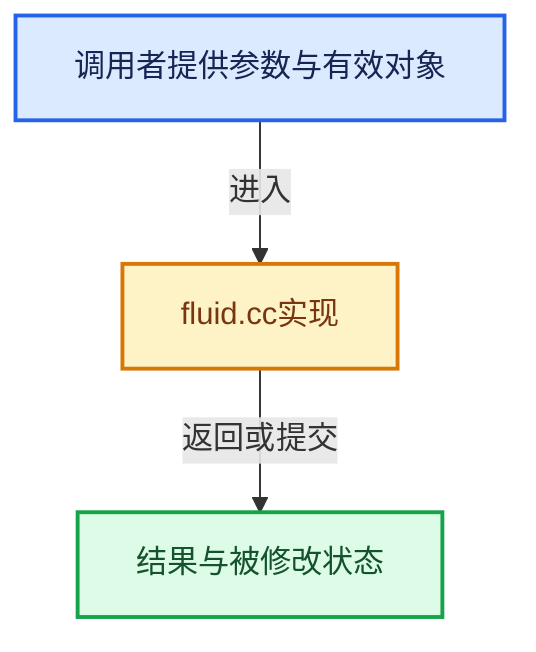

# 实现依赖专题：source/blender/blenkernel/intern/fluid.cc

[实现依赖导航](../../README.md) · [符号索引](../../../00-课程指南/02-源码与提交索引/符号依赖与实现索引.md)

本专题从正文实际调用进入，集中保存共享实现。函数有稳定锚点，可从调用处直接跳到对应完整函数；递归与互相调用通过回链组织。

## 本文件的实现关系





## 完整成员与函数实现

<a id="f-d3425565518608e3"></a>

### `blender::manta_pos_to_cell`

实现位置：[source/blender/blenkernel/intern/fluid.cc](../../../../../../../source/blender/blenkernel/intern/fluid.cc) · L393—L400。

接口参数：

- `FluidDomainSettings *fds`
- `float pos[3]`

**教学注释版**

<!-- annotated:ba36accd33f1ca -->

```cpp
static void manta_pos_to_cell(FluidDomainSettings *fds, float pos[3])
{
  mul_m4_v3(fds->imat, pos);
  sub_v3_v3(pos, fds->p0);
  pos[0] *= 1.0f / fds->cell_size[0];
  pos[1] *= 1.0f / fds->cell_size[1];
  pos[2] *= 1.0f / fds->cell_size[2];
}
```

<details>
<summary>核对原始源码：source/blender/blenkernel/intern/fluid.cc · L393—L400</summary>

<!-- original:ba36accd33f1ca:source/blender/blenkernel/intern/fluid.cc:393:400 -->

```cpp
static void manta_pos_to_cell(FluidDomainSettings *fds, float pos[3])
{
  mul_m4_v3(fds->imat, pos);
  sub_v3_v3(pos, fds->p0);
  pos[0] *= 1.0f / fds->cell_size[0];
  pos[1] *= 1.0f / fds->cell_size[1];
  pos[2] *= 1.0f / fds->cell_size[2];
}
```

</details>

**沿实际写入检查状态**

- `pos[0] *= 1.0f / fds->cell_size[0];`
- `pos[1] *= 1.0f / fds->cell_size[1];`
- `pos[2] *= 1.0f / fds->cell_size[2];`

**继续追踪实现**

- `mul_m4_v3` → [blender::mul_m4_v3 · L677](../../01-BLI基础库/intern/math_matrix_c.cc.md#f-14a8c267710d47a3)。
- `sub_v3_v3` → [blender::sub_v3_v3 · L353](../../01-BLI基础库/intern/math_vector_inline.cc.md#f-da39d7342c417f4b)。

<a id="f-fb59a1a0b815863c"></a>

### `blender::BKE_fluid_get_velocity_at`

实现位置：[source/blender/blenkernel/intern/fluid.cc](../../../../../../../source/blender/blenkernel/intern/fluid.cc) · L4315—L4377。

接口参数：

- `Object *ob`
- `float position[3]`
- `float velocity[3]`

**教学注释版**

<!-- annotated:eb73c3a8eda000 -->

```cpp
float BKE_fluid_get_velocity_at(Object *ob, float position[3], float velocity[3])
{
  FluidModifierData *fmd = (FluidModifierData *)BKE_modifiers_findby_type(ob, eModifierType_Fluid);
  zero_v3(velocity);

  if (fmd && (fmd->type & MOD_FLUID_TYPE_DOMAIN) && fmd->domain && fmd->domain->fluid) {
    FluidDomainSettings *fds = fmd->domain;
    float time_mult = 25.0f * DT_DEFAULT;
    // [讲解] std::max：按比较关系选取较大值。本讲解中的增长公式同时满足最低请求和几何增长；若保存返回引用，还需注意实参寿命。
    float size_mult = std::max({fds->global_size[0], fds->global_size[1], fds->global_size[2]}) /
                      std::max({fds->base_res[0], fds->base_res[1], fds->base_res[2]});
    float vel_mag;
    float density = 0.0f, fuel = 0.0f;
    float pos[3];
    copy_v3_v3(pos, position);
    manta_pos_to_cell(fds, pos);

    /* Check if position is outside domain max bounds. */
    if (pos[0] < fds->res_min[0] || pos[1] < fds->res_min[1] || pos[2] < fds->res_min[2]) {
      return -1.0f;
    }
    if (pos[0] > fds->res_max[0] || pos[1] > fds->res_max[1] || pos[2] > fds->res_max[2]) {
      return -1.0f;
    }

    /* map pos between 0.0 - 1.0 */
    pos[0] = (pos[0] - fds->res_min[0]) / float(fds->res[0]);
    pos[1] = (pos[1] - fds->res_min[1]) / float(fds->res[1]);
    pos[2] = (pos[2] - fds->res_min[2]) / float(fds->res[2]);

    /* Check if position is outside active area. */
    if (fds->type == FLUID_DOMAIN_TYPE_GAS && fds->flags & FLUID_DOMAIN_USE_ADAPTIVE_DOMAIN) {
      if (pos[0] < 0.0f || pos[1] < 0.0f || pos[2] < 0.0f) {
        return 0.0f;
      }
      if (pos[0] > 1.0f || pos[1] > 1.0f || pos[2] > 1.0f) {
        return 0.0f;
      }
    }

    /* Get interpolated velocity at given position. */
    velocity[0] = BLI_voxel_sample_trilinear(manta_get_velocity_x(fds->fluid), fds->res, pos);
    velocity[1] = BLI_voxel_sample_trilinear(manta_get_velocity_y(fds->fluid), fds->res, pos);
    velocity[2] = BLI_voxel_sample_trilinear(manta_get_velocity_z(fds->fluid), fds->res, pos);

    /* Convert simulation units to Blender units. */
    mul_v3_fl(velocity, size_mult);
    mul_v3_fl(velocity, time_mult);

    /* Convert velocity direction to global space. */
    vel_mag = len_v3(velocity);
    mul_mat3_m4_v3(fds->obmat, velocity);
    normalize_v3(velocity);
    mul_v3_fl(velocity, vel_mag);

    /* Use max value of fuel or smoke density. */
    density = BLI_voxel_sample_trilinear(manta_smoke_get_density(fds->fluid), fds->res, pos);
    if (manta_smoke_has_fuel(fds->fluid)) {
      fuel = BLI_voxel_sample_trilinear(manta_smoke_get_fuel(fds->fluid), fds->res, pos);
    }
    return std::max(density, fuel);
  }
  return -1.0f;
}
```

<details>
<summary>核对原始源码：source/blender/blenkernel/intern/fluid.cc · L4315—L4377</summary>

<!-- original:eb73c3a8eda000:source/blender/blenkernel/intern/fluid.cc:4315:4377 -->

```cpp
float BKE_fluid_get_velocity_at(Object *ob, float position[3], float velocity[3])
{
  FluidModifierData *fmd = (FluidModifierData *)BKE_modifiers_findby_type(ob, eModifierType_Fluid);
  zero_v3(velocity);

  if (fmd && (fmd->type & MOD_FLUID_TYPE_DOMAIN) && fmd->domain && fmd->domain->fluid) {
    FluidDomainSettings *fds = fmd->domain;
    float time_mult = 25.0f * DT_DEFAULT;
    float size_mult = std::max({fds->global_size[0], fds->global_size[1], fds->global_size[2]}) /
                      std::max({fds->base_res[0], fds->base_res[1], fds->base_res[2]});
    float vel_mag;
    float density = 0.0f, fuel = 0.0f;
    float pos[3];
    copy_v3_v3(pos, position);
    manta_pos_to_cell(fds, pos);

    /* Check if position is outside domain max bounds. */
    if (pos[0] < fds->res_min[0] || pos[1] < fds->res_min[1] || pos[2] < fds->res_min[2]) {
      return -1.0f;
    }
    if (pos[0] > fds->res_max[0] || pos[1] > fds->res_max[1] || pos[2] > fds->res_max[2]) {
      return -1.0f;
    }

    /* map pos between 0.0 - 1.0 */
    pos[0] = (pos[0] - fds->res_min[0]) / float(fds->res[0]);
    pos[1] = (pos[1] - fds->res_min[1]) / float(fds->res[1]);
    pos[2] = (pos[2] - fds->res_min[2]) / float(fds->res[2]);

    /* Check if position is outside active area. */
    if (fds->type == FLUID_DOMAIN_TYPE_GAS && fds->flags & FLUID_DOMAIN_USE_ADAPTIVE_DOMAIN) {
      if (pos[0] < 0.0f || pos[1] < 0.0f || pos[2] < 0.0f) {
        return 0.0f;
      }
      if (pos[0] > 1.0f || pos[1] > 1.0f || pos[2] > 1.0f) {
        return 0.0f;
      }
    }

    /* Get interpolated velocity at given position. */
    velocity[0] = BLI_voxel_sample_trilinear(manta_get_velocity_x(fds->fluid), fds->res, pos);
    velocity[1] = BLI_voxel_sample_trilinear(manta_get_velocity_y(fds->fluid), fds->res, pos);
    velocity[2] = BLI_voxel_sample_trilinear(manta_get_velocity_z(fds->fluid), fds->res, pos);

    /* Convert simulation units to Blender units. */
    mul_v3_fl(velocity, size_mult);
    mul_v3_fl(velocity, time_mult);

    /* Convert velocity direction to global space. */
    vel_mag = len_v3(velocity);
    mul_mat3_m4_v3(fds->obmat, velocity);
    normalize_v3(velocity);
    mul_v3_fl(velocity, vel_mag);

    /* Use max value of fuel or smoke density. */
    density = BLI_voxel_sample_trilinear(manta_smoke_get_density(fds->fluid), fds->res, pos);
    if (manta_smoke_has_fuel(fds->fluid)) {
      fuel = BLI_voxel_sample_trilinear(manta_smoke_get_fuel(fds->fluid), fds->res, pos);
    }
    return std::max(density, fuel);
  }
  return -1.0f;
}
```

</details>

**沿实际写入检查状态**

- `pos[0] = (pos[0] - fds->res_min[0]) / float(fds->res[0]);`
- `pos[1] = (pos[1] - fds->res_min[1]) / float(fds->res[1]);`
- `pos[2] = (pos[2] - fds->res_min[2]) / float(fds->res[2]);`
- `velocity[0] = BLI_voxel_sample_trilinear(manta_get_velocity_x(fds->fluid), fds->res, pos);`
- `velocity[1] = BLI_voxel_sample_trilinear(manta_get_velocity_y(fds->fluid), fds->res, pos);`
- `velocity[2] = BLI_voxel_sample_trilinear(manta_get_velocity_z(fds->fluid), fds->res, pos);`
- `vel_mag = len_v3(velocity);`
- `density = BLI_voxel_sample_trilinear(manta_smoke_get_density(fds->fluid), fds->res, pos);`
- `fuel = BLI_voxel_sample_trilinear(manta_smoke_get_fuel(fds->fluid), fds->res, pos);`

**结果出口**

- `return -1.0f;`
- `return 0.0f;`
- `return std::max(density, fuel);`

**继续追踪实现**

- `BKE_modifiers_findby_type` → [blender::BKE_modifiers_findby_type · L256](modifier.cc.md#f-9f6b6b9b4343d30f)。
- `zero_v3` → [blender::zero_v3 · L26](../../01-BLI基础库/intern/math_vector_inline.cc.md#f-13235b08fdecb098)。
- `std::max` → [外部契约](https://eel.is/c++draft/alg.min.max)：按比较关系选取较大值。本讲解中的增长公式同时满足最低请求和几何增长；若保存返回引用，还需注意实参寿命。
- `copy_v3_v3` → [blender::copy_v3_v3 · L47](../../01-BLI基础库/intern/math_vector_inline.cc.md#f-037a0d5fa5060bd6)。
- `manta_pos_to_cell` → [blender::manta_pos_to_cell · L393](fluid.cc.md#f-d3425565518608e3)。
- `BLI_voxel_sample_trilinear` → [blender::BLI_voxel_sample_trilinear · L46](../../01-BLI基础库/intern/voxel.cc.md#f-b1894180a8e60128)。
- `manta_get_velocity_x` → [blender::manta_get_velocity_x · L175](../../07-Intern运行时与平台/mantaflow/intern/manta_fluid_API.cpp.md#f-4a23a2951f3233c1)。
- `manta_get_velocity_y` → [blender::manta_get_velocity_y · L179](../../07-Intern运行时与平台/mantaflow/intern/manta_fluid_API.cpp.md#f-10418de2e724134d)。
- `manta_get_velocity_z` → [blender::manta_get_velocity_z · L183](../../07-Intern运行时与平台/mantaflow/intern/manta_fluid_API.cpp.md#f-5625407d5868acae)。
- `mul_v3_fl` → [blender::mul_v3_fl · L414](../../01-BLI基础库/intern/math_vector_inline.cc.md#f-00165156a06d1224)。
- `len_v3` → [blender::len_v3 · L781](../../01-BLI基础库/intern/math_vector_inline.cc.md#f-4ad88eb0aa8d70ab)。
- `mul_mat3_m4_v3` → [blender::mul_mat3_m4_v3 · L738](../../01-BLI基础库/intern/math_matrix_c.cc.md#f-85a92f87ede557ca)。
- `normalize_v3` → [blender::normalize_v3 · L933](../../01-BLI基础库/intern/math_vector_inline.cc.md#f-5f3257e657ef732c)。
- `manta_smoke_get_density` → [blender::manta_smoke_get_density · L411](../../07-Intern运行时与平台/mantaflow/intern/manta_fluid_API.cpp.md#f-f6a2f50cb9ff6258)。
- `manta_smoke_has_fuel` → [blender::manta_smoke_has_fuel · L492](../../07-Intern运行时与平台/mantaflow/intern/manta_fluid_API.cpp.md#f-0f8a92d03e48f57b)。
- `manta_smoke_get_fuel` → [blender::manta_smoke_get_fuel · L415](../../07-Intern运行时与平台/mantaflow/intern/manta_fluid_API.cpp.md#f-8fffd3e2ac29a1b8)。
