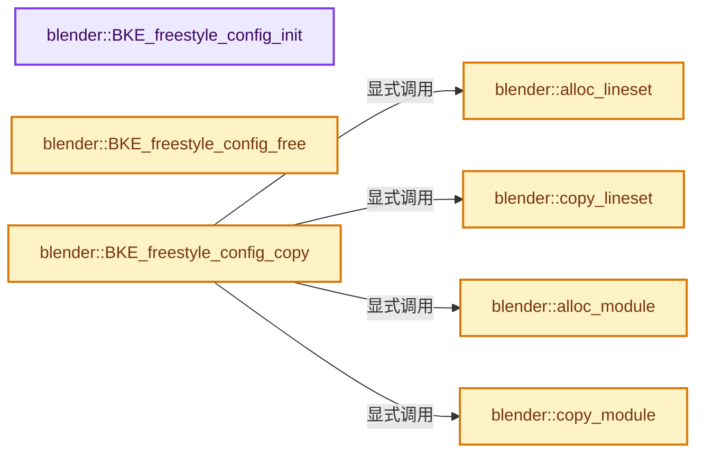
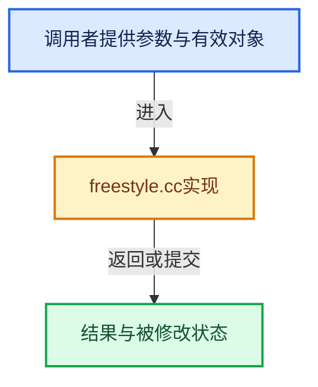

# 实现依赖专题：source/blender/blenkernel/intern/freestyle.cc

[实现依赖导航](../../README.md) · [符号索引](../../../00-课程指南/02-源码与提交索引/符号依赖与实现索引.md)

本专题从正文实际调用进入，集中保存共享实现。函数有稳定锚点，可从调用处直接跳到对应完整函数；递归与互相调用通过回链组织。

## 本文件的实现关系






## 完整成员与函数实现

<a id="f-e3beed6f1a4ed88f"></a>

### `blender::BKE_freestyle_config_init`

实现位置：[source/blender/blenkernel/intern/freestyle.cc](../../../../../../../source/blender/blenkernel/intern/freestyle.cc) · L33—L44。

接口参数：

- `FreestyleConfig *config`

**教学注释版**

<!-- annotated:ae19255ed8fbf8 -->

```cpp
void BKE_freestyle_config_init(FreestyleConfig *config)
{
  config->mode = FREESTYLE_CONTROL_EDITOR_MODE;

  config->modules.clear_no_delete();
  config->flags = eFreestyleConfig_Flags{};
  config->sphere_radius = 0.1f;
  config->dkr_epsilon = 0.0f;
  config->crease_angle = DEG2RADF(134.43f);

  config->linesets.clear_no_delete();
}
```

<details>
<summary>核对原始源码：source/blender/blenkernel/intern/freestyle.cc · L33—L44</summary>

<!-- original:ae19255ed8fbf8:source/blender/blenkernel/intern/freestyle.cc:33:44 -->

```cpp
void BKE_freestyle_config_init(FreestyleConfig *config)
{
  config->mode = FREESTYLE_CONTROL_EDITOR_MODE;

  config->modules.clear_no_delete();
  config->flags = eFreestyleConfig_Flags{};
  config->sphere_radius = 0.1f;
  config->dkr_epsilon = 0.0f;
  config->crease_angle = DEG2RADF(134.43f);

  config->linesets.clear_no_delete();
}
```

</details>

**沿实际写入检查状态**

- `config->mode = FREESTYLE_CONTROL_EDITOR_MODE;`
- `config->flags = eFreestyleConfig_Flags{};`
- `config->sphere_radius = 0.1f;`
- `config->dkr_epsilon = 0.0f;`
- `config->crease_angle = DEG2RADF(134.43f);`

**继续追踪实现**

- `config->modules.clear_no_delete` → [调用协议](../../../00-课程指南/01-路线与规范/模板宏与动态分派协议.md)：接收对象类型依赖auto、返回值或模板实例；不按同名猜测目标。调用位置L37。
- `DEG2RADF` → [DEG2RADF · L75](../../01-BLI基础库/BLI_math_constants.hh.md#m-b7feaa4acbdb)；[DEG2RADF · L17](../../07-Intern运行时与平台/cycles/app/cycles_xml.h.md#m-de839cbb85d5)。宏定义由构建条件选择。
- `config->linesets.clear_no_delete` → [调用协议](../../../00-课程指南/01-路线与规范/模板宏与动态分派协议.md)：接收对象类型依赖auto、返回值或模板实例；不按同名猜测目标。调用位置L43。

<a id="f-2009d18a37cd9fb5"></a>

### `blender::BKE_freestyle_config_free`

实现位置：[source/blender/blenkernel/intern/freestyle.cc](../../../../../../../source/blender/blenkernel/intern/freestyle.cc) · L46—L64。

接口参数：

- `FreestyleConfig *config`
- `const bool do_id_user`

**教学注释版**

<!-- annotated:0b648126a5f071 -->

```cpp
void BKE_freestyle_config_free(FreestyleConfig *config, const bool do_id_user)
{
  for (FreestyleLineSet &lineset : config->linesets) {
    if (lineset.group) {
      if (do_id_user) {
        id_us_min(&lineset.group->id);
      }
      lineset.group = nullptr;
    }
    if (lineset.linestyle) {
      if (do_id_user) {
        id_us_min(&lineset.linestyle->id);
      }
      lineset.linestyle = nullptr;
    }
  }
  config->linesets.free_no_destruct();
  config->modules.free_no_destruct();
}
```

<details>
<summary>核对原始源码：source/blender/blenkernel/intern/freestyle.cc · L46—L64</summary>

<!-- original:0b648126a5f071:source/blender/blenkernel/intern/freestyle.cc:46:64 -->

```cpp
void BKE_freestyle_config_free(FreestyleConfig *config, const bool do_id_user)
{
  for (FreestyleLineSet &lineset : config->linesets) {
    if (lineset.group) {
      if (do_id_user) {
        id_us_min(&lineset.group->id);
      }
      lineset.group = nullptr;
    }
    if (lineset.linestyle) {
      if (do_id_user) {
        id_us_min(&lineset.linestyle->id);
      }
      lineset.linestyle = nullptr;
    }
  }
  config->linesets.free_no_destruct();
  config->modules.free_no_destruct();
}
```

</details>

**沿实际写入检查状态**

- `lineset.group = nullptr;`
- `lineset.linestyle = nullptr;`

**继续追踪实现**

- `id_us_min` → [blender::id_us_min · L441](lib_id.cc.md#f-c5e5246a79962257)。
- `config->linesets.free_no_destruct` → [调用协议](../../../00-课程指南/01-路线与规范/模板宏与动态分派协议.md)：接收对象类型依赖auto、返回值或模板实例；不按同名猜测目标。调用位置L62。
- `config->modules.free_no_destruct` → [调用协议](../../../00-课程指南/01-路线与规范/模板宏与动态分派协议.md)：接收对象类型依赖auto、返回值或模板实例；不按同名猜测目标。调用位置L63。

<a id="f-400d3f55175a96da"></a>

### `blender::BKE_freestyle_config_copy`

实现位置：[source/blender/blenkernel/intern/freestyle.cc](../../../../../../../source/blender/blenkernel/intern/freestyle.cc) · L66—L92。

接口参数：

- `FreestyleConfig *new_config`
- `const FreestyleConfig *config`
- `const int flag`

**教学注释版**

<!-- annotated:bed0a9a13cbf76 -->

```cpp
void BKE_freestyle_config_copy(FreestyleConfig *new_config,
                               const FreestyleConfig *config,
                               const int flag)
{
  FreestyleLineSet *new_lineset;
  FreestyleModuleConfig *new_module;

  new_config->mode = config->mode;
  new_config->flags = config->flags;
  new_config->sphere_radius = config->sphere_radius;
  new_config->dkr_epsilon = config->dkr_epsilon;
  new_config->crease_angle = config->crease_angle;

  new_config->linesets.clear_no_delete();
  for (FreestyleLineSet &lineset : config->linesets) {
    new_lineset = alloc_lineset();
    copy_lineset(new_lineset, &lineset, flag);
    BLI_addtail(&new_config->linesets, static_cast<void *>(new_lineset));
  }

  new_config->modules.clear_no_delete();
  for (FreestyleModuleConfig &module : config->modules) {
    new_module = alloc_module();
    copy_module(new_module, &module);
    BLI_addtail(&new_config->modules, static_cast<void *>(new_module));
  }
}
```

<details>
<summary>核对原始源码：source/blender/blenkernel/intern/freestyle.cc · L66—L92</summary>

<!-- original:bed0a9a13cbf76:source/blender/blenkernel/intern/freestyle.cc:66:92 -->

```cpp
void BKE_freestyle_config_copy(FreestyleConfig *new_config,
                               const FreestyleConfig *config,
                               const int flag)
{
  FreestyleLineSet *new_lineset;
  FreestyleModuleConfig *new_module;

  new_config->mode = config->mode;
  new_config->flags = config->flags;
  new_config->sphere_radius = config->sphere_radius;
  new_config->dkr_epsilon = config->dkr_epsilon;
  new_config->crease_angle = config->crease_angle;

  new_config->linesets.clear_no_delete();
  for (FreestyleLineSet &lineset : config->linesets) {
    new_lineset = alloc_lineset();
    copy_lineset(new_lineset, &lineset, flag);
    BLI_addtail(&new_config->linesets, static_cast<void *>(new_lineset));
  }

  new_config->modules.clear_no_delete();
  for (FreestyleModuleConfig &module : config->modules) {
    new_module = alloc_module();
    copy_module(new_module, &module);
    BLI_addtail(&new_config->modules, static_cast<void *>(new_module));
  }
}
```

</details>

**沿实际写入检查状态**

- `new_config->mode = config->mode;`
- `new_config->flags = config->flags;`
- `new_config->sphere_radius = config->sphere_radius;`
- `new_config->dkr_epsilon = config->dkr_epsilon;`
- `new_config->crease_angle = config->crease_angle;`
- `new_lineset = alloc_lineset();`
- `new_module = alloc_module();`

**继续追踪实现**

- `new_config->linesets.clear_no_delete` → [调用协议](../../../00-课程指南/01-路线与规范/模板宏与动态分派协议.md)：接收对象类型依赖auto、返回值或模板实例；不按同名猜测目标。调用位置L79。
- `alloc_lineset` → [blender::alloc_lineset · L160](freestyle.cc.md#f-217123a0e789bd19)。
- `copy_lineset` → [blender::copy_lineset · L94](freestyle.cc.md#f-2ccdb0aed689ed76)。
- `BLI_addtail` → [blender::BLI_addtail · L118](../../01-BLI基础库/intern/listbase.cc.md#f-4fb027713fa3115b)。
- `new_config->modules.clear_no_delete` → [调用协议](../../../00-课程指南/01-路线与规范/模板宏与动态分派协议.md)：接收对象类型依赖auto、返回值或模板实例；不按同名猜测目标。调用位置L86。
- `alloc_module` → [blender::alloc_module · L113](freestyle.cc.md#f-38f7eeab0a0c2993)。
- `copy_module` → [blender::copy_module · L127](freestyle.cc.md#f-035eb57efa7ac759)。

<a id="f-2ccdb0aed689ed76"></a>

### `blender::copy_lineset`

实现位置：[source/blender/blenkernel/intern/freestyle.cc](../../../../../../../source/blender/blenkernel/intern/freestyle.cc) · L94—L111。

接口参数：

- `FreestyleLineSet *new_lineset`
- `FreestyleLineSet *lineset`
- `const int flag`

**教学注释版**

<!-- annotated:48e4ce8018eda4 -->

```cpp
static void copy_lineset(FreestyleLineSet *new_lineset, FreestyleLineSet *lineset, const int flag)
{
  new_lineset->linestyle = lineset->linestyle;
  new_lineset->flags = lineset->flags;
  new_lineset->selection = lineset->selection;
  new_lineset->qi = lineset->qi;
  new_lineset->qi_start = lineset->qi_start;
  new_lineset->qi_end = lineset->qi_end;
  new_lineset->edge_types = lineset->edge_types;
  new_lineset->exclude_edge_types = lineset->exclude_edge_types;
  new_lineset->group = lineset->group;
  STRNCPY_UTF8(new_lineset->name, lineset->name);

  if ((flag & LIB_ID_CREATE_NO_USER_REFCOUNT) == 0) {
    id_us_plus(id_cast<ID *>(new_lineset->linestyle));
    id_us_plus(id_cast<ID *>(new_lineset->group));
  }
}
```

<details>
<summary>核对原始源码：source/blender/blenkernel/intern/freestyle.cc · L94—L111</summary>

<!-- original:48e4ce8018eda4:source/blender/blenkernel/intern/freestyle.cc:94:111 -->

```cpp
static void copy_lineset(FreestyleLineSet *new_lineset, FreestyleLineSet *lineset, const int flag)
{
  new_lineset->linestyle = lineset->linestyle;
  new_lineset->flags = lineset->flags;
  new_lineset->selection = lineset->selection;
  new_lineset->qi = lineset->qi;
  new_lineset->qi_start = lineset->qi_start;
  new_lineset->qi_end = lineset->qi_end;
  new_lineset->edge_types = lineset->edge_types;
  new_lineset->exclude_edge_types = lineset->exclude_edge_types;
  new_lineset->group = lineset->group;
  STRNCPY_UTF8(new_lineset->name, lineset->name);

  if ((flag & LIB_ID_CREATE_NO_USER_REFCOUNT) == 0) {
    id_us_plus(id_cast<ID *>(new_lineset->linestyle));
    id_us_plus(id_cast<ID *>(new_lineset->group));
  }
}
```

</details>

**沿实际写入检查状态**

- `new_lineset->linestyle = lineset->linestyle;`
- `new_lineset->flags = lineset->flags;`
- `new_lineset->selection = lineset->selection;`
- `new_lineset->qi = lineset->qi;`
- `new_lineset->qi_start = lineset->qi_start;`
- `new_lineset->qi_end = lineset->qi_end;`
- `new_lineset->edge_types = lineset->edge_types;`
- `new_lineset->exclude_edge_types = lineset->exclude_edge_types;`
- `new_lineset->group = lineset->group;`

**继续追踪实现**

- `STRNCPY_UTF8` → [STRNCPY_UTF8 · L335](../../01-BLI基础库/BLI_string_utf8.hh.md#m-222967f0ab6a)。宏定义由构建条件选择。
- `id_us_plus` → [blender::id_us_plus · L433](lib_id.cc.md#f-1b90ef7608c4f32e)。
- `id_cast<ID *>` → [blender::id_cast · L1417](../../08-其他Blender模块/makesdna/DNA_ID.h.md#f-6c8ac6412850ac5a)。

<a id="f-38f7eeab0a0c2993"></a>

### `blender::alloc_module`

实现位置：[source/blender/blenkernel/intern/freestyle.cc](../../../../../../../source/blender/blenkernel/intern/freestyle.cc) · L113—L116。

**教学注释版**

<!-- annotated:d3318e17a8f65a -->

```cpp
static FreestyleModuleConfig *alloc_module()
{
  return MEM_new<FreestyleModuleConfig>("style module configuration");
}
```

<details>
<summary>核对原始源码：source/blender/blenkernel/intern/freestyle.cc · L113—L116</summary>

<!-- original:d3318e17a8f65a:source/blender/blenkernel/intern/freestyle.cc:113:116 -->

```cpp
static FreestyleModuleConfig *alloc_module()
{
  return MEM_new<FreestyleModuleConfig>("style module configuration");
}
```

</details>

**结果出口**

- `return MEM_new<FreestyleModuleConfig>("style module configuration");`

**继续追踪实现**

- `MEM_new<FreestyleModuleConfig>` → [MEM_new · L351](../../07-Intern运行时与平台/guardedalloc/MEM_guardedalloc.h.md#f-115f9b6784f89912)。

<a id="f-035eb57efa7ac759"></a>

### `blender::copy_module`

实现位置：[source/blender/blenkernel/intern/freestyle.cc](../../../../../../../source/blender/blenkernel/intern/freestyle.cc) · L127—L131。

接口参数：

- `FreestyleModuleConfig *new_module`
- `FreestyleModuleConfig *module`

**教学注释版**

<!-- annotated:95102609ea338d -->

```cpp
static void copy_module(FreestyleModuleConfig *new_module, FreestyleModuleConfig *module)
{
  new_module->script = module->script;
  new_module->is_displayed = module->is_displayed;
}
```

<details>
<summary>核对原始源码：source/blender/blenkernel/intern/freestyle.cc · L127—L131</summary>

<!-- original:95102609ea338d:source/blender/blenkernel/intern/freestyle.cc:127:131 -->

```cpp
static void copy_module(FreestyleModuleConfig *new_module, FreestyleModuleConfig *module)
{
  new_module->script = module->script;
  new_module->is_displayed = module->is_displayed;
}
```

</details>

**沿实际写入检查状态**

- `new_module->script = module->script;`
- `new_module->is_displayed = module->is_displayed;`

**继续追踪实现**

本实现没有需要继续展开的显式调用；检查返回表达式、对象转换和调用者前置条件。

<a id="f-217123a0e789bd19"></a>

### `blender::alloc_lineset`

实现位置：[source/blender/blenkernel/intern/freestyle.cc](../../../../../../../source/blender/blenkernel/intern/freestyle.cc) · L160—L163。

**教学注释版**

<!-- annotated:b7839d6f322313 -->

```cpp
static FreestyleLineSet *alloc_lineset()
{
  return MEM_new<FreestyleLineSet>("Freestyle line set");
}
```

<details>
<summary>核对原始源码：source/blender/blenkernel/intern/freestyle.cc · L160—L163</summary>

<!-- original:b7839d6f322313:source/blender/blenkernel/intern/freestyle.cc:160:163 -->

```cpp
static FreestyleLineSet *alloc_lineset()
{
  return MEM_new<FreestyleLineSet>("Freestyle line set");
}
```

</details>

**结果出口**

- `return MEM_new<FreestyleLineSet>("Freestyle line set");`

**继续追踪实现**

- `MEM_new<FreestyleLineSet>` → [MEM_new · L351](../../07-Intern运行时与平台/guardedalloc/MEM_guardedalloc.h.md#f-115f9b6784f89912)。
