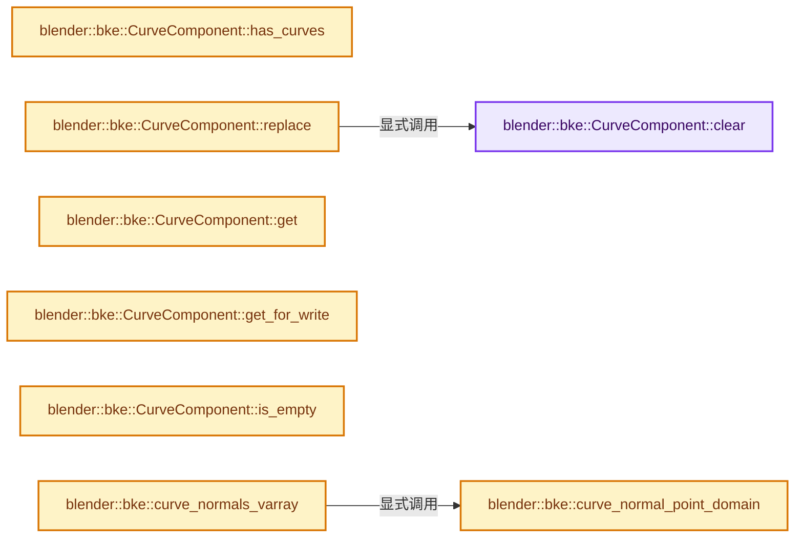
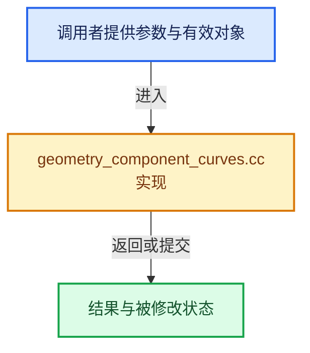

# 实现依赖专题：source/blender/blenkernel/intern/geometry_component_curves.cc

[实现依赖导航](../../README.md) · [符号索引](../../../00-课程指南/02-源码与提交索引/符号依赖与实现索引.md)

本专题从正文实际调用进入，集中保存共享实现。函数有稳定锚点，可从调用处直接跳到对应完整函数；递归与互相调用通过回链组织。

## 本文件的实现关系






## 完整成员与函数实现

<a id="f-feea24e160283a44"></a>

### `blender::bke::CurveComponent::clear`

实现位置：[source/blender/blenkernel/intern/geometry_component_curves.cc](../../../../../../../source/blender/blenkernel/intern/geometry_component_curves.cc) · L46—L62。

**教学注释版**

<!-- annotated:80505029e02fca -->

```cpp
void CurveComponent::clear()
{
  // [讲解] this->is_mutable：检查相应共享状态是否允许独占修改。
  BLI_assert(this->is_mutable() || this->is_expired());
  if (curves_ != nullptr) {
    if (ownership_ == GeometryOwnershipType::Owned) {
      BKE_id_free(nullptr, curves_);
    }
    if (curve_for_render_ != nullptr) {
      /* The curve created by this component should not have any edit mode data. */
      BLI_assert(curve_for_render_->editfont == nullptr && curve_for_render_->editnurb == nullptr);
      BKE_id_free(nullptr, curve_for_render_);
      curve_for_render_ = nullptr;
    }

    curves_ = nullptr;
  }
}
```

<details>
<summary>核对原始源码：source/blender/blenkernel/intern/geometry_component_curves.cc · L46—L62</summary>

<!-- original:80505029e02fca:source/blender/blenkernel/intern/geometry_component_curves.cc:46:62 -->

```cpp
void CurveComponent::clear()
{
  BLI_assert(this->is_mutable() || this->is_expired());
  if (curves_ != nullptr) {
    if (ownership_ == GeometryOwnershipType::Owned) {
      BKE_id_free(nullptr, curves_);
    }
    if (curve_for_render_ != nullptr) {
      /* The curve created by this component should not have any edit mode data. */
      BLI_assert(curve_for_render_->editfont == nullptr && curve_for_render_->editnurb == nullptr);
      BKE_id_free(nullptr, curve_for_render_);
      curve_for_render_ = nullptr;
    }

    curves_ = nullptr;
  }
}
```

</details>

**沿实际写入检查状态**

- `curve_for_render_ = nullptr;`
- `curves_ = nullptr;`

**继续追踪实现**

- `BLI_assert` → [BLI_assert · L48](../../01-BLI基础库/BLI_assert.hh.md#m-57a88495704d)；[BLI_assert · L63](../../01-BLI基础库/BLI_assert.hh.md#m-d07050020cb5)。宏定义由构建条件选择。
- `this->is_mutable` → [blender::ImplicitSharingInfo::is_mutable · L76](../../../06-隐式共享与缓存系统/01-所有权与写时复制.md#f-b4d31aba499caecb)。
- `this->is_expired` → [blender::ImplicitSharingInfo::is_expired · L85](../../../06-隐式共享与缓存系统/01-所有权与写时复制.md#f-2dc355bd9568b068)。
- `BKE_id_free` → [blender::BKE_id_free · L224](lib_id_delete.cc.md#f-28ed02c41d0f2d5b)。

<a id="f-129378f4a9769c06"></a>

### `blender::bke::CurveComponent::has_curves`

实现位置：[source/blender/blenkernel/intern/geometry_component_curves.cc](../../../../../../../source/blender/blenkernel/intern/geometry_component_curves.cc) · L64—L67。

**教学注释版**

<!-- annotated:cff325ec3ab6de -->

```cpp
bool CurveComponent::has_curves() const
{
  return curves_ != nullptr;
}
```

<details>
<summary>核对原始源码：source/blender/blenkernel/intern/geometry_component_curves.cc · L64—L67</summary>

<!-- original:cff325ec3ab6de:source/blender/blenkernel/intern/geometry_component_curves.cc:64:67 -->

```cpp
bool CurveComponent::has_curves() const
{
  return curves_ != nullptr;
}
```

</details>

**结果出口**

- `return curves_ != nullptr;`

**继续追踪实现**

本实现没有需要继续展开的显式调用；检查返回表达式、对象转换和调用者前置条件。

<a id="f-b53b6e068bec94b6"></a>

### `blender::bke::CurveComponent::replace`

实现位置：[source/blender/blenkernel/intern/geometry_component_curves.cc](../../../../../../../source/blender/blenkernel/intern/geometry_component_curves.cc) · L69—L75。

接口参数：

- `Curves *curves`
- `GeometryOwnershipType ownership`

**教学注释版**

<!-- annotated:d1aa12ea2bf32d -->

```cpp
void CurveComponent::replace(Curves *curves, GeometryOwnershipType ownership)
{
  // [讲解] this->is_mutable：检查相应共享状态是否允许独占修改。
  BLI_assert(this->is_mutable());
  this->clear();
  curves_ = curves;
  ownership_ = ownership;
}
```

<details>
<summary>核对原始源码：source/blender/blenkernel/intern/geometry_component_curves.cc · L69—L75</summary>

<!-- original:d1aa12ea2bf32d:source/blender/blenkernel/intern/geometry_component_curves.cc:69:75 -->

```cpp
void CurveComponent::replace(Curves *curves, GeometryOwnershipType ownership)
{
  BLI_assert(this->is_mutable());
  this->clear();
  curves_ = curves;
  ownership_ = ownership;
}
```

</details>

**沿实际写入检查状态**

- `curves_ = curves;`
- `ownership_ = ownership;`

**继续追踪实现**

- `BLI_assert` → [BLI_assert · L48](../../01-BLI基础库/BLI_assert.hh.md#m-57a88495704d)；[BLI_assert · L63](../../01-BLI基础库/BLI_assert.hh.md#m-d07050020cb5)。宏定义由构建条件选择。
- `this->is_mutable` → [blender::ImplicitSharingInfo::is_mutable · L76](../../../06-隐式共享与缓存系统/01-所有权与写时复制.md#f-b4d31aba499caecb)。
- `this->clear` → [blender::bke::CurveComponent::clear · L46](geometry_component_curves.cc.md#f-feea24e160283a44)。

<a id="f-dcafa3852e73eb1e"></a>

### `blender::bke::CurveComponent::get`

实现位置：[source/blender/blenkernel/intern/geometry_component_curves.cc](../../../../../../../source/blender/blenkernel/intern/geometry_component_curves.cc) · L85—L88。

**教学注释版**

<!-- annotated:d31a9459007932 -->

```cpp
const Curves *CurveComponent::get() const
{
  return curves_;
}
```

<details>
<summary>核对原始源码：source/blender/blenkernel/intern/geometry_component_curves.cc · L85—L88</summary>

<!-- original:d31a9459007932:source/blender/blenkernel/intern/geometry_component_curves.cc:85:88 -->

```cpp
const Curves *CurveComponent::get() const
{
  return curves_;
}
```

</details>

**结果出口**

- `return curves_;`

**继续追踪实现**

本实现没有需要继续展开的显式调用；检查返回表达式、对象转换和调用者前置条件。

<a id="f-b977e455f03f4551"></a>

### `blender::bke::CurveComponent::get_for_write`

实现位置：[source/blender/blenkernel/intern/geometry_component_curves.cc](../../../../../../../source/blender/blenkernel/intern/geometry_component_curves.cc) · L90—L98。

**教学注释版**

<!-- annotated:bf1e6257814059 -->

```cpp
Curves *CurveComponent::get_for_write()
{
  // [讲解] this->is_mutable：检查相应共享状态是否允许独占修改。
  BLI_assert(this->is_mutable());
  if (ownership_ == GeometryOwnershipType::ReadOnly) {
    curves_ = BKE_curves_copy_for_eval(curves_);
    ownership_ = GeometryOwnershipType::Owned;
  }
  return curves_;
}
```

<details>
<summary>核对原始源码：source/blender/blenkernel/intern/geometry_component_curves.cc · L90—L98</summary>

<!-- original:bf1e6257814059:source/blender/blenkernel/intern/geometry_component_curves.cc:90:98 -->

```cpp
Curves *CurveComponent::get_for_write()
{
  BLI_assert(this->is_mutable());
  if (ownership_ == GeometryOwnershipType::ReadOnly) {
    curves_ = BKE_curves_copy_for_eval(curves_);
    ownership_ = GeometryOwnershipType::Owned;
  }
  return curves_;
}
```

</details>

**沿实际写入检查状态**

- `curves_ = BKE_curves_copy_for_eval(curves_);`
- `ownership_ = GeometryOwnershipType::Owned;`

**结果出口**

- `return curves_;`

**继续追踪实现**

- `BLI_assert` → [BLI_assert · L48](../../01-BLI基础库/BLI_assert.hh.md#m-57a88495704d)；[BLI_assert · L63](../../01-BLI基础库/BLI_assert.hh.md#m-d07050020cb5)。宏定义由构建条件选择。
- `this->is_mutable` → [blender::ImplicitSharingInfo::is_mutable · L76](../../../06-隐式共享与缓存系统/01-所有权与写时复制.md#f-b4d31aba499caecb)。
- `BKE_curves_copy_for_eval` → [blender::BKE_curves_copy_for_eval · L197](curves.cc.md#f-d6185daf7e870bda)。

<a id="f-73f54f029c3003d3"></a>

### `blender::bke::CurveComponent::is_empty`

实现位置：[source/blender/blenkernel/intern/geometry_component_curves.cc](../../../../../../../source/blender/blenkernel/intern/geometry_component_curves.cc) · L100—L103。

**教学注释版**

<!-- annotated:094681d3db7547 -->

```cpp
bool CurveComponent::is_empty() const
{
  return curves_ == nullptr;
}
```

<details>
<summary>核对原始源码：source/blender/blenkernel/intern/geometry_component_curves.cc · L100—L103</summary>

<!-- original:094681d3db7547:source/blender/blenkernel/intern/geometry_component_curves.cc:100:103 -->

```cpp
bool CurveComponent::is_empty() const
{
  return curves_ == nullptr;
}
```

</details>

**结果出口**

- `return curves_ == nullptr;`

**继续追踪实现**

本实现没有需要继续展开的显式调用；检查返回表达式、对象转换和调用者前置条件。

<a id="f-d1811d10f96980c4"></a>

### `blender::bke::curve_normal_point_domain`

实现位置：[source/blender/blenkernel/intern/geometry_component_curves.cc](../../../../../../../source/blender/blenkernel/intern/geometry_component_curves.cc) · L153—L226。

接口参数：

- `const CurvesGeometry &curves`

**教学注释版**

<!-- annotated:06d0a5793eb1c4 -->

```cpp
static Array<float3> curve_normal_point_domain(const CurvesGeometry &curves)
{
  const OffsetIndices points_by_curve = curves.points_by_curve();
  const OffsetIndices evaluated_points_by_curve = curves.evaluated_points_by_curve();
  const VArray<int8_t> types = curves.curve_types();
  const VArray<int> resolutions = curves.resolution();
  const VArray<bool> curves_cyclic = curves.cyclic();
  const AttributeAccessor attributes = curves.attributes();
  const VArray<float3> custom_normals = *attributes.lookup_or_default<float3>(
      "custom_normal", AttrDomain::Point, float3(0, 0, 1));

  const Span<float3> positions = curves.positions();
  const VArray<int8_t> normal_modes = curves.normal_mode();

  const Span<float3> evaluated_normals = curves.evaluated_normals();

  Array<float3> results(curves.points_num());

  threading::parallel_for(curves.curves_range(), 128, [&](IndexRange range) {
    Vector<float3> nurbs_tangents;

    for (const int i_curve : range) {
      const IndexRange points = points_by_curve[i_curve];
      const IndexRange evaluated_points = evaluated_points_by_curve[i_curve];

      // [讲解] results.as_mutable_span：提供数组的借用访问入口。
      MutableSpan<float3> curve_normals = results.as_mutable_span().slice(points);

      switch (types[i_curve]) {
        case CURVE_TYPE_CATMULL_ROM: {
          // [讲解] evaluated_normals.slice：建立原连续范围的子视图。
          const Span<float3> normals = evaluated_normals.slice(evaluated_points);
          const int resolution = resolutions[i_curve];
          // [讲解] points.size：读取连续区间或分组的边界信息。
          for (const int i : IndexRange(points.size())) {
            curve_normals[i] = normals[resolution * i];
          }
          break;
        }
        case CURVE_TYPE_POLY:
          // [讲解] curve_normals.copy_from：修改已有目标元素，不改变底层容器长度。
          curve_normals.copy_from(evaluated_normals.slice(evaluated_points));
          break;
        case CURVE_TYPE_BEZIER: {
          const Span<float3> normals = evaluated_normals.slice(evaluated_points);
          // [讲解] curve_normals.first：按视图边界访问元素。
          curve_normals.first() = normals.first();
          const Span<int> offsets = curves.bezier_evaluated_offsets_for_curve(i_curve);
          for (const int i : IndexRange(points.size()).drop_front(1)) {
            curve_normals[i] = normals[offsets[i]];
          }
          break;
        }
        case CURVE_TYPE_NURBS: {
          /* For NURBS curves there is no obvious correspondence between specific evaluated points
           * and control points, so normals are determined by treating them as poly curves. */
          // [讲解] nurbs_tangents.clear：销毁所有有效元素，把size变为0，但保留原分配或内嵌容量。
          nurbs_tangents.clear();
          // [讲解] nurbs_tangents.resize：把有效元素数调整为new_size。增长路径构造新元素，缩小路径销毁尾部对象，最后才提交新的end_。
          nurbs_tangents.resize(points.size());
          const bool cyclic = curves_cyclic[i_curve];
          const Span<float3> curve_positions = positions.slice(points);
          curves::poly::calculate_tangents(curve_positions, cyclic, nurbs_tangents);
          switch (NormalMode(normal_modes[i_curve])) {
            case NORMAL_MODE_Z_UP:
              curves::poly::calculate_normals_z_up(nurbs_tangents, curve_normals);
              break;
            case NORMAL_MODE_MINIMUM_TWIST:
              curves::poly::calculate_normals_minimum(nurbs_tangents, cyclic, curve_normals);
              break;
            case NORMAL_MODE_FREE:
              custom_normals.materialize(points, results);
              break;
          }
          break;
        }
      }
    }
  });
  return results;
}
```

<details>
<summary>核对原始源码：source/blender/blenkernel/intern/geometry_component_curves.cc · L153—L226</summary>

<!-- original:06d0a5793eb1c4:source/blender/blenkernel/intern/geometry_component_curves.cc:153:226 -->

```cpp
static Array<float3> curve_normal_point_domain(const CurvesGeometry &curves)
{
  const OffsetIndices points_by_curve = curves.points_by_curve();
  const OffsetIndices evaluated_points_by_curve = curves.evaluated_points_by_curve();
  const VArray<int8_t> types = curves.curve_types();
  const VArray<int> resolutions = curves.resolution();
  const VArray<bool> curves_cyclic = curves.cyclic();
  const AttributeAccessor attributes = curves.attributes();
  const VArray<float3> custom_normals = *attributes.lookup_or_default<float3>(
      "custom_normal", AttrDomain::Point, float3(0, 0, 1));

  const Span<float3> positions = curves.positions();
  const VArray<int8_t> normal_modes = curves.normal_mode();

  const Span<float3> evaluated_normals = curves.evaluated_normals();

  Array<float3> results(curves.points_num());

  threading::parallel_for(curves.curves_range(), 128, [&](IndexRange range) {
    Vector<float3> nurbs_tangents;

    for (const int i_curve : range) {
      const IndexRange points = points_by_curve[i_curve];
      const IndexRange evaluated_points = evaluated_points_by_curve[i_curve];

      MutableSpan<float3> curve_normals = results.as_mutable_span().slice(points);

      switch (types[i_curve]) {
        case CURVE_TYPE_CATMULL_ROM: {
          const Span<float3> normals = evaluated_normals.slice(evaluated_points);
          const int resolution = resolutions[i_curve];
          for (const int i : IndexRange(points.size())) {
            curve_normals[i] = normals[resolution * i];
          }
          break;
        }
        case CURVE_TYPE_POLY:
          curve_normals.copy_from(evaluated_normals.slice(evaluated_points));
          break;
        case CURVE_TYPE_BEZIER: {
          const Span<float3> normals = evaluated_normals.slice(evaluated_points);
          curve_normals.first() = normals.first();
          const Span<int> offsets = curves.bezier_evaluated_offsets_for_curve(i_curve);
          for (const int i : IndexRange(points.size()).drop_front(1)) {
            curve_normals[i] = normals[offsets[i]];
          }
          break;
        }
        case CURVE_TYPE_NURBS: {
          /* For NURBS curves there is no obvious correspondence between specific evaluated points
           * and control points, so normals are determined by treating them as poly curves. */
          nurbs_tangents.clear();
          nurbs_tangents.resize(points.size());
          const bool cyclic = curves_cyclic[i_curve];
          const Span<float3> curve_positions = positions.slice(points);
          curves::poly::calculate_tangents(curve_positions, cyclic, nurbs_tangents);
          switch (NormalMode(normal_modes[i_curve])) {
            case NORMAL_MODE_Z_UP:
              curves::poly::calculate_normals_z_up(nurbs_tangents, curve_normals);
              break;
            case NORMAL_MODE_MINIMUM_TWIST:
              curves::poly::calculate_normals_minimum(nurbs_tangents, cyclic, curve_normals);
              break;
            case NORMAL_MODE_FREE:
              custom_normals.materialize(points, results);
              break;
          }
          break;
        }
      }
    }
  });
  return results;
}
```

</details>

**沿实际写入检查状态**

- `curve_normals[i] = normals[resolution * i];`
- `curve_normals[i] = normals[offsets[i]];`

**结果出口**

- `return results;`

**继续追踪实现**

- `curves.points_by_curve` → [blender::bke::CurvesGeometry::points_by_curve · L1058](../../../05-几何存储与拓扑映射/04-CurvesGeometry存储.md#f-a0416697e10ec205)。
- `curves.evaluated_points_by_curve` → [blender::bke::CurvesGeometry::evaluated_points_by_curve · L706](curves_geometry.cc.md#f-50a98b54f67dd20c)。
- `curves.curve_types` → [blender::bke::CurvesGeometry::curve_types · L229](curves_geometry.cc.md#f-e3847cb390c85e93)。
- `curves.resolution` → [blender::bke::CurvesGeometry::resolution · L373](curves_geometry.cc.md#f-1eb9ff703d58e3fb)。
- `curves.cyclic` → [blender::bke::CurvesGeometry::cyclic · L362](curves_geometry.cc.md#f-ec08c2a1d6f3bfea)。
- `curves.attributes` → [blender::bke::CurvesGeometry::attributes · L1908](curves_geometry.cc.md#f-8e24fbf758862a22)。
- `attributes.lookup_or_default<float3>` → [blender::bke::AttributeAccessor::lookup_or_default · L415](attribute_access.cc.md#f-a0cc3e316f1da4bd)。
- `float3` → [float3 · L641](../../08-其他Blender模块/compositor/algorithms/intern/smaa.cc.md#m-0ea8254cfdb4)。宏定义由构建条件选择。
- `curves.positions` → [blender::bke::CurvesGeometry::positions · L323](curves_geometry.cc.md#f-42ba586557e8ff18)。
- `curves.normal_mode` → [blender::bke::CurvesGeometry::normal_mode · L384](curves_geometry.cc.md#f-2c6d0ae0b2be0119)。
- `curves.evaluated_normals` → [blender::bke::CurvesGeometry::evaluated_normals · L1041](curves_geometry.cc.md#f-ce4fc6a5ac9c6df1)。
- `curves.points_num` → [blender::bke::CurvesGeometry::points_num · L1001](../../../05-几何存储与拓扑映射/04-CurvesGeometry存储.md#f-049421b1f643c700)。
- `threading::parallel_for` → [blender::threading::parallel_for · L68](../../../11-Depsgraph与并行任务系统/07-任务池与TBB接入.md#f-838294754c24426c)。
- `curves.curves_range` → [blender::bke::CurvesGeometry::curves_range · L1023](../../../05-几何存储与拓扑映射/04-CurvesGeometry存储.md#f-9aedfb1afc5ebcfb)。
- `results.as_mutable_span().slice` → [调用协议](../../../00-课程指南/01-路线与规范/模板宏与动态分派协议.md)：接收对象类型依赖auto、返回值或模板实例；不按同名猜测目标。调用位置L178。
- `results.as_mutable_span` → [blender::Array::as_mutable_span · L259](../../../01-基础容器与现代CPP/08-Array复制移动与销毁.md#f-4e91de9f1337c144)。
- `evaluated_normals.slice` → [blender::Span::slice · L141](../../../01-基础容器与现代CPP/05-Span只读连续视图.md#f-380a0e8fdcbd53cc)；[blender::Span::slice · L149](../../../01-基础容器与现代CPP/05-Span只读连续视图.md#f-9b9c15e78dd54eec)。同名重载需按实参类型选择。
- `IndexRange` → [blender::IndexRange](../../01-BLI基础库/BLI_index_range.hh.md#t-caa3466d6776)；[blender::gpu::shader::parser::IndexRange](../../08-其他Blender模块/gpu/shader_tool/utils.hh.md#t-82d2bd4ea71c)；[blender::IndexRange](../../08-其他Blender模块/makesdna/DNA_node_types.h.md#t-0448cc889d39)。
- `points.size` → [blender::IndexRange::size · L156](../../../01-基础容器与现代CPP/04-IndexRange连续整数区间.md#f-05f66c3ebb2fdfec)。
- `curve_normals.copy_from` → [blender::MutableSpan::copy_from · L745](../../../01-基础容器与现代CPP/06-MutableSpan可写视图.md#f-e4f099b1497adddb)。
- `curve_normals.first` → [blender::MutableSpan::first · L685](../../../01-基础容器与现代CPP/06-MutableSpan可写视图.md#f-3126bab9f43cee1c)。
- `normals.first` → [blender::Span::first · L319](../../../01-基础容器与现代CPP/05-Span只读连续视图.md#f-d8c9bcc3e9757248)。
- `curves.bezier_evaluated_offsets_for_curve` → [blender::bke::CurvesGeometry::bezier_evaluated_offsets_for_curve · L1070](../../../05-几何存储与拓扑映射/04-CurvesGeometry存储.md#f-b23f3527d5025ce2)。
- `IndexRange(points.size()).drop_front` → [调用协议](../../../00-课程指南/01-路线与规范/模板宏与动态分派协议.md)：接收对象类型依赖auto、返回值或模板实例；不按同名猜测目标。调用位置L196。
- `nurbs_tangents.clear` → [blender::Vector::clear · L468](../../../01-基础容器与现代CPP/10-Vector扩容与增长.md#f-d051bebff5275a43)。
- `nurbs_tangents.resize` → [blender::Vector::resize · L418](../../../01-基础容器与现代CPP/10-Vector扩容与增长.md#f-059312cabb8abe3a)；[blender::Vector::resize · L439](../../../01-基础容器与现代CPP/10-Vector扩容与增长.md#f-ab8f94924ebe2d12)。同名重载需按实参类型选择。
- `positions.slice` → [blender::Span::slice · L141](../../../01-基础容器与现代CPP/05-Span只读连续视图.md#f-380a0e8fdcbd53cc)；[blender::Span::slice · L149](../../../01-基础容器与现代CPP/05-Span只读连续视图.md#f-9b9c15e78dd54eec)。同名重载需按实参类型选择。
- `curves::poly::calculate_tangents` → [blender::bke::curves::poly::calculate_tangents · L74](curve_poly.cc.md#f-56266c9ce9e85bea)。
- `NormalMode` → [blender::NormalMode](../../08-其他Blender模块/makesdna/DNA_curves_types.h.md#t-7f8d6f6c3372)。
- `curves::poly::calculate_normals_z_up` → [blender::bke::curves::poly::calculate_normals_z_up · L126](curve_poly.cc.md#f-f664b957311eee3e)。
- `curves::poly::calculate_normals_minimum` → [blender::bke::curves::poly::calculate_normals_minimum · L166](curve_poly.cc.md#f-ef7aad05d9e5c2a3)。
- `custom_normals.materialize` → [调用协议](../../../00-课程指南/01-路线与规范/模板宏与动态分派协议.md)：由接收对象具体类型或运行时策略提供实现。调用位置L217。

<a id="f-020eb03be1280f86"></a>

### `blender::bke::curve_normals_varray`

实现位置：[source/blender/blenkernel/intern/geometry_component_curves.cc](../../../../../../../source/blender/blenkernel/intern/geometry_component_curves.cc) · L228—L248。

接口参数：

- `const CurvesGeometry &curves`
- `const AttrDomain domain`

**教学注释版**

<!-- annotated:12cd422c241e11 -->

```cpp
VArray<float3> curve_normals_varray(const CurvesGeometry &curves, const AttrDomain domain)
{
  const VArray<int8_t> types = curves.curve_types();
  if (curves.is_single_type(CURVE_TYPE_POLY)) {
    return curves.adapt_domain<float3>(
        VArray<float3>::from_span(curves.evaluated_normals()), AttrDomain::Point, domain);
  }

  Array<float3> normals = curve_normal_point_domain(curves);

  if (domain == AttrDomain::Point) {
    // [讲解] std::move：把表达式转换成可供移动重载选择的值类别；不保证真的移动，不结束源对象寿命，对const值可能选择复制。
    return VArray<float3>::from_container(std::move(normals));
  }

  if (domain == AttrDomain::Curve) {
    return curves.adapt_domain<float3>(
        VArray<float3>::from_container(std::move(normals)), AttrDomain::Point, AttrDomain::Curve);
  }

  return nullptr;
}
```

<details>
<summary>核对原始源码：source/blender/blenkernel/intern/geometry_component_curves.cc · L228—L248</summary>

<!-- original:12cd422c241e11:source/blender/blenkernel/intern/geometry_component_curves.cc:228:248 -->

```cpp
VArray<float3> curve_normals_varray(const CurvesGeometry &curves, const AttrDomain domain)
{
  const VArray<int8_t> types = curves.curve_types();
  if (curves.is_single_type(CURVE_TYPE_POLY)) {
    return curves.adapt_domain<float3>(
        VArray<float3>::from_span(curves.evaluated_normals()), AttrDomain::Point, domain);
  }

  Array<float3> normals = curve_normal_point_domain(curves);

  if (domain == AttrDomain::Point) {
    return VArray<float3>::from_container(std::move(normals));
  }

  if (domain == AttrDomain::Curve) {
    return curves.adapt_domain<float3>(
        VArray<float3>::from_container(std::move(normals)), AttrDomain::Point, AttrDomain::Curve);
  }

  return nullptr;
}
```

</details>

**结果出口**

- `return curves.adapt_domain<float3>(`
- `return VArray<float3>::from_container(std::move(normals));`
- `return nullptr;`

**继续追踪实现**

- `curves.curve_types` → [blender::bke::CurvesGeometry::curve_types · L229](curves_geometry.cc.md#f-e3847cb390c85e93)。
- `curves.is_single_type` → [blender::bke::CurvesGeometry::is_single_type · L1028](../../../05-几何存储与拓扑映射/04-CurvesGeometry存储.md#f-4a92c3c9cde2433d)。
- `curves.adapt_domain<float3>` → [blender::bke::CurvesGeometry::adapt_domain · L1878](curves_geometry.cc.md#f-3ca85e28e92b44a2)。
- `VArray<float3>::from_span` → [blender::GVArray::from_span · L895](../../../04-虚拟数组与索引选择/05-GVArray运行时类型.md#f-e8b978ca15febb67)；[blender::VArray::from_span · L768](../../../04-虚拟数组与索引选择/03-单值与Span表示.md#f-d9cf90c7ec1493b6)。同名重载需按实参类型选择。
- `curves.evaluated_normals` → [blender::bke::CurvesGeometry::evaluated_normals · L1041](curves_geometry.cc.md#f-ce4fc6a5ac9c6df1)。
- `curve_normal_point_domain` → [blender::bke::curve_normal_point_domain · L153](geometry_component_curves.cc.md#f-d1811d10f96980c4)。
- `VArray<float3>::from_container` → [blender::VArray::from_container · L809](../../../04-虚拟数组与索引选择/03-单值与Span表示.md#f-0e0990c28b1aac89)。
- `std::move` → [外部契约](https://eel.is/c++draft/utility.forward)：把表达式转换成可供移动重载选择的值类别；不保证真的移动，不结束源对象寿命，对const值可能选择复制。
