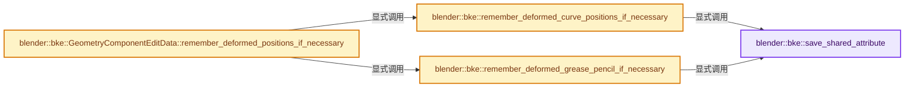
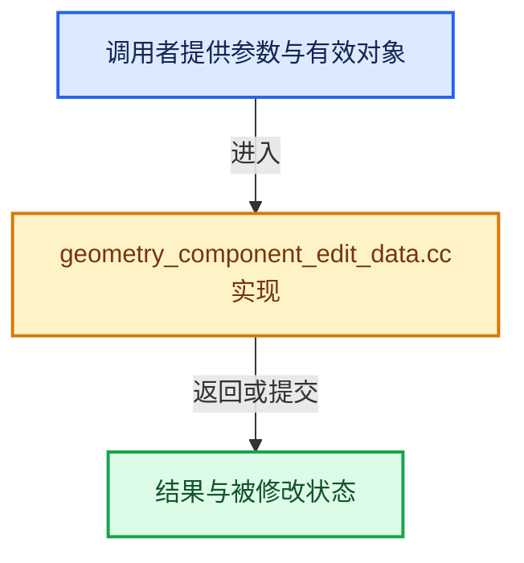

# 实现依赖专题：source/blender/blenkernel/intern/geometry_component_edit_data.cc

[实现依赖导航](../../README.md) · [符号索引](../../../00-课程指南/02-源码与提交索引/符号依赖与实现索引.md)

本专题从正文实际调用进入，集中保存共享实现。函数有稳定锚点，可从调用处直接跳到对应完整函数；递归与互相调用通过回链组织。

## 本文件的实现关系






## 完整成员与函数实现

<a id="f-9ef8aeaca983e553"></a>

### `blender::bke::save_shared_attribute`

实现位置：[source/blender/blenkernel/intern/geometry_component_edit_data.cc](../../../../../../../source/blender/blenkernel/intern/geometry_component_edit_data.cc) · L56—L66。

接口参数：

- `const GAttributeReader &attribute`

**教学注释版**

<!-- annotated:894ad0c5074485 -->

```cpp
static ImplicitSharingPtrAndData save_shared_attribute(const GAttributeReader &attribute)
{
  if (attribute.sharing_info && attribute.varray.is_span()) {
    const void *data = attribute.varray.get_internal_span().data();
    attribute.sharing_info->add_user();
    return {ImplicitSharingPtr(attribute.sharing_info), data};
  }
  auto *data = new ImplicitSharedValue<GArray<>>(attribute.varray.type(), attribute.varray.size());
  attribute.varray.materialize(data->data.data());
  return {ImplicitSharingPtr<>(data), data->data.data()};
}
```

<details>
<summary>核对原始源码：source/blender/blenkernel/intern/geometry_component_edit_data.cc · L56—L66</summary>

<!-- original:894ad0c5074485:source/blender/blenkernel/intern/geometry_component_edit_data.cc:56:66 -->

```cpp
static ImplicitSharingPtrAndData save_shared_attribute(const GAttributeReader &attribute)
{
  if (attribute.sharing_info && attribute.varray.is_span()) {
    const void *data = attribute.varray.get_internal_span().data();
    attribute.sharing_info->add_user();
    return {ImplicitSharingPtr(attribute.sharing_info), data};
  }
  auto *data = new ImplicitSharedValue<GArray<>>(attribute.varray.type(), attribute.varray.size());
  attribute.varray.materialize(data->data.data());
  return {ImplicitSharingPtr<>(data), data->data.data()};
}
```

</details>

**结果出口**

- `return {ImplicitSharingPtr(attribute.sharing_info), data};`
- `return {ImplicitSharingPtr<>(data), data->data.data()};`

**继续追踪实现**

- `attribute.varray.is_span` → [调用协议](../../../00-课程指南/01-路线与规范/模板宏与动态分派协议.md)：接收对象类型依赖auto、返回值或模板实例；不按同名猜测目标。调用位置L58。
- `attribute.varray.get_internal_span().data` → [调用协议](../../../00-课程指南/01-路线与规范/模板宏与动态分派协议.md)：接收对象类型依赖auto、返回值或模板实例；不按同名猜测目标。调用位置L59。
- `attribute.varray.get_internal_span` → [调用协议](../../../00-课程指南/01-路线与规范/模板宏与动态分派协议.md)：接收对象类型依赖auto、返回值或模板实例；不按同名猜测目标。调用位置L59。
- `attribute.sharing_info->add_user` → [调用协议](../../../00-课程指南/01-路线与规范/模板宏与动态分派协议.md)：接收对象类型依赖auto、返回值或模板实例；不按同名猜测目标。调用位置L60。
- `ImplicitSharingPtr` → [blender::ImplicitSharingPtr::ImplicitSharingPtr · L32](../../../06-隐式共享与缓存系统/03-Mixin与共享指针封装.md#f-d28a43dbb5ed8c05)；[blender::ImplicitSharingPtr::ImplicitSharingPtr · L34](../../../06-隐式共享与缓存系统/03-Mixin与共享指针封装.md#f-d27d5ebf676e244a)；[blender::ImplicitSharingPtr::ImplicitSharingPtr · L37](../../../06-隐式共享与缓存系统/03-Mixin与共享指针封装.md#f-17d0c5fe2b03a664)；[blender::ImplicitSharingPtr::ImplicitSharingPtr · L39](../../../06-隐式共享与缓存系统/03-Mixin与共享指针封装.md#f-1c8729ae57532370)；[blender::ImplicitSharingPtr::ImplicitSharingPtr · L44](../../../06-隐式共享与缓存系统/03-Mixin与共享指针封装.md#f-0b6be0142b98009e)；[blender::ImplicitSharingPtr::ImplicitSharingPtr · L49](../../../06-隐式共享与缓存系统/03-Mixin与共享指针封装.md#f-90c601ed9ed99045)；[blender::ImplicitSharingPtr::ImplicitSharingPtr · L57](../../../06-隐式共享与缓存系统/03-Mixin与共享指针封装.md#f-1625179ceae7a66d)。同名重载需按实参类型选择。
- `attribute.varray.type` → [调用协议](../../../00-课程指南/01-路线与规范/模板宏与动态分派协议.md)：接收对象类型依赖auto、返回值或模板实例；不按同名猜测目标。调用位置L63。
- `attribute.varray.size` → [调用协议](../../../00-课程指南/01-路线与规范/模板宏与动态分派协议.md)：接收对象类型依赖auto、返回值或模板实例；不按同名猜测目标。调用位置L63。
- `attribute.varray.materialize` → [调用协议](../../../00-课程指南/01-路线与规范/模板宏与动态分派协议.md)：接收对象类型依赖auto、返回值或模板实例；不按同名猜测目标。调用位置L64。
- `data->data.data` → [调用协议](../../../00-课程指南/01-路线与规范/模板宏与动态分派协议.md)：接收对象类型依赖auto、返回值或模板实例；不按同名猜测目标。调用位置L64。
- `ImplicitSharingPtr<>` → [blender::ImplicitSharingPtr::ImplicitSharingPtr · L32](../../../06-隐式共享与缓存系统/03-Mixin与共享指针封装.md#f-d28a43dbb5ed8c05)；[blender::ImplicitSharingPtr::ImplicitSharingPtr · L34](../../../06-隐式共享与缓存系统/03-Mixin与共享指针封装.md#f-d27d5ebf676e244a)；[blender::ImplicitSharingPtr::ImplicitSharingPtr · L37](../../../06-隐式共享与缓存系统/03-Mixin与共享指针封装.md#f-17d0c5fe2b03a664)；[blender::ImplicitSharingPtr::ImplicitSharingPtr · L39](../../../06-隐式共享与缓存系统/03-Mixin与共享指针封装.md#f-1c8729ae57532370)；[blender::ImplicitSharingPtr::ImplicitSharingPtr · L44](../../../06-隐式共享与缓存系统/03-Mixin与共享指针封装.md#f-0b6be0142b98009e)；[blender::ImplicitSharingPtr::ImplicitSharingPtr · L49](../../../06-隐式共享与缓存系统/03-Mixin与共享指针封装.md#f-90c601ed9ed99045)；[blender::ImplicitSharingPtr::ImplicitSharingPtr · L57](../../../06-隐式共享与缓存系统/03-Mixin与共享指针封装.md#f-1625179ceae7a66d)。同名重载需按实参类型选择。

<a id="f-cfa6aa0062897539"></a>

### `blender::bke::remember_deformed_curve_positions_if_necessary`

实现位置：[source/blender/blenkernel/intern/geometry_component_edit_data.cc](../../../../../../../source/blender/blenkernel/intern/geometry_component_edit_data.cc) · L68—L87。

接口参数：

- `const Curves *curves_id`
- `GeometryComponentEditData &edit_component`

**教学注释版**

<!-- annotated:19b40235eb0d78 -->

```cpp
static void remember_deformed_curve_positions_if_necessary(
    const Curves *curves_id, GeometryComponentEditData &edit_component)
{
  if (!edit_component.curves_edit_hints_) {
    return;
  }
  if (curves_id == nullptr) {
    return;
  }
  CurvesEditHints &edit_hints = *edit_component.curves_edit_hints_;
  if (edit_hints.positions().has_value()) {
    return;
  }
  const CurvesGeometry &curves = curves_id->geometry.wrap();
  const int points_num = curves.points_num();
  if (points_num != edit_hints.curves_id_orig.geometry.point_num) {
    return;
  }
  edit_hints.positions_data = save_shared_attribute(curves.attributes().lookup("position"));
}
```

<details>
<summary>核对原始源码：source/blender/blenkernel/intern/geometry_component_edit_data.cc · L68—L87</summary>

<!-- original:19b40235eb0d78:source/blender/blenkernel/intern/geometry_component_edit_data.cc:68:87 -->

```cpp
static void remember_deformed_curve_positions_if_necessary(
    const Curves *curves_id, GeometryComponentEditData &edit_component)
{
  if (!edit_component.curves_edit_hints_) {
    return;
  }
  if (curves_id == nullptr) {
    return;
  }
  CurvesEditHints &edit_hints = *edit_component.curves_edit_hints_;
  if (edit_hints.positions().has_value()) {
    return;
  }
  const CurvesGeometry &curves = curves_id->geometry.wrap();
  const int points_num = curves.points_num();
  if (points_num != edit_hints.curves_id_orig.geometry.point_num) {
    return;
  }
  edit_hints.positions_data = save_shared_attribute(curves.attributes().lookup("position"));
}
```

</details>

**沿实际写入检查状态**

- `edit_hints.positions_data = save_shared_attribute(curves.attributes().lookup("position"));`

**继续追踪实现**

- `edit_hints.positions().has_value` → [调用协议](../../../00-课程指南/01-路线与规范/模板宏与动态分派协议.md)：接收对象类型依赖auto、返回值或模板实例；不按同名猜测目标。调用位置L78。
- `edit_hints.positions` → [blender::bke::CurvesEditHints::positions · L383](curves.cc.md#f-50a38220570a15ad)。
- `curves_id->geometry.wrap` → [调用协议](../../../00-课程指南/01-路线与规范/模板宏与动态分派协议.md)：接收对象类型依赖auto、返回值或模板实例；不按同名猜测目标。调用位置L81。
- `curves.points_num` → [blender::bke::CurvesGeometry::points_num · L1001](../../../05-几何存储与拓扑映射/04-CurvesGeometry存储.md#f-049421b1f643c700)。
- `save_shared_attribute` → [blender::bke::save_shared_attribute · L56](geometry_component_edit_data.cc.md#f-9ef8aeaca983e553)。
- `curves.attributes().lookup` → [调用协议](../../../00-课程指南/01-路线与规范/模板宏与动态分派协议.md)：接收对象类型依赖auto、返回值或模板实例；不按同名猜测目标。调用位置L86。
- `curves.attributes` → [blender::bke::CurvesGeometry::attributes · L1908](curves_geometry.cc.md#f-8e24fbf758862a22)。

<a id="f-7ea6d12db2e83a3f"></a>

### `blender::bke::remember_deformed_grease_pencil_if_necessary`

实现位置：[source/blender/blenkernel/intern/geometry_component_edit_data.cc](../../../../../../../source/blender/blenkernel/intern/geometry_component_edit_data.cc) · L89—L132。

接口参数：

- `const GreasePencil *grease_pencil`
- `GeometryComponentEditData &edit_component`

**教学注释版**

<!-- annotated:9b2f71def9c8a5 -->

```cpp
static void remember_deformed_grease_pencil_if_necessary(const GreasePencil *grease_pencil,
                                                         GeometryComponentEditData &edit_component)
{
  if (!edit_component.grease_pencil_edit_hints_) {
    return;
  }
  if (edit_component.grease_pencil_edit_hints_->drawing_hints.has_value()) {
    return;
  }
  if (grease_pencil == nullptr) {
    return;
  }
  const GreasePencil &orig_grease_pencil =
      edit_component.grease_pencil_edit_hints_->grease_pencil_id_orig;
  const Span<const greasepencil::Layer *> layers = grease_pencil->layers();
  const Span<const greasepencil::Layer *> orig_layers = orig_grease_pencil.layers();
  // [讲解] layers.size：查询视图长度或生成对应有效索引区间。
  const int layers_num = layers.size();
  edit_component.grease_pencil_edit_hints_->drawing_hints.emplace(layers_num);
  MutableSpan<GreasePencilDrawingEditHints> all_hints =
      *edit_component.grease_pencil_edit_hints_->drawing_hints;
  // [讲解] layers.index_range：查询视图长度或生成对应有效索引区间。
  for (const int eval_layer_index : layers.index_range()) {
    const greasepencil::Layer &eval_layer = *layers[eval_layer_index];
    const greasepencil::Drawing *drawing = grease_pencil->get_eval_drawing(eval_layer);
    if (eval_layer.runtime->orig_layer_index_ == -1) {
      continue;
    }
    const greasepencil::Layer &orig_layer = *orig_layers[eval_layer.runtime->orig_layer_index_];
    const greasepencil::Drawing *orig_drawing = orig_grease_pencil.get_drawing_at(
        orig_layer, grease_pencil->runtime->eval_frame);
    GreasePencilDrawingEditHints &drawing_hints = all_hints[eval_layer_index];
    if (!drawing || !orig_drawing) {
      continue;
    }
    drawing_hints.drawing_orig = orig_drawing;
    const CurvesGeometry &curves = drawing->strokes();
    if (curves.points_num() != orig_drawing->strokes().points_num()) {
      continue;
    }
    if (curves.is_empty()) {
      continue;
    }
    drawing_hints.positions_data = save_shared_attribute(curves.attributes().lookup("position"));
  }
}
```

<details>
<summary>核对原始源码：source/blender/blenkernel/intern/geometry_component_edit_data.cc · L89—L132</summary>

<!-- original:9b2f71def9c8a5:source/blender/blenkernel/intern/geometry_component_edit_data.cc:89:132 -->

```cpp
static void remember_deformed_grease_pencil_if_necessary(const GreasePencil *grease_pencil,
                                                         GeometryComponentEditData &edit_component)
{
  if (!edit_component.grease_pencil_edit_hints_) {
    return;
  }
  if (edit_component.grease_pencil_edit_hints_->drawing_hints.has_value()) {
    return;
  }
  if (grease_pencil == nullptr) {
    return;
  }
  const GreasePencil &orig_grease_pencil =
      edit_component.grease_pencil_edit_hints_->grease_pencil_id_orig;
  const Span<const greasepencil::Layer *> layers = grease_pencil->layers();
  const Span<const greasepencil::Layer *> orig_layers = orig_grease_pencil.layers();
  const int layers_num = layers.size();
  edit_component.grease_pencil_edit_hints_->drawing_hints.emplace(layers_num);
  MutableSpan<GreasePencilDrawingEditHints> all_hints =
      *edit_component.grease_pencil_edit_hints_->drawing_hints;
  for (const int eval_layer_index : layers.index_range()) {
    const greasepencil::Layer &eval_layer = *layers[eval_layer_index];
    const greasepencil::Drawing *drawing = grease_pencil->get_eval_drawing(eval_layer);
    if (eval_layer.runtime->orig_layer_index_ == -1) {
      continue;
    }
    const greasepencil::Layer &orig_layer = *orig_layers[eval_layer.runtime->orig_layer_index_];
    const greasepencil::Drawing *orig_drawing = orig_grease_pencil.get_drawing_at(
        orig_layer, grease_pencil->runtime->eval_frame);
    GreasePencilDrawingEditHints &drawing_hints = all_hints[eval_layer_index];
    if (!drawing || !orig_drawing) {
      continue;
    }
    drawing_hints.drawing_orig = orig_drawing;
    const CurvesGeometry &curves = drawing->strokes();
    if (curves.points_num() != orig_drawing->strokes().points_num()) {
      continue;
    }
    if (curves.is_empty()) {
      continue;
    }
    drawing_hints.positions_data = save_shared_attribute(curves.attributes().lookup("position"));
  }
}
```

</details>

**沿实际写入检查状态**

- `drawing_hints.drawing_orig = orig_drawing;`
- `drawing_hints.positions_data = save_shared_attribute(curves.attributes().lookup("position"));`

**继续追踪实现**

- `edit_component.grease_pencil_edit_hints_->drawing_hints.has_value` → [调用协议](../../../00-课程指南/01-路线与规范/模板宏与动态分派协议.md)：接收对象类型依赖auto、返回值或模板实例；不按同名猜测目标。调用位置L95。
- `grease_pencil->layers` → [blender::GreasePencil::layers · L3983](grease_pencil.cc.md#f-15d64ed11a2babc0)。
- `orig_grease_pencil.layers` → [blender::GreasePencil::layers · L3983](grease_pencil.cc.md#f-15d64ed11a2babc0)。
- `layers.size` → [blender::Span::size · L256](../../../01-基础容器与现代CPP/05-Span只读连续视图.md#f-5f80fa006089c998)。
- `edit_component.grease_pencil_edit_hints_->drawing_hints.emplace` → [调用协议](../../../00-课程指南/01-路线与规范/模板宏与动态分派协议.md)：接收对象类型依赖auto、返回值或模板实例；不按同名猜测目标。调用位置L106。
- `layers.index_range` → [blender::Span::index_range · L405](../../../01-基础容器与现代CPP/05-Span只读连续视图.md#f-caaa9b06e13e53e0)。
- `grease_pencil->get_eval_drawing` → [blender::GreasePencil::get_eval_drawing · L3877](grease_pencil.cc.md#f-90fc4aad8697fbb6)；[blender::GreasePencil::get_eval_drawing · L3883](grease_pencil.cc.md#f-c0c3d7e7fffac861)。同名重载需按实参类型选择。
- `orig_grease_pencil.get_drawing_at` → [blender::GreasePencil::get_drawing_at · L3814](grease_pencil.cc.md#f-c38643507419f9ee)；[blender::GreasePencil::get_drawing_at · L3834](grease_pencil.cc.md#f-42398964c13c6abb)。同名重载需按实参类型选择。
- `drawing->strokes` → [blender::bke::greasepencil::Drawing::strokes · L1007](grease_pencil.cc.md#f-59e6522a8e8ac409)。
- `curves.points_num` → [blender::bke::CurvesGeometry::points_num · L1001](../../../05-几何存储与拓扑映射/04-CurvesGeometry存储.md#f-049421b1f643c700)。
- `orig_drawing->strokes().points_num` → [调用协议](../../../00-课程指南/01-路线与规范/模板宏与动态分派协议.md)：接收对象类型依赖auto、返回值或模板实例；不按同名猜测目标。调用位置L124。
- `orig_drawing->strokes` → [blender::bke::greasepencil::Drawing::strokes · L1007](grease_pencil.cc.md#f-59e6522a8e8ac409)。
- `curves.is_empty` → [blender::bke::CurvesGeometry::is_empty · L1013](../../../05-几何存储与拓扑映射/04-CurvesGeometry存储.md#f-4c323ef62c4b64ab)。
- `save_shared_attribute` → [blender::bke::save_shared_attribute · L56](geometry_component_edit_data.cc.md#f-9ef8aeaca983e553)。
- `curves.attributes().lookup` → [调用协议](../../../00-课程指南/01-路线与规范/模板宏与动态分派协议.md)：接收对象类型依赖auto、返回值或模板实例；不按同名猜测目标。调用位置L130。
- `curves.attributes` → [blender::bke::CurvesGeometry::attributes · L1908](curves_geometry.cc.md#f-8e24fbf758862a22)。

<a id="f-4f493e4950b51cf2"></a>

### `blender::bke::GeometryComponentEditData::remember_deformed_positions_if_necessary`

实现位置：[source/blender/blenkernel/intern/geometry_component_edit_data.cc](../../../../../../../source/blender/blenkernel/intern/geometry_component_edit_data.cc) · L134—L144。

接口参数：

- `GeometrySet &geometry`

**教学注释版**

<!-- annotated:d51fbfeb71bca1 -->

```cpp
void GeometryComponentEditData::remember_deformed_positions_if_necessary(GeometrySet &geometry)
{
  /* This component should be created at the start of object evaluation if it's necessary. */
  if (!geometry.has<GeometryComponentEditData>()) {
    return;
  }
  GeometryComponentEditData &edit_component =
      geometry.get_component_for_write<GeometryComponentEditData>();
  remember_deformed_curve_positions_if_necessary(geometry.get_curves(), edit_component);
  remember_deformed_grease_pencil_if_necessary(geometry.get_grease_pencil(), edit_component);
}
```

<details>
<summary>核对原始源码：source/blender/blenkernel/intern/geometry_component_edit_data.cc · L134—L144</summary>

<!-- original:d51fbfeb71bca1:source/blender/blenkernel/intern/geometry_component_edit_data.cc:134:144 -->

```cpp
void GeometryComponentEditData::remember_deformed_positions_if_necessary(GeometrySet &geometry)
{
  /* This component should be created at the start of object evaluation if it's necessary. */
  if (!geometry.has<GeometryComponentEditData>()) {
    return;
  }
  GeometryComponentEditData &edit_component =
      geometry.get_component_for_write<GeometryComponentEditData>();
  remember_deformed_curve_positions_if_necessary(geometry.get_curves(), edit_component);
  remember_deformed_grease_pencil_if_necessary(geometry.get_grease_pencil(), edit_component);
}
```

</details>

**继续追踪实现**

- `geometry.has<GeometryComponentEditData>` → [blender::bke::GeometrySet::has · L142](../../../06-隐式共享与缓存系统/05-GeometrySet读写与复制.md#f-5777be605a5451b6)。
- `geometry.get_component_for_write<GeometryComponentEditData>` → [blender::bke::GeometrySet::get_component_for_write · L119](../../../06-隐式共享与缓存系统/05-GeometrySet读写与复制.md#f-21eccb196f5b9a78)。
- `remember_deformed_curve_positions_if_necessary` → [blender::bke::remember_deformed_curve_positions_if_necessary · L68](geometry_component_edit_data.cc.md#f-cfa6aa0062897539)。
- `geometry.get_curves` → [blender::bke::GeometrySet::get_curves · L339](../../../06-隐式共享与缓存系统/05-GeometrySet读写与复制.md#f-1d7b3a3ddbc6c57b)。
- `remember_deformed_grease_pencil_if_necessary` → [blender::bke::remember_deformed_grease_pencil_if_necessary · L89](geometry_component_edit_data.cc.md#f-7ea6d12db2e83a3f)。
- `geometry.get_grease_pencil` → [blender::bke::GeometrySet::get_grease_pencil · L369](../../../06-隐式共享与缓存系统/05-GeometrySet读写与复制.md#f-4c73d7995c66f8bf)。
