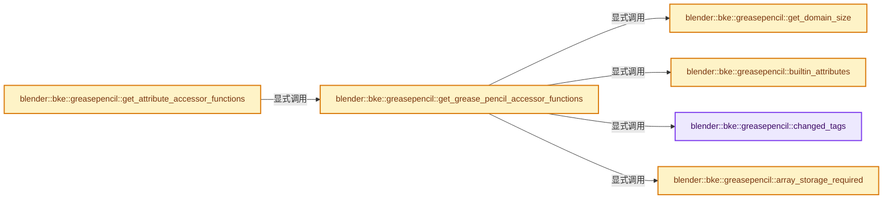
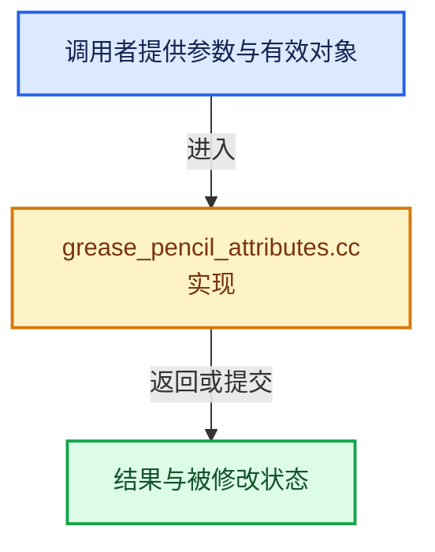

# 实现依赖专题：source/blender/blenkernel/intern/grease_pencil_attributes.cc

[实现依赖导航](../../README.md) · [符号索引](../../../00-课程指南/02-源码与提交索引/符号依赖与实现索引.md)

本专题从正文实际调用进入，集中保存共享实现。函数有稳定锚点，可从调用处直接跳到对应完整函数；递归与互相调用通过回链组织。

## 本文件的实现关系






## 完整成员与函数实现

<a id="f-05ee578569d91ea4"></a>

### `blender::bke::greasepencil::changed_tags`

实现位置：[source/blender/blenkernel/intern/grease_pencil_attributes.cc](../../../../../../../source/blender/blenkernel/intern/grease_pencil_attributes.cc) · L18—L22。

**教学注释版**

<!-- annotated:136cefa989f37e -->

```cpp
static const auto &changed_tags()
{
  static Map<StringRef, AttrUpdateOnChange> attributes;
  return attributes;
}
```

<details>
<summary>核对原始源码：source/blender/blenkernel/intern/grease_pencil_attributes.cc · L18—L22</summary>

<!-- original:136cefa989f37e:source/blender/blenkernel/intern/grease_pencil_attributes.cc:18:22 -->

```cpp
static const auto &changed_tags()
{
  static Map<StringRef, AttrUpdateOnChange> attributes;
  return attributes;
}
```

</details>

**结果出口**

- `return attributes;`

**继续追踪实现**

本实现没有需要继续展开的显式调用；检查返回表达式、对象转换和调用者前置条件。

<a id="f-f36d27df445426f6"></a>

### `blender::bke::greasepencil::builtin_attributes`

实现位置：[source/blender/blenkernel/intern/grease_pencil_attributes.cc](../../../../../../../source/blender/blenkernel/intern/grease_pencil_attributes.cc) · L24—L31。

**教学注释版**

<!-- annotated:0c47c3322a8c65 -->

```cpp
static const auto &builtin_attributes()
{
  static auto attributes = []() {
    Map<StringRef, AttrBuiltinInfo> map;
    return map;
  }();
  return attributes;
}
```

<details>
<summary>核对原始源码：source/blender/blenkernel/intern/grease_pencil_attributes.cc · L24—L31</summary>

<!-- original:0c47c3322a8c65:source/blender/blenkernel/intern/grease_pencil_attributes.cc:24:31 -->

```cpp
static const auto &builtin_attributes()
{
  static auto attributes = []() {
    Map<StringRef, AttrBuiltinInfo> map;
    return map;
  }();
  return attributes;
}
```

</details>

**结果出口**

- `return map;`
- `return attributes;`

**继续追踪实现**

- `[]() { Map<StringRef, AttrBuiltinInfo> map; return map; }` → [调用协议](../../../00-课程指南/01-路线与规范/模板宏与动态分派协议.md)：函数指针、局部可调用对象或未展开的宏；必须结合调用者环境。调用位置L26。

<a id="f-29624222a5a53bd7"></a>

### `blender::bke::greasepencil::array_storage_required`

实现位置：[source/blender/blenkernel/intern/grease_pencil_attributes.cc](../../../../../../../source/blender/blenkernel/intern/grease_pencil_attributes.cc) · L33—L37。

**教学注释版**

<!-- annotated:6c90b85650230d -->

```cpp
static const auto &array_storage_required()
{
  static Set<StringRef> attributes{};
  return attributes;
}
```

<details>
<summary>核对原始源码：source/blender/blenkernel/intern/grease_pencil_attributes.cc · L33—L37</summary>

<!-- original:6c90b85650230d:source/blender/blenkernel/intern/grease_pencil_attributes.cc:33:37 -->

```cpp
static const auto &array_storage_required()
{
  static Set<StringRef> attributes{};
  return attributes;
}
```

</details>

**结果出口**

- `return attributes;`

**继续追踪实现**

本实现没有需要继续展开的显式调用；检查返回表达式、对象转换和调用者前置条件。

<a id="f-d945b8dd708324ea"></a>

### `blender::bke::greasepencil::get_domain_size`

实现位置：[source/blender/blenkernel/intern/grease_pencil_attributes.cc](../../../../../../../source/blender/blenkernel/intern/grease_pencil_attributes.cc) · L39—L43。

接口参数：

- `const void *owner`
- `const AttrDomain domain`

**教学注释版**

<!-- annotated:ea5d36510a6e53 -->

```cpp
static int get_domain_size(const void *owner, const AttrDomain domain)
{
  const GreasePencil &grease_pencil = *static_cast<const GreasePencil *>(owner);
  return domain == AttrDomain::Layer ? grease_pencil.layers().size() : 0;
}
```

<details>
<summary>核对原始源码：source/blender/blenkernel/intern/grease_pencil_attributes.cc · L39—L43</summary>

<!-- original:ea5d36510a6e53:source/blender/blenkernel/intern/grease_pencil_attributes.cc:39:43 -->

```cpp
static int get_domain_size(const void *owner, const AttrDomain domain)
{
  const GreasePencil &grease_pencil = *static_cast<const GreasePencil *>(owner);
  return domain == AttrDomain::Layer ? grease_pencil.layers().size() : 0;
}
```

</details>

**结果出口**

- `return domain == AttrDomain::Layer ? grease_pencil.layers().size() : 0;`

**继续追踪实现**

- `grease_pencil.layers().size` → [调用协议](../../../00-课程指南/01-路线与规范/模板宏与动态分派协议.md)：接收对象类型依赖auto、返回值或模板实例；不按同名猜测目标。调用位置L42。
- `grease_pencil.layers` → [blender::GreasePencil::layers · L3983](grease_pencil.cc.md#f-15d64ed11a2babc0)。

<a id="f-a62146f13b168475"></a>

### `blender::bke::greasepencil::get_grease_pencil_accessor_functions`

实现位置：[source/blender/blenkernel/intern/grease_pencil_attributes.cc](../../../../../../../source/blender/blenkernel/intern/grease_pencil_attributes.cc) · L45—L202。

**教学注释版**

<!-- annotated:a191d577d7f839 -->

```cpp
static AttributeAccessorFunctions get_grease_pencil_accessor_functions()
{
  AttributeAccessorFunctions fn{};
  fn.domain_supported = [](const void * /*owner*/, const AttrDomain domain) {
    return domain == AttrDomain::Layer;
  };
  fn.domain_size = get_domain_size;
  fn.builtin_domain_and_type = [](const void * /*owner*/, const StringRef /*name*/)
      -> std::optional<AttributeDomainAndType> { return std::nullopt; };
  fn.lookup = [](const void *owner, const StringRef name) -> GAttributeReader {
    const GreasePencil &grease_pencil = *static_cast<const GreasePencil *>(owner);
    const AttributeStorage &storage = grease_pencil.attribute_storage.wrap();
    const Attribute *attribute = storage.lookup(name);
    if (!attribute) {
      return {};
    }
    const int domain_size = get_domain_size(owner, AttrDomain::Layer);
    return attribute_to_reader(*attribute, AttrDomain::Layer, domain_size);
  };
  fn.get_builtin_default = [](const void * /*owner*/, StringRef name) -> GPointer {
    const AttrBuiltinInfo &info = builtin_attributes().lookup(name);
    return info.default_value;
  };
  fn.lookup_meta_data = [](const void *owner, StringRef name) -> std::optional<AttributeMetaData> {
    const GreasePencil &grease_pencil = *static_cast<const GreasePencil *>(owner);
    const AttributeStorage &storage = grease_pencil.attribute_storage.wrap();
    const Attribute *attr = storage.lookup(name);
    if (!attr) {
      return std::nullopt;
    }
    return AttributeMetaData{attr->domain(), attr->data_type()};
  };
  fn.adapt_domain = [](const void * /*owner*/,
                       const GVArray &varray,
                       const AttrDomain from_domain,
                       const AttrDomain to_domain) {
    if (from_domain == to_domain && from_domain == AttrDomain::Layer) {
      return varray;
    }
    return GVArray{};
  };
  fn.foreach_attribute = [](const void *owner,
                            const FunctionRef<void(const AttributeIter &)> fn,
                            const AttributeAccessor &accessor) {
    const GreasePencil &grease_pencil = *static_cast<const GreasePencil *>(owner);
    const AttributeStorage &storage = grease_pencil.attribute_storage.wrap();
    for (const Attribute &attribute : storage) {
      const auto get_fn = [&]() {
        const int domain_size = get_domain_size(owner, AttrDomain::Layer);
        return attribute_to_reader(attribute, AttrDomain::Layer, domain_size);
      };
      AttributeIter iter(attribute.name(), attribute.domain(), attribute.data_type(), get_fn);
      iter.is_builtin = builtin_attributes().contains(attribute.name());
      iter.storage_type = attribute.storage_type();
      iter.accessor = &accessor;
      fn(iter);
      if (iter.is_stopped()) {
        break;
      }
    }
  };
  fn.lookup_validator = [](const void * /*owner*/, const StringRef name) -> AttributeValidator {
    const AttrBuiltinInfo *info = builtin_attributes().lookup_ptr(name);
    if (!info) {
      return {};
    }
    return info->validator;
  };
  fn.lookup_for_write = [](void *owner, const StringRef name) -> GAttributeWriter {
    GreasePencil &grease_pencil = *static_cast<GreasePencil *>(owner);
    AttributeStorage &storage = grease_pencil.attribute_storage.wrap();
    Attribute *attribute = storage.lookup(name);
    if (!attribute) {
      return {};
    }
    const int domain_size = get_domain_size(owner, AttrDomain::Layer);
    return attribute_to_writer(&grease_pencil, {}, domain_size, *attribute);
  };
  fn.remove = [](void *owner, const StringRef name) -> bool {
    GreasePencil &grease_pencil = *static_cast<GreasePencil *>(owner);
    AttributeStorage &storage = grease_pencil.attribute_storage.wrap();
    if (const AttrBuiltinInfo *info = builtin_attributes().lookup_ptr(name)) {
      if (!info->deletable) {
        return false;
      }
    }
    const std::optional<AttrUpdateOnChange> fn = changed_tags().lookup_try(name);
    const bool removed = storage.remove(name);
    if (!removed) {
      return false;
    }
    if (fn) {
      (*fn)(owner);
    }
    return true;
  };
  fn.add = [](void *owner,
              const StringRef name,
              const AttrDomain domain,
              const bke::AttrType type,
              const AttributeInit &initializer) {
    GreasePencil &grease_pencil = *static_cast<GreasePencil *>(owner);
    const int domain_size = get_domain_size(owner, domain);
    AttributeStorage &storage = grease_pencil.attribute_storage.wrap();
    if (const AttrBuiltinInfo *info = builtin_attributes().lookup_ptr(name)) {
      if (info->domain != domain || info->type != type) {
        return false;
      }
    }
    if (storage.lookup(name)) {
      return false;
    }
    const bool array = array_storage_required().contains(name);
    Attribute::DataVariant data = attribute_init_to_data(type, domain_size, initializer, array);
    // [讲解] std::move：把表达式转换成可供移动重载选择的值类别；不保证真的移动，不结束源对象寿命，对const值可能选择复制。
    storage.add(name, domain, type, std::move(data));
    if (initializer.type != AttributeInit::Type::Construct) {
      if (const std::optional<AttrUpdateOnChange> fn = changed_tags().lookup_try(name)) {
        (*fn)(owner);
      }
    }
    return true;
  };
  fn.rename = [](void *owner,
                 const Map<StringRef, StringRef> &name_map,
                 bool overwrite) -> Set<StringRef> {
    GreasePencil &grease_pencil = *static_cast<GreasePencil *>(owner);
    return rename_attributes(
        grease_pencil.attribute_storage.wrap(),
        name_map,
        overwrite,
        builtin_attributes(),
        array_storage_required(),
        [&](const bke::AttrDomain domain) { return get_domain_size(owner, domain); },
        std::nullopt,
        {});
  };
  fn.assign_data = [](void *owner, StringRef name, const AttributeInit &initializer) {
    GreasePencil &grease_pencil = *static_cast<GreasePencil *>(owner);
    AttributeStorage &storage = grease_pencil.attribute_storage.wrap();
    Attribute *attr = storage.lookup(name);
    if (!attr) {
      return false;
    }
    Attribute::DataVariant data = attribute_init_to_data(attr->data_type(),
                                                         get_domain_size(owner, attr->domain()),
                                                         initializer,
                                                         array_storage_required().contains(name));
    attr->assign_data(std::move(data));
    if (initializer.type != AttributeInit::Type::Construct) {
      if (const std::optional<AttrUpdateOnChange> fn = changed_tags().lookup_try(name)) {
        (*fn)(owner);
      }
    }
    return true;
  };

  return fn;
}
```

<details>
<summary>核对原始源码：source/blender/blenkernel/intern/grease_pencil_attributes.cc · L45—L202</summary>

<!-- original:a191d577d7f839:source/blender/blenkernel/intern/grease_pencil_attributes.cc:45:202 -->

```cpp
static AttributeAccessorFunctions get_grease_pencil_accessor_functions()
{
  AttributeAccessorFunctions fn{};
  fn.domain_supported = [](const void * /*owner*/, const AttrDomain domain) {
    return domain == AttrDomain::Layer;
  };
  fn.domain_size = get_domain_size;
  fn.builtin_domain_and_type = [](const void * /*owner*/, const StringRef /*name*/)
      -> std::optional<AttributeDomainAndType> { return std::nullopt; };
  fn.lookup = [](const void *owner, const StringRef name) -> GAttributeReader {
    const GreasePencil &grease_pencil = *static_cast<const GreasePencil *>(owner);
    const AttributeStorage &storage = grease_pencil.attribute_storage.wrap();
    const Attribute *attribute = storage.lookup(name);
    if (!attribute) {
      return {};
    }
    const int domain_size = get_domain_size(owner, AttrDomain::Layer);
    return attribute_to_reader(*attribute, AttrDomain::Layer, domain_size);
  };
  fn.get_builtin_default = [](const void * /*owner*/, StringRef name) -> GPointer {
    const AttrBuiltinInfo &info = builtin_attributes().lookup(name);
    return info.default_value;
  };
  fn.lookup_meta_data = [](const void *owner, StringRef name) -> std::optional<AttributeMetaData> {
    const GreasePencil &grease_pencil = *static_cast<const GreasePencil *>(owner);
    const AttributeStorage &storage = grease_pencil.attribute_storage.wrap();
    const Attribute *attr = storage.lookup(name);
    if (!attr) {
      return std::nullopt;
    }
    return AttributeMetaData{attr->domain(), attr->data_type()};
  };
  fn.adapt_domain = [](const void * /*owner*/,
                       const GVArray &varray,
                       const AttrDomain from_domain,
                       const AttrDomain to_domain) {
    if (from_domain == to_domain && from_domain == AttrDomain::Layer) {
      return varray;
    }
    return GVArray{};
  };
  fn.foreach_attribute = [](const void *owner,
                            const FunctionRef<void(const AttributeIter &)> fn,
                            const AttributeAccessor &accessor) {
    const GreasePencil &grease_pencil = *static_cast<const GreasePencil *>(owner);
    const AttributeStorage &storage = grease_pencil.attribute_storage.wrap();
    for (const Attribute &attribute : storage) {
      const auto get_fn = [&]() {
        const int domain_size = get_domain_size(owner, AttrDomain::Layer);
        return attribute_to_reader(attribute, AttrDomain::Layer, domain_size);
      };
      AttributeIter iter(attribute.name(), attribute.domain(), attribute.data_type(), get_fn);
      iter.is_builtin = builtin_attributes().contains(attribute.name());
      iter.storage_type = attribute.storage_type();
      iter.accessor = &accessor;
      fn(iter);
      if (iter.is_stopped()) {
        break;
      }
    }
  };
  fn.lookup_validator = [](const void * /*owner*/, const StringRef name) -> AttributeValidator {
    const AttrBuiltinInfo *info = builtin_attributes().lookup_ptr(name);
    if (!info) {
      return {};
    }
    return info->validator;
  };
  fn.lookup_for_write = [](void *owner, const StringRef name) -> GAttributeWriter {
    GreasePencil &grease_pencil = *static_cast<GreasePencil *>(owner);
    AttributeStorage &storage = grease_pencil.attribute_storage.wrap();
    Attribute *attribute = storage.lookup(name);
    if (!attribute) {
      return {};
    }
    const int domain_size = get_domain_size(owner, AttrDomain::Layer);
    return attribute_to_writer(&grease_pencil, {}, domain_size, *attribute);
  };
  fn.remove = [](void *owner, const StringRef name) -> bool {
    GreasePencil &grease_pencil = *static_cast<GreasePencil *>(owner);
    AttributeStorage &storage = grease_pencil.attribute_storage.wrap();
    if (const AttrBuiltinInfo *info = builtin_attributes().lookup_ptr(name)) {
      if (!info->deletable) {
        return false;
      }
    }
    const std::optional<AttrUpdateOnChange> fn = changed_tags().lookup_try(name);
    const bool removed = storage.remove(name);
    if (!removed) {
      return false;
    }
    if (fn) {
      (*fn)(owner);
    }
    return true;
  };
  fn.add = [](void *owner,
              const StringRef name,
              const AttrDomain domain,
              const bke::AttrType type,
              const AttributeInit &initializer) {
    GreasePencil &grease_pencil = *static_cast<GreasePencil *>(owner);
    const int domain_size = get_domain_size(owner, domain);
    AttributeStorage &storage = grease_pencil.attribute_storage.wrap();
    if (const AttrBuiltinInfo *info = builtin_attributes().lookup_ptr(name)) {
      if (info->domain != domain || info->type != type) {
        return false;
      }
    }
    if (storage.lookup(name)) {
      return false;
    }
    const bool array = array_storage_required().contains(name);
    Attribute::DataVariant data = attribute_init_to_data(type, domain_size, initializer, array);
    storage.add(name, domain, type, std::move(data));
    if (initializer.type != AttributeInit::Type::Construct) {
      if (const std::optional<AttrUpdateOnChange> fn = changed_tags().lookup_try(name)) {
        (*fn)(owner);
      }
    }
    return true;
  };
  fn.rename = [](void *owner,
                 const Map<StringRef, StringRef> &name_map,
                 bool overwrite) -> Set<StringRef> {
    GreasePencil &grease_pencil = *static_cast<GreasePencil *>(owner);
    return rename_attributes(
        grease_pencil.attribute_storage.wrap(),
        name_map,
        overwrite,
        builtin_attributes(),
        array_storage_required(),
        [&](const bke::AttrDomain domain) { return get_domain_size(owner, domain); },
        std::nullopt,
        {});
  };
  fn.assign_data = [](void *owner, StringRef name, const AttributeInit &initializer) {
    GreasePencil &grease_pencil = *static_cast<GreasePencil *>(owner);
    AttributeStorage &storage = grease_pencil.attribute_storage.wrap();
    Attribute *attr = storage.lookup(name);
    if (!attr) {
      return false;
    }
    Attribute::DataVariant data = attribute_init_to_data(attr->data_type(),
                                                         get_domain_size(owner, attr->domain()),
                                                         initializer,
                                                         array_storage_required().contains(name));
    attr->assign_data(std::move(data));
    if (initializer.type != AttributeInit::Type::Construct) {
      if (const std::optional<AttrUpdateOnChange> fn = changed_tags().lookup_try(name)) {
        (*fn)(owner);
      }
    }
    return true;
  };

  return fn;
}
```

</details>

**沿实际写入检查状态**

- `fn.domain_supported = [](const void * /*owner*/, const AttrDomain domain) {`
- `fn.domain_size = get_domain_size;`
- `fn.builtin_domain_and_type = [](const void * /*owner*/, const StringRef /*name*/)`
- `fn.lookup = [](const void *owner, const StringRef name) -> GAttributeReader {`
- `fn.get_builtin_default = [](const void * /*owner*/, StringRef name) -> GPointer {`
- `fn.lookup_meta_data = [](const void *owner, StringRef name) -> std::optional<AttributeMetaData> {`
- `fn.adapt_domain = [](const void * /*owner*/,`
- `fn.foreach_attribute = [](const void *owner,`
- `iter.is_builtin = builtin_attributes().contains(attribute.name());`
- `iter.storage_type = attribute.storage_type();`
- `iter.accessor = &accessor;`
- `fn.lookup_validator = [](const void * /*owner*/, const StringRef name) -> AttributeValidator {`
- `fn.lookup_for_write = [](void *owner, const StringRef name) -> GAttributeWriter {`
- `fn.remove = [](void *owner, const StringRef name) -> bool {`
- `fn.add = [](void *owner,`
- `fn.rename = [](void *owner,`
- `fn.assign_data = [](void *owner, StringRef name, const AttributeInit &initializer) {`

**结果出口**

- `return domain == AttrDomain::Layer;`
- `return {};`
- `return attribute_to_reader(*attribute, AttrDomain::Layer, domain_size);`
- `return info.default_value;`
- `return std::nullopt;`
- `return AttributeMetaData{attr->domain(), attr->data_type()};`
- `return varray;`
- `return GVArray{};`
- `return attribute_to_reader(attribute, AttrDomain::Layer, domain_size);`
- `return info->validator;`
- `return attribute_to_writer(&grease_pencil, {}, domain_size, *attribute);`
- `return false;`
- `return true;`
- `return rename_attributes(`
- `return fn;`

**继续追踪实现**

- `grease_pencil.attribute_storage.wrap` → [调用协议](../../../00-课程指南/01-路线与规范/模板宏与动态分派协议.md)：接收对象类型依赖auto、返回值或模板实例；不按同名猜测目标。调用位置L56。
- `storage.lookup` → [blender::bke::AttributeStorage::lookup · L218](attribute_storage.cc.md#f-7fdc83fb77004833)；[blender::bke::AttributeStorage::lookup · L228](attribute_storage.cc.md#f-4c9ec35a31afcd06)。同名重载需按实参类型选择。
- `get_domain_size` → [blender::bke::greasepencil::get_domain_size · L39](grease_pencil_attributes.cc.md#f-d945b8dd708324ea)。
- `attribute_to_reader` → [blender::bke::attribute_to_reader · L21](attribute_storage_access.cc.md#f-163d13c9de0f1d4b)。
- `builtin_attributes().lookup` → [调用协议](../../../00-课程指南/01-路线与规范/模板宏与动态分派协议.md)：接收对象类型依赖auto、返回值或模板实例；不按同名猜测目标。调用位置L65。
- `builtin_attributes` → [blender::bke::greasepencil::builtin_attributes · L24](grease_pencil_attributes.cc.md#f-f36d27df445426f6)。
- `attr->domain` → [blender::bke::Attribute::domain · L286](../../../05-几何存储与拓扑映射/10-布局兼容与几何实战.md#f-03667cd47954e9ff)。
- `attr->data_type` → [blender::bke::Attribute::data_type · L291](../../../05-几何存储与拓扑映射/10-布局兼容与几何实战.md#f-d86548da166fa237)。
- `attribute.name` → [blender::bke::Attribute::name · L281](../../../05-几何存储与拓扑映射/10-布局兼容与几何实战.md#f-673c10c3082f9df5)。
- `attribute.domain` → [blender::bke::Attribute::domain · L286](../../../05-几何存储与拓扑映射/10-布局兼容与几何实战.md#f-03667cd47954e9ff)。
- `attribute.data_type` → [blender::bke::Attribute::data_type · L291](../../../05-几何存储与拓扑映射/10-布局兼容与几何实战.md#f-d86548da166fa237)。
- `builtin_attributes().contains` → [调用协议](../../../00-课程指南/01-路线与规范/模板宏与动态分派协议.md)：接收对象类型依赖auto、返回值或模板实例；不按同名猜测目标。调用位置L97。
- `attribute.storage_type` → [blender::bke::Attribute::storage_type · L301](../../../05-几何存储与拓扑映射/10-布局兼容与几何实战.md#f-e08ee0374bedc01d)。
- `fn` → [调用协议](../../../00-课程指南/01-路线与规范/模板宏与动态分派协议.md)：局部可调用对象，须结合其初始化与捕获环境。调用位置L100。
- `iter.is_stopped` → [blender::bke::AttributeIter::is_stopped · L419](../../../05-几何存储与拓扑映射/08-AttributeAccessor接口.md#f-78d44598b8fa0c04)。
- `builtin_attributes().lookup_ptr` → [调用协议](../../../00-课程指南/01-路线与规范/模板宏与动态分派协议.md)：接收对象类型依赖auto、返回值或模板实例；不按同名猜测目标。调用位置L107。
- `attribute_to_writer` → [blender::bke::attribute_to_writer · L44](attribute_storage_access.cc.md#f-75cf114d7fc03fa8)。
- `changed_tags().lookup_try` → [调用协议](../../../00-课程指南/01-路线与规范/模板宏与动态分派协议.md)：接收对象类型依赖auto、返回值或模板实例；不按同名猜测目标。调用位置L131。
- `changed_tags` → [blender::bke::greasepencil::changed_tags · L18](grease_pencil_attributes.cc.md#f-05ee578569d91ea4)。
- `storage.remove` → [blender::bke::AttributeStorage::remove · L255](attribute_storage.cc.md#f-65b1c61b542236ae)；[blender::bke::AttributeStorage::remove · L270](attribute_storage.cc.md#f-10bfcc160f8e979a)；[blender::bke::AttributeStorage::remove · L277](attribute_storage.cc.md#f-be56394a344a175b)。同名重载需按实参类型选择。
- `(*fn)` → [调用协议](../../../00-课程指南/01-路线与规范/模板宏与动态分派协议.md)：局部可调用对象，须结合其初始化与捕获环境。调用位置L137。
- `array_storage_required().contains` → [调用协议](../../../00-课程指南/01-路线与规范/模板宏与动态分派协议.md)：接收对象类型依赖auto、返回值或模板实例；不按同名猜测目标。调用位置L157。
- `array_storage_required` → [blender::bke::greasepencil::array_storage_required · L33](grease_pencil_attributes.cc.md#f-29624222a5a53bd7)。
- `attribute_init_to_data` → [blender::bke::attribute_init_to_data · L80](attribute_storage_access.cc.md#f-34e72146abce4b23)。
- `storage.add` → [blender::bke::AttributeStorage::add · L238](attribute_storage.cc.md#f-b78aa43de4dafd5f)。
- `std::move` → [外部契约](https://eel.is/c++draft/utility.forward)：把表达式转换成可供移动重载选择的值类别；不保证真的移动，不结束源对象寿命，对const值可能选择复制。
- `rename_attributes` → [blender::bke::rename_attributes · L286](attribute_storage_access.cc.md#f-3b17282afd84c493)。
- `attr->assign_data` → [blender::bke::Attribute::assign_data · L312](../../../05-几何存储与拓扑映射/10-布局兼容与几何实战.md#f-9fcff5d02b6d8c44)。

<a id="f-d9026d41284294f8"></a>

### `blender::bke::greasepencil::get_attribute_accessor_functions`

实现位置：[source/blender/blenkernel/intern/grease_pencil_attributes.cc](../../../../../../../source/blender/blenkernel/intern/grease_pencil_attributes.cc) · L204—L208。

**教学注释版**

<!-- annotated:d7e684732c1833 -->

```cpp
const AttributeAccessorFunctions &get_attribute_accessor_functions()
{
  static const AttributeAccessorFunctions fn = get_grease_pencil_accessor_functions();
  return fn;
}
```

<details>
<summary>核对原始源码：source/blender/blenkernel/intern/grease_pencil_attributes.cc · L204—L208</summary>

<!-- original:d7e684732c1833:source/blender/blenkernel/intern/grease_pencil_attributes.cc:204:208 -->

```cpp
const AttributeAccessorFunctions &get_attribute_accessor_functions()
{
  static const AttributeAccessorFunctions fn = get_grease_pencil_accessor_functions();
  return fn;
}
```

</details>

**结果出口**

- `return fn;`

**继续追踪实现**

- `get_grease_pencil_accessor_functions` → [blender::bke::greasepencil::get_grease_pencil_accessor_functions · L45](grease_pencil_attributes.cc.md#f-a62146f13b168475)。
