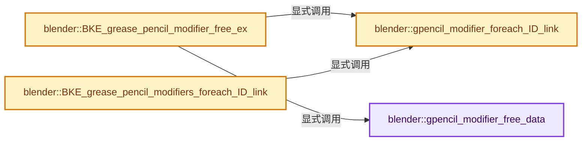
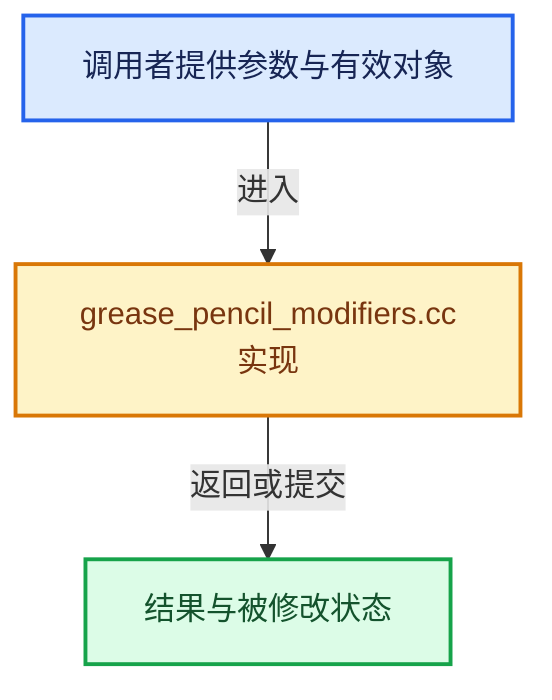

# 实现依赖专题：source/blender/blenkernel/intern/grease_pencil_modifiers.cc

[实现依赖导航](../../README.md) · [符号索引](../../../00-课程指南/02-源码与提交索引/符号依赖与实现索引.md)

本专题从正文实际调用进入，集中保存共享实现。函数有稳定锚点，可从调用处直接跳到对应完整函数；递归与互相调用通过回链组织。

## 本文件的实现关系






## 完整成员与函数实现

<a id="f-b56c5039d77cdd3e"></a>

### `blender::gpencil_modifier_free_data`

实现位置：[source/blender/blenkernel/intern/grease_pencil_modifiers.cc](../../../../../../../source/blender/blenkernel/intern/grease_pencil_modifiers.cc) · L44—L157。

接口参数：

- `GpencilModifierData *md`

**教学注释版**

<!-- annotated:4331efbc644612 -->

```cpp
static void gpencil_modifier_free_data(GpencilModifierData *md)
{
  switch (md->type) {
    case eGpencilModifierType_Noise: {
      NoiseGpencilModifierData *gpmd = reinterpret_cast<NoiseGpencilModifierData *>(md);

      if (gpmd->curve_intensity) {
        BKE_curvemapping_free(gpmd->curve_intensity);
      }
      break;
    }
    case eGpencilModifierType_Thick: {
      ThickGpencilModifierData *gpmd = reinterpret_cast<ThickGpencilModifierData *>(md);

      if (gpmd->curve_thickness) {
        BKE_curvemapping_free(gpmd->curve_thickness);
      }
      break;
    }
    case eGpencilModifierType_Tint: {
      TintGpencilModifierData *mmd = reinterpret_cast<TintGpencilModifierData *>(md);

      MEM_SAFE_DELETE(mmd->colorband);
      if (mmd->curve_intensity) {
        BKE_curvemapping_free(mmd->curve_intensity);
      }
      break;
    }
    case eGpencilModifierType_Opacity: {
      OpacityGpencilModifierData *gpmd = reinterpret_cast<OpacityGpencilModifierData *>(md);

      if (gpmd->curve_intensity) {
        BKE_curvemapping_free(gpmd->curve_intensity);
      }
      break;
    }
    case eGpencilModifierType_Color: {
      ColorGpencilModifierData *gpmd = reinterpret_cast<ColorGpencilModifierData *>(md);

      if (gpmd->curve_intensity) {
        BKE_curvemapping_free(gpmd->curve_intensity);
      }
      break;
    }
    case eGpencilModifierType_Lattice: {
      LatticeGpencilModifierData *mmd = reinterpret_cast<LatticeGpencilModifierData *>(md);
      LatticeDeformData *ldata = static_cast<LatticeDeformData *>(mmd->cache_data);

      /* free deform data */
      if (ldata) {
        BKE_lattice_deform_data_destroy(ldata);
      }
      break;
    }
    case eGpencilModifierType_Smooth: {
      SmoothGpencilModifierData *gpmd = reinterpret_cast<SmoothGpencilModifierData *>(md);

      if (gpmd->curve_intensity) {
        BKE_curvemapping_free(gpmd->curve_intensity);
      }
      break;
    }
    case eGpencilModifierType_Hook: {
      HookGpencilModifierData *mmd = reinterpret_cast<HookGpencilModifierData *>(md);

      if (mmd->curfalloff) {
        BKE_curvemapping_free(mmd->curfalloff);
      }
      break;
    }
    case eGpencilModifierType_Time: {
      TimeGpencilModifierData *gpmd = reinterpret_cast<TimeGpencilModifierData *>(md);

      MEM_SAFE_DELETE(gpmd->segments);
      break;
    }
    case eGpencilModifierType_Dash: {
      DashGpencilModifierData *dmd = reinterpret_cast<DashGpencilModifierData *>(md);

      MEM_SAFE_DELETE(dmd->segments);
      break;
    }
    case eGpencilModifierType_Shrinkwrap: {
      ShrinkwrapGpencilModifierData *mmd = reinterpret_cast<ShrinkwrapGpencilModifierData *>(md);

      if (mmd->cache_data) {
        BKE_shrinkwrap_free_tree(mmd->cache_data);
        MEM_delete(mmd->cache_data);
      }
      break;
    }

    case eGpencilModifierType_None:
    case eGpencilModifierType_Subdiv:
    case eGpencilModifierType_Array:
    case eGpencilModifierType_Build:
    case eGpencilModifierType_Simplify:
    case eGpencilModifierType_Offset:
    case eGpencilModifierType_Mirror:
    case eGpencilModifierType_Multiply:
    case eGpencilModifierType_Texture:
    case eGpencilModifierType_Lineart:
    case eGpencilModifierType_Length:
    case eGpencilModifierType_WeightProximity:
    case eGpencilModifierType_WeightAngle:
    case eGpencilModifierType_Envelope:
    case eGpencilModifierType_Outline:
    case eGpencilModifierType_Armature:
      break;
    case NUM_GREASEPENCIL_MODIFIER_TYPES:
      BLI_assert_unreachable();
      break;
  }
}
```

<details>
<summary>核对原始源码：source/blender/blenkernel/intern/grease_pencil_modifiers.cc · L44—L157</summary>

<!-- original:4331efbc644612:source/blender/blenkernel/intern/grease_pencil_modifiers.cc:44:157 -->

```cpp
static void gpencil_modifier_free_data(GpencilModifierData *md)
{
  switch (md->type) {
    case eGpencilModifierType_Noise: {
      NoiseGpencilModifierData *gpmd = reinterpret_cast<NoiseGpencilModifierData *>(md);

      if (gpmd->curve_intensity) {
        BKE_curvemapping_free(gpmd->curve_intensity);
      }
      break;
    }
    case eGpencilModifierType_Thick: {
      ThickGpencilModifierData *gpmd = reinterpret_cast<ThickGpencilModifierData *>(md);

      if (gpmd->curve_thickness) {
        BKE_curvemapping_free(gpmd->curve_thickness);
      }
      break;
    }
    case eGpencilModifierType_Tint: {
      TintGpencilModifierData *mmd = reinterpret_cast<TintGpencilModifierData *>(md);

      MEM_SAFE_DELETE(mmd->colorband);
      if (mmd->curve_intensity) {
        BKE_curvemapping_free(mmd->curve_intensity);
      }
      break;
    }
    case eGpencilModifierType_Opacity: {
      OpacityGpencilModifierData *gpmd = reinterpret_cast<OpacityGpencilModifierData *>(md);

      if (gpmd->curve_intensity) {
        BKE_curvemapping_free(gpmd->curve_intensity);
      }
      break;
    }
    case eGpencilModifierType_Color: {
      ColorGpencilModifierData *gpmd = reinterpret_cast<ColorGpencilModifierData *>(md);

      if (gpmd->curve_intensity) {
        BKE_curvemapping_free(gpmd->curve_intensity);
      }
      break;
    }
    case eGpencilModifierType_Lattice: {
      LatticeGpencilModifierData *mmd = reinterpret_cast<LatticeGpencilModifierData *>(md);
      LatticeDeformData *ldata = static_cast<LatticeDeformData *>(mmd->cache_data);

      /* free deform data */
      if (ldata) {
        BKE_lattice_deform_data_destroy(ldata);
      }
      break;
    }
    case eGpencilModifierType_Smooth: {
      SmoothGpencilModifierData *gpmd = reinterpret_cast<SmoothGpencilModifierData *>(md);

      if (gpmd->curve_intensity) {
        BKE_curvemapping_free(gpmd->curve_intensity);
      }
      break;
    }
    case eGpencilModifierType_Hook: {
      HookGpencilModifierData *mmd = reinterpret_cast<HookGpencilModifierData *>(md);

      if (mmd->curfalloff) {
        BKE_curvemapping_free(mmd->curfalloff);
      }
      break;
    }
    case eGpencilModifierType_Time: {
      TimeGpencilModifierData *gpmd = reinterpret_cast<TimeGpencilModifierData *>(md);

      MEM_SAFE_DELETE(gpmd->segments);
      break;
    }
    case eGpencilModifierType_Dash: {
      DashGpencilModifierData *dmd = reinterpret_cast<DashGpencilModifierData *>(md);

      MEM_SAFE_DELETE(dmd->segments);
      break;
    }
    case eGpencilModifierType_Shrinkwrap: {
      ShrinkwrapGpencilModifierData *mmd = reinterpret_cast<ShrinkwrapGpencilModifierData *>(md);

      if (mmd->cache_data) {
        BKE_shrinkwrap_free_tree(mmd->cache_data);
        MEM_delete(mmd->cache_data);
      }
      break;
    }

    case eGpencilModifierType_None:
    case eGpencilModifierType_Subdiv:
    case eGpencilModifierType_Array:
    case eGpencilModifierType_Build:
    case eGpencilModifierType_Simplify:
    case eGpencilModifierType_Offset:
    case eGpencilModifierType_Mirror:
    case eGpencilModifierType_Multiply:
    case eGpencilModifierType_Texture:
    case eGpencilModifierType_Lineart:
    case eGpencilModifierType_Length:
    case eGpencilModifierType_WeightProximity:
    case eGpencilModifierType_WeightAngle:
    case eGpencilModifierType_Envelope:
    case eGpencilModifierType_Outline:
    case eGpencilModifierType_Armature:
      break;
    case NUM_GREASEPENCIL_MODIFIER_TYPES:
      BLI_assert_unreachable();
      break;
  }
}
```

</details>

**继续追踪实现**

- `BKE_curvemapping_free` → [blender::BKE_curvemapping_free · L135](colortools.cc.md#f-8bede43499273823)。
- `MEM_SAFE_DELETE` → [MEM_SAFE_DELETE · L436](../../07-Intern运行时与平台/guardedalloc/MEM_guardedalloc.h.md#m-eadb3bc5b902)。宏定义由构建条件选择。
- `BKE_lattice_deform_data_destroy` → [blender::BKE_lattice_deform_data_destroy · L279](lattice_deform.cc.md#f-099172e0b236fb3c)。
- `BKE_shrinkwrap_free_tree` → [blender::BKE_shrinkwrap_free_tree · L144](shrinkwrap.cc.md#f-803c1caa34293b9d)。
- `MEM_delete` → [MEM_delete · L400](../../07-Intern运行时与平台/guardedalloc/MEM_guardedalloc.h.md#f-9049ffdd1682887c)。
- `BLI_assert_unreachable` → [BLI_assert_unreachable · L77](../../01-BLI基础库/BLI_assert.hh.md#m-7a2d91a67d8e)。宏定义由构建条件选择。

<a id="f-7fa83eeb3a332a73"></a>

### `blender::gpencil_modifier_foreach_ID_link`

实现位置：[source/blender/blenkernel/intern/grease_pencil_modifiers.cc](../../../../../../../source/blender/blenkernel/intern/grease_pencil_modifiers.cc) · L165—L349。

接口参数：

- `GpencilModifierData *md`
- `Object *ob`
- `GreasePencilIDWalkFunc walk`
- `void *user_data`

**教学注释版**

<!-- annotated:b59cc2258c2319 -->

```cpp
static void gpencil_modifier_foreach_ID_link(GpencilModifierData *md,
                                             Object *ob,
                                             GreasePencilIDWalkFunc walk,
                                             void *user_data)
{
  switch (md->type) {
    case eGpencilModifierType_None: {
      break;
    }
    case eGpencilModifierType_Noise: {
      NoiseGpencilModifierData *mmd = reinterpret_cast<NoiseGpencilModifierData *>(md);

      walk(user_data, ob, reinterpret_cast<ID **>(&mmd->material), IDWALK_CB_USER);
      break;
    }
    case eGpencilModifierType_Subdiv: {
      SubdivGpencilModifierData *mmd = reinterpret_cast<SubdivGpencilModifierData *>(md);

      walk(user_data, ob, reinterpret_cast<ID **>(&mmd->material), IDWALK_CB_USER);
      break;
    }
    case eGpencilModifierType_Thick: {
      ThickGpencilModifierData *mmd = reinterpret_cast<ThickGpencilModifierData *>(md);

      walk(user_data, ob, reinterpret_cast<ID **>(&mmd->material), IDWALK_CB_USER);
      break;
    }
    case eGpencilModifierType_Tint: {
      TintGpencilModifierData *mmd = reinterpret_cast<TintGpencilModifierData *>(md);

      walk(user_data, ob, reinterpret_cast<ID **>(&mmd->material), IDWALK_CB_USER);
      walk(user_data, ob, reinterpret_cast<ID **>(&mmd->object), IDWALK_CB_NOP);
      break;
    }
    case eGpencilModifierType_Array: {
      ArrayGpencilModifierData *mmd = reinterpret_cast<ArrayGpencilModifierData *>(md);

      walk(user_data, ob, reinterpret_cast<ID **>(&mmd->material), IDWALK_CB_USER);
      walk(user_data, ob, reinterpret_cast<ID **>(&mmd->object), IDWALK_CB_NOP);
      break;
    }
    case eGpencilModifierType_Build: {
      BuildGpencilModifierData *mmd = reinterpret_cast<BuildGpencilModifierData *>(md);

      walk(user_data, ob, reinterpret_cast<ID **>(&mmd->object), IDWALK_CB_NOP);
      break;
    }
    case eGpencilModifierType_Opacity: {
      OpacityGpencilModifierData *mmd = reinterpret_cast<OpacityGpencilModifierData *>(md);

      walk(user_data, ob, reinterpret_cast<ID **>(&mmd->material), IDWALK_CB_USER);
      break;
    }
    case eGpencilModifierType_Color: {
      ColorGpencilModifierData *mmd = reinterpret_cast<ColorGpencilModifierData *>(md);

      walk(user_data, ob, reinterpret_cast<ID **>(&mmd->material), IDWALK_CB_USER);
      break;
    }
    case eGpencilModifierType_Lattice: {
      LatticeGpencilModifierData *mmd = reinterpret_cast<LatticeGpencilModifierData *>(md);

      walk(user_data, ob, reinterpret_cast<ID **>(&mmd->material), IDWALK_CB_USER);
      walk(user_data, ob, reinterpret_cast<ID **>(&mmd->object), IDWALK_CB_NOP);
      break;
    }
    case eGpencilModifierType_Simplify: {
      SimplifyGpencilModifierData *mmd = reinterpret_cast<SimplifyGpencilModifierData *>(md);

      walk(user_data, ob, reinterpret_cast<ID **>(&mmd->material), IDWALK_CB_USER);
      break;
    }
    case eGpencilModifierType_Smooth: {
      SmoothGpencilModifierData *mmd = reinterpret_cast<SmoothGpencilModifierData *>(md);

      walk(user_data, ob, reinterpret_cast<ID **>(&mmd->material), IDWALK_CB_USER);
      break;
    }
    case eGpencilModifierType_Hook: {
      HookGpencilModifierData *mmd = reinterpret_cast<HookGpencilModifierData *>(md);

      walk(user_data, ob, reinterpret_cast<ID **>(&mmd->material), IDWALK_CB_USER);
      walk(user_data, ob, reinterpret_cast<ID **>(&mmd->object), IDWALK_CB_NOP);
      break;
    }
    case eGpencilModifierType_Offset: {
      OffsetGpencilModifierData *mmd = reinterpret_cast<OffsetGpencilModifierData *>(md);

      walk(user_data, ob, reinterpret_cast<ID **>(&mmd->material), IDWALK_CB_USER);
      break;
    }
    case eGpencilModifierType_Mirror: {
      MirrorGpencilModifierData *mmd = reinterpret_cast<MirrorGpencilModifierData *>(md);

      walk(user_data, ob, reinterpret_cast<ID **>(&mmd->material), IDWALK_CB_USER);
      walk(user_data, ob, reinterpret_cast<ID **>(&mmd->object), IDWALK_CB_NOP);
      break;
    }
    case eGpencilModifierType_Armature: {
      ArmatureGpencilModifierData *mmd = reinterpret_cast<ArmatureGpencilModifierData *>(md);

      walk(user_data, ob, reinterpret_cast<ID **>(&mmd->object), IDWALK_CB_NOP);
      break;
    }
    case eGpencilModifierType_Time: {
      TimeGpencilModifierData *mmd = reinterpret_cast<TimeGpencilModifierData *>(md);

      walk(user_data, ob, reinterpret_cast<ID **>(&mmd->material), IDWALK_CB_USER);
      break;
    }
    case eGpencilModifierType_Multiply: {
      MultiplyGpencilModifierData *mmd = reinterpret_cast<MultiplyGpencilModifierData *>(md);

      walk(user_data, ob, reinterpret_cast<ID **>(&mmd->material), IDWALK_CB_USER);
      break;
    }
    case eGpencilModifierType_Texture: {
      TextureGpencilModifierData *mmd = reinterpret_cast<TextureGpencilModifierData *>(md);

      walk(user_data, ob, reinterpret_cast<ID **>(&mmd->material), IDWALK_CB_USER);
      break;
    }
    case eGpencilModifierType_Lineart: {
      LineartGpencilModifierData *lmd = reinterpret_cast<LineartGpencilModifierData *>(md);

      walk(user_data, ob, reinterpret_cast<ID **>(&lmd->target_material), IDWALK_CB_USER);
      walk(user_data, ob, reinterpret_cast<ID **>(&lmd->source_collection), IDWALK_CB_NOP);

      walk(user_data, ob, reinterpret_cast<ID **>(&lmd->source_object), IDWALK_CB_NOP);
      walk(user_data, ob, reinterpret_cast<ID **>(&lmd->source_camera), IDWALK_CB_NOP);
      walk(user_data, ob, reinterpret_cast<ID **>(&lmd->light_contour_object), IDWALK_CB_NOP);
      break;
    }
    case eGpencilModifierType_Length: {
      LengthGpencilModifierData *mmd = reinterpret_cast<LengthGpencilModifierData *>(md);

      walk(user_data, ob, reinterpret_cast<ID **>(&mmd->material), IDWALK_CB_USER);
      break;
    }
    case eGpencilModifierType_WeightProximity: {
      WeightProxGpencilModifierData *mmd = reinterpret_cast<WeightProxGpencilModifierData *>(md);

      walk(user_data, ob, reinterpret_cast<ID **>(&mmd->material), IDWALK_CB_USER);
      walk(user_data, ob, reinterpret_cast<ID **>(&mmd->object), IDWALK_CB_NOP);
      break;
    }
    case eGpencilModifierType_Dash: {
      DashGpencilModifierData *mmd = reinterpret_cast<DashGpencilModifierData *>(md);

      walk(user_data, ob, reinterpret_cast<ID **>(&mmd->material), IDWALK_CB_USER);
      break;
    }
    case eGpencilModifierType_WeightAngle: {
      WeightAngleGpencilModifierData *mmd = reinterpret_cast<WeightAngleGpencilModifierData *>(md);

      walk(user_data, ob, reinterpret_cast<ID **>(&mmd->material), IDWALK_CB_USER);
      break;
    }
    case eGpencilModifierType_Shrinkwrap: {
      ShrinkwrapGpencilModifierData *mmd = reinterpret_cast<ShrinkwrapGpencilModifierData *>(md);

      walk(user_data, ob, reinterpret_cast<ID **>(&mmd->target), IDWALK_CB_NOP);
      walk(user_data, ob, reinterpret_cast<ID **>(&mmd->aux_target), IDWALK_CB_NOP);
      walk(user_data, ob, reinterpret_cast<ID **>(&mmd->material), IDWALK_CB_USER);
      break;
    }
    case eGpencilModifierType_Envelope: {
      EnvelopeGpencilModifierData *mmd = reinterpret_cast<EnvelopeGpencilModifierData *>(md);

      walk(user_data, ob, reinterpret_cast<ID **>(&mmd->material), IDWALK_CB_USER);
      break;
    }
    case eGpencilModifierType_Outline: {
      OutlineGpencilModifierData *mmd = reinterpret_cast<OutlineGpencilModifierData *>(md);

      walk(user_data, ob, reinterpret_cast<ID **>(&mmd->material), IDWALK_CB_USER);
      walk(user_data, ob, reinterpret_cast<ID **>(&mmd->outline_material), IDWALK_CB_USER);
      walk(user_data, ob, reinterpret_cast<ID **>(&mmd->object), IDWALK_CB_NOP);
      break;
    }
    case NUM_GREASEPENCIL_MODIFIER_TYPES:
      BLI_assert_unreachable();
      break;
  }
}
```

<details>
<summary>核对原始源码：source/blender/blenkernel/intern/grease_pencil_modifiers.cc · L165—L349</summary>

<!-- original:b59cc2258c2319:source/blender/blenkernel/intern/grease_pencil_modifiers.cc:165:349 -->

```cpp
static void gpencil_modifier_foreach_ID_link(GpencilModifierData *md,
                                             Object *ob,
                                             GreasePencilIDWalkFunc walk,
                                             void *user_data)
{
  switch (md->type) {
    case eGpencilModifierType_None: {
      break;
    }
    case eGpencilModifierType_Noise: {
      NoiseGpencilModifierData *mmd = reinterpret_cast<NoiseGpencilModifierData *>(md);

      walk(user_data, ob, reinterpret_cast<ID **>(&mmd->material), IDWALK_CB_USER);
      break;
    }
    case eGpencilModifierType_Subdiv: {
      SubdivGpencilModifierData *mmd = reinterpret_cast<SubdivGpencilModifierData *>(md);

      walk(user_data, ob, reinterpret_cast<ID **>(&mmd->material), IDWALK_CB_USER);
      break;
    }
    case eGpencilModifierType_Thick: {
      ThickGpencilModifierData *mmd = reinterpret_cast<ThickGpencilModifierData *>(md);

      walk(user_data, ob, reinterpret_cast<ID **>(&mmd->material), IDWALK_CB_USER);
      break;
    }
    case eGpencilModifierType_Tint: {
      TintGpencilModifierData *mmd = reinterpret_cast<TintGpencilModifierData *>(md);

      walk(user_data, ob, reinterpret_cast<ID **>(&mmd->material), IDWALK_CB_USER);
      walk(user_data, ob, reinterpret_cast<ID **>(&mmd->object), IDWALK_CB_NOP);
      break;
    }
    case eGpencilModifierType_Array: {
      ArrayGpencilModifierData *mmd = reinterpret_cast<ArrayGpencilModifierData *>(md);

      walk(user_data, ob, reinterpret_cast<ID **>(&mmd->material), IDWALK_CB_USER);
      walk(user_data, ob, reinterpret_cast<ID **>(&mmd->object), IDWALK_CB_NOP);
      break;
    }
    case eGpencilModifierType_Build: {
      BuildGpencilModifierData *mmd = reinterpret_cast<BuildGpencilModifierData *>(md);

      walk(user_data, ob, reinterpret_cast<ID **>(&mmd->object), IDWALK_CB_NOP);
      break;
    }
    case eGpencilModifierType_Opacity: {
      OpacityGpencilModifierData *mmd = reinterpret_cast<OpacityGpencilModifierData *>(md);

      walk(user_data, ob, reinterpret_cast<ID **>(&mmd->material), IDWALK_CB_USER);
      break;
    }
    case eGpencilModifierType_Color: {
      ColorGpencilModifierData *mmd = reinterpret_cast<ColorGpencilModifierData *>(md);

      walk(user_data, ob, reinterpret_cast<ID **>(&mmd->material), IDWALK_CB_USER);
      break;
    }
    case eGpencilModifierType_Lattice: {
      LatticeGpencilModifierData *mmd = reinterpret_cast<LatticeGpencilModifierData *>(md);

      walk(user_data, ob, reinterpret_cast<ID **>(&mmd->material), IDWALK_CB_USER);
      walk(user_data, ob, reinterpret_cast<ID **>(&mmd->object), IDWALK_CB_NOP);
      break;
    }
    case eGpencilModifierType_Simplify: {
      SimplifyGpencilModifierData *mmd = reinterpret_cast<SimplifyGpencilModifierData *>(md);

      walk(user_data, ob, reinterpret_cast<ID **>(&mmd->material), IDWALK_CB_USER);
      break;
    }
    case eGpencilModifierType_Smooth: {
      SmoothGpencilModifierData *mmd = reinterpret_cast<SmoothGpencilModifierData *>(md);

      walk(user_data, ob, reinterpret_cast<ID **>(&mmd->material), IDWALK_CB_USER);
      break;
    }
    case eGpencilModifierType_Hook: {
      HookGpencilModifierData *mmd = reinterpret_cast<HookGpencilModifierData *>(md);

      walk(user_data, ob, reinterpret_cast<ID **>(&mmd->material), IDWALK_CB_USER);
      walk(user_data, ob, reinterpret_cast<ID **>(&mmd->object), IDWALK_CB_NOP);
      break;
    }
    case eGpencilModifierType_Offset: {
      OffsetGpencilModifierData *mmd = reinterpret_cast<OffsetGpencilModifierData *>(md);

      walk(user_data, ob, reinterpret_cast<ID **>(&mmd->material), IDWALK_CB_USER);
      break;
    }
    case eGpencilModifierType_Mirror: {
      MirrorGpencilModifierData *mmd = reinterpret_cast<MirrorGpencilModifierData *>(md);

      walk(user_data, ob, reinterpret_cast<ID **>(&mmd->material), IDWALK_CB_USER);
      walk(user_data, ob, reinterpret_cast<ID **>(&mmd->object), IDWALK_CB_NOP);
      break;
    }
    case eGpencilModifierType_Armature: {
      ArmatureGpencilModifierData *mmd = reinterpret_cast<ArmatureGpencilModifierData *>(md);

      walk(user_data, ob, reinterpret_cast<ID **>(&mmd->object), IDWALK_CB_NOP);
      break;
    }
    case eGpencilModifierType_Time: {
      TimeGpencilModifierData *mmd = reinterpret_cast<TimeGpencilModifierData *>(md);

      walk(user_data, ob, reinterpret_cast<ID **>(&mmd->material), IDWALK_CB_USER);
      break;
    }
    case eGpencilModifierType_Multiply: {
      MultiplyGpencilModifierData *mmd = reinterpret_cast<MultiplyGpencilModifierData *>(md);

      walk(user_data, ob, reinterpret_cast<ID **>(&mmd->material), IDWALK_CB_USER);
      break;
    }
    case eGpencilModifierType_Texture: {
      TextureGpencilModifierData *mmd = reinterpret_cast<TextureGpencilModifierData *>(md);

      walk(user_data, ob, reinterpret_cast<ID **>(&mmd->material), IDWALK_CB_USER);
      break;
    }
    case eGpencilModifierType_Lineart: {
      LineartGpencilModifierData *lmd = reinterpret_cast<LineartGpencilModifierData *>(md);

      walk(user_data, ob, reinterpret_cast<ID **>(&lmd->target_material), IDWALK_CB_USER);
      walk(user_data, ob, reinterpret_cast<ID **>(&lmd->source_collection), IDWALK_CB_NOP);

      walk(user_data, ob, reinterpret_cast<ID **>(&lmd->source_object), IDWALK_CB_NOP);
      walk(user_data, ob, reinterpret_cast<ID **>(&lmd->source_camera), IDWALK_CB_NOP);
      walk(user_data, ob, reinterpret_cast<ID **>(&lmd->light_contour_object), IDWALK_CB_NOP);
      break;
    }
    case eGpencilModifierType_Length: {
      LengthGpencilModifierData *mmd = reinterpret_cast<LengthGpencilModifierData *>(md);

      walk(user_data, ob, reinterpret_cast<ID **>(&mmd->material), IDWALK_CB_USER);
      break;
    }
    case eGpencilModifierType_WeightProximity: {
      WeightProxGpencilModifierData *mmd = reinterpret_cast<WeightProxGpencilModifierData *>(md);

      walk(user_data, ob, reinterpret_cast<ID **>(&mmd->material), IDWALK_CB_USER);
      walk(user_data, ob, reinterpret_cast<ID **>(&mmd->object), IDWALK_CB_NOP);
      break;
    }
    case eGpencilModifierType_Dash: {
      DashGpencilModifierData *mmd = reinterpret_cast<DashGpencilModifierData *>(md);

      walk(user_data, ob, reinterpret_cast<ID **>(&mmd->material), IDWALK_CB_USER);
      break;
    }
    case eGpencilModifierType_WeightAngle: {
      WeightAngleGpencilModifierData *mmd = reinterpret_cast<WeightAngleGpencilModifierData *>(md);

      walk(user_data, ob, reinterpret_cast<ID **>(&mmd->material), IDWALK_CB_USER);
      break;
    }
    case eGpencilModifierType_Shrinkwrap: {
      ShrinkwrapGpencilModifierData *mmd = reinterpret_cast<ShrinkwrapGpencilModifierData *>(md);

      walk(user_data, ob, reinterpret_cast<ID **>(&mmd->target), IDWALK_CB_NOP);
      walk(user_data, ob, reinterpret_cast<ID **>(&mmd->aux_target), IDWALK_CB_NOP);
      walk(user_data, ob, reinterpret_cast<ID **>(&mmd->material), IDWALK_CB_USER);
      break;
    }
    case eGpencilModifierType_Envelope: {
      EnvelopeGpencilModifierData *mmd = reinterpret_cast<EnvelopeGpencilModifierData *>(md);

      walk(user_data, ob, reinterpret_cast<ID **>(&mmd->material), IDWALK_CB_USER);
      break;
    }
    case eGpencilModifierType_Outline: {
      OutlineGpencilModifierData *mmd = reinterpret_cast<OutlineGpencilModifierData *>(md);

      walk(user_data, ob, reinterpret_cast<ID **>(&mmd->material), IDWALK_CB_USER);
      walk(user_data, ob, reinterpret_cast<ID **>(&mmd->outline_material), IDWALK_CB_USER);
      walk(user_data, ob, reinterpret_cast<ID **>(&mmd->object), IDWALK_CB_NOP);
      break;
    }
    case NUM_GREASEPENCIL_MODIFIER_TYPES:
      BLI_assert_unreachable();
      break;
  }
}
```

</details>

**继续追踪实现**

- `walk` → [调用协议](../../../00-课程指南/01-路线与规范/模板宏与动态分派协议.md)：局部可调用对象，须结合其初始化与捕获环境。调用位置L177。
- `BLI_assert_unreachable` → [BLI_assert_unreachable · L77](../../01-BLI基础库/BLI_assert.hh.md#m-7a2d91a67d8e)。宏定义由构建条件选择。

<a id="f-6b63146ec372ea3e"></a>

### `blender::BKE_grease_pencil_modifier_free_ex`

实现位置：[source/blender/blenkernel/intern/grease_pencil_modifiers.cc](../../../../../../../source/blender/blenkernel/intern/grease_pencil_modifiers.cc) · L365—L377。

接口参数：

- `GpencilModifierData *md`
- `const int flag`

**教学注释版**

<!-- annotated:2e2752c50d28a5 -->

```cpp
void BKE_grease_pencil_modifier_free_ex(GpencilModifierData *md, const int flag)
{
  if ((flag & LIB_ID_CREATE_NO_USER_REFCOUNT) == 0) {
    gpencil_modifier_foreach_ID_link(md, nullptr, modifier_free_data_id_us_cb, nullptr);
  }

  gpencil_modifier_free_data(md);
  if (md->error) {
    MEM_delete(md->error);
  }

  MEM_delete(md);
}
```

<details>
<summary>核对原始源码：source/blender/blenkernel/intern/grease_pencil_modifiers.cc · L365—L377</summary>

<!-- original:2e2752c50d28a5:source/blender/blenkernel/intern/grease_pencil_modifiers.cc:365:377 -->

```cpp
void BKE_grease_pencil_modifier_free_ex(GpencilModifierData *md, const int flag)
{
  if ((flag & LIB_ID_CREATE_NO_USER_REFCOUNT) == 0) {
    gpencil_modifier_foreach_ID_link(md, nullptr, modifier_free_data_id_us_cb, nullptr);
  }

  gpencil_modifier_free_data(md);
  if (md->error) {
    MEM_delete(md->error);
  }

  MEM_delete(md);
}
```

</details>

**继续追踪实现**

- `gpencil_modifier_foreach_ID_link` → [blender::gpencil_modifier_foreach_ID_link · L165](grease_pencil_modifiers.cc.md#f-7fa83eeb3a332a73)。
- `gpencil_modifier_free_data` → [blender::gpencil_modifier_free_data · L44](grease_pencil_modifiers.cc.md#f-b56c5039d77cdd3e)。
- `MEM_delete` → [MEM_delete · L400](../../07-Intern运行时与平台/guardedalloc/MEM_guardedalloc.h.md#f-9049ffdd1682887c)。

<a id="f-5fde7b78e7156736"></a>

### `blender::BKE_grease_pencil_modifiers_foreach_ID_link`

实现位置：[source/blender/blenkernel/intern/grease_pencil_modifiers.cc](../../../../../../../source/blender/blenkernel/intern/grease_pencil_modifiers.cc) · L384—L393。

接口参数：

- `Object *ob`
- `GreasePencilIDWalkFunc walk`
- `void *user_data`

**教学注释版**

<!-- annotated:e7b20d06f3ee53 -->

```cpp
void BKE_grease_pencil_modifiers_foreach_ID_link(Object *ob,
                                                 GreasePencilIDWalkFunc walk,
                                                 void *user_data)
{
  GpencilModifierData *md = ob->greasepencil_modifiers.first();

  for (; md; md = md->next) {
    gpencil_modifier_foreach_ID_link(md, ob, walk, user_data);
  }
}
```

<details>
<summary>核对原始源码：source/blender/blenkernel/intern/grease_pencil_modifiers.cc · L384—L393</summary>

<!-- original:e7b20d06f3ee53:source/blender/blenkernel/intern/grease_pencil_modifiers.cc:384:393 -->

```cpp
void BKE_grease_pencil_modifiers_foreach_ID_link(Object *ob,
                                                 GreasePencilIDWalkFunc walk,
                                                 void *user_data)
{
  GpencilModifierData *md = ob->greasepencil_modifiers.first();

  for (; md; md = md->next) {
    gpencil_modifier_foreach_ID_link(md, ob, walk, user_data);
  }
}
```

</details>

**继续追踪实现**

- `ob->greasepencil_modifiers.first` → [调用协议](../../../00-课程指南/01-路线与规范/模板宏与动态分派协议.md)：接收对象类型依赖auto、返回值或模板实例；不按同名猜测目标。调用位置L388。
- `gpencil_modifier_foreach_ID_link` → [blender::gpencil_modifier_foreach_ID_link · L165](grease_pencil_modifiers.cc.md#f-7fa83eeb3a332a73)。
