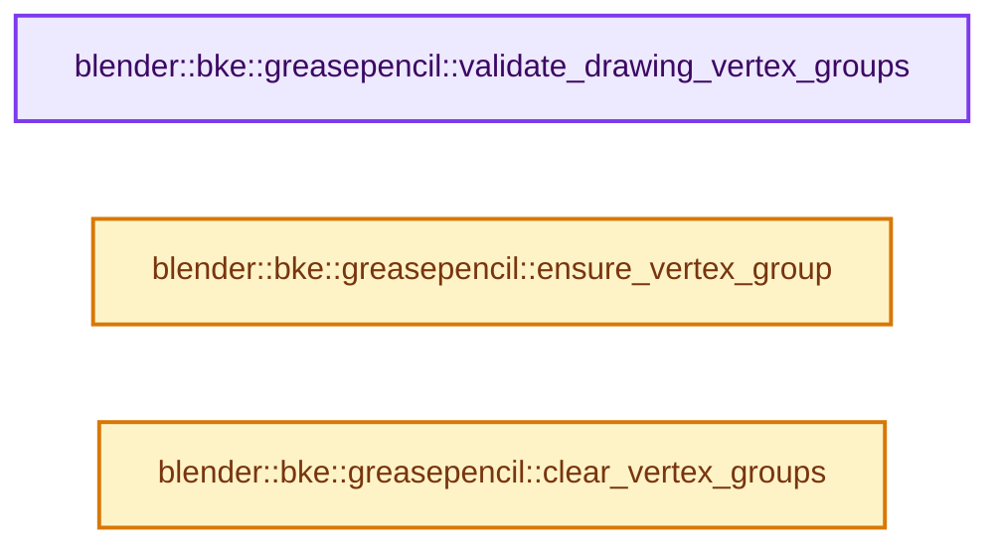
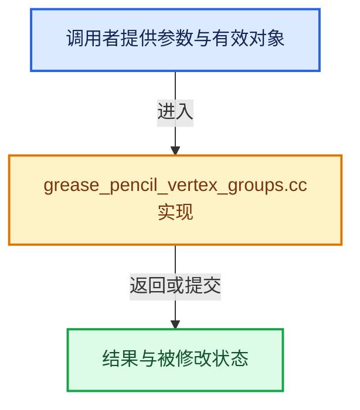

# 实现依赖专题：source/blender/blenkernel/intern/grease_pencil_vertex_groups.cc

[实现依赖导航](../../README.md) · [符号索引](../../../00-课程指南/02-源码与提交索引/符号依赖与实现索引.md)

本专题从正文实际调用进入，集中保存共享实现。函数有稳定锚点，可从调用处直接跳到对应完整函数；递归与互相调用通过回链组织。

## 本文件的实现关系






## 完整成员与函数实现

<a id="f-eacafd3f78cf4dfa"></a>

### `blender::bke::greasepencil::validate_drawing_vertex_groups`

实现位置：[source/blender/blenkernel/intern/grease_pencil_vertex_groups.cc](../../../../../../../source/blender/blenkernel/intern/grease_pencil_vertex_groups.cc) · L26—L52。

接口参数：

- `GreasePencil &grease_pencil`

**教学注释版**

<!-- annotated:3bceb463b601d9 -->

```cpp
void validate_drawing_vertex_groups(GreasePencil &grease_pencil)
{
  Set<std::string> valid_names;
  for (const bDeformGroup &defgroup : grease_pencil.vertex_group_names) {
    // [讲解] valid_names.add_new：按哈希与相等关系加入键或键值。
    valid_names.add_new(defgroup.name);
  }

  for (GreasePencilDrawingBase *base : grease_pencil.drawings()) {
    if (base->type != GP_DRAWING) {
      continue;
    }
    Drawing &drawing = reinterpret_cast<GreasePencilDrawing *>(base)->wrap();

    /* Remove unknown vertex groups. */
    CurvesGeometry &curves = drawing.strokes_for_write();
    int defgroup_index = 0;
    for (bDeformGroup &defgroup : curves.vertex_group_names.items_mutable()) {
      // [讲解] valid_names.contains：查询活项数量或键是否存在。
      if (!valid_names.contains(defgroup.name)) {
        remove_defgroup_index(curves.deform_verts_for_write(), defgroup_index);

        BLI_freelinkN(&curves.vertex_group_names, &defgroup);
      }

      ++defgroup_index;
    }
  }
}
```

<details>
<summary>核对原始源码：source/blender/blenkernel/intern/grease_pencil_vertex_groups.cc · L26—L52</summary>

<!-- original:3bceb463b601d9:source/blender/blenkernel/intern/grease_pencil_vertex_groups.cc:26:52 -->

```cpp
void validate_drawing_vertex_groups(GreasePencil &grease_pencil)
{
  Set<std::string> valid_names;
  for (const bDeformGroup &defgroup : grease_pencil.vertex_group_names) {
    valid_names.add_new(defgroup.name);
  }

  for (GreasePencilDrawingBase *base : grease_pencil.drawings()) {
    if (base->type != GP_DRAWING) {
      continue;
    }
    Drawing &drawing = reinterpret_cast<GreasePencilDrawing *>(base)->wrap();

    /* Remove unknown vertex groups. */
    CurvesGeometry &curves = drawing.strokes_for_write();
    int defgroup_index = 0;
    for (bDeformGroup &defgroup : curves.vertex_group_names.items_mutable()) {
      if (!valid_names.contains(defgroup.name)) {
        remove_defgroup_index(curves.deform_verts_for_write(), defgroup_index);

        BLI_freelinkN(&curves.vertex_group_names, &defgroup);
      }

      ++defgroup_index;
    }
  }
}
```

</details>

**继续追踪实现**

- `valid_names.add_new` → [blender::Set::add_new · L233](../../../02-哈希表与关联数据结构/08-Set与集合语义.md#f-12f4dd65a3abaaac)；[blender::Set::add_new · L237](../../../02-哈希表与关联数据结构/08-Set与集合语义.md#f-9c46c167cdd9bb73)。同名重载需按实参类型选择。
- `grease_pencil.drawings` → [blender::GreasePencil::drawings · L3338](grease_pencil.cc.md#f-4a9381efc430533a)；[blender::GreasePencil::drawings · L3343](grease_pencil.cc.md#f-75a528a69126428b)。同名重载需按实参类型选择。
- `reinterpret_cast<GreasePencilDrawing *>(base)->wrap` → [调用协议](../../../00-课程指南/01-路线与规范/模板宏与动态分派协议.md)：接收对象类型依赖auto、返回值或模板实例；不按同名猜测目标。调用位置L37。
- `drawing.strokes_for_write` → [blender::bke::greasepencil::Drawing::strokes_for_write · L1012](grease_pencil.cc.md#f-0649333785d0aa95)。
- `curves.vertex_group_names.items_mutable` → [调用协议](../../../00-课程指南/01-路线与规范/模板宏与动态分派协议.md)：接收对象类型依赖auto、返回值或模板实例；不按同名猜测目标。调用位置L42。
- `valid_names.contains` → [blender::Set::contains · L310](../../../02-哈希表与关联数据结构/08-Set与集合语义.md#f-af7099799494350e)。
- `remove_defgroup_index` → [blender::bke::remove_defgroup_index · L1758](deform.cc.md#f-42eb2479d5254ae6)。
- `curves.deform_verts_for_write` → [blender::bke::CurvesGeometry::deform_verts_for_write · L621](curves_geometry.cc.md#f-188eb89702a0a9e8)。
- `BLI_freelinkN` → [blender::BLI_freelinkN · L277](../../01-BLI基础库/intern/listbase.cc.md#f-c7719591852af7da)。

<a id="f-2d0283b48f7c4c8a"></a>

### `blender::bke::greasepencil::ensure_vertex_group`

实现位置：[source/blender/blenkernel/intern/grease_pencil_vertex_groups.cc](../../../../../../../source/blender/blenkernel/intern/grease_pencil_vertex_groups.cc) · L54—L65。

接口参数：

- `const StringRef name`
- `ListBaseT<bDeformGroup> &vertex_group_names`

**教学注释版**

<!-- annotated:518c638c8b9ed4 -->

```cpp
int ensure_vertex_group(const StringRef name, ListBaseT<bDeformGroup> &vertex_group_names)
{
  int def_nr = BKE_defgroup_name_index(&vertex_group_names, name);
  if (def_nr < 0) {
    bDeformGroup *defgroup = MEM_new<bDeformGroup>(__func__);
    name.copy_utf8_truncated(defgroup->name);
    BLI_addtail(&vertex_group_names, defgroup);
    def_nr = vertex_group_names.count() - 1;
    BLI_assert(def_nr >= 0);
  }
  return def_nr;
}
```

<details>
<summary>核对原始源码：source/blender/blenkernel/intern/grease_pencil_vertex_groups.cc · L54—L65</summary>

<!-- original:518c638c8b9ed4:source/blender/blenkernel/intern/grease_pencil_vertex_groups.cc:54:65 -->

```cpp
int ensure_vertex_group(const StringRef name, ListBaseT<bDeformGroup> &vertex_group_names)
{
  int def_nr = BKE_defgroup_name_index(&vertex_group_names, name);
  if (def_nr < 0) {
    bDeformGroup *defgroup = MEM_new<bDeformGroup>(__func__);
    name.copy_utf8_truncated(defgroup->name);
    BLI_addtail(&vertex_group_names, defgroup);
    def_nr = vertex_group_names.count() - 1;
    BLI_assert(def_nr >= 0);
  }
  return def_nr;
}
```

</details>

**沿实际写入检查状态**

- `def_nr = vertex_group_names.count() - 1;`

**结果出口**

- `return def_nr;`

**继续追踪实现**

- `BKE_defgroup_name_index` → [blender::BKE_defgroup_name_index · L544](deform.cc.md#f-41ba0c2309b689c8)。
- `MEM_new<bDeformGroup>` → [MEM_new · L351](../../07-Intern运行时与平台/guardedalloc/MEM_guardedalloc.h.md#f-115f9b6784f89912)。
- `name.copy_utf8_truncated` → [blender::StringRefBase::copy_utf8_truncated · L28](../../01-BLI基础库/intern/string_ref.cc.md#f-5d01486bac37768d)；[blender::StringRefBase::copy_utf8_truncated · L256](../../../01-基础容器与现代CPP/15-StringRef字符串视图.md#f-b2a0157cbe286321)。同名重载需按实参类型选择。
- `BLI_addtail` → [blender::BLI_addtail · L118](../../01-BLI基础库/intern/listbase.cc.md#f-4fb027713fa3115b)。
- `vertex_group_names.count` → [blender::ListBaseT::count · L92](../../08-其他Blender模块/makesdna/DNA_listBase.h.md#f-7d243d006ac4c693)。
- `BLI_assert` → [BLI_assert · L48](../../01-BLI基础库/BLI_assert.hh.md#m-57a88495704d)；[BLI_assert · L63](../../01-BLI基础库/BLI_assert.hh.md#m-d07050020cb5)。宏定义由构建条件选择。

<a id="f-630a526cbb7f2773"></a>

### `blender::bke::greasepencil::clear_vertex_groups`

实现位置：[source/blender/blenkernel/intern/grease_pencil_vertex_groups.cc](../../../../../../../source/blender/blenkernel/intern/grease_pencil_vertex_groups.cc) · L158—L171。

接口参数：

- `GreasePencil &grease_pencil`

**教学注释版**

<!-- annotated:b4eee82e60c8bb -->

```cpp
void clear_vertex_groups(GreasePencil &grease_pencil)
{
  for (GreasePencilDrawingBase *base : grease_pencil.drawings()) {
    if (base->type != GP_DRAWING) {
      continue;
    }
    Drawing &drawing = reinterpret_cast<GreasePencilDrawing *>(base)->wrap();
    bke::CurvesGeometry &curves = drawing.strokes_for_write();

    for (MDeformVert &dvert : curves.deform_verts_for_write()) {
      BKE_defvert_clear(&dvert);
    }
  }
}
```

<details>
<summary>核对原始源码：source/blender/blenkernel/intern/grease_pencil_vertex_groups.cc · L158—L171</summary>

<!-- original:b4eee82e60c8bb:source/blender/blenkernel/intern/grease_pencil_vertex_groups.cc:158:171 -->

```cpp
void clear_vertex_groups(GreasePencil &grease_pencil)
{
  for (GreasePencilDrawingBase *base : grease_pencil.drawings()) {
    if (base->type != GP_DRAWING) {
      continue;
    }
    Drawing &drawing = reinterpret_cast<GreasePencilDrawing *>(base)->wrap();
    bke::CurvesGeometry &curves = drawing.strokes_for_write();

    for (MDeformVert &dvert : curves.deform_verts_for_write()) {
      BKE_defvert_clear(&dvert);
    }
  }
}
```

</details>

**继续追踪实现**

- `grease_pencil.drawings` → [blender::GreasePencil::drawings · L3338](grease_pencil.cc.md#f-4a9381efc430533a)；[blender::GreasePencil::drawings · L3343](grease_pencil.cc.md#f-75a528a69126428b)。同名重载需按实参类型选择。
- `reinterpret_cast<GreasePencilDrawing *>(base)->wrap` → [调用协议](../../../00-课程指南/01-路线与规范/模板宏与动态分派协议.md)：接收对象类型依赖auto、返回值或模板实例；不按同名猜测目标。调用位置L164。
- `drawing.strokes_for_write` → [blender::bke::greasepencil::Drawing::strokes_for_write · L1012](grease_pencil.cc.md#f-0649333785d0aa95)。
- `curves.deform_verts_for_write` → [blender::bke::CurvesGeometry::deform_verts_for_write · L621](curves_geometry.cc.md#f-188eb89702a0a9e8)。
- `BKE_defvert_clear` → [blender::BKE_defvert_clear · L918](deform.cc.md#f-b838f638844bd559)。
