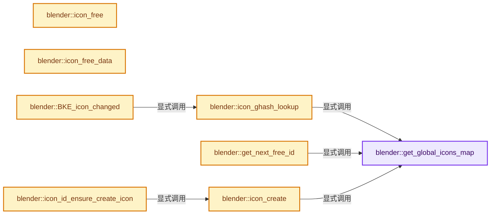
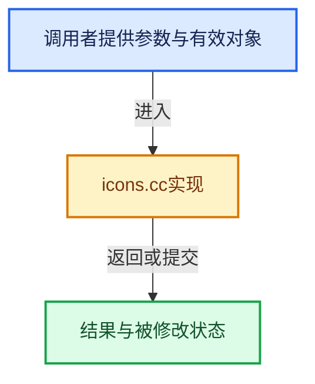

# 实现依赖专题：source/blender/blenkernel/intern/icons.cc

[实现依赖导航](../../README.md) · [符号索引](../../../00-课程指南/02-源码与提交索引/符号依赖与实现索引.md)

本专题从正文实际调用进入，集中保存共享实现。函数有稳定锚点，可从调用处直接跳到对应完整函数；递归与互相调用通过回链组织。

## 本文件的实现关系






## 完整成员与函数实现

<a id="f-05b624b42ac27b91"></a>

### `blender::get_global_icons_map`

实现位置：[source/blender/blenkernel/intern/icons.cc](../../../../../../../source/blender/blenkernel/intern/icons.cc) · L54—L58。

**教学注释版**

<!-- annotated:7fb40bfb1822c6 -->

```cpp
static GlobalIconsMap &get_global_icons_map()
{
  static GlobalIconsMap gIcons;
  return gIcons;
}
```

<details>
<summary>核对原始源码：source/blender/blenkernel/intern/icons.cc · L54—L58</summary>

<!-- original:7fb40bfb1822c6:source/blender/blenkernel/intern/icons.cc:54:58 -->

```cpp
static GlobalIconsMap &get_global_icons_map()
{
  static GlobalIconsMap gIcons;
  return gIcons;
}
```

</details>

**结果出口**

- `return gIcons;`

**继续追踪实现**

本实现没有需要继续展开的显式调用；检查返回表达式、对象转换和调用者前置条件。

<a id="f-612453d5a7eabf0f"></a>

### `blender::icon_free`

实现位置：[source/blender/blenkernel/intern/icons.cc](../../../../../../../source/blender/blenkernel/intern/icons.cc) · L76—L103。

接口参数：

- `void *val`

**教学注释版**

<!-- annotated:54ca0f6bfff7da -->

```cpp
static void icon_free(void *val)
{
  Icon *icon = static_cast<Icon *>(val);
  if (!icon) {
    return;
  }

  if (icon->obj_type == ICON_DATA_GEOM) {
    Icon_Geom *obj = static_cast<Icon_Geom *>(icon->obj);
    if (obj->mem) {
      /* coords & colors are part of this memory. */
      MEM_delete(obj->mem);
    }
    else {
      MEM_delete(obj->coords);
      MEM_delete(obj->colors);
    }
    MEM_delete(obj);
  }

  if (icon->drawinfo_free) {
    icon->drawinfo_free(icon->drawinfo);
  }
  else if (icon->drawinfo) {
    // [讲解] MEM_delete_void：以原始存储释放约定调用当前后端。
    MEM_delete_void(icon->drawinfo);
  }
  MEM_delete(icon);
}
```

<details>
<summary>核对原始源码：source/blender/blenkernel/intern/icons.cc · L76—L103</summary>

<!-- original:54ca0f6bfff7da:source/blender/blenkernel/intern/icons.cc:76:103 -->

```cpp
static void icon_free(void *val)
{
  Icon *icon = static_cast<Icon *>(val);
  if (!icon) {
    return;
  }

  if (icon->obj_type == ICON_DATA_GEOM) {
    Icon_Geom *obj = static_cast<Icon_Geom *>(icon->obj);
    if (obj->mem) {
      /* coords & colors are part of this memory. */
      MEM_delete(obj->mem);
    }
    else {
      MEM_delete(obj->coords);
      MEM_delete(obj->colors);
    }
    MEM_delete(obj);
  }

  if (icon->drawinfo_free) {
    icon->drawinfo_free(icon->drawinfo);
  }
  else if (icon->drawinfo) {
    MEM_delete_void(icon->drawinfo);
  }
  MEM_delete(icon);
}
```

</details>

**继续追踪实现**

- `MEM_delete` → [MEM_delete · L400](../../07-Intern运行时与平台/guardedalloc/MEM_guardedalloc.h.md#f-9049ffdd1682887c)。
- `icon->drawinfo_free` → [调用协议](../../../00-课程指南/01-路线与规范/模板宏与动态分派协议.md)：由接收对象具体类型或运行时策略提供实现。调用位置L97。
- `MEM_delete_void` → [MEM_delete_void · L647](../../07-Intern运行时与平台/guardedalloc/MEM_guardedalloc.h.md#f-642896c7c62ff8b9)；[MEM_delete_void · L109](../../07-Intern运行时与平台/guardedalloc/intern/mallocn.cc.md#f-9a07b26421f2bee6)。同名重载需按实参类型选择。

<a id="f-b4d742989754ec53"></a>

### `blender::icon_free_data`

实现位置：[source/blender/blenkernel/intern/icons.cc](../../../../../../../source/blender/blenkernel/intern/icons.cc) · L105—L137。

接口参数：

- `int icon_id`
- `Icon *icon`

**教学注释版**

<!-- annotated:246079bfc93965 -->

```cpp
static void icon_free_data(int icon_id, Icon *icon)
{
  switch (icon->obj_type) {
    case ICON_DATA_ID:
      (static_cast<ID *>(icon->obj))->icon_id = 0;
      break;
    case ICON_DATA_IMBUF: {
      ImBuf *imbuf = static_cast<ImBuf *>(icon->obj);
      if (imbuf) {
        IMB_freeImBuf(imbuf);
      }
      break;
    }
    case ICON_DATA_PREVIEW:
      (static_cast<PreviewImage *>(icon->obj))->runtime->icon_id = 0;
      break;
    case ICON_DATA_GPLAYER:
      (static_cast<bGPDlayer *>(icon->obj))->runtime.icon_id = 0;
      break;
    case ICON_DATA_GEOM:
      (static_cast<Icon_Geom *>(icon->obj))->icon_id = 0;
      break;
    case ICON_DATA_STUDIOLIGHT: {
      StudioLight *sl = static_cast<StudioLight *>(icon->obj);
      if (sl != nullptr) {
        BKE_studiolight_unset_icon_id(sl, icon_id);
      }
      break;
    }
    default:
      BLI_assert_unreachable();
  }
}
```

<details>
<summary>核对原始源码：source/blender/blenkernel/intern/icons.cc · L105—L137</summary>

<!-- original:246079bfc93965:source/blender/blenkernel/intern/icons.cc:105:137 -->

```cpp
static void icon_free_data(int icon_id, Icon *icon)
{
  switch (icon->obj_type) {
    case ICON_DATA_ID:
      (static_cast<ID *>(icon->obj))->icon_id = 0;
      break;
    case ICON_DATA_IMBUF: {
      ImBuf *imbuf = static_cast<ImBuf *>(icon->obj);
      if (imbuf) {
        IMB_freeImBuf(imbuf);
      }
      break;
    }
    case ICON_DATA_PREVIEW:
      (static_cast<PreviewImage *>(icon->obj))->runtime->icon_id = 0;
      break;
    case ICON_DATA_GPLAYER:
      (static_cast<bGPDlayer *>(icon->obj))->runtime.icon_id = 0;
      break;
    case ICON_DATA_GEOM:
      (static_cast<Icon_Geom *>(icon->obj))->icon_id = 0;
      break;
    case ICON_DATA_STUDIOLIGHT: {
      StudioLight *sl = static_cast<StudioLight *>(icon->obj);
      if (sl != nullptr) {
        BKE_studiolight_unset_icon_id(sl, icon_id);
      }
      break;
    }
    default:
      BLI_assert_unreachable();
  }
}
```

</details>

**继续追踪实现**

- `IMB_freeImBuf` → [blender::IMB_freeImBuf · L144](../../08-其他Blender模块/imbuf/intern/allocimbuf.cc.md#f-c830f56ede6f345b)。
- `BKE_studiolight_unset_icon_id` → [BKE_studiolight_unset_icon_id · L1014](studiolight.cc.md#f-1ff7aab040702102)。
- `BLI_assert_unreachable` → [BLI_assert_unreachable · L77](../../01-BLI基础库/BLI_assert.hh.md#m-7a2d91a67d8e)。宏定义由构建条件选择。

<a id="f-937e1662ecc6844c"></a>

### `blender::icon_ghash_lookup`

实现位置：[source/blender/blenkernel/intern/icons.cc](../../../../../../../source/blender/blenkernel/intern/icons.cc) · L139—L144。

接口参数：

- `int icon_id`

**教学注释版**

<!-- annotated:8a8d85d9a02f0d -->

```cpp
static Icon *icon_ghash_lookup(int icon_id)
{
  std::scoped_lock lock(gIconMutex);
  const GlobalIconsMap &gIcons = get_global_icons_map();
  // [讲解] gIcons.lookup_default：按键查找对应项。
  return gIcons.lookup_default(icon_id, nullptr);
}
```

<details>
<summary>核对原始源码：source/blender/blenkernel/intern/icons.cc · L139—L144</summary>

<!-- original:8a8d85d9a02f0d:source/blender/blenkernel/intern/icons.cc:139:144 -->

```cpp
static Icon *icon_ghash_lookup(int icon_id)
{
  std::scoped_lock lock(gIconMutex);
  const GlobalIconsMap &gIcons = get_global_icons_map();
  return gIcons.lookup_default(icon_id, nullptr);
}
```

</details>

**结果出口**

- `return gIcons.lookup_default(icon_id, nullptr);`

**继续追踪实现**

- `get_global_icons_map` → [blender::get_global_icons_map · L54](icons.cc.md#f-05b624b42ac27b91)。
- `gIcons.lookup_default` → [blender::Map::lookup_default · L570](../../../02-哈希表与关联数据结构/05-Map插入与回调.md#f-40294aaf345f6a8b)。

<a id="f-5690fcce2c9a3bbe"></a>

### `blender::get_next_free_id`

实现位置：[source/blender/blenkernel/intern/icons.cc](../../../../../../../source/blender/blenkernel/intern/icons.cc) · L148—L173。

**教学注释版**

<!-- annotated:b849f66338a821 -->

```cpp
static int get_next_free_id()
{
  std::scoped_lock lock(gIconMutex);
  const GlobalIconsMap &gIcons = get_global_icons_map();
  int startId = gFirstIconId;

  /* if we haven't used up the int number range, we just return the next int */
  if (gNextIconId >= gFirstIconId) {
    int next_id = gNextIconId++;
    return next_id;
  }

  /* Now we try to find the smallest icon id not stored in the gIcons hash.
   * Don't use icon_ghash_lookup here, it would lock recursively (dead-lock). */
  while (gIcons.contains(startId) && startId >= gFirstIconId) {
    startId++;
  }

  /* if we found a suitable one that isn't used yet, return it */
  if (startId >= gFirstIconId) {
    return startId;
  }

  /* fail */
  return 0;
}
```

<details>
<summary>核对原始源码：source/blender/blenkernel/intern/icons.cc · L148—L173</summary>

<!-- original:b849f66338a821:source/blender/blenkernel/intern/icons.cc:148:173 -->

```cpp
static int get_next_free_id()
{
  std::scoped_lock lock(gIconMutex);
  const GlobalIconsMap &gIcons = get_global_icons_map();
  int startId = gFirstIconId;

  /* if we haven't used up the int number range, we just return the next int */
  if (gNextIconId >= gFirstIconId) {
    int next_id = gNextIconId++;
    return next_id;
  }

  /* Now we try to find the smallest icon id not stored in the gIcons hash.
   * Don't use icon_ghash_lookup here, it would lock recursively (dead-lock). */
  while (gIcons.contains(startId) && startId >= gFirstIconId) {
    startId++;
  }

  /* if we found a suitable one that isn't used yet, return it */
  if (startId >= gFirstIconId) {
    return startId;
  }

  /* fail */
  return 0;
}
```

</details>

**结果出口**

- `return next_id;`
- `return startId;`
- `return 0;`

**继续追踪实现**

- `get_global_icons_map` → [blender::get_global_icons_map · L54](icons.cc.md#f-05b624b42ac27b91)。
- `gIcons.contains` → [blender::bNodeTreeInterfacePanel::contains · L923](node_tree_interface.cc.md#f-ba8671d8881bed94)。

<a id="f-447dab6fcdd1a48f"></a>

### `blender::BKE_icon_changed`

实现位置：[source/blender/blenkernel/intern/icons.cc](../../../../../../../source/blender/blenkernel/intern/icons.cc) · L215—L244。

接口参数：

- `const int icon_id`

**教学注释版**

<!-- annotated:e1eb4bc64af9d7 -->

```cpp
void BKE_icon_changed(const int icon_id)
{
  Icon *icon = nullptr;

  if (!icon_id || G.background) {
    return;
  }

  icon = icon_ghash_lookup(icon_id);
  if (!icon) {
    return;
  }

  /* We *only* expect ID-tied icons here, not non-ID icon/preview! */
  BLI_assert(icon->id_type != 0);
  BLI_assert(icon->obj_type == ICON_DATA_ID);

  /* Do not enforce creation of previews for valid ID types using BKE_previewimg_id_ensure()
   * here, we only want to ensure *existing* preview images are properly tagged as
   * changed/invalid, that's all. */
  PreviewImage **p_prv = BKE_previewimg_id_get_p(static_cast<ID *>(icon->obj));

  /* If we have previews, they all are now invalid changed. */
  if (p_prv && *p_prv) {
    for (int i = 0; i < NUM_ICON_SIZES; i++) {
      (*p_prv)->flag[i] |= PRV_CHANGED;
      (*p_prv)->changed_timestamp[i]++;
    }
  }
}
```

<details>
<summary>核对原始源码：source/blender/blenkernel/intern/icons.cc · L215—L244</summary>

<!-- original:e1eb4bc64af9d7:source/blender/blenkernel/intern/icons.cc:215:244 -->

```cpp
void BKE_icon_changed(const int icon_id)
{
  Icon *icon = nullptr;

  if (!icon_id || G.background) {
    return;
  }

  icon = icon_ghash_lookup(icon_id);
  if (!icon) {
    return;
  }

  /* We *only* expect ID-tied icons here, not non-ID icon/preview! */
  BLI_assert(icon->id_type != 0);
  BLI_assert(icon->obj_type == ICON_DATA_ID);

  /* Do not enforce creation of previews for valid ID types using BKE_previewimg_id_ensure()
   * here, we only want to ensure *existing* preview images are properly tagged as
   * changed/invalid, that's all. */
  PreviewImage **p_prv = BKE_previewimg_id_get_p(static_cast<ID *>(icon->obj));

  /* If we have previews, they all are now invalid changed. */
  if (p_prv && *p_prv) {
    for (int i = 0; i < NUM_ICON_SIZES; i++) {
      (*p_prv)->flag[i] |= PRV_CHANGED;
      (*p_prv)->changed_timestamp[i]++;
    }
  }
}
```

</details>

**沿实际写入检查状态**

- `icon = icon_ghash_lookup(icon_id);`

**继续追踪实现**

- `icon_ghash_lookup` → [blender::icon_ghash_lookup · L139](icons.cc.md#f-937e1662ecc6844c)。
- `BLI_assert` → [BLI_assert · L48](../../01-BLI基础库/BLI_assert.hh.md#m-57a88495704d)；[BLI_assert · L63](../../01-BLI基础库/BLI_assert.hh.md#m-d07050020cb5)。宏定义由构建条件选择。
- `BKE_previewimg_id_get_p` → [blender::BKE_previewimg_id_get_p · L222](preview_image.cc.md#f-e580ec2793e2975e)。

<a id="f-8091f47aecd2718b"></a>

### `blender::icon_create`

实现位置：[source/blender/blenkernel/intern/icons.cc](../../../../../../../source/blender/blenkernel/intern/icons.cc) · L246—L266。

接口参数：

- `int icon_id`
- `int obj_type`
- `void *obj`

**教学注释版**

<!-- annotated:b2c4e5ebf7139d -->

```cpp
static Icon *icon_create(int icon_id, int obj_type, void *obj)
{
  Icon *new_icon = MEM_new_uninitialized<Icon>(__func__);

  new_icon->obj_type = obj_type;
  new_icon->obj = obj;
  new_icon->id_type = 0;
  new_icon->flag = 0;

  /* next two lines make sure image gets created */
  new_icon->drawinfo = nullptr;
  new_icon->drawinfo_free = nullptr;

  {
    std::scoped_lock lock(gIconMutex);
    GlobalIconsMap &gIcons = get_global_icons_map();
    gIcons.add(icon_id, new_icon);
  }

  return new_icon;
}
```

<details>
<summary>核对原始源码：source/blender/blenkernel/intern/icons.cc · L246—L266</summary>

<!-- original:b2c4e5ebf7139d:source/blender/blenkernel/intern/icons.cc:246:266 -->

```cpp
static Icon *icon_create(int icon_id, int obj_type, void *obj)
{
  Icon *new_icon = MEM_new_uninitialized<Icon>(__func__);

  new_icon->obj_type = obj_type;
  new_icon->obj = obj;
  new_icon->id_type = 0;
  new_icon->flag = 0;

  /* next two lines make sure image gets created */
  new_icon->drawinfo = nullptr;
  new_icon->drawinfo_free = nullptr;

  {
    std::scoped_lock lock(gIconMutex);
    GlobalIconsMap &gIcons = get_global_icons_map();
    gIcons.add(icon_id, new_icon);
  }

  return new_icon;
}
```

</details>

**沿实际写入检查状态**

- `new_icon->obj_type = obj_type;`
- `new_icon->obj = obj;`
- `new_icon->id_type = 0;`
- `new_icon->flag = 0;`
- `new_icon->drawinfo = nullptr;`
- `new_icon->drawinfo_free = nullptr;`

**结果出口**

- `return new_icon;`

**继续追踪实现**

- `MEM_new_uninitialized<Icon>` → [MEM_new_uninitialized · L590](../../07-Intern运行时与平台/guardedalloc/MEM_guardedalloc.h.md#f-c773b2e5b8fe70e4)；[MEM_new_uninitialized · L124](../../07-Intern运行时与平台/guardedalloc/intern/mallocn.cc.md#f-28a7e00a1e67f699)。同名重载需按实参类型选择。
- `get_global_icons_map` → [blender::get_global_icons_map · L54](icons.cc.md#f-05b624b42ac27b91)。
- `gIcons.add` → [blender::ResourceScope::add · L158](../../../03-内存分配与运行时类型/05-ResourceScope销毁责任.md#f-ea50aaeb75a3ae88)；[blender::ResourceScope::add · L171](../../../03-内存分配与运行时类型/05-ResourceScope销毁责任.md#f-69a0755cd9372e60)；[blender::ResourceScope::add · L181](../../../03-内存分配与运行时类型/05-ResourceScope销毁责任.md#f-af785bf57d715c47)；[blender::ResourceScope::add · L199](../../../03-内存分配与运行时类型/05-ResourceScope销毁责任.md#f-bd09b45cee23317d)；[blender::add · L222](../../08-其他Blender模块/blentranslation/msgfmt/msgfmt.cc.md#f-7292fc7e06488a67)。同名重载需按实参类型选择。

<a id="f-10bb20eaebb57de9"></a>

### `blender::icon_id_ensure_create_icon`

实现位置：[source/blender/blenkernel/intern/icons.cc](../../../../../../../source/blender/blenkernel/intern/icons.cc) · L268—L277。

接口参数：

- `ID *id`

**教学注释版**

<!-- annotated:abf035b68a42b7 -->

```cpp
static int icon_id_ensure_create_icon(ID *id)
{
  BLI_assert(BLI_thread_is_main());

  Icon *icon = icon_create(id->icon_id, ICON_DATA_ID, id);
  icon->id_type = GS(id->name);
  icon->flag = ICON_FLAG_MANAGED;

  return id->icon_id;
}
```

<details>
<summary>核对原始源码：source/blender/blenkernel/intern/icons.cc · L268—L277</summary>

<!-- original:abf035b68a42b7:source/blender/blenkernel/intern/icons.cc:268:277 -->

```cpp
static int icon_id_ensure_create_icon(ID *id)
{
  BLI_assert(BLI_thread_is_main());

  Icon *icon = icon_create(id->icon_id, ICON_DATA_ID, id);
  icon->id_type = GS(id->name);
  icon->flag = ICON_FLAG_MANAGED;

  return id->icon_id;
}
```

</details>

**沿实际写入检查状态**

- `icon->id_type = GS(id->name);`
- `icon->flag = ICON_FLAG_MANAGED;`

**结果出口**

- `return id->icon_id;`

**继续追踪实现**

- `BLI_assert` → [BLI_assert · L48](../../01-BLI基础库/BLI_assert.hh.md#m-57a88495704d)；[BLI_assert · L63](../../01-BLI基础库/BLI_assert.hh.md#m-d07050020cb5)。宏定义由构建条件选择。
- `BLI_thread_is_main` → [BLI_thread_is_main · L184](../../01-BLI基础库/intern/threads.cc.md#f-da304af4327defdc)。
- `icon_create` → [blender::icon_create · L246](icons.cc.md#f-8091f47aecd2718b)。
- `GS` → [blender::GS · L410](../../08-其他Blender模块/makesdna/DNA_ID.h.md#f-c3ff509f79f21b05)。

<a id="f-9ba71d667742343a"></a>

### `blender::BKE_icon_id_ensure`

实现位置：[source/blender/blenkernel/intern/icons.cc](../../../../../../../source/blender/blenkernel/intern/icons.cc) · L279—L307。

接口参数：

- `ID *id`

**教学注释版**

<!-- annotated:4eeacd56739f9f -->

```cpp
int BKE_icon_id_ensure(ID *id)
{
  /* Never handle icons in non-main thread! */
  BLI_assert(BLI_thread_is_main());

  if (!id || G.background) {
    return 0;
  }

  if (id->icon_id) {
    return id->icon_id;
  }

  id->icon_id = get_next_free_id();

  if (!id->icon_id) {
    CLOG_ERROR(&LOG, "not enough IDs");
    return 0;
  }

  /* Ensure we synchronize ID icon_id with its previewimage if it has one. */
  PreviewImage **p_prv = BKE_previewimg_id_get_p(id);
  if (p_prv && *p_prv) {
    BLI_assert(ELEM((*p_prv)->runtime->icon_id, 0, id->icon_id));
    (*p_prv)->runtime->icon_id = id->icon_id;
  }

  return icon_id_ensure_create_icon(id);
}
```

<details>
<summary>核对原始源码：source/blender/blenkernel/intern/icons.cc · L279—L307</summary>

<!-- original:4eeacd56739f9f:source/blender/blenkernel/intern/icons.cc:279:307 -->

```cpp
int BKE_icon_id_ensure(ID *id)
{
  /* Never handle icons in non-main thread! */
  BLI_assert(BLI_thread_is_main());

  if (!id || G.background) {
    return 0;
  }

  if (id->icon_id) {
    return id->icon_id;
  }

  id->icon_id = get_next_free_id();

  if (!id->icon_id) {
    CLOG_ERROR(&LOG, "not enough IDs");
    return 0;
  }

  /* Ensure we synchronize ID icon_id with its previewimage if it has one. */
  PreviewImage **p_prv = BKE_previewimg_id_get_p(id);
  if (p_prv && *p_prv) {
    BLI_assert(ELEM((*p_prv)->runtime->icon_id, 0, id->icon_id));
    (*p_prv)->runtime->icon_id = id->icon_id;
  }

  return icon_id_ensure_create_icon(id);
}
```

</details>

**沿实际写入检查状态**

- `id->icon_id = get_next_free_id();`

**结果出口**

- `return 0;`
- `return id->icon_id;`
- `return icon_id_ensure_create_icon(id);`

**继续追踪实现**

- `BLI_assert` → [BLI_assert · L48](../../01-BLI基础库/BLI_assert.hh.md#m-57a88495704d)；[BLI_assert · L63](../../01-BLI基础库/BLI_assert.hh.md#m-d07050020cb5)。宏定义由构建条件选择。
- `BLI_thread_is_main` → [BLI_thread_is_main · L184](../../01-BLI基础库/intern/threads.cc.md#f-da304af4327defdc)。
- `get_next_free_id` → [blender::get_next_free_id · L148](icons.cc.md#f-5690fcce2c9a3bbe)。
- `CLOG_ERROR` → [CLOG_ERROR · L188](../../07-Intern运行时与平台/clog/CLG_log.h.md#m-081575cdc8d0)。宏定义由构建条件选择。
- `BKE_previewimg_id_get_p` → [blender::BKE_previewimg_id_get_p · L222](preview_image.cc.md#f-e580ec2793e2975e)。
- `ELEM` → [ELEM · L88](../../07-Intern运行时与平台/ghost/intern/GHOST_utildefines.hh.md#m-d28724a15928)；[ELEM · L135](../../01-BLI基础库/BLI_utildefines.hh.md#m-d6572de7cae0)。宏定义由构建条件选择。
- `icon_id_ensure_create_icon` → [blender::icon_id_ensure_create_icon · L268](icons.cc.md#f-10bb20eaebb57de9)。

<a id="f-1f065dc71aafb016"></a>

### `blender::BKE_icon_imbuf_create`

实现位置：[source/blender/blenkernel/intern/icons.cc](../../../../../../../source/blender/blenkernel/intern/icons.cc) · L387—L395。

接口参数：

- `ImBuf *ibuf`

**教学注释版**

<!-- annotated:803ce7ac06cdc1 -->

```cpp
int BKE_icon_imbuf_create(ImBuf *ibuf)
{
  int icon_id = get_next_free_id();

  Icon *icon = icon_create(icon_id, ICON_DATA_IMBUF, ibuf);
  icon->flag = ICON_FLAG_MANAGED;

  return icon_id;
}
```

<details>
<summary>核对原始源码：source/blender/blenkernel/intern/icons.cc · L387—L395</summary>

<!-- original:803ce7ac06cdc1:source/blender/blenkernel/intern/icons.cc:387:395 -->

```cpp
int BKE_icon_imbuf_create(ImBuf *ibuf)
{
  int icon_id = get_next_free_id();

  Icon *icon = icon_create(icon_id, ICON_DATA_IMBUF, ibuf);
  icon->flag = ICON_FLAG_MANAGED;

  return icon_id;
}
```

</details>

**沿实际写入检查状态**

- `icon->flag = ICON_FLAG_MANAGED;`

**结果出口**

- `return icon_id;`

**继续追踪实现**

- `get_next_free_id` → [blender::get_next_free_id · L148](icons.cc.md#f-5690fcce2c9a3bbe)。
- `icon_create` → [blender::icon_create · L246](icons.cc.md#f-8091f47aecd2718b)。

<a id="f-ee3d759f1924e7c9"></a>

### `blender::BKE_icon_get`

实现位置：[source/blender/blenkernel/intern/icons.cc](../../../../../../../source/blender/blenkernel/intern/icons.cc) · L491—L505。

接口参数：

- `const int icon_id`

**教学注释版**

<!-- annotated:1b5c828f8cbf81 -->

```cpp
Icon *BKE_icon_get(const int icon_id)
{
  BLI_assert(BLI_thread_is_main());

  Icon *icon = nullptr;

  icon = icon_ghash_lookup(icon_id);

  if (!icon) {
    CLOG_ERROR(&LOG, "no icon for icon ID: %d", icon_id);
    return nullptr;
  }

  return icon;
}
```

<details>
<summary>核对原始源码：source/blender/blenkernel/intern/icons.cc · L491—L505</summary>

<!-- original:1b5c828f8cbf81:source/blender/blenkernel/intern/icons.cc:491:505 -->

```cpp
Icon *BKE_icon_get(const int icon_id)
{
  BLI_assert(BLI_thread_is_main());

  Icon *icon = nullptr;

  icon = icon_ghash_lookup(icon_id);

  if (!icon) {
    CLOG_ERROR(&LOG, "no icon for icon ID: %d", icon_id);
    return nullptr;
  }

  return icon;
}
```

</details>

**沿实际写入检查状态**

- `icon = icon_ghash_lookup(icon_id);`

**结果出口**

- `return nullptr;`
- `return icon;`

**继续追踪实现**

- `BLI_assert` → [BLI_assert · L48](../../01-BLI基础库/BLI_assert.hh.md#m-57a88495704d)；[BLI_assert · L63](../../01-BLI基础库/BLI_assert.hh.md#m-d07050020cb5)。宏定义由构建条件选择。
- `BLI_thread_is_main` → [BLI_thread_is_main · L184](../../01-BLI基础库/intern/threads.cc.md#f-da304af4327defdc)。
- `icon_ghash_lookup` → [blender::icon_ghash_lookup · L139](icons.cc.md#f-937e1662ecc6844c)。
- `CLOG_ERROR` → [CLOG_ERROR · L188](../../07-Intern运行时与平台/clog/CLG_log.h.md#m-081575cdc8d0)。宏定义由构建条件选择。

<a id="f-d7e7f833e5762709"></a>

### `blender::BKE_icon_delete`

实现位置：[source/blender/blenkernel/intern/icons.cc](../../../../../../../source/blender/blenkernel/intern/icons.cc) · L545—L561。

接口参数：

- `const int icon_id`

**教学注释版**

<!-- annotated:dcd5198f756142 -->

```cpp
bool BKE_icon_delete(const int icon_id)
{
  if (icon_id == 0) {
    /* no icon defined for library object */
    return false;
  }

  std::scoped_lock lock(gIconMutex);
  GlobalIconsMap &gIcons = get_global_icons_map();
  if (Icon *icon = gIcons.pop_default(icon_id, nullptr)) {
    icon_free_data(icon_id, icon);
    icon_free(icon);
    return true;
  }

  return false;
}
```

<details>
<summary>核对原始源码：source/blender/blenkernel/intern/icons.cc · L545—L561</summary>

<!-- original:dcd5198f756142:source/blender/blenkernel/intern/icons.cc:545:561 -->

```cpp
bool BKE_icon_delete(const int icon_id)
{
  if (icon_id == 0) {
    /* no icon defined for library object */
    return false;
  }

  std::scoped_lock lock(gIconMutex);
  GlobalIconsMap &gIcons = get_global_icons_map();
  if (Icon *icon = gIcons.pop_default(icon_id, nullptr)) {
    icon_free_data(icon_id, icon);
    icon_free(icon);
    return true;
  }

  return false;
}
```

</details>

**结果出口**

- `return false;`
- `return true;`

**继续追踪实现**

- `get_global_icons_map` → [blender::get_global_icons_map · L54](icons.cc.md#f-05b624b42ac27b91)。
- `gIcons.pop_default` → [blender::Map::pop_default · L439](../../../02-哈希表与关联数据结构/04-Map查找与键访问.md#f-9dd656831c024785)；[blender::Map::pop_default · L443](../../../02-哈希表与关联数据结构/04-Map查找与键访问.md#f-f0e4b7971e882c92)。同名重载需按实参类型选择。
- `icon_free_data` → [blender::icon_free_data · L105](icons.cc.md#f-b4d742989754ec53)。
- `icon_free` → [blender::icon_free · L76](icons.cc.md#f-612453d5a7eabf0f)。
