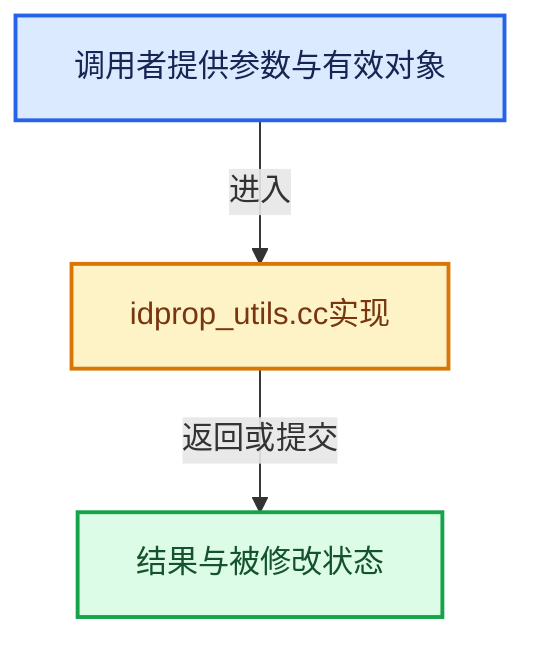

# 实现依赖专题：source/blender/blenkernel/intern/idprop_utils.cc

[实现依赖导航](../../README.md) · [符号索引](../../../00-课程指南/02-源码与提交索引/符号依赖与实现索引.md)

本专题从正文实际调用进入，集中保存共享实现。函数有稳定锚点，可从调用处直接跳到对应完整函数；递归与互相调用通过回链组织。

## 本文件的实现关系

```mermaid
flowchart LR
  F0["blender::idp_repr_fn_recursive"]:::abstraction
  F1["blender::IDP_repr_fn"]:::compute
  F2["blender::IDP_reprN"]:::compute
  F3["blender::IDP_print"]:::compute
  F0 -->|"显式调用"| F0
  F1 -->|"显式调用"| F0
  F2 -->|"显式调用"| F1
  F3 -->|"显式调用"| F2
  classDef input fill:#DBEAFE,stroke:#2563EB,color:#172554,stroke-width:2px;
  classDef data fill:#CFFAFE,stroke:#0891B2,color:#164E63,stroke-width:2px;
  classDef abstraction fill:#EDE9FE,stroke:#7C3AED,color:#3B0764,stroke-width:2px;
  classDef compute fill:#FEF3C7,stroke:#D97706,color:#78350F,stroke-width:2px;
  classDef result fill:#DCFCE7,stroke:#16A34A,color:#14532D,stroke-width:2px;
  classDef error fill:#FEE2E2,stroke:#DC2626,color:#7F1D1D,stroke-width:2px;
```






## 完整成员与函数实现

<a id="f-c42c4c6a72aea720"></a>

### `blender::idp_repr_fn_recursive`

实现位置：[source/blender/blenkernel/intern/idprop_utils.cc](../../../../../../../source/blender/blenkernel/intern/idprop_utils.cc) · L87—L232。

接口参数：

- `ReprState *state`
- `const IDProperty *prop`

**教学注释版**

<!-- annotated:6866a4ecd117d1 -->

```cpp
static void idp_repr_fn_recursive(ReprState *state, const IDProperty *prop)
{
/* NOTE: 'strlen' will be calculated at compile time for literals. */
#define STR_APPEND_STR(str) state->str_append_fn(state->user_data, str, uint(strlen(str)))

#define STR_APPEND_STR_QUOTE(str) idp_str_append_escape(state, str, uint(strlen(str)), true)
#define STR_APPEND_STR_LEN_QUOTE(str, str_len) idp_str_append_escape(state, str, str_len, true)

#define STR_APPEND_FMT(format, ...) \
  state->str_append_fn( \
      state->user_data, state->buf, uint(SNPRINTF_RLEN(state->buf, format, __VA_ARGS__)))

  switch (prop->type) {
    case IDP_STRING: {
      // [讲解] std::max：按比较关系选取较大值。本讲解中的增长公式同时满足最低请求和几何增长；若保存返回引用，还需注意实参寿命。
      STR_APPEND_STR_LEN_QUOTE(IDP_string_get(prop), uint(std::max(0, prop->len - 1)));
      break;
    }
    case IDP_INT: {
      if (const IDPropertyUIDataEnumItem *item = prop->ui_data ? IDP_EnumItemFind(prop) : nullptr)
      {
        STR_APPEND_STR_QUOTE(item->name);
      }
      else {
        STR_APPEND_FMT("%d", IDP_int_get(prop));
      }
      break;
    }
    case IDP_FLOAT: {
      STR_APPEND_FMT("%g", double(IDP_float_get(prop)));
      break;
    }
    case IDP_DOUBLE: {
      STR_APPEND_FMT("%g", IDP_double_get(prop));
      break;
    }
    case IDP_BOOLEAN: {
      STR_APPEND_FMT("%s", IDP_bool_get(prop) ? "True" : "False");
      break;
    }
    case IDP_ARRAY: {
      STR_APPEND_STR("[");
      switch (prop->subtype) {
        case IDP_INT:
          for (const int *v = static_cast<const int *>(prop->data.pointer), *v_end = v + prop->len;
               v != v_end;
               v++)
          {
            if (v != prop->data.pointer) {
              STR_APPEND_STR(", ");
            }
            STR_APPEND_FMT("%d", *v);
          }
          break;
        case IDP_FLOAT:
          for (const float *v = static_cast<const float *>(prop->data.pointer),
                           *v_end = v + prop->len;
               v != v_end;
               v++)
          {
            if (v != prop->data.pointer) {
              STR_APPEND_STR(", ");
            }
            STR_APPEND_FMT("%g", double(*v));
          }
          break;
        case IDP_DOUBLE:
          for (const double *v = static_cast<const double *>(prop->data.pointer),
                            *v_end = v + prop->len;
               v != v_end;
               v++)
          {
            if (v != prop->data.pointer) {
              STR_APPEND_STR(", ");
            }
            STR_APPEND_FMT("%g", *v);
          }
          break;
        case IDP_BOOLEAN:
          for (const double *v = static_cast<const double *>(prop->data.pointer),
                            *v_end = v + prop->len;
               v != v_end;
               v++)
          {
            if (v != prop->data.pointer) {
              STR_APPEND_STR(", ");
            }
            STR_APPEND_FMT("%s", IDP_bool_get(prop) ? "True" : "False");
          }
          break;
      }
      STR_APPEND_STR("]");
      break;
    }
    case IDP_IDPARRAY: {
      STR_APPEND_STR("[");
      for (const IDProperty *v = static_cast<const IDProperty *>(prop->data.pointer),
                            *v_end = v + prop->len;
           v != v_end;
           v++)
      {
        if (v != prop->data.pointer) {
          STR_APPEND_STR(", ");
        }
        idp_repr_fn_recursive(state, v);
      }
      STR_APPEND_STR("]");
      break;
    }
    case IDP_GROUP: {
      STR_APPEND_STR("{");
      for (const IDProperty &subprop : prop->data.group) {
        if (&subprop != prop->data.group.first()) {
          STR_APPEND_STR(", ");
        }
        STR_APPEND_STR_QUOTE(subprop.name);
        STR_APPEND_STR(": ");
        idp_repr_fn_recursive(state, &subprop);
      }
      STR_APPEND_STR("}");
      break;
    }
    case IDP_ID: {
      const ID *id = static_cast<const ID *>(prop->data.pointer);
      if (id != nullptr) {
        STR_APPEND_STR("bpy.data.");
        STR_APPEND_STR(BKE_idtype_idcode_to_name_plural(GS(id->name)));
        STR_APPEND_STR("[");
        STR_APPEND_STR_QUOTE(id->name + 2);
        STR_APPEND_STR("]");
      }
      else {
        STR_APPEND_STR("None");
      }
      break;
    }
    default: {
      BLI_assert_unreachable();
      break;
    }
  }

#undef STR_APPEND_STR
#undef STR_APPEND_STR_QUOTE
#undef STR_APPEND_STR_LEN_QUOTE
#undef STR_APPEND_FMT
}
```

<details>
<summary>核对原始源码：source/blender/blenkernel/intern/idprop_utils.cc · L87—L232</summary>

<!-- original:6866a4ecd117d1:source/blender/blenkernel/intern/idprop_utils.cc:87:232 -->

```cpp
static void idp_repr_fn_recursive(ReprState *state, const IDProperty *prop)
{
/* NOTE: 'strlen' will be calculated at compile time for literals. */
#define STR_APPEND_STR(str) state->str_append_fn(state->user_data, str, uint(strlen(str)))

#define STR_APPEND_STR_QUOTE(str) idp_str_append_escape(state, str, uint(strlen(str)), true)
#define STR_APPEND_STR_LEN_QUOTE(str, str_len) idp_str_append_escape(state, str, str_len, true)

#define STR_APPEND_FMT(format, ...) \
  state->str_append_fn( \
      state->user_data, state->buf, uint(SNPRINTF_RLEN(state->buf, format, __VA_ARGS__)))

  switch (prop->type) {
    case IDP_STRING: {
      STR_APPEND_STR_LEN_QUOTE(IDP_string_get(prop), uint(std::max(0, prop->len - 1)));
      break;
    }
    case IDP_INT: {
      if (const IDPropertyUIDataEnumItem *item = prop->ui_data ? IDP_EnumItemFind(prop) : nullptr)
      {
        STR_APPEND_STR_QUOTE(item->name);
      }
      else {
        STR_APPEND_FMT("%d", IDP_int_get(prop));
      }
      break;
    }
    case IDP_FLOAT: {
      STR_APPEND_FMT("%g", double(IDP_float_get(prop)));
      break;
    }
    case IDP_DOUBLE: {
      STR_APPEND_FMT("%g", IDP_double_get(prop));
      break;
    }
    case IDP_BOOLEAN: {
      STR_APPEND_FMT("%s", IDP_bool_get(prop) ? "True" : "False");
      break;
    }
    case IDP_ARRAY: {
      STR_APPEND_STR("[");
      switch (prop->subtype) {
        case IDP_INT:
          for (const int *v = static_cast<const int *>(prop->data.pointer), *v_end = v + prop->len;
               v != v_end;
               v++)
          {
            if (v != prop->data.pointer) {
              STR_APPEND_STR(", ");
            }
            STR_APPEND_FMT("%d", *v);
          }
          break;
        case IDP_FLOAT:
          for (const float *v = static_cast<const float *>(prop->data.pointer),
                           *v_end = v + prop->len;
               v != v_end;
               v++)
          {
            if (v != prop->data.pointer) {
              STR_APPEND_STR(", ");
            }
            STR_APPEND_FMT("%g", double(*v));
          }
          break;
        case IDP_DOUBLE:
          for (const double *v = static_cast<const double *>(prop->data.pointer),
                            *v_end = v + prop->len;
               v != v_end;
               v++)
          {
            if (v != prop->data.pointer) {
              STR_APPEND_STR(", ");
            }
            STR_APPEND_FMT("%g", *v);
          }
          break;
        case IDP_BOOLEAN:
          for (const double *v = static_cast<const double *>(prop->data.pointer),
                            *v_end = v + prop->len;
               v != v_end;
               v++)
          {
            if (v != prop->data.pointer) {
              STR_APPEND_STR(", ");
            }
            STR_APPEND_FMT("%s", IDP_bool_get(prop) ? "True" : "False");
          }
          break;
      }
      STR_APPEND_STR("]");
      break;
    }
    case IDP_IDPARRAY: {
      STR_APPEND_STR("[");
      for (const IDProperty *v = static_cast<const IDProperty *>(prop->data.pointer),
                            *v_end = v + prop->len;
           v != v_end;
           v++)
      {
        if (v != prop->data.pointer) {
          STR_APPEND_STR(", ");
        }
        idp_repr_fn_recursive(state, v);
      }
      STR_APPEND_STR("]");
      break;
    }
    case IDP_GROUP: {
      STR_APPEND_STR("{");
      for (const IDProperty &subprop : prop->data.group) {
        if (&subprop != prop->data.group.first()) {
          STR_APPEND_STR(", ");
        }
        STR_APPEND_STR_QUOTE(subprop.name);
        STR_APPEND_STR(": ");
        idp_repr_fn_recursive(state, &subprop);
      }
      STR_APPEND_STR("}");
      break;
    }
    case IDP_ID: {
      const ID *id = static_cast<const ID *>(prop->data.pointer);
      if (id != nullptr) {
        STR_APPEND_STR("bpy.data.");
        STR_APPEND_STR(BKE_idtype_idcode_to_name_plural(GS(id->name)));
        STR_APPEND_STR("[");
        STR_APPEND_STR_QUOTE(id->name + 2);
        STR_APPEND_STR("]");
      }
      else {
        STR_APPEND_STR("None");
      }
      break;
    }
    default: {
      BLI_assert_unreachable();
      break;
    }
  }

#undef STR_APPEND_STR
#undef STR_APPEND_STR_QUOTE
#undef STR_APPEND_STR_LEN_QUOTE
#undef STR_APPEND_FMT
}
```

</details>

**继续追踪实现**

- `STR_APPEND_STR_LEN_QUOTE` → [调用协议](../../../00-课程指南/01-路线与规范/模板宏与动态分派协议.md)：函数指针、局部可调用对象或未展开的宏；必须结合调用者环境。调用位置L101。
- `IDP_string_get` → [IDP_string_get · L375](../BKE_idprop.hh.md#m-bedef49dcb76)。宏定义由构建条件选择。
- `std::max` → [外部契约](https://eel.is/c++draft/alg.min.max)：按比较关系选取较大值。本讲解中的增长公式同时满足最低请求和几何增长；若保存返回引用，还需注意实参寿命。
- `IDP_EnumItemFind` → [blender::IDP_EnumItemFind · L543](idprop.cc.md#f-c11755fe169a4e7f)。
- `STR_APPEND_STR_QUOTE` → [调用协议](../../../00-课程指南/01-路线与规范/模板宏与动态分派协议.md)：函数指针、局部可调用对象或未展开的宏；必须结合调用者环境。调用位置L107。
- `STR_APPEND_FMT` → [调用协议](../../../00-课程指南/01-路线与规范/模板宏与动态分派协议.md)：函数指针、局部可调用对象或未展开的宏；必须结合调用者环境。调用位置L110。
- `IDP_int_get` → [IDP_int_get · L311](../BKE_idprop.hh.md#m-921e5bc3f26e)。宏定义由构建条件选择。
- `IDP_float_get` → [IDP_float_get · L339](../BKE_idprop.hh.md#m-cc419e289062)。宏定义由构建条件选择。
- `IDP_double_get` → [IDP_double_get · L348](../BKE_idprop.hh.md#m-f38831735afc)。宏定义由构建条件选择。
- `IDP_bool_get` → [IDP_bool_get · L320](../BKE_idprop.hh.md#m-27ca26d9570b)。宏定义由构建条件选择。
- `STR_APPEND_STR` → [调用协议](../../../00-课程指南/01-路线与规范/模板宏与动态分派协议.md)：函数指针、局部可调用对象或未展开的宏；必须结合调用者环境。调用位置L127。
- `idp_repr_fn_recursive` → [blender::idp_repr_fn_recursive · L87](idprop_utils.cc.md#f-c42c4c6a72aea720)。
- `prop->data.group.first` → [调用协议](../../../00-课程指南/01-路线与规范/模板宏与动态分派协议.md)：接收对象类型依赖auto、返回值或模板实例；不按同名猜测目标。调用位置L198。
- `BKE_idtype_idcode_to_name_plural` → [blender::BKE_idtype_idcode_to_name_plural · L268](idtype.cc.md#f-52880b295f558cdc)。
- `GS` → [blender::GS · L410](../../08-其他Blender模块/makesdna/DNA_ID.h.md#f-c3ff509f79f21b05)。
- `BLI_assert_unreachable` → [BLI_assert_unreachable · L77](../../01-BLI基础库/BLI_assert.hh.md#m-7a2d91a67d8e)。宏定义由构建条件选择。

<a id="f-b24e26551165db14"></a>

### `blender::IDP_repr_fn`

实现位置：[source/blender/blenkernel/intern/idprop_utils.cc](../../../../../../../source/blender/blenkernel/intern/idprop_utils.cc) · L234—L242。

接口参数：

- `const IDProperty *prop`
- `void (*str_append_fn)(void *user_data, const char *str, uint str_len)`
- `void *user_data`
- `const char *str`
- `uint str_len`
- `void *user_data`

**教学注释版**

<!-- annotated:d8bd5bcf1e5ad5 -->

```cpp
void IDP_repr_fn(const IDProperty *prop,
                 void (*str_append_fn)(void *user_data, const char *str, uint str_len),
                 void *user_data)
{
  ReprState state{};
  state.str_append_fn = str_append_fn;
  state.user_data = user_data;
  idp_repr_fn_recursive(&state, prop);
}
```

<details>
<summary>核对原始源码：source/blender/blenkernel/intern/idprop_utils.cc · L234—L242</summary>

<!-- original:d8bd5bcf1e5ad5:source/blender/blenkernel/intern/idprop_utils.cc:234:242 -->

```cpp
void IDP_repr_fn(const IDProperty *prop,
                 void (*str_append_fn)(void *user_data, const char *str, uint str_len),
                 void *user_data)
{
  ReprState state{};
  state.str_append_fn = str_append_fn;
  state.user_data = user_data;
  idp_repr_fn_recursive(&state, prop);
}
```

</details>

**沿实际写入检查状态**

- `state.str_append_fn = str_append_fn;`
- `state.user_data = user_data;`

**继续追踪实现**

- `idp_repr_fn_recursive` → [blender::idp_repr_fn_recursive · L87](idprop_utils.cc.md#f-c42c4c6a72aea720)。

<a id="f-8e23ea325e208c1a"></a>

### `blender::IDP_reprN`

实现位置：[source/blender/blenkernel/intern/idprop_utils.cc](../../../../../../../source/blender/blenkernel/intern/idprop_utils.cc) · L249—L259。

接口参数：

- `const IDProperty *prop`
- `uint *r_len`

**教学注释版**

<!-- annotated:3bf52181b72ae6 -->

```cpp
char *IDP_reprN(const IDProperty *prop, uint *r_len)
{
  DynStr *ds = BLI_dynstr_new();
  IDP_repr_fn(prop, repr_str, ds);
  char *cstring = BLI_dynstr_get_cstring(ds);
  if (r_len != nullptr) {
    *r_len = uint(BLI_dynstr_get_len(ds));
  }
  BLI_dynstr_free(ds);
  return cstring;
}
```

<details>
<summary>核对原始源码：source/blender/blenkernel/intern/idprop_utils.cc · L249—L259</summary>

<!-- original:3bf52181b72ae6:source/blender/blenkernel/intern/idprop_utils.cc:249:259 -->

```cpp
char *IDP_reprN(const IDProperty *prop, uint *r_len)
{
  DynStr *ds = BLI_dynstr_new();
  IDP_repr_fn(prop, repr_str, ds);
  char *cstring = BLI_dynstr_get_cstring(ds);
  if (r_len != nullptr) {
    *r_len = uint(BLI_dynstr_get_len(ds));
  }
  BLI_dynstr_free(ds);
  return cstring;
}
```

</details>

**结果出口**

- `return cstring;`

**继续追踪实现**

- `BLI_dynstr_new` → [blender::BLI_dynstr_new · L39](../../01-BLI基础库/intern/BLI_dynstr.cc.md#f-175f7e29ab0bb527)。
- `IDP_repr_fn` → [blender::IDP_repr_fn · L234](idprop_utils.cc.md#f-b24e26551165db14)。
- `BLI_dynstr_get_cstring` → [blender::BLI_dynstr_get_cstring · L145](../../01-BLI基础库/intern/BLI_dynstr.cc.md#f-96bf160f2e4e8179)。
- `BLI_dynstr_get_len` → [blender::BLI_dynstr_get_len · L124](../../01-BLI基础库/intern/BLI_dynstr.cc.md#f-b531ee8abf4f54d9)。
- `BLI_dynstr_free` → [blender::BLI_dynstr_free · L170](../../01-BLI基础库/intern/BLI_dynstr.cc.md#f-9c73673642d1e91f)。

<a id="f-e529bd123ffb3f84"></a>

### `blender::IDP_print`

实现位置：[source/blender/blenkernel/intern/idprop_utils.cc](../../../../../../../source/blender/blenkernel/intern/idprop_utils.cc) · L261—L267。

接口参数：

- `const IDProperty *prop`

**教学注释版**

<!-- annotated:1705e725f949b5 -->

```cpp
void IDP_print(const IDProperty *prop)
{
  char *repr = IDP_reprN(prop, nullptr);
  printf("IDProperty(%p): ", prop);
  puts(repr);
  MEM_delete(repr);
}
```

<details>
<summary>核对原始源码：source/blender/blenkernel/intern/idprop_utils.cc · L261—L267</summary>

<!-- original:1705e725f949b5:source/blender/blenkernel/intern/idprop_utils.cc:261:267 -->

```cpp
void IDP_print(const IDProperty *prop)
{
  char *repr = IDP_reprN(prop, nullptr);
  printf("IDProperty(%p): ", prop);
  puts(repr);
  MEM_delete(repr);
}
```

</details>

**继续追踪实现**

- `IDP_reprN` → [blender::IDP_reprN · L249](idprop_utils.cc.md#f-8e23ea325e208c1a)。
- `printf` → [外部契约](https://eel.is/c++draft/)：这个边界按实际表达式及所属类型核对参数、返回值、寿命与失败行为。这里提供接口入口，不声称已解释该第三方版本的内部实现。
- `puts` → [调用协议](../../../00-课程指南/01-路线与规范/模板宏与动态分派协议.md)：函数指针、局部可调用对象或未展开的宏；必须结合调用者环境。调用位置L265。
- `MEM_delete` → [MEM_delete · L400](../../07-Intern运行时与平台/guardedalloc/MEM_guardedalloc.h.md#f-9049ffdd1682887c)。
