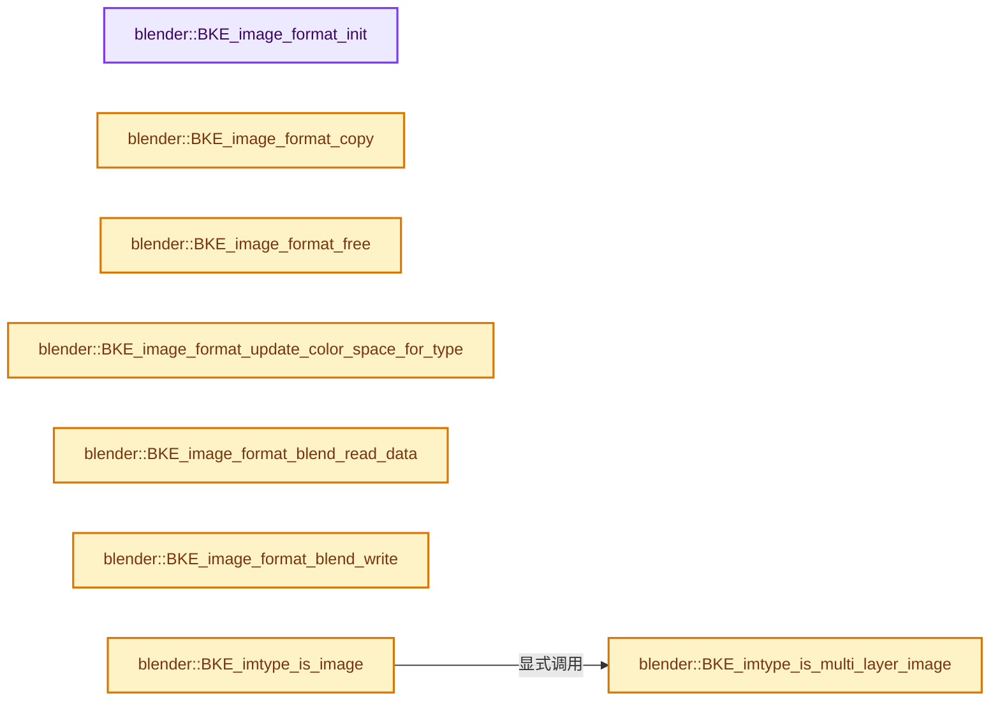
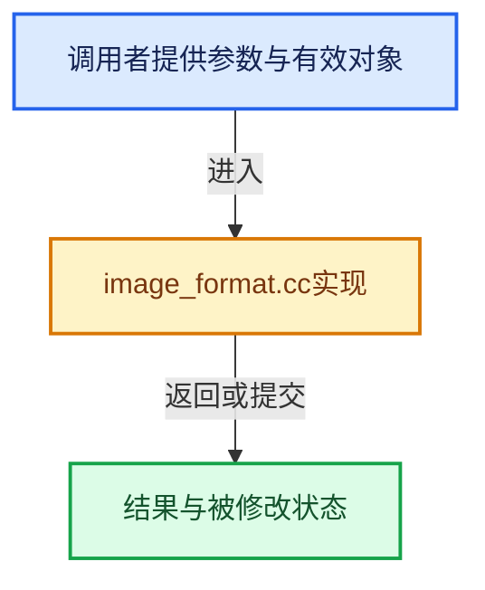

# 实现依赖专题：source/blender/blenkernel/intern/image_format.cc

[实现依赖导航](../../README.md) · [符号索引](../../../00-课程指南/02-源码与提交索引/符号依赖与实现索引.md)

本专题从正文实际调用进入，集中保存共享实现。函数有稳定锚点，可从调用处直接跳到对应完整函数；递归与互相调用通过回链组织。

## 本文件的实现关系






## 完整成员与函数实现

<a id="f-4473cbce67b78c6a"></a>

### `blender::BKE_image_format_init`

实现位置：[source/blender/blenkernel/intern/image_format.cc](../../../../../../../source/blender/blenkernel/intern/image_format.cc) · L34—L43。

接口参数：

- `ImageFormatData *imf`

**教学注释版**

<!-- annotated:fac8ef4f7ac3d7 -->

```cpp
void BKE_image_format_init(ImageFormatData *imf)
{
  *imf = ImageFormatData();

  BKE_color_managed_display_settings_init(&imf->display_settings);

  BKE_color_managed_view_settings_init(&imf->view_settings, &imf->display_settings, "AgX");

  BKE_color_managed_colorspace_settings_init(&imf->linear_colorspace_settings);
}
```

<details>
<summary>核对原始源码：source/blender/blenkernel/intern/image_format.cc · L34—L43</summary>

<!-- original:fac8ef4f7ac3d7:source/blender/blenkernel/intern/image_format.cc:34:43 -->

```cpp
void BKE_image_format_init(ImageFormatData *imf)
{
  *imf = ImageFormatData();

  BKE_color_managed_display_settings_init(&imf->display_settings);

  BKE_color_managed_view_settings_init(&imf->view_settings, &imf->display_settings, "AgX");

  BKE_color_managed_colorspace_settings_init(&imf->linear_colorspace_settings);
}
```

</details>

**继续追踪实现**

- `ImageFormatData` → [blender::ImageFormatData](../../08-其他Blender模块/windowmanager/WM_api.hh.md#t-04c3bd0013b4)；[blender::ImageFormatData](../../08-其他Blender模块/render/RE_pipeline.h.md#t-6cff205337a2)；[blender::ImageFormatData](../../08-其他Blender模块/render/RE_pipeline.h.md#t-8f2e175e5c78)；[blender::ImageFormatData](../BKE_scene.hh.md#t-486119f204b8)；[blender::ImageFormatData](../BKE_image_format.hh.md#t-98a3d54afe4f)；[blender::ImageFormatData](../BKE_image.hh.md#t-466d5c0708da)；[blender::ImageFormatData](../../08-其他Blender模块/imbuf/IMB_imbuf.hh.md#t-30440e64987b)；[blender::ImageFormatData](../../08-其他Blender模块/imbuf/IMB_colormanagement.hh.md#t-86d3ac76d981)；[blender::ImageFormatData](../../08-其他Blender模块/imbuf/movie/MOV_write.hh.md#t-c10b475e8972)；[blender::ImageFormatData](../../08-其他Blender模块/imbuf/movie/MOV_util.hh.md#t-7e76421ff710)；[blender::ImageFormatData](../../08-其他Blender模块/makesdna/DNA_scene_types.h.md#t-e4d94d9ec504)。
- `BKE_color_managed_display_settings_init` → [blender::BKE_color_managed_display_settings_init · L2057](colortools.cc.md#f-b824b74422e24ef5)。
- `BKE_color_managed_view_settings_init` → [blender::BKE_color_managed_view_settings_init · L2072](colortools.cc.md#f-e7c867f23704cf15)。
- `BKE_color_managed_colorspace_settings_init` → [blender::BKE_color_managed_colorspace_settings_init · L2151](colortools.cc.md#f-664027fab2b8848a)。

<a id="f-7f1a6e5f86fd6c3d"></a>

### `blender::BKE_image_format_copy`

实现位置：[source/blender/blenkernel/intern/image_format.cc](../../../../../../../source/blender/blenkernel/intern/image_format.cc) · L45—L52。

接口参数：

- `ImageFormatData *imf_dst`
- `const ImageFormatData *imf_src`

**教学注释版**

<!-- annotated:521ced632c182f -->

```cpp
void BKE_image_format_copy(ImageFormatData *imf_dst, const ImageFormatData *imf_src)
{
  // [讲解] memcpy：复制字节，源与目标不应重叠。类型生命周期、对齐和可复制表示须由调用者证明，不是任意对象的复制构造。
  memcpy(imf_dst, imf_src, sizeof(*imf_dst));
  BKE_color_managed_display_settings_copy(&imf_dst->display_settings, &imf_src->display_settings);
  BKE_color_managed_view_settings_copy(&imf_dst->view_settings, &imf_src->view_settings);
  BKE_color_managed_colorspace_settings_copy(&imf_dst->linear_colorspace_settings,
                                             &imf_src->linear_colorspace_settings);
}
```

<details>
<summary>核对原始源码：source/blender/blenkernel/intern/image_format.cc · L45—L52</summary>

<!-- original:521ced632c182f:source/blender/blenkernel/intern/image_format.cc:45:52 -->

```cpp
void BKE_image_format_copy(ImageFormatData *imf_dst, const ImageFormatData *imf_src)
{
  memcpy(imf_dst, imf_src, sizeof(*imf_dst));
  BKE_color_managed_display_settings_copy(&imf_dst->display_settings, &imf_src->display_settings);
  BKE_color_managed_view_settings_copy(&imf_dst->view_settings, &imf_src->view_settings);
  BKE_color_managed_colorspace_settings_copy(&imf_dst->linear_colorspace_settings,
                                             &imf_src->linear_colorspace_settings);
}
```

</details>

**继续追踪实现**

- `memcpy` → [外部契约](https://eel.is/c++draft/cstring.syn)：复制字节，源与目标不应重叠。类型生命周期、对齐和可复制表示须由调用者证明，不是任意对象的复制构造。
- `BKE_color_managed_display_settings_copy` → [blender::BKE_color_managed_display_settings_copy · L2065](colortools.cc.md#f-0d59e2259287d424)。
- `BKE_color_managed_view_settings_copy` → [blender::BKE_color_managed_view_settings_copy · L2099](colortools.cc.md#f-b017f7e4f8af5e8e)。
- `BKE_color_managed_colorspace_settings_copy` → [blender::BKE_color_managed_colorspace_settings_copy · L2158](colortools.cc.md#f-a9c85852386c8b2c)。

<a id="f-b70df4629a7d6282"></a>

### `blender::BKE_image_format_free`

实现位置：[source/blender/blenkernel/intern/image_format.cc](../../../../../../../source/blender/blenkernel/intern/image_format.cc) · L54—L57。

接口参数：

- `ImageFormatData *imf`

**教学注释版**

<!-- annotated:1a153661cc4338 -->

```cpp
void BKE_image_format_free(ImageFormatData *imf)
{
  BKE_color_managed_view_settings_free(&imf->view_settings);
}
```

<details>
<summary>核对原始源码：source/blender/blenkernel/intern/image_format.cc · L54—L57</summary>

<!-- original:1a153661cc4338:source/blender/blenkernel/intern/image_format.cc:54:57 -->

```cpp
void BKE_image_format_free(ImageFormatData *imf)
{
  BKE_color_managed_view_settings_free(&imf->view_settings);
}
```

</details>

**继续追踪实现**

- `BKE_color_managed_view_settings_free` → [blender::BKE_color_managed_view_settings_free · L2125](colortools.cc.md#f-bd5fbe8eb2acb4f3)。

<a id="f-d2fe00aa0f1c8f46"></a>

### `blender::BKE_image_format_update_color_space_for_type`

实现位置：[source/blender/blenkernel/intern/image_format.cc](../../../../../../../source/blender/blenkernel/intern/image_format.cc) · L59—L80。

接口参数：

- `ImageFormatData *format`

**教学注释版**

<!-- annotated:e44f7dc1b023a3 -->

```cpp
void BKE_image_format_update_color_space_for_type(ImageFormatData *format)
{
  /* If the color space is set to a data space, this is probably the user's intention, so leave it
   * as is. */
  if (IMB_colormanagement_space_name_is_data(format->linear_colorspace_settings.name)) {
    return;
  }

  const bool image_requires_linear = BKE_imtype_requires_linear_float(format->imtype);
  /* TODO: This is wrong, there are more linear colorspaces than scene linear. */
  const bool is_linear = IMB_colormanagement_space_name_is_scene_linear(
      format->linear_colorspace_settings.name);

  /* The color space is either not set or is linear but the image requires non-linear or vice
   * versa. So set to the default for the image type. */
  if (format->linear_colorspace_settings.name[0] == '\0' || image_requires_linear != is_linear) {
    const int role = image_requires_linear ? COLOR_ROLE_SCENE_LINEAR : COLOR_ROLE_DEFAULT_BYTE;
    const char *default_color_space = IMB_colormanagement_role_colorspace_name_get(role);
    IMB_colormanagement_colorspace_settings_set(&format->linear_colorspace_settings,
                                                default_color_space);
  }
}
```

<details>
<summary>核对原始源码：source/blender/blenkernel/intern/image_format.cc · L59—L80</summary>

<!-- original:e44f7dc1b023a3:source/blender/blenkernel/intern/image_format.cc:59:80 -->

```cpp
void BKE_image_format_update_color_space_for_type(ImageFormatData *format)
{
  /* If the color space is set to a data space, this is probably the user's intention, so leave it
   * as is. */
  if (IMB_colormanagement_space_name_is_data(format->linear_colorspace_settings.name)) {
    return;
  }

  const bool image_requires_linear = BKE_imtype_requires_linear_float(format->imtype);
  /* TODO: This is wrong, there are more linear colorspaces than scene linear. */
  const bool is_linear = IMB_colormanagement_space_name_is_scene_linear(
      format->linear_colorspace_settings.name);

  /* The color space is either not set or is linear but the image requires non-linear or vice
   * versa. So set to the default for the image type. */
  if (format->linear_colorspace_settings.name[0] == '\0' || image_requires_linear != is_linear) {
    const int role = image_requires_linear ? COLOR_ROLE_SCENE_LINEAR : COLOR_ROLE_DEFAULT_BYTE;
    const char *default_color_space = IMB_colormanagement_role_colorspace_name_get(role);
    IMB_colormanagement_colorspace_settings_set(&format->linear_colorspace_settings,
                                                default_color_space);
  }
}
```

</details>

**继续追踪实现**

- `IMB_colormanagement_space_name_is_data` → [blender::IMB_colormanagement_space_name_is_data · L1348](../../08-其他Blender模块/imbuf/intern/colormanagement.cc.md#f-581447ed34f42264)。
- `BKE_imtype_requires_linear_float` → [blender::BKE_imtype_requires_linear_float · L336](image_format.cc.md#f-35f555ce47429dd7)。
- `IMB_colormanagement_space_name_is_scene_linear` → [blender::IMB_colormanagement_space_name_is_scene_linear · L1354](../../08-其他Blender模块/imbuf/intern/colormanagement.cc.md#f-3540ab2d85eeb753)。
- `IMB_colormanagement_role_colorspace_name_get` → [blender::IMB_colormanagement_role_colorspace_name_get · L1247](../../08-其他Blender模块/imbuf/intern/colormanagement.cc.md#f-f2cf0e85682f0fd8)。
- `IMB_colormanagement_colorspace_settings_set` → [blender::IMB_colormanagement_colorspace_settings_set · L3164](../../08-其他Blender模块/imbuf/intern/colormanagement.cc.md#f-85d2536cb6c79b87)。

<a id="f-59b357861775e62e"></a>

### `blender::BKE_image_format_blend_read_data`

实现位置：[source/blender/blenkernel/intern/image_format.cc](../../../../../../../source/blender/blenkernel/intern/image_format.cc) · L82—L85。

接口参数：

- `BlendDataReader *reader`
- `ImageFormatData *imf`

**教学注释版**

<!-- annotated:0ed64c7cf30d34 -->

```cpp
void BKE_image_format_blend_read_data(BlendDataReader *reader, ImageFormatData *imf)
{
  BKE_color_managed_view_settings_blend_read_data(reader, &imf->view_settings);
}
```

<details>
<summary>核对原始源码：source/blender/blenkernel/intern/image_format.cc · L82—L85</summary>

<!-- original:0ed64c7cf30d34:source/blender/blenkernel/intern/image_format.cc:82:85 -->

```cpp
void BKE_image_format_blend_read_data(BlendDataReader *reader, ImageFormatData *imf)
{
  BKE_color_managed_view_settings_blend_read_data(reader, &imf->view_settings);
}
```

</details>

**继续追踪实现**

- `BKE_color_managed_view_settings_blend_read_data` → [blender::BKE_color_managed_view_settings_blend_read_data · L2141](colortools.cc.md#f-21c28600f7bad512)。

<a id="f-2e03c9c3368fd838"></a>

### `blender::BKE_image_format_blend_write`

实现位置：[source/blender/blenkernel/intern/image_format.cc](../../../../../../../source/blender/blenkernel/intern/image_format.cc) · L87—L90。

接口参数：

- `BlendWriter *writer`
- `ImageFormatData *imf`

**教学注释版**

<!-- annotated:9ce6e93f43e9aa -->

```cpp
void BKE_image_format_blend_write(BlendWriter *writer, ImageFormatData *imf)
{
  BKE_color_managed_view_settings_blend_write(writer, &imf->view_settings);
}
```

<details>
<summary>核对原始源码：source/blender/blenkernel/intern/image_format.cc · L87—L90</summary>

<!-- original:9ce6e93f43e9aa:source/blender/blenkernel/intern/image_format.cc:87:90 -->

```cpp
void BKE_image_format_blend_write(BlendWriter *writer, ImageFormatData *imf)
{
  BKE_color_managed_view_settings_blend_write(writer, &imf->view_settings);
}
```

</details>

**继续追踪实现**

- `BKE_color_managed_view_settings_blend_write` → [blender::BKE_color_managed_view_settings_blend_write · L2133](colortools.cc.md#f-17bfc9dbc8260a72)。

<a id="f-b0fe71720b572455"></a>

### `blender::BKE_imtype_is_image`

实现位置：[source/blender/blenkernel/intern/image_format.cc](../../../../../../../source/blender/blenkernel/intern/image_format.cc) · L300—L303。

接口参数：

- `const char imtype`

**教学注释版**

<!-- annotated:42bd582cc5d8a6 -->

```cpp
bool BKE_imtype_is_image(const char imtype)
{
  return !BKE_imtype_is_multi_layer_image(imtype) && !BKE_imtype_is_movie(imtype);
}
```

<details>
<summary>核对原始源码：source/blender/blenkernel/intern/image_format.cc · L300—L303</summary>

<!-- original:42bd582cc5d8a6:source/blender/blenkernel/intern/image_format.cc:300:303 -->

```cpp
bool BKE_imtype_is_image(const char imtype)
{
  return !BKE_imtype_is_multi_layer_image(imtype) && !BKE_imtype_is_movie(imtype);
}
```

</details>

**结果出口**

- `return !BKE_imtype_is_multi_layer_image(imtype) && !BKE_imtype_is_movie(imtype);`

**继续追踪实现**

- `BKE_imtype_is_multi_layer_image` → [blender::BKE_imtype_is_multi_layer_image · L305](image_format.cc.md#f-87574b4e2b4e26e7)。
- `BKE_imtype_is_movie` → [blender::BKE_imtype_is_movie · L310](image_format.cc.md#f-ca6733d2a96cafbd)。

<a id="f-87574b4e2b4e26e7"></a>

### `blender::BKE_imtype_is_multi_layer_image`

实现位置：[source/blender/blenkernel/intern/image_format.cc](../../../../../../../source/blender/blenkernel/intern/image_format.cc) · L305—L308。

接口参数：

- `const char imtype`

**教学注释版**

<!-- annotated:8423f8f3582803 -->

```cpp
bool BKE_imtype_is_multi_layer_image(const char imtype)
{
  return imtype == R_IMF_IMTYPE_MULTILAYER;
}
```

<details>
<summary>核对原始源码：source/blender/blenkernel/intern/image_format.cc · L305—L308</summary>

<!-- original:8423f8f3582803:source/blender/blenkernel/intern/image_format.cc:305:308 -->

```cpp
bool BKE_imtype_is_multi_layer_image(const char imtype)
{
  return imtype == R_IMF_IMTYPE_MULTILAYER;
}
```

</details>

**结果出口**

- `return imtype == R_IMF_IMTYPE_MULTILAYER;`

**继续追踪实现**

本实现没有需要继续展开的显式调用；检查返回表达式、对象转换和调用者前置条件。

<a id="f-ca6733d2a96cafbd"></a>

### `blender::BKE_imtype_is_movie`

实现位置：[source/blender/blenkernel/intern/image_format.cc](../../../../../../../source/blender/blenkernel/intern/image_format.cc) · L310—L313。

接口参数：

- `const char imtype`

**教学注释版**

<!-- annotated:ed6ceb82513f68 -->

```cpp
bool BKE_imtype_is_movie(const char imtype)
{
  return imtype == R_IMF_IMTYPE_FFMPEG;
}
```

<details>
<summary>核对原始源码：source/blender/blenkernel/intern/image_format.cc · L310—L313</summary>

<!-- original:ed6ceb82513f68:source/blender/blenkernel/intern/image_format.cc:310:313 -->

```cpp
bool BKE_imtype_is_movie(const char imtype)
{
  return imtype == R_IMF_IMTYPE_FFMPEG;
}
```

</details>

**结果出口**

- `return imtype == R_IMF_IMTYPE_FFMPEG;`

**继续追踪实现**

本实现没有需要继续展开的显式调用；检查返回表达式、对象转换和调用者前置条件。

<a id="f-35f555ce47429dd7"></a>

### `blender::BKE_imtype_requires_linear_float`

实现位置：[source/blender/blenkernel/intern/image_format.cc](../../../../../../../source/blender/blenkernel/intern/image_format.cc) · L336—L347。

接口参数：

- `const char imtype`

**教学注释版**

<!-- annotated:3d6b093966417b -->

```cpp
bool BKE_imtype_requires_linear_float(const char imtype)
{
  switch (imtype) {
    case R_IMF_IMTYPE_CINEON:
    case R_IMF_IMTYPE_DPX:
    case R_IMF_IMTYPE_RADHDR:
    case R_IMF_IMTYPE_OPENEXR:
    case R_IMF_IMTYPE_MULTILAYER:
      return true;
  }
  return false;
}
```

<details>
<summary>核对原始源码：source/blender/blenkernel/intern/image_format.cc · L336—L347</summary>

<!-- original:3d6b093966417b:source/blender/blenkernel/intern/image_format.cc:336:347 -->

```cpp
bool BKE_imtype_requires_linear_float(const char imtype)
{
  switch (imtype) {
    case R_IMF_IMTYPE_CINEON:
    case R_IMF_IMTYPE_DPX:
    case R_IMF_IMTYPE_RADHDR:
    case R_IMF_IMTYPE_OPENEXR:
    case R_IMF_IMTYPE_MULTILAYER:
      return true;
  }
  return false;
}
```

</details>

**结果出口**

- `return true;`
- `return false;`

**继续追踪实现**

本实现没有需要继续展开的显式调用；检查返回表达式、对象转换和调用者前置条件。

<a id="f-256e92f3cfcb35bc"></a>

### `blender::image_path_ext_from_imformat_impl`

实现位置：[source/blender/blenkernel/intern/image_format.cc](../../../../../../../source/blender/blenkernel/intern/image_format.cc) · L524—L600。

接口参数：

- `const char imtype`
- `const ImageFormatData *im_format`
- `const char *r_ext[BKE_IMAGE_PATH_EXT_MAX]`

**教学注释版**

<!-- annotated:6c7d26bc0d6bcb -->

```cpp
static int image_path_ext_from_imformat_impl(const char imtype,
                                             const ImageFormatData *im_format,
                                             const char *r_ext[BKE_IMAGE_PATH_EXT_MAX])
{
  int ext_num = 0;
  (void)im_format; /* may be unused, depends on build options */

  if (imtype == R_IMF_IMTYPE_IRIS) {
    r_ext[ext_num++] = ".rgb";
  }
  else if (imtype == R_IMF_IMTYPE_IRIZ) {
    r_ext[ext_num++] = ".rgb";
  }
  else if (imtype == R_IMF_IMTYPE_RADHDR) {
    r_ext[ext_num++] = ".hdr";
  }
  else if (ELEM(imtype, R_IMF_IMTYPE_PNG, R_IMF_IMTYPE_FFMPEG)) {
    r_ext[ext_num++] = ".png";
  }
  else if (imtype == R_IMF_IMTYPE_DDS) {
    r_ext[ext_num++] = ".dds";
  }
  else if (ELEM(imtype, R_IMF_IMTYPE_TARGA, R_IMF_IMTYPE_RAWTGA)) {
    r_ext[ext_num++] = ".tga";
  }
  else if (imtype == R_IMF_IMTYPE_BMP) {
    r_ext[ext_num++] = ".bmp";
  }
  else if (imtype == R_IMF_IMTYPE_TIFF) {
    r_ext[ext_num++] = ".tif";
    r_ext[ext_num++] = ".tiff";
  }
  else if (imtype == R_IMF_IMTYPE_PSD) {
    r_ext[ext_num++] = ".psd";
  }
  else if (ELEM(imtype, R_IMF_IMTYPE_OPENEXR, R_IMF_IMTYPE_MULTILAYER)) {
    r_ext[ext_num++] = ".exr";
  }
#ifdef WITH_IMAGE_CINEON
  else if (imtype == R_IMF_IMTYPE_CINEON) {
    r_ext[ext_num++] = ".cin";
  }
  else if (imtype == R_IMF_IMTYPE_DPX) {
    r_ext[ext_num++] = ".dpx";
  }
#endif
#ifdef WITH_IMAGE_OPENJPEG
  else if (imtype == R_IMF_IMTYPE_JP2) {
    if (im_format) {
      if (im_format->jp2_codec == R_IMF_JP2_CODEC_JP2) {
        r_ext[ext_num++] = ".jp2";
      }
      else if (im_format->jp2_codec == R_IMF_JP2_CODEC_J2K) {
        r_ext[ext_num++] = ".j2c";
      }
      else {
        BLI_assert_msg(0, "Unsupported jp2 codec was specified in im_format->jp2_codec");
      }
    }
    else {
      r_ext[ext_num++] = ".jp2";
    }
  }
#endif
#ifdef WITH_IMAGE_WEBP
  else if (imtype == R_IMF_IMTYPE_WEBP) {
    r_ext[ext_num++] = ".webp";
  }
#endif
  else if (imtype == R_IMF_IMTYPE_AVIF) {
    r_ext[ext_num++] = ".avif";
  }
  else {
    /* Handles: #R_IMF_IMTYPE_JPEG90 etc. */
    r_ext[ext_num++] = ".jpg";
    r_ext[ext_num++] = ".jpeg";
  }
```

<details>
<summary>核对原始源码：source/blender/blenkernel/intern/image_format.cc · L524—L600</summary>

<!-- original:6c7d26bc0d6bcb:source/blender/blenkernel/intern/image_format.cc:524:600 -->

```cpp
static int image_path_ext_from_imformat_impl(const char imtype,
                                             const ImageFormatData *im_format,
                                             const char *r_ext[BKE_IMAGE_PATH_EXT_MAX])
{
  int ext_num = 0;
  (void)im_format; /* may be unused, depends on build options */

  if (imtype == R_IMF_IMTYPE_IRIS) {
    r_ext[ext_num++] = ".rgb";
  }
  else if (imtype == R_IMF_IMTYPE_IRIZ) {
    r_ext[ext_num++] = ".rgb";
  }
  else if (imtype == R_IMF_IMTYPE_RADHDR) {
    r_ext[ext_num++] = ".hdr";
  }
  else if (ELEM(imtype, R_IMF_IMTYPE_PNG, R_IMF_IMTYPE_FFMPEG)) {
    r_ext[ext_num++] = ".png";
  }
  else if (imtype == R_IMF_IMTYPE_DDS) {
    r_ext[ext_num++] = ".dds";
  }
  else if (ELEM(imtype, R_IMF_IMTYPE_TARGA, R_IMF_IMTYPE_RAWTGA)) {
    r_ext[ext_num++] = ".tga";
  }
  else if (imtype == R_IMF_IMTYPE_BMP) {
    r_ext[ext_num++] = ".bmp";
  }
  else if (imtype == R_IMF_IMTYPE_TIFF) {
    r_ext[ext_num++] = ".tif";
    r_ext[ext_num++] = ".tiff";
  }
  else if (imtype == R_IMF_IMTYPE_PSD) {
    r_ext[ext_num++] = ".psd";
  }
  else if (ELEM(imtype, R_IMF_IMTYPE_OPENEXR, R_IMF_IMTYPE_MULTILAYER)) {
    r_ext[ext_num++] = ".exr";
  }
#ifdef WITH_IMAGE_CINEON
  else if (imtype == R_IMF_IMTYPE_CINEON) {
    r_ext[ext_num++] = ".cin";
  }
  else if (imtype == R_IMF_IMTYPE_DPX) {
    r_ext[ext_num++] = ".dpx";
  }
#endif
#ifdef WITH_IMAGE_OPENJPEG
  else if (imtype == R_IMF_IMTYPE_JP2) {
    if (im_format) {
      if (im_format->jp2_codec == R_IMF_JP2_CODEC_JP2) {
        r_ext[ext_num++] = ".jp2";
      }
      else if (im_format->jp2_codec == R_IMF_JP2_CODEC_J2K) {
        r_ext[ext_num++] = ".j2c";
      }
      else {
        BLI_assert_msg(0, "Unsupported jp2 codec was specified in im_format->jp2_codec");
      }
    }
    else {
      r_ext[ext_num++] = ".jp2";
    }
  }
#endif
#ifdef WITH_IMAGE_WEBP
  else if (imtype == R_IMF_IMTYPE_WEBP) {
    r_ext[ext_num++] = ".webp";
  }
#endif
  else if (imtype == R_IMF_IMTYPE_AVIF) {
    r_ext[ext_num++] = ".avif";
  }
  else {
    /* Handles: #R_IMF_IMTYPE_JPEG90 etc. */
    r_ext[ext_num++] = ".jpg";
    r_ext[ext_num++] = ".jpeg";
  }
```

</details>

**继续追踪实现**

- `ELEM` → [ELEM · L88](../../07-Intern运行时与平台/ghost/intern/GHOST_utildefines.hh.md#m-d28724a15928)；[ELEM · L135](../../01-BLI基础库/BLI_utildefines.hh.md#m-d6572de7cae0)。宏定义由构建条件选择。
- `BLI_assert_msg` → [BLI_assert_msg · L55](../../01-BLI基础库/BLI_assert.hh.md#m-695eed20dceb)；[BLI_assert_msg · L64](../../01-BLI基础库/BLI_assert.hh.md#m-7de5563de4db)。宏定义由构建条件选择。

<a id="f-858615d30e98c8b5"></a>

### `do_ensure_image_extension`

实现位置：[source/blender/blenkernel/intern/image_format.cc](../../../../../../../source/blender/blenkernel/intern/image_format.cc) · L617—L635。

接口参数：

- `char *filepath`
- `const size_t filepath_maxncpy`
- `const char imtype`
- `const ImageFormatData *im_format`

**教学注释版**

<!-- annotated:68c18cca624156 -->

```cpp
static bool do_ensure_image_extension(char *filepath,
                                      const size_t filepath_maxncpy,
                                      const char imtype,
                                      const ImageFormatData *im_format)
{
  const char *ext_array[BKE_IMAGE_PATH_EXT_MAX];
  int ext_array_num = image_path_ext_from_imformat_impl(imtype, im_format, ext_array);
  if (ext_array_num && !BLI_path_extension_check_array(filepath, ext_array)) {
    /* Removing *any* extension may remove part of the user defined name (if they include '.')
     * however in the case there is already a known image extension,
     * remove it to avoid`.png.tga`, for example. */
    if (BLI_path_extension_check_array(filepath, imb_ext_image)) {
      return BLI_path_extension_replace(filepath, filepath_maxncpy, ext_array[0]);
    }
    return BLI_path_extension_ensure(filepath, filepath_maxncpy, ext_array[0]);
  }

  return false;
}
```

<details>
<summary>核对原始源码：source/blender/blenkernel/intern/image_format.cc · L617—L635</summary>

<!-- original:68c18cca624156:source/blender/blenkernel/intern/image_format.cc:617:635 -->

```cpp
static bool do_ensure_image_extension(char *filepath,
                                      const size_t filepath_maxncpy,
                                      const char imtype,
                                      const ImageFormatData *im_format)
{
  const char *ext_array[BKE_IMAGE_PATH_EXT_MAX];
  int ext_array_num = image_path_ext_from_imformat_impl(imtype, im_format, ext_array);
  if (ext_array_num && !BLI_path_extension_check_array(filepath, ext_array)) {
    /* Removing *any* extension may remove part of the user defined name (if they include '.')
     * however in the case there is already a known image extension,
     * remove it to avoid`.png.tga`, for example. */
    if (BLI_path_extension_check_array(filepath, imb_ext_image)) {
      return BLI_path_extension_replace(filepath, filepath_maxncpy, ext_array[0]);
    }
    return BLI_path_extension_ensure(filepath, filepath_maxncpy, ext_array[0]);
  }

  return false;
}
```

</details>

**结果出口**

- `return BLI_path_extension_replace(filepath, filepath_maxncpy, ext_array[0]);`
- `return BLI_path_extension_ensure(filepath, filepath_maxncpy, ext_array[0]);`
- `return false;`

**继续追踪实现**

- `image_path_ext_from_imformat_impl` → [blender::image_path_ext_from_imformat_impl · L524](image_format.cc.md#f-256e92f3cfcb35bc)。
- `BLI_path_extension_check_array` → [BLI_path_extension_check_array · L1505](../../01-BLI基础库/intern/path_utils.cc.md#f-6c9c1f20eacc5647)。
- `BLI_path_extension_replace` → [BLI_path_extension_replace · L1572](../../01-BLI基础库/intern/path_utils.cc.md#f-5c166a2d15572357)。
- `BLI_path_extension_ensure` → [BLI_path_extension_ensure · L1596](../../01-BLI基础库/intern/path_utils.cc.md#f-8253818a36b0a79e)。

<a id="f-0833121c31efa85d"></a>

### `do_makepicstring`

实现位置：[source/blender/blenkernel/intern/image_format.cc](../../../../../../../source/blender/blenkernel/intern/image_format.cc) · L651—L698。

接口参数：

- `char filepath[FILE_MAX]`
- `const char *base`
- `const char *relbase`
- `const path_templates::VariableMap *template_variables`
- `int frame`
- `const char imtype`
- `const ImageFormatData *im_format`
- `const bool use_ext`
- `const bool use_frames`
- `const char *suffix`

**教学注释版**

<!-- annotated:846ce796b7ded9 -->

```cpp
static Vector<path_templates::Error> do_makepicstring(
    char filepath[FILE_MAX],
    const char *base,
    const char *relbase,
    const path_templates::VariableMap *template_variables,
    int frame,
    const char imtype,
    const ImageFormatData *im_format,
    const bool use_ext,
    const bool use_frames,
    const char *suffix)
{
  if (filepath == nullptr) {
    return {};
  }
  BLI_strncpy(filepath, base, FILE_MAX - 10); /* weak assumption */

  if (template_variables) {
    const Vector<path_templates::Error> variable_errors = BKE_path_apply_template(
        filepath, FILE_MAX, *template_variables);
    if (!variable_errors.is_empty()) {
      return variable_errors;
    }
  }

  BLI_path_abs(filepath, relbase);

  if (use_frames) {
    BLI_path_frame(filepath, FILE_MAX, frame, 4);
  }
  else {
    /* Avoid empty filename if there is no frame and only a directory was specified. */
    const size_t len = strlen(filepath);
    if (len && BLI_path_slash_is_native_compat(filepath[len - 1])) {
      BLI_path_suffix(filepath, FILE_MAX, DATA_("Untitled"), "");
    }
  }

  if (suffix) {
    BLI_path_suffix(filepath, FILE_MAX, suffix, "");
  }

  if (use_ext) {
    do_ensure_image_extension(filepath, FILE_MAX, imtype, im_format);
  }

  return {};
}
```

<details>
<summary>核对原始源码：source/blender/blenkernel/intern/image_format.cc · L651—L698</summary>

<!-- original:846ce796b7ded9:source/blender/blenkernel/intern/image_format.cc:651:698 -->

```cpp
static Vector<path_templates::Error> do_makepicstring(
    char filepath[FILE_MAX],
    const char *base,
    const char *relbase,
    const path_templates::VariableMap *template_variables,
    int frame,
    const char imtype,
    const ImageFormatData *im_format,
    const bool use_ext,
    const bool use_frames,
    const char *suffix)
{
  if (filepath == nullptr) {
    return {};
  }
  BLI_strncpy(filepath, base, FILE_MAX - 10); /* weak assumption */

  if (template_variables) {
    const Vector<path_templates::Error> variable_errors = BKE_path_apply_template(
        filepath, FILE_MAX, *template_variables);
    if (!variable_errors.is_empty()) {
      return variable_errors;
    }
  }

  BLI_path_abs(filepath, relbase);

  if (use_frames) {
    BLI_path_frame(filepath, FILE_MAX, frame, 4);
  }
  else {
    /* Avoid empty filename if there is no frame and only a directory was specified. */
    const size_t len = strlen(filepath);
    if (len && BLI_path_slash_is_native_compat(filepath[len - 1])) {
      BLI_path_suffix(filepath, FILE_MAX, DATA_("Untitled"), "");
    }
  }

  if (suffix) {
    BLI_path_suffix(filepath, FILE_MAX, suffix, "");
  }

  if (use_ext) {
    do_ensure_image_extension(filepath, FILE_MAX, imtype, im_format);
  }

  return {};
}
```

</details>

**结果出口**

- `return {};`
- `return variable_errors;`

**继续追踪实现**

- `BLI_strncpy` → [blender::BLI_strncpy · L70](../../01-BLI基础库/intern/string.cc.md#f-6324147b0d116da1)。
- `BKE_path_apply_template` → [blender::BKE_path_apply_template · L1055](path_templates.cc.md#f-4fce298769f4ae68)。
- `variable_errors.is_empty` → [blender::Vector::is_empty · L792](../../../01-基础容器与现代CPP/11-Vector插入删除与重排.md#f-937bbd9cb80bdcc8)。
- `BLI_path_abs` → [BLI_path_abs · L1164](../../01-BLI基础库/intern/path_utils.cc.md#f-002380948c1caeb6)。
- `BLI_path_frame` → [BLI_path_frame · L999](../../01-BLI基础库/intern/path_utils.cc.md#f-86ecc33491f04e49)。
- `strlen` → [外部契约](https://eel.is/c++draft/)：这个边界按实际表达式及所属类型核对参数、返回值、寿命与失败行为。这里提供接口入口，不声称已解释该第三方版本的内部实现。
- `BLI_path_slash_is_native_compat` → [blender::BLI_path_slash_is_native_compat · L765](../../01-BLI基础库/BLI_path_utils.hh.md#f-e95b7b29f428577d)。
- `BLI_path_suffix` → [BLI_path_suffix · L845](../../01-BLI基础库/intern/path_utils.cc.md#f-1ecb13d2af478c0e)。
- `DATA_` → [DATA_ · L52](../../08-其他Blender模块/blentranslation/BLT_translation.hh.md#m-178736083f83)。宏定义由构建条件选择。
- `do_ensure_image_extension` → [do_ensure_image_extension · L617](image_format.cc.md#f-858615d30e98c8b5)。

<a id="f-610c05842c99c247"></a>

### `BKE_image_path_from_imtype`

实现位置：[source/blender/blenkernel/intern/image_format.cc](../../../../../../../source/blender/blenkernel/intern/image_format.cc) · L723—L744。

接口参数：

- `char *filepath`
- `const char *base`
- `const char *relbase`
- `const path_templates::VariableMap *template_variables`
- `int frame`
- `const char imtype`
- `const bool use_ext`
- `const bool use_frames`
- `const char *suffix`

**教学注释版**

<!-- annotated:29736dbaacf2b8 -->

```cpp
Vector<path_templates::Error> BKE_image_path_from_imtype(
    char *filepath,
    const char *base,
    const char *relbase,
    const path_templates::VariableMap *template_variables,
    int frame,
    const char imtype,
    const bool use_ext,
    const bool use_frames,
    const char *suffix)
{
  return do_makepicstring(filepath,
                          base,
                          relbase,
                          template_variables,
                          frame,
                          imtype,
                          nullptr,
                          use_ext,
                          use_frames,
                          suffix);
}
```

<details>
<summary>核对原始源码：source/blender/blenkernel/intern/image_format.cc · L723—L744</summary>

<!-- original:29736dbaacf2b8:source/blender/blenkernel/intern/image_format.cc:723:744 -->

```cpp
Vector<path_templates::Error> BKE_image_path_from_imtype(
    char *filepath,
    const char *base,
    const char *relbase,
    const path_templates::VariableMap *template_variables,
    int frame,
    const char imtype,
    const bool use_ext,
    const bool use_frames,
    const char *suffix)
{
  return do_makepicstring(filepath,
                          base,
                          relbase,
                          template_variables,
                          frame,
                          imtype,
                          nullptr,
                          use_ext,
                          use_frames,
                          suffix);
}
```

</details>

**结果出口**

- `return do_makepicstring(filepath,`

**继续追踪实现**

- `do_makepicstring` → [do_makepicstring · L651](image_format.cc.md#f-0833121c31efa85d)。
