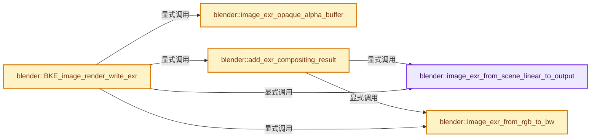

# 实现依赖专题：source/blender/blenkernel/intern/image_save.cc

[实现依赖导航](../../README.md) · [符号索引](../../../00-课程指南/02-源码与提交索引/符号依赖与实现索引.md)

本专题从正文实际调用进入，集中保存共享实现。函数有稳定锚点，可从调用处直接跳到对应完整函数；递归与互相调用通过回链组织。

## 本文件的实现关系




## 完整成员与函数实现

<a id="f-65616c48be03a0dd"></a>

### `blender::image_exr_from_scene_linear_to_output`

实现位置：[source/blender/blenkernel/intern/image_save.cc](../../../../../../../source/blender/blenkernel/intern/image_save.cc) · L717—L747。

接口参数：

- `const float *rect`
- `const int width`
- `const int height`
- `const int channels`
- `const ImageFormatData *imf`
- `Vector<float *> &tmp_output_rects`
- `StringRefNull &r_colorspace`

**教学注释版**

<!-- annotated:442a28d53e0d00 -->

```cpp
static const float *image_exr_from_scene_linear_to_output(const float *rect,
                                                          const int width,
                                                          const int height,
                                                          const int channels,
                                                          const ImageFormatData *imf,
                                                          Vector<float *> &tmp_output_rects,
                                                          StringRefNull &r_colorspace)
{
  if (imf == nullptr) {
    return rect;
  }

  const char *to_colorspace = imf->linear_colorspace_settings.name;
  if (to_colorspace[0] == '\0' || IMB_colormanagement_space_name_is_scene_linear(to_colorspace)) {
    return rect;
  }

  const size_t size = size_t(width) * size_t(height) * size_t(channels);
  float *output_rect = MEM_new_array_uninitialized<float>(size, __func__);
  std::copy_n(rect, size, output_rect);
  // [讲解] tmp_output_rects.append：在尾部建立新元素，必要时先扩大存储。
  tmp_output_rects.append(output_rect);

  const char *from_colorspace = IMB_colormanagement_role_colorspace_name_get(
      COLOR_ROLE_SCENE_LINEAR);
  IMB_colormanagement_transform_float(
      output_rect, width, height, channels, from_colorspace, to_colorspace, false);

  r_colorspace = to_colorspace;

  return output_rect;
}
```

<details>
<summary>核对原始源码：source/blender/blenkernel/intern/image_save.cc · L717—L747</summary>

<!-- original:442a28d53e0d00:source/blender/blenkernel/intern/image_save.cc:717:747 -->

```cpp
static const float *image_exr_from_scene_linear_to_output(const float *rect,
                                                          const int width,
                                                          const int height,
                                                          const int channels,
                                                          const ImageFormatData *imf,
                                                          Vector<float *> &tmp_output_rects,
                                                          StringRefNull &r_colorspace)
{
  if (imf == nullptr) {
    return rect;
  }

  const char *to_colorspace = imf->linear_colorspace_settings.name;
  if (to_colorspace[0] == '\0' || IMB_colormanagement_space_name_is_scene_linear(to_colorspace)) {
    return rect;
  }

  const size_t size = size_t(width) * size_t(height) * size_t(channels);
  float *output_rect = MEM_new_array_uninitialized<float>(size, __func__);
  std::copy_n(rect, size, output_rect);
  tmp_output_rects.append(output_rect);

  const char *from_colorspace = IMB_colormanagement_role_colorspace_name_get(
      COLOR_ROLE_SCENE_LINEAR);
  IMB_colormanagement_transform_float(
      output_rect, width, height, channels, from_colorspace, to_colorspace, false);

  r_colorspace = to_colorspace;

  return output_rect;
}
```

</details>

**沿实际写入检查状态**

- `r_colorspace = to_colorspace;`

**结果出口**

- `return rect;`
- `return output_rect;`

**继续追踪实现**

- `IMB_colormanagement_space_name_is_scene_linear` → [blender::IMB_colormanagement_space_name_is_scene_linear · L1354](../../08-其他Blender模块/imbuf/intern/colormanagement.cc.md#f-3540ab2d85eeb753)。
- `MEM_new_array_uninitialized<float>` → [MEM_new_array_uninitialized · L608](../../07-Intern运行时与平台/guardedalloc/MEM_guardedalloc.h.md#f-b7103eae8eb57b05)；[MEM_new_array_uninitialized · L129](../../07-Intern运行时与平台/guardedalloc/intern/mallocn.cc.md#f-bf6ef4ddcfb6e5df)。同名重载需按实参类型选择。
- `std::copy_n` → [外部契约](https://eel.is/c++draft/)：这个边界按实际表达式及所属类型核对参数、返回值、寿命与失败行为。这里提供接口入口，不声称已解释该第三方版本的内部实现。
- `tmp_output_rects.append` → [blender::Vector::append · L498](../../../01-基础容器与现代CPP/11-Vector插入删除与重排.md#f-5bde268a69e443ec)；[blender::Vector::append · L502](../../../01-基础容器与现代CPP/11-Vector插入删除与重排.md#f-591e0b15e6308532)。同名重载需按实参类型选择。
- `IMB_colormanagement_role_colorspace_name_get` → [blender::IMB_colormanagement_role_colorspace_name_get · L1247](../../08-其他Blender模块/imbuf/intern/colormanagement.cc.md#f-f2cf0e85682f0fd8)。
- `IMB_colormanagement_transform_float` → [blender::IMB_colormanagement_transform_float · L2282](../../08-其他Blender模块/imbuf/intern/colormanagement.cc.md#f-2e676a9b77f01d7b)。

<a id="f-9543c672b5c68a28"></a>

### `blender::image_exr_from_rgb_to_bw`

实现位置：[source/blender/blenkernel/intern/image_save.cc](../../../../../../../source/blender/blenkernel/intern/image_save.cc) · L749—L770。

接口参数：

- `const float *input_buffer`
- `int width`
- `int height`
- `int channels`
- `Vector<float *> &temporary_buffers`

**教学注释版**

<!-- annotated:c0f2befc64efd1 -->

```cpp
static const float *image_exr_from_rgb_to_bw(const float *input_buffer,
                                             int width,
                                             int height,
                                             int channels,
                                             Vector<float *> &temporary_buffers)
{
  float *gray_scale_output = MEM_new_array_uninitialized<float>(size_t(width) * size_t(height),
                                                                "Gray Scale Buffer For EXR");
  // [讲解] temporary_buffers.append：在尾部建立新元素，必要时先扩大存储。
  temporary_buffers.append(gray_scale_output);

  threading::parallel_for(IndexRange(height), 1, [&](const IndexRange sub_y_range) {
    for (const int64_t y : sub_y_range) {
      for (const int64_t x : IndexRange(width)) {
        const int64_t index = y * int64_t(width) + x;
        gray_scale_output[index] = IMB_colormanagement_get_luminance(input_buffer +
                                                                     index * channels);
      }
    }
  });

  return gray_scale_output;
}
```

<details>
<summary>核对原始源码：source/blender/blenkernel/intern/image_save.cc · L749—L770</summary>

<!-- original:c0f2befc64efd1:source/blender/blenkernel/intern/image_save.cc:749:770 -->

```cpp
static const float *image_exr_from_rgb_to_bw(const float *input_buffer,
                                             int width,
                                             int height,
                                             int channels,
                                             Vector<float *> &temporary_buffers)
{
  float *gray_scale_output = MEM_new_array_uninitialized<float>(size_t(width) * size_t(height),
                                                                "Gray Scale Buffer For EXR");
  temporary_buffers.append(gray_scale_output);

  threading::parallel_for(IndexRange(height), 1, [&](const IndexRange sub_y_range) {
    for (const int64_t y : sub_y_range) {
      for (const int64_t x : IndexRange(width)) {
        const int64_t index = y * int64_t(width) + x;
        gray_scale_output[index] = IMB_colormanagement_get_luminance(input_buffer +
                                                                     index * channels);
      }
    }
  });

  return gray_scale_output;
}
```

</details>

**沿实际写入检查状态**

- `gray_scale_output[index] = IMB_colormanagement_get_luminance(input_buffer +`

**结果出口**

- `return gray_scale_output;`

**继续追踪实现**

- `MEM_new_array_uninitialized<float>` → [MEM_new_array_uninitialized · L608](../../07-Intern运行时与平台/guardedalloc/MEM_guardedalloc.h.md#f-b7103eae8eb57b05)；[MEM_new_array_uninitialized · L129](../../07-Intern运行时与平台/guardedalloc/intern/mallocn.cc.md#f-bf6ef4ddcfb6e5df)。同名重载需按实参类型选择。
- `temporary_buffers.append` → [blender::Vector::append · L498](../../../01-基础容器与现代CPP/11-Vector插入删除与重排.md#f-5bde268a69e443ec)；[blender::Vector::append · L502](../../../01-基础容器与现代CPP/11-Vector插入删除与重排.md#f-591e0b15e6308532)。同名重载需按实参类型选择。
- `threading::parallel_for` → [blender::threading::parallel_for · L68](../../../11-Depsgraph与并行任务系统/07-任务池与TBB接入.md#f-838294754c24426c)。
- `IndexRange` → [blender::IndexRange](../../01-BLI基础库/BLI_index_range.hh.md#t-caa3466d6776)；[blender::gpu::shader::parser::IndexRange](../../08-其他Blender模块/gpu/shader_tool/utils.hh.md#t-82d2bd4ea71c)；[blender::IndexRange](../../08-其他Blender模块/makesdna/DNA_node_types.h.md#t-0448cc889d39)。
- `IMB_colormanagement_get_luminance` → [blender::IMB_colormanagement_get_luminance · L24](../../08-其他Blender模块/imbuf/intern/colormanagement_inline.h.md#f-78b5e1ba25ca496b)。

<a id="f-6132287648ac02c9"></a>

### `blender::image_exr_opaque_alpha_buffer`

实现位置：[source/blender/blenkernel/intern/image_save.cc](../../../../../../../source/blender/blenkernel/intern/image_save.cc) · L772—L789。

接口参数：

- `int width`
- `int height`
- `Vector<float *> &temporary_buffers`

**教学注释版**

<!-- annotated:ddee3748753978 -->

```cpp
static float *image_exr_opaque_alpha_buffer(int width,
                                            int height,
                                            Vector<float *> &temporary_buffers)
{
  float *alpha_output = MEM_new_array_uninitialized<float>(size_t(width) * size_t(height),
                                                           "Opaque Alpha Buffer For EXR");
  // [讲解] temporary_buffers.append：在尾部建立新元素，必要时先扩大存储。
  temporary_buffers.append(alpha_output);

  threading::parallel_for(IndexRange(height), 1, [&](const IndexRange sub_y_range) {
    for (const int64_t y : sub_y_range) {
      for (const int64_t x : IndexRange(width)) {
        alpha_output[y * int64_t(width) + x] = 1.0;
      }
    }
  });

  return alpha_output;
}
```

<details>
<summary>核对原始源码：source/blender/blenkernel/intern/image_save.cc · L772—L789</summary>

<!-- original:ddee3748753978:source/blender/blenkernel/intern/image_save.cc:772:789 -->

```cpp
static float *image_exr_opaque_alpha_buffer(int width,
                                            int height,
                                            Vector<float *> &temporary_buffers)
{
  float *alpha_output = MEM_new_array_uninitialized<float>(size_t(width) * size_t(height),
                                                           "Opaque Alpha Buffer For EXR");
  temporary_buffers.append(alpha_output);

  threading::parallel_for(IndexRange(height), 1, [&](const IndexRange sub_y_range) {
    for (const int64_t y : sub_y_range) {
      for (const int64_t x : IndexRange(width)) {
        alpha_output[y * int64_t(width) + x] = 1.0;
      }
    }
  });

  return alpha_output;
}
```

</details>

**结果出口**

- `return alpha_output;`

**继续追踪实现**

- `MEM_new_array_uninitialized<float>` → [MEM_new_array_uninitialized · L608](../../07-Intern运行时与平台/guardedalloc/MEM_guardedalloc.h.md#f-b7103eae8eb57b05)；[MEM_new_array_uninitialized · L129](../../07-Intern运行时与平台/guardedalloc/intern/mallocn.cc.md#f-bf6ef4ddcfb6e5df)。同名重载需按实参类型选择。
- `temporary_buffers.append` → [blender::Vector::append · L498](../../../01-基础容器与现代CPP/11-Vector插入删除与重排.md#f-5bde268a69e443ec)；[blender::Vector::append · L502](../../../01-基础容器与现代CPP/11-Vector插入删除与重排.md#f-591e0b15e6308532)。同名重载需按实参类型选择。
- `threading::parallel_for` → [blender::threading::parallel_for · L68](../../../11-Depsgraph与并行任务系统/07-任务池与TBB接入.md#f-838294754c24426c)。
- `IndexRange` → [blender::IndexRange](../../01-BLI基础库/BLI_index_range.hh.md#t-caa3466d6776)；[blender::gpu::shader::parser::IndexRange](../../08-其他Blender模块/gpu/shader_tool/utils.hh.md#t-82d2bd4ea71c)；[blender::IndexRange](../../08-其他Blender模块/makesdna/DNA_node_types.h.md#t-0448cc889d39)。

<a id="f-614184c60ff9be3f"></a>

### `blender::add_exr_compositing_result`

实现位置：[source/blender/blenkernel/intern/image_save.cc](../../../../../../../source/blender/blenkernel/intern/image_save.cc) · L791—L896。

接口参数：

- `ExrWriteHandle *exr_handle`
- `const RenderResult *render_result`
- `const ImageFormatData *imf`
- `bool save_as_render`
- `const char *view_name`
- `int layer`
- `Vector<float *> &temporary_buffers`

**教学注释版**

<!-- annotated:c6ed1bf0ec0838 -->

```cpp
static void add_exr_compositing_result(ExrWriteHandle *exr_handle,
                                       const RenderResult *render_result,
                                       const ImageFormatData *imf,
                                       bool save_as_render,
                                       const char *view_name,
                                       int layer,
                                       Vector<float *> &temporary_buffers)
{
  /* Render result has no compositing result. */
  if (!render_result->have_combined) {
    return;
  }

  /* Skip compositing result if we are saving a single layer EXR that is not the compositing
   * layer, which always has the layer index of 0. */
  const bool is_multi_layer = !(imf && imf->imtype == R_IMF_IMTYPE_OPENEXR);
  if (!is_multi_layer && layer != 0) {
    return;
  }

  /* Write the compositing result for the view with the given view name, or for all views if no
   * view name is given. */
  for (RenderView &render_view : render_result->views) {
    if (!render_view.ibuf || !render_view.ibuf->float_data()) {
      continue;
    }

    /* If a view name is given, then we skip views that do not match the given view name.
     * Otherwise, we always add the views. */
    if (view_name && !STREQ(view_name, render_view.name)) {
      continue;
    }

    /* If a view name is given, that means we are writing a single view, so no need to identify the
     * channel by the view name, and we supply an empty view to the rest of the code. */
    const char *render_view_name = view_name ? "" : render_view.name;

    /* Compositing results is always a 4-channel RGBA. */
    const int channels_count_in_buffer = 4;
    const float *output_buffer = render_view.ibuf->float_data();
    StringRefNull colorspace = IMB_colormanagement_role_colorspace_name_get(
        COLOR_ROLE_SCENE_LINEAR);

    if (save_as_render) {
      output_buffer = image_exr_from_scene_linear_to_output(output_buffer,
                                                            render_result->rectx,
                                                            render_result->recty,
                                                            channels_count_in_buffer,
                                                            imf,
                                                            temporary_buffers,
                                                            colorspace);
    }

    /* For multi-layer EXRs, we write the buffer as is with all its 4 channels. */
    const bool half_float = (imf && imf->depth == R_IMF_CHAN_DEPTH_16);
    if (is_multi_layer) {
      IMB_exr_write_pass(exr_handle,
                         "Composite.Combined",
                         "RGBA",
                         render_view_name,
                         colorspace,
                         channels_count_in_buffer,
                         channels_count_in_buffer * render_result->rectx,
                         output_buffer,
                         half_float);
      continue;
    }

    /* For single layer EXR, we only add the channels specified in the image format and do any
     * needed color format conversion.
     *
     * In case of a single required channel, we need to do RGBA to BW conversion. */

    const ImColorMode color_mode = imf ? imf->color_mode : ImColorMode::RGBA;
    if (color_mode == ImColorMode::BW) {
      const float *gray_scale_output = image_exr_from_rgb_to_bw(output_buffer,
                                                                render_result->rectx,
                                                                render_result->recty,
                                                                channels_count_in_buffer,
                                                                temporary_buffers);
      IMB_exr_write_pass(exr_handle,
                         "",
                         "V",
                         render_view_name,
                         colorspace,
                         1,
                         render_result->rectx,
                         gray_scale_output,
                         half_float);
      continue;
    }

    /* Add RGB[A] channels. This will essentially skip the alpha channel if only three channels
     * were required. */
    StringRefNull channelnames = color_mode == ImColorMode::RGBA ? "RGBA" : "RGB";
    IMB_exr_write_pass(exr_handle,
                       "",
                       channelnames,
                       render_view_name,
                       colorspace,
                       channels_count_in_buffer,
                       channels_count_in_buffer * render_result->rectx,
                       output_buffer,
                       half_float);
  }
}
```

<details>
<summary>核对原始源码：source/blender/blenkernel/intern/image_save.cc · L791—L896</summary>

<!-- original:c6ed1bf0ec0838:source/blender/blenkernel/intern/image_save.cc:791:896 -->

```cpp
static void add_exr_compositing_result(ExrWriteHandle *exr_handle,
                                       const RenderResult *render_result,
                                       const ImageFormatData *imf,
                                       bool save_as_render,
                                       const char *view_name,
                                       int layer,
                                       Vector<float *> &temporary_buffers)
{
  /* Render result has no compositing result. */
  if (!render_result->have_combined) {
    return;
  }

  /* Skip compositing result if we are saving a single layer EXR that is not the compositing
   * layer, which always has the layer index of 0. */
  const bool is_multi_layer = !(imf && imf->imtype == R_IMF_IMTYPE_OPENEXR);
  if (!is_multi_layer && layer != 0) {
    return;
  }

  /* Write the compositing result for the view with the given view name, or for all views if no
   * view name is given. */
  for (RenderView &render_view : render_result->views) {
    if (!render_view.ibuf || !render_view.ibuf->float_data()) {
      continue;
    }

    /* If a view name is given, then we skip views that do not match the given view name.
     * Otherwise, we always add the views. */
    if (view_name && !STREQ(view_name, render_view.name)) {
      continue;
    }

    /* If a view name is given, that means we are writing a single view, so no need to identify the
     * channel by the view name, and we supply an empty view to the rest of the code. */
    const char *render_view_name = view_name ? "" : render_view.name;

    /* Compositing results is always a 4-channel RGBA. */
    const int channels_count_in_buffer = 4;
    const float *output_buffer = render_view.ibuf->float_data();
    StringRefNull colorspace = IMB_colormanagement_role_colorspace_name_get(
        COLOR_ROLE_SCENE_LINEAR);

    if (save_as_render) {
      output_buffer = image_exr_from_scene_linear_to_output(output_buffer,
                                                            render_result->rectx,
                                                            render_result->recty,
                                                            channels_count_in_buffer,
                                                            imf,
                                                            temporary_buffers,
                                                            colorspace);
    }

    /* For multi-layer EXRs, we write the buffer as is with all its 4 channels. */
    const bool half_float = (imf && imf->depth == R_IMF_CHAN_DEPTH_16);
    if (is_multi_layer) {
      IMB_exr_write_pass(exr_handle,
                         "Composite.Combined",
                         "RGBA",
                         render_view_name,
                         colorspace,
                         channels_count_in_buffer,
                         channels_count_in_buffer * render_result->rectx,
                         output_buffer,
                         half_float);
      continue;
    }

    /* For single layer EXR, we only add the channels specified in the image format and do any
     * needed color format conversion.
     *
     * In case of a single required channel, we need to do RGBA to BW conversion. */

    const ImColorMode color_mode = imf ? imf->color_mode : ImColorMode::RGBA;
    if (color_mode == ImColorMode::BW) {
      const float *gray_scale_output = image_exr_from_rgb_to_bw(output_buffer,
                                                                render_result->rectx,
                                                                render_result->recty,
                                                                channels_count_in_buffer,
                                                                temporary_buffers);
      IMB_exr_write_pass(exr_handle,
                         "",
                         "V",
                         render_view_name,
                         colorspace,
                         1,
                         render_result->rectx,
                         gray_scale_output,
                         half_float);
      continue;
    }

    /* Add RGB[A] channels. This will essentially skip the alpha channel if only three channels
     * were required. */
    StringRefNull channelnames = color_mode == ImColorMode::RGBA ? "RGBA" : "RGB";
    IMB_exr_write_pass(exr_handle,
                       "",
                       channelnames,
                       render_view_name,
                       colorspace,
                       channels_count_in_buffer,
                       channels_count_in_buffer * render_result->rectx,
                       output_buffer,
                       half_float);
  }
}
```

</details>

**沿实际写入检查状态**

- `output_buffer = image_exr_from_scene_linear_to_output(output_buffer,`

**继续追踪实现**

- `render_view.ibuf->float_data` → [调用协议](../../../00-课程指南/01-路线与规范/模板宏与动态分派协议.md)：接收对象类型依赖auto、返回值或模板实例；不按同名猜测目标。调用位置L814。
- `STREQ` → [STREQ · L112](../../07-Intern运行时与平台/ghost/intern/GHOST_utildefines.hh.md#m-9549fb6aafd2)；[STREQ · L451](../../01-BLI基础库/BLI_utildefines.hh.md#m-c7b745bcfad2)；[STREQ · L55](../../07-Intern运行时与平台/clog/clog.cc.md#m-96e78f386894)。宏定义由构建条件选择。
- `IMB_colormanagement_role_colorspace_name_get` → [blender::IMB_colormanagement_role_colorspace_name_get · L1247](../../08-其他Blender模块/imbuf/intern/colormanagement.cc.md#f-f2cf0e85682f0fd8)。
- `image_exr_from_scene_linear_to_output` → [blender::image_exr_from_scene_linear_to_output · L717](image_save.cc.md#f-65616c48be03a0dd)。
- `IMB_exr_write_pass` → [blender::IMB_exr_write_pass · L949](../../08-其他Blender模块/imbuf/intern/openexr/openexr_api.cpp.md#f-edca421a9f0e3ee2)。
- `image_exr_from_rgb_to_bw` → [blender::image_exr_from_rgb_to_bw · L749](image_save.cc.md#f-9543c672b5c68a28)。

<a id="f-2a72af639418c6d6"></a>

### `blender::BKE_image_render_write_exr`

实现位置：[source/blender/blenkernel/intern/image_save.cc](../../../../../../../source/blender/blenkernel/intern/image_save.cc) · L898—L1082。

接口参数：

- `ReportList *reports`
- `const RenderResult *rr`
- `const char *filepath`
- `const ImageFormatData *imf`
- `const bool save_as_render`
- `const char *view`
- `int layer`

**教学注释版**

<!-- annotated:75f092c4714ca8 -->

```cpp
bool BKE_image_render_write_exr(ReportList *reports,
                                const RenderResult *rr,
                                const char *filepath,
                                const ImageFormatData *imf,
                                const bool save_as_render,
                                const char *view,
                                int layer)
{
  const int write_multipart = (imf ? imf->exr_flag & R_IMF_EXR_FLAG_MULTIPART : true);
  ExrWriteHandle *exrhandle = IMB_exr_write_begin(write_multipart);
  const bool multi_layer = !(imf && imf->imtype == R_IMF_IMTYPE_OPENEXR);

  /* Write first layer if not multilayer and no layer was specified. */
  if (!multi_layer && layer == -1) {
    layer = 0;
  }

  /* First add views since IMB_exr_add_channels checks number of views. */
  const RenderView *first_rview = rr->views.first();
  if (first_rview && (first_rview->next || first_rview->name[0])) {
    for (RenderView &rview : rr->views) {
      if (!view || STREQ(view, rview.name)) {
        IMB_exr_write_view(exrhandle, rview.name);
      }
    }
  }

  Vector<float *> tmp_output_rects;
  add_exr_compositing_result(exrhandle, rr, imf, save_as_render, view, layer, tmp_output_rects);

  /* Other render layers. */
  int nr = (rr->have_combined) ? 1 : 0;
  const bool has_multiple_layers = BLI_listbase_count_at_most(&rr->layers, 2) > 1;
  for (RenderLayer &rl : rr->layers) {
    /* Skip other render layers if requested. */
    if (!multi_layer && nr != layer) {
      nr++;
      continue;
    }
    nr++;

    for (RenderPass &render_pass : rl.passes) {
      /* Skip non-RGBA and Z passes if not using multi layer. */
      if (!multi_layer && !STR_ELEM(render_pass.name, RE_PASSNAME_COMBINED, "")) {
        continue;
      }

      /* Skip pass if it does not match the requested view(s). */
      const char *viewname = render_pass.view;
      if (view) {
        if (!STREQ(view, viewname)) {
          continue;
        }

        viewname = "";
      }

      /* We only store RGBA passes as half float, for
       * others precision loss can be problematic. */
      const bool pass_RGBA = RE_RenderPassIsColor(&render_pass);
      const bool half_float = (imf && imf->depth == R_IMF_CHAN_DEPTH_16);
      const bool pass_half_float = half_float && pass_RGBA;

      /* Color-space conversion only happens on RGBA passes. */
      const float *output_rect = render_pass.ibuf->float_data();
      StringRefNull colorspace = IMB_colormanagement_role_colorspace_name_get(
          (pass_RGBA) ? COLOR_ROLE_SCENE_LINEAR : COLOR_ROLE_DATA);

      if (save_as_render && pass_RGBA) {
        output_rect = image_exr_from_scene_linear_to_output(output_rect,
                                                            rr->rectx,
                                                            rr->recty,
                                                            render_pass.channels,
                                                            imf,
                                                            tmp_output_rects,
                                                            colorspace);
      }

      /* For multi-layer EXRs, we write the pass as is with all of its channels. */
      if (multi_layer) {
        std::string layer_pass_name = render_pass.name;

        /* Unless we have a single unnamed layer, include the layer name. */
        if (has_multiple_layers || rl.name[0] != '\0') {
          layer_pass_name = rl.name + ("." + layer_pass_name);
        }

        std::string channelnames = StringRef(render_pass.chan_id, render_pass.channels);
        IMB_exr_write_pass(exrhandle,
                           layer_pass_name,
                           channelnames,
                           viewname,
                           colorspace,
                           render_pass.channels,
                           render_pass.channels * rr->rectx,
                           output_rect,
                           pass_half_float);
        continue;
      }

      /* For single layer EXR, we only add the channels specified in the image format and do any
       * needed color format conversion.
       *
       * First, if the required channels equal the pass channels, we add the channels as is. Or,
       * we add the RGB[A] channels if the pass is RGB[A] and we require RGB[A]. If the alpha
       * channel is required but does not exist in the pass, it will be added below. */
      const int required_channels = imf ? int(imf->color_mode) / 8 : 4;
      if (required_channels == render_pass.channels ||
          (required_channels != 1 && render_pass.channels != 1))
      {
        std::string channelnames = StringRef(render_pass.chan_id,
                                             // [讲解] std::min：按比较关系选取较小值；截断范围时还需先满足非负和可表示范围，min本身不会证明边界安全。
                                             std::min(required_channels, render_pass.channels));
        IMB_exr_write_pass(exrhandle,
                           "",
                           channelnames,
                           viewname,
                           colorspace,
                           render_pass.channels,
                           render_pass.channels * rr->rectx,
                           output_rect,
                           pass_half_float);
      }
      else if (required_channels == 1) {
        /* In case of a single required channel, we need to do RGB[A] to BW conversion. We know
         * the input is RGB[A] and not single channel because it filed the condition above. */
        const float *gray_scale_output = image_exr_from_rgb_to_bw(
            output_rect, rr->rectx, rr->recty, render_pass.channels, tmp_output_rects);
        IMB_exr_write_pass(exrhandle,
                           "",
                           "V",
                           viewname,
                           colorspace,
                           1,
                           rr->rectx,
                           gray_scale_output,
                           pass_half_float);
      }
      else if (render_pass.channels == 1) {
        /* In case of a single channel pass, we need to broadcast the same channel for each of
         * the RGB channels that are required. We know the RGB is required because single channel
         * requirement was handled above. The alpha channel will be added later. */
        for (int i = 0; i < 3; i++) {
          IMB_exr_write_pass(exrhandle,
                             "",
                             std::string(1, "RGB"[i]).c_str(),
                             viewname,
                             colorspace,
                             1,
                             rr->rectx,
                             output_rect,
                             pass_half_float);
        }
      }

      /* Add an opaque alpha channel if the pass contains no alpha channel but an alpha channel
       * is required. */
      if (required_channels == 4 && render_pass.channels < 4) {
        float *alpha_output = image_exr_opaque_alpha_buffer(
            rr->rectx, rr->recty, tmp_output_rects);
        IMB_exr_write_pass(
            exrhandle, "", "A", viewname, colorspace, 1, rr->rectx, alpha_output, pass_half_float);
      }
    }
  }

  errno = 0;

  BLI_file_ensure_parent_dir_exists(filepath);

  const int compress = (imf ? imf->exr_codec : 0);
  const int quality = (imf ? imf->quality : 90);
  bool success = IMB_exr_write_end(
      exrhandle, filepath, rr->rectx, rr->recty, rr->ppm, compress, quality, rr->stamp_data);
  if (!success) {
    /* TODO: get the error from openexr's exception. */
    BKE_reportf(
        reports, RPT_ERROR, "Error writing render result, %s (see console)", strerror(errno));
  }

  for (float *rect : tmp_output_rects) {
    MEM_delete(rect);
  }

  return success;
}
```

<details>
<summary>核对原始源码：source/blender/blenkernel/intern/image_save.cc · L898—L1082</summary>

<!-- original:75f092c4714ca8:source/blender/blenkernel/intern/image_save.cc:898:1082 -->

```cpp
bool BKE_image_render_write_exr(ReportList *reports,
                                const RenderResult *rr,
                                const char *filepath,
                                const ImageFormatData *imf,
                                const bool save_as_render,
                                const char *view,
                                int layer)
{
  const int write_multipart = (imf ? imf->exr_flag & R_IMF_EXR_FLAG_MULTIPART : true);
  ExrWriteHandle *exrhandle = IMB_exr_write_begin(write_multipart);
  const bool multi_layer = !(imf && imf->imtype == R_IMF_IMTYPE_OPENEXR);

  /* Write first layer if not multilayer and no layer was specified. */
  if (!multi_layer && layer == -1) {
    layer = 0;
  }

  /* First add views since IMB_exr_add_channels checks number of views. */
  const RenderView *first_rview = rr->views.first();
  if (first_rview && (first_rview->next || first_rview->name[0])) {
    for (RenderView &rview : rr->views) {
      if (!view || STREQ(view, rview.name)) {
        IMB_exr_write_view(exrhandle, rview.name);
      }
    }
  }

  Vector<float *> tmp_output_rects;
  add_exr_compositing_result(exrhandle, rr, imf, save_as_render, view, layer, tmp_output_rects);

  /* Other render layers. */
  int nr = (rr->have_combined) ? 1 : 0;
  const bool has_multiple_layers = BLI_listbase_count_at_most(&rr->layers, 2) > 1;
  for (RenderLayer &rl : rr->layers) {
    /* Skip other render layers if requested. */
    if (!multi_layer && nr != layer) {
      nr++;
      continue;
    }
    nr++;

    for (RenderPass &render_pass : rl.passes) {
      /* Skip non-RGBA and Z passes if not using multi layer. */
      if (!multi_layer && !STR_ELEM(render_pass.name, RE_PASSNAME_COMBINED, "")) {
        continue;
      }

      /* Skip pass if it does not match the requested view(s). */
      const char *viewname = render_pass.view;
      if (view) {
        if (!STREQ(view, viewname)) {
          continue;
        }

        viewname = "";
      }

      /* We only store RGBA passes as half float, for
       * others precision loss can be problematic. */
      const bool pass_RGBA = RE_RenderPassIsColor(&render_pass);
      const bool half_float = (imf && imf->depth == R_IMF_CHAN_DEPTH_16);
      const bool pass_half_float = half_float && pass_RGBA;

      /* Color-space conversion only happens on RGBA passes. */
      const float *output_rect = render_pass.ibuf->float_data();
      StringRefNull colorspace = IMB_colormanagement_role_colorspace_name_get(
          (pass_RGBA) ? COLOR_ROLE_SCENE_LINEAR : COLOR_ROLE_DATA);

      if (save_as_render && pass_RGBA) {
        output_rect = image_exr_from_scene_linear_to_output(output_rect,
                                                            rr->rectx,
                                                            rr->recty,
                                                            render_pass.channels,
                                                            imf,
                                                            tmp_output_rects,
                                                            colorspace);
      }

      /* For multi-layer EXRs, we write the pass as is with all of its channels. */
      if (multi_layer) {
        std::string layer_pass_name = render_pass.name;

        /* Unless we have a single unnamed layer, include the layer name. */
        if (has_multiple_layers || rl.name[0] != '\0') {
          layer_pass_name = rl.name + ("." + layer_pass_name);
        }

        std::string channelnames = StringRef(render_pass.chan_id, render_pass.channels);
        IMB_exr_write_pass(exrhandle,
                           layer_pass_name,
                           channelnames,
                           viewname,
                           colorspace,
                           render_pass.channels,
                           render_pass.channels * rr->rectx,
                           output_rect,
                           pass_half_float);
        continue;
      }

      /* For single layer EXR, we only add the channels specified in the image format and do any
       * needed color format conversion.
       *
       * First, if the required channels equal the pass channels, we add the channels as is. Or,
       * we add the RGB[A] channels if the pass is RGB[A] and we require RGB[A]. If the alpha
       * channel is required but does not exist in the pass, it will be added below. */
      const int required_channels = imf ? int(imf->color_mode) / 8 : 4;
      if (required_channels == render_pass.channels ||
          (required_channels != 1 && render_pass.channels != 1))
      {
        std::string channelnames = StringRef(render_pass.chan_id,
                                             std::min(required_channels, render_pass.channels));
        IMB_exr_write_pass(exrhandle,
                           "",
                           channelnames,
                           viewname,
                           colorspace,
                           render_pass.channels,
                           render_pass.channels * rr->rectx,
                           output_rect,
                           pass_half_float);
      }
      else if (required_channels == 1) {
        /* In case of a single required channel, we need to do RGB[A] to BW conversion. We know
         * the input is RGB[A] and not single channel because it filed the condition above. */
        const float *gray_scale_output = image_exr_from_rgb_to_bw(
            output_rect, rr->rectx, rr->recty, render_pass.channels, tmp_output_rects);
        IMB_exr_write_pass(exrhandle,
                           "",
                           "V",
                           viewname,
                           colorspace,
                           1,
                           rr->rectx,
                           gray_scale_output,
                           pass_half_float);
      }
      else if (render_pass.channels == 1) {
        /* In case of a single channel pass, we need to broadcast the same channel for each of
         * the RGB channels that are required. We know the RGB is required because single channel
         * requirement was handled above. The alpha channel will be added later. */
        for (int i = 0; i < 3; i++) {
          IMB_exr_write_pass(exrhandle,
                             "",
                             std::string(1, "RGB"[i]).c_str(),
                             viewname,
                             colorspace,
                             1,
                             rr->rectx,
                             output_rect,
                             pass_half_float);
        }
      }

      /* Add an opaque alpha channel if the pass contains no alpha channel but an alpha channel
       * is required. */
      if (required_channels == 4 && render_pass.channels < 4) {
        float *alpha_output = image_exr_opaque_alpha_buffer(
            rr->rectx, rr->recty, tmp_output_rects);
        IMB_exr_write_pass(
            exrhandle, "", "A", viewname, colorspace, 1, rr->rectx, alpha_output, pass_half_float);
      }
    }
  }

  errno = 0;

  BLI_file_ensure_parent_dir_exists(filepath);

  const int compress = (imf ? imf->exr_codec : 0);
  const int quality = (imf ? imf->quality : 90);
  bool success = IMB_exr_write_end(
      exrhandle, filepath, rr->rectx, rr->recty, rr->ppm, compress, quality, rr->stamp_data);
  if (!success) {
    /* TODO: get the error from openexr's exception. */
    BKE_reportf(
        reports, RPT_ERROR, "Error writing render result, %s (see console)", strerror(errno));
  }

  for (float *rect : tmp_output_rects) {
    MEM_delete(rect);
  }

  return success;
}
```

</details>

**沿实际写入检查状态**

- `layer = 0;`
- `viewname = "";`
- `output_rect = image_exr_from_scene_linear_to_output(output_rect,`
- `layer_pass_name = rl.name + ("." + layer_pass_name);`
- `errno = 0;`

**结果出口**

- `return success;`

**继续追踪实现**

- `IMB_exr_write_begin` → [blender::IMB_exr_write_begin · L893](../../08-其他Blender模块/imbuf/intern/openexr/openexr_api.cpp.md#f-e7a019ffe61b0ed1)。
- `rr->views.first` → [调用协议](../../../00-课程指南/01-路线与规范/模板宏与动态分派协议.md)：接收对象类型依赖auto、返回值或模板实例；不按同名猜测目标。调用位置L916。
- `STREQ` → [STREQ · L112](../../07-Intern运行时与平台/ghost/intern/GHOST_utildefines.hh.md#m-9549fb6aafd2)；[STREQ · L451](../../01-BLI基础库/BLI_utildefines.hh.md#m-c7b745bcfad2)；[STREQ · L55](../../07-Intern运行时与平台/clog/clog.cc.md#m-96e78f386894)。宏定义由构建条件选择。
- `IMB_exr_write_view` → [blender::IMB_exr_write_view · L902](../../08-其他Blender模块/imbuf/intern/openexr/openexr_api.cpp.md#f-98deab3ee1c0e0c6)。
- `add_exr_compositing_result` → [blender::add_exr_compositing_result · L791](image_save.cc.md#f-614184c60ff9be3f)。
- `BLI_listbase_count_at_most` → [blender::BLI_listbase_count_at_most · L518](../../01-BLI基础库/intern/listbase.cc.md#f-8e9896af547c33c3)。
- `STR_ELEM` → [STR_ELEM · L658](../../01-BLI基础库/BLI_string.hh.md#m-101109e97582)。宏定义由构建条件选择。
- `RE_RenderPassIsColor` → [blender::RE_RenderPassIsColor · L1290](../../08-其他Blender模块/render/intern/render_result.cc.md#f-73d8a2d6740cb656)。
- `render_pass.ibuf->float_data` → [调用协议](../../../00-课程指南/01-路线与规范/模板宏与动态分派协议.md)：接收对象类型依赖auto、返回值或模板实例；不按同名猜测目标。调用位置L962。
- `IMB_colormanagement_role_colorspace_name_get` → [blender::IMB_colormanagement_role_colorspace_name_get · L1247](../../08-其他Blender模块/imbuf/intern/colormanagement.cc.md#f-f2cf0e85682f0fd8)。
- `image_exr_from_scene_linear_to_output` → [blender::image_exr_from_scene_linear_to_output · L717](image_save.cc.md#f-65616c48be03a0dd)。
- `StringRef` → [blender::StringRef::StringRef · L555](../../../01-基础容器与现代CPP/15-StringRef字符串视图.md#f-f6aca324a36faa7e)；[blender::StringRef::StringRef · L560](../../../01-基础容器与现代CPP/15-StringRef字符串视图.md#f-ab9714781ca51bac)；[blender::StringRef::StringRef · L565](../../../01-基础容器与现代CPP/15-StringRef字符串视图.md#f-95f0b483bbdd7739)；[blender::StringRef::StringRef · L570](../../../01-基础容器与现代CPP/15-StringRef字符串视图.md#f-808d05699cb33334)；[blender::StringRef::StringRef · L631](../../../01-基础容器与现代CPP/15-StringRef字符串视图.md#f-37788e5f3fa3b736)；[blender::StringRef::StringRef · L641](../../../01-基础容器与现代CPP/15-StringRef字符串视图.md#f-11abd0510fb6b926)；[blender::StringRef::StringRef · L646](../../../01-基础容器与现代CPP/15-StringRef字符串视图.md#f-8437dbd8a582eefd)；[blender::StringRef::StringRef · L651](../../../01-基础容器与现代CPP/15-StringRef字符串视图.md#f-70bcb338de0db978)。同名重载需按实参类型选择。
- `IMB_exr_write_pass` → [blender::IMB_exr_write_pass · L949](../../08-其他Blender模块/imbuf/intern/openexr/openexr_api.cpp.md#f-edca421a9f0e3ee2)。
- `std::min` → [外部契约](https://eel.is/c++draft/alg.min.max)：按比较关系选取较小值；截断范围时还需先满足非负和可表示范围，min本身不会证明边界安全。
- `image_exr_from_rgb_to_bw` → [blender::image_exr_from_rgb_to_bw · L749](image_save.cc.md#f-9543c672b5c68a28)。
- `std::string(1, "RGB"[i]).c_str` → [外部契约](https://eel.is/c++draft/)：这个边界按实际表达式及所属类型核对参数、返回值、寿命与失败行为。这里提供接口入口，不声称已解释该第三方版本的内部实现。
- `std::string` → [外部契约](https://eel.is/c++draft/)：这个边界按实际表达式及所属类型核对参数、返回值、寿命与失败行为。这里提供接口入口，不声称已解释该第三方版本的内部实现。
- `image_exr_opaque_alpha_buffer` → [blender::image_exr_opaque_alpha_buffer · L772](image_save.cc.md#f-6132287648ac02c9)。
- `BLI_file_ensure_parent_dir_exists` → [blender::BLI_file_ensure_parent_dir_exists · L454](../../01-BLI基础库/intern/fileops_c.cc.md#f-4a52b353b2b7ba32)。
- `IMB_exr_write_end` → [blender::IMB_exr_write_end · L1038](../../08-其他Blender模块/imbuf/intern/openexr/openexr_api.cpp.md#f-5ca5be04e1c58929)。
- `BKE_reportf` → [blender::BKE_reportf · L191](report.cc.md#f-e776fc632ffb42b3)。
- `strerror` → [调用协议](../../../00-课程指南/01-路线与规范/模板宏与动态分派协议.md)：函数指针、局部可调用对象或未展开的宏；必须结合调用者环境。调用位置L1074。
- `MEM_delete` → [MEM_delete · L400](../../07-Intern运行时与平台/guardedalloc/MEM_guardedalloc.h.md#f-9049ffdd1682887c)。
