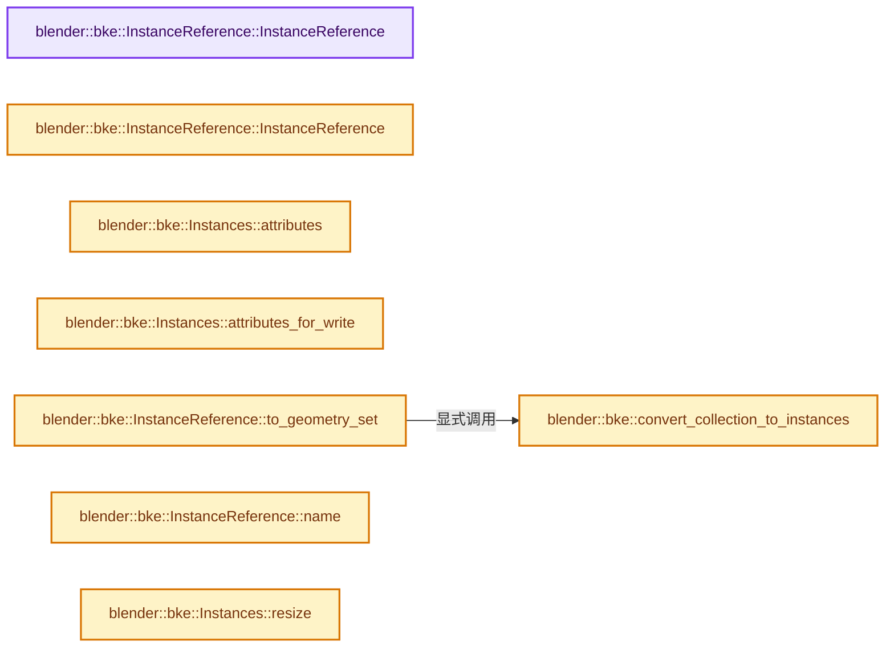
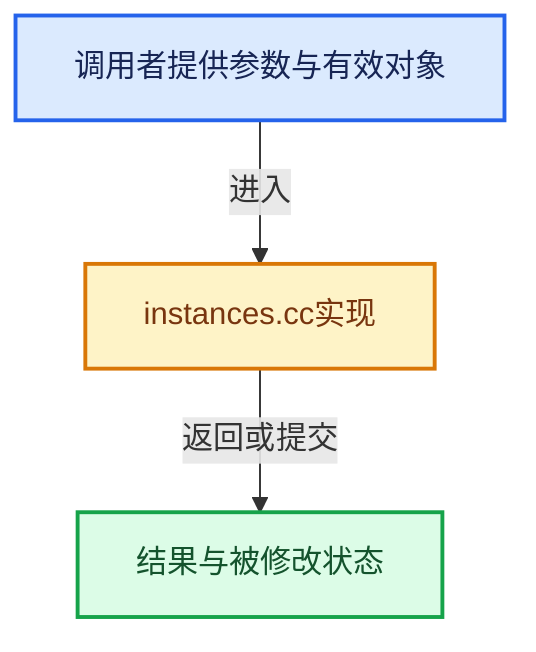

# 实现依赖专题：source/blender/blenkernel/intern/instances.cc

[实现依赖导航](../../README.md) · [符号索引](../../../00-课程指南/02-源码与提交索引/符号依赖与实现索引.md)

本专题从正文实际调用进入，集中保存共享实现。函数有稳定锚点，可从调用处直接跳到对应完整函数；递归与互相调用通过回链组织。

## 本文件的实现关系






## 完整成员与函数实现

<a id="f-087c9bd8d14e53b8"></a>

### `blender::bke::InstanceReference::InstanceReference`

实现位置：[source/blender/blenkernel/intern/instances.cc](../../../../../../../source/blender/blenkernel/intern/instances.cc) · L25—L29。

接口参数：

- `GeometrySet geometry_set`

**教学注释版**

<!-- annotated:b4772f6accb351 -->

```cpp
InstanceReference::InstanceReference(GeometrySet geometry_set)
    : type_(Type::GeometrySet),
      geometry_set_(std::make_unique<GeometrySet>(std::move(geometry_set)))
{
}
```

<details>
<summary>核对原始源码：source/blender/blenkernel/intern/instances.cc · L25—L29</summary>

<!-- original:b4772f6accb351:source/blender/blenkernel/intern/instances.cc:25:29 -->

```cpp
InstanceReference::InstanceReference(GeometrySet geometry_set)
    : type_(Type::GeometrySet),
      geometry_set_(std::make_unique<GeometrySet>(std::move(geometry_set)))
{
}
```

</details>

**继续追踪实现**

本实现没有需要继续展开的显式调用；检查返回表达式、对象转换和调用者前置条件。

<a id="f-3a1a225c151dca34"></a>

### `blender::bke::InstanceReference::InstanceReference`

实现位置：[source/blender/blenkernel/intern/instances.cc](../../../../../../../source/blender/blenkernel/intern/instances.cc) · L31—L37。

接口参数：

- `const InstanceReference &other`

**教学注释版**

<!-- annotated:0ed2a82f1668c8 -->

```cpp
InstanceReference::InstanceReference(const InstanceReference &other)
    : type_(other.type_), data_(other.data_)
{
  if (other.geometry_set_) {
    // [讲解] std::make_unique<GeometrySet>：创建独占拥有的对象，拥有关系可移动，get返回的借用指针不自动延长寿命。
    geometry_set_ = std::make_unique<GeometrySet>(*other.geometry_set_);
  }
}
```

<details>
<summary>核对原始源码：source/blender/blenkernel/intern/instances.cc · L31—L37</summary>

<!-- original:0ed2a82f1668c8:source/blender/blenkernel/intern/instances.cc:31:37 -->

```cpp
InstanceReference::InstanceReference(const InstanceReference &other)
    : type_(other.type_), data_(other.data_)
{
  if (other.geometry_set_) {
    geometry_set_ = std::make_unique<GeometrySet>(*other.geometry_set_);
  }
}
```

</details>

**沿实际写入检查状态**

- `geometry_set_ = std::make_unique<GeometrySet>(*other.geometry_set_);`

**继续追踪实现**

- `std::make_unique<GeometrySet>` → [外部契约](https://eel.is/c++draft/unique.ptr.create)：创建独占拥有的对象，拥有关系可移动，get返回的借用指针不自动延长寿命。

<a id="f-41bd4f24fbbb94a0"></a>

### `blender::bke::Instances::attributes`

实现位置：[source/blender/blenkernel/intern/instances.cc](../../../../../../../source/blender/blenkernel/intern/instances.cc) · L68—L71。

**教学注释版**

<!-- annotated:7bc549121d2d13 -->

```cpp
AttributeAccessor Instances::attributes() const
{
  return AttributeAccessor(this, instance_attribute_accessor_functions());
}
```

<details>
<summary>核对原始源码：source/blender/blenkernel/intern/instances.cc · L68—L71</summary>

<!-- original:7bc549121d2d13:source/blender/blenkernel/intern/instances.cc:68:71 -->

```cpp
AttributeAccessor Instances::attributes() const
{
  return AttributeAccessor(this, instance_attribute_accessor_functions());
}
```

</details>

**结果出口**

- `return AttributeAccessor(this, instance_attribute_accessor_functions());`

**继续追踪实现**

- `AttributeAccessor` → [blender::bke::AttributeAccessor::AttributeAccessor · L512](../../../05-几何存储与拓扑映射/08-AttributeAccessor接口.md#f-9d1f53e927223cec)。
- `instance_attribute_accessor_functions` → [blender::bke::instance_attribute_accessor_functions · L220](instances_attributes.cc.md#f-442b864517b792fc)。

<a id="f-452492ea2d55b0bc"></a>

### `blender::bke::Instances::attributes_for_write`

实现位置：[source/blender/blenkernel/intern/instances.cc](../../../../../../../source/blender/blenkernel/intern/instances.cc) · L73—L76。

**教学注释版**

<!-- annotated:abf905e49b7b57 -->

```cpp
MutableAttributeAccessor Instances::attributes_for_write()
{
  return MutableAttributeAccessor(this, instance_attribute_accessor_functions());
}
```

<details>
<summary>核对原始源码：source/blender/blenkernel/intern/instances.cc · L73—L76</summary>

<!-- original:abf905e49b7b57:source/blender/blenkernel/intern/instances.cc:73:76 -->

```cpp
MutableAttributeAccessor Instances::attributes_for_write()
{
  return MutableAttributeAccessor(this, instance_attribute_accessor_functions());
}
```

</details>

**结果出口**

- `return MutableAttributeAccessor(this, instance_attribute_accessor_functions());`

**继续追踪实现**

- `MutableAttributeAccessor` → [blender::bke::MutableAttributeAccessor::MutableAttributeAccessor · L709](../../../05-几何存储与拓扑映射/08-AttributeAccessor接口.md#f-22c329b6ae0e6946)。
- `instance_attribute_accessor_functions` → [blender::bke::instance_attribute_accessor_functions · L220](instances_attributes.cc.md#f-442b864517b792fc)。

<a id="f-8ebdcc29fda2b31e"></a>

### `blender::bke::convert_collection_to_instances`

实现位置：[source/blender/blenkernel/intern/instances.cc](../../../../../../../source/blender/blenkernel/intern/instances.cc) · L78—L113。

接口参数：

- `const Collection &collection`

**教学注释版**

<!-- annotated:da8213f8775bd8 -->

```cpp
static std::unique_ptr<bke::Instances> convert_collection_to_instances(
    const Collection &collection)
{
  const int instances_num = collection.children.count() + collection.gobject.count();

  // [讲解] std::make_unique<bke::Instances>：创建独占拥有的对象，拥有关系可移动，get返回的借用指针不自动延长寿命。
  auto instances = std::make_unique<bke::Instances>(instances_num);

  MutableSpan<int> handles = instances->reference_handles_for_write();
  MutableSpan<float4x4> transforms = instances->transforms_for_write();

  int i = 0;

  for (CollectionChild &collection_child : collection.children) {
    float4x4 transform = float4x4::identity();
    transform.location() += float3(collection_child.collection->instance_offset);
    transform.location() -= float3(collection.instance_offset);
    transforms[i] = transform;

    handles[i] = instances->add_reference(*collection_child.collection);

    i++;
  }

  for (CollectionObject &collection_object : collection.gobject) {
    float4x4 transform = float4x4::identity();
    transform.location() -= float3(collection.instance_offset);
    transform *= (collection_object.ob)->object_to_world();
    transforms[i] = transform;

    handles[i] = instances->add_reference(*collection_object.ob);

    i++;
  }

  return instances;
}
```

<details>
<summary>核对原始源码：source/blender/blenkernel/intern/instances.cc · L78—L113</summary>

<!-- original:da8213f8775bd8:source/blender/blenkernel/intern/instances.cc:78:113 -->

```cpp
static std::unique_ptr<bke::Instances> convert_collection_to_instances(
    const Collection &collection)
{
  const int instances_num = collection.children.count() + collection.gobject.count();

  auto instances = std::make_unique<bke::Instances>(instances_num);

  MutableSpan<int> handles = instances->reference_handles_for_write();
  MutableSpan<float4x4> transforms = instances->transforms_for_write();

  int i = 0;

  for (CollectionChild &collection_child : collection.children) {
    float4x4 transform = float4x4::identity();
    transform.location() += float3(collection_child.collection->instance_offset);
    transform.location() -= float3(collection.instance_offset);
    transforms[i] = transform;

    handles[i] = instances->add_reference(*collection_child.collection);

    i++;
  }

  for (CollectionObject &collection_object : collection.gobject) {
    float4x4 transform = float4x4::identity();
    transform.location() -= float3(collection.instance_offset);
    transform *= (collection_object.ob)->object_to_world();
    transforms[i] = transform;

    handles[i] = instances->add_reference(*collection_object.ob);

    i++;
  }

  return instances;
}
```

</details>

**沿实际写入检查状态**

- `transforms[i] = transform;`
- `handles[i] = instances->add_reference(*collection_child.collection);`
- `transform *= (collection_object.ob)->object_to_world();`
- `handles[i] = instances->add_reference(*collection_object.ob);`

**结果出口**

- `return instances;`

**继续追踪实现**

- `collection.children.count` → [调用协议](../../../00-课程指南/01-路线与规范/模板宏与动态分派协议.md)：接收对象类型依赖auto、返回值或模板实例；不按同名猜测目标。调用位置L81。
- `collection.gobject.count` → [调用协议](../../../00-课程指南/01-路线与规范/模板宏与动态分派协议.md)：接收对象类型依赖auto、返回值或模板实例；不按同名猜测目标。调用位置L81。
- `std::make_unique<bke::Instances>` → [外部契约](https://eel.is/c++draft/unique.ptr.create)：创建独占拥有的对象，拥有关系可移动，get返回的借用指针不自动延长寿命。
- `instances->reference_handles_for_write` → [调用协议](../../../00-课程指南/01-路线与规范/模板宏与动态分派协议.md)：接收对象类型依赖auto、返回值或模板实例；不按同名猜测目标。调用位置L85。
- `instances->transforms_for_write` → [调用协议](../../../00-课程指南/01-路线与规范/模板宏与动态分派协议.md)：接收对象类型依赖auto、返回值或模板实例；不按同名猜测目标。调用位置L86。
- `float4x4::identity` → [调用协议](../../../00-课程指南/01-路线与规范/模板宏与动态分派协议.md)：函数指针、局部可调用对象或未展开的宏；必须结合调用者环境。调用位置L91。
- `transform.location` → [调用协议](../../../00-课程指南/01-路线与规范/模板宏与动态分派协议.md)：由接收对象具体类型或运行时策略提供实现。调用位置L92。
- `float3` → [float3 · L641](../../08-其他Blender模块/compositor/algorithms/intern/smaa.cc.md#m-0ea8254cfdb4)。宏定义由构建条件选择。
- `instances->add_reference` → [调用协议](../../../00-课程指南/01-路线与规范/模板宏与动态分派协议.md)：接收对象类型依赖auto、返回值或模板实例；不按同名猜测目标。调用位置L96。
- `(collection_object.ob)->object_to_world` → [调用协议](../../../00-课程指南/01-路线与规范/模板宏与动态分派协议.md)：接收对象类型依赖auto、返回值或模板实例；不按同名猜测目标。调用位置L104。

<a id="f-597955f536f1020f"></a>

### `blender::bke::InstanceReference::to_geometry_set`

实现位置：[source/blender/blenkernel/intern/instances.cc](../../../../../../../source/blender/blenkernel/intern/instances.cc) · L115—L138。

接口参数：

- `GeometrySet &r_geometry_set`

**教学注释版**

<!-- annotated:61bac8609e746c -->

```cpp
void InstanceReference::to_geometry_set(GeometrySet &r_geometry_set) const
{
  r_geometry_set.clear();
  switch (type_) {
    case Type::Object: {
      const Object &object = this->object();
      r_geometry_set = bke::object_get_evaluated_geometry_set(object);
      break;
    }
    case Type::Collection: {
      const Collection &collection = this->collection();
      std::unique_ptr<bke::Instances> instances_ptr = convert_collection_to_instances(collection);
      r_geometry_set.replace_instances(instances_ptr.release());
      break;
    }
    case Type::GeometrySet: {
      r_geometry_set = this->geometry_set();
      break;
    }
    case Type::None: {
      break;
    }
  }
}
```

<details>
<summary>核对原始源码：source/blender/blenkernel/intern/instances.cc · L115—L138</summary>

<!-- original:61bac8609e746c:source/blender/blenkernel/intern/instances.cc:115:138 -->

```cpp
void InstanceReference::to_geometry_set(GeometrySet &r_geometry_set) const
{
  r_geometry_set.clear();
  switch (type_) {
    case Type::Object: {
      const Object &object = this->object();
      r_geometry_set = bke::object_get_evaluated_geometry_set(object);
      break;
    }
    case Type::Collection: {
      const Collection &collection = this->collection();
      std::unique_ptr<bke::Instances> instances_ptr = convert_collection_to_instances(collection);
      r_geometry_set.replace_instances(instances_ptr.release());
      break;
    }
    case Type::GeometrySet: {
      r_geometry_set = this->geometry_set();
      break;
    }
    case Type::None: {
      break;
    }
  }
}
```

</details>

**沿实际写入检查状态**

- `r_geometry_set = bke::object_get_evaluated_geometry_set(object);`
- `r_geometry_set = this->geometry_set();`

**继续追踪实现**

- `r_geometry_set.clear` → [blender::bke::GeometrySet::clear · L265](../../../06-隐式共享与缓存系统/05-GeometrySet读写与复制.md#f-8c0f2e9da85aab58)。
- `this->object` → [blender::bke::InstanceReference::object · L283](../BKE_instances.hh.md#f-67ac8fb7da7a6f9e)。
- `bke::object_get_evaluated_geometry_set` → [blender::bke::object_get_evaluated_geometry_set · L46](geometry_set_instances.cc.md#f-47e721147bb67b7f)。
- `this->collection` → [blender::bke::InstanceReference::collection · L289](../BKE_instances.hh.md#f-e08e28f7832eac09)。
- `convert_collection_to_instances` → [blender::bke::convert_collection_to_instances · L78](instances.cc.md#f-8ebdcc29fda2b31e)。
- `r_geometry_set.replace_instances` → [blender::bke::GeometrySet::replace_instances · L505](../../../06-隐式共享与缓存系统/05-GeometrySet读写与复制.md#f-b26122377a17a66c)。
- `instances_ptr.release` → [外部契约](https://eel.is/c++draft/)：这个边界按实际表达式及所属类型核对参数、返回值、寿命与失败行为。这里提供接口入口，不声称已解释该第三方版本的内部实现。
- `this->geometry_set` → [blender::bke::InstanceReference::geometry_set · L295](../BKE_instances.hh.md#f-39e1851c90d6f6f3)；[blender::bke::InstanceReference::geometry_set · L301](../BKE_instances.hh.md#f-3bba5053fead4038)。同名重载需按实参类型选择。

<a id="f-4024eea24b3596d9"></a>

### `blender::bke::InstanceReference::name`

实现位置：[source/blender/blenkernel/intern/instances.cc](../../../../../../../source/blender/blenkernel/intern/instances.cc) · L140—L153。

**教学注释版**

<!-- annotated:3899492dcf5c9a -->

```cpp
StringRefNull InstanceReference::name() const
{
  switch (type_) {
    case Type::Object:
      return this->object().id.name + 2;
    case Type::Collection:
      return this->collection().id.name + 2;
    case Type::GeometrySet:
      return this->geometry_set().name();
    case Type::None:
      break;
  }
  return "";
}
```

<details>
<summary>核对原始源码：source/blender/blenkernel/intern/instances.cc · L140—L153</summary>

<!-- original:3899492dcf5c9a:source/blender/blenkernel/intern/instances.cc:140:153 -->

```cpp
StringRefNull InstanceReference::name() const
{
  switch (type_) {
    case Type::Object:
      return this->object().id.name + 2;
    case Type::Collection:
      return this->collection().id.name + 2;
    case Type::GeometrySet:
      return this->geometry_set().name();
    case Type::None:
      break;
  }
  return "";
}
```

</details>

**结果出口**

- `return this->object().id.name + 2;`
- `return this->collection().id.name + 2;`
- `return this->geometry_set().name();`
- `return "";`

**继续追踪实现**

- `this->object` → [blender::bke::InstanceReference::object · L283](../BKE_instances.hh.md#f-67ac8fb7da7a6f9e)。
- `this->collection` → [blender::bke::InstanceReference::collection · L289](../BKE_instances.hh.md#f-e08e28f7832eac09)。
- `this->geometry_set().name` → [调用协议](../../../00-课程指南/01-路线与规范/模板宏与动态分派协议.md)：接收对象类型依赖auto、返回值或模板实例；不按同名猜测目标。调用位置L148。
- `this->geometry_set` → [blender::bke::InstanceReference::geometry_set · L295](../BKE_instances.hh.md#f-39e1851c90d6f6f3)；[blender::bke::InstanceReference::geometry_set · L301](../BKE_instances.hh.md#f-3bba5053fead4038)。同名重载需按实参类型选择。

<a id="f-35631267d05118c0"></a>

### `blender::bke::Instances::resize`

实现位置：[source/blender/blenkernel/intern/instances.cc](../../../../../../../source/blender/blenkernel/intern/instances.cc) · L216—L220。

接口参数：

- `int size`

**教学注释版**

<!-- annotated:1e3329b2c48aa9 -->

```cpp
void Instances::resize(int size)
{
  attributes_.resize(AttrDomain::Instance, size);
  instances_num_ = size;
}
```

<details>
<summary>核对原始源码：source/blender/blenkernel/intern/instances.cc · L216—L220</summary>

<!-- original:1e3329b2c48aa9:source/blender/blenkernel/intern/instances.cc:216:220 -->

```cpp
void Instances::resize(int size)
{
  attributes_.resize(AttrDomain::Instance, size);
  instances_num_ = size;
}
```

</details>

**沿实际写入检查状态**

- `instances_num_ = size;`

**继续追踪实现**

- `attributes_.resize` → [调用协议](../../../00-课程指南/01-路线与规范/模板宏与动态分派协议.md)：接收对象类型依赖auto、返回值或模板实例；不按同名猜测目标。调用位置L218。

<a id="f-191adc84775057a7"></a>

### `blender::bke::Instances::reference_handles`

实现位置：[source/blender/blenkernel/intern/instances.cc](../../../../../../../source/blender/blenkernel/intern/instances.cc) · L222—L227。

**教学注释版**

<!-- annotated:d74eff45841350 -->

```cpp
Span<int> Instances::reference_handles() const
{
  return get_span_attribute<int>(
             attributes_, AttrDomain::Instance, ".reference_index", instances_num_)
      .value_or(Span<int>());
}
```

<details>
<summary>核对原始源码：source/blender/blenkernel/intern/instances.cc · L222—L227</summary>

<!-- original:d74eff45841350:source/blender/blenkernel/intern/instances.cc:222:227 -->

```cpp
Span<int> Instances::reference_handles() const
{
  return get_span_attribute<int>(
             attributes_, AttrDomain::Instance, ".reference_index", instances_num_)
      .value_or(Span<int>());
}
```

</details>

**结果出口**

- `return get_span_attribute<int>(`

**继续追踪实现**

- `get_span_attribute<int>( attributes_, AttrDomain::Instance, ".reference_index", instances_num_) .value_or` → [调用协议](../../../00-课程指南/01-路线与规范/模板宏与动态分派协议.md)：接收对象类型依赖auto、返回值或模板实例；不按同名猜测目标。调用位置L224。
- `get_span_attribute<int>` → [blender::bke::get_span_attribute · L69](attribute_storage_access.hh.md#f-31bf92bc55779d80)；[blender::bke::get_span_attribute · L167](attribute_storage_access.cc.md#f-043f0c9c1fd78c2f)。同名重载需按实参类型选择。
- `Span<int>` → [blender::Span](../../01-BLI基础库/BLI_span.hh.md#t-8765a8e0c1d5)；[blender::Span](../../01-BLI基础库/BLI_index_range.hh.md#t-86091874a1c0)；[blender::Span](../../08-其他Blender模块/makesdna/DNA_pointcloud_types.h.md#t-112aa6ed842c)；[blender::Span](../../08-其他Blender模块/makesdna/DNA_node_types.h.md#t-49ec6fbb9b69)；[blender::Span](../../08-其他Blender模块/makesdna/DNA_mesh_types.h.md#t-184fd48fb638)；[blender::Span](../../08-其他Blender模块/makesdna/DNA_anim_types.h.md#t-d841071994c2)；[blender::Span](../../08-其他Blender模块/makesrna/RNA_path_fwd.hh.md#t-4dbb08969e41)。

<a id="f-8feaf9ceec17e391"></a>

### `blender::bke::Instances::reference_handles_for_write`

实现位置：[source/blender/blenkernel/intern/instances.cc](../../../../../../../source/blender/blenkernel/intern/instances.cc) · L229—L233。

**教学注释版**

<!-- annotated:edc1c6f4c46ded -->

```cpp
MutableSpan<int> Instances::reference_handles_for_write()
{
  return get_mutable_attribute<int>(
      attributes_, AttrDomain::Instance, ".reference_index", instances_num_);
}
```

<details>
<summary>核对原始源码：source/blender/blenkernel/intern/instances.cc · L229—L233</summary>

<!-- original:edc1c6f4c46ded:source/blender/blenkernel/intern/instances.cc:229:233 -->

```cpp
MutableSpan<int> Instances::reference_handles_for_write()
{
  return get_mutable_attribute<int>(
      attributes_, AttrDomain::Instance, ".reference_index", instances_num_);
}
```

</details>

**结果出口**

- `return get_mutable_attribute<int>(`

**继续追踪实现**

- `get_mutable_attribute<int>` → [blender::bke::get_mutable_attribute · L90](attribute_storage_access.hh.md#f-94948323441578df)；[blender::bke::get_mutable_attribute · L188](attribute_storage_access.cc.md#f-1dc04fa7db8e0dd3)。同名重载需按实参类型选择。

<a id="f-e15ea20162528723"></a>

### `blender::bke::Instances::transforms`

实现位置：[source/blender/blenkernel/intern/instances.cc](../../../../../../../source/blender/blenkernel/intern/instances.cc) · L235—L240。

**教学注释版**

<!-- annotated:895b7d7796ac90 -->

```cpp
Span<float4x4> Instances::transforms() const
{
  return get_span_attribute<float4x4>(
             attributes_, AttrDomain::Instance, "instance_transform", instances_num_)
      .value_or(Span<float4x4>());
}
```

<details>
<summary>核对原始源码：source/blender/blenkernel/intern/instances.cc · L235—L240</summary>

<!-- original:895b7d7796ac90:source/blender/blenkernel/intern/instances.cc:235:240 -->

```cpp
Span<float4x4> Instances::transforms() const
{
  return get_span_attribute<float4x4>(
             attributes_, AttrDomain::Instance, "instance_transform", instances_num_)
      .value_or(Span<float4x4>());
}
```

</details>

**结果出口**

- `return get_span_attribute<float4x4>(`

**继续追踪实现**

- `get_span_attribute<float4x4>( attributes_, AttrDomain::Instance, "instance_transform", instances_num_) .value_or` → [调用协议](../../../00-课程指南/01-路线与规范/模板宏与动态分派协议.md)：接收对象类型依赖auto、返回值或模板实例；不按同名猜测目标。调用位置L237。
- `get_span_attribute<float4x4>` → [blender::bke::get_span_attribute · L69](attribute_storage_access.hh.md#f-31bf92bc55779d80)；[blender::bke::get_span_attribute · L167](attribute_storage_access.cc.md#f-043f0c9c1fd78c2f)。同名重载需按实参类型选择。
- `Span<float4x4>` → [blender::Span](../../01-BLI基础库/BLI_span.hh.md#t-8765a8e0c1d5)；[blender::Span](../../01-BLI基础库/BLI_index_range.hh.md#t-86091874a1c0)；[blender::Span](../../08-其他Blender模块/makesdna/DNA_pointcloud_types.h.md#t-112aa6ed842c)；[blender::Span](../../08-其他Blender模块/makesdna/DNA_node_types.h.md#t-49ec6fbb9b69)；[blender::Span](../../08-其他Blender模块/makesdna/DNA_mesh_types.h.md#t-184fd48fb638)；[blender::Span](../../08-其他Blender模块/makesdna/DNA_anim_types.h.md#t-d841071994c2)；[blender::Span](../../08-其他Blender模块/makesrna/RNA_path_fwd.hh.md#t-4dbb08969e41)。

<a id="f-0350d6057ae379dc"></a>

### `blender::bke::Instances::transforms_for_write`

实现位置：[source/blender/blenkernel/intern/instances.cc](../../../../../../../source/blender/blenkernel/intern/instances.cc) · L242—L246。

**教学注释版**

<!-- annotated:80b90db0ec502e -->

```cpp
MutableSpan<float4x4> Instances::transforms_for_write()
{
  return get_mutable_attribute<float4x4>(
      attributes_, AttrDomain::Instance, "instance_transform", instances_num_);
}
```

<details>
<summary>核对原始源码：source/blender/blenkernel/intern/instances.cc · L242—L246</summary>

<!-- original:80b90db0ec502e:source/blender/blenkernel/intern/instances.cc:242:246 -->

```cpp
MutableSpan<float4x4> Instances::transforms_for_write()
{
  return get_mutable_attribute<float4x4>(
      attributes_, AttrDomain::Instance, "instance_transform", instances_num_);
}
```

</details>

**结果出口**

- `return get_mutable_attribute<float4x4>(`

**继续追踪实现**

- `get_mutable_attribute<float4x4>` → [blender::bke::get_mutable_attribute · L90](attribute_storage_access.hh.md#f-94948323441578df)；[blender::bke::get_mutable_attribute · L188](attribute_storage_access.cc.md#f-1dc04fa7db8e0dd3)。同名重载需按实参类型选择。

<a id="f-fde187bc84995b87"></a>

### `blender::bke::Instances::add_new_reference`

实现位置：[source/blender/blenkernel/intern/instances.cc](../../../../../../../source/blender/blenkernel/intern/instances.cc) · L284—L288。

接口参数：

- `InstanceReference reference`

**教学注释版**

<!-- annotated:d8e44d9c4ccae3 -->

```cpp
int Instances::add_new_reference(InstanceReference reference)
{
  this->tag_reference_handles_changed();
  // [讲解] std::move：把表达式转换成可供移动重载选择的值类别；不保证真的移动，不结束源对象寿命，对const值可能选择复制。
  return references_.append_and_get_index(std::move(reference));
}
```

<details>
<summary>核对原始源码：source/blender/blenkernel/intern/instances.cc · L284—L288</summary>

<!-- original:d8e44d9c4ccae3:source/blender/blenkernel/intern/instances.cc:284:288 -->

```cpp
int Instances::add_new_reference(InstanceReference reference)
{
  this->tag_reference_handles_changed();
  return references_.append_and_get_index(std::move(reference));
}
```

</details>

**结果出口**

- `return references_.append_and_get_index(std::move(reference));`

**继续追踪实现**

- `this->tag_reference_handles_changed` → [blender::bke::Instances::tag_reference_handles_changed · L222](../BKE_instances.hh.md#f-1e4f8467bc0a8283)。
- `references_.append_and_get_index` → [调用协议](../../../00-课程指南/01-路线与规范/模板宏与动态分派协议.md)：接收对象类型依赖auto、返回值或模板实例；不按同名猜测目标。调用位置L287。
- `std::move` → [外部契约](https://eel.is/c++draft/utility.forward)：把表达式转换成可供移动重载选择的值类别；不保证真的移动，不结束源对象寿命，对const值可能选择复制。

<a id="f-d0561cd365f4ff3b"></a>

### `blender::bke::Instances::references`

实现位置：[source/blender/blenkernel/intern/instances.cc](../../../../../../../source/blender/blenkernel/intern/instances.cc) · L290—L293。

**教学注释版**

<!-- annotated:3c032b880e7dde -->

```cpp
Span<InstanceReference> Instances::references() const
{
  return references_;
}
```

<details>
<summary>核对原始源码：source/blender/blenkernel/intern/instances.cc · L290—L293</summary>

<!-- original:3c032b880e7dde:source/blender/blenkernel/intern/instances.cc:290:293 -->

```cpp
Span<InstanceReference> Instances::references() const
{
  return references_;
}
```

</details>

**结果出口**

- `return references_;`

**继续追踪实现**

本实现没有需要继续展开的显式调用；检查返回表达式、对象转换和调用者前置条件。

<a id="f-91b59acce441c731"></a>

### `blender::bke::Instances::references_for_write`

实现位置：[source/blender/blenkernel/intern/instances.cc](../../../../../../../source/blender/blenkernel/intern/instances.cc) · L295—L298。

**教学注释版**

<!-- annotated:52fe7ae8a3dc9b -->

```cpp
MutableSpan<InstanceReference> Instances::references_for_write()
{
  return references_;
}
```

<details>
<summary>核对原始源码：source/blender/blenkernel/intern/instances.cc · L295—L298</summary>

<!-- original:52fe7ae8a3dc9b:source/blender/blenkernel/intern/instances.cc:295:298 -->

```cpp
MutableSpan<InstanceReference> Instances::references_for_write()
{
  return references_;
}
```

</details>

**结果出口**

- `return references_;`

**继续追踪实现**

本实现没有需要继续展开的显式调用；检查返回表达式、对象转换和调用者前置条件。

<a id="f-0284f09f6f4a3b4f"></a>

### `blender::bke::Instances::instances_num`

实现位置：[source/blender/blenkernel/intern/instances.cc](../../../../../../../source/blender/blenkernel/intern/instances.cc) · L408—L411。

**教学注释版**

<!-- annotated:a449181e6f1f52 -->

```cpp
int Instances::instances_num() const
{
  return this->instances_num_;
}
```

<details>
<summary>核对原始源码：source/blender/blenkernel/intern/instances.cc · L408—L411</summary>

<!-- original:a449181e6f1f52:source/blender/blenkernel/intern/instances.cc:408:411 -->

```cpp
int Instances::instances_num() const
{
  return this->instances_num_;
}
```

</details>

**结果出口**

- `return this->instances_num_;`

**继续追踪实现**

本实现没有需要继续展开的显式调用；检查返回表达式、对象转换和调用者前置条件。

<a id="f-00fbd740895c868f"></a>

### `blender::bke::instance_position_varray`

实现位置：[source/blender/blenkernel/intern/instances.cc](../../../../../../../source/blender/blenkernel/intern/instances.cc) · L544—L548。

接口参数：

- `const Instances &instances`

**教学注释版**

<!-- annotated:1859651833cbf1 -->

```cpp
VArray<float3> instance_position_varray(const Instances &instances)
{
  return VArray<float3>::from_derived_span<float4x4, get_transform_position>(
      instances.transforms());
}
```

<details>
<summary>核对原始源码：source/blender/blenkernel/intern/instances.cc · L544—L548</summary>

<!-- original:1859651833cbf1:source/blender/blenkernel/intern/instances.cc:544:548 -->

```cpp
VArray<float3> instance_position_varray(const Instances &instances)
{
  return VArray<float3>::from_derived_span<float4x4, get_transform_position>(
      instances.transforms());
}
```

</details>

**结果出口**

- `return VArray<float3>::from_derived_span<float4x4, get_transform_position>(`

**继续追踪实现**

- `VArray<float3>::from_derived_span<float4x4, get_transform_position>` → [blender::VArray::VArray · L729](../../../04-虚拟数组与索引选择/03-单值与Span表示.md#f-d7ae0ad405cffa83)；[blender::VArray::VArray · L731](../../../04-虚拟数组与索引选择/03-单值与Span表示.md#f-23fc37534533119a)；[blender::VArray::VArray · L733](../../../04-虚拟数组与索引选择/03-单值与Span表示.md#f-69612c15887be77d)；[blender::VArray::VArray · L735](../../../04-虚拟数组与索引选择/03-单值与Span表示.md#f-75f0a06e36786df7)；[blender::VArray::VArray · L740](../../../04-虚拟数组与索引选择/03-单值与Span表示.md#f-2f6f2caa2a2d034f)。同名重载需按实参类型选择。
- `instances.transforms` → [blender::bke::Instances::transforms · L235](instances.cc.md#f-e15ea20162528723)。
