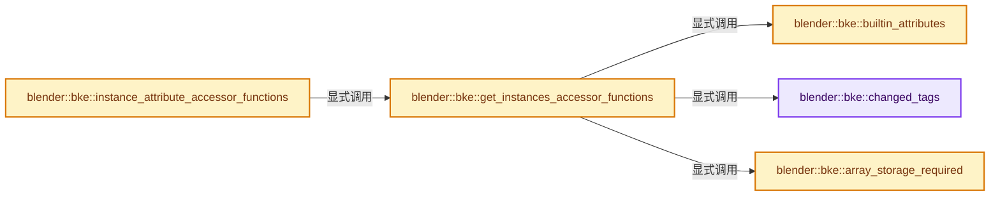
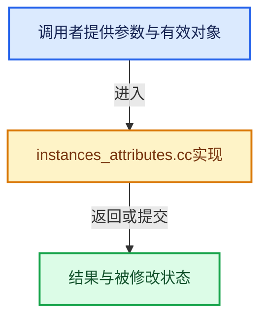

# 实现依赖专题：source/blender/blenkernel/intern/instances_attributes.cc

[实现依赖导航](../../README.md) · [符号索引](../../../00-课程指南/02-源码与提交索引/符号依赖与实现索引.md)

本专题从正文实际调用进入，集中保存共享实现。函数有稳定锚点，可从调用处直接跳到对应完整函数；递归与互相调用通过回链组织。

## 本文件的实现关系






## 完整成员与函数实现

<a id="f-c7c5628428fe3d71"></a>

### `blender::bke::changed_tags`

实现位置：[source/blender/blenkernel/intern/instances_attributes.cc](../../../../../../../source/blender/blenkernel/intern/instances_attributes.cc) · L21—L27。

**教学注释版**

<!-- annotated:3d6dc6e9cd2c01 -->

```cpp
static const auto &changed_tags()
{
  static Map<StringRef, AttrUpdateOnChange> attributes{
      {".reference_index", tag_component_reference_index_changed},
  };
  return attributes;
}
```

<details>
<summary>核对原始源码：source/blender/blenkernel/intern/instances_attributes.cc · L21—L27</summary>

<!-- original:3d6dc6e9cd2c01:source/blender/blenkernel/intern/instances_attributes.cc:21:27 -->

```cpp
static const auto &changed_tags()
{
  static Map<StringRef, AttrUpdateOnChange> attributes{
      {".reference_index", tag_component_reference_index_changed},
  };
  return attributes;
}
```

</details>

**结果出口**

- `return attributes;`

**继续追踪实现**

本实现没有需要继续展开的显式调用；检查返回表达式、对象转换和调用者前置条件。

<a id="f-93748f3e434b61ab"></a>

### `blender::bke::builtin_attributes`

实现位置：[source/blender/blenkernel/intern/instances_attributes.cc](../../../../../../../source/blender/blenkernel/intern/instances_attributes.cc) · L29—L46。

**教学注释版**

<!-- annotated:d6f68601e20c9b -->

```cpp
static const auto &builtin_attributes()
{
  static auto attributes = []() {
    Map<StringRef, AttrBuiltinInfo> map;

    AttrBuiltinInfo instance_transform(bke::AttrDomain::Instance, bke::AttrType::Float4x4);
    instance_transform.deletable = false;
    // [讲解] map.add_new：按哈希与相等关系加入键或键值。
    map.add_new("instance_transform", std::move(instance_transform));

    /** Indices into `Instances::references_`. Determines what data is instanced. */
    AttrBuiltinInfo reference_index(bke::AttrDomain::Instance, bke::AttrType::Int32);
    reference_index.deletable = false;
    // [讲解] std::move：把表达式转换成可供移动重载选择的值类别；不保证真的移动，不结束源对象寿命，对const值可能选择复制。
    map.add_new(".reference_index", std::move(reference_index));

    return map;
  }();
  return attributes;
}
```

<details>
<summary>核对原始源码：source/blender/blenkernel/intern/instances_attributes.cc · L29—L46</summary>

<!-- original:d6f68601e20c9b:source/blender/blenkernel/intern/instances_attributes.cc:29:46 -->

```cpp
static const auto &builtin_attributes()
{
  static auto attributes = []() {
    Map<StringRef, AttrBuiltinInfo> map;

    AttrBuiltinInfo instance_transform(bke::AttrDomain::Instance, bke::AttrType::Float4x4);
    instance_transform.deletable = false;
    map.add_new("instance_transform", std::move(instance_transform));

    /** Indices into `Instances::references_`. Determines what data is instanced. */
    AttrBuiltinInfo reference_index(bke::AttrDomain::Instance, bke::AttrType::Int32);
    reference_index.deletable = false;
    map.add_new(".reference_index", std::move(reference_index));

    return map;
  }();
  return attributes;
}
```

</details>

**沿实际写入检查状态**

- `instance_transform.deletable = false;`
- `reference_index.deletable = false;`

**结果出口**

- `return map;`
- `return attributes;`

**继续追踪实现**

- `[]() { Map<StringRef, AttrBuiltinInfo> map; AttrBuiltinInfo instance_transform(bke::AttrDomain::Instance, bke::AttrType::Float4x4); instance_transform.deletable = false; map.add_ne …（完整表达式见本函数源码）` → [调用协议](../../../00-课程指南/01-路线与规范/模板宏与动态分派协议.md)：函数指针、局部可调用对象或未展开的宏；必须结合调用者环境。调用位置L31。
- `map.add_new` → [blender::Map::add_new · L265](../../../02-哈希表与关联数据结构/02-Map总体布局.md#f-521ff0865e8229d0)；[blender::Map::add_new · L269](../../../02-哈希表与关联数据结构/02-Map总体布局.md#f-d89cee0e3d2848a0)；[blender::Map::add_new · L273](../../../02-哈希表与关联数据结构/02-Map总体布局.md#f-c13142c32e703ebd)；[blender::Map::add_new · L277](../../../02-哈希表与关联数据结构/04-Map查找与键访问.md#f-da1e537f229db040)。同名重载需按实参类型选择。
- `std::move` → [外部契约](https://eel.is/c++draft/utility.forward)：把表达式转换成可供移动重载选择的值类别；不保证真的移动，不结束源对象寿命，对const值可能选择复制。

<a id="f-9c417e188603ad46"></a>

### `blender::bke::array_storage_required`

实现位置：[source/blender/blenkernel/intern/instances_attributes.cc](../../../../../../../source/blender/blenkernel/intern/instances_attributes.cc) · L48—L52。

**教学注释版**

<!-- annotated:ee3ec0d989bf25 -->

```cpp
static const auto &array_storage_required()
{
  static Set<StringRef> attributes{"instance_transform", ".reference_index"};
  return attributes;
}
```

<details>
<summary>核对原始源码：source/blender/blenkernel/intern/instances_attributes.cc · L48—L52</summary>

<!-- original:ee3ec0d989bf25:source/blender/blenkernel/intern/instances_attributes.cc:48:52 -->

```cpp
static const auto &array_storage_required()
{
  static Set<StringRef> attributes{"instance_transform", ".reference_index"};
  return attributes;
}
```

</details>

**结果出口**

- `return attributes;`

**继续追踪实现**

本实现没有需要继续展开的显式调用；检查返回表达式、对象转换和调用者前置条件。

<a id="f-f109034c074ba98c"></a>

### `blender::bke::get_instances_accessor_functions`

实现位置：[source/blender/blenkernel/intern/instances_attributes.cc](../../../../../../../source/blender/blenkernel/intern/instances_attributes.cc) · L54—L218。

**教学注释版**

<!-- annotated:78c022b68320c3 -->

```cpp
static constexpr AttributeAccessorFunctions get_instances_accessor_functions()
{
  AttributeAccessorFunctions fn{};
  fn.domain_supported = [](const void * /*owner*/, const AttrDomain domain) {
    return domain == AttrDomain::Instance;
  };
  fn.domain_size = [](const void *owner, const AttrDomain domain) {
    return domain == AttrDomain::Instance ?
               static_cast<const Instances *>(owner)->instances_num() :
               0;
  };
  fn.builtin_domain_and_type = [](const void * /*owner*/,
                                  const StringRef name) -> std::optional<AttributeDomainAndType> {
    const AttrBuiltinInfo *info = builtin_attributes().lookup_ptr(name);
    if (!info) {
      return std::nullopt;
    }
    return AttributeDomainAndType{info->domain, info->type};
  };
  fn.get_builtin_default = [](const void * /*owner*/, StringRef name) -> GPointer {
    const AttrBuiltinInfo &info = builtin_attributes().lookup(name);
    return info.default_value;
  };
  fn.lookup_meta_data = [](const void *owner, StringRef name) -> std::optional<AttributeMetaData> {
    const Instances &instances = *static_cast<const Instances *>(owner);
    const AttributeStorage &storage = instances.attribute_storage();
    const Attribute *attr = storage.lookup(name);
    if (!attr) {
      return std::nullopt;
    }
    return AttributeMetaData{attr->domain(), attr->data_type()};
  };
  fn.lookup = [](const void *owner, const StringRef name) -> GAttributeReader {
    const Instances &instances = *static_cast<const Instances *>(owner);
    const AttributeStorage &storage = instances.attribute_storage();
    const Attribute *attribute = storage.lookup(name);
    if (!attribute) {
      return {};
    }
    return attribute_to_reader(*attribute, AttrDomain::Instance, instances.instances_num());
  };
  fn.adapt_domain = [](const void * /*owner*/,
                       const GVArray &varray,
                       const AttrDomain from_domain,
                       const AttrDomain to_domain) {
    if (from_domain == to_domain && from_domain == AttrDomain::Instance) {
      return varray;
    }
    return GVArray{};
  };
  fn.foreach_attribute = [](const void *owner,
                            const FunctionRef<void(const AttributeIter &)> fn,
                            const AttributeAccessor &accessor) {
    const Instances &instances = *static_cast<const Instances *>(owner);
    const AttributeStorage &storage = instances.attribute_storage();
    for (const Attribute &attribute : storage) {
      const auto get_fn = [&]() {
        return attribute_to_reader(attribute, AttrDomain::Instance, instances.instances_num());
      };
      AttributeIter iter(attribute.name(), attribute.domain(), attribute.data_type(), get_fn);
      iter.is_builtin = builtin_attributes().contains(attribute.name());
      iter.storage_type = attribute.storage_type();
      iter.accessor = &accessor;
      fn(iter);
      if (iter.is_stopped()) {
        break;
      }
    }
  };
  fn.lookup_validator = [](const void * /*owner*/, const StringRef name) -> AttributeValidator {
    const AttrBuiltinInfo *info = builtin_attributes().lookup_ptr(name);
    if (!info) {
      return {};
    }
    return info->validator;
  };
  fn.lookup_for_write = [](void *owner, const StringRef name) -> GAttributeWriter {
    Instances &instances = *static_cast<Instances *>(owner);
    AttributeStorage &storage = instances.attribute_storage();
    Attribute *attribute = storage.lookup(name);
    if (!attribute) {
      return {};
    }
    return attribute_to_writer(&instances, changed_tags(), instances.instances_num(), *attribute);
  };
  fn.remove = [](void *owner, const StringRef name) -> bool {
    Instances &instances = *static_cast<Instances *>(owner);
    AttributeStorage &storage = instances.attribute_storage();
    if (const AttrBuiltinInfo *info = builtin_attributes().lookup_ptr(name)) {
      if (!info->deletable) {
        return false;
      }
    }
    const std::optional<AttrUpdateOnChange> fn = changed_tags().lookup_try(name);
    const bool removed = storage.remove(name);
    if (!removed) {
      return false;
    }
    if (fn) {
      (*fn)(owner);
    }
    return true;
  };
  fn.add = [](void *owner,
              const StringRef name,
              const AttrDomain domain,
              const AttrType type,
              const AttributeInit &initializer) {
    Instances &instances = *static_cast<Instances *>(owner);
    const int domain_size = instances.instances_num();
    AttributeStorage &storage = instances.attribute_storage();
    if (const AttrBuiltinInfo *info = builtin_attributes().lookup_ptr(name)) {
      if (info->domain != domain || info->type != type) {
        return false;
      }
    }
    if (storage.lookup(name)) {
      return false;
    }
    const bool array = array_storage_required().contains(name);
    Attribute::DataVariant data = attribute_init_to_data(type, domain_size, initializer, array);
    // [讲解] std::move：把表达式转换成可供移动重载选择的值类别；不保证真的移动，不结束源对象寿命，对const值可能选择复制。
    storage.add(name, domain, type, std::move(data));
    if (initializer.type != AttributeInit::Type::Construct) {
      if (const std::optional<AttrUpdateOnChange> fn = changed_tags().lookup_try(name)) {
        (*fn)(owner);
      }
    }
    return true;
  };
  fn.rename = [](void *owner,
                 const Map<StringRef, StringRef> &name_map,
                 bool overwrite) -> Set<StringRef> {
    Instances &instances = *static_cast<Instances *>(owner);
    return rename_attributes(
        instances.attribute_storage(),
        name_map,
        overwrite,
        builtin_attributes(),
        array_storage_required(),
        [&](const bke::AttrDomain /*domain*/) { return instances.instances_num(); },
        std::nullopt,
        {});
  };
  fn.assign_data = [](void *owner, StringRef name, const AttributeInit &initializer) {
    Instances &instances = *static_cast<Instances *>(owner);
    AttributeStorage &storage = instances.attribute_storage();
    Attribute *attr = storage.lookup(name);
    if (!attr) {
      return false;
    }
    Attribute::DataVariant data = attribute_init_to_data(attr->data_type(),
                                                         instances.instances_num(),
                                                         initializer,
                                                         array_storage_required().contains(name));
    attr->assign_data(std::move(data));
    if (initializer.type != AttributeInit::Type::Construct) {
      if (const std::optional<AttrUpdateOnChange> fn = changed_tags().lookup_try(name)) {
        (*fn)(owner);
      }
    }
    return true;
  };

  return fn;
}
```

<details>
<summary>核对原始源码：source/blender/blenkernel/intern/instances_attributes.cc · L54—L218</summary>

<!-- original:78c022b68320c3:source/blender/blenkernel/intern/instances_attributes.cc:54:218 -->

```cpp
static constexpr AttributeAccessorFunctions get_instances_accessor_functions()
{
  AttributeAccessorFunctions fn{};
  fn.domain_supported = [](const void * /*owner*/, const AttrDomain domain) {
    return domain == AttrDomain::Instance;
  };
  fn.domain_size = [](const void *owner, const AttrDomain domain) {
    return domain == AttrDomain::Instance ?
               static_cast<const Instances *>(owner)->instances_num() :
               0;
  };
  fn.builtin_domain_and_type = [](const void * /*owner*/,
                                  const StringRef name) -> std::optional<AttributeDomainAndType> {
    const AttrBuiltinInfo *info = builtin_attributes().lookup_ptr(name);
    if (!info) {
      return std::nullopt;
    }
    return AttributeDomainAndType{info->domain, info->type};
  };
  fn.get_builtin_default = [](const void * /*owner*/, StringRef name) -> GPointer {
    const AttrBuiltinInfo &info = builtin_attributes().lookup(name);
    return info.default_value;
  };
  fn.lookup_meta_data = [](const void *owner, StringRef name) -> std::optional<AttributeMetaData> {
    const Instances &instances = *static_cast<const Instances *>(owner);
    const AttributeStorage &storage = instances.attribute_storage();
    const Attribute *attr = storage.lookup(name);
    if (!attr) {
      return std::nullopt;
    }
    return AttributeMetaData{attr->domain(), attr->data_type()};
  };
  fn.lookup = [](const void *owner, const StringRef name) -> GAttributeReader {
    const Instances &instances = *static_cast<const Instances *>(owner);
    const AttributeStorage &storage = instances.attribute_storage();
    const Attribute *attribute = storage.lookup(name);
    if (!attribute) {
      return {};
    }
    return attribute_to_reader(*attribute, AttrDomain::Instance, instances.instances_num());
  };
  fn.adapt_domain = [](const void * /*owner*/,
                       const GVArray &varray,
                       const AttrDomain from_domain,
                       const AttrDomain to_domain) {
    if (from_domain == to_domain && from_domain == AttrDomain::Instance) {
      return varray;
    }
    return GVArray{};
  };
  fn.foreach_attribute = [](const void *owner,
                            const FunctionRef<void(const AttributeIter &)> fn,
                            const AttributeAccessor &accessor) {
    const Instances &instances = *static_cast<const Instances *>(owner);
    const AttributeStorage &storage = instances.attribute_storage();
    for (const Attribute &attribute : storage) {
      const auto get_fn = [&]() {
        return attribute_to_reader(attribute, AttrDomain::Instance, instances.instances_num());
      };
      AttributeIter iter(attribute.name(), attribute.domain(), attribute.data_type(), get_fn);
      iter.is_builtin = builtin_attributes().contains(attribute.name());
      iter.storage_type = attribute.storage_type();
      iter.accessor = &accessor;
      fn(iter);
      if (iter.is_stopped()) {
        break;
      }
    }
  };
  fn.lookup_validator = [](const void * /*owner*/, const StringRef name) -> AttributeValidator {
    const AttrBuiltinInfo *info = builtin_attributes().lookup_ptr(name);
    if (!info) {
      return {};
    }
    return info->validator;
  };
  fn.lookup_for_write = [](void *owner, const StringRef name) -> GAttributeWriter {
    Instances &instances = *static_cast<Instances *>(owner);
    AttributeStorage &storage = instances.attribute_storage();
    Attribute *attribute = storage.lookup(name);
    if (!attribute) {
      return {};
    }
    return attribute_to_writer(&instances, changed_tags(), instances.instances_num(), *attribute);
  };
  fn.remove = [](void *owner, const StringRef name) -> bool {
    Instances &instances = *static_cast<Instances *>(owner);
    AttributeStorage &storage = instances.attribute_storage();
    if (const AttrBuiltinInfo *info = builtin_attributes().lookup_ptr(name)) {
      if (!info->deletable) {
        return false;
      }
    }
    const std::optional<AttrUpdateOnChange> fn = changed_tags().lookup_try(name);
    const bool removed = storage.remove(name);
    if (!removed) {
      return false;
    }
    if (fn) {
      (*fn)(owner);
    }
    return true;
  };
  fn.add = [](void *owner,
              const StringRef name,
              const AttrDomain domain,
              const AttrType type,
              const AttributeInit &initializer) {
    Instances &instances = *static_cast<Instances *>(owner);
    const int domain_size = instances.instances_num();
    AttributeStorage &storage = instances.attribute_storage();
    if (const AttrBuiltinInfo *info = builtin_attributes().lookup_ptr(name)) {
      if (info->domain != domain || info->type != type) {
        return false;
      }
    }
    if (storage.lookup(name)) {
      return false;
    }
    const bool array = array_storage_required().contains(name);
    Attribute::DataVariant data = attribute_init_to_data(type, domain_size, initializer, array);
    storage.add(name, domain, type, std::move(data));
    if (initializer.type != AttributeInit::Type::Construct) {
      if (const std::optional<AttrUpdateOnChange> fn = changed_tags().lookup_try(name)) {
        (*fn)(owner);
      }
    }
    return true;
  };
  fn.rename = [](void *owner,
                 const Map<StringRef, StringRef> &name_map,
                 bool overwrite) -> Set<StringRef> {
    Instances &instances = *static_cast<Instances *>(owner);
    return rename_attributes(
        instances.attribute_storage(),
        name_map,
        overwrite,
        builtin_attributes(),
        array_storage_required(),
        [&](const bke::AttrDomain /*domain*/) { return instances.instances_num(); },
        std::nullopt,
        {});
  };
  fn.assign_data = [](void *owner, StringRef name, const AttributeInit &initializer) {
    Instances &instances = *static_cast<Instances *>(owner);
    AttributeStorage &storage = instances.attribute_storage();
    Attribute *attr = storage.lookup(name);
    if (!attr) {
      return false;
    }
    Attribute::DataVariant data = attribute_init_to_data(attr->data_type(),
                                                         instances.instances_num(),
                                                         initializer,
                                                         array_storage_required().contains(name));
    attr->assign_data(std::move(data));
    if (initializer.type != AttributeInit::Type::Construct) {
      if (const std::optional<AttrUpdateOnChange> fn = changed_tags().lookup_try(name)) {
        (*fn)(owner);
      }
    }
    return true;
  };

  return fn;
}
```

</details>

**沿实际写入检查状态**

- `fn.domain_supported = [](const void * /*owner*/, const AttrDomain domain) {`
- `fn.domain_size = [](const void *owner, const AttrDomain domain) {`
- `fn.builtin_domain_and_type = [](const void * /*owner*/,`
- `fn.get_builtin_default = [](const void * /*owner*/, StringRef name) -> GPointer {`
- `fn.lookup_meta_data = [](const void *owner, StringRef name) -> std::optional<AttributeMetaData> {`
- `fn.lookup = [](const void *owner, const StringRef name) -> GAttributeReader {`
- `fn.adapt_domain = [](const void * /*owner*/,`
- `fn.foreach_attribute = [](const void *owner,`
- `iter.is_builtin = builtin_attributes().contains(attribute.name());`
- `iter.storage_type = attribute.storage_type();`
- `iter.accessor = &accessor;`
- `fn.lookup_validator = [](const void * /*owner*/, const StringRef name) -> AttributeValidator {`
- `fn.lookup_for_write = [](void *owner, const StringRef name) -> GAttributeWriter {`
- `fn.remove = [](void *owner, const StringRef name) -> bool {`
- `fn.add = [](void *owner,`
- `fn.rename = [](void *owner,`
- `fn.assign_data = [](void *owner, StringRef name, const AttributeInit &initializer) {`

**结果出口**

- `return domain == AttrDomain::Instance;`
- `return domain == AttrDomain::Instance ?`
- `return std::nullopt;`
- `return AttributeDomainAndType{info->domain, info->type};`
- `return info.default_value;`
- `return AttributeMetaData{attr->domain(), attr->data_type()};`
- `return {};`
- `return attribute_to_reader(*attribute, AttrDomain::Instance, instances.instances_num());`
- `return varray;`
- `return GVArray{};`
- `return attribute_to_reader(attribute, AttrDomain::Instance, instances.instances_num());`
- `return info->validator;`
- `return attribute_to_writer(&instances, changed_tags(), instances.instances_num(), *attribute);`
- `return false;`
- `return true;`
- `return rename_attributes(`
- `return fn;`

**继续追踪实现**

- `static_cast<const Instances *>(owner)->instances_num` → [调用协议](../../../00-课程指南/01-路线与规范/模板宏与动态分派协议.md)：接收对象类型依赖auto、返回值或模板实例；不按同名猜测目标。调用位置L62。
- `builtin_attributes().lookup_ptr` → [调用协议](../../../00-课程指南/01-路线与规范/模板宏与动态分派协议.md)：接收对象类型依赖auto、返回值或模板实例；不按同名猜测目标。调用位置L67。
- `builtin_attributes` → [blender::bke::builtin_attributes · L29](instances_attributes.cc.md#f-93748f3e434b61ab)。
- `builtin_attributes().lookup` → [调用协议](../../../00-课程指南/01-路线与规范/模板宏与动态分派协议.md)：接收对象类型依赖auto、返回值或模板实例；不按同名猜测目标。调用位置L74。
- `instances.attribute_storage` → [blender::bke::Instances::attribute_storage · L307](../BKE_instances.hh.md#f-91ec507dd8e91a3d)；[blender::bke::Instances::attribute_storage · L312](../BKE_instances.hh.md#f-1c0023d35990374b)。同名重载需按实参类型选择。
- `storage.lookup` → [blender::bke::AttributeStorage::lookup · L218](attribute_storage.cc.md#f-7fdc83fb77004833)；[blender::bke::AttributeStorage::lookup · L228](attribute_storage.cc.md#f-4c9ec35a31afcd06)。同名重载需按实参类型选择。
- `attr->domain` → [blender::bke::Attribute::domain · L286](../../../05-几何存储与拓扑映射/10-布局兼容与几何实战.md#f-03667cd47954e9ff)。
- `attr->data_type` → [blender::bke::Attribute::data_type · L291](../../../05-几何存储与拓扑映射/10-布局兼容与几何实战.md#f-d86548da166fa237)。
- `attribute_to_reader` → [blender::bke::attribute_to_reader · L21](attribute_storage_access.cc.md#f-163d13c9de0f1d4b)。
- `instances.instances_num` → [blender::bke::Instances::instances_num · L408](instances.cc.md#f-0284f09f6f4a3b4f)。
- `attribute.name` → [blender::bke::Attribute::name · L281](../../../05-几何存储与拓扑映射/10-布局兼容与几何实战.md#f-673c10c3082f9df5)。
- `attribute.domain` → [blender::bke::Attribute::domain · L286](../../../05-几何存储与拓扑映射/10-布局兼容与几何实战.md#f-03667cd47954e9ff)。
- `attribute.data_type` → [blender::bke::Attribute::data_type · L291](../../../05-几何存储与拓扑映射/10-布局兼容与几何实战.md#f-d86548da166fa237)。
- `builtin_attributes().contains` → [调用协议](../../../00-课程指南/01-路线与规范/模板宏与动态分派协议.md)：接收对象类型依赖auto、返回值或模板实例；不按同名猜测目标。调用位置L114。
- `attribute.storage_type` → [blender::bke::Attribute::storage_type · L301](../../../05-几何存储与拓扑映射/10-布局兼容与几何实战.md#f-e08ee0374bedc01d)。
- `fn` → [调用协议](../../../00-课程指南/01-路线与规范/模板宏与动态分派协议.md)：局部可调用对象，须结合其初始化与捕获环境。调用位置L117。
- `iter.is_stopped` → [blender::bke::AttributeIter::is_stopped · L419](../../../05-几何存储与拓扑映射/08-AttributeAccessor接口.md#f-78d44598b8fa0c04)。
- `attribute_to_writer` → [blender::bke::attribute_to_writer · L44](attribute_storage_access.cc.md#f-75cf114d7fc03fa8)。
- `changed_tags` → [blender::bke::changed_tags · L21](instances_attributes.cc.md#f-c7c5628428fe3d71)。
- `changed_tags().lookup_try` → [调用协议](../../../00-课程指南/01-路线与规范/模板宏与动态分派协议.md)：接收对象类型依赖auto、返回值或模板实例；不按同名猜测目标。调用位置L147。
- `storage.remove` → [blender::bke::AttributeStorage::remove · L255](attribute_storage.cc.md#f-65b1c61b542236ae)；[blender::bke::AttributeStorage::remove · L270](attribute_storage.cc.md#f-10bfcc160f8e979a)；[blender::bke::AttributeStorage::remove · L277](attribute_storage.cc.md#f-be56394a344a175b)。同名重载需按实参类型选择。
- `(*fn)` → [调用协议](../../../00-课程指南/01-路线与规范/模板宏与动态分派协议.md)：局部可调用对象，须结合其初始化与捕获环境。调用位置L153。
- `array_storage_required().contains` → [调用协议](../../../00-课程指南/01-路线与规范/模板宏与动态分派协议.md)：接收对象类型依赖auto、返回值或模板实例；不按同名猜测目标。调用位置L173。
- `array_storage_required` → [blender::bke::array_storage_required · L48](instances_attributes.cc.md#f-9c417e188603ad46)。
- `attribute_init_to_data` → [blender::bke::attribute_init_to_data · L80](attribute_storage_access.cc.md#f-34e72146abce4b23)。
- `storage.add` → [blender::bke::AttributeStorage::add · L238](attribute_storage.cc.md#f-b78aa43de4dafd5f)。
- `std::move` → [外部契约](https://eel.is/c++draft/utility.forward)：把表达式转换成可供移动重载选择的值类别；不保证真的移动，不结束源对象寿命，对const值可能选择复制。
- `rename_attributes` → [blender::bke::rename_attributes · L286](attribute_storage_access.cc.md#f-3b17282afd84c493)。
- `attr->assign_data` → [blender::bke::Attribute::assign_data · L312](../../../05-几何存储与拓扑映射/10-布局兼容与几何实战.md#f-9fcff5d02b6d8c44)。

<a id="f-442b864517b792fc"></a>

### `blender::bke::instance_attribute_accessor_functions`

实现位置：[source/blender/blenkernel/intern/instances_attributes.cc](../../../../../../../source/blender/blenkernel/intern/instances_attributes.cc) · L220—L224。

**教学注释版**

<!-- annotated:98641658e50ea6 -->

```cpp
const AttributeAccessorFunctions &instance_attribute_accessor_functions()
{
  static const AttributeAccessorFunctions fn = get_instances_accessor_functions();
  return fn;
}
```

<details>
<summary>核对原始源码：source/blender/blenkernel/intern/instances_attributes.cc · L220—L224</summary>

<!-- original:98641658e50ea6:source/blender/blenkernel/intern/instances_attributes.cc:220:224 -->

```cpp
const AttributeAccessorFunctions &instance_attribute_accessor_functions()
{
  static const AttributeAccessorFunctions fn = get_instances_accessor_functions();
  return fn;
}
```

</details>

**结果出口**

- `return fn;`

**继续追踪实现**

- `get_instances_accessor_functions` → [blender::bke::get_instances_accessor_functions · L54](instances_attributes.cc.md#f-f109034c074ba98c)。
