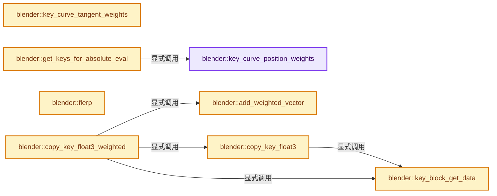
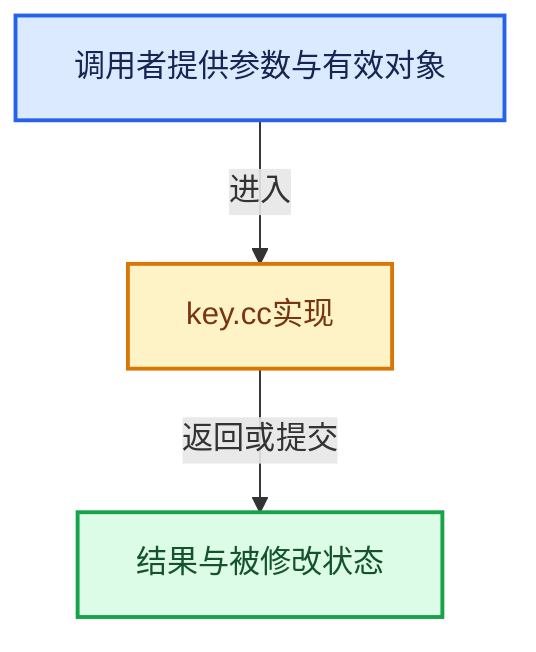

# 实现依赖专题：source/blender/blenkernel/intern/key.cc

[实现依赖导航](../../README.md) · [符号索引](../../../00-课程指南/02-源码与提交索引/符号依赖与实现索引.md)

本专题从正文实际调用进入，集中保存共享实现。函数有稳定锚点，可从调用处直接跳到对应完整函数；递归与互相调用通过回链组织。

## 本文件的实现关系






## 完整成员与函数实现

<a id="f-afb0f795e30f80db"></a>

### `blender::key_curve_position_weights`

实现位置：[source/blender/blenkernel/intern/key.cc](../../../../../../../source/blender/blenkernel/intern/key.cc) · L310—L351。

接口参数：

- `float t`
- `float data[4]`
- `KeyInterpolationType type`

**教学注释版**

<!-- annotated:1824f3877445ab -->

```cpp
void key_curve_position_weights(float t, float data[4], KeyInterpolationType type)
{
  float t2, t3, fc;

  switch (type) {
    case KEY_LINEAR:
      data[0] = 0.0f;
      data[1] = -t + 1.0f;
      data[2] = t;
      data[3] = 0.0f;
      break;
    case KEY_CARDINAL:
      t2 = t * t;
      t3 = t2 * t;
      fc = 0.71f;

      data[0] = -fc * t3 + 2.0f * fc * t2 - fc * t;
      data[1] = (2.0f - fc) * t3 + (fc - 3.0f) * t2 + 1.0f;
      data[2] = (fc - 2.0f) * t3 + (3.0f - 2.0f * fc) * t2 + fc * t;
      data[3] = fc * t3 - fc * t2;
      break;
    case KEY_BSPLINE:
      t2 = t * t;
      t3 = t2 * t;

      data[0] = -0.16666666f * t3 + 0.5f * t2 - 0.5f * t + 0.16666666f;
      data[1] = 0.5f * t3 - t2 + 0.66666666f;
      data[2] = -0.5f * t3 + 0.5f * t2 + 0.5f * t + 0.16666666f;
      data[3] = 0.16666666f * t3;
      break;
    case KEY_CATMULL_ROM:
      t2 = t * t;
      t3 = t2 * t;
      fc = 0.5f;

      data[0] = -fc * t3 + 2.0f * fc * t2 - fc * t;
      data[1] = (2.0f - fc) * t3 + (fc - 3.0f) * t2 + 1.0f;
      data[2] = (fc - 2.0f) * t3 + (3.0f - 2.0f * fc) * t2 + fc * t;
      data[3] = fc * t3 - fc * t2;
      break;
  }
}
```

<details>
<summary>核对原始源码：source/blender/blenkernel/intern/key.cc · L310—L351</summary>

<!-- original:1824f3877445ab:source/blender/blenkernel/intern/key.cc:310:351 -->

```cpp
void key_curve_position_weights(float t, float data[4], KeyInterpolationType type)
{
  float t2, t3, fc;

  switch (type) {
    case KEY_LINEAR:
      data[0] = 0.0f;
      data[1] = -t + 1.0f;
      data[2] = t;
      data[3] = 0.0f;
      break;
    case KEY_CARDINAL:
      t2 = t * t;
      t3 = t2 * t;
      fc = 0.71f;

      data[0] = -fc * t3 + 2.0f * fc * t2 - fc * t;
      data[1] = (2.0f - fc) * t3 + (fc - 3.0f) * t2 + 1.0f;
      data[2] = (fc - 2.0f) * t3 + (3.0f - 2.0f * fc) * t2 + fc * t;
      data[3] = fc * t3 - fc * t2;
      break;
    case KEY_BSPLINE:
      t2 = t * t;
      t3 = t2 * t;

      data[0] = -0.16666666f * t3 + 0.5f * t2 - 0.5f * t + 0.16666666f;
      data[1] = 0.5f * t3 - t2 + 0.66666666f;
      data[2] = -0.5f * t3 + 0.5f * t2 + 0.5f * t + 0.16666666f;
      data[3] = 0.16666666f * t3;
      break;
    case KEY_CATMULL_ROM:
      t2 = t * t;
      t3 = t2 * t;
      fc = 0.5f;

      data[0] = -fc * t3 + 2.0f * fc * t2 - fc * t;
      data[1] = (2.0f - fc) * t3 + (fc - 3.0f) * t2 + 1.0f;
      data[2] = (fc - 2.0f) * t3 + (3.0f - 2.0f * fc) * t2 + fc * t;
      data[3] = fc * t3 - fc * t2;
      break;
  }
}
```

</details>

**沿实际写入检查状态**

- `data[0] = 0.0f;`
- `data[1] = -t + 1.0f;`
- `data[2] = t;`
- `data[3] = 0.0f;`
- `t2 = t * t;`
- `t3 = t2 * t;`
- `fc = 0.71f;`
- `data[0] = -fc * t3 + 2.0f * fc * t2 - fc * t;`
- `data[1] = (2.0f - fc) * t3 + (fc - 3.0f) * t2 + 1.0f;`
- `data[2] = (fc - 2.0f) * t3 + (3.0f - 2.0f * fc) * t2 + fc * t;`
- `data[3] = fc * t3 - fc * t2;`
- `data[0] = -0.16666666f * t3 + 0.5f * t2 - 0.5f * t + 0.16666666f;`
- `data[1] = 0.5f * t3 - t2 + 0.66666666f;`
- `data[2] = -0.5f * t3 + 0.5f * t2 + 0.5f * t + 0.16666666f;`
- `data[3] = 0.16666666f * t3;`
- `fc = 0.5f;`

**继续追踪实现**

本实现没有需要继续展开的显式调用；检查返回表达式、对象转换和调用者前置条件。

<a id="f-0122f1a678ebac4e"></a>

### `blender::key_curve_tangent_weights`

实现位置：[source/blender/blenkernel/intern/key.cc](../../../../../../../source/blender/blenkernel/intern/key.cc) · L353—L391。

接口参数：

- `float t`
- `float data[4]`
- `KeyInterpolationType type`

**教学注释版**

<!-- annotated:401a50ec981d96 -->

```cpp
void key_curve_tangent_weights(float t, float data[4], KeyInterpolationType type)
{
  float t2, fc;

  switch (type) {
    case KEY_LINEAR:
      data[0] = 0.0f;
      data[1] = -1.0f;
      data[2] = 1.0f;
      data[3] = 0.0f;
      break;
    case KEY_CARDINAL:
      t2 = t * t;
      fc = 0.71f;

      data[0] = -3.0f * fc * t2 + 4.0f * fc * t - fc;
      data[1] = 3.0f * (2.0f - fc) * t2 + 2.0f * (fc - 3.0f) * t;
      data[2] = 3.0f * (fc - 2.0f) * t2 + 2.0f * (3.0f - 2.0f * fc) * t + fc;
      data[3] = 3.0f * fc * t2 - 2.0f * fc * t;
      break;
    case KEY_BSPLINE:
      t2 = t * t;

      data[0] = -0.5f * t2 + t - 0.5f;
      data[1] = 1.5f * t2 - t * 2.0f;
      data[2] = -1.5f * t2 + t + 0.5f;
      data[3] = 0.5f * t2;
      break;
    case KEY_CATMULL_ROM:
      t2 = t * t;
      fc = 0.5f;

      data[0] = -3.0f * fc * t2 + 4.0f * fc * t - fc;
      data[1] = 3.0f * (2.0f - fc) * t2 + 2.0f * (fc - 3.0f) * t;
      data[2] = 3.0f * (fc - 2.0f) * t2 + 2.0f * (3.0f - 2.0f * fc) * t + fc;
      data[3] = 3.0f * fc * t2 - 2.0f * fc * t;
      break;
  }
}
```

<details>
<summary>核对原始源码：source/blender/blenkernel/intern/key.cc · L353—L391</summary>

<!-- original:401a50ec981d96:source/blender/blenkernel/intern/key.cc:353:391 -->

```cpp
void key_curve_tangent_weights(float t, float data[4], KeyInterpolationType type)
{
  float t2, fc;

  switch (type) {
    case KEY_LINEAR:
      data[0] = 0.0f;
      data[1] = -1.0f;
      data[2] = 1.0f;
      data[3] = 0.0f;
      break;
    case KEY_CARDINAL:
      t2 = t * t;
      fc = 0.71f;

      data[0] = -3.0f * fc * t2 + 4.0f * fc * t - fc;
      data[1] = 3.0f * (2.0f - fc) * t2 + 2.0f * (fc - 3.0f) * t;
      data[2] = 3.0f * (fc - 2.0f) * t2 + 2.0f * (3.0f - 2.0f * fc) * t + fc;
      data[3] = 3.0f * fc * t2 - 2.0f * fc * t;
      break;
    case KEY_BSPLINE:
      t2 = t * t;

      data[0] = -0.5f * t2 + t - 0.5f;
      data[1] = 1.5f * t2 - t * 2.0f;
      data[2] = -1.5f * t2 + t + 0.5f;
      data[3] = 0.5f * t2;
      break;
    case KEY_CATMULL_ROM:
      t2 = t * t;
      fc = 0.5f;

      data[0] = -3.0f * fc * t2 + 4.0f * fc * t - fc;
      data[1] = 3.0f * (2.0f - fc) * t2 + 2.0f * (fc - 3.0f) * t;
      data[2] = 3.0f * (fc - 2.0f) * t2 + 2.0f * (3.0f - 2.0f * fc) * t + fc;
      data[3] = 3.0f * fc * t2 - 2.0f * fc * t;
      break;
  }
}
```

</details>

**沿实际写入检查状态**

- `data[0] = 0.0f;`
- `data[1] = -1.0f;`
- `data[2] = 1.0f;`
- `data[3] = 0.0f;`
- `t2 = t * t;`
- `fc = 0.71f;`
- `data[0] = -3.0f * fc * t2 + 4.0f * fc * t - fc;`
- `data[1] = 3.0f * (2.0f - fc) * t2 + 2.0f * (fc - 3.0f) * t;`
- `data[2] = 3.0f * (fc - 2.0f) * t2 + 2.0f * (3.0f - 2.0f * fc) * t + fc;`
- `data[3] = 3.0f * fc * t2 - 2.0f * fc * t;`
- `data[0] = -0.5f * t2 + t - 0.5f;`
- `data[1] = 1.5f * t2 - t * 2.0f;`
- `data[2] = -1.5f * t2 + t + 0.5f;`
- `data[3] = 0.5f * t2;`
- `fc = 0.5f;`

**继续追踪实现**

本实现没有需要继续展开的显式调用；检查返回表达式、对象转换和调用者前置条件。

<a id="f-d8993c0d86410ae5"></a>

### `blender::get_keys_for_absolute_eval`

实现位置：[source/blender/blenkernel/intern/key.cc](../../../../../../../source/blender/blenkernel/intern/key.cc) · L439—L529。

接口参数：

- `float eval_time`
- `const ListBaseT<KeyBlock> *keyblocks`
- `KeyBlock *r_target_keys[4]`
- `float r_weights[4]`

**教学注释版**

<!-- annotated:edd0a037031387 -->

```cpp
static bool get_keys_for_absolute_eval(float eval_time,
                                       const ListBaseT<KeyBlock> *keyblocks,
                                       KeyBlock *r_target_keys[4],
                                       float r_weights[4])
{
  KeyBlock *firstkey = keyblocks->first();
  KeyBlock *lastkey = keyblocks->last();
  eval_time = clamp_f(eval_time, firstkey->pos, lastkey->pos);

  r_target_keys[0] = r_target_keys[1] = r_target_keys[2] = r_target_keys[3] = firstkey;
  r_weights[0] = r_weights[1] = r_weights[2] = r_weights[3] = firstkey->pos;

  if (firstkey->next == nullptr) {
    /* There is only a single shapekey, we cannot do interpolation in this case. */
    return true;
  }

  r_target_keys[2] = firstkey->next;
  r_weights[2] = r_target_keys[2]->pos;
  r_target_keys[3] = r_target_keys[2]->next;
  if (r_target_keys[3] == nullptr) {
    r_target_keys[3] = r_target_keys[2];
  }
  r_weights[3] = r_target_keys[3]->pos;
  KeyBlock *key_iter = r_target_keys[3];

  /* Find the correct shapekeys. */
  while (r_weights[2] < eval_time) {
    if (key_iter->next == nullptr) {
      /* This triggers when `key_iter->next` has been a nullptr for one loop. */
      if (r_weights[2] == r_weights[3]) {
        break;
      }
    }
    else {
      key_iter = key_iter->next;
    }

    r_weights[0] = r_weights[1];
    r_target_keys[0] = r_target_keys[1];
    r_weights[1] = r_weights[2];
    r_target_keys[1] = r_target_keys[2];
    r_weights[2] = r_weights[3];
    r_target_keys[2] = r_target_keys[3];
    r_weights[3] = key_iter->pos;
    r_target_keys[3] = key_iter;
  }

  bool bsplinetype = false;
  if (r_target_keys[1]->type == KEY_BSPLINE || r_target_keys[2]->type == KEY_BSPLINE) {
    bsplinetype = true;
  }

  if (bsplinetype == false) { /* B spline doesn't go through the control points. */
    if (eval_time <= r_weights[1]) {
      /* This can happen if there are only 2 shapekeys. */
      r_weights[2] = r_weights[1];
      r_target_keys[2] = r_target_keys[1];
      return true;
    }
    if (eval_time >= r_weights[2]) { /* `eval_time` after 2nd key. */
      return true;
    }
  }
  else if (eval_time > r_weights[2]) { /* Last key. */
    eval_time = r_weights[2];
    r_target_keys[3] = r_target_keys[2];
    r_weights[3] = r_weights[2];
  }

  float delta = r_weights[2] - r_weights[1];
  if (delta == 0.0f) {
    if (bsplinetype == false) {
      return true; /* Both keys equal. */
    }
  }
  else {
    delta = (eval_time - r_weights[1]) / delta;
  }

  /* Interpolation. */
  key_curve_position_weights(delta, r_weights, KeyInterpolationType(r_target_keys[1]->type));

  if (r_target_keys[1]->type != r_target_keys[2]->type) {
    float t_other[4];
    key_curve_position_weights(delta, t_other, KeyInterpolationType(r_target_keys[2]->type));
    interp_v4_v4v4(r_weights, r_weights, t_other, delta);
  }

  return false;
}
```

<details>
<summary>核对原始源码：source/blender/blenkernel/intern/key.cc · L439—L529</summary>

<!-- original:edd0a037031387:source/blender/blenkernel/intern/key.cc:439:529 -->

```cpp
static bool get_keys_for_absolute_eval(float eval_time,
                                       const ListBaseT<KeyBlock> *keyblocks,
                                       KeyBlock *r_target_keys[4],
                                       float r_weights[4])
{
  KeyBlock *firstkey = keyblocks->first();
  KeyBlock *lastkey = keyblocks->last();
  eval_time = clamp_f(eval_time, firstkey->pos, lastkey->pos);

  r_target_keys[0] = r_target_keys[1] = r_target_keys[2] = r_target_keys[3] = firstkey;
  r_weights[0] = r_weights[1] = r_weights[2] = r_weights[3] = firstkey->pos;

  if (firstkey->next == nullptr) {
    /* There is only a single shapekey, we cannot do interpolation in this case. */
    return true;
  }

  r_target_keys[2] = firstkey->next;
  r_weights[2] = r_target_keys[2]->pos;
  r_target_keys[3] = r_target_keys[2]->next;
  if (r_target_keys[3] == nullptr) {
    r_target_keys[3] = r_target_keys[2];
  }
  r_weights[3] = r_target_keys[3]->pos;
  KeyBlock *key_iter = r_target_keys[3];

  /* Find the correct shapekeys. */
  while (r_weights[2] < eval_time) {
    if (key_iter->next == nullptr) {
      /* This triggers when `key_iter->next` has been a nullptr for one loop. */
      if (r_weights[2] == r_weights[3]) {
        break;
      }
    }
    else {
      key_iter = key_iter->next;
    }

    r_weights[0] = r_weights[1];
    r_target_keys[0] = r_target_keys[1];
    r_weights[1] = r_weights[2];
    r_target_keys[1] = r_target_keys[2];
    r_weights[2] = r_weights[3];
    r_target_keys[2] = r_target_keys[3];
    r_weights[3] = key_iter->pos;
    r_target_keys[3] = key_iter;
  }

  bool bsplinetype = false;
  if (r_target_keys[1]->type == KEY_BSPLINE || r_target_keys[2]->type == KEY_BSPLINE) {
    bsplinetype = true;
  }

  if (bsplinetype == false) { /* B spline doesn't go through the control points. */
    if (eval_time <= r_weights[1]) {
      /* This can happen if there are only 2 shapekeys. */
      r_weights[2] = r_weights[1];
      r_target_keys[2] = r_target_keys[1];
      return true;
    }
    if (eval_time >= r_weights[2]) { /* `eval_time` after 2nd key. */
      return true;
    }
  }
  else if (eval_time > r_weights[2]) { /* Last key. */
    eval_time = r_weights[2];
    r_target_keys[3] = r_target_keys[2];
    r_weights[3] = r_weights[2];
  }

  float delta = r_weights[2] - r_weights[1];
  if (delta == 0.0f) {
    if (bsplinetype == false) {
      return true; /* Both keys equal. */
    }
  }
  else {
    delta = (eval_time - r_weights[1]) / delta;
  }

  /* Interpolation. */
  key_curve_position_weights(delta, r_weights, KeyInterpolationType(r_target_keys[1]->type));

  if (r_target_keys[1]->type != r_target_keys[2]->type) {
    float t_other[4];
    key_curve_position_weights(delta, t_other, KeyInterpolationType(r_target_keys[2]->type));
    interp_v4_v4v4(r_weights, r_weights, t_other, delta);
  }

  return false;
}
```

</details>

**沿实际写入检查状态**

- `eval_time = clamp_f(eval_time, firstkey->pos, lastkey->pos);`
- `r_target_keys[0] = r_target_keys[1] = r_target_keys[2] = r_target_keys[3] = firstkey;`
- `r_weights[0] = r_weights[1] = r_weights[2] = r_weights[3] = firstkey->pos;`
- `r_target_keys[2] = firstkey->next;`
- `r_weights[2] = r_target_keys[2]->pos;`
- `r_target_keys[3] = r_target_keys[2]->next;`
- `r_target_keys[3] = r_target_keys[2];`
- `r_weights[3] = r_target_keys[3]->pos;`
- `key_iter = key_iter->next;`
- `r_weights[0] = r_weights[1];`
- `r_target_keys[0] = r_target_keys[1];`
- `r_weights[1] = r_weights[2];`
- `r_target_keys[1] = r_target_keys[2];`
- `r_weights[2] = r_weights[3];`
- `r_target_keys[2] = r_target_keys[3];`
- `r_weights[3] = key_iter->pos;`
- `r_target_keys[3] = key_iter;`
- `bsplinetype = true;`
- `r_weights[2] = r_weights[1];`
- `r_target_keys[2] = r_target_keys[1];`
- `eval_time = r_weights[2];`
- `r_weights[3] = r_weights[2];`
- `delta = (eval_time - r_weights[1]) / delta;`

**结果出口**

- `return true;`
- `return true; /* Both keys equal. */`
- `return false;`

**继续追踪实现**

- `keyblocks->first` → [blender::ListBaseT::first · L102](../../08-其他Blender模块/makesdna/DNA_listBase.h.md#f-3d12ff35da057c9e)；[blender::ListBaseT::first · L106](../../08-其他Blender模块/makesdna/DNA_listBase.h.md#f-0df87c3480e059f9)。同名重载需按实参类型选择。
- `keyblocks->last` → [blender::ListBaseT::last · L110](../../08-其他Blender模块/makesdna/DNA_listBase.h.md#f-7b7d35c25b6d06a4)；[blender::ListBaseT::last · L114](../../08-其他Blender模块/makesdna/DNA_listBase.h.md#f-1376db91ee7f5ddb)。同名重载需按实参类型选择。
- `clamp_f` → [blender::clamp_f · L405](../../01-BLI基础库/intern/math_base_inline.cc.md#f-abaf19ee32d97de2)。
- `key_curve_position_weights` → [blender::key_curve_position_weights · L310](key.cc.md#f-afb0f795e30f80db)。
- `KeyInterpolationType` → [blender::KeyInterpolationType](../../08-其他Blender模块/makesdna/DNA_key_types.h.md#t-9992054eaf23)。
- `interp_v4_v4v4` → [blender::interp_v4_v4v4 · L50](../../01-BLI基础库/intern/math_vector.cc.md#f-922b4ce22bd7c0c7)。

<a id="f-7256fadaf7d3e1e2"></a>

### `blender::key_block_get_data`

实现位置：[source/blender/blenkernel/intern/key.cc](../../../../../../../source/blender/blenkernel/intern/key.cc) · L531—L561。

接口参数：

- `Key *key`
- `KeyBlock *actkb`
- `KeyBlock *kb`
- `char **freedata`

**教学注释版**

<!-- annotated:e482ddd2293e42 -->

```cpp
static char *key_block_get_data(Key *key, KeyBlock *actkb, KeyBlock *kb, char **freedata)
{
  if (kb == actkb) {
    /* This hack makes it possible to edit shape keys in
     * edit mode with shape keys blending applied. */
    if (GS(key->from->name) == ID_ME) {

      Mesh *mesh = id_cast<Mesh *>(key->from);
      const BMesh *bm = BKE_editmesh_bmesh_get(mesh);

      if (mesh->runtime->edit_mesh && bm->totvert == kb->totelem) {
        int a = 0;
        float (*co)[3];
        co = MEM_new_array_uninitialized<float[3]>(size_t(bm->totvert), "key_block_get_data");

        BMVert *eve;
        BMIter iter;
        BM_ITER_MESH (eve, &iter, const_cast<BMesh *>(bm), BM_VERTS_OF_MESH) {
          copy_v3_v3(co[a], eve->co);
          a++;
        }

        *freedata = reinterpret_cast<char *>(co);
        return reinterpret_cast<char *>(co);
      }
    }
  }

  *freedata = nullptr;
  return static_cast<char *>(kb->data);
}
```

<details>
<summary>核对原始源码：source/blender/blenkernel/intern/key.cc · L531—L561</summary>

<!-- original:e482ddd2293e42:source/blender/blenkernel/intern/key.cc:531:561 -->

```cpp
static char *key_block_get_data(Key *key, KeyBlock *actkb, KeyBlock *kb, char **freedata)
{
  if (kb == actkb) {
    /* This hack makes it possible to edit shape keys in
     * edit mode with shape keys blending applied. */
    if (GS(key->from->name) == ID_ME) {

      Mesh *mesh = id_cast<Mesh *>(key->from);
      const BMesh *bm = BKE_editmesh_bmesh_get(mesh);

      if (mesh->runtime->edit_mesh && bm->totvert == kb->totelem) {
        int a = 0;
        float (*co)[3];
        co = MEM_new_array_uninitialized<float[3]>(size_t(bm->totvert), "key_block_get_data");

        BMVert *eve;
        BMIter iter;
        BM_ITER_MESH (eve, &iter, const_cast<BMesh *>(bm), BM_VERTS_OF_MESH) {
          copy_v3_v3(co[a], eve->co);
          a++;
        }

        *freedata = reinterpret_cast<char *>(co);
        return reinterpret_cast<char *>(co);
      }
    }
  }

  *freedata = nullptr;
  return static_cast<char *>(kb->data);
}
```

</details>

**沿实际写入检查状态**

- `co = MEM_new_array_uninitialized<float[3]>(size_t(bm->totvert), "key_block_get_data");`

**结果出口**

- `return reinterpret_cast<char *>(co);`
- `return static_cast<char *>(kb->data);`

**继续追踪实现**

- `GS` → [blender::GS · L410](../../08-其他Blender模块/makesdna/DNA_ID.h.md#f-c3ff509f79f21b05)。
- `id_cast<Mesh *>` → [blender::id_cast · L1417](../../08-其他Blender模块/makesdna/DNA_ID.h.md#f-6c8ac6412850ac5a)。
- `BKE_editmesh_bmesh_get` → [blender::BKE_editmesh_bmesh_get · L65](editmesh.cc.md#f-2afdd2773d3f0d88)；[blender::BKE_editmesh_bmesh_get · L71](editmesh.cc.md#f-80631d704a7e9947)。同名重载需按实参类型选择。
- `MEM_new_array_uninitialized<float[3]>` → [MEM_new_array_uninitialized · L608](../../07-Intern运行时与平台/guardedalloc/MEM_guardedalloc.h.md#f-b7103eae8eb57b05)；[MEM_new_array_uninitialized · L129](../../07-Intern运行时与平台/guardedalloc/intern/mallocn.cc.md#f-bf6ef4ddcfb6e5df)。同名重载需按实参类型选择。
- `BM_ITER_MESH` → [BM_ITER_MESH · L72](../../08-其他Blender模块/bmesh/intern/bmesh_iterators.hh.md#m-cfc837c73218)。宏定义由构建条件选择。
- `copy_v3_v3` → [blender::copy_v3_v3 · L47](../../01-BLI基础库/intern/math_vector_inline.cc.md#f-037a0d5fa5060bd6)。

<a id="f-a375eedd3b9d1f84"></a>

### `blender::add_weighted_vector`

实现位置：[source/blender/blenkernel/intern/key.cc](../../../../../../../source/blender/blenkernel/intern/key.cc) · L569—L575。

接口参数：

- `const int start_index`
- `const float weight`
- `const float *a`
- `const float *b`
- `float *r_target`

**教学注释版**

<!-- annotated:1935707ee20c21 -->

```cpp
static void add_weighted_vector(
    const int start_index, const float weight, const float *a, const float *b, float *r_target)
{
  r_target[start_index + 0] += weight * (b[start_index + 0] - a[start_index + 0]);
  r_target[start_index + 1] += weight * (b[start_index + 1] - a[start_index + 1]);
  r_target[start_index + 2] += weight * (b[start_index + 2] - a[start_index + 2]);
}
```

<details>
<summary>核对原始源码：source/blender/blenkernel/intern/key.cc · L569—L575</summary>

<!-- original:1935707ee20c21:source/blender/blenkernel/intern/key.cc:569:575 -->

```cpp
static void add_weighted_vector(
    const int start_index, const float weight, const float *a, const float *b, float *r_target)
{
  r_target[start_index + 0] += weight * (b[start_index + 0] - a[start_index + 0]);
  r_target[start_index + 1] += weight * (b[start_index + 1] - a[start_index + 1]);
  r_target[start_index + 2] += weight * (b[start_index + 2] - a[start_index + 2]);
}
```

</details>

**继续追踪实现**

本实现没有需要继续展开的显式调用；检查返回表达式、对象转换和调用者前置条件。

<a id="f-c3fd9fbfa8ce7a02"></a>

### `blender::flerp`

实现位置：[source/blender/blenkernel/intern/key.cc](../../../../../../../source/blender/blenkernel/intern/key.cc) · L580—L590。

接口参数：

- `const float f0[3]`
- `const float f1[3]`
- `const float f2[3]`
- `const float f3[3]`
- `const float weights[4]`
- `float r_out[3]`

**教学注释版**

<!-- annotated:c0b2e75ae3cba2 -->

```cpp
static void flerp(const float f0[3],
                  const float f1[3],
                  const float f2[3],
                  const float f3[3],
                  const float weights[4],
                  float r_out[3])
{
  r_out[0] = weights[0] * f0[0] + weights[1] * f1[0] + weights[2] * f2[0] + weights[3] * f3[0];
  r_out[1] = weights[0] * f0[1] + weights[1] * f1[1] + weights[2] * f2[1] + weights[3] * f3[1];
  r_out[2] = weights[0] * f0[2] + weights[1] * f1[2] + weights[2] * f2[2] + weights[3] * f3[2];
}
```

<details>
<summary>核对原始源码：source/blender/blenkernel/intern/key.cc · L580—L590</summary>

<!-- original:c0b2e75ae3cba2:source/blender/blenkernel/intern/key.cc:580:590 -->

```cpp
static void flerp(const float f0[3],
                  const float f1[3],
                  const float f2[3],
                  const float f3[3],
                  const float weights[4],
                  float r_out[3])
{
  r_out[0] = weights[0] * f0[0] + weights[1] * f1[0] + weights[2] * f2[0] + weights[3] * f3[0];
  r_out[1] = weights[0] * f0[1] + weights[1] * f1[1] + weights[2] * f2[1] + weights[3] * f3[1];
  r_out[2] = weights[0] * f0[2] + weights[1] * f1[2] + weights[2] * f2[2] + weights[3] * f3[2];
}
```

</details>

**沿实际写入检查状态**

- `r_out[0] = weights[0] * f0[0] + weights[1] * f1[0] + weights[2] * f2[0] + weights[3] * f3[0];`
- `r_out[1] = weights[0] * f0[1] + weights[1] * f1[1] + weights[2] * f2[1] + weights[3] * f3[1];`
- `r_out[2] = weights[0] * f0[2] + weights[1] * f1[2] + weights[2] * f2[2] + weights[3] * f3[2];`

**继续追踪实现**

本实现没有需要继续展开的显式调用；检查返回表达式、对象转换和调用者前置条件。

<a id="f-ac292fb81ef4ecd7"></a>

### `blender::copy_key_float3`

实现位置：[source/blender/blenkernel/intern/key.cc](../../../../../../../source/blender/blenkernel/intern/key.cc) · L595—L623。

接口参数：

- `const int vertex_count`
- `Key *key`
- `KeyBlock *active_keyblock`
- `KeyBlock *source`
- `float *r_target`

**教学注释版**

<!-- annotated:75dbfec4ef45f1 -->

```cpp
static void copy_key_float3(
    const int vertex_count, Key *key, KeyBlock *active_keyblock, KeyBlock *source, float *r_target)
{
  if (vertex_count == 0 || source->totelem == 0) {
    return;
  }
  char *free_keyblock_data;
  float *keyblock_data = reinterpret_cast<float *>(
      key_block_get_data(key, active_keyblock, source, &free_keyblock_data));

  if (vertex_count == source->totelem) {
    // [讲解] memcpy：复制字节，源与目标不应重叠。类型生命周期、对齐和可复制表示须由调用者证明，不是任意对象的复制构造。
    memcpy(r_target, keyblock_data, vertex_count * 3 * sizeof(float));
  }
  else {
    /* In case of KeyBlocks that have a different number of elements than the original data.
     * Maintained for backwards compatibility even though this state should not be reachable
     * through normal interactions with Blender. */
    const float step_rate = source->totelem / float(vertex_count);
    for (int i = 0; i < vertex_count; i++) {
      /* Rounding down to avoid exceeding the bounds. */
      const int source_index = int(step_rate * i);
      memcpy(&r_target[i * 3], &keyblock_data[source_index * 3], 3 * sizeof(float));
    }
  }

  if (free_keyblock_data) {
    MEM_delete(free_keyblock_data);
  }
}
```

<details>
<summary>核对原始源码：source/blender/blenkernel/intern/key.cc · L595—L623</summary>

<!-- original:75dbfec4ef45f1:source/blender/blenkernel/intern/key.cc:595:623 -->

```cpp
static void copy_key_float3(
    const int vertex_count, Key *key, KeyBlock *active_keyblock, KeyBlock *source, float *r_target)
{
  if (vertex_count == 0 || source->totelem == 0) {
    return;
  }
  char *free_keyblock_data;
  float *keyblock_data = reinterpret_cast<float *>(
      key_block_get_data(key, active_keyblock, source, &free_keyblock_data));

  if (vertex_count == source->totelem) {
    memcpy(r_target, keyblock_data, vertex_count * 3 * sizeof(float));
  }
  else {
    /* In case of KeyBlocks that have a different number of elements than the original data.
     * Maintained for backwards compatibility even though this state should not be reachable
     * through normal interactions with Blender. */
    const float step_rate = source->totelem / float(vertex_count);
    for (int i = 0; i < vertex_count; i++) {
      /* Rounding down to avoid exceeding the bounds. */
      const int source_index = int(step_rate * i);
      memcpy(&r_target[i * 3], &keyblock_data[source_index * 3], 3 * sizeof(float));
    }
  }

  if (free_keyblock_data) {
    MEM_delete(free_keyblock_data);
  }
}
```

</details>

**继续追踪实现**

- `key_block_get_data` → [blender::key_block_get_data · L531](key.cc.md#f-7256fadaf7d3e1e2)。
- `memcpy` → [外部契约](https://eel.is/c++draft/cstring.syn)：复制字节，源与目标不应重叠。类型生命周期、对齐和可复制表示须由调用者证明，不是任意对象的复制构造。
- `MEM_delete` → [MEM_delete · L400](../../07-Intern运行时与平台/guardedalloc/MEM_guardedalloc.h.md#f-9049ffdd1682887c)。

<a id="f-b50d7bad84dd9b37"></a>

### `blender::copy_key_float3_weighted`

实现位置：[source/blender/blenkernel/intern/key.cc](../../../../../../../source/blender/blenkernel/intern/key.cc) · L633—L672。

接口参数：

- `const int vertex_count`
- `Key *key`
- `KeyBlock *active_keyblock`
- `KeyBlock *source`
- `const float *weights`
- `float *r_target`

**教学注释版**

<!-- annotated:4a9ec73b991dda -->

```cpp
static void copy_key_float3_weighted(const int vertex_count,
                                     Key *key,
                                     KeyBlock *active_keyblock,
                                     KeyBlock *source,
                                     const float *weights,
                                     float *r_target)
{
  if (!weights) {
    copy_key_float3(vertex_count, key, active_keyblock, source, r_target);
    return;
  }

  if (vertex_count != source->totelem) {
    /* There was a system in place before that worked with keys that only have partial data. I
     * (christoph) removed that since there is no known case for that. */
    BLI_assert_unreachable();
    return;
  }

  char *free_source_data, *free_refkey_data;
  const float *source_data = reinterpret_cast<float *>(
      key_block_get_data(key, active_keyblock, source, &free_source_data));
  const float *refkey_data = reinterpret_cast<float *>(
      key_block_get_data(key, active_keyblock, key->refkey, &free_refkey_data));

  for (int i = 0; i < vertex_count; i++) {
    const int vector_index = i * 3;
    // [讲解] memcpy：复制字节，源与目标不应重叠。类型生命周期、对齐和可复制表示须由调用者证明，不是任意对象的复制构造。
    memcpy(&r_target[vector_index], &refkey_data[vector_index], 3 * sizeof(float));
    if (weights[i] != 0.0f) {
      add_weighted_vector(vector_index, weights[i], refkey_data, source_data, r_target);
    }
  }

  if (free_source_data) {
    MEM_delete(free_source_data);
  }
  if (free_refkey_data) {
    MEM_delete(free_refkey_data);
  }
}
```

<details>
<summary>核对原始源码：source/blender/blenkernel/intern/key.cc · L633—L672</summary>

<!-- original:4a9ec73b991dda:source/blender/blenkernel/intern/key.cc:633:672 -->

```cpp
static void copy_key_float3_weighted(const int vertex_count,
                                     Key *key,
                                     KeyBlock *active_keyblock,
                                     KeyBlock *source,
                                     const float *weights,
                                     float *r_target)
{
  if (!weights) {
    copy_key_float3(vertex_count, key, active_keyblock, source, r_target);
    return;
  }

  if (vertex_count != source->totelem) {
    /* There was a system in place before that worked with keys that only have partial data. I
     * (christoph) removed that since there is no known case for that. */
    BLI_assert_unreachable();
    return;
  }

  char *free_source_data, *free_refkey_data;
  const float *source_data = reinterpret_cast<float *>(
      key_block_get_data(key, active_keyblock, source, &free_source_data));
  const float *refkey_data = reinterpret_cast<float *>(
      key_block_get_data(key, active_keyblock, key->refkey, &free_refkey_data));

  for (int i = 0; i < vertex_count; i++) {
    const int vector_index = i * 3;
    memcpy(&r_target[vector_index], &refkey_data[vector_index], 3 * sizeof(float));
    if (weights[i] != 0.0f) {
      add_weighted_vector(vector_index, weights[i], refkey_data, source_data, r_target);
    }
  }

  if (free_source_data) {
    MEM_delete(free_source_data);
  }
  if (free_refkey_data) {
    MEM_delete(free_refkey_data);
  }
}
```

</details>

**继续追踪实现**

- `copy_key_float3` → [blender::copy_key_float3 · L595](key.cc.md#f-ac292fb81ef4ecd7)。
- `BLI_assert_unreachable` → [BLI_assert_unreachable · L77](../../01-BLI基础库/BLI_assert.hh.md#m-7a2d91a67d8e)。宏定义由构建条件选择。
- `key_block_get_data` → [blender::key_block_get_data · L531](key.cc.md#f-7256fadaf7d3e1e2)。
- `memcpy` → [外部契约](https://eel.is/c++draft/cstring.syn)：复制字节，源与目标不应重叠。类型生命周期、对齐和可复制表示须由调用者证明，不是任意对象的复制构造。
- `add_weighted_vector` → [blender::add_weighted_vector · L569](key.cc.md#f-a375eedd3b9d1f84)。
- `MEM_delete` → [MEM_delete · L400](../../07-Intern运行时与平台/guardedalloc/MEM_guardedalloc.h.md#f-9049ffdd1682887c)。

<a id="f-0f7eb02089285c3e"></a>

### `blender::key_evaluate_relative_float3`

实现位置：[source/blender/blenkernel/intern/key.cc](../../../../../../../source/blender/blenkernel/intern/key.cc) · L681—L737。

接口参数：

- `Key *key`
- `KeyBlock *active_keyblock`
- `const std::optional<Span<bool>> keys_to_process`
- `const int vertex_count`
- `float **per_keyblock_weights`
- `float *target_data`

**教学注释版**

<!-- annotated:49b073cc381b78 -->

```cpp
static void key_evaluate_relative_float3(Key *key,
                                         KeyBlock *active_keyblock,
                                         const std::optional<Span<bool>> keys_to_process,
                                         const int vertex_count,
                                         float **per_keyblock_weights,
                                         float *target_data)
{
  /* Creates the basis values of the reference key in target_data. */
  copy_key_float3(vertex_count, key, active_keyblock, key->refkey, target_data);

  /* Cannot use auto [keyblock_index, kb] here because that would throw a warning at the
   * parallel_for. */
  for (std::pair<int, KeyBlock &> enumerator : key->block.enumerate()) {
    KeyBlock &kb = enumerator.second;
    if (&kb == key->refkey) {
      continue;
    }
    if (keys_to_process && !(*keys_to_process)[enumerator.first]) {
      continue;
    }
    /* No difference in vertex count allowed. */
    if (kb.flag & KEYBLOCK_MUTE || kb.totelem != vertex_count) {
      continue;
    }
    const float kb_influence = kb.curval;
    if (kb_influence == 0.0f) {
      continue;
    }
    /* Reference can be any block. */
    KeyBlock *reference_kb = static_cast<KeyBlock *>(BLI_findlink(&key->block, kb.relative));
    if (reference_kb == nullptr) {
      continue;
    }

    const float *weights = per_keyblock_weights ? per_keyblock_weights[enumerator.first] : nullptr;

    char *freefrom = nullptr;
    const float *from = reinterpret_cast<float *>(
        key_block_get_data(key, active_keyblock, &kb, &freefrom));

    /* For meshes, use the original values instead of the bmesh values to
     * maintain a constant offset. */
    const float *reffrom = static_cast<float *>(reference_kb->data);
    threading::parallel_for(IndexRange(vertex_count), 1024, [&](const IndexRange range) {
      for (const int i : range) {
        const float weight = weights ? (weights[i] * kb.curval) : kb.curval;
        /* Each vertex has 3 floats. */
        const int vector_index = i * 3;
        add_weighted_vector(vector_index, weight, reffrom, from, target_data);
      }
    });

    if (freefrom) {
      MEM_delete(freefrom);
    }
  }
}
```

<details>
<summary>核对原始源码：source/blender/blenkernel/intern/key.cc · L681—L737</summary>

<!-- original:49b073cc381b78:source/blender/blenkernel/intern/key.cc:681:737 -->

```cpp
static void key_evaluate_relative_float3(Key *key,
                                         KeyBlock *active_keyblock,
                                         const std::optional<Span<bool>> keys_to_process,
                                         const int vertex_count,
                                         float **per_keyblock_weights,
                                         float *target_data)
{
  /* Creates the basis values of the reference key in target_data. */
  copy_key_float3(vertex_count, key, active_keyblock, key->refkey, target_data);

  /* Cannot use auto [keyblock_index, kb] here because that would throw a warning at the
   * parallel_for. */
  for (std::pair<int, KeyBlock &> enumerator : key->block.enumerate()) {
    KeyBlock &kb = enumerator.second;
    if (&kb == key->refkey) {
      continue;
    }
    if (keys_to_process && !(*keys_to_process)[enumerator.first]) {
      continue;
    }
    /* No difference in vertex count allowed. */
    if (kb.flag & KEYBLOCK_MUTE || kb.totelem != vertex_count) {
      continue;
    }
    const float kb_influence = kb.curval;
    if (kb_influence == 0.0f) {
      continue;
    }
    /* Reference can be any block. */
    KeyBlock *reference_kb = static_cast<KeyBlock *>(BLI_findlink(&key->block, kb.relative));
    if (reference_kb == nullptr) {
      continue;
    }

    const float *weights = per_keyblock_weights ? per_keyblock_weights[enumerator.first] : nullptr;

    char *freefrom = nullptr;
    const float *from = reinterpret_cast<float *>(
        key_block_get_data(key, active_keyblock, &kb, &freefrom));

    /* For meshes, use the original values instead of the bmesh values to
     * maintain a constant offset. */
    const float *reffrom = static_cast<float *>(reference_kb->data);
    threading::parallel_for(IndexRange(vertex_count), 1024, [&](const IndexRange range) {
      for (const int i : range) {
        const float weight = weights ? (weights[i] * kb.curval) : kb.curval;
        /* Each vertex has 3 floats. */
        const int vector_index = i * 3;
        add_weighted_vector(vector_index, weight, reffrom, from, target_data);
      }
    });

    if (freefrom) {
      MEM_delete(freefrom);
    }
  }
}
```

</details>

**继续追踪实现**

- `copy_key_float3` → [blender::copy_key_float3 · L595](key.cc.md#f-ac292fb81ef4ecd7)。
- `key->block.enumerate` → [调用协议](../../../00-课程指南/01-路线与规范/模板宏与动态分派协议.md)：接收对象类型依赖auto、返回值或模板实例；不按同名猜测目标。调用位置L693。
- `BLI_findlink` → [blender::BLI_findlink · L541](../../01-BLI基础库/intern/listbase.cc.md#f-6d3fd65974b4e808)。
- `key_block_get_data` → [blender::key_block_get_data · L531](key.cc.md#f-7256fadaf7d3e1e2)。
- `threading::parallel_for` → [blender::threading::parallel_for · L68](../../../11-Depsgraph与并行任务系统/07-任务池与TBB接入.md#f-838294754c24426c)。
- `IndexRange` → [blender::IndexRange](../../01-BLI基础库/BLI_index_range.hh.md#t-caa3466d6776)；[blender::gpu::shader::parser::IndexRange](../../08-其他Blender模块/gpu/shader_tool/utils.hh.md#t-82d2bd4ea71c)；[blender::IndexRange](../../08-其他Blender模块/makesdna/DNA_node_types.h.md#t-0448cc889d39)。
- `add_weighted_vector` → [blender::add_weighted_vector · L569](key.cc.md#f-a375eedd3b9d1f84)。
- `MEM_delete` → [MEM_delete · L400](../../07-Intern运行时与平台/guardedalloc/MEM_guardedalloc.h.md#f-9049ffdd1682887c)。

<a id="f-4caeb55c95bfd93c"></a>

### `blender::key_evaluate_absolute`

实现位置：[source/blender/blenkernel/intern/key.cc](../../../../../../../source/blender/blenkernel/intern/key.cc) · L742—L789。

接口参数：

- `const int vertex_count`
- `Key *key`
- `KeyBlock *active_keyblock`
- `KeyBlock *shapekeys[4]`
- `const float weights[4]`
- `float *r_target`

**教学注释版**

<!-- annotated:73f0bc7244bc19 -->

```cpp
static void key_evaluate_absolute(const int vertex_count,
                                  Key *key,
                                  KeyBlock *active_keyblock,
                                  KeyBlock *shapekeys[4],
                                  const float weights[4],
                                  float *r_target)
{
  char *freek1, *freek2, *freek3, *freek4;
  float *k1 = reinterpret_cast<float *>(
      key_block_get_data(key, active_keyblock, shapekeys[0], &freek1));
  float *k2 = reinterpret_cast<float *>(
      key_block_get_data(key, active_keyblock, shapekeys[1], &freek2));
  float *k3 = reinterpret_cast<float *>(
      key_block_get_data(key, active_keyblock, shapekeys[2], &freek3));
  float *k4 = reinterpret_cast<float *>(
      key_block_get_data(key, active_keyblock, shapekeys[3], &freek4));

  /* The step rate will be 1 in normal cases. We have to account for shapekeys with different
   * element counts though since that case used to be supported. */
  const float step_k1 = shapekeys[0]->totelem / float(vertex_count);
  const float step_k2 = shapekeys[1]->totelem / float(vertex_count);
  const float step_k3 = shapekeys[2]->totelem / float(vertex_count);
  const float step_k4 = shapekeys[3]->totelem / float(vertex_count);

  threading::parallel_for(IndexRange(vertex_count), 1024, [&](const IndexRange range) {
    for (const int i : range) {
      flerp(&k1[int(i * step_k1) * 3],
            &k2[int(i * step_k2) * 3],
            &k3[int(i * step_k3) * 3],
            &k4[int(i * step_k4) * 3],
            weights,
            &r_target[i * 3]);
    }
  });

  if (freek1) {
    MEM_delete(freek1);
  }
  if (freek2) {
    MEM_delete(freek2);
  }
  if (freek3) {
    MEM_delete(freek3);
  }
  if (freek4) {
    MEM_delete(freek4);
  }
}
```

<details>
<summary>核对原始源码：source/blender/blenkernel/intern/key.cc · L742—L789</summary>

<!-- original:73f0bc7244bc19:source/blender/blenkernel/intern/key.cc:742:789 -->

```cpp
static void key_evaluate_absolute(const int vertex_count,
                                  Key *key,
                                  KeyBlock *active_keyblock,
                                  KeyBlock *shapekeys[4],
                                  const float weights[4],
                                  float *r_target)
{
  char *freek1, *freek2, *freek3, *freek4;
  float *k1 = reinterpret_cast<float *>(
      key_block_get_data(key, active_keyblock, shapekeys[0], &freek1));
  float *k2 = reinterpret_cast<float *>(
      key_block_get_data(key, active_keyblock, shapekeys[1], &freek2));
  float *k3 = reinterpret_cast<float *>(
      key_block_get_data(key, active_keyblock, shapekeys[2], &freek3));
  float *k4 = reinterpret_cast<float *>(
      key_block_get_data(key, active_keyblock, shapekeys[3], &freek4));

  /* The step rate will be 1 in normal cases. We have to account for shapekeys with different
   * element counts though since that case used to be supported. */
  const float step_k1 = shapekeys[0]->totelem / float(vertex_count);
  const float step_k2 = shapekeys[1]->totelem / float(vertex_count);
  const float step_k3 = shapekeys[2]->totelem / float(vertex_count);
  const float step_k4 = shapekeys[3]->totelem / float(vertex_count);

  threading::parallel_for(IndexRange(vertex_count), 1024, [&](const IndexRange range) {
    for (const int i : range) {
      flerp(&k1[int(i * step_k1) * 3],
            &k2[int(i * step_k2) * 3],
            &k3[int(i * step_k3) * 3],
            &k4[int(i * step_k4) * 3],
            weights,
            &r_target[i * 3]);
    }
  });

  if (freek1) {
    MEM_delete(freek1);
  }
  if (freek2) {
    MEM_delete(freek2);
  }
  if (freek3) {
    MEM_delete(freek3);
  }
  if (freek4) {
    MEM_delete(freek4);
  }
}
```

</details>

**继续追踪实现**

- `key_block_get_data` → [blender::key_block_get_data · L531](key.cc.md#f-7256fadaf7d3e1e2)。
- `threading::parallel_for` → [blender::threading::parallel_for · L68](../../../11-Depsgraph与并行任务系统/07-任务池与TBB接入.md#f-838294754c24426c)。
- `IndexRange` → [blender::IndexRange](../../01-BLI基础库/BLI_index_range.hh.md#t-caa3466d6776)；[blender::gpu::shader::parser::IndexRange](../../08-其他Blender模块/gpu/shader_tool/utils.hh.md#t-82d2bd4ea71c)；[blender::IndexRange](../../08-其他Blender模块/makesdna/DNA_node_types.h.md#t-0448cc889d39)。
- `flerp` → [blender::flerp · L580](key.cc.md#f-c3fd9fbfa8ce7a02)。
- `MEM_delete` → [MEM_delete · L400](../../07-Intern运行时与平台/guardedalloc/MEM_guardedalloc.h.md#f-9049ffdd1682887c)。

<a id="f-7a1400db54ecb8d8"></a>

### `blender::get_weights_array`

实现位置：[source/blender/blenkernel/intern/key.cc](../../../../../../../source/blender/blenkernel/intern/key.cc) · L791—L866。

接口参数：

- `Object *ob`
- `const char *vgroup`
- `WeightsArrayCache *cache`

**教学注释版**

<!-- annotated:4fad106dc93220 -->

```cpp
static float *get_weights_array(Object *ob, const char *vgroup, WeightsArrayCache *cache)
{
  /* No vgroup string set? */
  if (vgroup[0] == 0) {
    return nullptr;
  }

  const MDeformVert *dvert = nullptr;
  int totvert = 0;

  /* Gather dvert and totvert. */
  const BMesh *bm = nullptr;
  if (ob->type == OB_MESH) {
    Mesh *mesh = id_cast<Mesh *>(ob->data);
    dvert = mesh->deform_verts().data();
    totvert = mesh->verts_num;

    const BMesh *bm_test = BKE_editmesh_bmesh_get(mesh);
    if (bm_test && bm_test->totvert == totvert) {
      bm = bm_test;
    }
  }
  else if (ob->type == OB_LATTICE) {
    Lattice *lt = id_cast<Lattice *>(ob->data);
    dvert = lt->dvert;
    totvert = lt->pntsu * lt->pntsv * lt->pntsw;
  }

  if (dvert == nullptr) {
    return nullptr;
  }

  /* Find the group (weak loop-in-loop). */
  const int defgrp_index = BKE_object_defgroup_name_index(ob, vgroup);
  if (defgrp_index != -1) {
    float *weights;

    if (cache) {
      if (cache->defgroup_weights == nullptr) {
        int num_defgroup = BKE_object_defgroup_count(ob);
        cache->defgroup_weights = MEM_new_array_zeroed<float *>(num_defgroup,
                                                                "cached defgroup weights");
        cache->num_defgroup_weights = num_defgroup;
      }

      if (cache->defgroup_weights[defgrp_index]) {
        return cache->defgroup_weights[defgrp_index];
      }
    }

    weights = MEM_new_array_uninitialized<float>(size_t(totvert), "weights");

    if (bm) {
      int i;
      const int cd_dvert_offset = CustomData_get_offset(&bm->vdata, CD_MDEFORMVERT);
      BMIter iter;
      BMVert *eve;
      BM_ITER_MESH_INDEX (eve, &iter, const_cast<BMesh *>(bm), BM_VERTS_OF_MESH, i) {
        dvert = static_cast<const MDeformVert *>(BM_ELEM_CD_GET_VOID_P(eve, cd_dvert_offset));
        weights[i] = BKE_defvert_find_weight(dvert, defgrp_index);
      }
    }
    else {
      for (int i = 0; i < totvert; i++, dvert++) {
        weights[i] = BKE_defvert_find_weight(dvert, defgrp_index);
      }
    }

    if (cache) {
      cache->defgroup_weights[defgrp_index] = weights;
    }

    return weights;
  }
  return nullptr;
}
```

<details>
<summary>核对原始源码：source/blender/blenkernel/intern/key.cc · L791—L866</summary>

<!-- original:4fad106dc93220:source/blender/blenkernel/intern/key.cc:791:866 -->

```cpp
static float *get_weights_array(Object *ob, const char *vgroup, WeightsArrayCache *cache)
{
  /* No vgroup string set? */
  if (vgroup[0] == 0) {
    return nullptr;
  }

  const MDeformVert *dvert = nullptr;
  int totvert = 0;

  /* Gather dvert and totvert. */
  const BMesh *bm = nullptr;
  if (ob->type == OB_MESH) {
    Mesh *mesh = id_cast<Mesh *>(ob->data);
    dvert = mesh->deform_verts().data();
    totvert = mesh->verts_num;

    const BMesh *bm_test = BKE_editmesh_bmesh_get(mesh);
    if (bm_test && bm_test->totvert == totvert) {
      bm = bm_test;
    }
  }
  else if (ob->type == OB_LATTICE) {
    Lattice *lt = id_cast<Lattice *>(ob->data);
    dvert = lt->dvert;
    totvert = lt->pntsu * lt->pntsv * lt->pntsw;
  }

  if (dvert == nullptr) {
    return nullptr;
  }

  /* Find the group (weak loop-in-loop). */
  const int defgrp_index = BKE_object_defgroup_name_index(ob, vgroup);
  if (defgrp_index != -1) {
    float *weights;

    if (cache) {
      if (cache->defgroup_weights == nullptr) {
        int num_defgroup = BKE_object_defgroup_count(ob);
        cache->defgroup_weights = MEM_new_array_zeroed<float *>(num_defgroup,
                                                                "cached defgroup weights");
        cache->num_defgroup_weights = num_defgroup;
      }

      if (cache->defgroup_weights[defgrp_index]) {
        return cache->defgroup_weights[defgrp_index];
      }
    }

    weights = MEM_new_array_uninitialized<float>(size_t(totvert), "weights");

    if (bm) {
      int i;
      const int cd_dvert_offset = CustomData_get_offset(&bm->vdata, CD_MDEFORMVERT);
      BMIter iter;
      BMVert *eve;
      BM_ITER_MESH_INDEX (eve, &iter, const_cast<BMesh *>(bm), BM_VERTS_OF_MESH, i) {
        dvert = static_cast<const MDeformVert *>(BM_ELEM_CD_GET_VOID_P(eve, cd_dvert_offset));
        weights[i] = BKE_defvert_find_weight(dvert, defgrp_index);
      }
    }
    else {
      for (int i = 0; i < totvert; i++, dvert++) {
        weights[i] = BKE_defvert_find_weight(dvert, defgrp_index);
      }
    }

    if (cache) {
      cache->defgroup_weights[defgrp_index] = weights;
    }

    return weights;
  }
  return nullptr;
}
```

</details>

**沿实际写入检查状态**

- `dvert = mesh->deform_verts().data();`
- `totvert = mesh->verts_num;`
- `bm = bm_test;`
- `dvert = lt->dvert;`
- `totvert = lt->pntsu * lt->pntsv * lt->pntsw;`
- `cache->defgroup_weights = MEM_new_array_zeroed<float *>(num_defgroup,`
- `cache->num_defgroup_weights = num_defgroup;`
- `weights = MEM_new_array_uninitialized<float>(size_t(totvert), "weights");`
- `dvert = static_cast<const MDeformVert *>(BM_ELEM_CD_GET_VOID_P(eve, cd_dvert_offset));`
- `weights[i] = BKE_defvert_find_weight(dvert, defgrp_index);`
- `cache->defgroup_weights[defgrp_index] = weights;`

**结果出口**

- `return nullptr;`
- `return cache->defgroup_weights[defgrp_index];`
- `return weights;`

**继续追踪实现**

- `id_cast<Mesh *>` → [blender::id_cast · L1417](../../08-其他Blender模块/makesdna/DNA_ID.h.md#f-6c8ac6412850ac5a)。
- `mesh->deform_verts().data` → [调用协议](../../../00-课程指南/01-路线与规范/模板宏与动态分派协议.md)：接收对象类型依赖auto、返回值或模板实例；不按同名猜测目标。调用位置L805。
- `mesh->deform_verts` → [Mesh::deform_verts · L1266](../../../05-几何存储与拓扑映射/03-MPoly迁移与兼容.md#f-4c0433aad24aa301)。
- `BKE_editmesh_bmesh_get` → [blender::BKE_editmesh_bmesh_get · L65](editmesh.cc.md#f-2afdd2773d3f0d88)；[blender::BKE_editmesh_bmesh_get · L71](editmesh.cc.md#f-80631d704a7e9947)。同名重载需按实参类型选择。
- `id_cast<Lattice *>` → [blender::id_cast · L1417](../../08-其他Blender模块/makesdna/DNA_ID.h.md#f-6c8ac6412850ac5a)。
- `BKE_object_defgroup_name_index` → [blender::BKE_object_defgroup_name_index · L597](deform.cc.md#f-ad856e5bba5cd758)。
- `BKE_object_defgroup_count` → [blender::BKE_object_defgroup_count · L608](deform.cc.md#f-2c43dbe7747d64a1)。
- `MEM_new_array_zeroed<float *>` → [MEM_new_array_zeroed · L566](../../07-Intern运行时与平台/guardedalloc/MEM_guardedalloc.h.md#f-3a0cf63fb5216500)；[MEM_new_array_zeroed · L119](../../07-Intern运行时与平台/guardedalloc/intern/mallocn.cc.md#f-6825557da566fdbe)。同名重载需按实参类型选择。
- `MEM_new_array_uninitialized<float>` → [MEM_new_array_uninitialized · L608](../../07-Intern运行时与平台/guardedalloc/MEM_guardedalloc.h.md#f-b7103eae8eb57b05)；[MEM_new_array_uninitialized · L129](../../07-Intern运行时与平台/guardedalloc/intern/mallocn.cc.md#f-bf6ef4ddcfb6e5df)。同名重载需按实参类型选择。
- `CustomData_get_offset` → [blender::CustomData_get_offset · L3379](customdata.cc.md#f-e0e230c6120acc9a)。
- `BM_ITER_MESH_INDEX` → [BM_ITER_MESH_INDEX · L76](../../08-其他Blender模块/bmesh/intern/bmesh_iterators.hh.md#m-6a0cac4538f9)。宏定义由构建条件选择。
- `BM_ELEM_CD_GET_VOID_P` → [BM_ELEM_CD_GET_VOID_P · L610](../../08-其他Blender模块/bmesh/bmesh_class.hh.md#m-cdfe9f3023fa)；[BM_ELEM_CD_GET_VOID_P · L618](../../08-其他Blender模块/bmesh/bmesh_class.hh.md#m-126b1260772d)。宏定义由构建条件选择。
- `BKE_defvert_find_weight` → [blender::BKE_defvert_find_weight · L779](deform.cc.md#f-c117fcd05c4fd453)。

<a id="f-64578c7d0a5153b7"></a>

### `blender::keyblock_get_per_block_weights`

实现位置：[source/blender/blenkernel/intern/key.cc](../../../../../../../source/blender/blenkernel/intern/key.cc) · L868—L878。

接口参数：

- `Object *ob`
- `Key *key`
- `WeightsArrayCache *cache`

**教学注释版**

<!-- annotated:d6456b0dfecc70 -->

```cpp
static float **keyblock_get_per_block_weights(Object *ob, Key *key, WeightsArrayCache *cache)
{
  float **per_keyblock_weights = MEM_new_array_uninitialized<float *>(size_t(key->totkey),
                                                                      "per keyblock weights");

  for (const auto [keyblock_index, keyblock] : key->block.enumerate()) {
    per_keyblock_weights[keyblock_index] = get_weights_array(ob, keyblock.vgroup, cache);
  }

  return per_keyblock_weights;
}
```

<details>
<summary>核对原始源码：source/blender/blenkernel/intern/key.cc · L868—L878</summary>

<!-- original:d6456b0dfecc70:source/blender/blenkernel/intern/key.cc:868:878 -->

```cpp
static float **keyblock_get_per_block_weights(Object *ob, Key *key, WeightsArrayCache *cache)
{
  float **per_keyblock_weights = MEM_new_array_uninitialized<float *>(size_t(key->totkey),
                                                                      "per keyblock weights");

  for (const auto [keyblock_index, keyblock] : key->block.enumerate()) {
    per_keyblock_weights[keyblock_index] = get_weights_array(ob, keyblock.vgroup, cache);
  }

  return per_keyblock_weights;
}
```

</details>

**沿实际写入检查状态**

- `per_keyblock_weights[keyblock_index] = get_weights_array(ob, keyblock.vgroup, cache);`

**结果出口**

- `return per_keyblock_weights;`

**继续追踪实现**

- `MEM_new_array_uninitialized<float *>` → [MEM_new_array_uninitialized · L608](../../07-Intern运行时与平台/guardedalloc/MEM_guardedalloc.h.md#f-b7103eae8eb57b05)；[MEM_new_array_uninitialized · L129](../../07-Intern运行时与平台/guardedalloc/intern/mallocn.cc.md#f-bf6ef4ddcfb6e5df)。同名重载需按实参类型选择。
- `key->block.enumerate` → [调用协议](../../../00-课程指南/01-路线与规范/模板宏与动态分派协议.md)：接收对象类型依赖auto、返回值或模板实例；不按同名猜测目标。调用位置L873。
- `get_weights_array` → [blender::get_weights_array · L791](key.cc.md#f-7a1400db54ecb8d8)。

<a id="f-092d10b449213433"></a>

### `blender::keyblock_free_per_block_weights`

实现位置：[source/blender/blenkernel/intern/key.cc](../../../../../../../source/blender/blenkernel/intern/key.cc) · L880—L904。

接口参数：

- `Key *key`
- `float **per_keyblock_weights`
- `WeightsArrayCache *cache`

**教学注释版**

<!-- annotated:bc4c5a65e2c156 -->

```cpp
static void keyblock_free_per_block_weights(Key *key,
                                            float **per_keyblock_weights,
                                            WeightsArrayCache *cache)
{
  if (cache) {
    if (cache->num_defgroup_weights) {
      for (int a = 0; a < cache->num_defgroup_weights; a++) {
        if (cache->defgroup_weights[a]) {
          MEM_delete(cache->defgroup_weights[a]);
        }
      }
      MEM_delete(cache->defgroup_weights);
    }
    cache->defgroup_weights = nullptr;
  }
  else {
    for (int a = 0; a < key->totkey; a++) {
      if (per_keyblock_weights[a]) {
        MEM_delete(per_keyblock_weights[a]);
      }
    }
  }

  MEM_delete(per_keyblock_weights);
}
```

<details>
<summary>核对原始源码：source/blender/blenkernel/intern/key.cc · L880—L904</summary>

<!-- original:bc4c5a65e2c156:source/blender/blenkernel/intern/key.cc:880:904 -->

```cpp
static void keyblock_free_per_block_weights(Key *key,
                                            float **per_keyblock_weights,
                                            WeightsArrayCache *cache)
{
  if (cache) {
    if (cache->num_defgroup_weights) {
      for (int a = 0; a < cache->num_defgroup_weights; a++) {
        if (cache->defgroup_weights[a]) {
          MEM_delete(cache->defgroup_weights[a]);
        }
      }
      MEM_delete(cache->defgroup_weights);
    }
    cache->defgroup_weights = nullptr;
  }
  else {
    for (int a = 0; a < key->totkey; a++) {
      if (per_keyblock_weights[a]) {
        MEM_delete(per_keyblock_weights[a]);
      }
    }
  }

  MEM_delete(per_keyblock_weights);
}
```

</details>

**沿实际写入检查状态**

- `cache->defgroup_weights = nullptr;`

**继续追踪实现**

- `MEM_delete` → [MEM_delete · L400](../../07-Intern运行时与平台/guardedalloc/MEM_guardedalloc.h.md#f-9049ffdd1682887c)。

<a id="f-0d8505df1f84c50b"></a>

### `blender::do_mesh_key`

实现位置：[source/blender/blenkernel/intern/key.cc](../../../../../../../source/blender/blenkernel/intern/key.cc) · L906—L936。

接口参数：

- `Object *ob`
- `Key *key`
- `const std::optional<Span<bool>> keys_to_process`
- `char *out`
- `const int tot`

**教学注释版**

<!-- annotated:869d6f765bfe7c -->

```cpp
static void do_mesh_key(Object *ob,
                        Key *key,
                        const std::optional<Span<bool>> keys_to_process,
                        char *out,
                        const int tot)
{
  KeyBlock *actkb = BKE_keyblock_from_object(ob);

  if (key->type == KEY_RELATIVE) {
    WeightsArrayCache cache = {0, nullptr};
    float **per_keyblock_weights;
    per_keyblock_weights = keyblock_get_per_block_weights(ob, key, &cache);
    key_evaluate_relative_float3(
        key, actkb, keys_to_process, tot, per_keyblock_weights, reinterpret_cast<float *>(out));
    keyblock_free_per_block_weights(key, per_keyblock_weights, &cache);
  }
  else {
    const float ctime_scaled = key->ctime / 100.0f;
    KeyBlock *shapekeys[4];
    float weights[4];
    const bool simple_copy = get_keys_for_absolute_eval(
        ctime_scaled, &key->block, shapekeys, weights);

    if (simple_copy == false) {
      key_evaluate_absolute(tot, key, actkb, shapekeys, weights, reinterpret_cast<float *>(out));
    }
    else {
      copy_key_float3(tot, key, actkb, shapekeys[2], reinterpret_cast<float *>(out));
    }
  }
}
```

<details>
<summary>核对原始源码：source/blender/blenkernel/intern/key.cc · L906—L936</summary>

<!-- original:869d6f765bfe7c:source/blender/blenkernel/intern/key.cc:906:936 -->

```cpp
static void do_mesh_key(Object *ob,
                        Key *key,
                        const std::optional<Span<bool>> keys_to_process,
                        char *out,
                        const int tot)
{
  KeyBlock *actkb = BKE_keyblock_from_object(ob);

  if (key->type == KEY_RELATIVE) {
    WeightsArrayCache cache = {0, nullptr};
    float **per_keyblock_weights;
    per_keyblock_weights = keyblock_get_per_block_weights(ob, key, &cache);
    key_evaluate_relative_float3(
        key, actkb, keys_to_process, tot, per_keyblock_weights, reinterpret_cast<float *>(out));
    keyblock_free_per_block_weights(key, per_keyblock_weights, &cache);
  }
  else {
    const float ctime_scaled = key->ctime / 100.0f;
    KeyBlock *shapekeys[4];
    float weights[4];
    const bool simple_copy = get_keys_for_absolute_eval(
        ctime_scaled, &key->block, shapekeys, weights);

    if (simple_copy == false) {
      key_evaluate_absolute(tot, key, actkb, shapekeys, weights, reinterpret_cast<float *>(out));
    }
    else {
      copy_key_float3(tot, key, actkb, shapekeys[2], reinterpret_cast<float *>(out));
    }
  }
}
```

</details>

**沿实际写入检查状态**

- `per_keyblock_weights = keyblock_get_per_block_weights(ob, key, &cache);`

**继续追踪实现**

- `BKE_keyblock_from_object` → [blender::BKE_keyblock_from_object · L1407](key.cc.md#f-0b20126f099723f9)。
- `keyblock_get_per_block_weights` → [blender::keyblock_get_per_block_weights · L868](key.cc.md#f-64578c7d0a5153b7)。
- `key_evaluate_relative_float3` → [blender::key_evaluate_relative_float3 · L681](key.cc.md#f-0f7eb02089285c3e)。
- `keyblock_free_per_block_weights` → [blender::keyblock_free_per_block_weights · L880](key.cc.md#f-092d10b449213433)。
- `get_keys_for_absolute_eval` → [blender::get_keys_for_absolute_eval · L439](key.cc.md#f-d8993c0d86410ae5)。
- `key_evaluate_absolute` → [blender::key_evaluate_absolute · L742](key.cc.md#f-4caeb55c95bfd93c)。
- `copy_key_float3` → [blender::copy_key_float3 · L595](key.cc.md#f-ac292fb81ef4ecd7)。

<a id="f-2d75c7436bfe2a2c"></a>

### `blender::do_curve_key`

实现位置：[source/blender/blenkernel/intern/key.cc](../../../../../../../source/blender/blenkernel/intern/key.cc) · L938—L964。

接口参数：

- `Object *ob`
- `Key *key`
- `const std::optional<Span<bool>> keys_to_process`
- `char *out`
- `const int tot`

**教学注释版**

<!-- annotated:22b16325c2fa77 -->

```cpp
static void do_curve_key(Object *ob,
                         Key *key,
                         const std::optional<Span<bool>> keys_to_process,
                         char *out,
                         const int tot)
{
  KeyBlock *actkb = BKE_keyblock_from_object(ob);

  if (key->type == KEY_RELATIVE) {
    key_evaluate_relative_float3(
        key, actkb, keys_to_process, tot, nullptr, reinterpret_cast<float *>(out));
  }
  else {
    const float ctime_scaled = key->ctime / 100.0f;
    KeyBlock *shapekeys[4];
    float weights[4];
    const bool simple_copy = get_keys_for_absolute_eval(
        ctime_scaled, &key->block, shapekeys, weights);

    if (simple_copy == false) {
      key_evaluate_absolute(tot, key, actkb, shapekeys, weights, reinterpret_cast<float *>(out));
    }
    else {
      copy_key_float3(tot, key, actkb, shapekeys[2], reinterpret_cast<float *>(out));
    }
  }
}
```

<details>
<summary>核对原始源码：source/blender/blenkernel/intern/key.cc · L938—L964</summary>

<!-- original:22b16325c2fa77:source/blender/blenkernel/intern/key.cc:938:964 -->

```cpp
static void do_curve_key(Object *ob,
                         Key *key,
                         const std::optional<Span<bool>> keys_to_process,
                         char *out,
                         const int tot)
{
  KeyBlock *actkb = BKE_keyblock_from_object(ob);

  if (key->type == KEY_RELATIVE) {
    key_evaluate_relative_float3(
        key, actkb, keys_to_process, tot, nullptr, reinterpret_cast<float *>(out));
  }
  else {
    const float ctime_scaled = key->ctime / 100.0f;
    KeyBlock *shapekeys[4];
    float weights[4];
    const bool simple_copy = get_keys_for_absolute_eval(
        ctime_scaled, &key->block, shapekeys, weights);

    if (simple_copy == false) {
      key_evaluate_absolute(tot, key, actkb, shapekeys, weights, reinterpret_cast<float *>(out));
    }
    else {
      copy_key_float3(tot, key, actkb, shapekeys[2], reinterpret_cast<float *>(out));
    }
  }
}
```

</details>

**继续追踪实现**

- `BKE_keyblock_from_object` → [blender::BKE_keyblock_from_object · L1407](key.cc.md#f-0b20126f099723f9)。
- `key_evaluate_relative_float3` → [blender::key_evaluate_relative_float3 · L681](key.cc.md#f-0f7eb02089285c3e)。
- `get_keys_for_absolute_eval` → [blender::get_keys_for_absolute_eval · L439](key.cc.md#f-d8993c0d86410ae5)。
- `key_evaluate_absolute` → [blender::key_evaluate_absolute · L742](key.cc.md#f-4caeb55c95bfd93c)。
- `copy_key_float3` → [blender::copy_key_float3 · L595](key.cc.md#f-ac292fb81ef4ecd7)。

<a id="f-27d49af9e3dd99db"></a>

### `blender::do_latt_key`

实现位置：[source/blender/blenkernel/intern/key.cc](../../../../../../../source/blender/blenkernel/intern/key.cc) · L966—L1000。

接口参数：

- `Object *ob`
- `Key *key`
- `const std::optional<Span<bool>> keys_to_process`
- `char *out`
- `const int tot`

**教学注释版**

<!-- annotated:31a21ef114f9c3 -->

```cpp
static void do_latt_key(Object *ob,
                        Key *key,
                        const std::optional<Span<bool>> keys_to_process,
                        char *out,
                        const int tot)
{
  Lattice *lt = id_cast<Lattice *>(ob->data);
  KeyBlock *actkb = BKE_keyblock_from_object(ob);

  if (key->type == KEY_RELATIVE) {
    float **per_keyblock_weights;
    per_keyblock_weights = keyblock_get_per_block_weights(ob, key, nullptr);
    key_evaluate_relative_float3(
        key, actkb, keys_to_process, tot, per_keyblock_weights, reinterpret_cast<float *>(out));
    keyblock_free_per_block_weights(key, per_keyblock_weights, nullptr);
  }
  else {
    const float ctime_scaled = key->ctime / 100.0f;
    KeyBlock *shapekeys[4];
    float weights[4];
    const bool simple_copy = get_keys_for_absolute_eval(
        ctime_scaled, &key->block, shapekeys, weights);

    if (simple_copy == false) {
      key_evaluate_absolute(tot, key, actkb, shapekeys, weights, reinterpret_cast<float *>(out));
    }
    else {
      copy_key_float3(tot, key, actkb, shapekeys[2], reinterpret_cast<float *>(out));
    }
  }

  if (lt->flag & LT_OUTSIDE) {
    outside_lattice(lt);
  }
}
```

<details>
<summary>核对原始源码：source/blender/blenkernel/intern/key.cc · L966—L1000</summary>

<!-- original:31a21ef114f9c3:source/blender/blenkernel/intern/key.cc:966:1000 -->

```cpp
static void do_latt_key(Object *ob,
                        Key *key,
                        const std::optional<Span<bool>> keys_to_process,
                        char *out,
                        const int tot)
{
  Lattice *lt = id_cast<Lattice *>(ob->data);
  KeyBlock *actkb = BKE_keyblock_from_object(ob);

  if (key->type == KEY_RELATIVE) {
    float **per_keyblock_weights;
    per_keyblock_weights = keyblock_get_per_block_weights(ob, key, nullptr);
    key_evaluate_relative_float3(
        key, actkb, keys_to_process, tot, per_keyblock_weights, reinterpret_cast<float *>(out));
    keyblock_free_per_block_weights(key, per_keyblock_weights, nullptr);
  }
  else {
    const float ctime_scaled = key->ctime / 100.0f;
    KeyBlock *shapekeys[4];
    float weights[4];
    const bool simple_copy = get_keys_for_absolute_eval(
        ctime_scaled, &key->block, shapekeys, weights);

    if (simple_copy == false) {
      key_evaluate_absolute(tot, key, actkb, shapekeys, weights, reinterpret_cast<float *>(out));
    }
    else {
      copy_key_float3(tot, key, actkb, shapekeys[2], reinterpret_cast<float *>(out));
    }
  }

  if (lt->flag & LT_OUTSIDE) {
    outside_lattice(lt);
  }
}
```

</details>

**沿实际写入检查状态**

- `per_keyblock_weights = keyblock_get_per_block_weights(ob, key, nullptr);`

**继续追踪实现**

- `id_cast<Lattice *>` → [blender::id_cast · L1417](../../08-其他Blender模块/makesdna/DNA_ID.h.md#f-6c8ac6412850ac5a)。
- `BKE_keyblock_from_object` → [blender::BKE_keyblock_from_object · L1407](key.cc.md#f-0b20126f099723f9)。
- `keyblock_get_per_block_weights` → [blender::keyblock_get_per_block_weights · L868](key.cc.md#f-64578c7d0a5153b7)。
- `key_evaluate_relative_float3` → [blender::key_evaluate_relative_float3 · L681](key.cc.md#f-0f7eb02089285c3e)。
- `keyblock_free_per_block_weights` → [blender::keyblock_free_per_block_weights · L880](key.cc.md#f-092d10b449213433)。
- `get_keys_for_absolute_eval` → [blender::get_keys_for_absolute_eval · L439](key.cc.md#f-d8993c0d86410ae5)。
- `key_evaluate_absolute` → [blender::key_evaluate_absolute · L742](key.cc.md#f-4caeb55c95bfd93c)。
- `copy_key_float3` → [blender::copy_key_float3 · L595](key.cc.md#f-ac292fb81ef4ecd7)。
- `outside_lattice` → [blender::outside_lattice · L415](lattice.cc.md#f-0b6e5ff486a1cc3b)。

<a id="f-2ee933fd9371726a"></a>

### `blender::BKE_key_evaluate_object_ex`

实现位置：[source/blender/blenkernel/intern/key.cc](../../../../../../../source/blender/blenkernel/intern/key.cc) · L1009—L1135。

接口参数：

- `Object *ob`
- `int *r_totelem`
- `float *arr`
- `size_t arr_size`
- `const std::optional<Span<bool>> keys_to_process`
- `ID *obdata`

**教学注释版**

<!-- annotated:1f0923bee35997 -->

```cpp
float *BKE_key_evaluate_object_ex(Object *ob,
                                  int *r_totelem,
                                  float *arr,
                                  size_t arr_size,
                                  const std::optional<Span<bool>> keys_to_process,
                                  ID *obdata)
{
  Key *key = BKE_key_from_object(ob);
  KeyBlock *actkb = BKE_keyblock_from_object(ob);

  if (key == nullptr || key->block.is_empty()) {
    return nullptr;
  }

  /* Compute size of output array. */
  int tot = 0, size = 0;
  if (ob->type == OB_MESH) {
    Mesh *mesh = id_cast<Mesh *>(ob->data);

    tot = mesh->verts_num;
    size = tot * sizeof(float[KEYELEM_FLOAT_LEN_COORD]);
  }
  else if (ob->type == OB_LATTICE) {
    Lattice *lt = id_cast<Lattice *>(ob->data);

    tot = lt->pntsu * lt->pntsv * lt->pntsw;
    size = tot * sizeof(float[KEYELEM_FLOAT_LEN_COORD]);
  }
  else if (ELEM(ob->type, OB_CURVES_LEGACY, OB_SURF)) {
    Curve *cu = id_cast<Curve *>(ob->data);

    tot = BKE_keyblock_curve_element_count(&cu->nurb);
    size = tot * sizeof(float[KEYELEM_ELEM_SIZE_CURVE]);
  }

  /* If nothing to interpolate, cancel. */
  if (tot == 0 || size == 0) {
    return nullptr;
  }

  /* Allocate array. */
  char *out;
  if (arr == nullptr) {
    out = MEM_new_array_zeroed<char>(size, "BKE_key_evaluate_object out");
  }
  else {
    if (arr_size != size) {
      return nullptr;
    }

    out = reinterpret_cast<char *>(arr);
  }

  if (ob->shapeflag & OB_SHAPE_LOCK) {
    /* Shape locked, copy the locked shape instead of blending. */
    KeyBlock *kb = static_cast<KeyBlock *>(BLI_findlink(&key->block, ob->shapenr - 1));

    if (kb && (kb->flag & KEYBLOCK_MUTE)) {
      kb = key->refkey;
    }

    if (kb == nullptr) {
      kb = key->block.first();
      ob->shapenr = 1;
    }

    if (OB_TYPE_SUPPORT_VGROUP(ob->type)) {
      const float *weights = get_weights_array(ob, kb->vgroup, nullptr);
      copy_key_float3_weighted(tot, key, actkb, kb, weights, reinterpret_cast<float *>(out));

      if (weights) {
        MEM_delete(weights);
      }
    }
    else if (ELEM(ob->type, OB_CURVES_LEGACY, OB_SURF)) {
      copy_key_float3(tot, key, actkb, kb, reinterpret_cast<float *>(out));
    }
  }
  else {
    if (ob->type == OB_MESH) {
      do_mesh_key(ob, key, keys_to_process, out, tot);
    }
    else if (ob->type == OB_LATTICE) {
      do_latt_key(ob, key, keys_to_process, out, tot);
    }
    else if (ob->type == OB_CURVES_LEGACY) {
      do_curve_key(ob, key, keys_to_process, out, tot);
    }
    else if (ob->type == OB_SURF) {
      do_curve_key(ob, key, keys_to_process, out, tot);
    }
  }

  if (obdata != nullptr) {
    switch (GS(obdata->name)) {
      case ID_ME: {
        Mesh *mesh = id_cast<Mesh *>(obdata);
        const int totvert = min_ii(tot, mesh->verts_num);
        mesh->vert_positions_for_write().take_front(totvert).copy_from(
            {reinterpret_cast<const float3 *>(out), totvert});
        mesh->tag_positions_changed();
        break;
      }
      case ID_LT: {
        Lattice *lattice = id_cast<Lattice *>(obdata);
        const int totpoint = min_ii(tot, lattice->pntsu * lattice->pntsv * lattice->pntsw);
        keyblock_data_convert_to_lattice(
            reinterpret_cast<const float (*)[3]>(out), lattice->def, totpoint);
        break;
      }
      case ID_CU_LEGACY: {
        Curve *curve = id_cast<Curve *>(obdata);
        const int totpoint = min_ii(tot, BKE_keyblock_curve_element_count(&curve->nurb));
        keyblock_data_convert_to_curve(
            reinterpret_cast<const float *>(out), &curve->nurb, totpoint);
        break;
      }
      default:
        BLI_assert_unreachable();
    }
  }

  if (r_totelem) {
    *r_totelem = tot;
  }
  return reinterpret_cast<float *>(out);
}
```

<details>
<summary>核对原始源码：source/blender/blenkernel/intern/key.cc · L1009—L1135</summary>

<!-- original:1f0923bee35997:source/blender/blenkernel/intern/key.cc:1009:1135 -->

```cpp
float *BKE_key_evaluate_object_ex(Object *ob,
                                  int *r_totelem,
                                  float *arr,
                                  size_t arr_size,
                                  const std::optional<Span<bool>> keys_to_process,
                                  ID *obdata)
{
  Key *key = BKE_key_from_object(ob);
  KeyBlock *actkb = BKE_keyblock_from_object(ob);

  if (key == nullptr || key->block.is_empty()) {
    return nullptr;
  }

  /* Compute size of output array. */
  int tot = 0, size = 0;
  if (ob->type == OB_MESH) {
    Mesh *mesh = id_cast<Mesh *>(ob->data);

    tot = mesh->verts_num;
    size = tot * sizeof(float[KEYELEM_FLOAT_LEN_COORD]);
  }
  else if (ob->type == OB_LATTICE) {
    Lattice *lt = id_cast<Lattice *>(ob->data);

    tot = lt->pntsu * lt->pntsv * lt->pntsw;
    size = tot * sizeof(float[KEYELEM_FLOAT_LEN_COORD]);
  }
  else if (ELEM(ob->type, OB_CURVES_LEGACY, OB_SURF)) {
    Curve *cu = id_cast<Curve *>(ob->data);

    tot = BKE_keyblock_curve_element_count(&cu->nurb);
    size = tot * sizeof(float[KEYELEM_ELEM_SIZE_CURVE]);
  }

  /* If nothing to interpolate, cancel. */
  if (tot == 0 || size == 0) {
    return nullptr;
  }

  /* Allocate array. */
  char *out;
  if (arr == nullptr) {
    out = MEM_new_array_zeroed<char>(size, "BKE_key_evaluate_object out");
  }
  else {
    if (arr_size != size) {
      return nullptr;
    }

    out = reinterpret_cast<char *>(arr);
  }

  if (ob->shapeflag & OB_SHAPE_LOCK) {
    /* Shape locked, copy the locked shape instead of blending. */
    KeyBlock *kb = static_cast<KeyBlock *>(BLI_findlink(&key->block, ob->shapenr - 1));

    if (kb && (kb->flag & KEYBLOCK_MUTE)) {
      kb = key->refkey;
    }

    if (kb == nullptr) {
      kb = key->block.first();
      ob->shapenr = 1;
    }

    if (OB_TYPE_SUPPORT_VGROUP(ob->type)) {
      const float *weights = get_weights_array(ob, kb->vgroup, nullptr);
      copy_key_float3_weighted(tot, key, actkb, kb, weights, reinterpret_cast<float *>(out));

      if (weights) {
        MEM_delete(weights);
      }
    }
    else if (ELEM(ob->type, OB_CURVES_LEGACY, OB_SURF)) {
      copy_key_float3(tot, key, actkb, kb, reinterpret_cast<float *>(out));
    }
  }
  else {
    if (ob->type == OB_MESH) {
      do_mesh_key(ob, key, keys_to_process, out, tot);
    }
    else if (ob->type == OB_LATTICE) {
      do_latt_key(ob, key, keys_to_process, out, tot);
    }
    else if (ob->type == OB_CURVES_LEGACY) {
      do_curve_key(ob, key, keys_to_process, out, tot);
    }
    else if (ob->type == OB_SURF) {
      do_curve_key(ob, key, keys_to_process, out, tot);
    }
  }

  if (obdata != nullptr) {
    switch (GS(obdata->name)) {
      case ID_ME: {
        Mesh *mesh = id_cast<Mesh *>(obdata);
        const int totvert = min_ii(tot, mesh->verts_num);
        mesh->vert_positions_for_write().take_front(totvert).copy_from(
            {reinterpret_cast<const float3 *>(out), totvert});
        mesh->tag_positions_changed();
        break;
      }
      case ID_LT: {
        Lattice *lattice = id_cast<Lattice *>(obdata);
        const int totpoint = min_ii(tot, lattice->pntsu * lattice->pntsv * lattice->pntsw);
        keyblock_data_convert_to_lattice(
            reinterpret_cast<const float (*)[3]>(out), lattice->def, totpoint);
        break;
      }
      case ID_CU_LEGACY: {
        Curve *curve = id_cast<Curve *>(obdata);
        const int totpoint = min_ii(tot, BKE_keyblock_curve_element_count(&curve->nurb));
        keyblock_data_convert_to_curve(
            reinterpret_cast<const float *>(out), &curve->nurb, totpoint);
        break;
      }
      default:
        BLI_assert_unreachable();
    }
  }

  if (r_totelem) {
    *r_totelem = tot;
  }
  return reinterpret_cast<float *>(out);
}
```

</details>

**沿实际写入检查状态**

- `tot = mesh->verts_num;`
- `size = tot * sizeof(float[KEYELEM_FLOAT_LEN_COORD]);`
- `tot = lt->pntsu * lt->pntsv * lt->pntsw;`
- `tot = BKE_keyblock_curve_element_count(&cu->nurb);`
- `size = tot * sizeof(float[KEYELEM_ELEM_SIZE_CURVE]);`
- `out = MEM_new_array_zeroed<char>(size, "BKE_key_evaluate_object out");`
- `out = reinterpret_cast<char *>(arr);`
- `kb = key->refkey;`
- `kb = key->block.first();`
- `ob->shapenr = 1;`

**结果出口**

- `return nullptr;`
- `return reinterpret_cast<float *>(out);`

**继续追踪实现**

- `BKE_key_from_object` → [blender::BKE_key_from_object · L1311](key.cc.md#f-c191304ae3a652d6)。
- `BKE_keyblock_from_object` → [blender::BKE_keyblock_from_object · L1407](key.cc.md#f-0b20126f099723f9)。
- `key->block.is_empty` → [调用协议](../../../00-课程指南/01-路线与规范/模板宏与动态分派协议.md)：接收对象类型依赖auto、返回值或模板实例；不按同名猜测目标。调用位置L1019。
- `id_cast<Mesh *>` → [blender::id_cast · L1417](../../08-其他Blender模块/makesdna/DNA_ID.h.md#f-6c8ac6412850ac5a)。
- `id_cast<Lattice *>` → [blender::id_cast · L1417](../../08-其他Blender模块/makesdna/DNA_ID.h.md#f-6c8ac6412850ac5a)。
- `ELEM` → [ELEM · L88](../../07-Intern运行时与平台/ghost/intern/GHOST_utildefines.hh.md#m-d28724a15928)；[ELEM · L135](../../01-BLI基础库/BLI_utildefines.hh.md#m-d6572de7cae0)。宏定义由构建条件选择。
- `id_cast<Curve *>` → [blender::id_cast · L1417](../../08-其他Blender模块/makesdna/DNA_ID.h.md#f-6c8ac6412850ac5a)。
- `BKE_keyblock_curve_element_count` → [blender::BKE_keyblock_curve_element_count · L1528](key.cc.md#f-026103526401f73f)。
- `MEM_new_array_zeroed<char>` → [MEM_new_array_zeroed · L566](../../07-Intern运行时与平台/guardedalloc/MEM_guardedalloc.h.md#f-3a0cf63fb5216500)；[MEM_new_array_zeroed · L119](../../07-Intern运行时与平台/guardedalloc/intern/mallocn.cc.md#f-6825557da566fdbe)。同名重载需按实参类型选择。
- `BLI_findlink` → [blender::BLI_findlink · L541](../../01-BLI基础库/intern/listbase.cc.md#f-6d3fd65974b4e808)。
- `key->block.first` → [调用协议](../../../00-课程指南/01-路线与规范/模板宏与动态分派协议.md)：接收对象类型依赖auto、返回值或模板实例；不按同名猜测目标。调用位置L1071。
- `OB_TYPE_SUPPORT_VGROUP` → [OB_TYPE_SUPPORT_VGROUP · L734](../../08-其他Blender模块/makesdna/DNA_object_types.h.md#m-418d8ceae920)。宏定义由构建条件选择。
- `get_weights_array` → [blender::get_weights_array · L791](key.cc.md#f-7a1400db54ecb8d8)。
- `copy_key_float3_weighted` → [blender::copy_key_float3_weighted · L633](key.cc.md#f-b50d7bad84dd9b37)。
- `MEM_delete` → [MEM_delete · L400](../../07-Intern运行时与平台/guardedalloc/MEM_guardedalloc.h.md#f-9049ffdd1682887c)。
- `copy_key_float3` → [blender::copy_key_float3 · L595](key.cc.md#f-ac292fb81ef4ecd7)。
- `do_mesh_key` → [blender::do_mesh_key · L906](key.cc.md#f-0d8505df1f84c50b)。
- `do_latt_key` → [blender::do_latt_key · L966](key.cc.md#f-27d49af9e3dd99db)。
- `do_curve_key` → [blender::do_curve_key · L938](key.cc.md#f-2d75c7436bfe2a2c)。
- `GS` → [blender::GS · L410](../../08-其他Blender模块/makesdna/DNA_ID.h.md#f-c3ff509f79f21b05)。
- `min_ii` → [blender::min_ii · L364](../../01-BLI基础库/intern/math_base_inline.cc.md#f-30336db35b2810b8)。
- `mesh->vert_positions_for_write().take_front(totvert).copy_from` → [调用协议](../../../00-课程指南/01-路线与规范/模板宏与动态分派协议.md)：接收对象类型依赖auto、返回值或模板实例；不按同名猜测目标。调用位置L1107。
- `mesh->vert_positions_for_write().take_front` → [调用协议](../../../00-课程指南/01-路线与规范/模板宏与动态分派协议.md)：接收对象类型依赖auto、返回值或模板实例；不按同名猜测目标。调用位置L1107。
- `mesh->vert_positions_for_write` → [Mesh::vert_positions_for_write · L1199](../../../05-几何存储与拓扑映射/03-MPoly迁移与兼容.md#f-ae8d77205112d843)。
- `mesh->tag_positions_changed` → [blender::Mesh::tag_positions_changed · L407](../../../06-隐式共享与缓存系统/10-局部更新与失效修复.md#f-90e852663d44ad53)。
- `keyblock_data_convert_to_lattice` → [blender::keyblock_data_convert_to_lattice · L1508](key.cc.md#f-3c155fca658d8582)。
- `keyblock_data_convert_to_curve` → [blender::keyblock_data_convert_to_curve · L1630](key.cc.md#f-57034141b9e9aece)。
- `BLI_assert_unreachable` → [BLI_assert_unreachable · L77](../../01-BLI基础库/BLI_assert.hh.md#m-7a2d91a67d8e)。宏定义由构建条件选择。

<a id="f-e217ac1eaa1e8a5f"></a>

### `blender::BKE_key_evaluate_object`

实现位置：[source/blender/blenkernel/intern/key.cc](../../../../../../../source/blender/blenkernel/intern/key.cc) · L1137—L1140。

接口参数：

- `Object *ob`
- `int *r_totelem`

**教学注释版**

<!-- annotated:8d63a7d5dce1fb -->

```cpp
float *BKE_key_evaluate_object(Object *ob, int *r_totelem)
{
  return BKE_key_evaluate_object_ex(ob, r_totelem, nullptr, 0, std::nullopt, nullptr);
}
```

<details>
<summary>核对原始源码：source/blender/blenkernel/intern/key.cc · L1137—L1140</summary>

<!-- original:8d63a7d5dce1fb:source/blender/blenkernel/intern/key.cc:1137:1140 -->

```cpp
float *BKE_key_evaluate_object(Object *ob, int *r_totelem)
{
  return BKE_key_evaluate_object_ex(ob, r_totelem, nullptr, 0, std::nullopt, nullptr);
}
```

</details>

**结果出口**

- `return BKE_key_evaluate_object_ex(ob, r_totelem, nullptr, 0, std::nullopt, nullptr);`

**继续追踪实现**

- `BKE_key_evaluate_object_ex` → [blender::BKE_key_evaluate_object_ex · L1009](key.cc.md#f-2ee933fd9371726a)。

<a id="f-034edf74ab81ce13"></a>

### `blender::BKE_key_idtype_support`

实现位置：[source/blender/blenkernel/intern/key.cc](../../../../../../../source/blender/blenkernel/intern/key.cc) · L1254—L1264。

接口参数：

- `const short id_type`

**教学注释版**

<!-- annotated:e88eaa77f5e968 -->

```cpp
bool BKE_key_idtype_support(const short id_type)
{
  switch (id_type) {
    case ID_ME:
    case ID_CU_LEGACY:
    case ID_LT:
      return true;
    default:
      return false;
  }
}
```

<details>
<summary>核对原始源码：source/blender/blenkernel/intern/key.cc · L1254—L1264</summary>

<!-- original:e88eaa77f5e968:source/blender/blenkernel/intern/key.cc:1254:1264 -->

```cpp
bool BKE_key_idtype_support(const short id_type)
{
  switch (id_type) {
    case ID_ME:
    case ID_CU_LEGACY:
    case ID_LT:
      return true;
    default:
      return false;
  }
}
```

</details>

**结果出口**

- `return true;`
- `return false;`

**继续追踪实现**

本实现没有需要继续展开的显式调用；检查返回表达式、对象转换和调用者前置条件。

<a id="f-5df58ee4614424bc"></a>

### `blender::BKE_key_from_id_p`

实现位置：[source/blender/blenkernel/intern/key.cc](../../../../../../../source/blender/blenkernel/intern/key.cc) · L1266—L1289。

接口参数：

- `ID *id`

**教学注释版**

<!-- annotated:00fc12cd69675f -->

```cpp
Key **BKE_key_from_id_p(ID *id)
{
  switch (GS(id->name)) {
    case ID_ME: {
      Mesh *mesh = id_cast<Mesh *>(id);
      return &mesh->key;
    }
    case ID_CU_LEGACY: {
      Curve *cu = id_cast<Curve *>(id);
      if (cu->ob_type != OB_FONT) {
        return &cu->key;
      }
      break;
    }
    case ID_LT: {
      Lattice *lt = id_cast<Lattice *>(id);
      return &lt->key;
    }
    default:
      break;
  }

  return nullptr;
}
```

<details>
<summary>核对原始源码：source/blender/blenkernel/intern/key.cc · L1266—L1289</summary>

<!-- original:00fc12cd69675f:source/blender/blenkernel/intern/key.cc:1266:1289 -->

```cpp
Key **BKE_key_from_id_p(ID *id)
{
  switch (GS(id->name)) {
    case ID_ME: {
      Mesh *mesh = id_cast<Mesh *>(id);
      return &mesh->key;
    }
    case ID_CU_LEGACY: {
      Curve *cu = id_cast<Curve *>(id);
      if (cu->ob_type != OB_FONT) {
        return &cu->key;
      }
      break;
    }
    case ID_LT: {
      Lattice *lt = id_cast<Lattice *>(id);
      return &lt->key;
    }
    default:
      break;
  }

  return nullptr;
}
```

</details>

**结果出口**

- `return &mesh->key;`
- `return &cu->key;`
- `return &lt->key;`
- `return nullptr;`

**继续追踪实现**

- `GS` → [blender::GS · L410](../../08-其他Blender模块/makesdna/DNA_ID.h.md#f-c3ff509f79f21b05)。
- `id_cast<Mesh *>` → [blender::id_cast · L1417](../../08-其他Blender模块/makesdna/DNA_ID.h.md#f-6c8ac6412850ac5a)。
- `id_cast<Curve *>` → [blender::id_cast · L1417](../../08-其他Blender模块/makesdna/DNA_ID.h.md#f-6c8ac6412850ac5a)。
- `id_cast<Lattice *>` → [blender::id_cast · L1417](../../08-其他Blender模块/makesdna/DNA_ID.h.md#f-6c8ac6412850ac5a)。

<a id="f-2050edb37f3ef7b0"></a>

### `blender::BKE_key_from_id`

实现位置：[source/blender/blenkernel/intern/key.cc](../../../../../../../source/blender/blenkernel/intern/key.cc) · L1291—L1300。

接口参数：

- `ID *id`

**教学注释版**

<!-- annotated:947c51f735fd80 -->

```cpp
Key *BKE_key_from_id(ID *id)
{
  Key **key_p;
  key_p = BKE_key_from_id_p(id);
  if (key_p) {
    return *key_p;
  }

  return nullptr;
}
```

<details>
<summary>核对原始源码：source/blender/blenkernel/intern/key.cc · L1291—L1300</summary>

<!-- original:947c51f735fd80:source/blender/blenkernel/intern/key.cc:1291:1300 -->

```cpp
Key *BKE_key_from_id(ID *id)
{
  Key **key_p;
  key_p = BKE_key_from_id_p(id);
  if (key_p) {
    return *key_p;
  }

  return nullptr;
}
```

</details>

**沿实际写入检查状态**

- `key_p = BKE_key_from_id_p(id);`

**结果出口**

- `return *key_p;`
- `return nullptr;`

**继续追踪实现**

- `BKE_key_from_id_p` → [blender::BKE_key_from_id_p · L1266](key.cc.md#f-5df58ee4614424bc)。

<a id="f-4906b0109449f5fc"></a>

### `blender::BKE_key_from_object_p`

实现位置：[source/blender/blenkernel/intern/key.cc](../../../../../../../source/blender/blenkernel/intern/key.cc) · L1302—L1309。

接口参数：

- `Object *ob`

**教学注释版**

<!-- annotated:bef17d23844187 -->

```cpp
Key **BKE_key_from_object_p(Object *ob)
{
  if (ob == nullptr || ob->data == nullptr) {
    return nullptr;
  }

  return BKE_key_from_id_p(ob->data);
}
```

<details>
<summary>核对原始源码：source/blender/blenkernel/intern/key.cc · L1302—L1309</summary>

<!-- original:bef17d23844187:source/blender/blenkernel/intern/key.cc:1302:1309 -->

```cpp
Key **BKE_key_from_object_p(Object *ob)
{
  if (ob == nullptr || ob->data == nullptr) {
    return nullptr;
  }

  return BKE_key_from_id_p(ob->data);
}
```

</details>

**结果出口**

- `return nullptr;`
- `return BKE_key_from_id_p(ob->data);`

**继续追踪实现**

- `BKE_key_from_id_p` → [blender::BKE_key_from_id_p · L1266](key.cc.md#f-5df58ee4614424bc)。

<a id="f-c191304ae3a652d6"></a>

### `blender::BKE_key_from_object`

实现位置：[source/blender/blenkernel/intern/key.cc](../../../../../../../source/blender/blenkernel/intern/key.cc) · L1311—L1320。

接口参数：

- `Object *ob`

**教学注释版**

<!-- annotated:fdc62c269618bc -->

```cpp
Key *BKE_key_from_object(Object *ob)
{
  Key **key_p;
  key_p = BKE_key_from_object_p(ob);
  if (key_p) {
    return *key_p;
  }

  return nullptr;
}
```

<details>
<summary>核对原始源码：source/blender/blenkernel/intern/key.cc · L1311—L1320</summary>

<!-- original:fdc62c269618bc:source/blender/blenkernel/intern/key.cc:1311:1320 -->

```cpp
Key *BKE_key_from_object(Object *ob)
{
  Key **key_p;
  key_p = BKE_key_from_object_p(ob);
  if (key_p) {
    return *key_p;
  }

  return nullptr;
}
```

</details>

**沿实际写入检查状态**

- `key_p = BKE_key_from_object_p(ob);`

**结果出口**

- `return *key_p;`
- `return nullptr;`

**继续追踪实现**

- `BKE_key_from_object_p` → [blender::BKE_key_from_object_p · L1302](key.cc.md#f-4906b0109449f5fc)。

<a id="f-4c187367672bc993"></a>

### `blender::BKE_keyblock_add`

实现位置：[source/blender/blenkernel/intern/key.cc](../../../../../../../source/blender/blenkernel/intern/key.cc) · L1322—L1365。

接口参数：

- `Key *key`
- `const char *name`

**教学注释版**

<!-- annotated:f61508ba36c651 -->

```cpp
KeyBlock *BKE_keyblock_add(Key *key, const char *name)
{
  float curpos = -0.1;

  KeyBlock *kb = key->block.last();
  if (kb) {
    curpos = kb->pos;
  }

  kb = MEM_new<KeyBlock>("Keyblock");
  BLI_addtail(&key->block, kb);
  kb->type = KEY_LINEAR;

  const int tot = key->block.count();
  if (name) {
    STRNCPY_UTF8(kb->name, name);
  }
  else {
    if (tot == 1) {
      STRNCPY_UTF8(kb->name, DATA_("Basis"));
    }
    else {
      SNPRINTF_UTF8(kb->name, DATA_("Key %d"), tot - 1);
    }
  }

  BLI_uniquename(&key->block, kb, DATA_("Key"), '.', offsetof(KeyBlock, name), sizeof(kb->name));

  kb->uid = key->uidgen++;

  key->totkey++;
  if (key->totkey == 1) {
    key->refkey = kb;
  }

  kb->slidermin = 0.0f;
  kb->slidermax = 1.0f;

  /* \note The caller may want to set this to current time, but don't do it here since we need to
   * sort which could cause problems in some cases, see #BKE_keyblock_add_ctime. */
  kb->pos = curpos + 0.1f; /* Only used for absolute shape keys. */

  return kb;
}
```

<details>
<summary>核对原始源码：source/blender/blenkernel/intern/key.cc · L1322—L1365</summary>

<!-- original:f61508ba36c651:source/blender/blenkernel/intern/key.cc:1322:1365 -->

```cpp
KeyBlock *BKE_keyblock_add(Key *key, const char *name)
{
  float curpos = -0.1;

  KeyBlock *kb = key->block.last();
  if (kb) {
    curpos = kb->pos;
  }

  kb = MEM_new<KeyBlock>("Keyblock");
  BLI_addtail(&key->block, kb);
  kb->type = KEY_LINEAR;

  const int tot = key->block.count();
  if (name) {
    STRNCPY_UTF8(kb->name, name);
  }
  else {
    if (tot == 1) {
      STRNCPY_UTF8(kb->name, DATA_("Basis"));
    }
    else {
      SNPRINTF_UTF8(kb->name, DATA_("Key %d"), tot - 1);
    }
  }

  BLI_uniquename(&key->block, kb, DATA_("Key"), '.', offsetof(KeyBlock, name), sizeof(kb->name));

  kb->uid = key->uidgen++;

  key->totkey++;
  if (key->totkey == 1) {
    key->refkey = kb;
  }

  kb->slidermin = 0.0f;
  kb->slidermax = 1.0f;

  /* \note The caller may want to set this to current time, but don't do it here since we need to
   * sort which could cause problems in some cases, see #BKE_keyblock_add_ctime. */
  kb->pos = curpos + 0.1f; /* Only used for absolute shape keys. */

  return kb;
}
```

</details>

**沿实际写入检查状态**

- `curpos = kb->pos;`
- `kb = MEM_new<KeyBlock>("Keyblock");`
- `kb->type = KEY_LINEAR;`
- `kb->uid = key->uidgen++;`
- `key->refkey = kb;`
- `kb->slidermin = 0.0f;`
- `kb->slidermax = 1.0f;`
- `kb->pos = curpos + 0.1f; /* Only used for absolute shape keys. */`

**结果出口**

- `return kb;`

**继续追踪实现**

- `key->block.last` → [调用协议](../../../00-课程指南/01-路线与规范/模板宏与动态分派协议.md)：接收对象类型依赖auto、返回值或模板实例；不按同名猜测目标。调用位置L1326。
- `MEM_new<KeyBlock>` → [MEM_new · L351](../../07-Intern运行时与平台/guardedalloc/MEM_guardedalloc.h.md#f-115f9b6784f89912)。
- `BLI_addtail` → [blender::BLI_addtail · L118](../../01-BLI基础库/intern/listbase.cc.md#f-4fb027713fa3115b)。
- `key->block.count` → [调用协议](../../../00-课程指南/01-路线与规范/模板宏与动态分派协议.md)：接收对象类型依赖auto、返回值或模板实例；不按同名猜测目标。调用位置L1335。
- `STRNCPY_UTF8` → [STRNCPY_UTF8 · L335](../../01-BLI基础库/BLI_string_utf8.hh.md#m-222967f0ab6a)。宏定义由构建条件选择。
- `DATA_` → [DATA_ · L52](../../08-其他Blender模块/blentranslation/BLT_translation.hh.md#m-178736083f83)。宏定义由构建条件选择。
- `SNPRINTF_UTF8` → [SNPRINTF_UTF8 · L340](../../01-BLI基础库/BLI_string_utf8.hh.md#m-5e57d7a30c64)。宏定义由构建条件选择。
- `BLI_uniquename` → [blender::BLI_uniquename · L491](../../01-BLI基础库/intern/string_utils.cc.md#f-bcf1a000dbfb87d1)。

<a id="f-0b20126f099723f9"></a>

### `blender::BKE_keyblock_from_object`

实现位置：[source/blender/blenkernel/intern/key.cc](../../../../../../../source/blender/blenkernel/intern/key.cc) · L1407—L1412。

接口参数：

- `Object *ob`

**教学注释版**

<!-- annotated:f493e41c2f75bf -->

```cpp
KeyBlock *BKE_keyblock_from_object(Object *ob)
{
  Key *key = BKE_key_from_object(ob);

  return BKE_keyblock_find_by_index(key, ob->shapenr - 1);
}
```

<details>
<summary>核对原始源码：source/blender/blenkernel/intern/key.cc · L1407—L1412</summary>

<!-- original:f493e41c2f75bf:source/blender/blenkernel/intern/key.cc:1407:1412 -->

```cpp
KeyBlock *BKE_keyblock_from_object(Object *ob)
{
  Key *key = BKE_key_from_object(ob);

  return BKE_keyblock_find_by_index(key, ob->shapenr - 1);
}
```

</details>

**结果出口**

- `return BKE_keyblock_find_by_index(key, ob->shapenr - 1);`

**继续追踪实现**

- `BKE_key_from_object` → [blender::BKE_key_from_object · L1311](key.cc.md#f-c191304ae3a652d6)。
- `BKE_keyblock_find_by_index` → [blender::BKE_keyblock_find_by_index · L1425](key.cc.md#f-0693ed595207ecc7)。

<a id="f-0693ed595207ecc7"></a>

### `blender::BKE_keyblock_find_by_index`

实现位置：[source/blender/blenkernel/intern/key.cc](../../../../../../../source/blender/blenkernel/intern/key.cc) · L1425—L1432。

接口参数：

- `Key *key`
- `int index`

**教学注释版**

<!-- annotated:ec33c14deda8b6 -->

```cpp
KeyBlock *BKE_keyblock_find_by_index(Key *key, int index)
{
  if (!key) {
    return nullptr;
  }

  return static_cast<KeyBlock *>(BLI_findlink(&key->block, index));
}
```

<details>
<summary>核对原始源码：source/blender/blenkernel/intern/key.cc · L1425—L1432</summary>

<!-- original:ec33c14deda8b6:source/blender/blenkernel/intern/key.cc:1425:1432 -->

```cpp
KeyBlock *BKE_keyblock_find_by_index(Key *key, int index)
{
  if (!key) {
    return nullptr;
  }

  return static_cast<KeyBlock *>(BLI_findlink(&key->block, index));
}
```

</details>

**结果出口**

- `return nullptr;`
- `return static_cast<KeyBlock *>(BLI_findlink(&key->block, index));`

**继续追踪实现**

- `BLI_findlink` → [blender::BLI_findlink · L541](../../01-BLI基础库/intern/listbase.cc.md#f-6d3fd65974b4e808)。

<a id="f-abe1d8497349716b"></a>

### `blender::BKE_keyblock_curval_rnapath_get`

实现位置：[source/blender/blenkernel/intern/key.cc](../../../../../../../source/blender/blenkernel/intern/key.cc) · L1460—L1469。

接口参数：

- `const Key *key`
- `const KeyBlock *kb`

**教学注释版**

<!-- annotated:318e84134d5920 -->

```cpp
std::optional<std::string> BKE_keyblock_curval_rnapath_get(const Key *key, const KeyBlock *kb)
{
  if (ELEM(nullptr, key, kb)) {
    return std::nullopt;
  }
  PointerRNA ptr = RNA_pointer_create_discrete(
      const_cast<ID *>(&key->id), RNA_ShapeKey, (KeyBlock *)kb);
  PropertyRNA *prop = RNA_struct_find_property(&ptr, "value");
  return RNA_path_from_ID_to_property(&ptr, prop);
}
```

<details>
<summary>核对原始源码：source/blender/blenkernel/intern/key.cc · L1460—L1469</summary>

<!-- original:318e84134d5920:source/blender/blenkernel/intern/key.cc:1460:1469 -->

```cpp
std::optional<std::string> BKE_keyblock_curval_rnapath_get(const Key *key, const KeyBlock *kb)
{
  if (ELEM(nullptr, key, kb)) {
    return std::nullopt;
  }
  PointerRNA ptr = RNA_pointer_create_discrete(
      const_cast<ID *>(&key->id), RNA_ShapeKey, (KeyBlock *)kb);
  PropertyRNA *prop = RNA_struct_find_property(&ptr, "value");
  return RNA_path_from_ID_to_property(&ptr, prop);
}
```

</details>

**结果出口**

- `return std::nullopt;`
- `return RNA_path_from_ID_to_property(&ptr, prop);`

**继续追踪实现**

- `ELEM` → [ELEM · L88](../../07-Intern运行时与平台/ghost/intern/GHOST_utildefines.hh.md#m-d28724a15928)；[ELEM · L135](../../01-BLI基础库/BLI_utildefines.hh.md#m-d6572de7cae0)。宏定义由构建条件选择。
- `RNA_pointer_create_discrete` → [blender::RNA_pointer_create_discrete · L181](../../08-其他Blender模块/makesrna/intern/rna_access.cc.md#f-592a276e869c6d94)。
- `RNA_struct_find_property` → [blender::RNA_struct_find_property · L855](../../08-其他Blender模块/makesrna/intern/rna_access.cc.md#f-75b0f3b3cc89dd4c)；[blender::RNA_struct_find_property · L874](../../08-其他Blender模块/makesrna/intern/rna_access.cc.md#f-7fb7ab238d64680f)。同名重载需按实参类型选择。
- `RNA_path_from_ID_to_property` → [blender::RNA_path_from_ID_to_property · L1234](../../08-其他Blender模块/makesrna/intern/rna_path.cc.md#f-ef329046496e4c69)。

<a id="f-3c155fca658d8582"></a>

### `blender::keyblock_data_convert_to_lattice`

实现位置：[source/blender/blenkernel/intern/key.cc](../../../../../../../source/blender/blenkernel/intern/key.cc) · L1508—L1515。

接口参数：

- `const float (*fp)[3]`
- `BPoint *bpoint`
- `const int totpoint`

**教学注释版**

<!-- annotated:0951ae96bdef32 -->

```cpp
static void keyblock_data_convert_to_lattice(const float (*fp)[3],
                                             BPoint *bpoint,
                                             const int totpoint)
{
  for (int i = 0; i < totpoint; i++, fp++, bpoint++) {
    copy_v3_v3(bpoint->vec, *fp);
  }
}
```

<details>
<summary>核对原始源码：source/blender/blenkernel/intern/key.cc · L1508—L1515</summary>

<!-- original:0951ae96bdef32:source/blender/blenkernel/intern/key.cc:1508:1515 -->

```cpp
static void keyblock_data_convert_to_lattice(const float (*fp)[3],
                                             BPoint *bpoint,
                                             const int totpoint)
{
  for (int i = 0; i < totpoint; i++, fp++, bpoint++) {
    copy_v3_v3(bpoint->vec, *fp);
  }
}
```

</details>

**继续追踪实现**

- `copy_v3_v3` → [blender::copy_v3_v3 · L47](../../01-BLI基础库/intern/math_vector_inline.cc.md#f-037a0d5fa5060bd6)。

<a id="f-026103526401f73f"></a>

### `blender::BKE_keyblock_curve_element_count`

实现位置：[source/blender/blenkernel/intern/key.cc](../../../../../../../source/blender/blenkernel/intern/key.cc) · L1528—L1545。

接口参数：

- `const ListBaseT<Nurb> *nurb`

**教学注释版**

<!-- annotated:3bce16b9caf4f4 -->

```cpp
int BKE_keyblock_curve_element_count(const ListBaseT<Nurb> *nurb)
{
  const Nurb *nu;
  int tot = 0;

  nu = nurb->first();
  while (nu) {
    if (nu->bezt) {
      tot += KEYELEM_ELEM_LEN_BEZTRIPLE * nu->pntsu;
    }
    else if (nu->bp) {
      tot += KEYELEM_ELEM_LEN_BPOINT * nu->pntsu * nu->pntsv;
    }

    nu = nu->next;
  }
  return tot;
}
```

<details>
<summary>核对原始源码：source/blender/blenkernel/intern/key.cc · L1528—L1545</summary>

<!-- original:3bce16b9caf4f4:source/blender/blenkernel/intern/key.cc:1528:1545 -->

```cpp
int BKE_keyblock_curve_element_count(const ListBaseT<Nurb> *nurb)
{
  const Nurb *nu;
  int tot = 0;

  nu = nurb->first();
  while (nu) {
    if (nu->bezt) {
      tot += KEYELEM_ELEM_LEN_BEZTRIPLE * nu->pntsu;
    }
    else if (nu->bp) {
      tot += KEYELEM_ELEM_LEN_BPOINT * nu->pntsu * nu->pntsv;
    }

    nu = nu->next;
  }
  return tot;
}
```

</details>

**沿实际写入检查状态**

- `nu = nurb->first();`
- `tot += KEYELEM_ELEM_LEN_BEZTRIPLE * nu->pntsu;`
- `tot += KEYELEM_ELEM_LEN_BPOINT * nu->pntsu * nu->pntsv;`
- `nu = nu->next;`

**结果出口**

- `return tot;`

**继续追踪实现**

- `nurb->first` → [blender::ListBaseT::first · L102](../../08-其他Blender模块/makesdna/DNA_listBase.h.md#f-3d12ff35da057c9e)；[blender::ListBaseT::first · L106](../../08-其他Blender模块/makesdna/DNA_listBase.h.md#f-0df87c3480e059f9)。同名重载需按实参类型选择。

<a id="f-57034141b9e9aece"></a>

### `blender::keyblock_data_convert_to_curve`

实现位置：[source/blender/blenkernel/intern/key.cc](../../../../../../../source/blender/blenkernel/intern/key.cc) · L1630—L1656。

接口参数：

- `const float *fp`
- `ListBaseT<Nurb> *nurb`
- `int totpoint`

**教学注释版**

<!-- annotated:cf1625786a9a29 -->

```cpp
static void keyblock_data_convert_to_curve(const float *fp, ListBaseT<Nurb> *nurb, int totpoint)
{
  for (Nurb *nu = nurb->first(); nu && totpoint > 0; nu = nu->next) {
    if (nu->bezt != nullptr) {
      BezTriple *bezt = nu->bezt;
      for (int i = nu->pntsu; i && (totpoint -= KEYELEM_ELEM_LEN_BEZTRIPLE) >= 0;
           i--, bezt++, fp += KEYELEM_FLOAT_LEN_BEZTRIPLE)
      {
        for (int j = 0; j < 3; j++) {
          copy_v3_v3(bezt->vec[j], &fp[j * 3]);
        }
        bezt->tilt = fp[9];
        bezt->radius = fp[10];
      }
    }
    else {
      BPoint *bp = nu->bp;
      for (int i = nu->pntsu * nu->pntsv; i && (totpoint -= KEYELEM_ELEM_LEN_BPOINT) >= 0;
           i--, bp++, fp += KEYELEM_FLOAT_LEN_BPOINT)
      {
        copy_v3_v3(bp->vec, fp);
        bp->tilt = fp[3];
        bp->radius = fp[4];
      }
    }
  }
}
```

<details>
<summary>核对原始源码：source/blender/blenkernel/intern/key.cc · L1630—L1656</summary>

<!-- original:cf1625786a9a29:source/blender/blenkernel/intern/key.cc:1630:1656 -->

```cpp
static void keyblock_data_convert_to_curve(const float *fp, ListBaseT<Nurb> *nurb, int totpoint)
{
  for (Nurb *nu = nurb->first(); nu && totpoint > 0; nu = nu->next) {
    if (nu->bezt != nullptr) {
      BezTriple *bezt = nu->bezt;
      for (int i = nu->pntsu; i && (totpoint -= KEYELEM_ELEM_LEN_BEZTRIPLE) >= 0;
           i--, bezt++, fp += KEYELEM_FLOAT_LEN_BEZTRIPLE)
      {
        for (int j = 0; j < 3; j++) {
          copy_v3_v3(bezt->vec[j], &fp[j * 3]);
        }
        bezt->tilt = fp[9];
        bezt->radius = fp[10];
      }
    }
    else {
      BPoint *bp = nu->bp;
      for (int i = nu->pntsu * nu->pntsv; i && (totpoint -= KEYELEM_ELEM_LEN_BPOINT) >= 0;
           i--, bp++, fp += KEYELEM_FLOAT_LEN_BPOINT)
      {
        copy_v3_v3(bp->vec, fp);
        bp->tilt = fp[3];
        bp->radius = fp[4];
      }
    }
  }
}
```

</details>

**沿实际写入检查状态**

- `bezt->tilt = fp[9];`
- `bezt->radius = fp[10];`
- `bp->tilt = fp[3];`
- `bp->radius = fp[4];`

**继续追踪实现**

- `nurb->first` → [blender::ListBaseT::first · L102](../../08-其他Blender模块/makesdna/DNA_listBase.h.md#f-3d12ff35da057c9e)；[blender::ListBaseT::first · L106](../../08-其他Blender模块/makesdna/DNA_listBase.h.md#f-0df87c3480e059f9)。同名重载需按实参类型选择。
- `copy_v3_v3` → [blender::copy_v3_v3 · L47](../../01-BLI基础库/intern/math_vector_inline.cc.md#f-037a0d5fa5060bd6)。

<a id="f-ab313440717581a2"></a>

### `blender::BKE_keyblock_get_dependent_keys`

实现位置：[source/blender/blenkernel/intern/key.cc](../../../../../../../source/blender/blenkernel/intern/key.cc) · L1875—L1914。

接口参数：

- `const Key *key`
- `const int index`

**教学注释版**

<!-- annotated:760b72bc15b644 -->

```cpp
std::optional<Array<bool>> BKE_keyblock_get_dependent_keys(const Key *key, const int index)
{
  if (key->type != KEY_RELATIVE) {
    return std::nullopt;
  }

  const int count = key->block.count();

  if (index < 0 || index >= count) {
    return std::nullopt;
  }

  /* Seed the table with the specified key. */
  Array<bool> marked(count, false);

  marked[index] = true;

  /* Iterative breadth-first search through the key list. This method minimizes
   * the number of scans through the list and is fail-safe vs reference cycles. */
  bool updated, found = false;

  do {
    updated = false;

    for (const auto [i, kb] : key->block.enumerate()) {
      if (!marked[i] && kb.relative >= 0 && kb.relative < count && marked[kb.relative]) {
        marked[i] = true;
        updated = found = true;
      }
    }
  } while (updated);

  if (!found) {
    return std::nullopt;
  }

  /* After the search is complete, exclude the original key. */
  marked[index] = false;
  return marked;
}
```

<details>
<summary>核对原始源码：source/blender/blenkernel/intern/key.cc · L1875—L1914</summary>

<!-- original:760b72bc15b644:source/blender/blenkernel/intern/key.cc:1875:1914 -->

```cpp
std::optional<Array<bool>> BKE_keyblock_get_dependent_keys(const Key *key, const int index)
{
  if (key->type != KEY_RELATIVE) {
    return std::nullopt;
  }

  const int count = key->block.count();

  if (index < 0 || index >= count) {
    return std::nullopt;
  }

  /* Seed the table with the specified key. */
  Array<bool> marked(count, false);

  marked[index] = true;

  /* Iterative breadth-first search through the key list. This method minimizes
   * the number of scans through the list and is fail-safe vs reference cycles. */
  bool updated, found = false;

  do {
    updated = false;

    for (const auto [i, kb] : key->block.enumerate()) {
      if (!marked[i] && kb.relative >= 0 && kb.relative < count && marked[kb.relative]) {
        marked[i] = true;
        updated = found = true;
      }
    }
  } while (updated);

  if (!found) {
    return std::nullopt;
  }

  /* After the search is complete, exclude the original key. */
  marked[index] = false;
  return marked;
}
```

</details>

**沿实际写入检查状态**

- `marked[index] = true;`
- `updated = false;`
- `marked[i] = true;`
- `updated = found = true;`
- `marked[index] = false;`

**结果出口**

- `return std::nullopt;`
- `return marked;`

**继续追踪实现**

- `key->block.count` → [调用协议](../../../00-课程指南/01-路线与规范/模板宏与动态分派协议.md)：接收对象类型依赖auto、返回值或模板实例；不按同名猜测目标。调用位置L1881。
- `key->block.enumerate` → [调用协议](../../../00-课程指南/01-路线与规范/模板宏与动态分派协议.md)：接收对象类型依赖auto、返回值或模板实例；不按同名猜测目标。调用位置L1899。
