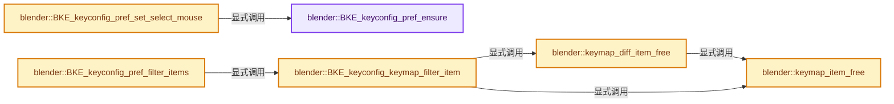
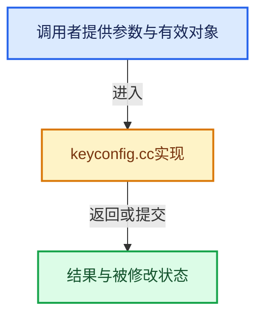

# 实现依赖专题：source/blender/blenkernel/intern/keyconfig.cc

[实现依赖导航](../../README.md) · [符号索引](../../../00-课程指南/02-源码与提交索引/符号依赖与实现索引.md)

本专题从正文实际调用进入，集中保存共享实现。函数有稳定锚点，可从调用处直接跳到对应完整函数；递归与互相调用通过回链组织。

## 本文件的实现关系






## 完整成员与函数实现

<a id="f-4f4284afaf5d07ff"></a>

### `blender::BKE_keyconfig_pref_ensure`

实现位置：[source/blender/blenkernel/intern/keyconfig.cc](../../../../../../../source/blender/blenkernel/intern/keyconfig.cc) · L36—L50。

接口参数：

- `UserDef *userdef`
- `const char *kc_idname`

**教学注释版**

<!-- annotated:a8022a68193c68 -->

```cpp
wmKeyConfigPref *BKE_keyconfig_pref_ensure(UserDef *userdef, const char *kc_idname)
{
  wmKeyConfigPref *kpt = static_cast<wmKeyConfigPref *>(BLI_findstring(
      &userdef->user_keyconfig_prefs, kc_idname, offsetof(wmKeyConfigPref, idname)));
  if (kpt == nullptr) {
    kpt = MEM_new<wmKeyConfigPref>(__func__);
    STRNCPY(kpt->idname, kc_idname);
    BLI_addtail(&userdef->user_keyconfig_prefs, kpt);
  }
  if (kpt->prop == nullptr) {
    /* name is unimportant. */
    kpt->prop = bke::idprop::create_group(kc_idname).release();
  }
  return kpt;
}
```

<details>
<summary>核对原始源码：source/blender/blenkernel/intern/keyconfig.cc · L36—L50</summary>

<!-- original:a8022a68193c68:source/blender/blenkernel/intern/keyconfig.cc:36:50 -->

```cpp
wmKeyConfigPref *BKE_keyconfig_pref_ensure(UserDef *userdef, const char *kc_idname)
{
  wmKeyConfigPref *kpt = static_cast<wmKeyConfigPref *>(BLI_findstring(
      &userdef->user_keyconfig_prefs, kc_idname, offsetof(wmKeyConfigPref, idname)));
  if (kpt == nullptr) {
    kpt = MEM_new<wmKeyConfigPref>(__func__);
    STRNCPY(kpt->idname, kc_idname);
    BLI_addtail(&userdef->user_keyconfig_prefs, kpt);
  }
  if (kpt->prop == nullptr) {
    /* name is unimportant. */
    kpt->prop = bke::idprop::create_group(kc_idname).release();
  }
  return kpt;
}
```

</details>

**沿实际写入检查状态**

- `kpt = MEM_new<wmKeyConfigPref>(__func__);`
- `kpt->prop = bke::idprop::create_group(kc_idname).release();`

**结果出口**

- `return kpt;`

**继续追踪实现**

- `BLI_findstring` → [blender::BLI_findstring · L615](../../01-BLI基础库/intern/listbase.cc.md#f-d913b13b2651348e)。
- `MEM_new<wmKeyConfigPref>` → [MEM_new · L351](../../07-Intern运行时与平台/guardedalloc/MEM_guardedalloc.h.md#f-115f9b6784f89912)。
- `STRNCPY` → [blender::STRNCPY · L690](../../01-BLI基础库/BLI_string.hh.md#f-6b2d861724026be6)。
- `BLI_addtail` → [blender::BLI_addtail · L118](../../01-BLI基础库/intern/listbase.cc.md#f-4fb027713fa3115b)。
- `bke::idprop::create_group(kc_idname).release` → [调用协议](../../../00-课程指南/01-路线与规范/模板宏与动态分派协议.md)：接收对象类型依赖auto、返回值或模板实例；不按同名猜测目标。调用位置L47。
- `bke::idprop::create_group` → [blender::bke::idprop::create_group · L155](idprop_create.cc.md#f-b1e2d8bfd5654bc2)。

<a id="f-e1ca3ce531f3c9f4"></a>

### `blender::BKE_keyconfig_pref_set_select_mouse`

实现位置：[source/blender/blenkernel/intern/keyconfig.cc](../../../../../../../source/blender/blenkernel/intern/keyconfig.cc) · L114—L124。

接口参数：

- `UserDef *userdef`
- `int value`
- `bool override`

**教学注释版**

<!-- annotated:0c8e7d31bf4d60 -->

```cpp
void BKE_keyconfig_pref_set_select_mouse(UserDef *userdef, int value, bool override)
{
  wmKeyConfigPref *kpt = BKE_keyconfig_pref_ensure(userdef, WM_KEYCONFIG_STR_DEFAULT);
  IDProperty *idprop = IDP_GetPropertyFromGroup(kpt->prop, "select_mouse");
  if (!idprop) {
    IDP_AddToGroup(kpt->prop, bke::idprop::create("select_mouse", value).release());
  }
  else if (override) {
    IDP_int_set(idprop, value);
  }
}
```

<details>
<summary>核对原始源码：source/blender/blenkernel/intern/keyconfig.cc · L114—L124</summary>

<!-- original:0c8e7d31bf4d60:source/blender/blenkernel/intern/keyconfig.cc:114:124 -->

```cpp
void BKE_keyconfig_pref_set_select_mouse(UserDef *userdef, int value, bool override)
{
  wmKeyConfigPref *kpt = BKE_keyconfig_pref_ensure(userdef, WM_KEYCONFIG_STR_DEFAULT);
  IDProperty *idprop = IDP_GetPropertyFromGroup(kpt->prop, "select_mouse");
  if (!idprop) {
    IDP_AddToGroup(kpt->prop, bke::idprop::create("select_mouse", value).release());
  }
  else if (override) {
    IDP_int_set(idprop, value);
  }
}
```

</details>

**继续追踪实现**

- `BKE_keyconfig_pref_ensure` → [blender::BKE_keyconfig_pref_ensure · L36](keyconfig.cc.md#f-4f4284afaf5d07ff)。
- `IDP_GetPropertyFromGroup` → [blender::IDP_GetPropertyFromGroup · L818](idprop.cc.md#f-a8d678499d89359e)。
- `IDP_AddToGroup` → [blender::IDP_AddToGroup · L788](idprop.cc.md#f-35f2075430483def)。
- `bke::idprop::create("select_mouse", value).release` → [调用协议](../../../00-课程指南/01-路线与规范/模板宏与动态分派协议.md)：接收对象类型依赖auto、返回值或模板实例；不按同名猜测目标。调用位置L119。
- `bke::idprop::create` → [blender::bke::idprop::create · L21](idprop_create.cc.md#f-9f46f3367aea5850)；[blender::bke::idprop::create · L41](idprop_create.cc.md#f-fb8f0fd79ae0a7b2)；[blender::bke::idprop::create · L51](idprop_create.cc.md#f-3c724b83c1b70000)；[blender::bke::idprop::create · L61](idprop_create.cc.md#f-3e8bfbe29fbc5b06)；[blender::bke::idprop::create · L69](idprop_create.cc.md#f-da73ef629d404b53)；[blender::bke::idprop::create · L134](idprop_create.cc.md#f-db9e605ad4939d5d)；[blender::bke::idprop::create · L141](idprop_create.cc.md#f-1198c99845e5eb1f)；[blender::bke::idprop::create · L148](idprop_create.cc.md#f-d9cb1affee65ed50)。同名重载需按实参类型选择。
- `IDP_int_set` → [IDP_int_set · L312](../BKE_idprop.hh.md#m-e6029d8f612d)。宏定义由构建条件选择。

<a id="f-a02490a80bed1411"></a>

### `blender::keymap_item_free`

实现位置：[source/blender/blenkernel/intern/keyconfig.cc](../../../../../../../source/blender/blenkernel/intern/keyconfig.cc) · L126—L133。

接口参数：

- `wmKeyMapItem *kmi`

**教学注释版**

<!-- annotated:7f8f4611cade1f -->

```cpp
static void keymap_item_free(wmKeyMapItem *kmi)
{
  IDP_FreeProperty(kmi->properties);
  if (kmi->ptr) {
    MEM_delete(kmi->ptr);
  }
  MEM_delete(kmi);
}
```

<details>
<summary>核对原始源码：source/blender/blenkernel/intern/keyconfig.cc · L126—L133</summary>

<!-- original:7f8f4611cade1f:source/blender/blenkernel/intern/keyconfig.cc:126:133 -->

```cpp
static void keymap_item_free(wmKeyMapItem *kmi)
{
  IDP_FreeProperty(kmi->properties);
  if (kmi->ptr) {
    MEM_delete(kmi->ptr);
  }
  MEM_delete(kmi);
}
```

</details>

**继续追踪实现**

- `IDP_FreeProperty` → [blender::IDP_FreeProperty · L1403](idprop.cc.md#f-389134a630df1bed)。
- `MEM_delete` → [MEM_delete · L400](../../07-Intern运行时与平台/guardedalloc/MEM_guardedalloc.h.md#f-9049ffdd1682887c)。

<a id="f-58bdd066d47e42a7"></a>

### `blender::keymap_diff_item_free`

实现位置：[source/blender/blenkernel/intern/keyconfig.cc](../../../../../../../source/blender/blenkernel/intern/keyconfig.cc) · L135—L144。

接口参数：

- `wmKeyMapDiffItem *kmdi`

**教学注释版**

<!-- annotated:31bc6158267188 -->

```cpp
static void keymap_diff_item_free(wmKeyMapDiffItem *kmdi)
{
  if (kmdi->add_item) {
    keymap_item_free(kmdi->add_item);
  }
  if (kmdi->remove_item) {
    keymap_item_free(kmdi->remove_item);
  }
  MEM_delete(kmdi);
}
```

<details>
<summary>核对原始源码：source/blender/blenkernel/intern/keyconfig.cc · L135—L144</summary>

<!-- original:31bc6158267188:source/blender/blenkernel/intern/keyconfig.cc:135:144 -->

```cpp
static void keymap_diff_item_free(wmKeyMapDiffItem *kmdi)
{
  if (kmdi->add_item) {
    keymap_item_free(kmdi->add_item);
  }
  if (kmdi->remove_item) {
    keymap_item_free(kmdi->remove_item);
  }
  MEM_delete(kmdi);
}
```

</details>

**继续追踪实现**

- `keymap_item_free` → [blender::keymap_item_free · L126](keyconfig.cc.md#f-a02490a80bed1411)。
- `MEM_delete` → [MEM_delete · L400](../../07-Intern运行时与平台/guardedalloc/MEM_guardedalloc.h.md#f-9049ffdd1682887c)。

<a id="f-e6be6b15878879f0"></a>

### `blender::BKE_keyconfig_keymap_filter_item`

实现位置：[source/blender/blenkernel/intern/keyconfig.cc](../../../../../../../source/blender/blenkernel/intern/keyconfig.cc) · L146—L188。

接口参数：

- `wmKeyMap *keymap`
- `const wmKeyConfigFilterItemParams *params`
- `bool (*filter_fn)(wmKeyMapItem *kmi, void *user_data)`
- `wmKeyMapItem *kmi`
- `void *user_data`
- `void *user_data`

**教学注释版**

<!-- annotated:810fdbb9c9834b -->

```cpp
void BKE_keyconfig_keymap_filter_item(wmKeyMap *keymap,
                                      const wmKeyConfigFilterItemParams *params,
                                      bool (*filter_fn)(wmKeyMapItem *kmi, void *user_data),
                                      void *user_data)
{
  if (params->check_diff_item_add || params->check_diff_item_remove) {
    for (wmKeyMapDiffItem *kmdi = keymap->diff_items.first(), *kmdi_next; kmdi; kmdi = kmdi_next) {
      kmdi_next = kmdi->next;
      bool remove = false;

      if (params->check_diff_item_add) {
        if (kmdi->add_item) {
          if (filter_fn(kmdi->add_item, user_data)) {
            remove = true;
          }
        }
      }

      if (!remove && params->check_diff_item_remove) {
        if (kmdi->remove_item) {
          if (filter_fn(kmdi->remove_item, user_data)) {
            remove = true;
          }
        }
      }

      if (remove) {
        BLI_remlink(&keymap->diff_items, kmdi);
        keymap_diff_item_free(kmdi);
      }
    }
  }

  if (params->check_item) {
    for (wmKeyMapItem *kmi = keymap->items.first(), *kmi_next; kmi; kmi = kmi_next) {
      kmi_next = kmi->next;
      if (filter_fn(kmi, user_data)) {
        BLI_remlink(&keymap->items, kmi);
        keymap_item_free(kmi);
      }
    }
  }
}
```

<details>
<summary>核对原始源码：source/blender/blenkernel/intern/keyconfig.cc · L146—L188</summary>

<!-- original:810fdbb9c9834b:source/blender/blenkernel/intern/keyconfig.cc:146:188 -->

```cpp
void BKE_keyconfig_keymap_filter_item(wmKeyMap *keymap,
                                      const wmKeyConfigFilterItemParams *params,
                                      bool (*filter_fn)(wmKeyMapItem *kmi, void *user_data),
                                      void *user_data)
{
  if (params->check_diff_item_add || params->check_diff_item_remove) {
    for (wmKeyMapDiffItem *kmdi = keymap->diff_items.first(), *kmdi_next; kmdi; kmdi = kmdi_next) {
      kmdi_next = kmdi->next;
      bool remove = false;

      if (params->check_diff_item_add) {
        if (kmdi->add_item) {
          if (filter_fn(kmdi->add_item, user_data)) {
            remove = true;
          }
        }
      }

      if (!remove && params->check_diff_item_remove) {
        if (kmdi->remove_item) {
          if (filter_fn(kmdi->remove_item, user_data)) {
            remove = true;
          }
        }
      }

      if (remove) {
        BLI_remlink(&keymap->diff_items, kmdi);
        keymap_diff_item_free(kmdi);
      }
    }
  }

  if (params->check_item) {
    for (wmKeyMapItem *kmi = keymap->items.first(), *kmi_next; kmi; kmi = kmi_next) {
      kmi_next = kmi->next;
      if (filter_fn(kmi, user_data)) {
        BLI_remlink(&keymap->items, kmi);
        keymap_item_free(kmi);
      }
    }
  }
}
```

</details>

**沿实际写入检查状态**

- `kmdi_next = kmdi->next;`
- `remove = true;`
- `kmi_next = kmi->next;`

**继续追踪实现**

- `keymap->diff_items.first` → [调用协议](../../../00-课程指南/01-路线与规范/模板宏与动态分派协议.md)：接收对象类型依赖auto、返回值或模板实例；不按同名猜测目标。调用位置L152。
- `filter_fn` → [调用协议](../../../00-课程指南/01-路线与规范/模板宏与动态分派协议.md)：局部可调用对象，须结合其初始化与捕获环境。调用位置L158。
- `BLI_remlink` → [blender::BLI_remlink · L138](../../01-BLI基础库/intern/listbase.cc.md#f-120d80f281ca4cb7)。
- `keymap_diff_item_free` → [blender::keymap_diff_item_free · L135](keyconfig.cc.md#f-58bdd066d47e42a7)。
- `keymap->items.first` → [调用协议](../../../00-课程指南/01-路线与规范/模板宏与动态分派协议.md)：接收对象类型依赖auto、返回值或模板实例；不按同名猜测目标。调用位置L180。
- `keymap_item_free` → [blender::keymap_item_free · L126](keyconfig.cc.md#f-a02490a80bed1411)。

<a id="f-a0e5561285bf7159"></a>

### `blender::BKE_keyconfig_pref_filter_items`

实现位置：[source/blender/blenkernel/intern/keyconfig.cc](../../../../../../../source/blender/blenkernel/intern/keyconfig.cc) · L190—L198。

接口参数：

- `UserDef *userdef`
- `const wmKeyConfigFilterItemParams *params`
- `bool (*filter_fn)(wmKeyMapItem *kmi, void *user_data)`
- `wmKeyMapItem *kmi`
- `void *user_data`
- `void *user_data`

**教学注释版**

<!-- annotated:cfcfb63295f39d -->

```cpp
void BKE_keyconfig_pref_filter_items(UserDef *userdef,
                                     const wmKeyConfigFilterItemParams *params,
                                     bool (*filter_fn)(wmKeyMapItem *kmi, void *user_data),
                                     void *user_data)
{
  for (wmKeyMap &keymap : userdef->user_keymaps) {
    BKE_keyconfig_keymap_filter_item(&keymap, params, filter_fn, user_data);
  }
}
```

<details>
<summary>核对原始源码：source/blender/blenkernel/intern/keyconfig.cc · L190—L198</summary>

<!-- original:cfcfb63295f39d:source/blender/blenkernel/intern/keyconfig.cc:190:198 -->

```cpp
void BKE_keyconfig_pref_filter_items(UserDef *userdef,
                                     const wmKeyConfigFilterItemParams *params,
                                     bool (*filter_fn)(wmKeyMapItem *kmi, void *user_data),
                                     void *user_data)
{
  for (wmKeyMap &keymap : userdef->user_keymaps) {
    BKE_keyconfig_keymap_filter_item(&keymap, params, filter_fn, user_data);
  }
}
```

</details>

**继续追踪实现**

- `BKE_keyconfig_keymap_filter_item` → [blender::BKE_keyconfig_keymap_filter_item · L146](keyconfig.cc.md#f-e6be6b15878879f0)。
