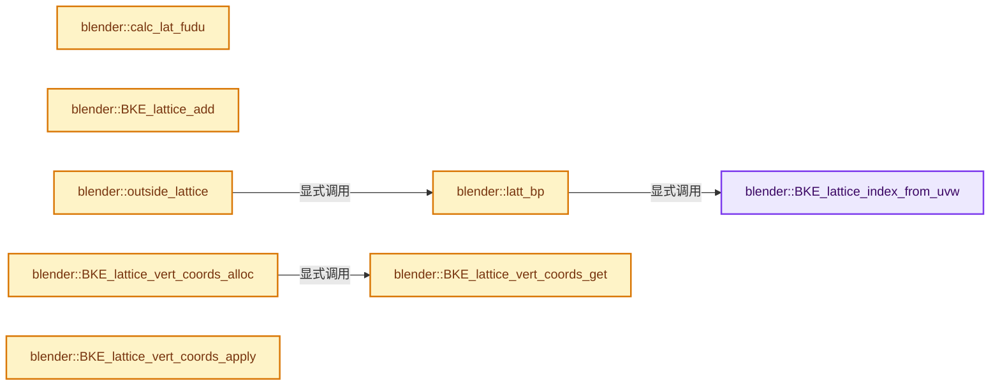
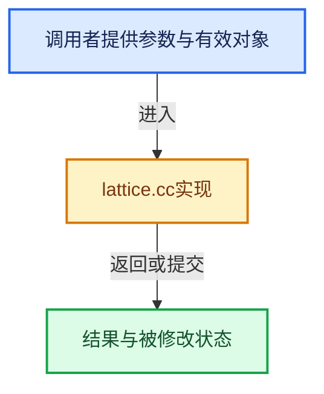

# 实现依赖专题：source/blender/blenkernel/intern/lattice.cc

[实现依赖导航](../../README.md) · [符号索引](../../../00-课程指南/02-源码与提交索引/符号依赖与实现索引.md)

本专题从正文实际调用进入，集中保存共享实现。函数有稳定锚点，可从调用处直接跳到对应完整函数；递归与互相调用通过回链组织。

## 本文件的实现关系






## 完整成员与函数实现

<a id="f-06c631ed22c970ac"></a>

### `blender::BKE_lattice_index_from_uvw`

实现位置：[source/blender/blenkernel/intern/lattice.cc](../../../../../../../source/blender/blenkernel/intern/lattice.cc) · L199—L205。

接口参数：

- `const Lattice *lt`
- `const int u`
- `const int v`
- `const int w`

**教学注释版**

<!-- annotated:acfdace1dcd45e -->

```cpp
int BKE_lattice_index_from_uvw(const Lattice *lt, const int u, const int v, const int w)
{
  const int totu = lt->pntsu;
  const int totv = lt->pntsv;

  return (w * (totu * totv) + (v * totu) + u);
}
```

<details>
<summary>核对原始源码：source/blender/blenkernel/intern/lattice.cc · L199—L205</summary>

<!-- original:acfdace1dcd45e:source/blender/blenkernel/intern/lattice.cc:199:205 -->

```cpp
int BKE_lattice_index_from_uvw(const Lattice *lt, const int u, const int v, const int w)
{
  const int totu = lt->pntsu;
  const int totv = lt->pntsv;

  return (w * (totu * totv) + (v * totu) + u);
}
```

</details>

**结果出口**

- `return (w * (totu * totv) + (v * totu) + u);`

**继续追踪实现**

本实现没有需要继续展开的显式调用；检查返回表达式、对象转换和调用者前置条件。

<a id="f-ab3049f15fa8750e"></a>

### `blender::calc_lat_fudu`

实现位置：[source/blender/blenkernel/intern/lattice.cc](../../../../../../../source/blender/blenkernel/intern/lattice.cc) · L261—L275。

接口参数：

- `int flag`
- `int res`
- `float *r_fu`
- `float *r_du`

**教学注释版**

<!-- annotated:9ecc5d1d0d21c3 -->

```cpp
void calc_lat_fudu(int flag, int res, float *r_fu, float *r_du)
{
  if (res == 1) {
    *r_fu = 0.0;
    *r_du = 0.0;
  }
  else if (flag & LT_GRID) {
    *r_fu = -0.5f * (res - 1);
    *r_du = 1.0f;
  }
  else {
    *r_fu = -1.0f;
    *r_du = 2.0f / (res - 1);
  }
}
```

<details>
<summary>核对原始源码：source/blender/blenkernel/intern/lattice.cc · L261—L275</summary>

<!-- original:9ecc5d1d0d21c3:source/blender/blenkernel/intern/lattice.cc:261:275 -->

```cpp
void calc_lat_fudu(int flag, int res, float *r_fu, float *r_du)
{
  if (res == 1) {
    *r_fu = 0.0;
    *r_du = 0.0;
  }
  else if (flag & LT_GRID) {
    *r_fu = -0.5f * (res - 1);
    *r_du = 1.0f;
  }
  else {
    *r_fu = -1.0f;
    *r_du = 2.0f / (res - 1);
  }
}
```

</details>

**继续追踪实现**

本实现没有需要继续展开的显式调用；检查返回表达式、对象转换和调用者前置条件。

<a id="f-e60b9443d992d450"></a>

### `blender::BKE_lattice_add`

实现位置：[source/blender/blenkernel/intern/lattice.cc](../../../../../../../source/blender/blenkernel/intern/lattice.cc) · L392—L399。

接口参数：

- `Main *bmain`
- `const char *name`

**教学注释版**

<!-- annotated:c509c9c4ac9a26 -->

```cpp
Lattice *BKE_lattice_add(Main *bmain, const char *name)
{
  Lattice *lt;

  lt = BKE_id_new<Lattice>(bmain, name);

  return lt;
}
```

<details>
<summary>核对原始源码：source/blender/blenkernel/intern/lattice.cc · L392—L399</summary>

<!-- original:c509c9c4ac9a26:source/blender/blenkernel/intern/lattice.cc:392:399 -->

```cpp
Lattice *BKE_lattice_add(Main *bmain, const char *name)
{
  Lattice *lt;

  lt = BKE_id_new<Lattice>(bmain, name);

  return lt;
}
```

</details>

**沿实际写入检查状态**

- `lt = BKE_id_new<Lattice>(bmain, name);`

**结果出口**

- `return lt;`

**继续追踪实现**

- `BKE_id_new<Lattice>` → [blender::BKE_id_new · L1612](lib_id.cc.md#f-5335c97ce0a8fbc8)。

<a id="f-8c9bbc75f7d56ef5"></a>

### `blender::latt_bp`

实现位置：[source/blender/blenkernel/intern/lattice.cc](../../../../../../../source/blender/blenkernel/intern/lattice.cc) · L410—L413。

接口参数：

- `Lattice *lt`
- `int u`
- `int v`
- `int w`

**教学注释版**

<!-- annotated:55b4ffa5e78c2f -->

```cpp
static BPoint *latt_bp(Lattice *lt, int u, int v, int w)
{
  return &lt->def[BKE_lattice_index_from_uvw(lt, u, v, w)];
}
```

<details>
<summary>核对原始源码：source/blender/blenkernel/intern/lattice.cc · L410—L413</summary>

<!-- original:55b4ffa5e78c2f:source/blender/blenkernel/intern/lattice.cc:410:413 -->

```cpp
static BPoint *latt_bp(Lattice *lt, int u, int v, int w)
{
  return &lt->def[BKE_lattice_index_from_uvw(lt, u, v, w)];
}
```

</details>

**结果出口**

- `return &lt->def[BKE_lattice_index_from_uvw(lt, u, v, w)];`

**继续追踪实现**

- `BKE_lattice_index_from_uvw` → [blender::BKE_lattice_index_from_uvw · L199](lattice.cc.md#f-06c631ed22c970ac)。

<a id="f-0b6e5ff486a1cc3b"></a>

### `blender::outside_lattice`

实现位置：[source/blender/blenkernel/intern/lattice.cc](../../../../../../../source/blender/blenkernel/intern/lattice.cc) · L415—L492。

接口参数：

- `Lattice *lt`

**教学注释版**

<!-- annotated:e3d51e70737c40 -->

```cpp
void outside_lattice(Lattice *lt)
{
  BPoint *bp, *bp1, *bp2;
  int u, v, w;
  float fac1, du = 0.0, dv = 0.0, dw = 0.0;

  if (lt->flag & LT_OUTSIDE) {
    bp = lt->def;

    if (lt->pntsu > 1) {
      du = 1.0f / float(lt->pntsu - 1);
    }
    if (lt->pntsv > 1) {
      dv = 1.0f / float(lt->pntsv - 1);
    }
    if (lt->pntsw > 1) {
      dw = 1.0f / float(lt->pntsw - 1);
    }

    for (w = 0; w < lt->pntsw; w++) {

      for (v = 0; v < lt->pntsv; v++) {

        for (u = 0; u < lt->pntsu; u++, bp++) {
          if (u == 0 || v == 0 || w == 0 || u == lt->pntsu - 1 || v == lt->pntsv - 1 ||
              w == lt->pntsw - 1)
          {
            /* pass */
          }
          else {
            bp->hide = 1;
            bp->f1 &= ~SELECT;

            /* U extrema. */
            bp1 = latt_bp(lt, 0, v, w);
            bp2 = latt_bp(lt, lt->pntsu - 1, v, w);

            fac1 = du * u;
            bp->vec[0] = (1.0f - fac1) * bp1->vec[0] + fac1 * bp2->vec[0];
            bp->vec[1] = (1.0f - fac1) * bp1->vec[1] + fac1 * bp2->vec[1];
            bp->vec[2] = (1.0f - fac1) * bp1->vec[2] + fac1 * bp2->vec[2];

            /* V extrema. */
            bp1 = latt_bp(lt, u, 0, w);
            bp2 = latt_bp(lt, u, lt->pntsv - 1, w);

            fac1 = dv * v;
            bp->vec[0] += (1.0f - fac1) * bp1->vec[0] + fac1 * bp2->vec[0];
            bp->vec[1] += (1.0f - fac1) * bp1->vec[1] + fac1 * bp2->vec[1];
            bp->vec[2] += (1.0f - fac1) * bp1->vec[2] + fac1 * bp2->vec[2];

            /* W extrema. */
            bp1 = latt_bp(lt, u, v, 0);
            bp2 = latt_bp(lt, u, v, lt->pntsw - 1);

            fac1 = dw * w;
            bp->vec[0] += (1.0f - fac1) * bp1->vec[0] + fac1 * bp2->vec[0];
            bp->vec[1] += (1.0f - fac1) * bp1->vec[1] + fac1 * bp2->vec[1];
            bp->vec[2] += (1.0f - fac1) * bp1->vec[2] + fac1 * bp2->vec[2];

            mul_v3_fl(bp->vec, 1.0f / 3.0f);
          }
        }
      }
    }
  }
  else {
    bp = lt->def;

    for (w = 0; w < lt->pntsw; w++) {
      for (v = 0; v < lt->pntsv; v++) {
        for (u = 0; u < lt->pntsu; u++, bp++) {
          bp->hide = 0;
        }
      }
    }
  }
}
```

<details>
<summary>核对原始源码：source/blender/blenkernel/intern/lattice.cc · L415—L492</summary>

<!-- original:e3d51e70737c40:source/blender/blenkernel/intern/lattice.cc:415:492 -->

```cpp
void outside_lattice(Lattice *lt)
{
  BPoint *bp, *bp1, *bp2;
  int u, v, w;
  float fac1, du = 0.0, dv = 0.0, dw = 0.0;

  if (lt->flag & LT_OUTSIDE) {
    bp = lt->def;

    if (lt->pntsu > 1) {
      du = 1.0f / float(lt->pntsu - 1);
    }
    if (lt->pntsv > 1) {
      dv = 1.0f / float(lt->pntsv - 1);
    }
    if (lt->pntsw > 1) {
      dw = 1.0f / float(lt->pntsw - 1);
    }

    for (w = 0; w < lt->pntsw; w++) {

      for (v = 0; v < lt->pntsv; v++) {

        for (u = 0; u < lt->pntsu; u++, bp++) {
          if (u == 0 || v == 0 || w == 0 || u == lt->pntsu - 1 || v == lt->pntsv - 1 ||
              w == lt->pntsw - 1)
          {
            /* pass */
          }
          else {
            bp->hide = 1;
            bp->f1 &= ~SELECT;

            /* U extrema. */
            bp1 = latt_bp(lt, 0, v, w);
            bp2 = latt_bp(lt, lt->pntsu - 1, v, w);

            fac1 = du * u;
            bp->vec[0] = (1.0f - fac1) * bp1->vec[0] + fac1 * bp2->vec[0];
            bp->vec[1] = (1.0f - fac1) * bp1->vec[1] + fac1 * bp2->vec[1];
            bp->vec[2] = (1.0f - fac1) * bp1->vec[2] + fac1 * bp2->vec[2];

            /* V extrema. */
            bp1 = latt_bp(lt, u, 0, w);
            bp2 = latt_bp(lt, u, lt->pntsv - 1, w);

            fac1 = dv * v;
            bp->vec[0] += (1.0f - fac1) * bp1->vec[0] + fac1 * bp2->vec[0];
            bp->vec[1] += (1.0f - fac1) * bp1->vec[1] + fac1 * bp2->vec[1];
            bp->vec[2] += (1.0f - fac1) * bp1->vec[2] + fac1 * bp2->vec[2];

            /* W extrema. */
            bp1 = latt_bp(lt, u, v, 0);
            bp2 = latt_bp(lt, u, v, lt->pntsw - 1);

            fac1 = dw * w;
            bp->vec[0] += (1.0f - fac1) * bp1->vec[0] + fac1 * bp2->vec[0];
            bp->vec[1] += (1.0f - fac1) * bp1->vec[1] + fac1 * bp2->vec[1];
            bp->vec[2] += (1.0f - fac1) * bp1->vec[2] + fac1 * bp2->vec[2];

            mul_v3_fl(bp->vec, 1.0f / 3.0f);
          }
        }
      }
    }
  }
  else {
    bp = lt->def;

    for (w = 0; w < lt->pntsw; w++) {
      for (v = 0; v < lt->pntsv; v++) {
        for (u = 0; u < lt->pntsu; u++, bp++) {
          bp->hide = 0;
        }
      }
    }
  }
}
```

</details>

**沿实际写入检查状态**

- `bp = lt->def;`
- `du = 1.0f / float(lt->pntsu - 1);`
- `dv = 1.0f / float(lt->pntsv - 1);`
- `dw = 1.0f / float(lt->pntsw - 1);`
- `bp->hide = 1;`
- `bp->f1 &= ~SELECT;`
- `bp1 = latt_bp(lt, 0, v, w);`
- `bp2 = latt_bp(lt, lt->pntsu - 1, v, w);`
- `fac1 = du * u;`
- `bp->vec[0] = (1.0f - fac1) * bp1->vec[0] + fac1 * bp2->vec[0];`
- `bp->vec[1] = (1.0f - fac1) * bp1->vec[1] + fac1 * bp2->vec[1];`
- `bp->vec[2] = (1.0f - fac1) * bp1->vec[2] + fac1 * bp2->vec[2];`
- `bp1 = latt_bp(lt, u, 0, w);`
- `bp2 = latt_bp(lt, u, lt->pntsv - 1, w);`
- `fac1 = dv * v;`
- `bp->vec[0] += (1.0f - fac1) * bp1->vec[0] + fac1 * bp2->vec[0];`
- `bp->vec[1] += (1.0f - fac1) * bp1->vec[1] + fac1 * bp2->vec[1];`
- `bp->vec[2] += (1.0f - fac1) * bp1->vec[2] + fac1 * bp2->vec[2];`
- `bp1 = latt_bp(lt, u, v, 0);`
- `bp2 = latt_bp(lt, u, v, lt->pntsw - 1);`
- `fac1 = dw * w;`
- `bp->hide = 0;`

**继续追踪实现**

- `latt_bp` → [blender::latt_bp · L410](lattice.cc.md#f-8c9bbc75f7d56ef5)。
- `mul_v3_fl` → [blender::mul_v3_fl · L414](../../01-BLI基础库/intern/math_vector_inline.cc.md#f-00165156a06d1224)。

<a id="f-3f12219cbd5607fb"></a>

### `blender::BKE_lattice_vert_coords_get`

实现位置：[source/blender/blenkernel/intern/lattice.cc](../../../../../../../source/blender/blenkernel/intern/lattice.cc) · L494—L500。

接口参数：

- `const Lattice *lt`
- `MutableSpan<float3> vert_coords`

**教学注释版**

<!-- annotated:98c6586a439633 -->

```cpp
void BKE_lattice_vert_coords_get(const Lattice *lt, MutableSpan<float3> vert_coords)
{
  const int vert_len = lt->pntsu * lt->pntsv * lt->pntsw;
  for (int i = 0; i < vert_len; i++) {
    vert_coords[i] = lt->def[i].vec;
  }
}
```

<details>
<summary>核对原始源码：source/blender/blenkernel/intern/lattice.cc · L494—L500</summary>

<!-- original:98c6586a439633:source/blender/blenkernel/intern/lattice.cc:494:500 -->

```cpp
void BKE_lattice_vert_coords_get(const Lattice *lt, MutableSpan<float3> vert_coords)
{
  const int vert_len = lt->pntsu * lt->pntsv * lt->pntsw;
  for (int i = 0; i < vert_len; i++) {
    vert_coords[i] = lt->def[i].vec;
  }
}
```

</details>

**沿实际写入检查状态**

- `vert_coords[i] = lt->def[i].vec;`

**继续追踪实现**

本实现没有需要继续展开的显式调用；检查返回表达式、对象转换和调用者前置条件。

<a id="f-9b476442bdb2b7fb"></a>

### `blender::BKE_lattice_vert_coords_alloc`

实现位置：[source/blender/blenkernel/intern/lattice.cc](../../../../../../../source/blender/blenkernel/intern/lattice.cc) · L502—L508。

接口参数：

- `const Lattice *lt`

**教学注释版**

<!-- annotated:28545b68f61a08 -->

```cpp
Array<float3> BKE_lattice_vert_coords_alloc(const Lattice *lt)
{
  const int vert_len = lt->pntsu * lt->pntsv * lt->pntsw;
  Array<float3> vert_coords(vert_len);
  BKE_lattice_vert_coords_get(lt, vert_coords);
  return vert_coords;
}
```

<details>
<summary>核对原始源码：source/blender/blenkernel/intern/lattice.cc · L502—L508</summary>

<!-- original:28545b68f61a08:source/blender/blenkernel/intern/lattice.cc:502:508 -->

```cpp
Array<float3> BKE_lattice_vert_coords_alloc(const Lattice *lt)
{
  const int vert_len = lt->pntsu * lt->pntsv * lt->pntsw;
  Array<float3> vert_coords(vert_len);
  BKE_lattice_vert_coords_get(lt, vert_coords);
  return vert_coords;
}
```

</details>

**结果出口**

- `return vert_coords;`

**继续追踪实现**

- `BKE_lattice_vert_coords_get` → [blender::BKE_lattice_vert_coords_get · L494](lattice.cc.md#f-3f12219cbd5607fb)。

<a id="f-7a5e5778799f0f20"></a>

### `blender::BKE_lattice_vert_coords_apply`

实现位置：[source/blender/blenkernel/intern/lattice.cc](../../../../../../../source/blender/blenkernel/intern/lattice.cc) · L520—L526。

接口参数：

- `Lattice *lt`
- `const Span<float3> vert_coords`

**教学注释版**

<!-- annotated:d3c0a9523cc6c7 -->

```cpp
void BKE_lattice_vert_coords_apply(Lattice *lt, const Span<float3> vert_coords)
{
  const int vert_len = lt->pntsu * lt->pntsv * lt->pntsw;
  for (int i = 0; i < vert_len; i++) {
    copy_v3_v3(lt->def[i].vec, vert_coords[i]);
  }
}
```

<details>
<summary>核对原始源码：source/blender/blenkernel/intern/lattice.cc · L520—L526</summary>

<!-- original:d3c0a9523cc6c7:source/blender/blenkernel/intern/lattice.cc:520:526 -->

```cpp
void BKE_lattice_vert_coords_apply(Lattice *lt, const Span<float3> vert_coords)
{
  const int vert_len = lt->pntsu * lt->pntsv * lt->pntsw;
  for (int i = 0; i < vert_len; i++) {
    copy_v3_v3(lt->def[i].vec, vert_coords[i]);
  }
}
```

</details>

**继续追踪实现**

- `copy_v3_v3` → [blender::copy_v3_v3 · L47](../../01-BLI基础库/intern/math_vector_inline.cc.md#f-037a0d5fa5060bd6)。

<a id="f-6d3ea701a0b81a03"></a>

### `blender::BKE_lattice_modifiers_calc`

实现位置：[source/blender/blenkernel/intern/lattice.cc](../../../../../../../source/blender/blenkernel/intern/lattice.cc) · L528—L581。

接口参数：

- `Depsgraph *depsgraph`
- `Scene *scene`
- `Object *ob`

**教学注释版**

<!-- annotated:6a22b194503d68 -->

```cpp
void BKE_lattice_modifiers_calc(Depsgraph *depsgraph, Scene *scene, Object *ob)
{
  BKE_object_free_derived_caches(ob);
  if (ob->runtime->curve_cache == nullptr) {
    ob->runtime->curve_cache = MEM_new_zeroed<CurveCache>("CurveCache for lattice");
  }

  Lattice *lt = id_cast<Lattice *>(ob->data);
  VirtualModifierData virtual_modifier_data;
  ModifierData *md = BKE_modifiers_get_virtual_modifierlist(ob, &virtual_modifier_data);
  Array<float3> vert_coords;
  const bool is_editmode = (lt->editlatt != nullptr);
  const ModifierEvalContext mectx = {depsgraph, ob, ModifierApplyFlag(0)};

  for (; md; md = md->next) {
    const ModifierTypeInfo *mti = BKE_modifier_get_info(md->type);

    if (!(mti->flags & eModifierTypeFlag_AcceptsVertexCosOnly)) {
      continue;
    }
    if (!(md->mode & eModifierMode_Realtime)) {
      continue;
    }
    if (is_editmode && !(md->mode & eModifierMode_Editmode)) {
      continue;
    }
    if (mti->is_disabled && mti->is_disabled(scene, md, false)) {
      continue;
    }
    if (mti->type != ModifierTypeType::OnlyDeform) {
      continue;
    }

    // [讲解] vert_coords.is_empty：查询固定有效长度及其索引范围。
    if (vert_coords.is_empty()) {
      /* Get either the edit-mode or regular lattice, whichever is in use now. */
      const Lattice *effective_lattice = BKE_object_get_lattice(ob);
      vert_coords = BKE_lattice_vert_coords_alloc(effective_lattice);
    }

    mti->deform_verts(md, &mectx, nullptr, vert_coords);
  }

  if (vert_coords.is_empty()) {
    return;
  }

  Lattice *lt_eval = BKE_object_get_evaluated_lattice(ob);
  if (lt_eval == nullptr) {
    BKE_id_copy_ex(nullptr, &lt->id, reinterpret_cast<ID **>(&lt_eval), LIB_ID_COPY_LOCALIZE);
    BKE_object_eval_assign_data(ob, &lt_eval->id, true);
  }

  BKE_lattice_vert_coords_apply(lt_eval, vert_coords);
}
```

<details>
<summary>核对原始源码：source/blender/blenkernel/intern/lattice.cc · L528—L581</summary>

<!-- original:6a22b194503d68:source/blender/blenkernel/intern/lattice.cc:528:581 -->

```cpp
void BKE_lattice_modifiers_calc(Depsgraph *depsgraph, Scene *scene, Object *ob)
{
  BKE_object_free_derived_caches(ob);
  if (ob->runtime->curve_cache == nullptr) {
    ob->runtime->curve_cache = MEM_new_zeroed<CurveCache>("CurveCache for lattice");
  }

  Lattice *lt = id_cast<Lattice *>(ob->data);
  VirtualModifierData virtual_modifier_data;
  ModifierData *md = BKE_modifiers_get_virtual_modifierlist(ob, &virtual_modifier_data);
  Array<float3> vert_coords;
  const bool is_editmode = (lt->editlatt != nullptr);
  const ModifierEvalContext mectx = {depsgraph, ob, ModifierApplyFlag(0)};

  for (; md; md = md->next) {
    const ModifierTypeInfo *mti = BKE_modifier_get_info(md->type);

    if (!(mti->flags & eModifierTypeFlag_AcceptsVertexCosOnly)) {
      continue;
    }
    if (!(md->mode & eModifierMode_Realtime)) {
      continue;
    }
    if (is_editmode && !(md->mode & eModifierMode_Editmode)) {
      continue;
    }
    if (mti->is_disabled && mti->is_disabled(scene, md, false)) {
      continue;
    }
    if (mti->type != ModifierTypeType::OnlyDeform) {
      continue;
    }

    if (vert_coords.is_empty()) {
      /* Get either the edit-mode or regular lattice, whichever is in use now. */
      const Lattice *effective_lattice = BKE_object_get_lattice(ob);
      vert_coords = BKE_lattice_vert_coords_alloc(effective_lattice);
    }

    mti->deform_verts(md, &mectx, nullptr, vert_coords);
  }

  if (vert_coords.is_empty()) {
    return;
  }

  Lattice *lt_eval = BKE_object_get_evaluated_lattice(ob);
  if (lt_eval == nullptr) {
    BKE_id_copy_ex(nullptr, &lt->id, reinterpret_cast<ID **>(&lt_eval), LIB_ID_COPY_LOCALIZE);
    BKE_object_eval_assign_data(ob, &lt_eval->id, true);
  }

  BKE_lattice_vert_coords_apply(lt_eval, vert_coords);
}
```

</details>

**沿实际写入检查状态**

- `ob->runtime->curve_cache = MEM_new_zeroed<CurveCache>("CurveCache for lattice");`
- `vert_coords = BKE_lattice_vert_coords_alloc(effective_lattice);`

**继续追踪实现**

- `BKE_object_free_derived_caches` → [blender::BKE_object_free_derived_caches · L1810](object.cc.md#f-74071902e41326eb)。
- `MEM_new_zeroed<CurveCache>` → [MEM_new_zeroed · L550](../../07-Intern运行时与平台/guardedalloc/MEM_guardedalloc.h.md#f-eeb1e2a7f57dd231)；[MEM_new_zeroed · L114](../../07-Intern运行时与平台/guardedalloc/intern/mallocn.cc.md#f-e04cf01c64c8b180)。同名重载需按实参类型选择。
- `id_cast<Lattice *>` → [blender::id_cast · L1417](../../08-其他Blender模块/makesdna/DNA_ID.h.md#f-6c8ac6412850ac5a)。
- `BKE_modifiers_get_virtual_modifierlist` → [blender::BKE_modifiers_get_virtual_modifierlist · L620](modifier.cc.md#f-47967058788364c5)。
- `ModifierApplyFlag` → [blender::ModifierApplyFlag](../BKE_modifier.hh.md#t-de246822eca5)。
- `BKE_modifier_get_info` → [blender::BKE_modifier_get_info · L120](modifier.cc.md#f-88218d6d450f0291)。
- `mti->is_disabled` → [blender::is_disabled · L54](../../08-其他Blender模块/shader_fx/intern/FX_shader_swirl.cc.md#f-1fa33151afe58068)；[blender::is_disabled · L67](../../08-其他Blender模块/shader_fx/intern/FX_shader_shadow.cc.md#f-936f1bc8fa045f67)；[blender::is_disabled · L364](../../08-其他Blender模块/modifiers/intern/MOD_weightvgproximity.cc.md#f-58485959326c2392)；[blender::is_disabled · L191](../../08-其他Blender模块/modifiers/intern/MOD_weightvgmix.cc.md#f-912f1304d17b472c)；[blender::is_disabled · L145](../../08-其他Blender模块/modifiers/intern/MOD_weightvgedit.cc.md#f-c33ae1e162371338)；[blender::is_disabled · L75](../../08-其他Blender模块/modifiers/intern/MOD_grease_pencil_multiply.cc.md#f-21f6342c5bcd23a5)；[blender::is_disabled · L113](../../08-其他Blender模块/modifiers/intern/MOD_warp.cc.md#f-65e936f06690c840)；[blender::is_disabled · L82](../../08-其他Blender模块/modifiers/intern/MOD_grease_pencil_lattice.cc.md#f-642a1871ed7f5d16)；[blender::is_disabled · L64](../../08-其他Blender模块/modifiers/intern/MOD_grease_pencil_hook.cc.md#f-7c4f2f87977f7ff4)；[blender::is_disabled · L86](../../08-其他Blender模块/modifiers/intern/MOD_grease_pencil_dash.cc.md#f-e4b2bdbede848e63)；[blender::is_disabled · L1578](../../08-其他Blender模块/modifiers/intern/MOD_surfacedeform.cc.md#f-31b5ac41acd6acf7)；[blender::is_disabled · L76](../../08-其他Blender模块/modifiers/intern/MOD_grease_pencil_armature.cc.md#f-daf48a379166dc1d)；[blender::is_disabled · L98](../../08-其他Blender模块/modifiers/intern/MOD_displace.cc.md#f-1b57de5c7c5ed986)；[blender::is_disabled · L109](../../08-其他Blender模块/modifiers/intern/MOD_datatransfer.cc.md#f-1462741eb790d5d3)；[blender::is_disabled · L55](../../08-其他Blender模块/modifiers/intern/MOD_curve.cc.md#f-7e7d110d02c4185d)；[blender::is_disabled · L41](../../08-其他Blender模块/modifiers/intern/MOD_cast.cc.md#f-e8066e41ace3db74)；[blender::is_disabled · L67](../../08-其他Blender模块/modifiers/intern/MOD_boolean.cc.md#f-10ba59baf87b0176)；[blender::is_disabled · L303](../../08-其他Blender模块/modifiers/intern/MOD_bevel.cc.md#f-60c56c6eeeef0756)；[blender::is_disabled · L879](../../08-其他Blender模块/modifiers/intern/MOD_array.cc.md#f-545946d8f3ef90b7)；[blender::is_disabled · L64](../../08-其他Blender模块/modifiers/intern/MOD_armature.cc.md#f-3524d00c8f6db35a)；[blender::is_disabled · L83](../../08-其他Blender模块/modifiers/intern/MOD_subsurf.cc.md#f-ad8eaec305d9e17f)；[blender::is_disabled · L40](../../08-其他Blender模块/modifiers/intern/MOD_smooth.cc.md#f-89ecdefddba1e6ee)；[blender::is_disabled · L51](../../08-其他Blender模块/modifiers/intern/MOD_shrinkwrap.cc.md#f-0e46fe7fdc27da7c)；[blender::is_disabled · L61](../../08-其他Blender模块/modifiers/intern/MOD_particleinstance.cc.md#f-59047440a73ab867)；[blender::is_disabled · L580](../../08-其他Blender模块/modifiers/intern/MOD_normal_edit.cc.md#f-0b8fc4fcaedab259)；[blender::is_disabled · L21](../../08-其他Blender模块/modifiers/intern/MOD_none.cc.md#f-ffd215cf5c70a9fe)；[blender::is_disabled · L290](../../08-其他Blender模块/modifiers/intern/MOD_nodes.cc.md#f-f3ed5c7d6f189dc6)；[blender::is_disabled · L91](../../08-其他Blender模块/modifiers/intern/MOD_meshsequencecache.cc.md#f-1a635d0bc724e354)；[blender::is_disabled · L114](../../08-其他Blender模块/modifiers/intern/MOD_meshdeform.cc.md#f-54680412759ac2f7)；[blender::is_disabled · L60](../../08-其他Blender模块/modifiers/intern/MOD_meshcache.cc.md#f-2bd1fc07b3633983)；[blender::is_disabled · L731](../../08-其他Blender模块/modifiers/intern/MOD_mask.cc.md#f-3fa59a8a6aecbf58)；[blender::is_disabled · L114](../../08-其他Blender模块/modifiers/intern/MOD_lineart.cc.md#f-86cef0e0fda42510)；[blender::is_disabled · L55](../../08-其他Blender模块/modifiers/intern/MOD_lattice.cc.md#f-edd429545e7ba90f)；[blender::is_disabled · L60](../../08-其他Blender模块/modifiers/intern/MOD_lattice.cc.md#f-ee807ba898915214)；[blender::is_disabled · L475](../../08-其他Blender模块/modifiers/intern/MOD_laplaciansmooth.cc.md#f-fdc4ea2f5636bce1)；[blender::is_disabled · L746](../../08-其他Blender模块/modifiers/intern/MOD_laplaciandeform.cc.md#f-9d2a656c5929964b)；[blender::is_disabled · L93](../../08-其他Blender模块/modifiers/intern/MOD_hook.cc.md#f-cba6a1c7b18865ae)；[blender::is_disabled · L64](../../08-其他Blender模块/modifiers/intern/MOD_grease_pencil_weight_proximity.cc.md#f-1f7ded59fac77678)；[blender::is_disabled · L66](../../08-其他Blender模块/modifiers/intern/MOD_grease_pencil_weight_angle.cc.md#f-69c2fb9ecdd947e6)；[blender::is_disabled · L112](../../08-其他Blender模块/modifiers/intern/MOD_grease_pencil_tint.cc.md#f-c16e54ca49f05062)；[blender::is_disabled · L85](../../08-其他Blender模块/modifiers/intern/MOD_grease_pencil_shrinkwrap.cc.md#f-b004accafec24111)。同名重载需按实参类型选择。
- `vert_coords.is_empty` → [blender::Array::is_empty · L275](../../../01-基础容器与现代CPP/08-Array复制移动与销毁.md#f-5eba6dba0f0e521b)。
- `BKE_object_get_lattice` → [blender::BKE_object_get_lattice · L4545](object.cc.md#f-947a32f5c471e9ed)。
- `BKE_lattice_vert_coords_alloc` → [blender::BKE_lattice_vert_coords_alloc · L502](lattice.cc.md#f-9b476442bdb2b7fb)。
- `mti->deform_verts` → [blender::deform_verts · L278](../../08-其他Blender模块/modifiers/intern/MOD_wave.cc.md#f-3a377a5528fe6b4e)；[blender::deform_verts · L331](../../08-其他Blender模块/modifiers/intern/MOD_warp.cc.md#f-98dd715a1dab904a)；[blender::deform_verts · L1565](../../08-其他Blender模块/modifiers/intern/MOD_surfacedeform.cc.md#f-16234210ff29d27a)；[blender::deform_verts · L78](../../08-其他Blender模块/modifiers/intern/MOD_surface.cc.md#f-de03bdbc3c06dedc)；[blender::deform_verts · L326](../../08-其他Blender模块/modifiers/intern/MOD_displace.cc.md#f-5dd2136571461346)；[blender::deform_verts · L92](../../08-其他Blender模块/modifiers/intern/MOD_curve.cc.md#f-d99984e6cde8d521)；[blender::deform_verts · L739](../../08-其他Blender模块/modifiers/intern/MOD_correctivesmooth.cc.md#f-08b18fb3793bd32b)；[blender::deform_verts · L75](../../08-其他Blender模块/modifiers/intern/MOD_collision.cc.md#f-cef5b0b08bece31a)；[blender::deform_verts · L72](../../08-其他Blender模块/modifiers/intern/MOD_cloth.cc.md#f-3cf7020249825dc5)；[blender::deform_verts · L445](../../08-其他Blender模块/modifiers/intern/MOD_cast.cc.md#f-e68dfcf9b31b2381)；[blender::deform_verts · L115](../../08-其他Blender模块/modifiers/intern/MOD_armature.cc.md#f-00659aeadfbf2ac6)；[blender::deform_verts · L31](../../08-其他Blender模块/modifiers/intern/MOD_softbody.cc.md#f-ec3526265f5cd79f)；[blender::deform_verts · L166](../../08-其他Blender模块/modifiers/intern/MOD_smooth.cc.md#f-e340cd99ecd4b8fd)；[blender::deform_verts · L423](../../08-其他Blender模块/modifiers/intern/MOD_simpledeform.cc.md#f-9392b95e994a8195)；[blender::deform_verts · L77](../../08-其他Blender模块/modifiers/intern/MOD_shrinkwrap.cc.md#f-a55a40eb67d99344)；[blender::deform_verts · L26](../../08-其他Blender模块/modifiers/intern/MOD_shapekey.cc.md#f-28f15a07a028259a)；[blender::deform_verts · L93](../../08-其他Blender模块/modifiers/intern/MOD_particlesystem.cc.md#f-0e74765bf7dcf203)；[blender::deform_verts · L416](../../08-其他Blender模块/modifiers/intern/MOD_meshdeform.cc.md#f-1962f813b7776661)；[blender::deform_verts · L273](../../08-其他Blender模块/modifiers/intern/MOD_meshcache.cc.md#f-9705a04062fd0b35)；[blender::deform_verts · L85](../../08-其他Blender模块/modifiers/intern/MOD_lattice.cc.md#f-ecfdd18aaaaf0313)；[blender::deform_verts · L500](../../08-其他Blender模块/modifiers/intern/MOD_laplaciansmooth.cc.md#f-1f652ed905148aa6)；[blender::deform_verts · L764](../../08-其他Blender模块/modifiers/intern/MOD_laplaciandeform.cc.md#f-5a090dd99388d5a1)；[blender::deform_verts · L422](../../08-其他Blender模块/modifiers/intern/MOD_hook.cc.md#f-a8fb3eec0222e7e8)。同名重载需按实参类型选择。
- `BKE_object_get_evaluated_lattice` → [blender::BKE_object_get_evaluated_lattice · L4560](object.cc.md#f-a72732756ec4c71c)。
- `BKE_id_copy_ex` → [blender::BKE_id_copy_ex · L851](lib_id.cc.md#f-24272170c95f49fb)。
- `BKE_object_eval_assign_data` → [blender::BKE_object_eval_assign_data · L1786](object.cc.md#f-8f43c337a2db2299)。
- `BKE_lattice_vert_coords_apply` → [blender::BKE_lattice_vert_coords_apply · L520](lattice.cc.md#f-7a5e5778799f0f20)。

<a id="f-93c02e0870685a74"></a>

### `blender::BKE_lattice_deform_verts_get`

实现位置：[source/blender/blenkernel/intern/lattice.cc](../../../../../../../source/blender/blenkernel/intern/lattice.cc) · L583—L588。

接口参数：

- `const Object *oblatt`

**教学注释版**

<!-- annotated:37b454388c735e -->

```cpp
MDeformVert *BKE_lattice_deform_verts_get(const Object *oblatt)
{
  BLI_assert(oblatt->type == OB_LATTICE);
  Lattice *lt = BKE_object_get_lattice(oblatt);
  return lt->dvert;
}
```

<details>
<summary>核对原始源码：source/blender/blenkernel/intern/lattice.cc · L583—L588</summary>

<!-- original:37b454388c735e:source/blender/blenkernel/intern/lattice.cc:583:588 -->

```cpp
MDeformVert *BKE_lattice_deform_verts_get(const Object *oblatt)
{
  BLI_assert(oblatt->type == OB_LATTICE);
  Lattice *lt = BKE_object_get_lattice(oblatt);
  return lt->dvert;
}
```

</details>

**结果出口**

- `return lt->dvert;`

**继续追踪实现**

- `BLI_assert` → [BLI_assert · L48](../../01-BLI基础库/BLI_assert.hh.md#m-57a88495704d)；[BLI_assert · L63](../../01-BLI基础库/BLI_assert.hh.md#m-d07050020cb5)。宏定义由构建条件选择。
- `BKE_object_get_lattice` → [blender::BKE_object_get_lattice · L4545](object.cc.md#f-947a32f5c471e9ed)。

<a id="f-395b4c2d29874196"></a>

### `blender::BKE_lattice_minmax`

实现位置：[source/blender/blenkernel/intern/lattice.cc](../../../../../../../source/blender/blenkernel/intern/lattice.cc) · L625—L643。

接口参数：

- `const Lattice *lt`

**教学注释版**

<!-- annotated:3bff42fda8dfe3 -->

```cpp
std::optional<Bounds<float3>> BKE_lattice_minmax(const Lattice *lt)
{
  int i, numVerts;

  if (lt->editlatt) {
    lt = lt->editlatt->latt;
  }
  numVerts = lt->pntsu * lt->pntsv * lt->pntsw;
  if (numVerts == 0) {
    return std::nullopt;
  }

  float3 min = lt->def[0].vec;
  float3 max = lt->def[0].vec;
  for (i = 0; i < numVerts; i++) {
    minmax_v3v3_v3(min, max, lt->def[i].vec);
  }
  return Bounds<float3>{min, max};
}
```

<details>
<summary>核对原始源码：source/blender/blenkernel/intern/lattice.cc · L625—L643</summary>

<!-- original:3bff42fda8dfe3:source/blender/blenkernel/intern/lattice.cc:625:643 -->

```cpp
std::optional<Bounds<float3>> BKE_lattice_minmax(const Lattice *lt)
{
  int i, numVerts;

  if (lt->editlatt) {
    lt = lt->editlatt->latt;
  }
  numVerts = lt->pntsu * lt->pntsv * lt->pntsw;
  if (numVerts == 0) {
    return std::nullopt;
  }

  float3 min = lt->def[0].vec;
  float3 max = lt->def[0].vec;
  for (i = 0; i < numVerts; i++) {
    minmax_v3v3_v3(min, max, lt->def[i].vec);
  }
  return Bounds<float3>{min, max};
}
```

</details>

**沿实际写入检查状态**

- `lt = lt->editlatt->latt;`
- `numVerts = lt->pntsu * lt->pntsv * lt->pntsw;`

**结果出口**

- `return std::nullopt;`
- `return Bounds<float3>{min, max};`

**继续追踪实现**

- `minmax_v3v3_v3` → [blender::minmax_v3v3_v3 · L716](../../01-BLI基础库/intern/math_vector.cc.md#f-9d9c3397f2360838)。

<a id="f-3f987dd1fb6bed2d"></a>

### `blender::BKE_lattice_eval_geometry`

实现位置：[source/blender/blenkernel/intern/lattice.cc](../../../../../../../source/blender/blenkernel/intern/lattice.cc) · L711—L711。

接口参数：

- `Depsgraph *`
- `Lattice *`

**教学注释版**

<!-- annotated:8d32833be90a09 -->

```cpp
void BKE_lattice_eval_geometry(Depsgraph * /*depsgraph*/, Lattice * /*latt*/) {}
```

<details>
<summary>核对原始源码：source/blender/blenkernel/intern/lattice.cc · L711—L711</summary>

<!-- original:8d32833be90a09:source/blender/blenkernel/intern/lattice.cc:711:711 -->

```cpp
void BKE_lattice_eval_geometry(Depsgraph * /*depsgraph*/, Lattice * /*latt*/) {}
```

</details>

**继续追踪实现**

本实现没有需要继续展开的显式调用；检查返回表达式、对象转换和调用者前置条件。

<a id="f-de0c64e920577347"></a>

### `blender::BKE_lattice_batch_cache_dirty_tag`

实现位置：[source/blender/blenkernel/intern/lattice.cc](../../../../../../../source/blender/blenkernel/intern/lattice.cc) · L718—L723。

接口参数：

- `Lattice *lt`
- `int mode`

**教学注释版**

<!-- annotated:09c90ccb476e6a -->

```cpp
void BKE_lattice_batch_cache_dirty_tag(Lattice *lt, int mode)
{
  if (lt->batch_cache) {
    BKE_lattice_batch_cache_dirty_tag_cb(lt, mode);
  }
}
```

<details>
<summary>核对原始源码：source/blender/blenkernel/intern/lattice.cc · L718—L723</summary>

<!-- original:09c90ccb476e6a:source/blender/blenkernel/intern/lattice.cc:718:723 -->

```cpp
void BKE_lattice_batch_cache_dirty_tag(Lattice *lt, int mode)
{
  if (lt->batch_cache) {
    BKE_lattice_batch_cache_dirty_tag_cb(lt, mode);
  }
}
```

</details>

**继续追踪实现**

- `BKE_lattice_batch_cache_dirty_tag_cb` → [调用协议](../../../00-课程指南/01-路线与规范/模板宏与动态分派协议.md)：函数指针、局部可调用对象或未展开的宏；必须结合调用者环境。调用位置L721。
