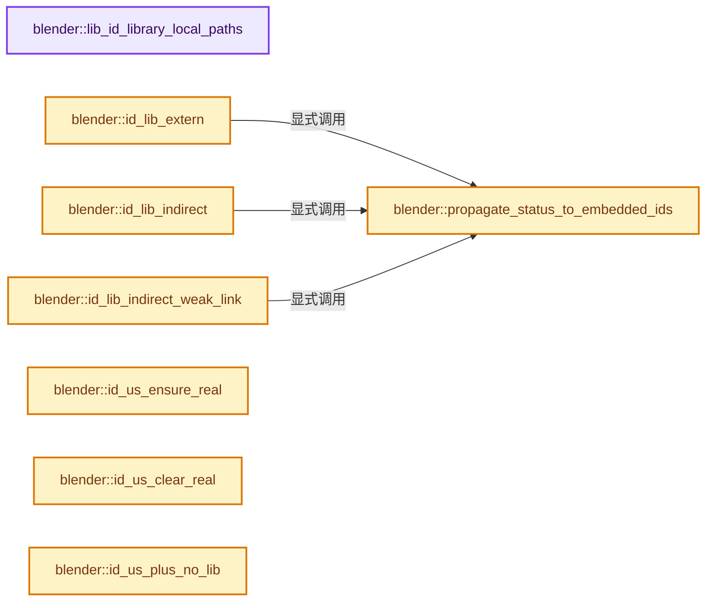
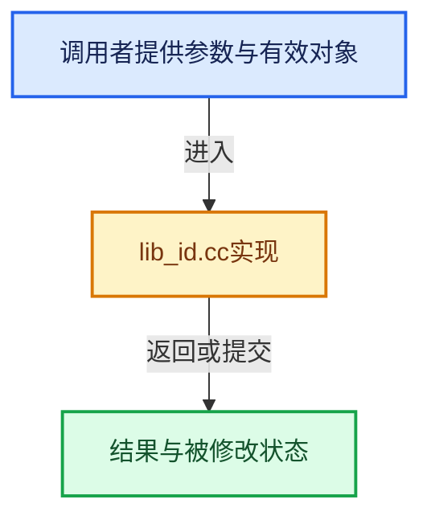

# 实现依赖专题：source/blender/blenkernel/intern/lib_id.cc

[实现依赖导航](../../README.md) · [符号索引](../../../00-课程指南/02-源码与提交索引/符号依赖与实现索引.md)

本专题从正文实际调用进入，集中保存共享实现。函数有稳定锚点，可从调用处直接跳到对应完整函数；递归与互相调用通过回链组织。

## 本文件的实现关系






## 完整成员与函数实现

<a id="f-2aed8bd2d833d500"></a>

### `blender::lib_id_library_local_paths`

实现位置：[source/blender/blenkernel/intern/lib_id.cc](../../../../../../../source/blender/blenkernel/intern/lib_id.cc) · L181—L194。

接口参数：

- `Main *bmain`
- `Library *lib_to`
- `Library *lib_from`
- `ID *id`

**教学注释版**

<!-- annotated:c5bc1a49543505 -->

```cpp
static void lib_id_library_local_paths(Main *bmain, Library *lib_to, Library *lib_from, ID *id)
{
  BLI_assert(lib_to || lib_from);
  const char *bpath_user_data[2] = {
      lib_to ? lib_to->runtime->filepath_abs : BKE_main_blendfile_path(bmain),
      lib_from ? lib_from->runtime->filepath_abs : BKE_main_blendfile_path(bmain)};

  BPathForeachPathData path_data{};
  path_data.bmain = bmain;
  path_data.callback_function = lib_id_library_local_paths_callback;
  path_data.flag = BKE_BPATH_FOREACH_PATH_SKIP_MULTIFILE;
  path_data.user_data = static_cast<void *>(bpath_user_data);
  BKE_bpath_foreach_path_id(&path_data, id);
}
```

<details>
<summary>核对原始源码：source/blender/blenkernel/intern/lib_id.cc · L181—L194</summary>

<!-- original:c5bc1a49543505:source/blender/blenkernel/intern/lib_id.cc:181:194 -->

```cpp
static void lib_id_library_local_paths(Main *bmain, Library *lib_to, Library *lib_from, ID *id)
{
  BLI_assert(lib_to || lib_from);
  const char *bpath_user_data[2] = {
      lib_to ? lib_to->runtime->filepath_abs : BKE_main_blendfile_path(bmain),
      lib_from ? lib_from->runtime->filepath_abs : BKE_main_blendfile_path(bmain)};

  BPathForeachPathData path_data{};
  path_data.bmain = bmain;
  path_data.callback_function = lib_id_library_local_paths_callback;
  path_data.flag = BKE_BPATH_FOREACH_PATH_SKIP_MULTIFILE;
  path_data.user_data = static_cast<void *>(bpath_user_data);
  BKE_bpath_foreach_path_id(&path_data, id);
}
```

</details>

**沿实际写入检查状态**

- `path_data.bmain = bmain;`
- `path_data.callback_function = lib_id_library_local_paths_callback;`
- `path_data.flag = BKE_BPATH_FOREACH_PATH_SKIP_MULTIFILE;`
- `path_data.user_data = static_cast<void *>(bpath_user_data);`

**继续追踪实现**

- `BLI_assert` → [BLI_assert · L48](../../01-BLI基础库/BLI_assert.hh.md#m-57a88495704d)；[BLI_assert · L63](../../01-BLI基础库/BLI_assert.hh.md#m-d07050020cb5)。宏定义由构建条件选择。
- `BKE_main_blendfile_path` → [blender::BKE_main_blendfile_path · L1058](main.cc.md#f-5ff28b998fa003d7)。
- `BKE_bpath_foreach_path_id` → [blender::BKE_bpath_foreach_path_id · L77](bpath.cc.md#f-34da3ab32199f808)。

<a id="f-b2bddbec1df272f1"></a>

### `blender::propagate_status_to_embedded_ids`

实现位置：[source/blender/blenkernel/intern/lib_id.cc](../../../../../../../source/blender/blenkernel/intern/lib_id.cc) · L301—L326。

接口参数：

- `ID &id`

**教学注释版**

<!-- annotated:de6ab0ee4e2434 -->

```cpp
static void propagate_status_to_embedded_ids(ID &id)
{
  auto propagate_status_fn = [&id](ID &embedded_id) -> void {
    constexpr eID_Flag FLAGS_TO_SYNC = ID_FLAG_INDIRECT_WEAK_LINK;
    constexpr eID_Tag TAGS_TO_SYNC = (ID_TAG_EXTERN | ID_TAG_INDIRECT);

    BLI_assert(embedded_id.flag & ID_FLAG_EMBEDDED_DATA);
    BLI_assert(embedded_id.lib == id.lib);

    embedded_id.flag &= ~FLAGS_TO_SYNC;
    embedded_id.flag |= (id.flag & FLAGS_TO_SYNC);
    embedded_id.tag &= ~TAGS_TO_SYNC;
    embedded_id.tag |= (id.tag & TAGS_TO_SYNC);
  };

  bNodeTree *ntree = bke::node_tree_from_id(&id);
  if (ntree) {
    propagate_status_fn(ntree->id);
  }
  if (id.id_type() == ID_SCE) {
    Collection *master_collection = id_cast<Scene &>(id).master_collection;
    if (master_collection) {
      propagate_status_fn(master_collection->id);
    }
  }
}
```

<details>
<summary>核对原始源码：source/blender/blenkernel/intern/lib_id.cc · L301—L326</summary>

<!-- original:de6ab0ee4e2434:source/blender/blenkernel/intern/lib_id.cc:301:326 -->

```cpp
static void propagate_status_to_embedded_ids(ID &id)
{
  auto propagate_status_fn = [&id](ID &embedded_id) -> void {
    constexpr eID_Flag FLAGS_TO_SYNC = ID_FLAG_INDIRECT_WEAK_LINK;
    constexpr eID_Tag TAGS_TO_SYNC = (ID_TAG_EXTERN | ID_TAG_INDIRECT);

    BLI_assert(embedded_id.flag & ID_FLAG_EMBEDDED_DATA);
    BLI_assert(embedded_id.lib == id.lib);

    embedded_id.flag &= ~FLAGS_TO_SYNC;
    embedded_id.flag |= (id.flag & FLAGS_TO_SYNC);
    embedded_id.tag &= ~TAGS_TO_SYNC;
    embedded_id.tag |= (id.tag & TAGS_TO_SYNC);
  };

  bNodeTree *ntree = bke::node_tree_from_id(&id);
  if (ntree) {
    propagate_status_fn(ntree->id);
  }
  if (id.id_type() == ID_SCE) {
    Collection *master_collection = id_cast<Scene &>(id).master_collection;
    if (master_collection) {
      propagate_status_fn(master_collection->id);
    }
  }
}
```

</details>

**沿实际写入检查状态**

- `embedded_id.flag &= ~FLAGS_TO_SYNC;`
- `embedded_id.flag |= (id.flag & FLAGS_TO_SYNC);`
- `embedded_id.tag &= ~TAGS_TO_SYNC;`
- `embedded_id.tag |= (id.tag & TAGS_TO_SYNC);`

**继续追踪实现**

- `BLI_assert` → [BLI_assert · L48](../../01-BLI基础库/BLI_assert.hh.md#m-57a88495704d)；[BLI_assert · L63](../../01-BLI基础库/BLI_assert.hh.md#m-d07050020cb5)。宏定义由构建条件选择。
- `bke::node_tree_from_id` → [blender::bke::node_tree_from_id · L5337](node.cc.md#f-9bb7511df53d8493)。
- `propagate_status_fn` → [调用协议](../../../00-课程指南/01-路线与规范/模板宏与动态分派协议.md)：局部可调用对象，须结合其初始化与捕获环境。调用位置L318。
- `id.id_type` → [blender::ID::id_type · L544](../../08-其他Blender模块/makesdna/DNA_ID.h.md#f-ee8fe63f3948aa47)。
- `id_cast<Scene &>` → [blender::id_cast · L1417](../../08-其他Blender模块/makesdna/DNA_ID.h.md#f-6c8ac6412850ac5a)。

<a id="f-f059acd9757bc9c9"></a>

### `blender::id_lib_extern`

实现位置：[source/blender/blenkernel/intern/lib_id.cc](../../../../../../../source/blender/blenkernel/intern/lib_id.cc) · L328—L352。

接口参数：

- `ID *id`
- `const bool enforce_fix`

**教学注释版**

<!-- annotated:8f9a8f4ec3a8e6 -->

```cpp
void id_lib_extern(ID *id, const bool enforce_fix)
{
  if (id && ID_IS_LINKED(id)) {
#ifndef NDEBUG
    if (!enforce_fix) {
      const eID_Tag linked_tags = eID_Tag(id->tag & (ID_TAG_EXTERN | ID_TAG_INDIRECT));
      BLI_assert_msg(
          linked_tags != (ID_TAG_EXTERN | ID_TAG_INDIRECT),
          "A linked ID must never be both directly and indirectly linked at the same time.");
      BLI_assert_msg(linked_tags != 0,
                     "A linked ID must always be either directly or indirectly linked.");
    }
#endif

    /* Note: non-linkable IDs can be directly linked in case they are linked packed. */
    BLI_assert(BKE_idtype_idcode_is_linkable(id->id_type()) || ID_IS_PACKED(id));
    if ((id->tag & ID_TAG_INDIRECT) != 0 || enforce_fix) {
      id->tag &= ~ID_TAG_INDIRECT;
      id->flag &= ~ID_FLAG_INDIRECT_WEAK_LINK;
      id->tag |= ID_TAG_EXTERN;
      id->lib->runtime->parent = nullptr;
      propagate_status_to_embedded_ids(*id);
    }
  }
}
```

<details>
<summary>核对原始源码：source/blender/blenkernel/intern/lib_id.cc · L328—L352</summary>

<!-- original:8f9a8f4ec3a8e6:source/blender/blenkernel/intern/lib_id.cc:328:352 -->

```cpp
void id_lib_extern(ID *id, const bool enforce_fix)
{
  if (id && ID_IS_LINKED(id)) {
#ifndef NDEBUG
    if (!enforce_fix) {
      const eID_Tag linked_tags = eID_Tag(id->tag & (ID_TAG_EXTERN | ID_TAG_INDIRECT));
      BLI_assert_msg(
          linked_tags != (ID_TAG_EXTERN | ID_TAG_INDIRECT),
          "A linked ID must never be both directly and indirectly linked at the same time.");
      BLI_assert_msg(linked_tags != 0,
                     "A linked ID must always be either directly or indirectly linked.");
    }
#endif

    /* Note: non-linkable IDs can be directly linked in case they are linked packed. */
    BLI_assert(BKE_idtype_idcode_is_linkable(id->id_type()) || ID_IS_PACKED(id));
    if ((id->tag & ID_TAG_INDIRECT) != 0 || enforce_fix) {
      id->tag &= ~ID_TAG_INDIRECT;
      id->flag &= ~ID_FLAG_INDIRECT_WEAK_LINK;
      id->tag |= ID_TAG_EXTERN;
      id->lib->runtime->parent = nullptr;
      propagate_status_to_embedded_ids(*id);
    }
  }
}
```

</details>

**沿实际写入检查状态**

- `id->tag &= ~ID_TAG_INDIRECT;`
- `id->flag &= ~ID_FLAG_INDIRECT_WEAK_LINK;`
- `id->tag |= ID_TAG_EXTERN;`
- `id->lib->runtime->parent = nullptr;`

**继续追踪实现**

- `ID_IS_LINKED` → [ID_IS_LINKED · L697](../../08-其他Blender模块/makesdna/DNA_ID.h.md#m-7e1e1e9b20e6)。宏定义由构建条件选择。
- `eID_Tag` → [blender::eID_Tag](../../08-其他Blender模块/makesdna/DNA_ID.h.md#t-40c4ccaf2a99)。
- `BLI_assert_msg` → [BLI_assert_msg · L55](../../01-BLI基础库/BLI_assert.hh.md#m-695eed20dceb)；[BLI_assert_msg · L64](../../01-BLI基础库/BLI_assert.hh.md#m-7de5563de4db)。宏定义由构建条件选择。
- `BLI_assert` → [BLI_assert · L48](../../01-BLI基础库/BLI_assert.hh.md#m-57a88495704d)；[BLI_assert · L63](../../01-BLI基础库/BLI_assert.hh.md#m-d07050020cb5)。宏定义由构建条件选择。
- `BKE_idtype_idcode_is_linkable` → [blender::BKE_idtype_idcode_is_linkable · L307](idtype.cc.md#f-1e2659e8f278ceeb)。
- `id->id_type` → [blender::ID::id_type · L544](../../08-其他Blender模块/makesdna/DNA_ID.h.md#f-ee8fe63f3948aa47)。
- `ID_IS_PACKED` → [ID_IS_PACKED · L703](../../08-其他Blender模块/makesdna/DNA_ID.h.md#m-48f895e65dc3)。宏定义由构建条件选择。
- `propagate_status_to_embedded_ids` → [blender::propagate_status_to_embedded_ids · L301](lib_id.cc.md#f-b2bddbec1df272f1)。

<a id="f-7ba36a13b2a88487"></a>

### `blender::id_lib_indirect`

实现位置：[source/blender/blenkernel/intern/lib_id.cc](../../../../../../../source/blender/blenkernel/intern/lib_id.cc) · L354—L375。

接口参数：

- `ID *id`
- `const bool enforce_fix`

**教学注释版**

<!-- annotated:b871ac26b701c9 -->

```cpp
void id_lib_indirect(ID *id, const bool enforce_fix)
{
  if (id && ID_IS_LINKED(id)) {
#ifndef NDEBUG
    if (!enforce_fix) {
      const eID_Tag linked_tags = eID_Tag(id->tag & (ID_TAG_EXTERN | ID_TAG_INDIRECT));
      BLI_assert_msg(
          linked_tags != (ID_TAG_EXTERN | ID_TAG_INDIRECT),
          "A linked ID must never be both directly and indirectly linked at the same time.");
      BLI_assert_msg(linked_tags != 0,
                     "A linked ID must always be either directly or indirectly linked.");
    }
#endif

    if ((id->tag & ID_TAG_EXTERN) != 0 || enforce_fix) {
      id->tag &= ~ID_TAG_EXTERN;
      id->tag |= ID_TAG_INDIRECT;
      /* Do not clear library parent info here, it might have already been set to correct value. */
      propagate_status_to_embedded_ids(*id);
    }
  }
}
```

<details>
<summary>核对原始源码：source/blender/blenkernel/intern/lib_id.cc · L354—L375</summary>

<!-- original:b871ac26b701c9:source/blender/blenkernel/intern/lib_id.cc:354:375 -->

```cpp
void id_lib_indirect(ID *id, const bool enforce_fix)
{
  if (id && ID_IS_LINKED(id)) {
#ifndef NDEBUG
    if (!enforce_fix) {
      const eID_Tag linked_tags = eID_Tag(id->tag & (ID_TAG_EXTERN | ID_TAG_INDIRECT));
      BLI_assert_msg(
          linked_tags != (ID_TAG_EXTERN | ID_TAG_INDIRECT),
          "A linked ID must never be both directly and indirectly linked at the same time.");
      BLI_assert_msg(linked_tags != 0,
                     "A linked ID must always be either directly or indirectly linked.");
    }
#endif

    if ((id->tag & ID_TAG_EXTERN) != 0 || enforce_fix) {
      id->tag &= ~ID_TAG_EXTERN;
      id->tag |= ID_TAG_INDIRECT;
      /* Do not clear library parent info here, it might have already been set to correct value. */
      propagate_status_to_embedded_ids(*id);
    }
  }
}
```

</details>

**沿实际写入检查状态**

- `id->tag &= ~ID_TAG_EXTERN;`
- `id->tag |= ID_TAG_INDIRECT;`

**继续追踪实现**

- `ID_IS_LINKED` → [ID_IS_LINKED · L697](../../08-其他Blender模块/makesdna/DNA_ID.h.md#m-7e1e1e9b20e6)。宏定义由构建条件选择。
- `eID_Tag` → [blender::eID_Tag](../../08-其他Blender模块/makesdna/DNA_ID.h.md#t-40c4ccaf2a99)。
- `BLI_assert_msg` → [BLI_assert_msg · L55](../../01-BLI基础库/BLI_assert.hh.md#m-695eed20dceb)；[BLI_assert_msg · L64](../../01-BLI基础库/BLI_assert.hh.md#m-7de5563de4db)。宏定义由构建条件选择。
- `propagate_status_to_embedded_ids` → [blender::propagate_status_to_embedded_ids · L301](lib_id.cc.md#f-b2bddbec1df272f1)。

<a id="f-37abec2e45ad67dc"></a>

### `blender::id_lib_indirect_weak_link`

实现位置：[source/blender/blenkernel/intern/lib_id.cc](../../../../../../../source/blender/blenkernel/intern/lib_id.cc) · L377—L386。

接口参数：

- `ID *id`

**教学注释版**

<!-- annotated:f2cc27ad2fb1e2 -->

```cpp
void id_lib_indirect_weak_link(ID *id)
{
  if (id && ID_IS_LINKED(id)) {
    BLI_assert(BKE_idtype_idcode_is_linkable(id->id_type()) || ID_IS_PACKED(id));
    if (id->tag & ID_TAG_INDIRECT) {
      id->flag |= ID_FLAG_INDIRECT_WEAK_LINK;
      propagate_status_to_embedded_ids(*id);
    }
  }
}
```

<details>
<summary>核对原始源码：source/blender/blenkernel/intern/lib_id.cc · L377—L386</summary>

<!-- original:f2cc27ad2fb1e2:source/blender/blenkernel/intern/lib_id.cc:377:386 -->

```cpp
void id_lib_indirect_weak_link(ID *id)
{
  if (id && ID_IS_LINKED(id)) {
    BLI_assert(BKE_idtype_idcode_is_linkable(id->id_type()) || ID_IS_PACKED(id));
    if (id->tag & ID_TAG_INDIRECT) {
      id->flag |= ID_FLAG_INDIRECT_WEAK_LINK;
      propagate_status_to_embedded_ids(*id);
    }
  }
}
```

</details>

**沿实际写入检查状态**

- `id->flag |= ID_FLAG_INDIRECT_WEAK_LINK;`

**继续追踪实现**

- `ID_IS_LINKED` → [ID_IS_LINKED · L697](../../08-其他Blender模块/makesdna/DNA_ID.h.md#m-7e1e1e9b20e6)。宏定义由构建条件选择。
- `BLI_assert` → [BLI_assert · L48](../../01-BLI基础库/BLI_assert.hh.md#m-57a88495704d)；[BLI_assert · L63](../../01-BLI基础库/BLI_assert.hh.md#m-d07050020cb5)。宏定义由构建条件选择。
- `BKE_idtype_idcode_is_linkable` → [blender::BKE_idtype_idcode_is_linkable · L307](idtype.cc.md#f-1e2659e8f278ceeb)。
- `id->id_type` → [blender::ID::id_type · L544](../../08-其他Blender模块/makesdna/DNA_ID.h.md#f-ee8fe63f3948aa47)。
- `ID_IS_PACKED` → [ID_IS_PACKED · L703](../../08-其他Blender模块/makesdna/DNA_ID.h.md#m-48f895e65dc3)。宏定义由构建条件选择。
- `propagate_status_to_embedded_ids` → [blender::propagate_status_to_embedded_ids · L301](lib_id.cc.md#f-b2bddbec1df272f1)。

<a id="f-6faedd694354706a"></a>

### `blender::id_us_ensure_real`

实现位置：[source/blender/blenkernel/intern/lib_id.cc](../../../../../../../source/blender/blenkernel/intern/lib_id.cc) · L388—L404。

接口参数：

- `ID *id`

**教学注释版**

<!-- annotated:ac7c46d7383159 -->

```cpp
void id_us_ensure_real(ID *id)
{
  if (id) {
    const int limit = ID_FAKE_USERS(id);
    id->tag |= ID_TAG_EXTRAUSER;
    if (id->us <= limit) {
      if (id->us < limit || ((id->us == limit) && (id->tag & ID_TAG_EXTRAUSER_SET))) {
        CLOG_ERROR(&LOG,
                   "ID user count error: %s (from '%s')",
                   id->name,
                   id->lib ? id->lib->runtime->filepath_abs : "[Main]");
      }
      id->us = limit + 1;
      id->tag |= ID_TAG_EXTRAUSER_SET;
    }
  }
}
```

<details>
<summary>核对原始源码：source/blender/blenkernel/intern/lib_id.cc · L388—L404</summary>

<!-- original:ac7c46d7383159:source/blender/blenkernel/intern/lib_id.cc:388:404 -->

```cpp
void id_us_ensure_real(ID *id)
{
  if (id) {
    const int limit = ID_FAKE_USERS(id);
    id->tag |= ID_TAG_EXTRAUSER;
    if (id->us <= limit) {
      if (id->us < limit || ((id->us == limit) && (id->tag & ID_TAG_EXTRAUSER_SET))) {
        CLOG_ERROR(&LOG,
                   "ID user count error: %s (from '%s')",
                   id->name,
                   id->lib ? id->lib->runtime->filepath_abs : "[Main]");
      }
      id->us = limit + 1;
      id->tag |= ID_TAG_EXTRAUSER_SET;
    }
  }
}
```

</details>

**沿实际写入检查状态**

- `id->tag |= ID_TAG_EXTRAUSER;`
- `id->us = limit + 1;`
- `id->tag |= ID_TAG_EXTRAUSER_SET;`

**继续追踪实现**

- `ID_FAKE_USERS` → [ID_FAKE_USERS · L658](../../08-其他Blender模块/makesdna/DNA_ID.h.md#m-eab64737860c)。宏定义由构建条件选择。
- `CLOG_ERROR` → [CLOG_ERROR · L188](../../07-Intern运行时与平台/clog/CLG_log.h.md#m-081575cdc8d0)。宏定义由构建条件选择。

<a id="f-a426cbdc6d5bfd34"></a>

### `blender::id_us_clear_real`

实现位置：[source/blender/blenkernel/intern/lib_id.cc](../../../../../../../source/blender/blenkernel/intern/lib_id.cc) · L406—L415。

接口参数：

- `ID *id`

**教学注释版**

<!-- annotated:1e28c72eba06b8 -->

```cpp
void id_us_clear_real(ID *id)
{
  if (id && (id->tag & ID_TAG_EXTRAUSER)) {
    if (id->tag & ID_TAG_EXTRAUSER_SET) {
      id->us--;
      BLI_assert(id->us >= ID_FAKE_USERS(id));
    }
    id->tag &= ~(ID_TAG_EXTRAUSER | ID_TAG_EXTRAUSER_SET);
  }
}
```

<details>
<summary>核对原始源码：source/blender/blenkernel/intern/lib_id.cc · L406—L415</summary>

<!-- original:1e28c72eba06b8:source/blender/blenkernel/intern/lib_id.cc:406:415 -->

```cpp
void id_us_clear_real(ID *id)
{
  if (id && (id->tag & ID_TAG_EXTRAUSER)) {
    if (id->tag & ID_TAG_EXTRAUSER_SET) {
      id->us--;
      BLI_assert(id->us >= ID_FAKE_USERS(id));
    }
    id->tag &= ~(ID_TAG_EXTRAUSER | ID_TAG_EXTRAUSER_SET);
  }
}
```

</details>

**沿实际写入检查状态**

- `id->tag &= ~(ID_TAG_EXTRAUSER | ID_TAG_EXTRAUSER_SET);`

**继续追踪实现**

- `BLI_assert` → [BLI_assert · L48](../../01-BLI基础库/BLI_assert.hh.md#m-57a88495704d)；[BLI_assert · L63](../../01-BLI基础库/BLI_assert.hh.md#m-d07050020cb5)。宏定义由构建条件选择。
- `ID_FAKE_USERS` → [ID_FAKE_USERS · L658](../../08-其他Blender模块/makesdna/DNA_ID.h.md#m-eab64737860c)。宏定义由构建条件选择。

<a id="f-eb98cf0a1e8edddd"></a>

### `blender::id_us_plus_no_lib`

实现位置：[source/blender/blenkernel/intern/lib_id.cc](../../../../../../../source/blender/blenkernel/intern/lib_id.cc) · L417—L431。

接口参数：

- `ID *id`

**教学注释版**

<!-- annotated:95f3e5f43a50b7 -->

```cpp
void id_us_plus_no_lib(ID *id)
{
  if (id) {
    if ((id->tag & ID_TAG_EXTRAUSER) && (id->tag & ID_TAG_EXTRAUSER_SET)) {
      BLI_assert(id->us >= 1);
      /* No need to increase count, just tag extra user as no more set.
       * Avoids annoying & inconsistent +1 in user count. */
      id->tag &= ~ID_TAG_EXTRAUSER_SET;
    }
    else {
      BLI_assert(id->us >= 0);
      id->us++;
    }
  }
}
```

<details>
<summary>核对原始源码：source/blender/blenkernel/intern/lib_id.cc · L417—L431</summary>

<!-- original:95f3e5f43a50b7:source/blender/blenkernel/intern/lib_id.cc:417:431 -->

```cpp
void id_us_plus_no_lib(ID *id)
{
  if (id) {
    if ((id->tag & ID_TAG_EXTRAUSER) && (id->tag & ID_TAG_EXTRAUSER_SET)) {
      BLI_assert(id->us >= 1);
      /* No need to increase count, just tag extra user as no more set.
       * Avoids annoying & inconsistent +1 in user count. */
      id->tag &= ~ID_TAG_EXTRAUSER_SET;
    }
    else {
      BLI_assert(id->us >= 0);
      id->us++;
    }
  }
}
```

</details>

**沿实际写入检查状态**

- `id->tag &= ~ID_TAG_EXTRAUSER_SET;`

**继续追踪实现**

- `BLI_assert` → [BLI_assert · L48](../../01-BLI基础库/BLI_assert.hh.md#m-57a88495704d)；[BLI_assert · L63](../../01-BLI基础库/BLI_assert.hh.md#m-d07050020cb5)。宏定义由构建条件选择。

<a id="f-1b90ef7608c4f32e"></a>

### `blender::id_us_plus`

实现位置：[source/blender/blenkernel/intern/lib_id.cc](../../../../../../../source/blender/blenkernel/intern/lib_id.cc) · L433—L439。

接口参数：

- `ID *id`

**教学注释版**

<!-- annotated:2b6ed53c269e1e -->

```cpp
void id_us_plus(ID *id)
{
  if (id) {
    id_us_plus_no_lib(id);
    id_lib_extern(id);
  }
}
```

<details>
<summary>核对原始源码：source/blender/blenkernel/intern/lib_id.cc · L433—L439</summary>

<!-- original:2b6ed53c269e1e:source/blender/blenkernel/intern/lib_id.cc:433:439 -->

```cpp
void id_us_plus(ID *id)
{
  if (id) {
    id_us_plus_no_lib(id);
    id_lib_extern(id);
  }
}
```

</details>

**继续追踪实现**

- `id_us_plus_no_lib` → [blender::id_us_plus_no_lib · L417](lib_id.cc.md#f-eb98cf0a1e8edddd)。
- `id_lib_extern` → [blender::id_lib_extern · L328](lib_id.cc.md#f-f059acd9757bc9c9)。

<a id="f-c5e5246a79962257"></a>

### `blender::id_us_min`

实现位置：[source/blender/blenkernel/intern/lib_id.cc](../../../../../../../source/blender/blenkernel/intern/lib_id.cc) · L441—L469。

接口参数：

- `ID *id`

**教学注释版**

<!-- annotated:719f33c2e358e2 -->

```cpp
void id_us_min(ID *id)
{
  if (id) {
    const int limit = ID_FAKE_USERS(id);

    if (id->us <= limit) {
      if (!ID_TYPE_IS_DEPRECATED(id->id_type())) {
        /* Do not assert on deprecated ID types, we cannot really ensure that their ID
         * reference-counting is valid. */
        CLOG_ERROR(&LOG,
                   "ID user decrement error: %s (from '%s'): %d <= %d",
                   id->name,
                   id->lib ? id->lib->runtime->filepath_abs : "[Main]",
                   id->us,
                   limit);
      }
      id->us = limit;
    }
    else {
      id->us--;
    }

    if ((id->us == limit) && (id->tag & ID_TAG_EXTRAUSER)) {
      /* We need an extra user here, but never actually incremented user count for it so far,
       * do it now. */
      id_us_ensure_real(id);
    }
  }
}
```

<details>
<summary>核对原始源码：source/blender/blenkernel/intern/lib_id.cc · L441—L469</summary>

<!-- original:719f33c2e358e2:source/blender/blenkernel/intern/lib_id.cc:441:469 -->

```cpp
void id_us_min(ID *id)
{
  if (id) {
    const int limit = ID_FAKE_USERS(id);

    if (id->us <= limit) {
      if (!ID_TYPE_IS_DEPRECATED(id->id_type())) {
        /* Do not assert on deprecated ID types, we cannot really ensure that their ID
         * reference-counting is valid. */
        CLOG_ERROR(&LOG,
                   "ID user decrement error: %s (from '%s'): %d <= %d",
                   id->name,
                   id->lib ? id->lib->runtime->filepath_abs : "[Main]",
                   id->us,
                   limit);
      }
      id->us = limit;
    }
    else {
      id->us--;
    }

    if ((id->us == limit) && (id->tag & ID_TAG_EXTRAUSER)) {
      /* We need an extra user here, but never actually incremented user count for it so far,
       * do it now. */
      id_us_ensure_real(id);
    }
  }
}
```

</details>

**沿实际写入检查状态**

- `id->us = limit;`

**继续追踪实现**

- `ID_FAKE_USERS` → [ID_FAKE_USERS · L658](../../08-其他Blender模块/makesdna/DNA_ID.h.md#m-eab64737860c)。宏定义由构建条件选择。
- `ID_TYPE_IS_DEPRECATED` → [ID_TYPE_IS_DEPRECATED · L755](../../08-其他Blender模块/makesdna/DNA_ID.h.md#m-4d88a4d64f85)。宏定义由构建条件选择。
- `id->id_type` → [blender::ID::id_type · L544](../../08-其他Blender模块/makesdna/DNA_ID.h.md#f-ee8fe63f3948aa47)。
- `CLOG_ERROR` → [CLOG_ERROR · L188](../../07-Intern运行时与平台/clog/CLG_log.h.md#m-081575cdc8d0)。宏定义由构建条件选择。
- `id_us_ensure_real` → [blender::id_us_ensure_real · L388](lib_id.cc.md#f-6faedd694354706a)。

<a id="f-b1cc5ae2024991f3"></a>

### `blender::id_fake_user_set`

实现位置：[source/blender/blenkernel/intern/lib_id.cc](../../../../../../../source/blender/blenkernel/intern/lib_id.cc) · L471—L477。

接口参数：

- `ID *id`

**教学注释版**

<!-- annotated:2b9734c2e7494b -->

```cpp
void id_fake_user_set(ID *id)
{
  if (id && !(id->flag & ID_FLAG_FAKEUSER)) {
    id->flag |= ID_FLAG_FAKEUSER;
    id_us_plus(id);
  }
}
```

<details>
<summary>核对原始源码：source/blender/blenkernel/intern/lib_id.cc · L471—L477</summary>

<!-- original:2b9734c2e7494b:source/blender/blenkernel/intern/lib_id.cc:471:477 -->

```cpp
void id_fake_user_set(ID *id)
{
  if (id && !(id->flag & ID_FLAG_FAKEUSER)) {
    id->flag |= ID_FLAG_FAKEUSER;
    id_us_plus(id);
  }
}
```

</details>

**沿实际写入检查状态**

- `id->flag |= ID_FLAG_FAKEUSER;`

**继续追踪实现**

- `id_us_plus` → [blender::id_us_plus · L433](lib_id.cc.md#f-1b90ef7608c4f32e)。

<a id="f-375b0c66da203120"></a>

### `blender::id_fake_user_clear`

实现位置：[source/blender/blenkernel/intern/lib_id.cc](../../../../../../../source/blender/blenkernel/intern/lib_id.cc) · L479—L485。

接口参数：

- `ID *id`

**教学注释版**

<!-- annotated:bcca1ab4fc82ff -->

```cpp
void id_fake_user_clear(ID *id)
{
  if (id && (id->flag & ID_FLAG_FAKEUSER)) {
    id->flag &= ~ID_FLAG_FAKEUSER;
    id_us_min(id);
  }
}
```

<details>
<summary>核对原始源码：source/blender/blenkernel/intern/lib_id.cc · L479—L485</summary>

<!-- original:bcca1ab4fc82ff:source/blender/blenkernel/intern/lib_id.cc:479:485 -->

```cpp
void id_fake_user_clear(ID *id)
{
  if (id && (id->flag & ID_FLAG_FAKEUSER)) {
    id->flag &= ~ID_FLAG_FAKEUSER;
    id_us_min(id);
  }
}
```

</details>

**沿实际写入检查状态**

- `id->flag &= ~ID_FLAG_FAKEUSER;`

**继续追踪实现**

- `id_us_min` → [blender::id_us_min · L441](lib_id.cc.md#f-c5e5246a79962257)。

<a id="f-6edc20d558dfd075"></a>

### `blender::BKE_id_newptr_and_tag_clear`

实现位置：[source/blender/blenkernel/intern/lib_id.cc](../../../../../../../source/blender/blenkernel/intern/lib_id.cc) · L487—L515。

接口参数：

- `ID *id`

**教学注释版**

<!-- annotated:9a5474ac1e1f6a -->

```cpp
void BKE_id_newptr_and_tag_clear(ID *id)
{
  /* We assume that if this ID has no new ID, its embedded data has not either. */
  if (id->newid == nullptr) {
    return;
  }

  id->newid->tag &= ~ID_TAG_NEW;
  id->newid = nullptr;

  /* Deal with embedded data too. */
  /* NOTE: even though ShapeKeys are not technically embedded data currently, they behave as such
   * in most cases, so for sake of consistency treat them as such here. Also mirrors the behavior
   * in `BKE_lib_id_make_local`. */
  Key *key = BKE_key_from_id(id);
  if (key != nullptr) {
    BKE_id_newptr_and_tag_clear(&key->id);
  }
  bNodeTree *ntree = bke::node_tree_from_id(id);
  if (ntree != nullptr) {
    BKE_id_newptr_and_tag_clear(&ntree->id);
  }
  if (id->id_type() == ID_SCE) {
    Collection *master_collection = (id_cast<Scene *>(id))->master_collection;
    if (master_collection != nullptr) {
      BKE_id_newptr_and_tag_clear(&master_collection->id);
    }
  }
}
```

<details>
<summary>核对原始源码：source/blender/blenkernel/intern/lib_id.cc · L487—L515</summary>

<!-- original:9a5474ac1e1f6a:source/blender/blenkernel/intern/lib_id.cc:487:515 -->

```cpp
void BKE_id_newptr_and_tag_clear(ID *id)
{
  /* We assume that if this ID has no new ID, its embedded data has not either. */
  if (id->newid == nullptr) {
    return;
  }

  id->newid->tag &= ~ID_TAG_NEW;
  id->newid = nullptr;

  /* Deal with embedded data too. */
  /* NOTE: even though ShapeKeys are not technically embedded data currently, they behave as such
   * in most cases, so for sake of consistency treat them as such here. Also mirrors the behavior
   * in `BKE_lib_id_make_local`. */
  Key *key = BKE_key_from_id(id);
  if (key != nullptr) {
    BKE_id_newptr_and_tag_clear(&key->id);
  }
  bNodeTree *ntree = bke::node_tree_from_id(id);
  if (ntree != nullptr) {
    BKE_id_newptr_and_tag_clear(&ntree->id);
  }
  if (id->id_type() == ID_SCE) {
    Collection *master_collection = (id_cast<Scene *>(id))->master_collection;
    if (master_collection != nullptr) {
      BKE_id_newptr_and_tag_clear(&master_collection->id);
    }
  }
}
```

</details>

**沿实际写入检查状态**

- `id->newid->tag &= ~ID_TAG_NEW;`
- `id->newid = nullptr;`

**继续追踪实现**

- `BKE_key_from_id` → [blender::BKE_key_from_id · L1291](key.cc.md#f-2050edb37f3ef7b0)。
- `BKE_id_newptr_and_tag_clear` → [blender::BKE_id_newptr_and_tag_clear · L487](lib_id.cc.md#f-6edc20d558dfd075)。
- `bke::node_tree_from_id` → [blender::bke::node_tree_from_id · L5337](node.cc.md#f-9bb7511df53d8493)。
- `id->id_type` → [blender::ID::id_type · L544](../../08-其他Blender模块/makesdna/DNA_ID.h.md#f-ee8fe63f3948aa47)。
- `id_cast<Scene *>` → [blender::id_cast · L1417](../../08-其他Blender模块/makesdna/DNA_ID.h.md#f-6c8ac6412850ac5a)。

<a id="f-370493b4efa1f066"></a>

### `blender::BKE_lib_id_expand_local`

实现位置：[source/blender/blenkernel/intern/lib_id.cc](../../../../../../../source/blender/blenkernel/intern/lib_id.cc) · L556—L560。

接口参数：

- `Main *bmain`
- `ID *id`
- `const int flags`

**教学注释版**

<!-- annotated:a956afee67390b -->

```cpp
void BKE_lib_id_expand_local(Main *bmain, ID *id, const int flags)
{
  BKE_library_foreach_ID_link(
      bmain, id, lib_id_expand_local_cb, POINTER_FROM_INT(flags), IDWALK_READONLY);
}
```

<details>
<summary>核对原始源码：source/blender/blenkernel/intern/lib_id.cc · L556—L560</summary>

<!-- original:a956afee67390b:source/blender/blenkernel/intern/lib_id.cc:556:560 -->

```cpp
void BKE_lib_id_expand_local(Main *bmain, ID *id, const int flags)
{
  BKE_library_foreach_ID_link(
      bmain, id, lib_id_expand_local_cb, POINTER_FROM_INT(flags), IDWALK_READONLY);
}
```

</details>

**继续追踪实现**

- `BKE_library_foreach_ID_link` → [blender::BKE_library_foreach_ID_link · L449](lib_query.cc.md#f-a52fd9a0ee74a026)。
- `POINTER_FROM_INT` → [POINTER_FROM_INT · L321](../../01-BLI基础库/BLI_utildefines.hh.md#m-17841357bb5a)。宏定义由构建条件选择。

<a id="f-8ffc3170bda347da"></a>

### `blender::lib_id_copy_ensure_local`

实现位置：[source/blender/blenkernel/intern/lib_id.cc](../../../../../../../source/blender/blenkernel/intern/lib_id.cc) · L562—L575。

接口参数：

- `Main *bmain`
- `const ID *old_id`
- `ID *new_id`
- `const int flags`

**教学注释版**

<!-- annotated:6e9770686e39f0 -->

```cpp
void lib_id_copy_ensure_local(Main *bmain, const ID *old_id, ID *new_id, const int flags)
{
  if (ID_IS_LINKED(old_id)) {
    /* For packed linked data copied into local IDs in Main, assume that they are no more related
     * to their original library source, and clear their deep-hash.
     *
     * NOTE: In case more control is needed over that behavior in the future, a new flag can be
     * added instead. */
    new_id->deep_hash = {};

    BKE_lib_id_expand_local(bmain, new_id, flags);
    lib_id_library_local_paths(bmain, nullptr, old_id->lib, new_id);
  }
}
```

<details>
<summary>核对原始源码：source/blender/blenkernel/intern/lib_id.cc · L562—L575</summary>

<!-- original:6e9770686e39f0:source/blender/blenkernel/intern/lib_id.cc:562:575 -->

```cpp
void lib_id_copy_ensure_local(Main *bmain, const ID *old_id, ID *new_id, const int flags)
{
  if (ID_IS_LINKED(old_id)) {
    /* For packed linked data copied into local IDs in Main, assume that they are no more related
     * to their original library source, and clear their deep-hash.
     *
     * NOTE: In case more control is needed over that behavior in the future, a new flag can be
     * added instead. */
    new_id->deep_hash = {};

    BKE_lib_id_expand_local(bmain, new_id, flags);
    lib_id_library_local_paths(bmain, nullptr, old_id->lib, new_id);
  }
}
```

</details>

**沿实际写入检查状态**

- `new_id->deep_hash = {};`

**继续追踪实现**

- `ID_IS_LINKED` → [ID_IS_LINKED · L697](../../08-其他Blender模块/makesdna/DNA_ID.h.md#m-7e1e1e9b20e6)。宏定义由构建条件选择。
- `BKE_lib_id_expand_local` → [blender::BKE_lib_id_expand_local · L556](lib_id.cc.md#f-370493b4efa1f066)。
- `lib_id_library_local_paths` → [blender::lib_id_library_local_paths · L181](lib_id.cc.md#f-2aed8bd2d833d500)。

<a id="f-1ed32b930b96ebb2"></a>

### `blender::BKE_id_copy_in_lib`

实现位置：[source/blender/blenkernel/intern/lib_id.cc](../../../../../../../source/blender/blenkernel/intern/lib_id.cc) · L749—L849。

接口参数：

- `Main *bmain`
- `std::optional<Library *> owner_library`
- `const ID *id`
- `std::optional<const ID *> new_owner_id`
- `ID **new_id_p`
- `const int flag`

**教学注释版**

<!-- annotated:74e427ca3052ff -->

```cpp
ID *BKE_id_copy_in_lib(Main *bmain,
                       std::optional<Library *> owner_library,
                       const ID *id,
                       std::optional<const ID *> new_owner_id,
                       ID **new_id_p,
                       const int flag)
{
  ID *newid = (new_id_p != nullptr) ? *new_id_p : nullptr;
  BLI_assert_msg(newid || (flag & LIB_ID_CREATE_NO_ALLOCATE) == 0,
                 "Copying with 'no allocate' behavior should always get a non-null new ID buffer");

  /* Make sure destination pointer is all good. */
  if ((flag & LIB_ID_CREATE_NO_ALLOCATE) == 0) {
    newid = nullptr;
  }
  else {
    if (!newid) {
      /* Invalid case, already caught by the assert above. */
      return nullptr;
    }
  }

  /* Early output if source is nullptr. */
  if (id == nullptr) {
    return nullptr;
  }

  const IDTypeInfo *idtype_info = BKE_idtype_get_info_from_id(id);

  if (idtype_info != nullptr) {
    if ((idtype_info->flags & IDTYPE_FLAGS_NO_COPY) != 0) {
      return nullptr;
    }

    BKE_libblock_copy_in_lib(bmain, owner_library, id, new_owner_id, &newid, flag);

    if (idtype_info->copy_data != nullptr) {
      idtype_info->copy_data(bmain, owner_library, newid, id, flag);
    }
  }
  else {
    BLI_assert_msg(0, "IDType Missing IDTypeInfo");
  }

  BLI_assert_msg(newid, "Could not get an allocated new ID to copy into");
  if (!newid) {
    return nullptr;
  }

  /* Update ID refcount, remap pointers to self in new ID. */
  IDCopyLibManagementData data{};
  data.id_src = id;
  data.id_dst = newid;
  data.flag = flag;
  /* When copying an embedded ID, typically at this point its owner ID pointer will still point to
   * the owner of the source, this code has no access to its valid (i.e. destination) owner. This
   * can be added at some point if needed, but currently the #id_copy_libmanagement_cb callback
   * does need this information. */
  BKE_library_foreach_ID_link(
      bmain, newid, id_copy_libmanagement_cb, &data, IDWALK_IGNORE_MISSING_OWNER_ID);

  /* FIXME: Check if this code can be moved in #BKE_libblock_copy_in_lib ? Would feel more fitted
   * there, having library handling split between both functions does not look good. */
  /* Do not make new copy local in case we are copying outside of main...
   * XXX TODO: is this behavior OK, or should we need a separate flag to control that? */
  if ((flag & LIB_ID_CREATE_NO_MAIN) == 0) {
    BLI_assert(!owner_library || newid->lib == *owner_library);
    /* If the ID was copied into a library, ensure paths are properly remapped, and that it has a
     * 'linked' tag set. */
    if (ID_IS_LINKED(newid)) {
      if (newid->lib != id->lib) {
        lib_id_library_local_paths(bmain, newid->lib, id->lib, newid);
      }
      if ((newid->tag & (ID_TAG_EXTERN | ID_TAG_INDIRECT)) == 0) {
        newid->tag |= ID_TAG_EXTERN;
      }
    }
    /* Expanding local linked ID usages should never be needed with embedded IDs - this will be
     * handled together with their owner ID copying code. */
    else if ((newid->flag & ID_FLAG_EMBEDDED_DATA) == 0) {
      lib_id_copy_ensure_local(bmain, id, newid, 0);
    }
  }

  else {
    /* NOTE: Do not call `ensure_local` for IDs copied outside of Main, even if they do become
     * local.
     *
     * Most of the time, this would not be the desired behavior currently.
     *
     * In the few cases where this is actually needed (e.g. from liboverride resync code, see
     * #lib_override_library_create_from), calling code is responsible for this. */
    newid->lib = owner_library ? *owner_library : id->lib;
  }

  if (new_id_p != nullptr) {
    *new_id_p = newid;
  }

  return newid;
}
```

<details>
<summary>核对原始源码：source/blender/blenkernel/intern/lib_id.cc · L749—L849</summary>

<!-- original:74e427ca3052ff:source/blender/blenkernel/intern/lib_id.cc:749:849 -->

```cpp
ID *BKE_id_copy_in_lib(Main *bmain,
                       std::optional<Library *> owner_library,
                       const ID *id,
                       std::optional<const ID *> new_owner_id,
                       ID **new_id_p,
                       const int flag)
{
  ID *newid = (new_id_p != nullptr) ? *new_id_p : nullptr;
  BLI_assert_msg(newid || (flag & LIB_ID_CREATE_NO_ALLOCATE) == 0,
                 "Copying with 'no allocate' behavior should always get a non-null new ID buffer");

  /* Make sure destination pointer is all good. */
  if ((flag & LIB_ID_CREATE_NO_ALLOCATE) == 0) {
    newid = nullptr;
  }
  else {
    if (!newid) {
      /* Invalid case, already caught by the assert above. */
      return nullptr;
    }
  }

  /* Early output if source is nullptr. */
  if (id == nullptr) {
    return nullptr;
  }

  const IDTypeInfo *idtype_info = BKE_idtype_get_info_from_id(id);

  if (idtype_info != nullptr) {
    if ((idtype_info->flags & IDTYPE_FLAGS_NO_COPY) != 0) {
      return nullptr;
    }

    BKE_libblock_copy_in_lib(bmain, owner_library, id, new_owner_id, &newid, flag);

    if (idtype_info->copy_data != nullptr) {
      idtype_info->copy_data(bmain, owner_library, newid, id, flag);
    }
  }
  else {
    BLI_assert_msg(0, "IDType Missing IDTypeInfo");
  }

  BLI_assert_msg(newid, "Could not get an allocated new ID to copy into");
  if (!newid) {
    return nullptr;
  }

  /* Update ID refcount, remap pointers to self in new ID. */
  IDCopyLibManagementData data{};
  data.id_src = id;
  data.id_dst = newid;
  data.flag = flag;
  /* When copying an embedded ID, typically at this point its owner ID pointer will still point to
   * the owner of the source, this code has no access to its valid (i.e. destination) owner. This
   * can be added at some point if needed, but currently the #id_copy_libmanagement_cb callback
   * does need this information. */
  BKE_library_foreach_ID_link(
      bmain, newid, id_copy_libmanagement_cb, &data, IDWALK_IGNORE_MISSING_OWNER_ID);

  /* FIXME: Check if this code can be moved in #BKE_libblock_copy_in_lib ? Would feel more fitted
   * there, having library handling split between both functions does not look good. */
  /* Do not make new copy local in case we are copying outside of main...
   * XXX TODO: is this behavior OK, or should we need a separate flag to control that? */
  if ((flag & LIB_ID_CREATE_NO_MAIN) == 0) {
    BLI_assert(!owner_library || newid->lib == *owner_library);
    /* If the ID was copied into a library, ensure paths are properly remapped, and that it has a
     * 'linked' tag set. */
    if (ID_IS_LINKED(newid)) {
      if (newid->lib != id->lib) {
        lib_id_library_local_paths(bmain, newid->lib, id->lib, newid);
      }
      if ((newid->tag & (ID_TAG_EXTERN | ID_TAG_INDIRECT)) == 0) {
        newid->tag |= ID_TAG_EXTERN;
      }
    }
    /* Expanding local linked ID usages should never be needed with embedded IDs - this will be
     * handled together with their owner ID copying code. */
    else if ((newid->flag & ID_FLAG_EMBEDDED_DATA) == 0) {
      lib_id_copy_ensure_local(bmain, id, newid, 0);
    }
  }

  else {
    /* NOTE: Do not call `ensure_local` for IDs copied outside of Main, even if they do become
     * local.
     *
     * Most of the time, this would not be the desired behavior currently.
     *
     * In the few cases where this is actually needed (e.g. from liboverride resync code, see
     * #lib_override_library_create_from), calling code is responsible for this. */
    newid->lib = owner_library ? *owner_library : id->lib;
  }

  if (new_id_p != nullptr) {
    *new_id_p = newid;
  }

  return newid;
}
```

</details>

**沿实际写入检查状态**

- `newid = nullptr;`
- `data.id_src = id;`
- `data.id_dst = newid;`
- `data.flag = flag;`
- `newid->tag |= ID_TAG_EXTERN;`
- `newid->lib = owner_library ? *owner_library : id->lib;`

**结果出口**

- `return nullptr;`
- `return newid;`

**继续追踪实现**

- `BLI_assert_msg` → [BLI_assert_msg · L55](../../01-BLI基础库/BLI_assert.hh.md#m-695eed20dceb)；[BLI_assert_msg · L64](../../01-BLI基础库/BLI_assert.hh.md#m-7de5563de4db)。宏定义由构建条件选择。
- `BKE_idtype_get_info_from_id` → [blender::BKE_idtype_get_info_from_id · L232](idtype.cc.md#f-9b31985f4ea4750d)。
- `BKE_libblock_copy_in_lib` → [blender::BKE_libblock_copy_in_lib · L1633](lib_id.cc.md#f-098759f6afd09423)。
- `idtype_info->copy_data` → [blender::bNodeTreeInterface::copy_data · L1733](node_tree_interface.cc.md#f-57f205d914a130e0)。
- `BKE_library_foreach_ID_link` → [blender::BKE_library_foreach_ID_link · L449](lib_query.cc.md#f-a52fd9a0ee74a026)。
- `BLI_assert` → [BLI_assert · L48](../../01-BLI基础库/BLI_assert.hh.md#m-57a88495704d)；[BLI_assert · L63](../../01-BLI基础库/BLI_assert.hh.md#m-d07050020cb5)。宏定义由构建条件选择。
- `ID_IS_LINKED` → [ID_IS_LINKED · L697](../../08-其他Blender模块/makesdna/DNA_ID.h.md#m-7e1e1e9b20e6)。宏定义由构建条件选择。
- `lib_id_library_local_paths` → [blender::lib_id_library_local_paths · L181](lib_id.cc.md#f-2aed8bd2d833d500)。
- `lib_id_copy_ensure_local` → [blender::lib_id_copy_ensure_local · L562](lib_id.cc.md#f-8ffc3170bda347da)。

<a id="f-24272170c95f49fb"></a>

### `blender::BKE_id_copy_ex`

实现位置：[source/blender/blenkernel/intern/lib_id.cc](../../../../../../../source/blender/blenkernel/intern/lib_id.cc) · L851—L854。

接口参数：

- `Main *bmain`
- `const ID *id`
- `ID **new_id_p`
- `const int flag`

**教学注释版**

<!-- annotated:6d2a0a2fb2855e -->

```cpp
ID *BKE_id_copy_ex(Main *bmain, const ID *id, ID **new_id_p, const int flag)
{
  return BKE_id_copy_in_lib(bmain, std::nullopt, id, std::nullopt, new_id_p, flag);
}
```

<details>
<summary>核对原始源码：source/blender/blenkernel/intern/lib_id.cc · L851—L854</summary>

<!-- original:6d2a0a2fb2855e:source/blender/blenkernel/intern/lib_id.cc:851:854 -->

```cpp
ID *BKE_id_copy_ex(Main *bmain, const ID *id, ID **new_id_p, const int flag)
{
  return BKE_id_copy_in_lib(bmain, std::nullopt, id, std::nullopt, new_id_p, flag);
}
```

</details>

**结果出口**

- `return BKE_id_copy_in_lib(bmain, std::nullopt, id, std::nullopt, new_id_p, flag);`

**继续追踪实现**

- `BKE_id_copy_in_lib` → [blender::BKE_id_copy_in_lib · L749](lib_id.cc.md#f-1ed32b930b96ebb2)。

<a id="f-01adb85c99630499"></a>

### `blender::id_swap`

实现位置：[source/blender/blenkernel/intern/lib_id.cc](../../../../../../../source/blender/blenkernel/intern/lib_id.cc) · L987—L1091。

接口参数：

- `Main *bmain`
- `ID *id_a`
- `ID *id_b`
- `const bool do_full_id`
- `const bool do_self_remap`
- `IDRemapper *input_remapper_id_a`
- `IDRemapper *input_remapper_id_b`
- `const int self_remap_flags`

**教学注释版**

<!-- annotated:f4a5b1bd89f329 -->

```cpp
static void id_swap(Main *bmain,
                    ID *id_a,
                    ID *id_b,
                    const bool do_full_id,
                    const bool do_self_remap,
                    IDRemapper *input_remapper_id_a,
                    IDRemapper *input_remapper_id_b,
                    const int self_remap_flags)
{
  BLI_assert(GS(id_a->name) == GS(id_b->name));

  IDRemapper *remapper_id_a = input_remapper_id_a;
  IDRemapper *remapper_id_b = input_remapper_id_b;
  if (do_self_remap) {
    if (remapper_id_a == nullptr) {
      remapper_id_a = MEM_new<IDRemapper>(__func__);
    }
    if (remapper_id_b == nullptr) {
      remapper_id_b = MEM_new<IDRemapper>(__func__);
    }
  }

  const IDTypeInfo *id_type = BKE_idtype_get_info_from_id(id_a);
  BLI_assert(id_type != nullptr);
  const size_t id_struct_size = id_type->struct_size;

  const ID id_a_back = *id_a;
  const ID id_b_back = *id_b;

  char *id_swap_buff = static_cast<char *>(alloca(id_struct_size));

  // [讲解] memcpy：复制字节，源与目标不应重叠。类型生命周期、对齐和可复制表示须由调用者证明，不是任意对象的复制构造。
  memcpy(id_swap_buff, id_a, id_struct_size);
  memcpy(id_a, id_b, id_struct_size);
  memcpy(id_b, id_swap_buff, id_struct_size);

  if (!do_full_id) {
    /* Restore original ID's internal data. */
    *id_a = id_a_back;
    *id_b = id_b_back;

    /* Exception: IDProperties. */
    id_a->properties = id_b_back.properties;
    id_b->properties = id_a_back.properties;
    id_a->system_properties = id_b_back.system_properties;
    id_b->system_properties = id_a_back.system_properties;
    /* Exception: recalc flags. */
    id_a->recalc = id_b_back.recalc;
    id_b->recalc = id_a_back.recalc;
  }

  id_embedded_swap(bmain,
                   reinterpret_cast<ID **>(bke::node_tree_ptr_from_id(id_a)),
                   reinterpret_cast<ID **>(bke::node_tree_ptr_from_id(id_b)),
                   do_full_id,
                   remapper_id_a,
                   remapper_id_b);
  if (id_a->id_type() == ID_SCE) {
    Scene *scene_a = id_cast<Scene *>(id_a);
    Scene *scene_b = id_cast<Scene *>(id_b);
    id_embedded_swap(bmain,
                     reinterpret_cast<ID **>(&scene_a->master_collection),
                     reinterpret_cast<ID **>(&scene_b->master_collection),
                     do_full_id,
                     remapper_id_a,
                     remapper_id_b);
  }

  if (remapper_id_a != nullptr) {
    remapper_id_a->add(id_b, id_a);
  }
  if (remapper_id_b != nullptr) {
    remapper_id_b->add(id_a, id_b);
  }

  /* Finalize remapping of internal references to self broken by swapping, if requested. */
  if (do_self_remap) {
    BKE_libblock_relink_multiple(
        bmain, {id_a}, ID_REMAP_TYPE_REMAP, *remapper_id_a, self_remap_flags);
    BKE_libblock_relink_multiple(
        bmain, {id_b}, ID_REMAP_TYPE_REMAP, *remapper_id_b, self_remap_flags);
  }

  if ((id_type->flags & IDTYPE_FLAGS_NO_ANIMDATA) == 0 && bmain) {
    /* Action Slots point to the IDs they animate, and thus now also needs swapping. Instead of
     * doing this here (and requiring knowledge of how that's supposed to be done), just mark these
     * pointers as dirty so that they're rebuilt at first use.
     *
     * There are a few calls to id_swap() where `bmain` is nil. None of these matter here, though:
     *
     * - At blendfile load (`read_libblock_undo_restore_at_old_address()`). Fine
     *   because after loading the action slot user cache is rebuilt anyway.
     * - Swapping window managers (`swap_wm_data_for_blendfile()`). Fine because
     *   WMs cannot be animated.
     * - Palette undo code (`palette_undo_preserve()`). Fine because palettes
     *   cannot be animated. */
    bke::animdata::action_slots_user_cache_invalidate(*bmain);
  }

  if (input_remapper_id_a == nullptr && remapper_id_a != nullptr) {
    MEM_delete(remapper_id_a);
  }
  if (input_remapper_id_b == nullptr && remapper_id_b != nullptr) {
    MEM_delete(remapper_id_b);
  }
}
```

<details>
<summary>核对原始源码：source/blender/blenkernel/intern/lib_id.cc · L987—L1091</summary>

<!-- original:f4a5b1bd89f329:source/blender/blenkernel/intern/lib_id.cc:987:1091 -->

```cpp
static void id_swap(Main *bmain,
                    ID *id_a,
                    ID *id_b,
                    const bool do_full_id,
                    const bool do_self_remap,
                    IDRemapper *input_remapper_id_a,
                    IDRemapper *input_remapper_id_b,
                    const int self_remap_flags)
{
  BLI_assert(GS(id_a->name) == GS(id_b->name));

  IDRemapper *remapper_id_a = input_remapper_id_a;
  IDRemapper *remapper_id_b = input_remapper_id_b;
  if (do_self_remap) {
    if (remapper_id_a == nullptr) {
      remapper_id_a = MEM_new<IDRemapper>(__func__);
    }
    if (remapper_id_b == nullptr) {
      remapper_id_b = MEM_new<IDRemapper>(__func__);
    }
  }

  const IDTypeInfo *id_type = BKE_idtype_get_info_from_id(id_a);
  BLI_assert(id_type != nullptr);
  const size_t id_struct_size = id_type->struct_size;

  const ID id_a_back = *id_a;
  const ID id_b_back = *id_b;

  char *id_swap_buff = static_cast<char *>(alloca(id_struct_size));

  memcpy(id_swap_buff, id_a, id_struct_size);
  memcpy(id_a, id_b, id_struct_size);
  memcpy(id_b, id_swap_buff, id_struct_size);

  if (!do_full_id) {
    /* Restore original ID's internal data. */
    *id_a = id_a_back;
    *id_b = id_b_back;

    /* Exception: IDProperties. */
    id_a->properties = id_b_back.properties;
    id_b->properties = id_a_back.properties;
    id_a->system_properties = id_b_back.system_properties;
    id_b->system_properties = id_a_back.system_properties;
    /* Exception: recalc flags. */
    id_a->recalc = id_b_back.recalc;
    id_b->recalc = id_a_back.recalc;
  }

  id_embedded_swap(bmain,
                   reinterpret_cast<ID **>(bke::node_tree_ptr_from_id(id_a)),
                   reinterpret_cast<ID **>(bke::node_tree_ptr_from_id(id_b)),
                   do_full_id,
                   remapper_id_a,
                   remapper_id_b);
  if (id_a->id_type() == ID_SCE) {
    Scene *scene_a = id_cast<Scene *>(id_a);
    Scene *scene_b = id_cast<Scene *>(id_b);
    id_embedded_swap(bmain,
                     reinterpret_cast<ID **>(&scene_a->master_collection),
                     reinterpret_cast<ID **>(&scene_b->master_collection),
                     do_full_id,
                     remapper_id_a,
                     remapper_id_b);
  }

  if (remapper_id_a != nullptr) {
    remapper_id_a->add(id_b, id_a);
  }
  if (remapper_id_b != nullptr) {
    remapper_id_b->add(id_a, id_b);
  }

  /* Finalize remapping of internal references to self broken by swapping, if requested. */
  if (do_self_remap) {
    BKE_libblock_relink_multiple(
        bmain, {id_a}, ID_REMAP_TYPE_REMAP, *remapper_id_a, self_remap_flags);
    BKE_libblock_relink_multiple(
        bmain, {id_b}, ID_REMAP_TYPE_REMAP, *remapper_id_b, self_remap_flags);
  }

  if ((id_type->flags & IDTYPE_FLAGS_NO_ANIMDATA) == 0 && bmain) {
    /* Action Slots point to the IDs they animate, and thus now also needs swapping. Instead of
     * doing this here (and requiring knowledge of how that's supposed to be done), just mark these
     * pointers as dirty so that they're rebuilt at first use.
     *
     * There are a few calls to id_swap() where `bmain` is nil. None of these matter here, though:
     *
     * - At blendfile load (`read_libblock_undo_restore_at_old_address()`). Fine
     *   because after loading the action slot user cache is rebuilt anyway.
     * - Swapping window managers (`swap_wm_data_for_blendfile()`). Fine because
     *   WMs cannot be animated.
     * - Palette undo code (`palette_undo_preserve()`). Fine because palettes
     *   cannot be animated. */
    bke::animdata::action_slots_user_cache_invalidate(*bmain);
  }

  if (input_remapper_id_a == nullptr && remapper_id_a != nullptr) {
    MEM_delete(remapper_id_a);
  }
  if (input_remapper_id_b == nullptr && remapper_id_b != nullptr) {
    MEM_delete(remapper_id_b);
  }
}
```

</details>

**沿实际写入检查状态**

- `remapper_id_a = MEM_new<IDRemapper>(__func__);`
- `remapper_id_b = MEM_new<IDRemapper>(__func__);`
- `id_a->properties = id_b_back.properties;`
- `id_b->properties = id_a_back.properties;`
- `id_a->system_properties = id_b_back.system_properties;`
- `id_b->system_properties = id_a_back.system_properties;`
- `id_a->recalc = id_b_back.recalc;`
- `id_b->recalc = id_a_back.recalc;`

**继续追踪实现**

- `BLI_assert` → [BLI_assert · L48](../../01-BLI基础库/BLI_assert.hh.md#m-57a88495704d)；[BLI_assert · L63](../../01-BLI基础库/BLI_assert.hh.md#m-d07050020cb5)。宏定义由构建条件选择。
- `GS` → [blender::GS · L410](../../08-其他Blender模块/makesdna/DNA_ID.h.md#f-c3ff509f79f21b05)。
- `MEM_new<IDRemapper>` → [MEM_new · L351](../../07-Intern运行时与平台/guardedalloc/MEM_guardedalloc.h.md#f-115f9b6784f89912)。
- `BKE_idtype_get_info_from_id` → [blender::BKE_idtype_get_info_from_id · L232](idtype.cc.md#f-9b31985f4ea4750d)。
- `alloca` → [alloca · L19](../../01-BLI基础库/BLI_compiler_compat.hh.md#m-3f4c0afdcf42)。宏定义由构建条件选择。
- `memcpy` → [外部契约](https://eel.is/c++draft/cstring.syn)：复制字节，源与目标不应重叠。类型生命周期、对齐和可复制表示须由调用者证明，不是任意对象的复制构造。
- `id_embedded_swap` → [blender::id_embedded_swap · L1097](lib_id.cc.md#f-7e638ae43e58319e)。
- `bke::node_tree_ptr_from_id` → [blender::bke::node_tree_ptr_from_id · L5312](node.cc.md#f-6fe4dd9e6b4e65e2)。
- `id_a->id_type` → [blender::ID::id_type · L544](../../08-其他Blender模块/makesdna/DNA_ID.h.md#f-ee8fe63f3948aa47)。
- `id_cast<Scene *>` → [blender::id_cast · L1417](../../08-其他Blender模块/makesdna/DNA_ID.h.md#f-6c8ac6412850ac5a)。
- `remapper_id_a->add` → [blender::bke::id::IDRemapper::add · L17](lib_id_remapper.cc.md#f-8aa3e96df078a711)。
- `remapper_id_b->add` → [blender::bke::id::IDRemapper::add · L17](lib_id_remapper.cc.md#f-8aa3e96df078a711)。
- `BKE_libblock_relink_multiple` → [blender::BKE_libblock_relink_multiple · L793](lib_remap.cc.md#f-789659361e18e5af)。
- `bke::animdata::action_slots_user_cache_invalidate` → [blender::bke::animdata::action_slots_user_cache_invalidate · L1355](anim_data.cc.md#f-9b952bffc35f3758)。
- `MEM_delete` → [MEM_delete · L400](../../07-Intern运行时与平台/guardedalloc/MEM_guardedalloc.h.md#f-9049ffdd1682887c)。

<a id="f-7e638ae43e58319e"></a>

### `blender::id_embedded_swap`

实现位置：[source/blender/blenkernel/intern/lib_id.cc](../../../../../../../source/blender/blenkernel/intern/lib_id.cc) · L1097—L1128。

接口参数：

- `Main *bmain`
- `ID **embedded_id_a`
- `ID **embedded_id_b`
- `const bool do_full_id`
- `IDRemapper *remapper_id_a`
- `IDRemapper *remapper_id_b`

**教学注释版**

<!-- annotated:d7f6f24a0ce840 -->

```cpp
static void id_embedded_swap(Main *bmain,
                             ID **embedded_id_a,
                             ID **embedded_id_b,
                             const bool do_full_id,
                             IDRemapper *remapper_id_a,
                             IDRemapper *remapper_id_b)
{
  if (embedded_id_a != nullptr && *embedded_id_a != nullptr) {
    BLI_assert(embedded_id_b != nullptr);

    if (*embedded_id_b == nullptr) {
      /* Cannot swap anything if one of the embedded IDs is nullptr. */
      return;
    }

    /* Do not remap internal references to itself here, since embedded IDs pointers also need to be
     * potentially remapped in owner ID's data, which will also handle embedded IDs data. */
    id_swap(
        bmain, *embedded_id_a, *embedded_id_b, do_full_id, false, remapper_id_a, remapper_id_b, 0);
    /* Manual 'remap' of owning embedded pointer in owner ID. */
    std::swap(*embedded_id_a, *embedded_id_b);

    /* Restore internal pointers to the swapped embedded IDs in their owners' data. This also
     * includes the potential self-references inside the embedded IDs themselves. */
    if (remapper_id_a != nullptr) {
      remapper_id_a->add(*embedded_id_b, *embedded_id_a);
    }
    if (remapper_id_b != nullptr) {
      remapper_id_b->add(*embedded_id_a, *embedded_id_b);
    }
  }
}
```

<details>
<summary>核对原始源码：source/blender/blenkernel/intern/lib_id.cc · L1097—L1128</summary>

<!-- original:d7f6f24a0ce840:source/blender/blenkernel/intern/lib_id.cc:1097:1128 -->

```cpp
static void id_embedded_swap(Main *bmain,
                             ID **embedded_id_a,
                             ID **embedded_id_b,
                             const bool do_full_id,
                             IDRemapper *remapper_id_a,
                             IDRemapper *remapper_id_b)
{
  if (embedded_id_a != nullptr && *embedded_id_a != nullptr) {
    BLI_assert(embedded_id_b != nullptr);

    if (*embedded_id_b == nullptr) {
      /* Cannot swap anything if one of the embedded IDs is nullptr. */
      return;
    }

    /* Do not remap internal references to itself here, since embedded IDs pointers also need to be
     * potentially remapped in owner ID's data, which will also handle embedded IDs data. */
    id_swap(
        bmain, *embedded_id_a, *embedded_id_b, do_full_id, false, remapper_id_a, remapper_id_b, 0);
    /* Manual 'remap' of owning embedded pointer in owner ID. */
    std::swap(*embedded_id_a, *embedded_id_b);

    /* Restore internal pointers to the swapped embedded IDs in their owners' data. This also
     * includes the potential self-references inside the embedded IDs themselves. */
    if (remapper_id_a != nullptr) {
      remapper_id_a->add(*embedded_id_b, *embedded_id_a);
    }
    if (remapper_id_b != nullptr) {
      remapper_id_b->add(*embedded_id_a, *embedded_id_b);
    }
  }
}
```

</details>

**继续追踪实现**

- `BLI_assert` → [BLI_assert · L48](../../01-BLI基础库/BLI_assert.hh.md#m-57a88495704d)；[BLI_assert · L63](../../01-BLI基础库/BLI_assert.hh.md#m-d07050020cb5)。宏定义由构建条件选择。
- `id_swap` → [blender::id_swap · L987](lib_id.cc.md#f-01adb85c99630499)。
- `std::swap` → [外部契约](https://eel.is/c++draft/)：这个边界按实际表达式及所属类型核对参数、返回值、寿命与失败行为。这里提供接口入口，不声称已解释该第三方版本的内部实现。
- `remapper_id_a->add` → [blender::bke::id::IDRemapper::add · L17](lib_id_remapper.cc.md#f-8aa3e96df078a711)。
- `remapper_id_b->add` → [blender::bke::id::IDRemapper::add · L17](lib_id_remapper.cc.md#f-8aa3e96df078a711)。

<a id="f-de944053c1979617"></a>

### `blender::BKE_lib_id_swap`

实现位置：[source/blender/blenkernel/intern/lib_id.cc](../../../../../../../source/blender/blenkernel/intern/lib_id.cc) · L1130—L1134。

接口参数：

- `Main *bmain`
- `ID *id_a`
- `ID *id_b`
- `const bool do_self_remap`
- `const int self_remap_flags`

**教学注释版**

<!-- annotated:fe57c18dfbaab8 -->

```cpp
void BKE_lib_id_swap(
    Main *bmain, ID *id_a, ID *id_b, const bool do_self_remap, const int self_remap_flags)
{
  id_swap(bmain, id_a, id_b, false, do_self_remap, nullptr, nullptr, self_remap_flags);
}
```

<details>
<summary>核对原始源码：source/blender/blenkernel/intern/lib_id.cc · L1130—L1134</summary>

<!-- original:fe57c18dfbaab8:source/blender/blenkernel/intern/lib_id.cc:1130:1134 -->

```cpp
void BKE_lib_id_swap(
    Main *bmain, ID *id_a, ID *id_b, const bool do_self_remap, const int self_remap_flags)
{
  id_swap(bmain, id_a, id_b, false, do_self_remap, nullptr, nullptr, self_remap_flags);
}
```

</details>

**继续追踪实现**

- `id_swap` → [blender::id_swap · L987](lib_id.cc.md#f-01adb85c99630499)。

<a id="f-dcd7dcc885db988d"></a>

### `blender::BKE_lib_id_swap_full`

实现位置：[source/blender/blenkernel/intern/lib_id.cc](../../../../../../../source/blender/blenkernel/intern/lib_id.cc) · L1136—L1140。

接口参数：

- `Main *bmain`
- `ID *id_a`
- `ID *id_b`
- `const bool do_self_remap`
- `const int self_remap_flags`

**教学注释版**

<!-- annotated:d587bb3e527c71 -->

```cpp
void BKE_lib_id_swap_full(
    Main *bmain, ID *id_a, ID *id_b, const bool do_self_remap, const int self_remap_flags)
{
  id_swap(bmain, id_a, id_b, true, do_self_remap, nullptr, nullptr, self_remap_flags);
}
```

<details>
<summary>核对原始源码：source/blender/blenkernel/intern/lib_id.cc · L1136—L1140</summary>

<!-- original:d587bb3e527c71:source/blender/blenkernel/intern/lib_id.cc:1136:1140 -->

```cpp
void BKE_lib_id_swap_full(
    Main *bmain, ID *id_a, ID *id_b, const bool do_self_remap, const int self_remap_flags)
{
  id_swap(bmain, id_a, id_b, true, do_self_remap, nullptr, nullptr, self_remap_flags);
}
```

</details>

**继续追踪实现**

- `id_swap` → [blender::id_swap · L987](lib_id.cc.md#f-01adb85c99630499)。

<a id="f-7712007249294893"></a>

### `blender::BKE_libblock_management_main_add`

实现位置：[source/blender/blenkernel/intern/lib_id.cc](../../../../../../../source/blender/blenkernel/intern/lib_id.cc) · L1201—L1244。

接口参数：

- `Main *bmain`
- `void *idv`

**教学注释版**

<!-- annotated:a56ce00a49edf2 -->

```cpp
void BKE_libblock_management_main_add(Main *bmain, void *idv)
{
  ID *id = static_cast<ID *>(idv);

  BLI_assert(bmain != nullptr);
  if ((id->tag & ID_TAG_NO_MAIN) == 0) {
    return;
  }

  if ((id->tag & ID_TAG_NOT_ALLOCATED) != 0) {
    /* We cannot add non-allocated ID to Main! */
    return;
  }

  /* We cannot allow non-userrefcounting IDs in Main database! */
  if ((id->tag & ID_TAG_NO_USER_REFCOUNT) != 0) {
    BKE_library_foreach_ID_link(bmain, id, libblock_management_us_plus, nullptr, IDWALK_NOP);
  }

  if (ID_IS_PACKED(id)) {
    BLI_assert(ID_IS_LINKED(id));
    if ((id->lib->flag & LIBRARY_FLAG_IS_ARCHIVE) == 0) {
      /* If the packed ID is currently using a regular library, find or create a suitable archive
       * one, and assign it to the id before adding it to the Main. */
      bool is_new_;
      Library *archive_lib = bke::library::ensure_archive_library(
          *bmain, *id, *id->lib, id->deep_hash, is_new_);
      id->lib = archive_lib;
    }
  }

  ListBaseT<ID> *lb = which_libbase(bmain, id->id_type());
  BKE_main_lock(bmain);
  BLI_addtail(lb, id);
  /* We need to allow adding extra datablocks into libraries too, e.g. to support generating new
   * overrides for recursive resync. */
  BKE_id_new_name_validate(*bmain, *lb, *id, nullptr, IDNewNameMode::RenameExistingNever, true);
  /* alphabetic insertion: is in new_id */
  id->tag &= ~(ID_TAG_NO_MAIN | ID_TAG_NO_USER_REFCOUNT);
  bmain->is_memfile_undo_written = false;
  BKE_main_unlock(bmain);

  BKE_lib_libblock_session_uid_ensure(id);
}
```

<details>
<summary>核对原始源码：source/blender/blenkernel/intern/lib_id.cc · L1201—L1244</summary>

<!-- original:a56ce00a49edf2:source/blender/blenkernel/intern/lib_id.cc:1201:1244 -->

```cpp
void BKE_libblock_management_main_add(Main *bmain, void *idv)
{
  ID *id = static_cast<ID *>(idv);

  BLI_assert(bmain != nullptr);
  if ((id->tag & ID_TAG_NO_MAIN) == 0) {
    return;
  }

  if ((id->tag & ID_TAG_NOT_ALLOCATED) != 0) {
    /* We cannot add non-allocated ID to Main! */
    return;
  }

  /* We cannot allow non-userrefcounting IDs in Main database! */
  if ((id->tag & ID_TAG_NO_USER_REFCOUNT) != 0) {
    BKE_library_foreach_ID_link(bmain, id, libblock_management_us_plus, nullptr, IDWALK_NOP);
  }

  if (ID_IS_PACKED(id)) {
    BLI_assert(ID_IS_LINKED(id));
    if ((id->lib->flag & LIBRARY_FLAG_IS_ARCHIVE) == 0) {
      /* If the packed ID is currently using a regular library, find or create a suitable archive
       * one, and assign it to the id before adding it to the Main. */
      bool is_new_;
      Library *archive_lib = bke::library::ensure_archive_library(
          *bmain, *id, *id->lib, id->deep_hash, is_new_);
      id->lib = archive_lib;
    }
  }

  ListBaseT<ID> *lb = which_libbase(bmain, id->id_type());
  BKE_main_lock(bmain);
  BLI_addtail(lb, id);
  /* We need to allow adding extra datablocks into libraries too, e.g. to support generating new
   * overrides for recursive resync. */
  BKE_id_new_name_validate(*bmain, *lb, *id, nullptr, IDNewNameMode::RenameExistingNever, true);
  /* alphabetic insertion: is in new_id */
  id->tag &= ~(ID_TAG_NO_MAIN | ID_TAG_NO_USER_REFCOUNT);
  bmain->is_memfile_undo_written = false;
  BKE_main_unlock(bmain);

  BKE_lib_libblock_session_uid_ensure(id);
}
```

</details>

**沿实际写入检查状态**

- `id->lib = archive_lib;`
- `id->tag &= ~(ID_TAG_NO_MAIN | ID_TAG_NO_USER_REFCOUNT);`
- `bmain->is_memfile_undo_written = false;`

**继续追踪实现**

- `BLI_assert` → [BLI_assert · L48](../../01-BLI基础库/BLI_assert.hh.md#m-57a88495704d)；[BLI_assert · L63](../../01-BLI基础库/BLI_assert.hh.md#m-d07050020cb5)。宏定义由构建条件选择。
- `BKE_library_foreach_ID_link` → [blender::BKE_library_foreach_ID_link · L449](lib_query.cc.md#f-a52fd9a0ee74a026)。
- `ID_IS_PACKED` → [ID_IS_PACKED · L703](../../08-其他Blender模块/makesdna/DNA_ID.h.md#m-48f895e65dc3)。宏定义由构建条件选择。
- `ID_IS_LINKED` → [ID_IS_LINKED · L697](../../08-其他Blender模块/makesdna/DNA_ID.h.md#m-7e1e1e9b20e6)。宏定义由构建条件选择。
- `bke::library::ensure_archive_library` → [blender::bke::library::ensure_archive_library · L543](library.cc.md#f-e27b4c41b2e7b7bc)。
- `which_libbase` → [blender::which_libbase · L1073](main.cc.md#f-87eb528420a3faf0)。
- `id->id_type` → [blender::ID::id_type · L544](../../08-其他Blender模块/makesdna/DNA_ID.h.md#f-ee8fe63f3948aa47)。
- `BKE_main_lock` → [blender::BKE_main_lock · L661](main.cc.md#f-3f480bfb076dd87d)。
- `BLI_addtail` → [blender::BLI_addtail · L118](../../01-BLI基础库/intern/listbase.cc.md#f-4fb027713fa3115b)。
- `BKE_id_new_name_validate` → [blender::BKE_id_new_name_validate · L1999](lib_id.cc.md#f-41b18cbf65cad8f7)。
- `BKE_main_unlock` → [blender::BKE_main_unlock · L666](main.cc.md#f-abebed07b3cec04c)。
- `BKE_lib_libblock_session_uid_ensure` → [blender::BKE_lib_libblock_session_uid_ensure · L1575](lib_id.cc.md#f-9cc19a6145626ae9)。

<a id="f-dc1f19761bb957cc"></a>

### `blender::BKE_main_id_tag_listbase`

实现位置：[source/blender/blenkernel/intern/lib_id.cc](../../../../../../../source/blender/blenkernel/intern/lib_id.cc) · L1291—L1305。

接口参数：

- `ListBaseT<ID> *lb`
- `const int tag`
- `const bool value`

**教学注释版**

<!-- annotated:b22d7968f53f71 -->

```cpp
void BKE_main_id_tag_listbase(ListBaseT<ID> *lb, const int tag, const bool value)
{
  ID *id;
  if (value) {
    for (id = lb->first(); id; id = static_cast<ID *>(id->next)) {
      id->tag |= tag;
    }
  }
  else {
    const int ntag = ~tag;
    for (id = lb->first(); id; id = static_cast<ID *>(id->next)) {
      id->tag &= ntag;
    }
  }
}
```

<details>
<summary>核对原始源码：source/blender/blenkernel/intern/lib_id.cc · L1291—L1305</summary>

<!-- original:b22d7968f53f71:source/blender/blenkernel/intern/lib_id.cc:1291:1305 -->

```cpp
void BKE_main_id_tag_listbase(ListBaseT<ID> *lb, const int tag, const bool value)
{
  ID *id;
  if (value) {
    for (id = lb->first(); id; id = static_cast<ID *>(id->next)) {
      id->tag |= tag;
    }
  }
  else {
    const int ntag = ~tag;
    for (id = lb->first(); id; id = static_cast<ID *>(id->next)) {
      id->tag &= ntag;
    }
  }
}
```

</details>

**沿实际写入检查状态**

- `id->tag |= tag;`
- `id->tag &= ntag;`

**继续追踪实现**

- `lb->first` → [blender::ListBaseT::first · L102](../../08-其他Blender模块/makesdna/DNA_listBase.h.md#f-3d12ff35da057c9e)；[blender::ListBaseT::first · L106](../../08-其他Blender模块/makesdna/DNA_listBase.h.md#f-0df87c3480e059f9)。同名重载需按实参类型选择。

<a id="f-86eefd51ea761cc7"></a>

### `blender::BKE_main_id_tag_all`

实现位置：[source/blender/blenkernel/intern/lib_id.cc](../../../../../../../source/blender/blenkernel/intern/lib_id.cc) · L1314—L1321。

接口参数：

- `Main *mainvar`
- `const int tag`
- `const bool value`

**教学注释版**

<!-- annotated:1a22d25b282e58 -->

```cpp
void BKE_main_id_tag_all(Main *mainvar, const int tag, const bool value)
{
  MainListsArray lbarray = BKE_main_lists_get(*mainvar);
  int a = lbarray.size();
  while (a--) {
    BKE_main_id_tag_listbase(lbarray[a], tag, value);
  }
}
```

<details>
<summary>核对原始源码：source/blender/blenkernel/intern/lib_id.cc · L1314—L1321</summary>

<!-- original:1a22d25b282e58:source/blender/blenkernel/intern/lib_id.cc:1314:1321 -->

```cpp
void BKE_main_id_tag_all(Main *mainvar, const int tag, const bool value)
{
  MainListsArray lbarray = BKE_main_lists_get(*mainvar);
  int a = lbarray.size();
  while (a--) {
    BKE_main_id_tag_listbase(lbarray[a], tag, value);
  }
}
```

</details>

**继续追踪实现**

- `BKE_main_lists_get` → [blender::BKE_main_lists_get · L1158](main.cc.md#f-908cb8449aa99c35)。
- `lbarray.size` → [blender::MainAllIDsIterator::size · L1291](main.cc.md#f-520d1311c646452f)。
- `BKE_main_id_tag_listbase` → [blender::BKE_main_id_tag_listbase · L1291](lib_id.cc.md#f-dc1f19761bb957cc)。

<a id="f-9bbd3278e34099f5"></a>

### `blender::BKE_main_id_repair_duplicate_names_listbase`

实现位置：[source/blender/blenkernel/intern/lib_id.cc](../../../../../../../source/blender/blenkernel/intern/lib_id.cc) · L1348—L1377。

接口参数：

- `Main *bmain`
- `ListBaseT<ID> *lb`

**教学注释版**

<!-- annotated:b09c825b7679e0 -->

```cpp
void BKE_main_id_repair_duplicate_names_listbase(Main *bmain, ListBaseT<ID> *lb)
{
  int lb_len = 0;
  for (ID &id : *lb) {
    if (!ID_IS_LINKED(&id)) {
      lb_len += 1;
    }
  }
  if (lb_len <= 1) {
    return;
  }

  /* Fill an array because renaming sorts. */
  ID **id_array = MEM_new_array_uninitialized<ID *>(size_t(lb_len), __func__);
  Set<StringRef> name_set;
  int i = 0;
  for (ID &id : *lb) {
    if (!ID_IS_LINKED(&id)) {
      id_array[i] = &id;
      i++;
    }
  }
  for (i = 0; i < lb_len; i++) {
    // [讲解] name_set.add：按哈希与相等关系加入键或键值。
    if (!name_set.add(BKE_id_name(*id_array[i]))) {
      BKE_id_new_name_validate(
          *bmain, *lb, *id_array[i], nullptr, IDNewNameMode::RenameExistingNever, false);
    }
  }
  MEM_delete(id_array);
}
```

<details>
<summary>核对原始源码：source/blender/blenkernel/intern/lib_id.cc · L1348—L1377</summary>

<!-- original:b09c825b7679e0:source/blender/blenkernel/intern/lib_id.cc:1348:1377 -->

```cpp
void BKE_main_id_repair_duplicate_names_listbase(Main *bmain, ListBaseT<ID> *lb)
{
  int lb_len = 0;
  for (ID &id : *lb) {
    if (!ID_IS_LINKED(&id)) {
      lb_len += 1;
    }
  }
  if (lb_len <= 1) {
    return;
  }

  /* Fill an array because renaming sorts. */
  ID **id_array = MEM_new_array_uninitialized<ID *>(size_t(lb_len), __func__);
  Set<StringRef> name_set;
  int i = 0;
  for (ID &id : *lb) {
    if (!ID_IS_LINKED(&id)) {
      id_array[i] = &id;
      i++;
    }
  }
  for (i = 0; i < lb_len; i++) {
    if (!name_set.add(BKE_id_name(*id_array[i]))) {
      BKE_id_new_name_validate(
          *bmain, *lb, *id_array[i], nullptr, IDNewNameMode::RenameExistingNever, false);
    }
  }
  MEM_delete(id_array);
}
```

</details>

**沿实际写入检查状态**

- `lb_len += 1;`
- `id_array[i] = &id;`

**继续追踪实现**

- `ID_IS_LINKED` → [ID_IS_LINKED · L697](../../08-其他Blender模块/makesdna/DNA_ID.h.md#m-7e1e1e9b20e6)。宏定义由构建条件选择。
- `MEM_new_array_uninitialized<ID *>` → [MEM_new_array_uninitialized · L608](../../07-Intern运行时与平台/guardedalloc/MEM_guardedalloc.h.md#f-b7103eae8eb57b05)；[MEM_new_array_uninitialized · L129](../../07-Intern运行时与平台/guardedalloc/intern/mallocn.cc.md#f-bf6ef4ddcfb6e5df)。同名重载需按实参类型选择。
- `name_set.add` → [blender::Set::add · L248](../../../02-哈希表与关联数据结构/08-Set与集合语义.md#f-c7498809c2327fba)；[blender::Set::add · L252](../../../02-哈希表与关联数据结构/08-Set与集合语义.md#f-e3ac8d1c52c03c2b)。同名重载需按实参类型选择。
- `BKE_id_name` → [blender::BKE_id_name · L1001](../BKE_lib_id.hh.md#f-b9397f1fe1fcc017)；[blender::BKE_id_name · L1005](../BKE_lib_id.hh.md#f-c026427d13979145)。同名重载需按实参类型选择。
- `BKE_id_new_name_validate` → [blender::BKE_id_new_name_validate · L1999](lib_id.cc.md#f-41b18cbf65cad8f7)。
- `MEM_delete` → [MEM_delete · L400](../../07-Intern运行时与平台/guardedalloc/MEM_guardedalloc.h.md#f-9049ffdd1682887c)。

<a id="f-77aa07005cf12f25"></a>

### `blender::BKE_libblock_runtime_ensure`

实现位置：[source/blender/blenkernel/intern/lib_id.cc](../../../../../../../source/blender/blenkernel/intern/lib_id.cc) · L1403—L1408。

接口参数：

- `ID &id`

**教学注释版**

<!-- annotated:ea9d5f235a6f92 -->

```cpp
void BKE_libblock_runtime_ensure(ID &id)
{
  if (!id.runtime) {
    id.runtime = MEM_new<bke::id::ID_Runtime>(__func__);
  }
}
```

<details>
<summary>核对原始源码：source/blender/blenkernel/intern/lib_id.cc · L1403—L1408</summary>

<!-- original:ea9d5f235a6f92:source/blender/blenkernel/intern/lib_id.cc:1403:1408 -->

```cpp
void BKE_libblock_runtime_ensure(ID &id)
{
  if (!id.runtime) {
    id.runtime = MEM_new<bke::id::ID_Runtime>(__func__);
  }
}
```

</details>

**沿实际写入检查状态**

- `id.runtime = MEM_new<bke::id::ID_Runtime>(__func__);`

**继续追踪实现**

- `MEM_new<bke::id::ID_Runtime>` → [MEM_new · L351](../../07-Intern运行时与平台/guardedalloc/MEM_guardedalloc.h.md#f-115f9b6784f89912)。

<a id="f-ec9c9418e8823e12"></a>

### `blender::BKE_libblock_get_alloc_info`

实现位置：[source/blender/blenkernel/intern/lib_id.cc](../../../../../../../source/blender/blenkernel/intern/lib_id.cc) · L1410—L1425。

接口参数：

- `short type`
- `const char **r_name`

**教学注释版**

<!-- annotated:4ecaca9d131c7a -->

```cpp
size_t BKE_libblock_get_alloc_info(short type, const char **r_name)
{
  const IDTypeInfo *id_type = BKE_idtype_get_info_from_idcode(type);

  if (id_type == nullptr) {
    if (r_name != nullptr) {
      *r_name = nullptr;
    }
    return 0;
  }

  if (r_name != nullptr) {
    *r_name = id_type->name;
  }
  return id_type->struct_size;
}
```

<details>
<summary>核对原始源码：source/blender/blenkernel/intern/lib_id.cc · L1410—L1425</summary>

<!-- original:4ecaca9d131c7a:source/blender/blenkernel/intern/lib_id.cc:1410:1425 -->

```cpp
size_t BKE_libblock_get_alloc_info(short type, const char **r_name)
{
  const IDTypeInfo *id_type = BKE_idtype_get_info_from_idcode(type);

  if (id_type == nullptr) {
    if (r_name != nullptr) {
      *r_name = nullptr;
    }
    return 0;
  }

  if (r_name != nullptr) {
    *r_name = id_type->name;
  }
  return id_type->struct_size;
}
```

</details>

**结果出口**

- `return 0;`
- `return id_type->struct_size;`

**继续追踪实现**

- `BKE_idtype_get_info_from_idcode` → [blender::BKE_idtype_get_info_from_idcode · L227](idtype.cc.md#f-3cf440a8f8dbe459)。

<a id="f-f52f7365ac6fd612"></a>

### `blender::BKE_libblock_alloc_notest`

实现位置：[source/blender/blenkernel/intern/lib_id.cc](../../../../../../../source/blender/blenkernel/intern/lib_id.cc) · L1427—L1437。

接口参数：

- `short type`

**教学注释版**

<!-- annotated:856aac83865b7a -->

```cpp
ID *BKE_libblock_alloc_notest(short type)
{
  const char *name;
  size_t size = BKE_libblock_get_alloc_info(type, &name);
  if (size != 0) {
    ID *id = static_cast<ID *>(MEM_new_zeroed(size, name));
    return id;
  }
  BLI_assert_msg(0, "Request to allocate unknown data type");
  return nullptr;
}
```

<details>
<summary>核对原始源码：source/blender/blenkernel/intern/lib_id.cc · L1427—L1437</summary>

<!-- original:856aac83865b7a:source/blender/blenkernel/intern/lib_id.cc:1427:1437 -->

```cpp
ID *BKE_libblock_alloc_notest(short type)
{
  const char *name;
  size_t size = BKE_libblock_get_alloc_info(type, &name);
  if (size != 0) {
    ID *id = static_cast<ID *>(MEM_new_zeroed(size, name));
    return id;
  }
  BLI_assert_msg(0, "Request to allocate unknown data type");
  return nullptr;
}
```

</details>

**结果出口**

- `return id;`
- `return nullptr;`

**继续追踪实现**

- `BKE_libblock_get_alloc_info` → [blender::BKE_libblock_get_alloc_info · L1410](lib_id.cc.md#f-ec9c9418e8823e12)。
- `MEM_new_zeroed` → [MEM_new_zeroed · L550](../../07-Intern运行时与平台/guardedalloc/MEM_guardedalloc.h.md#f-eeb1e2a7f57dd231)；[MEM_new_zeroed · L114](../../07-Intern运行时与平台/guardedalloc/intern/mallocn.cc.md#f-e04cf01c64c8b180)。同名重载需按实参类型选择。
- `BLI_assert_msg` → [BLI_assert_msg · L55](../../01-BLI基础库/BLI_assert.hh.md#m-695eed20dceb)；[BLI_assert_msg · L64](../../01-BLI基础库/BLI_assert.hh.md#m-7de5563de4db)。宏定义由构建条件选择。

<a id="f-99744a3c9002e827"></a>

### `blender::BKE_libblock_alloc_in_lib`

实现位置：[source/blender/blenkernel/intern/lib_id.cc](../../../../../../../source/blender/blenkernel/intern/lib_id.cc) · L1439—L1543。

接口参数：

- `Main *bmain`
- `std::optional<Library *> owner_library`
- `short type`
- `const char *name`
- `const int flag`

**教学注释版**

<!-- annotated:579a04aaf65de9 -->

```cpp
void *BKE_libblock_alloc_in_lib(Main *bmain,
                                std::optional<Library *> owner_library,
                                short type,
                                const char *name,
                                const int flag)
{
  BLI_assert((flag & LIB_ID_CREATE_NO_ALLOCATE) == 0);
  BLI_assert((flag & LIB_ID_CREATE_NO_MAIN) != 0 || bmain != nullptr);
  BLI_assert((flag & LIB_ID_CREATE_NO_MAIN) != 0 || (flag & LIB_ID_CREATE_LOCAL) == 0);

  ID *id = BKE_libblock_alloc_notest(type);
  BKE_libblock_runtime_ensure(*id);

  if (id) {
    if ((flag & LIB_ID_CREATE_NO_MAIN) != 0) {
      id->tag |= ID_TAG_NO_MAIN;
    }
    if ((flag & LIB_ID_CREATE_NO_USER_REFCOUNT) != 0) {
      id->tag |= ID_TAG_NO_USER_REFCOUNT;
    }
    if (flag & LIB_ID_CREATE_LOCAL) {
      id->tag |= ID_TAG_LOCALIZED;
    }

    id->icon_id = 0;
    *(reinterpret_cast<short *>(id->name)) = type;
    if ((flag & LIB_ID_CREATE_NO_USER_REFCOUNT) == 0) {
      id->us = 1;
    }
    if ((flag & LIB_ID_CREATE_NO_MAIN) == 0) {
      /* Note that 2.8x versioning has tested not to cause conflicts. Node trees are
       * skipped in this check to allow adding a geometry node tree for versioning. */
      BLI_assert(bmain->is_locked_for_linking == false || ELEM(type, ID_WS, ID_GR, ID_NT));
      ListBaseT<ID> *lb = which_libbase(bmain, type);

      /* This is important in "read-file do-version after lib-link" context mainly, but is a good
       * behavior for consistency in general: ID created for a Main should get that main's current
       * library pointer.
       *
       * NOTE: A bit convoluted.
       *   - When Main has a defined `curlib`, it is assumed to be a split main containing only IDs
       *     from that library. In that case, the library can be set later, and it avoids
       *     synchronization issues in the namemap between the one of that temp 'library' Main and
       *     the library ID runtime namemap itself. In a way, the ID can be assumed local to the
       *     current Main, for its assignment to this Main.
       *   - In all other cases, the Main is assumed 'complete', i.e. containing all local and
       *     linked IDs, In that case, it is critical that the ID gets the correct library assigned
       *     now, to ensure that the call to #BKE_id_new_name_validate gives a fully valid result
       *     once it has been assigned to the current Main.
       */
      if (bmain->curlib) {
        id->lib = nullptr;
      }
      else {
        id->lib = owner_library ? *owner_library : nullptr;
      }

      BKE_main_lock(bmain);
      BLI_addtail(lb, id);
      BKE_id_new_name_validate(*bmain, *lb, *id, name, IDNewNameMode::RenameExistingNever, true);
      bmain->is_memfile_undo_written = false;
      /* alphabetic insertion: is in new_id */
      BKE_main_unlock(bmain);

      /* Split Main case, now the ID should get the Main's #curlib. */
      if (bmain->curlib) {
        BLI_assert(!owner_library || *owner_library == bmain->curlib);
        id->lib = bmain->curlib;
      }

      /* This assert avoids having to keep name_map consistency when changing the library of an ID,
       * if this check is not true anymore it will have to be done here too. */
      BLI_assert(bmain->curlib == nullptr || bmain->curlib->runtime->name_map == nullptr);

      /* TODO: to be removed from here! */
      if ((flag & LIB_ID_CREATE_NO_DEG_TAG) == 0) {
        DEG_id_type_tag(bmain, type);
      }
    }
    else {
      BLI_strncpy(id->name + 2, name, sizeof(id->name) - 2);
      id->lib = owner_library ? *owner_library : nullptr;
    }

    /* When creating an ID in a library, ensure it is properly tagged as either directly or
     * indirectly linked.
     *
     * Note: Using the library parent here to decide if the type of linking is somewhat weak, but
     * there is no other info at this level. In any case, this status is reset/re-validated on file
     * save and read, and caller code is free to reset this value to its liking using
     * `id_lib_extern`/`id_lib_indirect`. */
    if (ID_IS_LINKED(id)) {
      id->tag |= (id->lib->runtime->parent) ? ID_TAG_INDIRECT : ID_TAG_EXTERN;
    }

    /* We also need to ensure a valid `session_uid` for some non-main data (like embedded IDs).
     * IDs not allocated however should not need those (this would e.g. avoid generating session
     * UIDs for depsgraph evaluated IDs, if it was using this function). */
    if ((flag & LIB_ID_CREATE_NO_ALLOCATE) == 0) {
      BKE_lib_libblock_session_uid_ensure(id);
    }
  }

  return id;
}
```

<details>
<summary>核对原始源码：source/blender/blenkernel/intern/lib_id.cc · L1439—L1543</summary>

<!-- original:579a04aaf65de9:source/blender/blenkernel/intern/lib_id.cc:1439:1543 -->

```cpp
void *BKE_libblock_alloc_in_lib(Main *bmain,
                                std::optional<Library *> owner_library,
                                short type,
                                const char *name,
                                const int flag)
{
  BLI_assert((flag & LIB_ID_CREATE_NO_ALLOCATE) == 0);
  BLI_assert((flag & LIB_ID_CREATE_NO_MAIN) != 0 || bmain != nullptr);
  BLI_assert((flag & LIB_ID_CREATE_NO_MAIN) != 0 || (flag & LIB_ID_CREATE_LOCAL) == 0);

  ID *id = BKE_libblock_alloc_notest(type);
  BKE_libblock_runtime_ensure(*id);

  if (id) {
    if ((flag & LIB_ID_CREATE_NO_MAIN) != 0) {
      id->tag |= ID_TAG_NO_MAIN;
    }
    if ((flag & LIB_ID_CREATE_NO_USER_REFCOUNT) != 0) {
      id->tag |= ID_TAG_NO_USER_REFCOUNT;
    }
    if (flag & LIB_ID_CREATE_LOCAL) {
      id->tag |= ID_TAG_LOCALIZED;
    }

    id->icon_id = 0;
    *(reinterpret_cast<short *>(id->name)) = type;
    if ((flag & LIB_ID_CREATE_NO_USER_REFCOUNT) == 0) {
      id->us = 1;
    }
    if ((flag & LIB_ID_CREATE_NO_MAIN) == 0) {
      /* Note that 2.8x versioning has tested not to cause conflicts. Node trees are
       * skipped in this check to allow adding a geometry node tree for versioning. */
      BLI_assert(bmain->is_locked_for_linking == false || ELEM(type, ID_WS, ID_GR, ID_NT));
      ListBaseT<ID> *lb = which_libbase(bmain, type);

      /* This is important in "read-file do-version after lib-link" context mainly, but is a good
       * behavior for consistency in general: ID created for a Main should get that main's current
       * library pointer.
       *
       * NOTE: A bit convoluted.
       *   - When Main has a defined `curlib`, it is assumed to be a split main containing only IDs
       *     from that library. In that case, the library can be set later, and it avoids
       *     synchronization issues in the namemap between the one of that temp 'library' Main and
       *     the library ID runtime namemap itself. In a way, the ID can be assumed local to the
       *     current Main, for its assignment to this Main.
       *   - In all other cases, the Main is assumed 'complete', i.e. containing all local and
       *     linked IDs, In that case, it is critical that the ID gets the correct library assigned
       *     now, to ensure that the call to #BKE_id_new_name_validate gives a fully valid result
       *     once it has been assigned to the current Main.
       */
      if (bmain->curlib) {
        id->lib = nullptr;
      }
      else {
        id->lib = owner_library ? *owner_library : nullptr;
      }

      BKE_main_lock(bmain);
      BLI_addtail(lb, id);
      BKE_id_new_name_validate(*bmain, *lb, *id, name, IDNewNameMode::RenameExistingNever, true);
      bmain->is_memfile_undo_written = false;
      /* alphabetic insertion: is in new_id */
      BKE_main_unlock(bmain);

      /* Split Main case, now the ID should get the Main's #curlib. */
      if (bmain->curlib) {
        BLI_assert(!owner_library || *owner_library == bmain->curlib);
        id->lib = bmain->curlib;
      }

      /* This assert avoids having to keep name_map consistency when changing the library of an ID,
       * if this check is not true anymore it will have to be done here too. */
      BLI_assert(bmain->curlib == nullptr || bmain->curlib->runtime->name_map == nullptr);

      /* TODO: to be removed from here! */
      if ((flag & LIB_ID_CREATE_NO_DEG_TAG) == 0) {
        DEG_id_type_tag(bmain, type);
      }
    }
    else {
      BLI_strncpy(id->name + 2, name, sizeof(id->name) - 2);
      id->lib = owner_library ? *owner_library : nullptr;
    }

    /* When creating an ID in a library, ensure it is properly tagged as either directly or
     * indirectly linked.
     *
     * Note: Using the library parent here to decide if the type of linking is somewhat weak, but
     * there is no other info at this level. In any case, this status is reset/re-validated on file
     * save and read, and caller code is free to reset this value to its liking using
     * `id_lib_extern`/`id_lib_indirect`. */
    if (ID_IS_LINKED(id)) {
      id->tag |= (id->lib->runtime->parent) ? ID_TAG_INDIRECT : ID_TAG_EXTERN;
    }

    /* We also need to ensure a valid `session_uid` for some non-main data (like embedded IDs).
     * IDs not allocated however should not need those (this would e.g. avoid generating session
     * UIDs for depsgraph evaluated IDs, if it was using this function). */
    if ((flag & LIB_ID_CREATE_NO_ALLOCATE) == 0) {
      BKE_lib_libblock_session_uid_ensure(id);
    }
  }

  return id;
}
```

</details>

**沿实际写入检查状态**

- `id->tag |= ID_TAG_NO_MAIN;`
- `id->tag |= ID_TAG_NO_USER_REFCOUNT;`
- `id->tag |= ID_TAG_LOCALIZED;`
- `id->icon_id = 0;`
- `id->us = 1;`
- `id->lib = nullptr;`
- `id->lib = owner_library ? *owner_library : nullptr;`
- `bmain->is_memfile_undo_written = false;`
- `id->lib = bmain->curlib;`
- `id->tag |= (id->lib->runtime->parent) ? ID_TAG_INDIRECT : ID_TAG_EXTERN;`

**结果出口**

- `return id;`

**继续追踪实现**

- `BLI_assert` → [BLI_assert · L48](../../01-BLI基础库/BLI_assert.hh.md#m-57a88495704d)；[BLI_assert · L63](../../01-BLI基础库/BLI_assert.hh.md#m-d07050020cb5)。宏定义由构建条件选择。
- `BKE_libblock_alloc_notest` → [blender::BKE_libblock_alloc_notest · L1427](lib_id.cc.md#f-f52f7365ac6fd612)。
- `BKE_libblock_runtime_ensure` → [blender::BKE_libblock_runtime_ensure · L1403](lib_id.cc.md#f-77aa07005cf12f25)。
- `ELEM` → [ELEM · L88](../../07-Intern运行时与平台/ghost/intern/GHOST_utildefines.hh.md#m-d28724a15928)；[ELEM · L135](../../01-BLI基础库/BLI_utildefines.hh.md#m-d6572de7cae0)。宏定义由构建条件选择。
- `which_libbase` → [blender::which_libbase · L1073](main.cc.md#f-87eb528420a3faf0)。
- `BKE_main_lock` → [blender::BKE_main_lock · L661](main.cc.md#f-3f480bfb076dd87d)。
- `BLI_addtail` → [blender::BLI_addtail · L118](../../01-BLI基础库/intern/listbase.cc.md#f-4fb027713fa3115b)。
- `BKE_id_new_name_validate` → [blender::BKE_id_new_name_validate · L1999](lib_id.cc.md#f-41b18cbf65cad8f7)。
- `BKE_main_unlock` → [blender::BKE_main_unlock · L666](main.cc.md#f-abebed07b3cec04c)。
- `DEG_id_type_tag` → [blender::DEG_id_type_tag · L902](../../06-Depsgraph依赖图/intern/depsgraph_tag.cc.md#f-37c26cb6466fa25d)。
- `BLI_strncpy` → [blender::BLI_strncpy · L70](../../01-BLI基础库/intern/string.cc.md#f-6324147b0d116da1)。
- `ID_IS_LINKED` → [ID_IS_LINKED · L697](../../08-其他Blender模块/makesdna/DNA_ID.h.md#m-7e1e1e9b20e6)。宏定义由构建条件选择。
- `BKE_lib_libblock_session_uid_ensure` → [blender::BKE_lib_libblock_session_uid_ensure · L1575](lib_id.cc.md#f-9cc19a6145626ae9)。

<a id="f-135c8eaf9ed20667"></a>

### `blender::BKE_libblock_alloc`

实现位置：[source/blender/blenkernel/intern/lib_id.cc](../../../../../../../source/blender/blenkernel/intern/lib_id.cc) · L1545—L1548。

接口参数：

- `Main *bmain`
- `short type`
- `const char *name`
- `const int flag`

**教学注释版**

<!-- annotated:6911f68ac3e9aa -->

```cpp
void *BKE_libblock_alloc(Main *bmain, short type, const char *name, const int flag)
{
  return BKE_libblock_alloc_in_lib(bmain, std::nullopt, type, name, flag);
}
```

<details>
<summary>核对原始源码：source/blender/blenkernel/intern/lib_id.cc · L1545—L1548</summary>

<!-- original:6911f68ac3e9aa:source/blender/blenkernel/intern/lib_id.cc:1545:1548 -->

```cpp
void *BKE_libblock_alloc(Main *bmain, short type, const char *name, const int flag)
{
  return BKE_libblock_alloc_in_lib(bmain, std::nullopt, type, name, flag);
}
```

</details>

**结果出口**

- `return BKE_libblock_alloc_in_lib(bmain, std::nullopt, type, name, flag);`

**继续追踪实现**

- `BKE_libblock_alloc_in_lib` → [blender::BKE_libblock_alloc_in_lib · L1439](lib_id.cc.md#f-99744a3c9002e827)。

<a id="f-5036d15511807417"></a>

### `blender::BKE_libblock_init_empty`

实现位置：[source/blender/blenkernel/intern/lib_id.cc](../../../../../../../source/blender/blenkernel/intern/lib_id.cc) · L1550—L1562。

接口参数：

- `ID *id`

**教学注释版**

<!-- annotated:700ed2f564d6df -->

```cpp
void BKE_libblock_init_empty(ID *id)
{
  const IDTypeInfo *idtype_info = BKE_idtype_get_info_from_id(id);

  if (idtype_info != nullptr) {
    if (idtype_info->init_data != nullptr) {
      idtype_info->init_data(id);
    }
    return;
  }

  BLI_assert_msg(0, "IDType Missing IDTypeInfo");
}
```

<details>
<summary>核对原始源码：source/blender/blenkernel/intern/lib_id.cc · L1550—L1562</summary>

<!-- original:700ed2f564d6df:source/blender/blenkernel/intern/lib_id.cc:1550:1562 -->

```cpp
void BKE_libblock_init_empty(ID *id)
{
  const IDTypeInfo *idtype_info = BKE_idtype_get_info_from_id(id);

  if (idtype_info != nullptr) {
    if (idtype_info->init_data != nullptr) {
      idtype_info->init_data(id);
    }
    return;
  }

  BLI_assert_msg(0, "IDType Missing IDTypeInfo");
}
```

</details>

**继续追踪实现**

- `BKE_idtype_get_info_from_id` → [blender::BKE_idtype_get_info_from_id · L232](idtype.cc.md#f-9b31985f4ea4750d)。
- `idtype_info->init_data` → [blender::bNodeTreeInterface::init_data · L1727](node_tree_interface.cc.md#f-388b1a0c7b6bf6a4)。
- `BLI_assert_msg` → [BLI_assert_msg · L55](../../01-BLI基础库/BLI_assert.hh.md#m-695eed20dceb)；[BLI_assert_msg · L64](../../01-BLI基础库/BLI_assert.hh.md#m-7de5563de4db)。宏定义由构建条件选择。

<a id="f-738810f6a36dae4f"></a>

### `blender::BKE_libblock_runtime_reset_remapping_status`

实现位置：[source/blender/blenkernel/intern/lib_id.cc](../../../../../../../source/blender/blenkernel/intern/lib_id.cc) · L1564—L1570。

接口参数：

- `ID *id`

**教学注释版**

<!-- annotated:0066233f713634 -->

```cpp
void BKE_libblock_runtime_reset_remapping_status(ID *id)
{
  id->runtime->remap.status = 0;
  id->runtime->remap.skipped_refcounted = 0;
  id->runtime->remap.skipped_direct = 0;
  id->runtime->remap.skipped_indirect = 0;
}
```

<details>
<summary>核对原始源码：source/blender/blenkernel/intern/lib_id.cc · L1564—L1570</summary>

<!-- original:0066233f713634:source/blender/blenkernel/intern/lib_id.cc:1564:1570 -->

```cpp
void BKE_libblock_runtime_reset_remapping_status(ID *id)
{
  id->runtime->remap.status = 0;
  id->runtime->remap.skipped_refcounted = 0;
  id->runtime->remap.skipped_direct = 0;
  id->runtime->remap.skipped_indirect = 0;
}
```

</details>

**沿实际写入检查状态**

- `id->runtime->remap.status = 0;`
- `id->runtime->remap.skipped_refcounted = 0;`
- `id->runtime->remap.skipped_direct = 0;`
- `id->runtime->remap.skipped_indirect = 0;`

**继续追踪实现**

本实现没有需要继续展开的显式调用；检查返回表达式、对象转换和调用者前置条件。

<a id="f-9cc19a6145626ae9"></a>

### `blender::BKE_lib_libblock_session_uid_ensure`

实现位置：[source/blender/blenkernel/intern/lib_id.cc](../../../../../../../source/blender/blenkernel/intern/lib_id.cc) · L1575—L1586。

接口参数：

- `ID *id`

**教学注释版**

<!-- annotated:3ce4263bcd95fe -->

```cpp
void BKE_lib_libblock_session_uid_ensure(ID *id)
{
  if (id->session_uid == MAIN_ID_SESSION_UID_UNSET) {
    BLI_assert((id->tag & ID_TAG_TEMP_MAIN) == 0); /* Caller must ensure this. */
    id->session_uid = atomic_add_and_fetch_uint32(&global_session_uid, 1);
    /* In case overflow happens, still assign a valid ID. This way opening files many times works
     * correctly. */
    if (id->session_uid == MAIN_ID_SESSION_UID_UNSET) [[unlikely]] {
      id->session_uid = atomic_add_and_fetch_uint32(&global_session_uid, 1);
    }
  }
}
```

<details>
<summary>核对原始源码：source/blender/blenkernel/intern/lib_id.cc · L1575—L1586</summary>

<!-- original:3ce4263bcd95fe:source/blender/blenkernel/intern/lib_id.cc:1575:1586 -->

```cpp
void BKE_lib_libblock_session_uid_ensure(ID *id)
{
  if (id->session_uid == MAIN_ID_SESSION_UID_UNSET) {
    BLI_assert((id->tag & ID_TAG_TEMP_MAIN) == 0); /* Caller must ensure this. */
    id->session_uid = atomic_add_and_fetch_uint32(&global_session_uid, 1);
    /* In case overflow happens, still assign a valid ID. This way opening files many times works
     * correctly. */
    if (id->session_uid == MAIN_ID_SESSION_UID_UNSET) [[unlikely]] {
      id->session_uid = atomic_add_and_fetch_uint32(&global_session_uid, 1);
    }
  }
}
```

</details>

**沿实际写入检查状态**

- `id->session_uid = atomic_add_and_fetch_uint32(&global_session_uid, 1);`

**继续追踪实现**

- `BLI_assert` → [BLI_assert · L48](../../01-BLI基础库/BLI_assert.hh.md#m-57a88495704d)；[BLI_assert · L63](../../01-BLI基础库/BLI_assert.hh.md#m-d07050020cb5)。宏定义由构建条件选择。
- `atomic_add_and_fetch_uint32` → [atomic_add_and_fetch_uint32 · L405](../../07-Intern运行时与平台/atomic/intern/atomic_ops_unix.h.md#f-ccc6c873ba01b33f)；[atomic_add_and_fetch_uint32 · L459](../../07-Intern运行时与平台/atomic/intern/atomic_ops_unix.h.md#f-d0997e43fa9ccc74)；[atomic_add_and_fetch_uint32 · L137](../../07-Intern运行时与平台/atomic/intern/atomic_ops_msvc.h.md#f-12392044c659d919)。同名重载需按实参类型选择。

<a id="f-6e590513ab780cfd"></a>

### `blender::BKE_id_new_in_lib`

实现位置：[source/blender/blenkernel/intern/lib_id.cc](../../../../../../../source/blender/blenkernel/intern/lib_id.cc) · L1594—L1610。

接口参数：

- `Main *bmain`
- `std::optional<Library *> owner_library`
- `const short type`
- `const char *name`

**教学注释版**

<!-- annotated:7825c352f6f1d5 -->

```cpp
void *BKE_id_new_in_lib(Main *bmain,
                        std::optional<Library *> owner_library,
                        const short type,
                        const char *name)

{
  BLI_assert(bmain != nullptr);

  if (name == nullptr) {
    name = DATA_(BKE_idtype_idcode_to_name(type));
  }

  ID *id = static_cast<ID *>(BKE_libblock_alloc_in_lib(bmain, owner_library, type, name, 0));
  BKE_libblock_init_empty(id);

  return id;
}
```

<details>
<summary>核对原始源码：source/blender/blenkernel/intern/lib_id.cc · L1594—L1610</summary>

<!-- original:7825c352f6f1d5:source/blender/blenkernel/intern/lib_id.cc:1594:1610 -->

```cpp
void *BKE_id_new_in_lib(Main *bmain,
                        std::optional<Library *> owner_library,
                        const short type,
                        const char *name)

{
  BLI_assert(bmain != nullptr);

  if (name == nullptr) {
    name = DATA_(BKE_idtype_idcode_to_name(type));
  }

  ID *id = static_cast<ID *>(BKE_libblock_alloc_in_lib(bmain, owner_library, type, name, 0));
  BKE_libblock_init_empty(id);

  return id;
}
```

</details>

**沿实际写入检查状态**

- `name = DATA_(BKE_idtype_idcode_to_name(type));`

**结果出口**

- `return id;`

**继续追踪实现**

- `BLI_assert` → [BLI_assert · L48](../../01-BLI基础库/BLI_assert.hh.md#m-57a88495704d)；[BLI_assert · L63](../../01-BLI基础库/BLI_assert.hh.md#m-d07050020cb5)。宏定义由构建条件选择。
- `DATA_` → [DATA_ · L52](../../08-其他Blender模块/blentranslation/BLT_translation.hh.md#m-178736083f83)。宏定义由构建条件选择。
- `BKE_idtype_idcode_to_name` → [blender::BKE_idtype_idcode_to_name · L261](idtype.cc.md#f-282fc9db6d5f0eb2)。
- `BKE_libblock_alloc_in_lib` → [blender::BKE_libblock_alloc_in_lib · L1439](lib_id.cc.md#f-99744a3c9002e827)。
- `BKE_libblock_init_empty` → [blender::BKE_libblock_init_empty · L1550](lib_id.cc.md#f-5036d15511807417)。

<a id="f-5335c97ce0a8fbc8"></a>

### `blender::BKE_id_new`

实现位置：[source/blender/blenkernel/intern/lib_id.cc](../../../../../../../source/blender/blenkernel/intern/lib_id.cc) · L1612—L1615。

接口参数：

- `Main *bmain`
- `const short type`
- `const char *name`

**教学注释版**

<!-- annotated:2106b2c991d15f -->

```cpp
void *BKE_id_new(Main *bmain, const short type, const char *name)
{
  return BKE_id_new_in_lib(bmain, std::nullopt, type, name);
}
```

<details>
<summary>核对原始源码：source/blender/blenkernel/intern/lib_id.cc · L1612—L1615</summary>

<!-- original:2106b2c991d15f:source/blender/blenkernel/intern/lib_id.cc:1612:1615 -->

```cpp
void *BKE_id_new(Main *bmain, const short type, const char *name)
{
  return BKE_id_new_in_lib(bmain, std::nullopt, type, name);
}
```

</details>

**结果出口**

- `return BKE_id_new_in_lib(bmain, std::nullopt, type, name);`

**继续追踪实现**

- `BKE_id_new_in_lib` → [blender::BKE_id_new_in_lib · L1594](lib_id.cc.md#f-6e590513ab780cfd)。

<a id="f-b72d7abbfd8aeae3"></a>

### `blender::BKE_id_new_nomain`

实现位置：[source/blender/blenkernel/intern/lib_id.cc](../../../../../../../source/blender/blenkernel/intern/lib_id.cc) · L1617—L1631。

接口参数：

- `const short type`
- `const char *name`

**教学注释版**

<!-- annotated:0857b79de94d70 -->

```cpp
void *BKE_id_new_nomain(const short type, const char *name)
{
  if (name == nullptr) {
    name = DATA_(BKE_idtype_idcode_to_name(type));
  }

  ID *id = static_cast<ID *>(BKE_libblock_alloc(
      nullptr,
      type,
      name,
      LIB_ID_CREATE_NO_MAIN | LIB_ID_CREATE_NO_USER_REFCOUNT | LIB_ID_CREATE_NO_DEG_TAG));
  BKE_libblock_init_empty(id);

  return id;
}
```

<details>
<summary>核对原始源码：source/blender/blenkernel/intern/lib_id.cc · L1617—L1631</summary>

<!-- original:0857b79de94d70:source/blender/blenkernel/intern/lib_id.cc:1617:1631 -->

```cpp
void *BKE_id_new_nomain(const short type, const char *name)
{
  if (name == nullptr) {
    name = DATA_(BKE_idtype_idcode_to_name(type));
  }

  ID *id = static_cast<ID *>(BKE_libblock_alloc(
      nullptr,
      type,
      name,
      LIB_ID_CREATE_NO_MAIN | LIB_ID_CREATE_NO_USER_REFCOUNT | LIB_ID_CREATE_NO_DEG_TAG));
  BKE_libblock_init_empty(id);

  return id;
}
```

</details>

**沿实际写入检查状态**

- `name = DATA_(BKE_idtype_idcode_to_name(type));`

**结果出口**

- `return id;`

**继续追踪实现**

- `DATA_` → [DATA_ · L52](../../08-其他Blender模块/blentranslation/BLT_translation.hh.md#m-178736083f83)。宏定义由构建条件选择。
- `BKE_idtype_idcode_to_name` → [blender::BKE_idtype_idcode_to_name · L261](idtype.cc.md#f-282fc9db6d5f0eb2)。
- `BKE_libblock_alloc` → [blender::BKE_libblock_alloc · L1545](lib_id.cc.md#f-135c8eaf9ed20667)。
- `BKE_libblock_init_empty` → [blender::BKE_libblock_init_empty · L1550](lib_id.cc.md#f-5036d15511807417)。

<a id="f-098759f6afd09423"></a>

### `blender::BKE_libblock_copy_in_lib`

实现位置：[source/blender/blenkernel/intern/lib_id.cc](../../../../../../../source/blender/blenkernel/intern/lib_id.cc) · L1633—L1790。

接口参数：

- `Main *bmain`
- `std::optional<Library *> owner_library`
- `const ID *id`
- `std::optional<const ID *> new_owner_id`
- `ID **new_id_p`
- `const int orig_flag`

**教学注释版**

<!-- annotated:e06fe62ecccfa1 -->

```cpp
void BKE_libblock_copy_in_lib(Main *bmain,
                              std::optional<Library *> owner_library,
                              const ID *id,
                              std::optional<const ID *> new_owner_id,
                              ID **new_id_p,
                              const int orig_flag)
{
  ID *new_id = *new_id_p;
  int flag = orig_flag;

  const bool is_embedded_id = (id->flag & ID_FLAG_EMBEDDED_DATA) != 0;

  BLI_assert((flag & LIB_ID_CREATE_NO_MAIN) != 0 || bmain != nullptr);
  BLI_assert((flag & LIB_ID_CREATE_NO_MAIN) != 0 || (flag & LIB_ID_CREATE_NO_ALLOCATE) == 0);
  BLI_assert((flag & LIB_ID_CREATE_NO_MAIN) != 0 || (flag & LIB_ID_CREATE_LOCAL) == 0);

  /* Embedded ID handling.
   *
   * NOTE: This makes copying code of embedded IDs non-reentrant (i.e. copying an embedded ID as
   * part of another embedded ID would not work properly). This is not an issue currently, but may
   * need to be addressed in the future. */
  if ((bmain != nullptr) && is_embedded_id) {
    flag |= LIB_ID_CREATE_NO_MAIN;
  }

  /* The id->flag bits to copy over. */
  const int copy_idflag_mask = ID_FLAG_EMBEDDED_DATA;
  /* The id->tag bits to copy over. */
  const int copy_idtag_mask =
      /* Only copy potentially existing 'linked' tags if the new ID is being placed into a library.
       *
       * Further tag and paths remapping is handled in #BKE_id_copy_in_lib.
       */
      ((owner_library && *owner_library) ? (ID_TAG_EXTERN | ID_TAG_INDIRECT) : 0);

  if ((flag & LIB_ID_CREATE_NO_ALLOCATE) != 0) {
    /* `new_id_p` already contains pointer to allocated memory.
     * Clear and initialize it similar to BKE_libblock_alloc_in_lib. */
    const size_t size = BKE_libblock_get_alloc_info(id->id_type(), nullptr);
    // [讲解] memset：填充字节，不调用T构造函数，也不保证任意类型的全零表示是合法或期望值。
    memset(static_cast<void *>(new_id), 0, size);
    BKE_libblock_runtime_ensure(*new_id);
    STRNCPY(new_id->name, id->name);
    new_id->us = 0;
    new_id->tag |= ID_TAG_NOT_ALLOCATED | ID_TAG_NO_MAIN | ID_TAG_NO_USER_REFCOUNT;
    new_id->lib = owner_library ? *owner_library : id->lib;
    /* TODO: Is this entirely consistent with BKE_libblock_alloc_in_lib, and can we
     * deduplicate the initialization code? */
  }
  else {
    new_id = static_cast<ID *>(
        BKE_libblock_alloc_in_lib(bmain, owner_library, id->id_type(), BKE_id_name(*id), flag));
  }
  BLI_assert(new_id != nullptr);

  if ((flag & LIB_ID_COPY_SET_COPIED_ON_WRITE) != 0) {
    new_id->tag |= ID_TAG_COPIED_ON_EVAL;
  }
  else {
    new_id->tag &= ~ID_TAG_COPIED_ON_EVAL;
  }

  const size_t id_len = BKE_libblock_get_alloc_info(new_id->id_type(), nullptr);
  const size_t id_offset = sizeof(ID);
  if (int(id_len) - int(id_offset) > 0) { /* signed to allow neg result */ /* XXX ????? */
    const char *cp = reinterpret_cast<const char *>(id);
    char *cpn = reinterpret_cast<char *>(new_id);

    // [讲解] memcpy：复制字节，源与目标不应重叠。类型生命周期、对齐和可复制表示须由调用者证明，不是任意对象的复制构造。
    memcpy(cpn + id_offset, cp + id_offset, id_len - id_offset);
  }

  new_id->flag = (new_id->flag & ~copy_idflag_mask) | (id->flag & copy_idflag_mask);
  new_id->tag = (new_id->tag & ~copy_idtag_mask) | (id->tag & copy_idtag_mask);

  /* Embedded ID data handling. */
  if (is_embedded_id && (orig_flag & LIB_ID_CREATE_NO_MAIN) == 0) {
    new_id->tag &= ~ID_TAG_NO_MAIN;
  }
  /* NOTE: This also needs to run for ShapeKeys, which are not (yet) actual embedded IDs.
   * NOTE: for now, keep existing owner ID (i.e. owner of the source embedded ID) if no new one
   * is given. In some cases (e.g. depsgraph), this is important for later remapping to work
   * properly.
   */
  if (new_owner_id.has_value()) {
    const IDTypeInfo *idtype = BKE_idtype_get_info_from_id(new_id);
    BLI_assert(idtype->owner_pointer_get != nullptr);
    ID **owner_id_pointer = idtype->owner_pointer_get(new_id, false);
    if (owner_id_pointer) {
      *owner_id_pointer = const_cast<ID *>(*new_owner_id);
      if (*new_owner_id == nullptr) {
        /* If the new id does not have an owner, it's also not embedded. */
        new_id->flag &= ~ID_FLAG_EMBEDDED_DATA;
      }
    }
  }

  /* We do not want any handling of user-count in code duplicating the data here, we do that all
   * at once in id_copy_libmanagement_cb() at the end. */
  const int copy_data_flag = orig_flag | LIB_ID_CREATE_NO_USER_REFCOUNT;

  if (id->properties) {
    new_id->properties = IDP_CopyProperty_ex(id->properties, copy_data_flag);
  }
  if (id->system_properties) {
    new_id->system_properties = IDP_CopyProperty_ex(id->system_properties, copy_data_flag);
  }

  /* This is never duplicated, only one existing ID should have a given weak ref to library/ID. */
  new_id->library_weak_reference = nullptr;

  if ((orig_flag & LIB_ID_COPY_NO_LIB_OVERRIDE) == 0) {
    if (ID_IS_OVERRIDE_LIBRARY_REAL(id)) {
      /* We do not want to copy existing override rules here, as they would break the proper
       * remapping between IDs. Proper overrides rules will be re-generated anyway. */
      BKE_lib_override_library_copy(new_id, id, false);
    }
    else if (ID_IS_OVERRIDE_LIBRARY_VIRTUAL(id)) {
      /* Just ensure virtual overrides do get properly tagged, there is not actual override data to
       * copy here. */
      new_id->flag |= ID_FLAG_EMBEDDED_DATA_LIB_OVERRIDE;
    }
  }

  if (id_can_have_animdata(new_id)) {
    IdAdtTemplate *iat = reinterpret_cast<IdAdtTemplate *>(new_id);

    /* the duplicate should get a copy of the animdata */
    if ((flag & LIB_ID_COPY_NO_ANIMDATA) == 0) {
      /* Note that even though horrors like root node-trees are not in bmain, the actions they use
       * in their anim data *are* in bmain... super-mega-hooray. */
      BLI_assert((copy_data_flag & LIB_ID_COPY_ACTIONS) == 0 ||
                 (copy_data_flag & LIB_ID_CREATE_NO_MAIN) == 0);
      iat->adt = BKE_animdata_copy_in_lib(bmain, owner_library, iat->adt, copy_data_flag);
    }
    else {
      iat->adt = nullptr;
    }
  }

  if (flag & LIB_ID_COPY_ASSET_METADATA) {
    if (id->asset_data) {
      new_id->asset_data = BKE_asset_metadata_copy(id->asset_data);
    }
  }

  if ((flag & LIB_ID_CREATE_NO_DEG_TAG) == 0 && (flag & LIB_ID_CREATE_NO_MAIN) == 0) {
    DEG_id_type_tag(bmain, new_id->id_type());
  }

  if (owner_library && *owner_library && ((*owner_library)->flag & LIBRARY_FLAG_IS_ARCHIVE) != 0) {
    new_id->flag |= ID_FLAG_LINKED_AND_PACKED;
  }

  if (flag & LIB_ID_COPY_ID_NEW_SET) {
    ID_NEW_SET(const_cast<ID *>(id), new_id);
  }

  *new_id_p = new_id;
}
```

<details>
<summary>核对原始源码：source/blender/blenkernel/intern/lib_id.cc · L1633—L1790</summary>

<!-- original:e06fe62ecccfa1:source/blender/blenkernel/intern/lib_id.cc:1633:1790 -->

```cpp
void BKE_libblock_copy_in_lib(Main *bmain,
                              std::optional<Library *> owner_library,
                              const ID *id,
                              std::optional<const ID *> new_owner_id,
                              ID **new_id_p,
                              const int orig_flag)
{
  ID *new_id = *new_id_p;
  int flag = orig_flag;

  const bool is_embedded_id = (id->flag & ID_FLAG_EMBEDDED_DATA) != 0;

  BLI_assert((flag & LIB_ID_CREATE_NO_MAIN) != 0 || bmain != nullptr);
  BLI_assert((flag & LIB_ID_CREATE_NO_MAIN) != 0 || (flag & LIB_ID_CREATE_NO_ALLOCATE) == 0);
  BLI_assert((flag & LIB_ID_CREATE_NO_MAIN) != 0 || (flag & LIB_ID_CREATE_LOCAL) == 0);

  /* Embedded ID handling.
   *
   * NOTE: This makes copying code of embedded IDs non-reentrant (i.e. copying an embedded ID as
   * part of another embedded ID would not work properly). This is not an issue currently, but may
   * need to be addressed in the future. */
  if ((bmain != nullptr) && is_embedded_id) {
    flag |= LIB_ID_CREATE_NO_MAIN;
  }

  /* The id->flag bits to copy over. */
  const int copy_idflag_mask = ID_FLAG_EMBEDDED_DATA;
  /* The id->tag bits to copy over. */
  const int copy_idtag_mask =
      /* Only copy potentially existing 'linked' tags if the new ID is being placed into a library.
       *
       * Further tag and paths remapping is handled in #BKE_id_copy_in_lib.
       */
      ((owner_library && *owner_library) ? (ID_TAG_EXTERN | ID_TAG_INDIRECT) : 0);

  if ((flag & LIB_ID_CREATE_NO_ALLOCATE) != 0) {
    /* `new_id_p` already contains pointer to allocated memory.
     * Clear and initialize it similar to BKE_libblock_alloc_in_lib. */
    const size_t size = BKE_libblock_get_alloc_info(id->id_type(), nullptr);
    memset(static_cast<void *>(new_id), 0, size);
    BKE_libblock_runtime_ensure(*new_id);
    STRNCPY(new_id->name, id->name);
    new_id->us = 0;
    new_id->tag |= ID_TAG_NOT_ALLOCATED | ID_TAG_NO_MAIN | ID_TAG_NO_USER_REFCOUNT;
    new_id->lib = owner_library ? *owner_library : id->lib;
    /* TODO: Is this entirely consistent with BKE_libblock_alloc_in_lib, and can we
     * deduplicate the initialization code? */
  }
  else {
    new_id = static_cast<ID *>(
        BKE_libblock_alloc_in_lib(bmain, owner_library, id->id_type(), BKE_id_name(*id), flag));
  }
  BLI_assert(new_id != nullptr);

  if ((flag & LIB_ID_COPY_SET_COPIED_ON_WRITE) != 0) {
    new_id->tag |= ID_TAG_COPIED_ON_EVAL;
  }
  else {
    new_id->tag &= ~ID_TAG_COPIED_ON_EVAL;
  }

  const size_t id_len = BKE_libblock_get_alloc_info(new_id->id_type(), nullptr);
  const size_t id_offset = sizeof(ID);
  if (int(id_len) - int(id_offset) > 0) { /* signed to allow neg result */ /* XXX ????? */
    const char *cp = reinterpret_cast<const char *>(id);
    char *cpn = reinterpret_cast<char *>(new_id);

    memcpy(cpn + id_offset, cp + id_offset, id_len - id_offset);
  }

  new_id->flag = (new_id->flag & ~copy_idflag_mask) | (id->flag & copy_idflag_mask);
  new_id->tag = (new_id->tag & ~copy_idtag_mask) | (id->tag & copy_idtag_mask);

  /* Embedded ID data handling. */
  if (is_embedded_id && (orig_flag & LIB_ID_CREATE_NO_MAIN) == 0) {
    new_id->tag &= ~ID_TAG_NO_MAIN;
  }
  /* NOTE: This also needs to run for ShapeKeys, which are not (yet) actual embedded IDs.
   * NOTE: for now, keep existing owner ID (i.e. owner of the source embedded ID) if no new one
   * is given. In some cases (e.g. depsgraph), this is important for later remapping to work
   * properly.
   */
  if (new_owner_id.has_value()) {
    const IDTypeInfo *idtype = BKE_idtype_get_info_from_id(new_id);
    BLI_assert(idtype->owner_pointer_get != nullptr);
    ID **owner_id_pointer = idtype->owner_pointer_get(new_id, false);
    if (owner_id_pointer) {
      *owner_id_pointer = const_cast<ID *>(*new_owner_id);
      if (*new_owner_id == nullptr) {
        /* If the new id does not have an owner, it's also not embedded. */
        new_id->flag &= ~ID_FLAG_EMBEDDED_DATA;
      }
    }
  }

  /* We do not want any handling of user-count in code duplicating the data here, we do that all
   * at once in id_copy_libmanagement_cb() at the end. */
  const int copy_data_flag = orig_flag | LIB_ID_CREATE_NO_USER_REFCOUNT;

  if (id->properties) {
    new_id->properties = IDP_CopyProperty_ex(id->properties, copy_data_flag);
  }
  if (id->system_properties) {
    new_id->system_properties = IDP_CopyProperty_ex(id->system_properties, copy_data_flag);
  }

  /* This is never duplicated, only one existing ID should have a given weak ref to library/ID. */
  new_id->library_weak_reference = nullptr;

  if ((orig_flag & LIB_ID_COPY_NO_LIB_OVERRIDE) == 0) {
    if (ID_IS_OVERRIDE_LIBRARY_REAL(id)) {
      /* We do not want to copy existing override rules here, as they would break the proper
       * remapping between IDs. Proper overrides rules will be re-generated anyway. */
      BKE_lib_override_library_copy(new_id, id, false);
    }
    else if (ID_IS_OVERRIDE_LIBRARY_VIRTUAL(id)) {
      /* Just ensure virtual overrides do get properly tagged, there is not actual override data to
       * copy here. */
      new_id->flag |= ID_FLAG_EMBEDDED_DATA_LIB_OVERRIDE;
    }
  }

  if (id_can_have_animdata(new_id)) {
    IdAdtTemplate *iat = reinterpret_cast<IdAdtTemplate *>(new_id);

    /* the duplicate should get a copy of the animdata */
    if ((flag & LIB_ID_COPY_NO_ANIMDATA) == 0) {
      /* Note that even though horrors like root node-trees are not in bmain, the actions they use
       * in their anim data *are* in bmain... super-mega-hooray. */
      BLI_assert((copy_data_flag & LIB_ID_COPY_ACTIONS) == 0 ||
                 (copy_data_flag & LIB_ID_CREATE_NO_MAIN) == 0);
      iat->adt = BKE_animdata_copy_in_lib(bmain, owner_library, iat->adt, copy_data_flag);
    }
    else {
      iat->adt = nullptr;
    }
  }

  if (flag & LIB_ID_COPY_ASSET_METADATA) {
    if (id->asset_data) {
      new_id->asset_data = BKE_asset_metadata_copy(id->asset_data);
    }
  }

  if ((flag & LIB_ID_CREATE_NO_DEG_TAG) == 0 && (flag & LIB_ID_CREATE_NO_MAIN) == 0) {
    DEG_id_type_tag(bmain, new_id->id_type());
  }

  if (owner_library && *owner_library && ((*owner_library)->flag & LIBRARY_FLAG_IS_ARCHIVE) != 0) {
    new_id->flag |= ID_FLAG_LINKED_AND_PACKED;
  }

  if (flag & LIB_ID_COPY_ID_NEW_SET) {
    ID_NEW_SET(const_cast<ID *>(id), new_id);
  }

  *new_id_p = new_id;
}
```

</details>

**沿实际写入检查状态**

- `flag |= LIB_ID_CREATE_NO_MAIN;`
- `new_id->us = 0;`
- `new_id->tag |= ID_TAG_NOT_ALLOCATED | ID_TAG_NO_MAIN | ID_TAG_NO_USER_REFCOUNT;`
- `new_id->lib = owner_library ? *owner_library : id->lib;`
- `new_id = static_cast<ID *>(`
- `new_id->tag |= ID_TAG_COPIED_ON_EVAL;`
- `new_id->tag &= ~ID_TAG_COPIED_ON_EVAL;`
- `new_id->flag = (new_id->flag & ~copy_idflag_mask) | (id->flag & copy_idflag_mask);`
- `new_id->tag = (new_id->tag & ~copy_idtag_mask) | (id->tag & copy_idtag_mask);`
- `new_id->tag &= ~ID_TAG_NO_MAIN;`
- `new_id->flag &= ~ID_FLAG_EMBEDDED_DATA;`
- `new_id->properties = IDP_CopyProperty_ex(id->properties, copy_data_flag);`
- `new_id->system_properties = IDP_CopyProperty_ex(id->system_properties, copy_data_flag);`
- `new_id->library_weak_reference = nullptr;`
- `new_id->flag |= ID_FLAG_EMBEDDED_DATA_LIB_OVERRIDE;`
- `iat->adt = BKE_animdata_copy_in_lib(bmain, owner_library, iat->adt, copy_data_flag);`
- `iat->adt = nullptr;`
- `new_id->asset_data = BKE_asset_metadata_copy(id->asset_data);`
- `new_id->flag |= ID_FLAG_LINKED_AND_PACKED;`

**继续追踪实现**

- `BLI_assert` → [BLI_assert · L48](../../01-BLI基础库/BLI_assert.hh.md#m-57a88495704d)；[BLI_assert · L63](../../01-BLI基础库/BLI_assert.hh.md#m-d07050020cb5)。宏定义由构建条件选择。
- `BKE_libblock_get_alloc_info` → [blender::BKE_libblock_get_alloc_info · L1410](lib_id.cc.md#f-ec9c9418e8823e12)。
- `id->id_type` → [blender::ID::id_type · L544](../../08-其他Blender模块/makesdna/DNA_ID.h.md#f-ee8fe63f3948aa47)。
- `memset` → [外部契约](https://eel.is/c++draft/cstring.syn)：填充字节，不调用T构造函数，也不保证任意类型的全零表示是合法或期望值。
- `BKE_libblock_runtime_ensure` → [blender::BKE_libblock_runtime_ensure · L1403](lib_id.cc.md#f-77aa07005cf12f25)。
- `STRNCPY` → [blender::STRNCPY · L690](../../01-BLI基础库/BLI_string.hh.md#f-6b2d861724026be6)。
- `BKE_libblock_alloc_in_lib` → [blender::BKE_libblock_alloc_in_lib · L1439](lib_id.cc.md#f-99744a3c9002e827)。
- `BKE_id_name` → [blender::BKE_id_name · L1001](../BKE_lib_id.hh.md#f-b9397f1fe1fcc017)；[blender::BKE_id_name · L1005](../BKE_lib_id.hh.md#f-c026427d13979145)。同名重载需按实参类型选择。
- `new_id->id_type` → [blender::ID::id_type · L544](../../08-其他Blender模块/makesdna/DNA_ID.h.md#f-ee8fe63f3948aa47)。
- `memcpy` → [外部契约](https://eel.is/c++draft/cstring.syn)：复制字节，源与目标不应重叠。类型生命周期、对齐和可复制表示须由调用者证明，不是任意对象的复制构造。
- `new_owner_id.has_value` → [外部契约](https://eel.is/c++draft/)：这个边界按实际表达式及所属类型核对参数、返回值、寿命与失败行为。这里提供接口入口，不声称已解释该第三方版本的内部实现。
- `BKE_idtype_get_info_from_id` → [blender::BKE_idtype_get_info_from_id · L232](idtype.cc.md#f-9b31985f4ea4750d)。
- `idtype->owner_pointer_get` → [调用协议](../../../00-课程指南/01-路线与规范/模板宏与动态分派协议.md)：由接收对象具体类型或运行时策略提供实现。调用位置L1718。
- `IDP_CopyProperty_ex` → [blender::IDP_CopyProperty_ex · L968](idprop.cc.md#f-df4a72661231af0c)。
- `ID_IS_OVERRIDE_LIBRARY_REAL` → [ID_IS_OVERRIDE_LIBRARY_REAL · L729](../../08-其他Blender模块/makesdna/DNA_ID.h.md#m-aad2bb9f5d75)。宏定义由构建条件选择。
- `BKE_lib_override_library_copy` → [blender::BKE_lib_override_library_copy · L201](lib_override.cc.md#f-5afe8c81905fff1c)。
- `ID_IS_OVERRIDE_LIBRARY_VIRTUAL` → [ID_IS_OVERRIDE_LIBRARY_VIRTUAL · L733](../../08-其他Blender模块/makesdna/DNA_ID.h.md#m-e9ed24b06b4b)。宏定义由构建条件选择。
- `id_can_have_animdata` → [blender::id_can_have_animdata · L78](anim_data.cc.md#f-006144b58a860d8d)。
- `BKE_animdata_copy_in_lib` → [blender::BKE_animdata_copy_in_lib · L263](anim_data.cc.md#f-58f11f46cdc83f44)。
- `BKE_asset_metadata_copy` → [blender::BKE_asset_metadata_copy · L42](asset.cc.md#f-cd15b4fc549aa6ab)。
- `DEG_id_type_tag` → [blender::DEG_id_type_tag · L902](../../06-Depsgraph依赖图/intern/depsgraph_tag.cc.md#f-37c26cb6466fa25d)。
- `ID_NEW_SET` → [ID_NEW_SET · L757](../../08-其他Blender模块/makesdna/DNA_ID.h.md#m-92129f729bcf)。宏定义由构建条件选择。

<a id="f-211512083e97ca43"></a>

### `blender::BKE_libblock_find_name`

实现位置：[source/blender/blenkernel/intern/lib_id.cc](../../../../../../../source/blender/blenkernel/intern/lib_id.cc) · L1808—L1824。

接口参数：

- `Main *bmain`
- `const short type`
- `const char *name`
- `const std::optional<Library *> lib`

**教学注释版**

<!-- annotated:3c64b44e5a5fb5 -->

```cpp
ID *BKE_libblock_find_name(Main *bmain,
                           const short type,
                           const char *name,
                           const std::optional<Library *> lib)
{
  const ListBaseT<ID> *lb = which_libbase(bmain, type);
  BLI_assert(lb != nullptr);

  ID *id = static_cast<ID *>(BLI_findstring(lb, name, offsetof(ID, name) + 2));
  if (lib) {
    while (id && id->lib != *lib) {
      id = static_cast<ID *>(BLI_listbase_findafter_string(
          reinterpret_cast<Link *>(id), name, offsetof(ID, name) + 2));
    }
  }
  return id;
}
```

<details>
<summary>核对原始源码：source/blender/blenkernel/intern/lib_id.cc · L1808—L1824</summary>

<!-- original:3c64b44e5a5fb5:source/blender/blenkernel/intern/lib_id.cc:1808:1824 -->

```cpp
ID *BKE_libblock_find_name(Main *bmain,
                           const short type,
                           const char *name,
                           const std::optional<Library *> lib)
{
  const ListBaseT<ID> *lb = which_libbase(bmain, type);
  BLI_assert(lb != nullptr);

  ID *id = static_cast<ID *>(BLI_findstring(lb, name, offsetof(ID, name) + 2));
  if (lib) {
    while (id && id->lib != *lib) {
      id = static_cast<ID *>(BLI_listbase_findafter_string(
          reinterpret_cast<Link *>(id), name, offsetof(ID, name) + 2));
    }
  }
  return id;
}
```

</details>

**沿实际写入检查状态**

- `id = static_cast<ID *>(BLI_listbase_findafter_string(`

**结果出口**

- `return id;`

**继续追踪实现**

- `which_libbase` → [blender::which_libbase · L1073](main.cc.md#f-87eb528420a3faf0)。
- `BLI_assert` → [BLI_assert · L48](../../01-BLI基础库/BLI_assert.hh.md#m-57a88495704d)；[BLI_assert · L63](../../01-BLI基础库/BLI_assert.hh.md#m-d07050020cb5)。宏定义由构建条件选择。
- `BLI_findstring` → [blender::BLI_findstring · L615](../../01-BLI基础库/intern/listbase.cc.md#f-d913b13b2651348e)。
- `BLI_listbase_findafter_string` → [blender::BLI_listbase_findafter_string · L645](../../01-BLI基础库/intern/listbase.cc.md#f-e5c6fafceec3bd39)。

<a id="f-72807eec4bc1dba5"></a>

### `blender::BKE_libblock_find_session_uid`

实现位置：[source/blender/blenkernel/intern/lib_id.cc](../../../../../../../source/blender/blenkernel/intern/lib_id.cc) · L1826—L1836。

接口参数：

- `Main *bmain`
- `const short type`
- `const uint32_t session_uid`

**教学注释版**

<!-- annotated:81d95585661827 -->

```cpp
ID *BKE_libblock_find_session_uid(Main *bmain, const short type, const uint32_t session_uid)
{
  const ListBaseT<ID> *lb = which_libbase(bmain, type);
  BLI_assert(lb != nullptr);
  for (ID &id : *lb) {
    if (id.session_uid == session_uid) {
      return &id;
    }
  }
  return nullptr;
}
```

<details>
<summary>核对原始源码：source/blender/blenkernel/intern/lib_id.cc · L1826—L1836</summary>

<!-- original:81d95585661827:source/blender/blenkernel/intern/lib_id.cc:1826:1836 -->

```cpp
ID *BKE_libblock_find_session_uid(Main *bmain, const short type, const uint32_t session_uid)
{
  const ListBaseT<ID> *lb = which_libbase(bmain, type);
  BLI_assert(lb != nullptr);
  for (ID &id : *lb) {
    if (id.session_uid == session_uid) {
      return &id;
    }
  }
  return nullptr;
}
```

</details>

**结果出口**

- `return &id;`
- `return nullptr;`

**继续追踪实现**

- `which_libbase` → [blender::which_libbase · L1073](main.cc.md#f-87eb528420a3faf0)。
- `BLI_assert` → [BLI_assert · L48](../../01-BLI基础库/BLI_assert.hh.md#m-57a88495704d)；[BLI_assert · L63](../../01-BLI基础库/BLI_assert.hh.md#m-d07050020cb5)。宏定义由构建条件选择。

<a id="f-378891263f858bc3"></a>

### `blender::BKE_libblock_find_session_uid`

实现位置：[source/blender/blenkernel/intern/lib_id.cc](../../../../../../../source/blender/blenkernel/intern/lib_id.cc) · L1838—L1848。

接口参数：

- `Main *bmain`
- `const uint32_t session_uid`

**教学注释版**

<!-- annotated:9ef142d7bd159a -->

```cpp
ID *BKE_libblock_find_session_uid(Main *bmain, const uint32_t session_uid)
{
  ID *id_iter;
  FOREACH_MAIN_ID_BEGIN (bmain, id_iter) {
    if (id_iter->session_uid == session_uid) {
      return id_iter;
    }
  }
  FOREACH_MAIN_ID_END;
  return nullptr;
}
```

<details>
<summary>核对原始源码：source/blender/blenkernel/intern/lib_id.cc · L1838—L1848</summary>

<!-- original:9ef142d7bd159a:source/blender/blenkernel/intern/lib_id.cc:1838:1848 -->

```cpp
ID *BKE_libblock_find_session_uid(Main *bmain, const uint32_t session_uid)
{
  ID *id_iter;
  FOREACH_MAIN_ID_BEGIN (bmain, id_iter) {
    if (id_iter->session_uid == session_uid) {
      return id_iter;
    }
  }
  FOREACH_MAIN_ID_END;
  return nullptr;
}
```

</details>

**结果出口**

- `return id_iter;`
- `return nullptr;`

**继续追踪实现**

本实现没有需要继续展开的显式调用；检查返回表达式、对象转换和调用者前置条件。

<a id="f-663e07cb04bf54f8"></a>

### `blender::BKE_libblock_find_name_and_library`

实现位置：[source/blender/blenkernel/intern/lib_id.cc](../../../../../../../source/blender/blenkernel/intern/lib_id.cc) · L1850—L1863。

接口参数：

- `Main *bmain`
- `const short type`
- `const char *name`
- `const char *lib_name`

**教学注释版**

<!-- annotated:fb7b21ada3a0d8 -->

```cpp
ID *BKE_libblock_find_name_and_library(Main *bmain,
                                       const short type,
                                       const char *name,
                                       const char *lib_name)
{
  const bool is_linked = (lib_name && lib_name[0] != '\0');
  Library *library = is_linked ? reinterpret_cast<Library *>(
                                     BKE_libblock_find_name(bmain, ID_LI, lib_name, nullptr)) :
                                 nullptr;
  if (is_linked && !library) {
    return nullptr;
  }
  return BKE_libblock_find_name(bmain, type, name, library);
}
```

<details>
<summary>核对原始源码：source/blender/blenkernel/intern/lib_id.cc · L1850—L1863</summary>

<!-- original:fb7b21ada3a0d8:source/blender/blenkernel/intern/lib_id.cc:1850:1863 -->

```cpp
ID *BKE_libblock_find_name_and_library(Main *bmain,
                                       const short type,
                                       const char *name,
                                       const char *lib_name)
{
  const bool is_linked = (lib_name && lib_name[0] != '\0');
  Library *library = is_linked ? reinterpret_cast<Library *>(
                                     BKE_libblock_find_name(bmain, ID_LI, lib_name, nullptr)) :
                                 nullptr;
  if (is_linked && !library) {
    return nullptr;
  }
  return BKE_libblock_find_name(bmain, type, name, library);
}
```

</details>

**结果出口**

- `return nullptr;`
- `return BKE_libblock_find_name(bmain, type, name, library);`

**继续追踪实现**

- `BKE_libblock_find_name` → [blender::BKE_libblock_find_name · L1808](lib_id.cc.md#f-211512083e97ca43)。

<a id="f-5eca74a0911de674"></a>

### `blender::id_sort_by_name`

实现位置：[source/blender/blenkernel/intern/lib_id.cc](../../../../../../../source/blender/blenkernel/intern/lib_id.cc) · L1888—L1997。

接口参数：

- `ListBaseT<ID> *lb`
- `ID *id`
- `ID *id_sorting_hint`

**教学注释版**

<!-- annotated:bf33764302385a -->

```cpp
void id_sort_by_name(ListBaseT<ID> *lb, ID *id, ID *id_sorting_hint)
{
#define ID_SORT_STEP_SIZE 512

  ID *idtest;

  /* insert alphabetically */
  if (lb->first() == lb->last()) {
    return;
  }

  BLI_remlink(lb, id);

  /* Check if we can actually insert id before or after id_sorting_hint, if given. */
  if (!ELEM(id_sorting_hint, nullptr, id) && id_sorting_hint->lib == id->lib) {
    BLI_assert(BLI_findindex(lb, id_sorting_hint) >= 0);

    ID *id_sorting_hint_next = static_cast<ID *>(id_sorting_hint->next);
    if (BLI_strcasecmp(id_sorting_hint->name, id->name) < 0 &&
        (id_sorting_hint_next == nullptr || id_sorting_hint_next->lib != id->lib ||
         BLI_strcasecmp(id_sorting_hint_next->name, id->name) > 0))
    {
      BLI_insertlinkafter(lb, id_sorting_hint, id);
      return;
    }

    ID *id_sorting_hint_prev = static_cast<ID *>(id_sorting_hint->prev);
    if (BLI_strcasecmp(id_sorting_hint->name, id->name) > 0 &&
        (id_sorting_hint_prev == nullptr || id_sorting_hint_prev->lib != id->lib ||
         BLI_strcasecmp(id_sorting_hint_prev->name, id->name) < 0))
    {
      BLI_insertlinkbefore(lb, id_sorting_hint, id);
      return;
    }
  }

  void *item_array[ID_SORT_STEP_SIZE];
  int item_array_index;

  /* Step one: We go backward over a whole chunk of items at once, until we find a limit item
   * that is lower than, or equal (should never happen!) to the one we want to insert. */
  /* NOTE: We start from the end, because in typical 'heavy' case (insertion of lots of IDs at
   * once using the same base name), newly inserted items will generally be towards the end
   * (higher extension numbers). */
  bool is_in_library = false;
  item_array_index = ID_SORT_STEP_SIZE - 1;
  for (idtest = lb->last(); idtest != nullptr; idtest = static_cast<ID *>(idtest->prev)) {
    if (is_in_library) {
      if (idtest->lib != id->lib) {
        /* We got out of expected library 'range' in the list, so we are done here and can move on
         * to the next step. */
        break;
      }
    }
    else if (idtest->lib == id->lib) {
      /* We are entering the expected library 'range' of IDs in the list. */
      is_in_library = true;
    }

    if (!is_in_library) {
      continue;
    }

    item_array[item_array_index] = idtest;
    if (item_array_index == 0) {
      if (BLI_strcasecmp(idtest->name, id->name) <= 0) {
        break;
      }
      item_array_index = ID_SORT_STEP_SIZE;
    }
    item_array_index--;
  }

  /* Step two: we go forward in the selected chunk of items and check all of them, as we know
   * that our target is in there. */

  /* If we reached start of the list, current item_array_index is off-by-one.
   * Otherwise, we already know that it points to an item lower-or-equal-than the one we want to
   * insert, no need to redo the check for that one.
   * So we can increment that index in any case. */
  for (item_array_index++; item_array_index < ID_SORT_STEP_SIZE; item_array_index++) {
    idtest = static_cast<ID *>(item_array[item_array_index]);
    if (BLI_strcasecmp(idtest->name, id->name) > 0) {
      BLI_insertlinkbefore(lb, idtest, id);
      break;
    }
  }
  if (item_array_index == ID_SORT_STEP_SIZE) {
    if (idtest == nullptr) {
      /* If idtest is nullptr here, it means that in the first loop, the last comparison was
       * performed exactly on the first item of the list, and that it also failed. And that the
       * second loop was not walked at all.
       *
       * In other words, if `id` is local, all the items in the list are greater than the inserted
       * one, so we can put it at the start of the list. Or, if `id` is linked, it is the first one
       * of its library, and we can put it at the very end of the list. */
      if (ID_IS_LINKED(id)) {
        BLI_addtail(lb, id);
      }
      else {
        BLI_addhead(lb, id);
      }
    }
    else {
      BLI_insertlinkafter(lb, idtest, id);
    }
  }

#undef ID_SORT_STEP_SIZE
}
```

<details>
<summary>核对原始源码：source/blender/blenkernel/intern/lib_id.cc · L1888—L1997</summary>

<!-- original:bf33764302385a:source/blender/blenkernel/intern/lib_id.cc:1888:1997 -->

```cpp
void id_sort_by_name(ListBaseT<ID> *lb, ID *id, ID *id_sorting_hint)
{
#define ID_SORT_STEP_SIZE 512

  ID *idtest;

  /* insert alphabetically */
  if (lb->first() == lb->last()) {
    return;
  }

  BLI_remlink(lb, id);

  /* Check if we can actually insert id before or after id_sorting_hint, if given. */
  if (!ELEM(id_sorting_hint, nullptr, id) && id_sorting_hint->lib == id->lib) {
    BLI_assert(BLI_findindex(lb, id_sorting_hint) >= 0);

    ID *id_sorting_hint_next = static_cast<ID *>(id_sorting_hint->next);
    if (BLI_strcasecmp(id_sorting_hint->name, id->name) < 0 &&
        (id_sorting_hint_next == nullptr || id_sorting_hint_next->lib != id->lib ||
         BLI_strcasecmp(id_sorting_hint_next->name, id->name) > 0))
    {
      BLI_insertlinkafter(lb, id_sorting_hint, id);
      return;
    }

    ID *id_sorting_hint_prev = static_cast<ID *>(id_sorting_hint->prev);
    if (BLI_strcasecmp(id_sorting_hint->name, id->name) > 0 &&
        (id_sorting_hint_prev == nullptr || id_sorting_hint_prev->lib != id->lib ||
         BLI_strcasecmp(id_sorting_hint_prev->name, id->name) < 0))
    {
      BLI_insertlinkbefore(lb, id_sorting_hint, id);
      return;
    }
  }

  void *item_array[ID_SORT_STEP_SIZE];
  int item_array_index;

  /* Step one: We go backward over a whole chunk of items at once, until we find a limit item
   * that is lower than, or equal (should never happen!) to the one we want to insert. */
  /* NOTE: We start from the end, because in typical 'heavy' case (insertion of lots of IDs at
   * once using the same base name), newly inserted items will generally be towards the end
   * (higher extension numbers). */
  bool is_in_library = false;
  item_array_index = ID_SORT_STEP_SIZE - 1;
  for (idtest = lb->last(); idtest != nullptr; idtest = static_cast<ID *>(idtest->prev)) {
    if (is_in_library) {
      if (idtest->lib != id->lib) {
        /* We got out of expected library 'range' in the list, so we are done here and can move on
         * to the next step. */
        break;
      }
    }
    else if (idtest->lib == id->lib) {
      /* We are entering the expected library 'range' of IDs in the list. */
      is_in_library = true;
    }

    if (!is_in_library) {
      continue;
    }

    item_array[item_array_index] = idtest;
    if (item_array_index == 0) {
      if (BLI_strcasecmp(idtest->name, id->name) <= 0) {
        break;
      }
      item_array_index = ID_SORT_STEP_SIZE;
    }
    item_array_index--;
  }

  /* Step two: we go forward in the selected chunk of items and check all of them, as we know
   * that our target is in there. */

  /* If we reached start of the list, current item_array_index is off-by-one.
   * Otherwise, we already know that it points to an item lower-or-equal-than the one we want to
   * insert, no need to redo the check for that one.
   * So we can increment that index in any case. */
  for (item_array_index++; item_array_index < ID_SORT_STEP_SIZE; item_array_index++) {
    idtest = static_cast<ID *>(item_array[item_array_index]);
    if (BLI_strcasecmp(idtest->name, id->name) > 0) {
      BLI_insertlinkbefore(lb, idtest, id);
      break;
    }
  }
  if (item_array_index == ID_SORT_STEP_SIZE) {
    if (idtest == nullptr) {
      /* If idtest is nullptr here, it means that in the first loop, the last comparison was
       * performed exactly on the first item of the list, and that it also failed. And that the
       * second loop was not walked at all.
       *
       * In other words, if `id` is local, all the items in the list are greater than the inserted
       * one, so we can put it at the start of the list. Or, if `id` is linked, it is the first one
       * of its library, and we can put it at the very end of the list. */
      if (ID_IS_LINKED(id)) {
        BLI_addtail(lb, id);
      }
      else {
        BLI_addhead(lb, id);
      }
    }
    else {
      BLI_insertlinkafter(lb, idtest, id);
    }
  }

#undef ID_SORT_STEP_SIZE
}
```

</details>

**沿实际写入检查状态**

- `item_array_index = ID_SORT_STEP_SIZE - 1;`
- `is_in_library = true;`
- `item_array[item_array_index] = idtest;`
- `item_array_index = ID_SORT_STEP_SIZE;`
- `idtest = static_cast<ID *>(item_array[item_array_index]);`

**继续追踪实现**

- `lb->first` → [blender::ListBaseT::first · L102](../../08-其他Blender模块/makesdna/DNA_listBase.h.md#f-3d12ff35da057c9e)；[blender::ListBaseT::first · L106](../../08-其他Blender模块/makesdna/DNA_listBase.h.md#f-0df87c3480e059f9)。同名重载需按实参类型选择。
- `lb->last` → [blender::ListBaseT::last · L110](../../08-其他Blender模块/makesdna/DNA_listBase.h.md#f-7b7d35c25b6d06a4)；[blender::ListBaseT::last · L114](../../08-其他Blender模块/makesdna/DNA_listBase.h.md#f-1376db91ee7f5ddb)。同名重载需按实参类型选择。
- `BLI_remlink` → [blender::BLI_remlink · L138](../../01-BLI基础库/intern/listbase.cc.md#f-120d80f281ca4cb7)。
- `ELEM` → [ELEM · L88](../../07-Intern运行时与平台/ghost/intern/GHOST_utildefines.hh.md#m-d28724a15928)；[ELEM · L135](../../01-BLI基础库/BLI_utildefines.hh.md#m-d6572de7cae0)。宏定义由构建条件选择。
- `BLI_assert` → [BLI_assert · L48](../../01-BLI基础库/BLI_assert.hh.md#m-57a88495704d)；[BLI_assert · L63](../../01-BLI基础库/BLI_assert.hh.md#m-d07050020cb5)。宏定义由构建条件选择。
- `BLI_findindex` → [blender::BLI_findindex · L593](../../01-BLI基础库/intern/listbase.cc.md#f-cb9036f12bd486b7)。
- `BLI_strcasecmp` → [blender::BLI_strcasecmp · L643](../../01-BLI基础库/intern/string.cc.md#f-4d435afbbbd61278)。
- `BLI_insertlinkafter` → [blender::BLI_insertlinkafter · L339](../../01-BLI基础库/intern/listbase.cc.md#f-fb34ee702e68c1d5)。
- `BLI_insertlinkbefore` → [blender::BLI_insertlinkbefore · L378](../../01-BLI基础库/intern/listbase.cc.md#f-b9a49151feaf9c08)。
- `ID_IS_LINKED` → [ID_IS_LINKED · L697](../../08-其他Blender模块/makesdna/DNA_ID.h.md#m-7e1e1e9b20e6)。宏定义由构建条件选择。
- `BLI_addtail` → [blender::BLI_addtail · L118](../../01-BLI基础库/intern/listbase.cc.md#f-4fb027713fa3115b)。
- `BLI_addhead` → [blender::BLI_addhead · L98](../../01-BLI基础库/intern/listbase.cc.md#f-fed3ad483fcdfeb9)。

<a id="f-41b18cbf65cad8f7"></a>

### `blender::BKE_id_new_name_validate`

实现位置：[source/blender/blenkernel/intern/lib_id.cc](../../../../../../../source/blender/blenkernel/intern/lib_id.cc) · L1999—L2095。

接口参数：

- `Main &bmain`
- `ListBaseT<ID> &lb`
- `ID &id`
- `const char *newname`
- `IDNewNameMode mode`
- `const bool do_linked_data`

**教学注释版**

<!-- annotated:ca04954c04f6ce -->

```cpp
IDNewNameResult BKE_id_new_name_validate(Main &bmain,
                                         ListBaseT<ID> &lb,
                                         ID &id,
                                         const char *newname,
                                         IDNewNameMode mode,
                                         const bool do_linked_data)
{
  char name[MAX_ID_NAME - 2];

  /* If library, don't rename (unless explicitly required), but do ensure proper sorting. */
  if (!do_linked_data && ID_IS_LINKED(&id)) {
    id_sort_by_name(&lb, &id, nullptr);

    return {IDNewNameResult::Action::UNCHANGED, nullptr};
  }

  /* If no name given, use name of current ID. */
  if (newname == nullptr) {
    newname = BKE_id_name(id);
  }
  /* Make a copy of given name (newname args can be const). */
  STRNCPY(name, newname);

  if (name[0] == '\0') {
    /* Disallow empty names. */
    STRNCPY_UTF8(name, DATA_(BKE_idtype_idcode_to_name(id.id_type())));
  }
  else {
    /* Disallow non UTF8 chars,
     * the interface checks for this but new ID's based on file names don't. */
    BLI_str_utf8_invalid_strip(name, strlen(name));
  }

  /* Store original requested new name, in modes that may solve name conflict by renaming the
   * existing conflicting ID. */
  char orig_name[MAX_ID_NAME - 2];
  if (ELEM(mode, IDNewNameMode::RenameExistingAlways, IDNewNameMode::RenameExistingSameRoot)) {
    STRNCPY(orig_name, name);
  }

  const bool had_name_collision = BKE_main_namemap_get_unique_name(bmain, id, name);

  if (had_name_collision &&
      ELEM(mode, IDNewNameMode::RenameExistingAlways, IDNewNameMode::RenameExistingSameRoot))
  {
    char prev_name[MAX_ID_NAME - 2];
    char prev_name_root[MAX_ID_NAME - 2];
    int prev_number = 0;
    char new_name_root[MAX_ID_NAME - 2];
    int new_number = 0;
    STRNCPY(prev_name, BKE_id_name(id));
    if (mode == IDNewNameMode::RenameExistingSameRoot) {
      BLI_string_split_name_number(BKE_id_name(id), '.', prev_name_root, &prev_number);
      BLI_string_split_name_number(name, '.', new_name_root, &new_number);
    }

    ID *id_other = BKE_libblock_find_name(&bmain, id.id_type(), orig_name, id.lib);
    BLI_assert(id_other);

    /* In case of #RenameExistingSameRoot, the existing ID (`id_other`) is only renamed if it has
     * the same 'root' name as the current name of the renamed `id`. */
    if (mode == IDNewNameMode::RenameExistingAlways ||
        (mode == IDNewNameMode::RenameExistingSameRoot && STREQ(prev_name_root, new_name_root)))
    {
      BLI_strncpy(id_other->name + 2, name, sizeof(id_other->name) - 2);
      id_sort_by_name(&lb, id_other, nullptr);

      const bool is_idname_changed = !STREQ(BKE_id_name(id), orig_name);
      IDNewNameResult result = {IDNewNameResult::Action::UNCHANGED_COLLISION, id_other};
      if (is_idname_changed) {
        BLI_strncpy(id.name + 2, orig_name, sizeof(id.name) - 2);
        result.action = IDNewNameResult::Action::RENAMED_COLLISION_FORCED;
      }
      id_sort_by_name(&lb, &id, nullptr);

      return result;
    }
  }

  /* The requested new name may be available (not collide with any other existing ID name), but
   * still differ from the current name of the renamed ID.
   * Conversely, the requested new name may have been colliding with an existing one, and the
   * generated unique name may end up being the current ID's name. */
  const bool is_idname_changed = !STREQ(BKE_id_name(id), name);

  IDNewNameResult result = {IDNewNameResult::Action::UNCHANGED, nullptr};
  if (is_idname_changed) {
    BLI_strncpy(id.name + 2, name, sizeof(id.name) - 2);
    result.action = had_name_collision ? IDNewNameResult::Action::RENAMED_COLLISION_ADJUSTED :
                                         IDNewNameResult::Action::RENAMED_NO_COLLISION;
  }
  else if (had_name_collision) {
    result.action = IDNewNameResult::Action::UNCHANGED_COLLISION;
  }
  id_sort_by_name(&lb, &id, nullptr);
  return result;
}
```

<details>
<summary>核对原始源码：source/blender/blenkernel/intern/lib_id.cc · L1999—L2095</summary>

<!-- original:ca04954c04f6ce:source/blender/blenkernel/intern/lib_id.cc:1999:2095 -->

```cpp
IDNewNameResult BKE_id_new_name_validate(Main &bmain,
                                         ListBaseT<ID> &lb,
                                         ID &id,
                                         const char *newname,
                                         IDNewNameMode mode,
                                         const bool do_linked_data)
{
  char name[MAX_ID_NAME - 2];

  /* If library, don't rename (unless explicitly required), but do ensure proper sorting. */
  if (!do_linked_data && ID_IS_LINKED(&id)) {
    id_sort_by_name(&lb, &id, nullptr);

    return {IDNewNameResult::Action::UNCHANGED, nullptr};
  }

  /* If no name given, use name of current ID. */
  if (newname == nullptr) {
    newname = BKE_id_name(id);
  }
  /* Make a copy of given name (newname args can be const). */
  STRNCPY(name, newname);

  if (name[0] == '\0') {
    /* Disallow empty names. */
    STRNCPY_UTF8(name, DATA_(BKE_idtype_idcode_to_name(id.id_type())));
  }
  else {
    /* Disallow non UTF8 chars,
     * the interface checks for this but new ID's based on file names don't. */
    BLI_str_utf8_invalid_strip(name, strlen(name));
  }

  /* Store original requested new name, in modes that may solve name conflict by renaming the
   * existing conflicting ID. */
  char orig_name[MAX_ID_NAME - 2];
  if (ELEM(mode, IDNewNameMode::RenameExistingAlways, IDNewNameMode::RenameExistingSameRoot)) {
    STRNCPY(orig_name, name);
  }

  const bool had_name_collision = BKE_main_namemap_get_unique_name(bmain, id, name);

  if (had_name_collision &&
      ELEM(mode, IDNewNameMode::RenameExistingAlways, IDNewNameMode::RenameExistingSameRoot))
  {
    char prev_name[MAX_ID_NAME - 2];
    char prev_name_root[MAX_ID_NAME - 2];
    int prev_number = 0;
    char new_name_root[MAX_ID_NAME - 2];
    int new_number = 0;
    STRNCPY(prev_name, BKE_id_name(id));
    if (mode == IDNewNameMode::RenameExistingSameRoot) {
      BLI_string_split_name_number(BKE_id_name(id), '.', prev_name_root, &prev_number);
      BLI_string_split_name_number(name, '.', new_name_root, &new_number);
    }

    ID *id_other = BKE_libblock_find_name(&bmain, id.id_type(), orig_name, id.lib);
    BLI_assert(id_other);

    /* In case of #RenameExistingSameRoot, the existing ID (`id_other`) is only renamed if it has
     * the same 'root' name as the current name of the renamed `id`. */
    if (mode == IDNewNameMode::RenameExistingAlways ||
        (mode == IDNewNameMode::RenameExistingSameRoot && STREQ(prev_name_root, new_name_root)))
    {
      BLI_strncpy(id_other->name + 2, name, sizeof(id_other->name) - 2);
      id_sort_by_name(&lb, id_other, nullptr);

      const bool is_idname_changed = !STREQ(BKE_id_name(id), orig_name);
      IDNewNameResult result = {IDNewNameResult::Action::UNCHANGED_COLLISION, id_other};
      if (is_idname_changed) {
        BLI_strncpy(id.name + 2, orig_name, sizeof(id.name) - 2);
        result.action = IDNewNameResult::Action::RENAMED_COLLISION_FORCED;
      }
      id_sort_by_name(&lb, &id, nullptr);

      return result;
    }
  }

  /* The requested new name may be available (not collide with any other existing ID name), but
   * still differ from the current name of the renamed ID.
   * Conversely, the requested new name may have been colliding with an existing one, and the
   * generated unique name may end up being the current ID's name. */
  const bool is_idname_changed = !STREQ(BKE_id_name(id), name);

  IDNewNameResult result = {IDNewNameResult::Action::UNCHANGED, nullptr};
  if (is_idname_changed) {
    BLI_strncpy(id.name + 2, name, sizeof(id.name) - 2);
    result.action = had_name_collision ? IDNewNameResult::Action::RENAMED_COLLISION_ADJUSTED :
                                         IDNewNameResult::Action::RENAMED_NO_COLLISION;
  }
  else if (had_name_collision) {
    result.action = IDNewNameResult::Action::UNCHANGED_COLLISION;
  }
  id_sort_by_name(&lb, &id, nullptr);
  return result;
}
```

</details>

**沿实际写入检查状态**

- `newname = BKE_id_name(id);`
- `result.action = IDNewNameResult::Action::RENAMED_COLLISION_FORCED;`
- `result.action = had_name_collision ? IDNewNameResult::Action::RENAMED_COLLISION_ADJUSTED :`
- `result.action = IDNewNameResult::Action::UNCHANGED_COLLISION;`

**结果出口**

- `return {IDNewNameResult::Action::UNCHANGED, nullptr};`
- `return result;`

**继续追踪实现**

- `ID_IS_LINKED` → [ID_IS_LINKED · L697](../../08-其他Blender模块/makesdna/DNA_ID.h.md#m-7e1e1e9b20e6)。宏定义由构建条件选择。
- `id_sort_by_name` → [blender::id_sort_by_name · L1888](lib_id.cc.md#f-5eca74a0911de674)。
- `BKE_id_name` → [blender::BKE_id_name · L1001](../BKE_lib_id.hh.md#f-b9397f1fe1fcc017)；[blender::BKE_id_name · L1005](../BKE_lib_id.hh.md#f-c026427d13979145)。同名重载需按实参类型选择。
- `STRNCPY` → [blender::STRNCPY · L690](../../01-BLI基础库/BLI_string.hh.md#f-6b2d861724026be6)。
- `STRNCPY_UTF8` → [STRNCPY_UTF8 · L335](../../01-BLI基础库/BLI_string_utf8.hh.md#m-222967f0ab6a)。宏定义由构建条件选择。
- `DATA_` → [DATA_ · L52](../../08-其他Blender模块/blentranslation/BLT_translation.hh.md#m-178736083f83)。宏定义由构建条件选择。
- `BKE_idtype_idcode_to_name` → [blender::BKE_idtype_idcode_to_name · L261](idtype.cc.md#f-282fc9db6d5f0eb2)。
- `id.id_type` → [blender::ID::id_type · L544](../../08-其他Blender模块/makesdna/DNA_ID.h.md#f-ee8fe63f3948aa47)。
- `BLI_str_utf8_invalid_strip` → [blender::BLI_str_utf8_invalid_strip · L289](../../01-BLI基础库/intern/string_utf8.cc.md#f-1870ea2045c820fa)。
- `strlen` → [外部契约](https://eel.is/c++draft/)：这个边界按实际表达式及所属类型核对参数、返回值、寿命与失败行为。这里提供接口入口，不声称已解释该第三方版本的内部实现。
- `ELEM` → [ELEM · L88](../../07-Intern运行时与平台/ghost/intern/GHOST_utildefines.hh.md#m-d28724a15928)；[ELEM · L135](../../01-BLI基础库/BLI_utildefines.hh.md#m-d6572de7cae0)。宏定义由构建条件选择。
- `BKE_main_namemap_get_unique_name` → [blender::BKE_main_namemap_get_unique_name · L593](main_namemap.cc.md#f-6eb6a4b526acf350)。
- `BLI_string_split_name_number` → [blender::BLI_string_split_name_number · L190](../../01-BLI基础库/intern/string_utils.cc.md#f-a94e773e26eb8221)；[blender::BLI_string_split_name_number · L218](../../01-BLI基础库/intern/string_utils.cc.md#f-b2b541e978f36495)。同名重载需按实参类型选择。
- `BKE_libblock_find_name` → [blender::BKE_libblock_find_name · L1808](lib_id.cc.md#f-211512083e97ca43)。
- `BLI_assert` → [BLI_assert · L48](../../01-BLI基础库/BLI_assert.hh.md#m-57a88495704d)；[BLI_assert · L63](../../01-BLI基础库/BLI_assert.hh.md#m-d07050020cb5)。宏定义由构建条件选择。
- `STREQ` → [STREQ · L112](../../07-Intern运行时与平台/ghost/intern/GHOST_utildefines.hh.md#m-9549fb6aafd2)；[STREQ · L451](../../01-BLI基础库/BLI_utildefines.hh.md#m-c7b745bcfad2)；[STREQ · L55](../../07-Intern运行时与平台/clog/clog.cc.md#m-96e78f386894)。宏定义由构建条件选择。
- `BLI_strncpy` → [blender::BLI_strncpy · L70](../../01-BLI基础库/intern/string.cc.md#f-6324147b0d116da1)。

<a id="f-108f47af6a4d57a0"></a>

### `blender::BKE_main_id_newptr_and_tag_clear`

实现位置：[source/blender/blenkernel/intern/lib_id.cc](../../../../../../../source/blender/blenkernel/intern/lib_id.cc) · L2097—L2105。

接口参数：

- `Main *bmain`

**教学注释版**

<!-- annotated:421e5a581f73cb -->

```cpp
void BKE_main_id_newptr_and_tag_clear(Main *bmain)
{
  ID *id;

  FOREACH_MAIN_ID_BEGIN (bmain, id) {
    BKE_id_newptr_and_tag_clear(id);
  }
  FOREACH_MAIN_ID_END;
}
```

<details>
<summary>核对原始源码：source/blender/blenkernel/intern/lib_id.cc · L2097—L2105</summary>

<!-- original:421e5a581f73cb:source/blender/blenkernel/intern/lib_id.cc:2097:2105 -->

```cpp
void BKE_main_id_newptr_and_tag_clear(Main *bmain)
{
  ID *id;

  FOREACH_MAIN_ID_BEGIN (bmain, id) {
    BKE_id_newptr_and_tag_clear(id);
  }
  FOREACH_MAIN_ID_END;
}
```

</details>

**继续追踪实现**

- `BKE_id_newptr_and_tag_clear` → [blender::BKE_id_newptr_and_tag_clear · L487](lib_id.cc.md#f-6edc20d558dfd075)。

<a id="f-e546dd4e23a861d2"></a>

### `blender::BKE_main_id_refcount_recompute`

实现位置：[source/blender/blenkernel/intern/lib_id.cc](../../../../../../../source/blender/blenkernel/intern/lib_id.cc) · L2131—L2161。

接口参数：

- `Main *bmain`
- `const bool do_linked_only`

**教学注释版**

<!-- annotated:0f97bb0221cce1 -->

```cpp
void BKE_main_id_refcount_recompute(Main *bmain, const bool do_linked_only)
{
  ID *id;

  FOREACH_MAIN_ID_BEGIN (bmain, id) {
    if (!ID_IS_LINKED(id) && do_linked_only) {
      continue;
    }
    id->us = ID_FAKE_USERS(id);
    /* Note that we keep EXTRAUSER tag here, since some UI users may define it too... */
    if (id->tag & ID_TAG_EXTRAUSER) {
      id->tag &= ~(ID_TAG_EXTRAUSER | ID_TAG_EXTRAUSER_SET);
      id_us_ensure_real(id);
    }
    if (ELEM(id->id_type(), ID_SCE, ID_WM, ID_WS)) {
      /* These IDs should always have a 'virtual' user. */
      id_us_ensure_real(id);
    }
  }
  FOREACH_MAIN_ID_END;

  /* Go over whole Main database to re-generate proper user-counts. */
  FOREACH_MAIN_ID_BEGIN (bmain, id) {
    BKE_library_foreach_ID_link(bmain,
                                id,
                                id_refcount_recompute_callback,
                                POINTER_FROM_INT(int(do_linked_only)),
                                IDWALK_READONLY | IDWALK_INCLUDE_UI);
  }
  FOREACH_MAIN_ID_END;
}
```

<details>
<summary>核对原始源码：source/blender/blenkernel/intern/lib_id.cc · L2131—L2161</summary>

<!-- original:0f97bb0221cce1:source/blender/blenkernel/intern/lib_id.cc:2131:2161 -->

```cpp
void BKE_main_id_refcount_recompute(Main *bmain, const bool do_linked_only)
{
  ID *id;

  FOREACH_MAIN_ID_BEGIN (bmain, id) {
    if (!ID_IS_LINKED(id) && do_linked_only) {
      continue;
    }
    id->us = ID_FAKE_USERS(id);
    /* Note that we keep EXTRAUSER tag here, since some UI users may define it too... */
    if (id->tag & ID_TAG_EXTRAUSER) {
      id->tag &= ~(ID_TAG_EXTRAUSER | ID_TAG_EXTRAUSER_SET);
      id_us_ensure_real(id);
    }
    if (ELEM(id->id_type(), ID_SCE, ID_WM, ID_WS)) {
      /* These IDs should always have a 'virtual' user. */
      id_us_ensure_real(id);
    }
  }
  FOREACH_MAIN_ID_END;

  /* Go over whole Main database to re-generate proper user-counts. */
  FOREACH_MAIN_ID_BEGIN (bmain, id) {
    BKE_library_foreach_ID_link(bmain,
                                id,
                                id_refcount_recompute_callback,
                                POINTER_FROM_INT(int(do_linked_only)),
                                IDWALK_READONLY | IDWALK_INCLUDE_UI);
  }
  FOREACH_MAIN_ID_END;
}
```

</details>

**沿实际写入检查状态**

- `id->us = ID_FAKE_USERS(id);`
- `id->tag &= ~(ID_TAG_EXTRAUSER | ID_TAG_EXTRAUSER_SET);`

**继续追踪实现**

- `ID_IS_LINKED` → [ID_IS_LINKED · L697](../../08-其他Blender模块/makesdna/DNA_ID.h.md#m-7e1e1e9b20e6)。宏定义由构建条件选择。
- `ID_FAKE_USERS` → [ID_FAKE_USERS · L658](../../08-其他Blender模块/makesdna/DNA_ID.h.md#m-eab64737860c)。宏定义由构建条件选择。
- `id_us_ensure_real` → [blender::id_us_ensure_real · L388](lib_id.cc.md#f-6faedd694354706a)。
- `ELEM` → [ELEM · L88](../../07-Intern运行时与平台/ghost/intern/GHOST_utildefines.hh.md#m-d28724a15928)；[ELEM · L135](../../01-BLI基础库/BLI_utildefines.hh.md#m-d6572de7cae0)。宏定义由构建条件选择。
- `id->id_type` → [blender::ID::id_type · L544](../../08-其他Blender模块/makesdna/DNA_ID.h.md#f-ee8fe63f3948aa47)。
- `BKE_library_foreach_ID_link` → [blender::BKE_library_foreach_ID_link · L449](lib_query.cc.md#f-a52fd9a0ee74a026)。
- `POINTER_FROM_INT` → [POINTER_FROM_INT · L321](../../01-BLI基础库/BLI_utildefines.hh.md#m-17841357bb5a)。宏定义由构建条件选择。

<a id="f-0ce19ed07aabf656"></a>

### `blender::BKE_main_id_indirect_linked_update`

实现位置：[source/blender/blenkernel/intern/lib_id.cc](../../../../../../../source/blender/blenkernel/intern/lib_id.cc) · L2211—L2332。

接口参数：

- `Main &bmain`
- `std::optional<Span<ID *>> local_ids`

**教学注释版**

<!-- annotated:faa80e983e4419 -->

```cpp
void BKE_main_id_indirect_linked_update(Main &bmain, std::optional<Span<ID *>> local_ids)
{
  auto reset_linked_status_cb = [](ID &id) -> void {
    if (!ID_IS_LINKED(&id)) {
      return;
    }
    if (BKE_idtype_idcode_is_linkable(id.id_type())) {
      if (USER_DEVELOPER_TOOL_TEST(&U, use_all_linked_data_direct)) {
        /* Forces all linked data to be considered as directly linked.
         * FIXME: Workaround some BAT tool limitations for Heist production, should be removed
         * asap afterward. */
        id_lib_extern(&id, true);
      }
      else if (id.id_type() == ID_SCE) {
        /* For scenes, do not force them into 'indirectly linked' status.
         * The main reason is that scenes typically have no users, so most linked scene would be
         * systematically 'lost' on file save.
         *
         * While this change re-introduces the 'no-more-used data laying around in files for
         * ever' issue when it comes to scenes, this solution seems to be the most sensible one
         * for the time being, considering that:
         *   - Scene are a top-level container.
         *   - Linked scenes are typically explicitly linked by the user.
         *   - Cases where scenes would be indirectly linked by other data (e.g. when linking a
         *     collection or material) can be considered at the very least as not following sane
         *     practice in data dependencies.
         *   - There are typically not hundreds of scenes in a file, and they are always very
         *     easily discoverable and browsable from the main UI. */
        /* Ensure that embedded IDs of a scene are in sync with their scene's directly/indirectly
         * linked status. */
        propagate_status_to_embedded_ids(id);
      }
      else {
        id_lib_indirect(&id, true);
      }
    }
    else {
      /* By definition, non-linkable IDs are always indirectly linked (outside of special cases
       * like the packed linked data, which is covered later in this function, see
       * `id_indirect_linked_update_packed_ids_fn`). */
      id_lib_indirect(&id, true);
    }
  };
  for (ID &id : MainAllIDsIterator(bmain)) {
    reset_linked_status_cb(id);
  }

  const LibraryForeachIDFlag foreach_id_flag = IDWALK_READONLY | IDWALK_INCLUDE_UI;
  VectorSet<ID *> extern_packed_ids;
  if (local_ids.has_value()) {
    for (ID *id : *local_ids) {
      BLI_assert(!ID_IS_LINKED(id));
      BKE_library_foreach_ID_link(
          &bmain, id, id_indirect_linked_update_fn, &extern_packed_ids, foreach_id_flag);
    }
  }
  else {
    for (ID &id : MainAllIDsIterator(bmain)) {
      if (ID_IS_LINKED(&id)) {
        continue;
      }
      BKE_library_foreach_ID_link(
          &bmain, &id, id_indirect_linked_update_fn, &extern_packed_ids, foreach_id_flag);
    }
  }

  /* Packed linked IDs have a different understanding of directly vs. indirectly linked.
   *
   * Essentially, all IDs which are a dependency of a given directly linked packed data are also
   * considered directly linked.
   *
   * This makes sense on the principle level (packed IDs _never_ use regular other linked
   * IDs, so they behave as some sort of coherent data unit). And it ensures e.g. that if one
   * packed ID is written in a blendfile, then all of its dependencies are also written with it.
   */
  auto id_indirect_linked_update_packed_ids_fn =
      [&extern_packed_ids](LibraryIDLinkCallbackData *cb_data) -> int {
    ID *self_id = cb_data->self_id;
    ID **id_pointer = cb_data->id_pointer;
    ID *id = *id_pointer;

    if (!id) {
      return IDWALK_RET_NOP;
    }
    if (cb_data->cb_flag & IDWALK_CB_LOOPBACK) {
      /* Loop-back usages (e.g. from shape-key to their mesh etc.) can be ignored in ID dependency
       * processes. */
      return IDWALK_RET_NOP;
    }
    if (cb_data->cb_flag & (IDWALK_CB_EMBEDDED | IDWALK_CB_EMBEDDED_NOT_OWNING)) {
      /* Embedded IDs should always share the directly/indirectly linked status of their owner
       * regular ID (ensured as part of `id_lib_extern` calls).
       *
       * There's also no need to add them to `extern_packed_ids`, their owner is already there and
       * `BKE_library_foreach_ID_link` will take care of processing their embedded IDs own ID
       * usages. */
      BLI_assert(id->flag & ID_FLAG_EMBEDDED_DATA);
      BLI_assert(id->tag & ID_TAG_EXTERN);
      return IDWALK_RET_NOP;
    }
    if (cb_data->cb_flag & IDWALK_CB_WRITEFILE_IGNORE) {
      /* Do not consider these ID usages (typically, from the Outliner e.g.) as making the ID
       * directly linked. */
      return IDWALK_RET_NOP;
    }

    BLI_assert(ID_IS_PACKED(self_id) && ID_IS_PACKED(id));
    BLI_assert(self_id->tag & ID_TAG_EXTERN);
    UNUSED_VARS_NDEBUG(self_id);

    id_lib_extern(id);
    // [讲解] extern_packed_ids.add：按哈希与相等关系加入键或键值。
    extern_packed_ids.add(id);
    return IDWALK_RET_NOP;
  };
  // [讲解] extern_packed_ids.size：查询活项数量或键是否存在。
  for (int i = 0; i < extern_packed_ids.size(); i++) {
    BKE_library_foreach_ID_link(&bmain,
                                extern_packed_ids[i],
                                id_indirect_linked_update_packed_ids_fn,
                                nullptr,
                                foreach_id_flag);
  }
}
```

<details>
<summary>核对原始源码：source/blender/blenkernel/intern/lib_id.cc · L2211—L2332</summary>

<!-- original:faa80e983e4419:source/blender/blenkernel/intern/lib_id.cc:2211:2332 -->

```cpp
void BKE_main_id_indirect_linked_update(Main &bmain, std::optional<Span<ID *>> local_ids)
{
  auto reset_linked_status_cb = [](ID &id) -> void {
    if (!ID_IS_LINKED(&id)) {
      return;
    }
    if (BKE_idtype_idcode_is_linkable(id.id_type())) {
      if (USER_DEVELOPER_TOOL_TEST(&U, use_all_linked_data_direct)) {
        /* Forces all linked data to be considered as directly linked.
         * FIXME: Workaround some BAT tool limitations for Heist production, should be removed
         * asap afterward. */
        id_lib_extern(&id, true);
      }
      else if (id.id_type() == ID_SCE) {
        /* For scenes, do not force them into 'indirectly linked' status.
         * The main reason is that scenes typically have no users, so most linked scene would be
         * systematically 'lost' on file save.
         *
         * While this change re-introduces the 'no-more-used data laying around in files for
         * ever' issue when it comes to scenes, this solution seems to be the most sensible one
         * for the time being, considering that:
         *   - Scene are a top-level container.
         *   - Linked scenes are typically explicitly linked by the user.
         *   - Cases where scenes would be indirectly linked by other data (e.g. when linking a
         *     collection or material) can be considered at the very least as not following sane
         *     practice in data dependencies.
         *   - There are typically not hundreds of scenes in a file, and they are always very
         *     easily discoverable and browsable from the main UI. */
        /* Ensure that embedded IDs of a scene are in sync with their scene's directly/indirectly
         * linked status. */
        propagate_status_to_embedded_ids(id);
      }
      else {
        id_lib_indirect(&id, true);
      }
    }
    else {
      /* By definition, non-linkable IDs are always indirectly linked (outside of special cases
       * like the packed linked data, which is covered later in this function, see
       * `id_indirect_linked_update_packed_ids_fn`). */
      id_lib_indirect(&id, true);
    }
  };
  for (ID &id : MainAllIDsIterator(bmain)) {
    reset_linked_status_cb(id);
  }

  const LibraryForeachIDFlag foreach_id_flag = IDWALK_READONLY | IDWALK_INCLUDE_UI;
  VectorSet<ID *> extern_packed_ids;
  if (local_ids.has_value()) {
    for (ID *id : *local_ids) {
      BLI_assert(!ID_IS_LINKED(id));
      BKE_library_foreach_ID_link(
          &bmain, id, id_indirect_linked_update_fn, &extern_packed_ids, foreach_id_flag);
    }
  }
  else {
    for (ID &id : MainAllIDsIterator(bmain)) {
      if (ID_IS_LINKED(&id)) {
        continue;
      }
      BKE_library_foreach_ID_link(
          &bmain, &id, id_indirect_linked_update_fn, &extern_packed_ids, foreach_id_flag);
    }
  }

  /* Packed linked IDs have a different understanding of directly vs. indirectly linked.
   *
   * Essentially, all IDs which are a dependency of a given directly linked packed data are also
   * considered directly linked.
   *
   * This makes sense on the principle level (packed IDs _never_ use regular other linked
   * IDs, so they behave as some sort of coherent data unit). And it ensures e.g. that if one
   * packed ID is written in a blendfile, then all of its dependencies are also written with it.
   */
  auto id_indirect_linked_update_packed_ids_fn =
      [&extern_packed_ids](LibraryIDLinkCallbackData *cb_data) -> int {
    ID *self_id = cb_data->self_id;
    ID **id_pointer = cb_data->id_pointer;
    ID *id = *id_pointer;

    if (!id) {
      return IDWALK_RET_NOP;
    }
    if (cb_data->cb_flag & IDWALK_CB_LOOPBACK) {
      /* Loop-back usages (e.g. from shape-key to their mesh etc.) can be ignored in ID dependency
       * processes. */
      return IDWALK_RET_NOP;
    }
    if (cb_data->cb_flag & (IDWALK_CB_EMBEDDED | IDWALK_CB_EMBEDDED_NOT_OWNING)) {
      /* Embedded IDs should always share the directly/indirectly linked status of their owner
       * regular ID (ensured as part of `id_lib_extern` calls).
       *
       * There's also no need to add them to `extern_packed_ids`, their owner is already there and
       * `BKE_library_foreach_ID_link` will take care of processing their embedded IDs own ID
       * usages. */
      BLI_assert(id->flag & ID_FLAG_EMBEDDED_DATA);
      BLI_assert(id->tag & ID_TAG_EXTERN);
      return IDWALK_RET_NOP;
    }
    if (cb_data->cb_flag & IDWALK_CB_WRITEFILE_IGNORE) {
      /* Do not consider these ID usages (typically, from the Outliner e.g.) as making the ID
       * directly linked. */
      return IDWALK_RET_NOP;
    }

    BLI_assert(ID_IS_PACKED(self_id) && ID_IS_PACKED(id));
    BLI_assert(self_id->tag & ID_TAG_EXTERN);
    UNUSED_VARS_NDEBUG(self_id);

    id_lib_extern(id);
    extern_packed_ids.add(id);
    return IDWALK_RET_NOP;
  };
  for (int i = 0; i < extern_packed_ids.size(); i++) {
    BKE_library_foreach_ID_link(&bmain,
                                extern_packed_ids[i],
                                id_indirect_linked_update_packed_ids_fn,
                                nullptr,
                                foreach_id_flag);
  }
}
```

</details>

**结果出口**

- `return IDWALK_RET_NOP;`

**继续追踪实现**

- `ID_IS_LINKED` → [ID_IS_LINKED · L697](../../08-其他Blender模块/makesdna/DNA_ID.h.md#m-7e1e1e9b20e6)。宏定义由构建条件选择。
- `BKE_idtype_idcode_is_linkable` → [blender::BKE_idtype_idcode_is_linkable · L307](idtype.cc.md#f-1e2659e8f278ceeb)。
- `id.id_type` → [blender::ID::id_type · L544](../../08-其他Blender模块/makesdna/DNA_ID.h.md#f-ee8fe63f3948aa47)。
- `USER_DEVELOPER_TOOL_TEST` → [USER_DEVELOPER_TOOL_TEST · L926](../../08-其他Blender模块/makesdna/DNA_userdef_types.h.md#m-86dc117d0e84)。宏定义由构建条件选择。
- `id_lib_extern` → [blender::id_lib_extern · L328](lib_id.cc.md#f-f059acd9757bc9c9)。
- `propagate_status_to_embedded_ids` → [blender::propagate_status_to_embedded_ids · L301](lib_id.cc.md#f-b2bddbec1df272f1)。
- `id_lib_indirect` → [blender::id_lib_indirect · L354](lib_id.cc.md#f-7ba36a13b2a88487)。
- `MainAllIDsIterator` → [blender::MainAllIDsIterator::MainAllIDsIterator · L839](../BKE_main.hh.md#f-87be303bf34eb386)；[blender::MainAllIDsIterator::MainAllIDsIterator · L845](../BKE_main.hh.md#f-5e2f0cd0f7fd5620)；[blender::MainAllIDsIterator::MainAllIDsIterator · L852](../BKE_main.hh.md#f-d92ba02aeaeb4ad9)。同名重载需按实参类型选择。
- `reset_linked_status_cb` → [调用协议](../../../00-课程指南/01-路线与规范/模板宏与动态分派协议.md)：局部可调用对象，须结合其初始化与捕获环境。调用位置L2255。
- `local_ids.has_value` → [外部契约](https://eel.is/c++draft/)：这个边界按实际表达式及所属类型核对参数、返回值、寿命与失败行为。这里提供接口入口，不声称已解释该第三方版本的内部实现。
- `BLI_assert` → [BLI_assert · L48](../../01-BLI基础库/BLI_assert.hh.md#m-57a88495704d)；[BLI_assert · L63](../../01-BLI基础库/BLI_assert.hh.md#m-d07050020cb5)。宏定义由构建条件选择。
- `BKE_library_foreach_ID_link` → [blender::BKE_library_foreach_ID_link · L449](lib_query.cc.md#f-a52fd9a0ee74a026)。
- `ID_IS_PACKED` → [ID_IS_PACKED · L703](../../08-其他Blender模块/makesdna/DNA_ID.h.md#m-48f895e65dc3)。宏定义由构建条件选择。
- `UNUSED_VARS_NDEBUG` → [UNUSED_VARS_NDEBUG · L526](../../01-BLI基础库/BLI_utildefines.hh.md#m-fea439f7d366)；[UNUSED_VARS_NDEBUG · L528](../../01-BLI基础库/BLI_utildefines.hh.md#m-a8f8cfac06c0)。宏定义由构建条件选择。
- `extern_packed_ids.add` → [blender::VectorSet::add · L351](../../../01-基础容器与现代CPP/14-VectorSet稳定索引与去重.md#f-96bfe2bf376d6298)；[blender::VectorSet::add · L355](../../../01-基础容器与现代CPP/14-VectorSet稳定索引与去重.md#f-c0474f6a0568033b)。同名重载需按实参类型选择。
- `extern_packed_ids.size` → [blender::VectorSet::size · L611](../../../01-基础容器与现代CPP/14-VectorSet稳定索引与去重.md#f-f42667f4f31e3349)。

<a id="f-10ccb7870b932b6c"></a>

### `blender::BKE_libblock_rename`

实现位置：[source/blender/blenkernel/intern/lib_id.cc](../../../../../../../source/blender/blenkernel/intern/lib_id.cc) · L2632—L2652。

接口参数：

- `Main &bmain`
- `ID &id`
- `StringRefNull name`
- `const IDNewNameMode mode`

**教学注释版**

<!-- annotated:64105e5b46c09f -->

```cpp
IDNewNameResult BKE_libblock_rename(Main &bmain,
                                    ID &id,
                                    StringRefNull name,
                                    const IDNewNameMode mode)
{
  BLI_assert(BKE_id_is_in_main(&bmain, &id));

  if (STREQ(BKE_id_name(id), name.c_str())) {
    return {IDNewNameResult::Action::UNCHANGED, nullptr};
  }
  BKE_main_namemap_remove_id(bmain, id);
  ListBaseT<ID> &lb = *which_libbase(&bmain, id.id_type());
  IDNewNameResult result = BKE_id_new_name_validate(bmain, lb, id, name.c_str(), mode, true);
  if (!ELEM(result.action,
            IDNewNameResult::Action::UNCHANGED,
            IDNewNameResult::Action::UNCHANGED_COLLISION))
  {
    bmain.is_memfile_undo_written = false;
  }
  return result;
}
```

<details>
<summary>核对原始源码：source/blender/blenkernel/intern/lib_id.cc · L2632—L2652</summary>

<!-- original:64105e5b46c09f:source/blender/blenkernel/intern/lib_id.cc:2632:2652 -->

```cpp
IDNewNameResult BKE_libblock_rename(Main &bmain,
                                    ID &id,
                                    StringRefNull name,
                                    const IDNewNameMode mode)
{
  BLI_assert(BKE_id_is_in_main(&bmain, &id));

  if (STREQ(BKE_id_name(id), name.c_str())) {
    return {IDNewNameResult::Action::UNCHANGED, nullptr};
  }
  BKE_main_namemap_remove_id(bmain, id);
  ListBaseT<ID> &lb = *which_libbase(&bmain, id.id_type());
  IDNewNameResult result = BKE_id_new_name_validate(bmain, lb, id, name.c_str(), mode, true);
  if (!ELEM(result.action,
            IDNewNameResult::Action::UNCHANGED,
            IDNewNameResult::Action::UNCHANGED_COLLISION))
  {
    bmain.is_memfile_undo_written = false;
  }
  return result;
}
```

</details>

**沿实际写入检查状态**

- `bmain.is_memfile_undo_written = false;`

**结果出口**

- `return {IDNewNameResult::Action::UNCHANGED, nullptr};`
- `return result;`

**继续追踪实现**

- `BLI_assert` → [BLI_assert · L48](../../01-BLI基础库/BLI_assert.hh.md#m-57a88495704d)；[BLI_assert · L63](../../01-BLI基础库/BLI_assert.hh.md#m-d07050020cb5)。宏定义由构建条件选择。
- `BKE_id_is_in_main` → [blender::BKE_id_is_in_main · L2752](lib_id.cc.md#f-ba9773dcd9a24741)。
- `STREQ` → [STREQ · L112](../../07-Intern运行时与平台/ghost/intern/GHOST_utildefines.hh.md#m-9549fb6aafd2)；[STREQ · L451](../../01-BLI基础库/BLI_utildefines.hh.md#m-c7b745bcfad2)；[STREQ · L55](../../07-Intern运行时与平台/clog/clog.cc.md#m-96e78f386894)。宏定义由构建条件选择。
- `BKE_id_name` → [blender::BKE_id_name · L1001](../BKE_lib_id.hh.md#f-b9397f1fe1fcc017)；[blender::BKE_id_name · L1005](../BKE_lib_id.hh.md#f-c026427d13979145)。同名重载需按实参类型选择。
- `name.c_str` → [blender::StringRefNull::c_str · L544](../../../01-基础容器与现代CPP/15-StringRef字符串视图.md#f-4a8bbfe1e6d00757)。
- `BKE_main_namemap_remove_id` → [blender::BKE_main_namemap_remove_id · L612](main_namemap.cc.md#f-61fb0649bdf69d89)。
- `which_libbase` → [blender::which_libbase · L1073](main.cc.md#f-87eb528420a3faf0)。
- `id.id_type` → [blender::ID::id_type · L544](../../08-其他Blender模块/makesdna/DNA_ID.h.md#f-ee8fe63f3948aa47)。
- `BKE_id_new_name_validate` → [blender::BKE_id_new_name_validate · L1999](lib_id.cc.md#f-41b18cbf65cad8f7)。
- `ELEM` → [ELEM · L88](../../07-Intern运行时与平台/ghost/intern/GHOST_utildefines.hh.md#m-d28724a15928)；[ELEM · L135](../../01-BLI基础库/BLI_utildefines.hh.md#m-d6572de7cae0)。宏定义由构建条件选择。

<a id="f-366d3be77c856752"></a>

### `blender::BKE_id_rename`

实现位置：[source/blender/blenkernel/intern/lib_id.cc](../../../../../../../source/blender/blenkernel/intern/lib_id.cc) · L2654—L2689。

接口参数：

- `Main &bmain`
- `ID &id`
- `StringRefNull name`
- `const IDNewNameMode mode`

**教学注释版**

<!-- annotated:84040837052fc0 -->

```cpp
IDNewNameResult BKE_id_rename(Main &bmain, ID &id, StringRefNull name, const IDNewNameMode mode)
{
  const IDNewNameResult result = BKE_libblock_rename(bmain, id, name, mode);

  auto deg_tag_id = [](ID &id) -> void {
    DEG_id_tag_update(&id, ID_RECALC_SYNC_TO_EVAL);
    switch (id.id_type()) {
      case ID_OB: {
        Object &ob = reinterpret_cast<Object &>(id);
        if (ob.type == OB_MBALL) {
          DEG_id_tag_update(&ob.id, ID_RECALC_GEOMETRY);
        }
        break;
      }
      default:
        break;
    }
  };

  switch (result.action) {
    case IDNewNameResult::Action::UNCHANGED:
    case IDNewNameResult::Action::UNCHANGED_COLLISION:
      break;
    case IDNewNameResult::Action::RENAMED_NO_COLLISION:
    case IDNewNameResult::Action::RENAMED_COLLISION_ADJUSTED:
      deg_tag_id(id);
      break;
    case IDNewNameResult::Action::RENAMED_COLLISION_FORCED:
      BLI_assert(result.other_id);
      deg_tag_id(*result.other_id);
      deg_tag_id(id);
      break;
  }

  return result;
}
```

<details>
<summary>核对原始源码：source/blender/blenkernel/intern/lib_id.cc · L2654—L2689</summary>

<!-- original:84040837052fc0:source/blender/blenkernel/intern/lib_id.cc:2654:2689 -->

```cpp
IDNewNameResult BKE_id_rename(Main &bmain, ID &id, StringRefNull name, const IDNewNameMode mode)
{
  const IDNewNameResult result = BKE_libblock_rename(bmain, id, name, mode);

  auto deg_tag_id = [](ID &id) -> void {
    DEG_id_tag_update(&id, ID_RECALC_SYNC_TO_EVAL);
    switch (id.id_type()) {
      case ID_OB: {
        Object &ob = reinterpret_cast<Object &>(id);
        if (ob.type == OB_MBALL) {
          DEG_id_tag_update(&ob.id, ID_RECALC_GEOMETRY);
        }
        break;
      }
      default:
        break;
    }
  };

  switch (result.action) {
    case IDNewNameResult::Action::UNCHANGED:
    case IDNewNameResult::Action::UNCHANGED_COLLISION:
      break;
    case IDNewNameResult::Action::RENAMED_NO_COLLISION:
    case IDNewNameResult::Action::RENAMED_COLLISION_ADJUSTED:
      deg_tag_id(id);
      break;
    case IDNewNameResult::Action::RENAMED_COLLISION_FORCED:
      BLI_assert(result.other_id);
      deg_tag_id(*result.other_id);
      deg_tag_id(id);
      break;
  }

  return result;
}
```

</details>

**结果出口**

- `return result;`

**继续追踪实现**

- `BKE_libblock_rename` → [blender::BKE_libblock_rename · L2632](lib_id.cc.md#f-10ccb7870b932b6c)。
- `DEG_id_tag_update` → [blender::DEG_id_tag_update · L844](../../06-Depsgraph依赖图/intern/depsgraph_tag.cc.md#f-62d2949dd168bb81)。
- `id.id_type` → [blender::ID::id_type · L544](../../08-其他Blender模块/makesdna/DNA_ID.h.md#f-ee8fe63f3948aa47)。
- `deg_tag_id` → [调用协议](../../../00-课程指南/01-路线与规范/模板宏与动态分派协议.md)：局部可调用对象，须结合其初始化与捕获环境。调用位置L2679。
- `BLI_assert` → [BLI_assert · L48](../../01-BLI基础库/BLI_assert.hh.md#m-57a88495704d)；[BLI_assert · L63](../../01-BLI基础库/BLI_assert.hh.md#m-d07050020cb5)。宏定义由构建条件选择。

<a id="f-ba9773dcd9a24741"></a>

### `blender::BKE_id_is_in_main`

实现位置：[source/blender/blenkernel/intern/lib_id.cc](../../../../../../../source/blender/blenkernel/intern/lib_id.cc) · L2752—L2757。

接口参数：

- `Main *bmain`
- `ID *id`

**教学注释版**

<!-- annotated:752e70f24495c1 -->

```cpp
bool BKE_id_is_in_main(Main *bmain, ID *id)
{
  /* We do not want to fail when id is nullptr here, even though this is a bit strange behavior...
   */
  return (id == nullptr || BLI_findindex(which_libbase(bmain, id->id_type()), id) != -1);
}
```

<details>
<summary>核对原始源码：source/blender/blenkernel/intern/lib_id.cc · L2752—L2757</summary>

<!-- original:752e70f24495c1:source/blender/blenkernel/intern/lib_id.cc:2752:2757 -->

```cpp
bool BKE_id_is_in_main(Main *bmain, ID *id)
{
  /* We do not want to fail when id is nullptr here, even though this is a bit strange behavior...
   */
  return (id == nullptr || BLI_findindex(which_libbase(bmain, id->id_type()), id) != -1);
}
```

</details>

**结果出口**

- `return (id == nullptr || BLI_findindex(which_libbase(bmain, id->id_type()), id) != -1);`

**继续追踪实现**

- `BLI_findindex` → [blender::BLI_findindex · L593](../../01-BLI基础库/intern/listbase.cc.md#f-cb9036f12bd486b7)。
- `which_libbase` → [blender::which_libbase · L1073](main.cc.md#f-87eb528420a3faf0)。
- `id->id_type` → [blender::ID::id_type · L544](../../08-其他Blender模块/makesdna/DNA_ID.h.md#f-ee8fe63f3948aa47)。

<a id="f-7e127299ae0040e7"></a>

### `blender::BKE_id_can_be_asset`

实现位置：[source/blender/blenkernel/intern/lib_id.cc](../../../../../../../source/blender/blenkernel/intern/lib_id.cc) · L2764—L2768。

接口参数：

- `const ID *id`

**教学注释版**

<!-- annotated:5ac8e2d81a422d -->

```cpp
bool BKE_id_can_be_asset(const ID *id)
{
  return ID_IS_EDITABLE(id) && !ID_IS_OVERRIDE_LIBRARY(id) &&
         BKE_idtype_idcode_is_linkable(id->id_type());
}
```

<details>
<summary>核对原始源码：source/blender/blenkernel/intern/lib_id.cc · L2764—L2768</summary>

<!-- original:5ac8e2d81a422d:source/blender/blenkernel/intern/lib_id.cc:2764:2768 -->

```cpp
bool BKE_id_can_be_asset(const ID *id)
{
  return ID_IS_EDITABLE(id) && !ID_IS_OVERRIDE_LIBRARY(id) &&
         BKE_idtype_idcode_is_linkable(id->id_type());
}
```

</details>

**结果出口**

- `return ID_IS_EDITABLE(id) && !ID_IS_OVERRIDE_LIBRARY(id) &&`

**继续追踪实现**

- `ID_IS_EDITABLE` → [ID_IS_EDITABLE · L708](../../08-其他Blender模块/makesdna/DNA_ID.h.md#m-57579f93767f)。宏定义由构建条件选择。
- `ID_IS_OVERRIDE_LIBRARY` → [ID_IS_OVERRIDE_LIBRARY · L736](../../08-其他Blender模块/makesdna/DNA_ID.h.md#m-c84b86cfb14f)。宏定义由构建条件选择。
- `BKE_idtype_idcode_is_linkable` → [blender::BKE_idtype_idcode_is_linkable · L307](idtype.cc.md#f-1e2659e8f278ceeb)。
- `id->id_type` → [blender::ID::id_type · L544](../../08-其他Blender模块/makesdna/DNA_ID.h.md#f-ee8fe63f3948aa47)。

<a id="f-a51c741e122bfc1f"></a>

### `blender::BKE_id_owner_get`

实现位置：[source/blender/blenkernel/intern/lib_id.cc](../../../../../../../source/blender/blenkernel/intern/lib_id.cc) · L2770—L2780。

接口参数：

- `ID *id`
- `const bool debug_relationship_assert`

**教学注释版**

<!-- annotated:eb5b1824e05f2e -->

```cpp
ID *BKE_id_owner_get(ID *id, const bool debug_relationship_assert)
{
  const IDTypeInfo *idtype = BKE_idtype_get_info_from_id(id);
  if (idtype->owner_pointer_get != nullptr) {
    ID **owner_id_pointer = idtype->owner_pointer_get(id, debug_relationship_assert);
    if (owner_id_pointer != nullptr) {
      return *owner_id_pointer;
    }
  }
  return nullptr;
}
```

<details>
<summary>核对原始源码：source/blender/blenkernel/intern/lib_id.cc · L2770—L2780</summary>

<!-- original:eb5b1824e05f2e:source/blender/blenkernel/intern/lib_id.cc:2770:2780 -->

```cpp
ID *BKE_id_owner_get(ID *id, const bool debug_relationship_assert)
{
  const IDTypeInfo *idtype = BKE_idtype_get_info_from_id(id);
  if (idtype->owner_pointer_get != nullptr) {
    ID **owner_id_pointer = idtype->owner_pointer_get(id, debug_relationship_assert);
    if (owner_id_pointer != nullptr) {
      return *owner_id_pointer;
    }
  }
  return nullptr;
}
```

</details>

**结果出口**

- `return *owner_id_pointer;`
- `return nullptr;`

**继续追踪实现**

- `BKE_idtype_get_info_from_id` → [blender::BKE_idtype_get_info_from_id · L232](idtype.cc.md#f-9b31985f4ea4750d)。
- `idtype->owner_pointer_get` → [调用协议](../../../00-课程指南/01-路线与规范/模板宏与动态分派协议.md)：由接收对象具体类型或运行时策略提供实现。调用位置L2774。

<a id="f-869bb38ca7053b5f"></a>

### `blender::BKE_id_is_editable`

实现位置：[source/blender/blenkernel/intern/lib_id.cc](../../../../../../../source/blender/blenkernel/intern/lib_id.cc) · L2782—L2785。

接口参数：

- `const Main *bmain`
- `const ID *id`

**教学注释版**

<!-- annotated:0d38aa679b4278 -->

```cpp
bool BKE_id_is_editable(const Main *bmain, const ID *id)
{
  return ID_IS_EDITABLE(id) && !BKE_lib_override_library_is_system_defined(bmain, id);
}
```

<details>
<summary>核对原始源码：source/blender/blenkernel/intern/lib_id.cc · L2782—L2785</summary>

<!-- original:0d38aa679b4278:source/blender/blenkernel/intern/lib_id.cc:2782:2785 -->

```cpp
bool BKE_id_is_editable(const Main *bmain, const ID *id)
{
  return ID_IS_EDITABLE(id) && !BKE_lib_override_library_is_system_defined(bmain, id);
}
```

</details>

**结果出口**

- `return ID_IS_EDITABLE(id) && !BKE_lib_override_library_is_system_defined(bmain, id);`

**继续追踪实现**

- `ID_IS_EDITABLE` → [ID_IS_EDITABLE · L708](../../08-其他Blender模块/makesdna/DNA_ID.h.md#m-57579f93767f)。宏定义由构建条件选择。
- `BKE_lib_override_library_is_system_defined` → [blender::BKE_lib_override_library_is_system_defined · L379](lib_override.cc.md#f-49439a3fb8a65a49)。

<a id="f-85ea0225c867bd69"></a>

### `blender::BKE_id_blend_write`

实现位置：[source/blender/blenkernel/intern/lib_id.cc](../../../../../../../source/blender/blenkernel/intern/lib_id.cc) · L2890—L2936。

接口参数：

- `BlendWriter *writer`
- `ID *id`

**教学注释版**

<!-- annotated:258c2b23f04745 -->

```cpp
void BKE_id_blend_write(BlendWriter *writer, ID *id)
{
  if (id->asset_data) {
    BKE_asset_metadata_write(writer, id->asset_data);
  }

  if (id->library_weak_reference != nullptr) {
    writer->write_struct(id->library_weak_reference);
  }

  /* ID_WM's id->properties are considered runtime only, and never written in .blend file. */
  if (id->properties && !ELEM(id->id_type(), ID_WM)) {
    IDP_BlendWrite(writer, id->properties);
  }
  /* ID_WM's id->system_properties are considered runtime only, and never written in .blend file.
   */
  if (id->system_properties && !ELEM(id->id_type(), ID_WM)) {
    IDP_BlendWrite(writer, id->system_properties);
  }

  BKE_animdata_blend_write(writer, id);

  if (id->override_library) {
    writer->write_struct(id->override_library);

    writer->write_struct_list(&id->override_library->properties);
    for (IDOverrideLibraryProperty &op : id->override_library->properties) {
      writer->write_string(op.rna_path);

      writer->write_struct_list(&op.operations);
      for (IDOverrideLibraryPropertyOperation &opop : op.operations) {
        if (opop.subitem_reference_name) {
          writer->write_string(opop.subitem_reference_name);
        }
        if (opop.subitem_local_name) {
          writer->write_string(opop.subitem_local_name);
        }
        if (opop.label) {
          writer->write_string(opop.label);
        }
        if (opop.tooltip) {
          writer->write_string(opop.tooltip);
        }
      }
    }
  }
}
```

<details>
<summary>核对原始源码：source/blender/blenkernel/intern/lib_id.cc · L2890—L2936</summary>

<!-- original:258c2b23f04745:source/blender/blenkernel/intern/lib_id.cc:2890:2936 -->

```cpp
void BKE_id_blend_write(BlendWriter *writer, ID *id)
{
  if (id->asset_data) {
    BKE_asset_metadata_write(writer, id->asset_data);
  }

  if (id->library_weak_reference != nullptr) {
    writer->write_struct(id->library_weak_reference);
  }

  /* ID_WM's id->properties are considered runtime only, and never written in .blend file. */
  if (id->properties && !ELEM(id->id_type(), ID_WM)) {
    IDP_BlendWrite(writer, id->properties);
  }
  /* ID_WM's id->system_properties are considered runtime only, and never written in .blend file.
   */
  if (id->system_properties && !ELEM(id->id_type(), ID_WM)) {
    IDP_BlendWrite(writer, id->system_properties);
  }

  BKE_animdata_blend_write(writer, id);

  if (id->override_library) {
    writer->write_struct(id->override_library);

    writer->write_struct_list(&id->override_library->properties);
    for (IDOverrideLibraryProperty &op : id->override_library->properties) {
      writer->write_string(op.rna_path);

      writer->write_struct_list(&op.operations);
      for (IDOverrideLibraryPropertyOperation &opop : op.operations) {
        if (opop.subitem_reference_name) {
          writer->write_string(opop.subitem_reference_name);
        }
        if (opop.subitem_local_name) {
          writer->write_string(opop.subitem_local_name);
        }
        if (opop.label) {
          writer->write_string(opop.label);
        }
        if (opop.tooltip) {
          writer->write_string(opop.tooltip);
        }
      }
    }
  }
}
```

</details>

**继续追踪实现**

- `BKE_asset_metadata_write` → [blender::BKE_asset_metadata_write · L201](asset.cc.md#f-cbfdb11b5f3c0659)。
- `writer->write_struct` → [blender::BlendWriter::write_struct · L236](../../08-其他Blender模块/blenloader/BLO_read_write.hh.md#f-65ffd01269f4b779)。
- `ELEM` → [ELEM · L88](../../07-Intern运行时与平台/ghost/intern/GHOST_utildefines.hh.md#m-d28724a15928)；[ELEM · L135](../../01-BLI基础库/BLI_utildefines.hh.md#m-d6572de7cae0)。宏定义由构建条件选择。
- `id->id_type` → [blender::ID::id_type · L544](../../08-其他Blender模块/makesdna/DNA_ID.h.md#f-ee8fe63f3948aa47)。
- `IDP_BlendWrite` → [blender::IDP_BlendWrite · L1696](idprop.cc.md#f-6fff3964b602094e)。
- `BKE_animdata_blend_write` → [blender::BKE_animdata_blend_write · L1277](anim_data.cc.md#f-247fa76d22009421)。
- `writer->write_struct_list` → [blender::BlendWriter::write_struct_list · L298](../../08-其他Blender模块/blenloader/BLO_read_write.hh.md#f-8aca3b06a9458bda)。
- `writer->write_string` → [blender::BlendWriter::write_string · L2357](../../08-其他Blender模块/blenloader/intern/writefile.cc.md#f-3fd83db72afbdcbe)。
