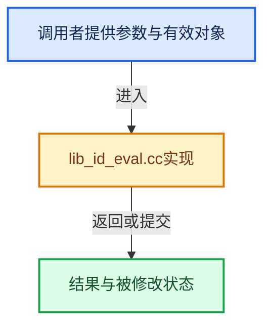

# 实现依赖专题：source/blender/blenkernel/intern/lib_id_eval.cc

[实现依赖导航](../../README.md) · [符号索引](../../../00-课程指南/02-源码与提交索引/符号依赖与实现索引.md)

本专题从正文实际调用进入，集中保存共享实现。函数有稳定锚点，可从调用处直接跳到对应完整函数；递归与互相调用通过回链组织。

## 本文件的实现关系





## 完整成员与函数实现

<a id="f-2863d2be32c6678f"></a>

### `blender::BKE_id_eval_properties_copy`

实现位置：[source/blender/blenkernel/intern/lib_id_eval.cc](../../../../../../../source/blender/blenkernel/intern/lib_id_eval.cc) · L20—L31。

接口参数：

- `ID *id_cow`
- `ID *id`

**教学注释版**

<!-- annotated:ecc31025256362 -->

```cpp
void BKE_id_eval_properties_copy(ID *id_cow, ID *id)
{
  const ID_Type id_type = GS(id->name);
  BLI_assert((id_cow->tag & ID_TAG_COPIED_ON_EVAL) && !(id->tag & ID_TAG_COPIED_ON_EVAL));
  BLI_assert(ID_TYPE_SUPPORTS_PARAMS_WITHOUT_COW(id_type));
  if (id_type == ID_ME) {
    BKE_mesh_copy_parameters(id_cast<Mesh *>(id_cow), id_cast<const Mesh *>(id));
  }
  else {
    BLI_assert_unreachable();
  }
}
```

<details>
<summary>核对原始源码：source/blender/blenkernel/intern/lib_id_eval.cc · L20—L31</summary>

<!-- original:ecc31025256362:source/blender/blenkernel/intern/lib_id_eval.cc:20:31 -->

```cpp
void BKE_id_eval_properties_copy(ID *id_cow, ID *id)
{
  const ID_Type id_type = GS(id->name);
  BLI_assert((id_cow->tag & ID_TAG_COPIED_ON_EVAL) && !(id->tag & ID_TAG_COPIED_ON_EVAL));
  BLI_assert(ID_TYPE_SUPPORTS_PARAMS_WITHOUT_COW(id_type));
  if (id_type == ID_ME) {
    BKE_mesh_copy_parameters(id_cast<Mesh *>(id_cow), id_cast<const Mesh *>(id));
  }
  else {
    BLI_assert_unreachable();
  }
}
```

</details>

**继续追踪实现**

- `GS` → [blender::GS · L410](../../08-其他Blender模块/makesdna/DNA_ID.h.md#f-c3ff509f79f21b05)。
- `BLI_assert` → [BLI_assert · L48](../../01-BLI基础库/BLI_assert.hh.md#m-57a88495704d)；[BLI_assert · L63](../../01-BLI基础库/BLI_assert.hh.md#m-d07050020cb5)。宏定义由构建条件选择。
- `ID_TYPE_SUPPORTS_PARAMS_WITHOUT_COW` → [ID_TYPE_SUPPORTS_PARAMS_WITHOUT_COW · L751](../../08-其他Blender模块/makesdna/DNA_ID.h.md#m-5aeaecb7bea6)。宏定义由构建条件选择。
- `BKE_mesh_copy_parameters` → [BKE_mesh_copy_parameters · L1462](../../../05-几何存储与拓扑映射/03-MPoly迁移与兼容.md#f-ef5676005d694d8d)。
- `id_cast<Mesh *>` → [blender::id_cast · L1417](../../08-其他Blender模块/makesdna/DNA_ID.h.md#f-6c8ac6412850ac5a)。
- `id_cast<const Mesh *>` → [blender::id_cast · L1417](../../08-其他Blender模块/makesdna/DNA_ID.h.md#f-6c8ac6412850ac5a)。
- `BLI_assert_unreachable` → [BLI_assert_unreachable · L77](../../01-BLI基础库/BLI_assert.hh.md#m-7a2d91a67d8e)。宏定义由构建条件选择。
