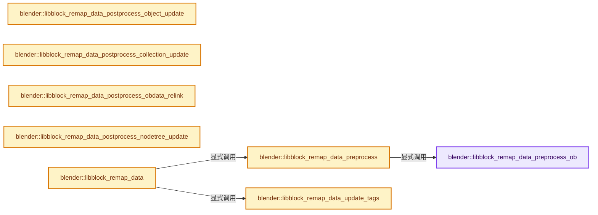
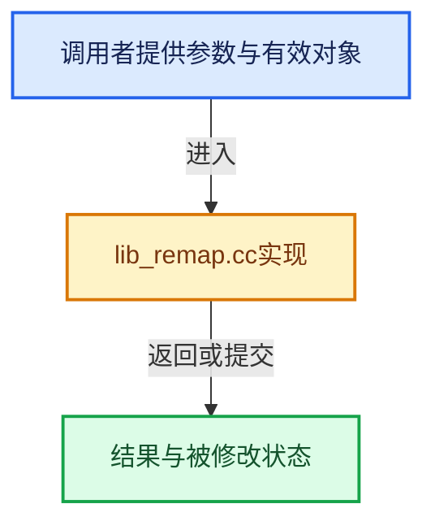

# 实现依赖专题：source/blender/blenkernel/intern/lib_remap.cc

[实现依赖导航](../../README.md) · [符号索引](../../../00-课程指南/02-源码与提交索引/符号依赖与实现索引.md)

本专题从正文实际调用进入，集中保存共享实现。函数有稳定锚点，可从调用处直接跳到对应完整函数；递归与互相调用通过回链组织。

## 本文件的实现关系






## 完整成员与函数实现

<a id="f-f1ec6cab1e8f2d47"></a>

### `blender::libblock_remap_data_preprocess_ob`

实现位置：[source/blender/blenkernel/intern/lib_remap.cc](../../../../../../../source/blender/blenkernel/intern/lib_remap.cc) · L311—L342。

接口参数：

- `Object *ob`
- `eIDRemapType remap_type`
- `const IDRemapper &id_remapper`

**教学注释版**

<!-- annotated:1218fd6dcf757b -->

```cpp
static void libblock_remap_data_preprocess_ob(Object *ob,
                                              eIDRemapType remap_type,
                                              const IDRemapper &id_remapper)
{
  if (ob->type != OB_ARMATURE) {
    return;
  }
  if (ob->pose == nullptr) {
    return;
  }

  const bool is_cleanup_type = remap_type == ID_REMAP_TYPE_CLEANUP;
  /* Early exit when mapping, but no armature mappings present. */
  if (!is_cleanup_type && !id_remapper.contains_mappings_for_any(FILTER_ID_AR)) {
    return;
  }

  /* Object's pose holds reference to armature bones. sic */
  /* Note that in theory, we should have to bother about linked/non-linked/never-null/etc.
   * flags/states.
   * Fortunately, this is just a tag, so we can accept to 'over-tag' a bit for pose recalc,
   * and avoid another complex and risky condition nightmare like the one we have in
   * foreach_libblock_remap_callback(). */
  const IDRemapperApplyResult expected_mapping_result = id_remapper.get_mapping_result(
      ob->data, ID_REMAP_APPLY_DEFAULT, nullptr);
  if (is_cleanup_type || expected_mapping_result == ID_REMAP_RESULT_SOURCE_REMAPPED) {
    ob->pose->flag |= POSE_RECALC;
    /* We need to clear pose bone pointers immediately, some code may access those before
     * pose is actually recomputed, which can lead to segfault. */
    BKE_pose_clear_pointers(ob->pose);
  }
}
```

<details>
<summary>核对原始源码：source/blender/blenkernel/intern/lib_remap.cc · L311—L342</summary>

<!-- original:1218fd6dcf757b:source/blender/blenkernel/intern/lib_remap.cc:311:342 -->

```cpp
static void libblock_remap_data_preprocess_ob(Object *ob,
                                              eIDRemapType remap_type,
                                              const IDRemapper &id_remapper)
{
  if (ob->type != OB_ARMATURE) {
    return;
  }
  if (ob->pose == nullptr) {
    return;
  }

  const bool is_cleanup_type = remap_type == ID_REMAP_TYPE_CLEANUP;
  /* Early exit when mapping, but no armature mappings present. */
  if (!is_cleanup_type && !id_remapper.contains_mappings_for_any(FILTER_ID_AR)) {
    return;
  }

  /* Object's pose holds reference to armature bones. sic */
  /* Note that in theory, we should have to bother about linked/non-linked/never-null/etc.
   * flags/states.
   * Fortunately, this is just a tag, so we can accept to 'over-tag' a bit for pose recalc,
   * and avoid another complex and risky condition nightmare like the one we have in
   * foreach_libblock_remap_callback(). */
  const IDRemapperApplyResult expected_mapping_result = id_remapper.get_mapping_result(
      ob->data, ID_REMAP_APPLY_DEFAULT, nullptr);
  if (is_cleanup_type || expected_mapping_result == ID_REMAP_RESULT_SOURCE_REMAPPED) {
    ob->pose->flag |= POSE_RECALC;
    /* We need to clear pose bone pointers immediately, some code may access those before
     * pose is actually recomputed, which can lead to segfault. */
    BKE_pose_clear_pointers(ob->pose);
  }
}
```

</details>

**沿实际写入检查状态**

- `ob->pose->flag |= POSE_RECALC;`

**继续追踪实现**

- `id_remapper.contains_mappings_for_any` → [blender::bke::id::IDRemapper::contains_mappings_for_any · L302](../BKE_lib_remap.hh.md#f-3bd488d0f5a6058b)。
- `id_remapper.get_mapping_result` → [blender::bke::id::IDRemapper::get_mapping_result · L39](lib_id_remapper.cc.md#f-de163a430e2ee6ef)。
- `BKE_pose_clear_pointers` → [blender::BKE_pose_clear_pointers · L2971](armature.cc.md#f-8ae6c314638ef7bf)。

<a id="f-dfb3e592e99893f0"></a>

### `blender::libblock_remap_data_preprocess`

实现位置：[source/blender/blenkernel/intern/lib_remap.cc](../../../../../../../source/blender/blenkernel/intern/lib_remap.cc) · L344—L357。

接口参数：

- `ID *id_owner`
- `eIDRemapType remap_type`
- `const IDRemapper &id_remapper`

**教学注释版**

<!-- annotated:c2f1b920814079 -->

```cpp
static void libblock_remap_data_preprocess(ID *id_owner,
                                           eIDRemapType remap_type,
                                           const IDRemapper &id_remapper)
{
  switch (GS(id_owner->name)) {
    case ID_OB: {
      Object *ob = id_cast<Object *>(id_owner);
      libblock_remap_data_preprocess_ob(ob, remap_type, id_remapper);
      break;
    }
    default:
      break;
  }
}
```

<details>
<summary>核对原始源码：source/blender/blenkernel/intern/lib_remap.cc · L344—L357</summary>

<!-- original:c2f1b920814079:source/blender/blenkernel/intern/lib_remap.cc:344:357 -->

```cpp
static void libblock_remap_data_preprocess(ID *id_owner,
                                           eIDRemapType remap_type,
                                           const IDRemapper &id_remapper)
{
  switch (GS(id_owner->name)) {
    case ID_OB: {
      Object *ob = id_cast<Object *>(id_owner);
      libblock_remap_data_preprocess_ob(ob, remap_type, id_remapper);
      break;
    }
    default:
      break;
  }
}
```

</details>

**继续追踪实现**

- `GS` → [blender::GS · L410](../../08-其他Blender模块/makesdna/DNA_ID.h.md#f-c3ff509f79f21b05)。
- `id_cast<Object *>` → [blender::id_cast · L1417](../../08-其他Blender模块/makesdna/DNA_ID.h.md#f-6c8ac6412850ac5a)。
- `libblock_remap_data_preprocess_ob` → [blender::libblock_remap_data_preprocess_ob · L311](lib_remap.cc.md#f-f1ec6cab1e8f2d47)。

<a id="f-d2020cee1741ba77"></a>

### `blender::libblock_remap_data_postprocess_object_update`

实现位置：[source/blender/blenkernel/intern/lib_remap.cc](../../../../../../../source/blender/blenkernel/intern/lib_remap.cc) · L363—L395。

接口参数：

- `Main *bmain`
- `Object *old_ob`
- `Object *`
- `const bool do_sync_collection`

**教学注释版**

<!-- annotated:47a1da0d657fc7 -->

```cpp
static void libblock_remap_data_postprocess_object_update(Main *bmain,
                                                          Object *old_ob,
                                                          Object * /*new_ob*/,
                                                          const bool do_sync_collection)
{
  /* Will only effectively process collections that have been tagged with
   * #COLLECTION_TAG_COLLECTION_OBJECT_DIRTY. See #collection_foreach_id callback. */
  BKE_collections_object_remove_invalids(bmain);

  if (do_sync_collection) {
    BKE_main_collection_sync_remap(bmain);
  }

  if (old_ob == nullptr) {
    for (Object *ob = bmain->objects.first(); ob != nullptr;
         ob = static_cast<Object *>(ob->id.next))
    {
      if (ob->type == OB_MBALL && BKE_mball_is_basis(ob)) {
        DEG_id_tag_update(&ob->id, ID_RECALC_GEOMETRY);
      }
    }
  }
  else {
    for (Object *ob = bmain->objects.first(); ob != nullptr;
         ob = static_cast<Object *>(ob->id.next))
    {
      if (ob->type == OB_MBALL && BKE_mball_is_basis_for(ob, old_ob)) {
        DEG_id_tag_update(&ob->id, ID_RECALC_GEOMETRY);
        break; /* There is only one basis... */
      }
    }
  }
}
```

<details>
<summary>核对原始源码：source/blender/blenkernel/intern/lib_remap.cc · L363—L395</summary>

<!-- original:47a1da0d657fc7:source/blender/blenkernel/intern/lib_remap.cc:363:395 -->

```cpp
static void libblock_remap_data_postprocess_object_update(Main *bmain,
                                                          Object *old_ob,
                                                          Object * /*new_ob*/,
                                                          const bool do_sync_collection)
{
  /* Will only effectively process collections that have been tagged with
   * #COLLECTION_TAG_COLLECTION_OBJECT_DIRTY. See #collection_foreach_id callback. */
  BKE_collections_object_remove_invalids(bmain);

  if (do_sync_collection) {
    BKE_main_collection_sync_remap(bmain);
  }

  if (old_ob == nullptr) {
    for (Object *ob = bmain->objects.first(); ob != nullptr;
         ob = static_cast<Object *>(ob->id.next))
    {
      if (ob->type == OB_MBALL && BKE_mball_is_basis(ob)) {
        DEG_id_tag_update(&ob->id, ID_RECALC_GEOMETRY);
      }
    }
  }
  else {
    for (Object *ob = bmain->objects.first(); ob != nullptr;
         ob = static_cast<Object *>(ob->id.next))
    {
      if (ob->type == OB_MBALL && BKE_mball_is_basis_for(ob, old_ob)) {
        DEG_id_tag_update(&ob->id, ID_RECALC_GEOMETRY);
        break; /* There is only one basis... */
      }
    }
  }
}
```

</details>

**沿实际写入检查状态**

- `ob = static_cast<Object *>(ob->id.next))`

**继续追踪实现**

- `BKE_collections_object_remove_invalids` → [blender::BKE_collections_object_remove_invalids · L1855](collection.cc.md#f-04670febcb6be8b7)。
- `BKE_main_collection_sync_remap` → [blender::BKE_main_collection_sync_remap · L1521](layer.cc.md#f-3a3a06c3fdb216b5)。
- `bmain->objects.first` → [调用协议](../../../00-课程指南/01-路线与规范/模板宏与动态分派协议.md)：接收对象类型依赖auto、返回值或模板实例；不按同名猜测目标。调用位置L377。
- `BKE_mball_is_basis` → [blender::BKE_mball_is_basis · L255](mball.cc.md#f-4b8275ea965e6286)。
- `DEG_id_tag_update` → [blender::DEG_id_tag_update · L844](../../06-Depsgraph依赖图/intern/depsgraph_tag.cc.md#f-62d2949dd168bb81)。
- `BKE_mball_is_basis_for` → [blender::BKE_mball_is_basis_for · L294](mball.cc.md#f-376bfaa04c53a3e4)。

<a id="f-cbc1c198a6aa2257"></a>

### `blender::libblock_remap_data_postprocess_collection_update`

实现位置：[source/blender/blenkernel/intern/lib_remap.cc](../../../../../../../source/blender/blenkernel/intern/lib_remap.cc) · L399—L419。

接口参数：

- `Main *bmain`
- `Collection *owner_collection`
- `Collection *`
- `Collection *new_collection`

**教学注释版**

<!-- annotated:d30c87465de95e -->

```cpp
static void libblock_remap_data_postprocess_collection_update(Main *bmain,
                                                              Collection *owner_collection,
                                                              Collection * /*old_collection*/,
                                                              Collection *new_collection)
{
  if (new_collection == nullptr) {
    /* XXX Complex cases can lead to nullptr pointers in other collections than old_collection,
     * and BKE_main_collection_sync_remap() does not tolerate any of those, so for now always check
     * whole existing collections for nullptr pointers.
     * I'd consider optimizing that whole collection remapping process a TODO: for later. */
    BKE_collections_child_remove_nulls(bmain, owner_collection, nullptr /*old_collection*/);
  }
  else {
    /* Temp safe fix, but a "tad" brute force... We should probably be able to use parents from
     * old_collection instead? */
    /* NOTE: Also takes care of duplicated child collections that remapping may have created. */
    BKE_main_collections_parent_relations_rebuild(bmain);
  }

  BKE_main_collection_sync_remap(bmain);
}
```

<details>
<summary>核对原始源码：source/blender/blenkernel/intern/lib_remap.cc · L399—L419</summary>

<!-- original:d30c87465de95e:source/blender/blenkernel/intern/lib_remap.cc:399:419 -->

```cpp
static void libblock_remap_data_postprocess_collection_update(Main *bmain,
                                                              Collection *owner_collection,
                                                              Collection * /*old_collection*/,
                                                              Collection *new_collection)
{
  if (new_collection == nullptr) {
    /* XXX Complex cases can lead to nullptr pointers in other collections than old_collection,
     * and BKE_main_collection_sync_remap() does not tolerate any of those, so for now always check
     * whole existing collections for nullptr pointers.
     * I'd consider optimizing that whole collection remapping process a TODO: for later. */
    BKE_collections_child_remove_nulls(bmain, owner_collection, nullptr /*old_collection*/);
  }
  else {
    /* Temp safe fix, but a "tad" brute force... We should probably be able to use parents from
     * old_collection instead? */
    /* NOTE: Also takes care of duplicated child collections that remapping may have created. */
    BKE_main_collections_parent_relations_rebuild(bmain);
  }

  BKE_main_collection_sync_remap(bmain);
}
```

</details>

**继续追踪实现**

- `BKE_collections_child_remove_nulls` → [blender::BKE_collections_child_remove_nulls · L1886](collection.cc.md#f-bef35d7c41c9d632)。
- `BKE_main_collections_parent_relations_rebuild` → [blender::BKE_main_collections_parent_relations_rebuild · L2234](collection.cc.md#f-8e4df560b39c6dd5)。
- `BKE_main_collection_sync_remap` → [blender::BKE_main_collection_sync_remap · L1521](layer.cc.md#f-3a3a06c3fdb216b5)。

<a id="f-4562ff6d82ce5691"></a>

### `blender::libblock_remap_data_postprocess_obdata_relink`

实现位置：[source/blender/blenkernel/intern/lib_remap.cc](../../../../../../../source/blender/blenkernel/intern/lib_remap.cc) · L421—L437。

接口参数：

- `Main *bmain`
- `Object *ob`
- `ID *new_id`

**教学注释版**

<!-- annotated:6d79595a9a1d91 -->

```cpp
static void libblock_remap_data_postprocess_obdata_relink(Main *bmain, Object *ob, ID *new_id)
{
  if (ob->data == new_id) {
    switch (GS(new_id->name)) {
      case ID_ME:
        multires_force_sculpt_rebuild(ob);
        break;
      case ID_CU_LEGACY:
        BKE_curve_type_test(ob, true);
        break;
      default:
        break;
    }
    BKE_modifiers_test_object(ob);
    BKE_object_materials_sync_length(bmain, ob, new_id);
  }
}
```

<details>
<summary>核对原始源码：source/blender/blenkernel/intern/lib_remap.cc · L421—L437</summary>

<!-- original:6d79595a9a1d91:source/blender/blenkernel/intern/lib_remap.cc:421:437 -->

```cpp
static void libblock_remap_data_postprocess_obdata_relink(Main *bmain, Object *ob, ID *new_id)
{
  if (ob->data == new_id) {
    switch (GS(new_id->name)) {
      case ID_ME:
        multires_force_sculpt_rebuild(ob);
        break;
      case ID_CU_LEGACY:
        BKE_curve_type_test(ob, true);
        break;
      default:
        break;
    }
    BKE_modifiers_test_object(ob);
    BKE_object_materials_sync_length(bmain, ob, new_id);
  }
}
```

</details>

**继续追踪实现**

- `GS` → [blender::GS · L410](../../08-其他Blender模块/makesdna/DNA_ID.h.md#f-c3ff509f79f21b05)。
- `multires_force_sculpt_rebuild` → [blender::multires_force_sculpt_rebuild · L332](multires.cc.md#f-843eb01be1cd1dee)。
- `BKE_curve_type_test` → [blender::BKE_curve_type_test · L476](curve.cc.md#f-44008f8d7c308cb4)。
- `BKE_modifiers_test_object` → [blender::BKE_modifiers_test_object · L889](modifier.cc.md#f-f6767bae7ea8b3f8)。
- `BKE_object_materials_sync_length` → [blender::BKE_object_materials_sync_length · L1060](material.cc.md#f-b879972e7f061cb6)。

<a id="f-cff009feae87a685"></a>

### `blender::libblock_remap_data_postprocess_nodetree_update`

实现位置：[source/blender/blenkernel/intern/lib_remap.cc](../../../../../../../source/blender/blenkernel/intern/lib_remap.cc) · L439—L443。

接口参数：

- `Main *bmain`
- `ID *new_id`

**教学注释版**

<!-- annotated:1b298fa714122c -->

```cpp
static void libblock_remap_data_postprocess_nodetree_update(Main *bmain, ID *new_id)
{
  /* Update all group nodes using a node group. */
  bke::node_tree_update_all_users(bmain, new_id);
}
```

<details>
<summary>核对原始源码：source/blender/blenkernel/intern/lib_remap.cc · L439—L443</summary>

<!-- original:1b298fa714122c:source/blender/blenkernel/intern/lib_remap.cc:439:443 -->

```cpp
static void libblock_remap_data_postprocess_nodetree_update(Main *bmain, ID *new_id)
{
  /* Update all group nodes using a node group. */
  bke::node_tree_update_all_users(bmain, new_id);
}
```

</details>

**继续追踪实现**

- `bke::node_tree_update_all_users` → [blender::bke::node_tree_update_all_users · L5707](node.cc.md#f-9632729f994986c8)。

<a id="f-bb210980a7212941"></a>

### `blender::libblock_remap_data_update_tags`

实现位置：[source/blender/blenkernel/intern/lib_remap.cc](../../../../../../../source/blender/blenkernel/intern/lib_remap.cc) · L445—L467。

接口参数：

- `ID *old_id`
- `ID *new_id`
- `IDRemap *id_remap_data`

**教学注释版**

<!-- annotated:ff92be55412abb -->

```cpp
static void libblock_remap_data_update_tags(ID *old_id, ID *new_id, IDRemap *id_remap_data)
{
  const int remap_flags = id_remap_data->flag;
  if ((remap_flags & ID_REMAP_SKIP_USER_CLEAR) == 0) {
    /* XXX We may not want to always 'transfer' fake-user from old to new id...
     *     Think for now it's desired behavior though,
     *     we can always add an option (flag) to control this later if needed. */
    if (old_id != nullptr && (old_id->flag & ID_FLAG_FAKEUSER) && new_id != nullptr) {
      id_fake_user_clear(old_id);
      id_fake_user_set(new_id);
    }

    id_us_clear_real(old_id);
  }

  if (new_id != nullptr && (new_id->tag & ID_TAG_INDIRECT) &&
      (new_id->runtime->remap.status & ID_REMAP_IS_LINKED_DIRECT))
  {
    new_id->tag &= ~ID_TAG_INDIRECT;
    new_id->flag &= ~ID_FLAG_INDIRECT_WEAK_LINK;
    new_id->tag |= ID_TAG_EXTERN;
  }
}
```

<details>
<summary>核对原始源码：source/blender/blenkernel/intern/lib_remap.cc · L445—L467</summary>

<!-- original:ff92be55412abb:source/blender/blenkernel/intern/lib_remap.cc:445:467 -->

```cpp
static void libblock_remap_data_update_tags(ID *old_id, ID *new_id, IDRemap *id_remap_data)
{
  const int remap_flags = id_remap_data->flag;
  if ((remap_flags & ID_REMAP_SKIP_USER_CLEAR) == 0) {
    /* XXX We may not want to always 'transfer' fake-user from old to new id...
     *     Think for now it's desired behavior though,
     *     we can always add an option (flag) to control this later if needed. */
    if (old_id != nullptr && (old_id->flag & ID_FLAG_FAKEUSER) && new_id != nullptr) {
      id_fake_user_clear(old_id);
      id_fake_user_set(new_id);
    }

    id_us_clear_real(old_id);
  }

  if (new_id != nullptr && (new_id->tag & ID_TAG_INDIRECT) &&
      (new_id->runtime->remap.status & ID_REMAP_IS_LINKED_DIRECT))
  {
    new_id->tag &= ~ID_TAG_INDIRECT;
    new_id->flag &= ~ID_FLAG_INDIRECT_WEAK_LINK;
    new_id->tag |= ID_TAG_EXTERN;
  }
}
```

</details>

**沿实际写入检查状态**

- `new_id->tag &= ~ID_TAG_INDIRECT;`
- `new_id->flag &= ~ID_FLAG_INDIRECT_WEAK_LINK;`
- `new_id->tag |= ID_TAG_EXTERN;`

**继续追踪实现**

- `id_fake_user_clear` → [blender::id_fake_user_clear · L479](lib_id.cc.md#f-375b0c66da203120)。
- `id_fake_user_set` → [blender::id_fake_user_set · L471](lib_id.cc.md#f-b1cc5ae2024991f3)。
- `id_us_clear_real` → [blender::id_us_clear_real · L406](lib_id.cc.md#f-a426cbdc6d5bfd34)。

<a id="f-1ce58a04fdb37050"></a>

### `blender::libblock_remap_data`

实现位置：[source/blender/blenkernel/intern/lib_remap.cc](../../../../../../../source/blender/blenkernel/intern/lib_remap.cc) · L499—L564。

接口参数：

- `Main *bmain`
- `ID *id`
- `eIDRemapType remap_type`
- `IDRemapper &id_remapper`
- `const int remap_flags`

**教学注释版**

<!-- annotated:867c2c6e0df120 -->

```cpp
static void libblock_remap_data(
    Main *bmain, ID *id, eIDRemapType remap_type, IDRemapper &id_remapper, const int remap_flags)
{
  IDRemap id_remap_data = {
      /*type*/ remap_type,
      /*bmain*/ bmain,
      /*id_remapper*/ id_remapper,
      /*id_owner*/ nullptr,
      /*flag*/ remap_flags,
  };

  const bool include_ui = (remap_flags & ID_REMAP_FORCE_UI_POINTERS) != 0;
  const LibraryForeachIDFlag foreach_id_flags =
      (((remap_flags & ID_REMAP_FORCE_INTERNAL_RUNTIME_POINTERS) != 0 ?
            IDWALK_DO_INTERNAL_RUNTIME_POINTERS :
            IDWALK_NOP) |
       (include_ui ? IDWALK_INCLUDE_UI : IDWALK_NOP) |

       ((remap_flags & ID_REMAP_NO_ORIG_POINTERS_ACCESS) != 0 ? IDWALK_NO_ORIG_POINTERS_ACCESS :
                                                                IDWALK_NOP) |
       ((remap_flags & ID_REMAP_DO_LIBRARY_POINTERS) != 0 ? IDWALK_DO_LIBRARY_POINTER :
                                                            IDWALK_NOP));

  id_remapper.iter(libblock_remap_reset_remapping_status_fn);

  if (id) {
#ifdef DEBUG_PRINT
    printf("\tchecking id %s (%p, %p)\n", id->name, id, id->lib);
#endif
    id_remap_data.id_owner = (id->flag & ID_FLAG_EMBEDDED_DATA) ? BKE_id_owner_get(id) : id;
    libblock_remap_data_preprocess(id_remap_data.id_owner, remap_type, id_remapper);
    BKE_library_foreach_ID_link(
        bmain, id, foreach_libblock_remap_callback, &id_remap_data, foreach_id_flags);
  }
  else {
    /* Note that this is a very 'brute force' approach,
     * maybe we could use some depsgraph to only process objects actually using given old_id...
     * sounds rather unlikely currently, though, so this will do for now. */
    ID *id_curr;

    FOREACH_MAIN_ID_BEGIN (bmain, id_curr) {
      const uint64_t can_use_filter_id = BKE_library_id_can_use_filter_id(id_curr, include_ui);
      const bool has_mapping = id_remapper.contains_mappings_for_any(can_use_filter_id);

      /* Continue when id_remapper doesn't have any mappings that can be used by id_curr. */
      if (!has_mapping) {
        continue;
      }

      /* Note that we cannot skip indirect usages of old_id
       * here (if requested), we still need to check it for the
       * user count handling...
       * XXX No more true (except for debug usage of those
       * skipping counters). */
      id_remap_data.id_owner = id_curr;
      libblock_remap_data_preprocess(id_remap_data.id_owner, remap_type, id_remapper);
      BKE_library_foreach_ID_link(
          bmain, id_curr, foreach_libblock_remap_callback, &id_remap_data, foreach_id_flags);
    }
    FOREACH_MAIN_ID_END;
  }

  id_remapper.iter([&](ID *old_id, ID *new_id) {
    libblock_remap_data_update_tags(old_id, new_id, &id_remap_data);
  });
}
```

<details>
<summary>核对原始源码：source/blender/blenkernel/intern/lib_remap.cc · L499—L564</summary>

<!-- original:867c2c6e0df120:source/blender/blenkernel/intern/lib_remap.cc:499:564 -->

```cpp
static void libblock_remap_data(
    Main *bmain, ID *id, eIDRemapType remap_type, IDRemapper &id_remapper, const int remap_flags)
{
  IDRemap id_remap_data = {
      /*type*/ remap_type,
      /*bmain*/ bmain,
      /*id_remapper*/ id_remapper,
      /*id_owner*/ nullptr,
      /*flag*/ remap_flags,
  };

  const bool include_ui = (remap_flags & ID_REMAP_FORCE_UI_POINTERS) != 0;
  const LibraryForeachIDFlag foreach_id_flags =
      (((remap_flags & ID_REMAP_FORCE_INTERNAL_RUNTIME_POINTERS) != 0 ?
            IDWALK_DO_INTERNAL_RUNTIME_POINTERS :
            IDWALK_NOP) |
       (include_ui ? IDWALK_INCLUDE_UI : IDWALK_NOP) |

       ((remap_flags & ID_REMAP_NO_ORIG_POINTERS_ACCESS) != 0 ? IDWALK_NO_ORIG_POINTERS_ACCESS :
                                                                IDWALK_NOP) |
       ((remap_flags & ID_REMAP_DO_LIBRARY_POINTERS) != 0 ? IDWALK_DO_LIBRARY_POINTER :
                                                            IDWALK_NOP));

  id_remapper.iter(libblock_remap_reset_remapping_status_fn);

  if (id) {
#ifdef DEBUG_PRINT
    printf("\tchecking id %s (%p, %p)\n", id->name, id, id->lib);
#endif
    id_remap_data.id_owner = (id->flag & ID_FLAG_EMBEDDED_DATA) ? BKE_id_owner_get(id) : id;
    libblock_remap_data_preprocess(id_remap_data.id_owner, remap_type, id_remapper);
    BKE_library_foreach_ID_link(
        bmain, id, foreach_libblock_remap_callback, &id_remap_data, foreach_id_flags);
  }
  else {
    /* Note that this is a very 'brute force' approach,
     * maybe we could use some depsgraph to only process objects actually using given old_id...
     * sounds rather unlikely currently, though, so this will do for now. */
    ID *id_curr;

    FOREACH_MAIN_ID_BEGIN (bmain, id_curr) {
      const uint64_t can_use_filter_id = BKE_library_id_can_use_filter_id(id_curr, include_ui);
      const bool has_mapping = id_remapper.contains_mappings_for_any(can_use_filter_id);

      /* Continue when id_remapper doesn't have any mappings that can be used by id_curr. */
      if (!has_mapping) {
        continue;
      }

      /* Note that we cannot skip indirect usages of old_id
       * here (if requested), we still need to check it for the
       * user count handling...
       * XXX No more true (except for debug usage of those
       * skipping counters). */
      id_remap_data.id_owner = id_curr;
      libblock_remap_data_preprocess(id_remap_data.id_owner, remap_type, id_remapper);
      BKE_library_foreach_ID_link(
          bmain, id_curr, foreach_libblock_remap_callback, &id_remap_data, foreach_id_flags);
    }
    FOREACH_MAIN_ID_END;
  }

  id_remapper.iter([&](ID *old_id, ID *new_id) {
    libblock_remap_data_update_tags(old_id, new_id, &id_remap_data);
  });
}
```

</details>

**沿实际写入检查状态**

- `id_remap_data.id_owner = (id->flag & ID_FLAG_EMBEDDED_DATA) ? BKE_id_owner_get(id) : id;`
- `id_remap_data.id_owner = id_curr;`

**继续追踪实现**

- `id_remapper.iter` → [blender::bke::id::IDRemapper::iter · L340](../BKE_lib_remap.hh.md#f-6c49bff2f172c121)。
- `printf` → [外部契约](https://eel.is/c++draft/)：这个边界按实际表达式及所属类型核对参数、返回值、寿命与失败行为。这里提供接口入口，不声称已解释该第三方版本的内部实现。
- `BKE_id_owner_get` → [blender::BKE_id_owner_get · L2770](lib_id.cc.md#f-a51c741e122bfc1f)。
- `libblock_remap_data_preprocess` → [blender::libblock_remap_data_preprocess · L344](lib_remap.cc.md#f-dfb3e592e99893f0)。
- `BKE_library_foreach_ID_link` → [blender::BKE_library_foreach_ID_link · L449](lib_query.cc.md#f-a52fd9a0ee74a026)。
- `BKE_library_id_can_use_filter_id` → [blender::BKE_library_id_can_use_filter_id · L494](lib_query.cc.md#f-f58a137b4634c6e8)。
- `id_remapper.contains_mappings_for_any` → [blender::bke::id::IDRemapper::contains_mappings_for_any · L302](../BKE_lib_remap.hh.md#f-3bd488d0f5a6058b)。
- `libblock_remap_data_update_tags` → [blender::libblock_remap_data_update_tags · L445](lib_remap.cc.md#f-bb210980a7212941)。

<a id="f-c0e6e587bd7653f6"></a>

### `blender::libblock_remap_foreach_idpair`

实现位置：[source/blender/blenkernel/intern/lib_remap.cc](../../../../../../../source/blender/blenkernel/intern/lib_remap.cc) · L566—L652。

接口参数：

- `ID *old_id`
- `ID *new_id`
- `Main *bmain`
- `int remap_flags`

**教学注释版**

<!-- annotated:8aef8f8a48be11 -->

```cpp
static void libblock_remap_foreach_idpair(ID *old_id, ID *new_id, Main *bmain, int remap_flags)
{
  if (old_id == new_id) {
    return;
  }

  BLI_assert(old_id != nullptr);
  BLI_assert((new_id == nullptr) || remap_flags & ID_REMAP_ALLOW_IDTYPE_MISMATCH ||
             GS(old_id->name) == GS(new_id->name));

  if (free_notifier_reference_cb) {
    free_notifier_reference_cb(old_id);
  }

  if ((remap_flags & ID_REMAP_SKIP_USER_CLEAR) == 0) {
    /* If old_id was used by some ugly 'user_one' stuff (like Image or Clip editors...), and user
     * count has actually been incremented for that, we have to decrease once more its user
     * count... unless we had to skip some 'user_one' cases. */
    if ((old_id->tag & ID_TAG_EXTRAUSER_SET) &&
        !(old_id->runtime->remap.status & ID_REMAP_IS_USER_ONE_SKIPPED))
    {
      id_us_clear_real(old_id);
    }
  }

  const int skipped_refcounted = old_id->runtime->remap.skipped_refcounted;
  if (old_id->us - skipped_refcounted < 0) {
    CLOG_ERROR(&LOG,
               "Error in remapping process from '%s' (%p) to '%s' (%p): "
               "wrong user count in old ID after process (summing up to %d)",
               old_id->name,
               old_id,
               new_id ? new_id->name : "<nullptr>",
               new_id,
               old_id->us - skipped_refcounted);
  }

  const int skipped_direct = old_id->runtime->remap.skipped_direct;
  if (skipped_direct == 0) {
    /* old_id is assumed to not be used directly anymore... */
    if (old_id->lib && (old_id->tag & ID_TAG_EXTERN)) {
      old_id->tag &= ~ID_TAG_EXTERN;
      old_id->tag |= ID_TAG_INDIRECT;
    }
  }

  /* Some after-process updates.
   * This is a bit ugly, but cannot see a way to avoid it.
   * Maybe we should do a per-ID callback for this instead? */
  switch (GS(old_id->name)) {
    case ID_OB:
      libblock_remap_data_postprocess_object_update(
          bmain, id_cast<Object *>(old_id), id_cast<Object *>(new_id), true);
      break;
    case ID_GR:
      libblock_remap_data_postprocess_collection_update(
          bmain, nullptr, id_cast<Collection *>(old_id), id_cast<Collection *>(new_id));
      break;
    case ID_ME:
    case ID_CU_LEGACY:
    case ID_MB:
    case ID_CV:
    case ID_PT:
    case ID_VO:
      if (new_id) { /* Only affects us in case obdata was relinked (changed). */
        for (Object *ob = bmain->objects.first(); ob; ob = static_cast<Object *>(ob->id.next)) {
          libblock_remap_data_postprocess_obdata_relink(bmain, ob, new_id);
        }
      }
      break;
    default:
      break;
  }

  /* Node trees may virtually use any kind of data-block... */
  /* XXX Yuck!!!! nodetree update can do pretty much any thing when talking about py nodes,
   *     including creating new data-blocks (see #50385), so we need to unlock main here. :(
   *     Why can't we have re-entrent locks? */
  BKE_main_unlock(bmain);
  libblock_remap_data_postprocess_nodetree_update(bmain, new_id);
  BKE_main_lock(bmain);

  /* Full rebuild of DEG! */
  DEG_relations_tag_update(bmain);

  BKE_libblock_runtime_reset_remapping_status(old_id);
}
```

<details>
<summary>核对原始源码：source/blender/blenkernel/intern/lib_remap.cc · L566—L652</summary>

<!-- original:8aef8f8a48be11:source/blender/blenkernel/intern/lib_remap.cc:566:652 -->

```cpp
static void libblock_remap_foreach_idpair(ID *old_id, ID *new_id, Main *bmain, int remap_flags)
{
  if (old_id == new_id) {
    return;
  }

  BLI_assert(old_id != nullptr);
  BLI_assert((new_id == nullptr) || remap_flags & ID_REMAP_ALLOW_IDTYPE_MISMATCH ||
             GS(old_id->name) == GS(new_id->name));

  if (free_notifier_reference_cb) {
    free_notifier_reference_cb(old_id);
  }

  if ((remap_flags & ID_REMAP_SKIP_USER_CLEAR) == 0) {
    /* If old_id was used by some ugly 'user_one' stuff (like Image or Clip editors...), and user
     * count has actually been incremented for that, we have to decrease once more its user
     * count... unless we had to skip some 'user_one' cases. */
    if ((old_id->tag & ID_TAG_EXTRAUSER_SET) &&
        !(old_id->runtime->remap.status & ID_REMAP_IS_USER_ONE_SKIPPED))
    {
      id_us_clear_real(old_id);
    }
  }

  const int skipped_refcounted = old_id->runtime->remap.skipped_refcounted;
  if (old_id->us - skipped_refcounted < 0) {
    CLOG_ERROR(&LOG,
               "Error in remapping process from '%s' (%p) to '%s' (%p): "
               "wrong user count in old ID after process (summing up to %d)",
               old_id->name,
               old_id,
               new_id ? new_id->name : "<nullptr>",
               new_id,
               old_id->us - skipped_refcounted);
  }

  const int skipped_direct = old_id->runtime->remap.skipped_direct;
  if (skipped_direct == 0) {
    /* old_id is assumed to not be used directly anymore... */
    if (old_id->lib && (old_id->tag & ID_TAG_EXTERN)) {
      old_id->tag &= ~ID_TAG_EXTERN;
      old_id->tag |= ID_TAG_INDIRECT;
    }
  }

  /* Some after-process updates.
   * This is a bit ugly, but cannot see a way to avoid it.
   * Maybe we should do a per-ID callback for this instead? */
  switch (GS(old_id->name)) {
    case ID_OB:
      libblock_remap_data_postprocess_object_update(
          bmain, id_cast<Object *>(old_id), id_cast<Object *>(new_id), true);
      break;
    case ID_GR:
      libblock_remap_data_postprocess_collection_update(
          bmain, nullptr, id_cast<Collection *>(old_id), id_cast<Collection *>(new_id));
      break;
    case ID_ME:
    case ID_CU_LEGACY:
    case ID_MB:
    case ID_CV:
    case ID_PT:
    case ID_VO:
      if (new_id) { /* Only affects us in case obdata was relinked (changed). */
        for (Object *ob = bmain->objects.first(); ob; ob = static_cast<Object *>(ob->id.next)) {
          libblock_remap_data_postprocess_obdata_relink(bmain, ob, new_id);
        }
      }
      break;
    default:
      break;
  }

  /* Node trees may virtually use any kind of data-block... */
  /* XXX Yuck!!!! nodetree update can do pretty much any thing when talking about py nodes,
   *     including creating new data-blocks (see #50385), so we need to unlock main here. :(
   *     Why can't we have re-entrent locks? */
  BKE_main_unlock(bmain);
  libblock_remap_data_postprocess_nodetree_update(bmain, new_id);
  BKE_main_lock(bmain);

  /* Full rebuild of DEG! */
  DEG_relations_tag_update(bmain);

  BKE_libblock_runtime_reset_remapping_status(old_id);
}
```

</details>

**沿实际写入检查状态**

- `old_id->tag &= ~ID_TAG_EXTERN;`
- `old_id->tag |= ID_TAG_INDIRECT;`

**继续追踪实现**

- `BLI_assert` → [BLI_assert · L48](../../01-BLI基础库/BLI_assert.hh.md#m-57a88495704d)；[BLI_assert · L63](../../01-BLI基础库/BLI_assert.hh.md#m-d07050020cb5)。宏定义由构建条件选择。
- `GS` → [blender::GS · L410](../../08-其他Blender模块/makesdna/DNA_ID.h.md#f-c3ff509f79f21b05)。
- `free_notifier_reference_cb` → [调用协议](../../../00-课程指南/01-路线与规范/模板宏与动态分派协议.md)：函数指针、局部可调用对象或未展开的宏；必须结合调用者环境。调用位置L577。
- `id_us_clear_real` → [blender::id_us_clear_real · L406](lib_id.cc.md#f-a426cbdc6d5bfd34)。
- `CLOG_ERROR` → [CLOG_ERROR · L188](../../07-Intern运行时与平台/clog/CLG_log.h.md#m-081575cdc8d0)。宏定义由构建条件选择。
- `libblock_remap_data_postprocess_object_update` → [blender::libblock_remap_data_postprocess_object_update · L363](lib_remap.cc.md#f-d2020cee1741ba77)。
- `id_cast<Object *>` → [blender::id_cast · L1417](../../08-其他Blender模块/makesdna/DNA_ID.h.md#f-6c8ac6412850ac5a)。
- `libblock_remap_data_postprocess_collection_update` → [blender::libblock_remap_data_postprocess_collection_update · L399](lib_remap.cc.md#f-cbc1c198a6aa2257)。
- `id_cast<Collection *>` → [blender::id_cast · L1417](../../08-其他Blender模块/makesdna/DNA_ID.h.md#f-6c8ac6412850ac5a)。
- `bmain->objects.first` → [调用协议](../../../00-课程指南/01-路线与规范/模板宏与动态分派协议.md)：接收对象类型依赖auto、返回值或模板实例；不按同名猜测目标。调用位置L631。
- `libblock_remap_data_postprocess_obdata_relink` → [blender::libblock_remap_data_postprocess_obdata_relink · L421](lib_remap.cc.md#f-4562ff6d82ce5691)。
- `BKE_main_unlock` → [blender::BKE_main_unlock · L666](main.cc.md#f-abebed07b3cec04c)。
- `libblock_remap_data_postprocess_nodetree_update` → [blender::libblock_remap_data_postprocess_nodetree_update · L439](lib_remap.cc.md#f-cff009feae87a685)。
- `BKE_main_lock` → [blender::BKE_main_lock · L661](main.cc.md#f-3f480bfb076dd87d)。
- `DEG_relations_tag_update` → [blender::DEG_relations_tag_update · L350](../../06-Depsgraph依赖图/intern/depsgraph_build.cc.md#f-2910c78540652980)。
- `BKE_libblock_runtime_reset_remapping_status` → [blender::BKE_libblock_runtime_reset_remapping_status · L1564](lib_id.cc.md#f-738810f6a36dae4f)。

<a id="f-4100dadcdf3e446e"></a>

### `blender::BKE_libblock_remap_multiple_locked`

实现位置：[source/blender/blenkernel/intern/lib_remap.cc](../../../../../../../source/blender/blenkernel/intern/lib_remap.cc) · L654—L676。

接口参数：

- `Main *bmain`
- `IDRemapper &mappings`
- `const int remap_flags`

**教学注释版**

<!-- annotated:a8ba5389385830 -->

```cpp
void BKE_libblock_remap_multiple_locked(Main *bmain, IDRemapper &mappings, const int remap_flags)
{
  if (mappings.is_empty()) {
    /* Early exit nothing to do. */
    return;
  }

  libblock_remap_data(bmain, nullptr, ID_REMAP_TYPE_REMAP, mappings, remap_flags);

  mappings.iter([&](ID *old_id, ID *new_id) {
    libblock_remap_foreach_idpair(old_id, new_id, bmain, remap_flags);
  });

  /* We assume editors do not hold references to their IDs... This is false in some cases
   * (Image is especially tricky here),
   * editors' code is to handle refcount (id->us) itself then. */
  if (remap_editor_id_reference_cb) {
    remap_editor_id_reference_cb(mappings);
  }

  /* Full rebuild of DEG! */
  DEG_relations_tag_update(bmain);
}
```

<details>
<summary>核对原始源码：source/blender/blenkernel/intern/lib_remap.cc · L654—L676</summary>

<!-- original:a8ba5389385830:source/blender/blenkernel/intern/lib_remap.cc:654:676 -->

```cpp
void BKE_libblock_remap_multiple_locked(Main *bmain, IDRemapper &mappings, const int remap_flags)
{
  if (mappings.is_empty()) {
    /* Early exit nothing to do. */
    return;
  }

  libblock_remap_data(bmain, nullptr, ID_REMAP_TYPE_REMAP, mappings, remap_flags);

  mappings.iter([&](ID *old_id, ID *new_id) {
    libblock_remap_foreach_idpair(old_id, new_id, bmain, remap_flags);
  });

  /* We assume editors do not hold references to their IDs... This is false in some cases
   * (Image is especially tricky here),
   * editors' code is to handle refcount (id->us) itself then. */
  if (remap_editor_id_reference_cb) {
    remap_editor_id_reference_cb(mappings);
  }

  /* Full rebuild of DEG! */
  DEG_relations_tag_update(bmain);
}
```

</details>

**继续追踪实现**

- `mappings.is_empty` → [blender::bke::id::IDRemapper::is_empty · L297](../BKE_lib_remap.hh.md#f-66141d507b751c46)。
- `libblock_remap_data` → [blender::libblock_remap_data · L499](lib_remap.cc.md#f-1ce58a04fdb37050)。
- `mappings.iter` → [blender::bke::id::IDRemapper::iter · L340](../BKE_lib_remap.hh.md#f-6c49bff2f172c121)。
- `libblock_remap_foreach_idpair` → [blender::libblock_remap_foreach_idpair · L566](lib_remap.cc.md#f-c0e6e587bd7653f6)。
- `remap_editor_id_reference_cb` → [调用协议](../../../00-课程指南/01-路线与规范/模板宏与动态分派协议.md)：函数指针、局部可调用对象或未展开的宏；必须结合调用者环境。调用位置L671。
- `DEG_relations_tag_update` → [blender::DEG_relations_tag_update · L350](../../06-Depsgraph依赖图/intern/depsgraph_build.cc.md#f-2910c78540652980)。

<a id="f-8cd487ddcbf7abf1"></a>

### `blender::BKE_libblock_remap_locked`

实现位置：[source/blender/blenkernel/intern/lib_remap.cc](../../../../../../../source/blender/blenkernel/intern/lib_remap.cc) · L692—L699。

接口参数：

- `Main *bmain`
- `void *old_idv`
- `void *new_idv`
- `const int remap_flags`

**教学注释版**

<!-- annotated:627049a3c0d1a5 -->

```cpp
void BKE_libblock_remap_locked(Main *bmain, void *old_idv, void *new_idv, const int remap_flags)
{
  IDRemapper remapper;
  ID *old_id = static_cast<ID *>(old_idv);
  ID *new_id = static_cast<ID *>(new_idv);
  remapper.add(old_id, new_id);
  BKE_libblock_remap_multiple_locked(bmain, remapper, remap_flags);
}
```

<details>
<summary>核对原始源码：source/blender/blenkernel/intern/lib_remap.cc · L692—L699</summary>

<!-- original:627049a3c0d1a5:source/blender/blenkernel/intern/lib_remap.cc:692:699 -->

```cpp
void BKE_libblock_remap_locked(Main *bmain, void *old_idv, void *new_idv, const int remap_flags)
{
  IDRemapper remapper;
  ID *old_id = static_cast<ID *>(old_idv);
  ID *new_id = static_cast<ID *>(new_idv);
  remapper.add(old_id, new_id);
  BKE_libblock_remap_multiple_locked(bmain, remapper, remap_flags);
}
```

</details>

**继续追踪实现**

- `remapper.add` → [blender::bke::id::IDRemapper::add · L17](lib_id_remapper.cc.md#f-8aa3e96df078a711)。
- `BKE_libblock_remap_multiple_locked` → [blender::BKE_libblock_remap_multiple_locked · L654](lib_remap.cc.md#f-4100dadcdf3e446e)。

<a id="f-163f6e2677832421"></a>

### `blender::BKE_libblock_remap_multiple`

实现位置：[source/blender/blenkernel/intern/lib_remap.cc](../../../../../../../source/blender/blenkernel/intern/lib_remap.cc) · L710—L717。

接口参数：

- `Main *bmain`
- `IDRemapper &mappings`
- `const int remap_flags`

**教学注释版**

<!-- annotated:67fec6a1f2173b -->

```cpp
void BKE_libblock_remap_multiple(Main *bmain, IDRemapper &mappings, const int remap_flags)
{
  BKE_main_lock(bmain);

  BKE_libblock_remap_multiple_locked(bmain, mappings, remap_flags);

  BKE_main_unlock(bmain);
}
```

<details>
<summary>核对原始源码：source/blender/blenkernel/intern/lib_remap.cc · L710—L717</summary>

<!-- original:67fec6a1f2173b:source/blender/blenkernel/intern/lib_remap.cc:710:717 -->

```cpp
void BKE_libblock_remap_multiple(Main *bmain, IDRemapper &mappings, const int remap_flags)
{
  BKE_main_lock(bmain);

  BKE_libblock_remap_multiple_locked(bmain, mappings, remap_flags);

  BKE_main_unlock(bmain);
}
```

</details>

**继续追踪实现**

- `BKE_main_lock` → [blender::BKE_main_lock · L661](main.cc.md#f-3f480bfb076dd87d)。
- `BKE_libblock_remap_multiple_locked` → [blender::BKE_libblock_remap_multiple_locked · L654](lib_remap.cc.md#f-4100dadcdf3e446e)。
- `BKE_main_unlock` → [blender::BKE_main_unlock · L666](main.cc.md#f-abebed07b3cec04c)。

<a id="f-c8fea5008cf881e7"></a>

### `blender::BKE_libblock_unlink`

实现位置：[source/blender/blenkernel/intern/lib_remap.cc](../../../../../../../source/blender/blenkernel/intern/lib_remap.cc) · L719—L728。

接口参数：

- `Main *bmain`
- `void *idv`
- `const bool do_skip_indirect`

**教学注释版**

<!-- annotated:c7fc44b443112e -->

```cpp
void BKE_libblock_unlink(Main *bmain, void *idv, const bool do_skip_indirect)
{
  const int remap_flags = (do_skip_indirect ? ID_REMAP_SKIP_INDIRECT_USAGE : 0);

  BKE_main_lock(bmain);

  BKE_libblock_remap_locked(bmain, idv, nullptr, remap_flags);

  BKE_main_unlock(bmain);
}
```

<details>
<summary>核对原始源码：source/blender/blenkernel/intern/lib_remap.cc · L719—L728</summary>

<!-- original:c7fc44b443112e:source/blender/blenkernel/intern/lib_remap.cc:719:728 -->

```cpp
void BKE_libblock_unlink(Main *bmain, void *idv, const bool do_skip_indirect)
{
  const int remap_flags = (do_skip_indirect ? ID_REMAP_SKIP_INDIRECT_USAGE : 0);

  BKE_main_lock(bmain);

  BKE_libblock_remap_locked(bmain, idv, nullptr, remap_flags);

  BKE_main_unlock(bmain);
}
```

</details>

**继续追踪实现**

- `BKE_main_lock` → [blender::BKE_main_lock · L661](main.cc.md#f-3f480bfb076dd87d)。
- `BKE_libblock_remap_locked` → [blender::BKE_libblock_remap_locked · L692](lib_remap.cc.md#f-8cd487ddcbf7abf1)。
- `BKE_main_unlock` → [blender::BKE_main_unlock · L666](main.cc.md#f-abebed07b3cec04c)。

<a id="f-73d4983849dfebcb"></a>

### `blender::libblock_relink_foreach_idpair`

实现位置：[source/blender/blenkernel/intern/lib_remap.cc](../../../../../../../source/blender/blenkernel/intern/lib_remap.cc) · L738—L791。

接口参数：

- `ID *old_id`
- `ID *new_id`
- `Main *bmain`
- `const Span<ID *> ids`

**教学注释版**

<!-- annotated:d460005137e530 -->

```cpp
static void libblock_relink_foreach_idpair(ID *old_id,
                                           ID *new_id,
                                           Main *bmain,
                                           const Span<ID *> ids)
{
  BLI_assert(old_id != nullptr);
  BLI_assert((new_id == nullptr) || GS(old_id->name) == GS(new_id->name));
  BLI_assert(old_id != new_id);

  bool is_object_update_processed = false;
  for (ID *id_iter : ids) {
    /* Some after-process updates.
     * This is a bit ugly, but cannot see a way to avoid it.
     * Maybe we should do a per-ID callback for this instead?
     */
    switch (GS(id_iter->name)) {
      case ID_SCE:
      case ID_GR: {
        /* NOTE: here we know which collection we have affected, so at lest for nullptr children
         * detection we can only process that one.
         * This is also a required fix in case `id` would not be in Main anymore, which can happen
         * e.g. when called from `id_delete`. */
        Collection *owner_collection = (GS(id_iter->name) == ID_GR) ?
                                           id_cast<Collection *>(id_iter) :
                                           (id_cast<Scene *>(id_iter))->master_collection;
        switch (GS(old_id->name)) {
          case ID_OB:
            if (!is_object_update_processed) {
              libblock_remap_data_postprocess_object_update(
                  bmain, id_cast<Object *>(old_id), id_cast<Object *>(new_id), true);
              is_object_update_processed = true;
            }
            break;
          case ID_GR:
            libblock_remap_data_postprocess_collection_update(bmain,
                                                              owner_collection,
                                                              id_cast<Collection *>(old_id),
                                                              id_cast<Collection *>(new_id));
            break;
          default:
            break;
        }
        break;
      }
      case ID_OB:
        if (new_id != nullptr) { /* Only affects us in case obdata was relinked (changed). */
          libblock_remap_data_postprocess_obdata_relink(bmain, id_cast<Object *>(id_iter), new_id);
        }
        break;
      default:
        break;
    }
  }
}
```

<details>
<summary>核对原始源码：source/blender/blenkernel/intern/lib_remap.cc · L738—L791</summary>

<!-- original:d460005137e530:source/blender/blenkernel/intern/lib_remap.cc:738:791 -->

```cpp
static void libblock_relink_foreach_idpair(ID *old_id,
                                           ID *new_id,
                                           Main *bmain,
                                           const Span<ID *> ids)
{
  BLI_assert(old_id != nullptr);
  BLI_assert((new_id == nullptr) || GS(old_id->name) == GS(new_id->name));
  BLI_assert(old_id != new_id);

  bool is_object_update_processed = false;
  for (ID *id_iter : ids) {
    /* Some after-process updates.
     * This is a bit ugly, but cannot see a way to avoid it.
     * Maybe we should do a per-ID callback for this instead?
     */
    switch (GS(id_iter->name)) {
      case ID_SCE:
      case ID_GR: {
        /* NOTE: here we know which collection we have affected, so at lest for nullptr children
         * detection we can only process that one.
         * This is also a required fix in case `id` would not be in Main anymore, which can happen
         * e.g. when called from `id_delete`. */
        Collection *owner_collection = (GS(id_iter->name) == ID_GR) ?
                                           id_cast<Collection *>(id_iter) :
                                           (id_cast<Scene *>(id_iter))->master_collection;
        switch (GS(old_id->name)) {
          case ID_OB:
            if (!is_object_update_processed) {
              libblock_remap_data_postprocess_object_update(
                  bmain, id_cast<Object *>(old_id), id_cast<Object *>(new_id), true);
              is_object_update_processed = true;
            }
            break;
          case ID_GR:
            libblock_remap_data_postprocess_collection_update(bmain,
                                                              owner_collection,
                                                              id_cast<Collection *>(old_id),
                                                              id_cast<Collection *>(new_id));
            break;
          default:
            break;
        }
        break;
      }
      case ID_OB:
        if (new_id != nullptr) { /* Only affects us in case obdata was relinked (changed). */
          libblock_remap_data_postprocess_obdata_relink(bmain, id_cast<Object *>(id_iter), new_id);
        }
        break;
      default:
        break;
    }
  }
}
```

</details>

**沿实际写入检查状态**

- `is_object_update_processed = true;`

**继续追踪实现**

- `BLI_assert` → [BLI_assert · L48](../../01-BLI基础库/BLI_assert.hh.md#m-57a88495704d)；[BLI_assert · L63](../../01-BLI基础库/BLI_assert.hh.md#m-d07050020cb5)。宏定义由构建条件选择。
- `GS` → [blender::GS · L410](../../08-其他Blender模块/makesdna/DNA_ID.h.md#f-c3ff509f79f21b05)。
- `id_cast<Collection *>` → [blender::id_cast · L1417](../../08-其他Blender模块/makesdna/DNA_ID.h.md#f-6c8ac6412850ac5a)。
- `id_cast<Scene *>` → [blender::id_cast · L1417](../../08-其他Blender模块/makesdna/DNA_ID.h.md#f-6c8ac6412850ac5a)。
- `libblock_remap_data_postprocess_object_update` → [blender::libblock_remap_data_postprocess_object_update · L363](lib_remap.cc.md#f-d2020cee1741ba77)。
- `id_cast<Object *>` → [blender::id_cast · L1417](../../08-其他Blender模块/makesdna/DNA_ID.h.md#f-6c8ac6412850ac5a)。
- `libblock_remap_data_postprocess_collection_update` → [blender::libblock_remap_data_postprocess_collection_update · L399](lib_remap.cc.md#f-cbc1c198a6aa2257)。
- `libblock_remap_data_postprocess_obdata_relink` → [blender::libblock_remap_data_postprocess_obdata_relink · L421](lib_remap.cc.md#f-4562ff6d82ce5691)。

<a id="f-789659361e18e5af"></a>

### `blender::BKE_libblock_relink_multiple`

实现位置：[source/blender/blenkernel/intern/lib_remap.cc](../../../../../../../source/blender/blenkernel/intern/lib_remap.cc) · L793—L853。

接口参数：

- `Main *bmain`
- `const Span<ID *> ids`
- `const eIDRemapType remap_type`
- `IDRemapper &id_remapper`
- `const int remap_flags`

**教学注释版**

<!-- annotated:219422f616b882 -->

```cpp
void BKE_libblock_relink_multiple(Main *bmain,
                                  const Span<ID *> ids,
                                  const eIDRemapType remap_type,
                                  IDRemapper &id_remapper,
                                  const int remap_flags)
{
  BLI_assert(remap_type == ID_REMAP_TYPE_REMAP || id_remapper.is_empty());

  for (ID *id_iter : ids) {
    libblock_remap_data(bmain, id_iter, remap_type, id_remapper, remap_flags);
  }

  if (bmain == nullptr) {
    return;
  }

  switch (remap_type) {
    case ID_REMAP_TYPE_REMAP: {
      id_remapper.iter([&](ID *old_id, ID *new_id) {
        libblock_relink_foreach_idpair(old_id, new_id, bmain, ids);
      });
      break;
    }
    case ID_REMAP_TYPE_CLEANUP: {
      bool is_object_update_processed = false;
      for (ID *id_iter : ids) {
        switch (GS(id_iter->name)) {
          case ID_SCE:
          case ID_GR: {
            /* NOTE: here we know which collection we have affected, so at lest for nullptr
             * children detection we can only process that one. This is also a required fix in case
             * `id` would not be in Main anymore, which can happen e.g. when called from
             * `id_delete`. */
            Collection *owner_collection = (GS(id_iter->name) == ID_GR) ?
                                               id_cast<Collection *>(id_iter) :
                                               (id_cast<Scene *>(id_iter))->master_collection;
            /* No choice but to check whole objects once, and all children collections. */
            if (!is_object_update_processed) {
              /* We only want to affect Object pointers here, not Collection ones, LayerCollections
               * will be resynced as part of the call to
               * `libblock_remap_data_postprocess_collection_update` below. */
              libblock_remap_data_postprocess_object_update(bmain, nullptr, nullptr, false);
              is_object_update_processed = true;
            }
            libblock_remap_data_postprocess_collection_update(
                bmain, owner_collection, nullptr, nullptr);
            break;
          }
          default:
            break;
        }
      }

      break;
    }
    default:
      BLI_assert_unreachable();
  }

  DEG_relations_tag_update(bmain);
}
```

<details>
<summary>核对原始源码：source/blender/blenkernel/intern/lib_remap.cc · L793—L853</summary>

<!-- original:219422f616b882:source/blender/blenkernel/intern/lib_remap.cc:793:853 -->

```cpp
void BKE_libblock_relink_multiple(Main *bmain,
                                  const Span<ID *> ids,
                                  const eIDRemapType remap_type,
                                  IDRemapper &id_remapper,
                                  const int remap_flags)
{
  BLI_assert(remap_type == ID_REMAP_TYPE_REMAP || id_remapper.is_empty());

  for (ID *id_iter : ids) {
    libblock_remap_data(bmain, id_iter, remap_type, id_remapper, remap_flags);
  }

  if (bmain == nullptr) {
    return;
  }

  switch (remap_type) {
    case ID_REMAP_TYPE_REMAP: {
      id_remapper.iter([&](ID *old_id, ID *new_id) {
        libblock_relink_foreach_idpair(old_id, new_id, bmain, ids);
      });
      break;
    }
    case ID_REMAP_TYPE_CLEANUP: {
      bool is_object_update_processed = false;
      for (ID *id_iter : ids) {
        switch (GS(id_iter->name)) {
          case ID_SCE:
          case ID_GR: {
            /* NOTE: here we know which collection we have affected, so at lest for nullptr
             * children detection we can only process that one. This is also a required fix in case
             * `id` would not be in Main anymore, which can happen e.g. when called from
             * `id_delete`. */
            Collection *owner_collection = (GS(id_iter->name) == ID_GR) ?
                                               id_cast<Collection *>(id_iter) :
                                               (id_cast<Scene *>(id_iter))->master_collection;
            /* No choice but to check whole objects once, and all children collections. */
            if (!is_object_update_processed) {
              /* We only want to affect Object pointers here, not Collection ones, LayerCollections
               * will be resynced as part of the call to
               * `libblock_remap_data_postprocess_collection_update` below. */
              libblock_remap_data_postprocess_object_update(bmain, nullptr, nullptr, false);
              is_object_update_processed = true;
            }
            libblock_remap_data_postprocess_collection_update(
                bmain, owner_collection, nullptr, nullptr);
            break;
          }
          default:
            break;
        }
      }

      break;
    }
    default:
      BLI_assert_unreachable();
  }

  DEG_relations_tag_update(bmain);
}
```

</details>

**沿实际写入检查状态**

- `is_object_update_processed = true;`

**继续追踪实现**

- `BLI_assert` → [BLI_assert · L48](../../01-BLI基础库/BLI_assert.hh.md#m-57a88495704d)；[BLI_assert · L63](../../01-BLI基础库/BLI_assert.hh.md#m-d07050020cb5)。宏定义由构建条件选择。
- `id_remapper.is_empty` → [blender::bke::id::IDRemapper::is_empty · L297](../BKE_lib_remap.hh.md#f-66141d507b751c46)。
- `libblock_remap_data` → [blender::libblock_remap_data · L499](lib_remap.cc.md#f-1ce58a04fdb37050)。
- `id_remapper.iter` → [blender::bke::id::IDRemapper::iter · L340](../BKE_lib_remap.hh.md#f-6c49bff2f172c121)。
- `libblock_relink_foreach_idpair` → [blender::libblock_relink_foreach_idpair · L738](lib_remap.cc.md#f-73d4983849dfebcb)。
- `GS` → [blender::GS · L410](../../08-其他Blender模块/makesdna/DNA_ID.h.md#f-c3ff509f79f21b05)。
- `id_cast<Collection *>` → [blender::id_cast · L1417](../../08-其他Blender模块/makesdna/DNA_ID.h.md#f-6c8ac6412850ac5a)。
- `id_cast<Scene *>` → [blender::id_cast · L1417](../../08-其他Blender模块/makesdna/DNA_ID.h.md#f-6c8ac6412850ac5a)。
- `libblock_remap_data_postprocess_object_update` → [blender::libblock_remap_data_postprocess_object_update · L363](lib_remap.cc.md#f-d2020cee1741ba77)。
- `libblock_remap_data_postprocess_collection_update` → [blender::libblock_remap_data_postprocess_collection_update · L399](lib_remap.cc.md#f-cbc1c198a6aa2257)。
- `BLI_assert_unreachable` → [BLI_assert_unreachable · L77](../../01-BLI基础库/BLI_assert.hh.md#m-7a2d91a67d8e)。宏定义由构建条件选择。
- `DEG_relations_tag_update` → [blender::DEG_relations_tag_update · L350](../../06-Depsgraph依赖图/intern/depsgraph_build.cc.md#f-2910c78540652980)。

<a id="f-2a7012d1e8479d5d"></a>

### `blender::BKE_libblock_relink_ex`

实现位置：[source/blender/blenkernel/intern/lib_remap.cc](../../../../../../../source/blender/blenkernel/intern/lib_remap.cc) · L855—L883。

接口参数：

- `Main *bmain`
- `void *idv`
- `void *old_idv`
- `void *new_idv`
- `const int remap_flags`

**教学注释版**

<!-- annotated:5aaa95b558bdfe -->

```cpp
void BKE_libblock_relink_ex(
    Main *bmain, void *idv, void *old_idv, void *new_idv, const int remap_flags)
{

  /* Should be able to replace all _relink() functions (constraints, rigidbody, etc.) ? */

  ID *id = static_cast<ID *>(idv);
  ID *old_id = static_cast<ID *>(old_idv);
  ID *new_id = static_cast<ID *>(new_idv);
  Array<ID *> ids = {id};

  /* No need to lock here, we are only affecting given ID, not bmain database. */
  IDRemapper id_remapper;
  eIDRemapType remap_type = ID_REMAP_TYPE_REMAP;

  BLI_assert(id != nullptr);
  UNUSED_VARS_NDEBUG(id);
  if (old_id != nullptr) {
    BLI_assert((new_id == nullptr) || GS(old_id->name) == GS(new_id->name));
    BLI_assert(old_id != new_id);
    id_remapper.add(old_id, new_id);
  }
  else {
    BLI_assert(new_id == nullptr);
    remap_type = ID_REMAP_TYPE_CLEANUP;
  }

  BKE_libblock_relink_multiple(bmain, ids, remap_type, id_remapper, remap_flags);
}
```

<details>
<summary>核对原始源码：source/blender/blenkernel/intern/lib_remap.cc · L855—L883</summary>

<!-- original:5aaa95b558bdfe:source/blender/blenkernel/intern/lib_remap.cc:855:883 -->

```cpp
void BKE_libblock_relink_ex(
    Main *bmain, void *idv, void *old_idv, void *new_idv, const int remap_flags)
{

  /* Should be able to replace all _relink() functions (constraints, rigidbody, etc.) ? */

  ID *id = static_cast<ID *>(idv);
  ID *old_id = static_cast<ID *>(old_idv);
  ID *new_id = static_cast<ID *>(new_idv);
  Array<ID *> ids = {id};

  /* No need to lock here, we are only affecting given ID, not bmain database. */
  IDRemapper id_remapper;
  eIDRemapType remap_type = ID_REMAP_TYPE_REMAP;

  BLI_assert(id != nullptr);
  UNUSED_VARS_NDEBUG(id);
  if (old_id != nullptr) {
    BLI_assert((new_id == nullptr) || GS(old_id->name) == GS(new_id->name));
    BLI_assert(old_id != new_id);
    id_remapper.add(old_id, new_id);
  }
  else {
    BLI_assert(new_id == nullptr);
    remap_type = ID_REMAP_TYPE_CLEANUP;
  }

  BKE_libblock_relink_multiple(bmain, ids, remap_type, id_remapper, remap_flags);
}
```

</details>

**沿实际写入检查状态**

- `remap_type = ID_REMAP_TYPE_CLEANUP;`

**继续追踪实现**

- `BLI_assert` → [BLI_assert · L48](../../01-BLI基础库/BLI_assert.hh.md#m-57a88495704d)；[BLI_assert · L63](../../01-BLI基础库/BLI_assert.hh.md#m-d07050020cb5)。宏定义由构建条件选择。
- `UNUSED_VARS_NDEBUG` → [UNUSED_VARS_NDEBUG · L526](../../01-BLI基础库/BLI_utildefines.hh.md#m-fea439f7d366)；[UNUSED_VARS_NDEBUG · L528](../../01-BLI基础库/BLI_utildefines.hh.md#m-a8f8cfac06c0)。宏定义由构建条件选择。
- `GS` → [blender::GS · L410](../../08-其他Blender模块/makesdna/DNA_ID.h.md#f-c3ff509f79f21b05)。
- `id_remapper.add` → [blender::bke::id::IDRemapper::add · L17](lib_id_remapper.cc.md#f-8aa3e96df078a711)。
- `BKE_libblock_relink_multiple` → [blender::BKE_libblock_relink_multiple · L793](lib_remap.cc.md#f-789659361e18e5af)。
