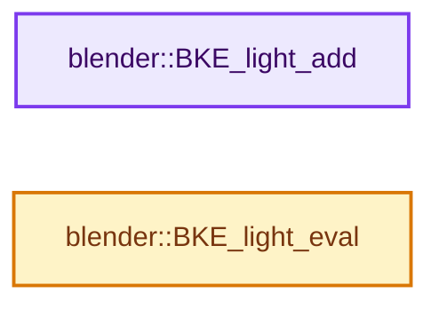
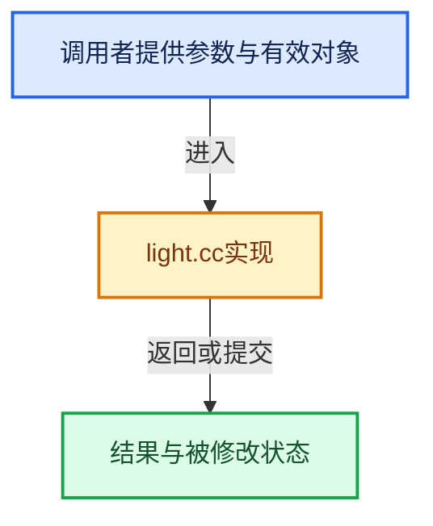

# 实现依赖专题：source/blender/blenkernel/intern/light.cc

[实现依赖导航](../../README.md) · [符号索引](../../../00-课程指南/02-源码与提交索引/符号依赖与实现索引.md)

本专题从正文实际调用进入，集中保存共享实现。函数有稳定锚点，可从调用处直接跳到对应完整函数；递归与互相调用通过回链组织。

## 本文件的实现关系






## 完整成员与函数实现

<a id="f-e9ca4d2ee9e83771"></a>

### `blender::BKE_light_add`

实现位置：[source/blender/blenkernel/intern/light.cc](../../../../../../../source/blender/blenkernel/intern/light.cc) · L202—L211。

接口参数：

- `Main *bmain`
- `const char *name`

**教学注释版**

<!-- annotated:7a8272c3b635a0 -->

```cpp
Light *BKE_light_add(Main *bmain, const char *name)
{
  Light *la;

  la = BKE_id_new<Light>(bmain, name);

  nodes::node_tree_shader_default(nullptr, bmain, &la->id);

  return la;
}
```

<details>
<summary>核对原始源码：source/blender/blenkernel/intern/light.cc · L202—L211</summary>

<!-- original:7a8272c3b635a0:source/blender/blenkernel/intern/light.cc:202:211 -->

```cpp
Light *BKE_light_add(Main *bmain, const char *name)
{
  Light *la;

  la = BKE_id_new<Light>(bmain, name);

  nodes::node_tree_shader_default(nullptr, bmain, &la->id);

  return la;
}
```

</details>

**沿实际写入检查状态**

- `la = BKE_id_new<Light>(bmain, name);`

**结果出口**

- `return la;`

**继续追踪实现**

- `BKE_id_new<Light>` → [blender::BKE_id_new · L1612](lib_id.cc.md#f-5335c97ce0a8fbc8)。
- `nodes::node_tree_shader_default` → [blender::nodes::node_tree_shader_default · L35](../../04-Nodes节点系统/intern/node_tree_defaults.cc.md#f-d8712912f3ff2dec)。

<a id="f-34f14fd97808d503"></a>

### `blender::BKE_light_eval`

实现位置：[source/blender/blenkernel/intern/light.cc](../../../../../../../source/blender/blenkernel/intern/light.cc) · L213—L216。

接口参数：

- `Depsgraph *depsgraph`
- `Light *la`

**教学注释版**

<!-- annotated:7a9a129dfb2f5a -->

```cpp
void BKE_light_eval(Depsgraph *depsgraph, Light *la)
{
  DEG_debug_print_eval(depsgraph, __func__, la->id.name, la);
}
```

<details>
<summary>核对原始源码：source/blender/blenkernel/intern/light.cc · L213—L216</summary>

<!-- original:7a9a129dfb2f5a:source/blender/blenkernel/intern/light.cc:213:216 -->

```cpp
void BKE_light_eval(Depsgraph *depsgraph, Light *la)
{
  DEG_debug_print_eval(depsgraph, __func__, la->id.name, la);
}
```

</details>

**继续追踪实现**

- `DEG_debug_print_eval` → [blender::DEG_debug_print_eval · L240](../../06-Depsgraph依赖图/intern/depsgraph_debug.cc.md#f-f2c4ea506dd14a2f)。
