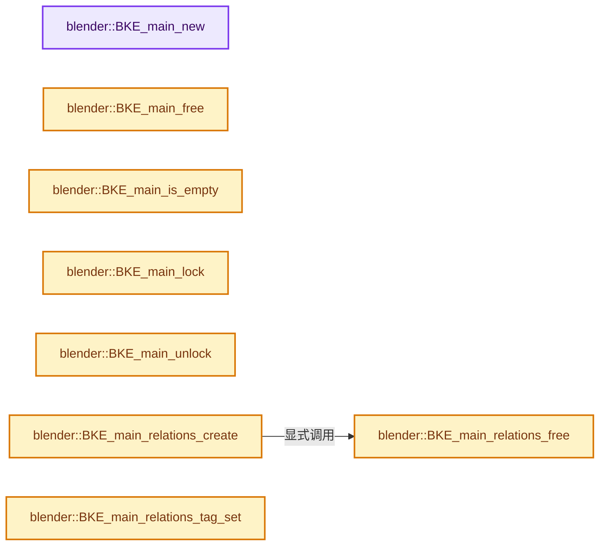
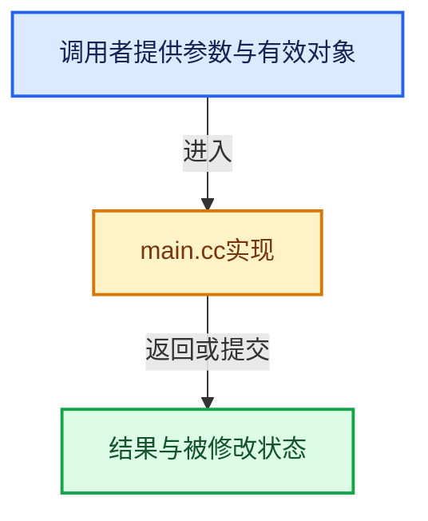

# 实现依赖专题：source/blender/blenkernel/intern/main.cc

[实现依赖导航](../../README.md) · [符号索引](../../../00-课程指南/02-源码与提交索引/符号依赖与实现索引.md)

本专题从正文实际调用进入，集中保存共享实现。函数有稳定锚点，可从调用处直接跳到对应完整函数；递归与互相调用通过回链组织。

## 本文件的实现关系






## 完整成员与函数实现

<a id="f-1498afa664771383"></a>

### `blender::BKE_main_new`

实现位置：[source/blender/blenkernel/intern/main.cc](../../../../../../../source/blender/blenkernel/intern/main.cc) · L93—L98。

**教学注释版**

<!-- annotated:ed0c1746a86534 -->

```cpp
Main *BKE_main_new()
{
  Main *bmain = MEM_new<Main>(__func__);
  IMB_colormanagement_working_space_init_default(bmain);
  return bmain;
}
```

<details>
<summary>核对原始源码：source/blender/blenkernel/intern/main.cc · L93—L98</summary>

<!-- original:ed0c1746a86534:source/blender/blenkernel/intern/main.cc:93:98 -->

```cpp
Main *BKE_main_new()
{
  Main *bmain = MEM_new<Main>(__func__);
  IMB_colormanagement_working_space_init_default(bmain);
  return bmain;
}
```

</details>

**结果出口**

- `return bmain;`

**继续追踪实现**

- `MEM_new<Main>` → [MEM_new · L351](../../07-Intern运行时与平台/guardedalloc/MEM_guardedalloc.h.md#f-115f9b6784f89912)。
- `IMB_colormanagement_working_space_init_default` → [blender::IMB_colormanagement_working_space_init_default · L3629](../../08-其他Blender模块/imbuf/intern/colormanagement.cc.md#f-0b7ba730811ddf10)。

<a id="f-1d1a39a52bc33bac"></a>

### `blender::BKE_main_free`

实现位置：[source/blender/blenkernel/intern/main.cc](../../../../../../../source/blender/blenkernel/intern/main.cc) · L202—L205。

接口参数：

- `Main *bmain`

**教学注释版**

<!-- annotated:874a2973c2d836 -->

```cpp
void BKE_main_free(Main *bmain)
{
  MEM_delete(bmain);
}
```

<details>
<summary>核对原始源码：source/blender/blenkernel/intern/main.cc · L202—L205</summary>

<!-- original:874a2973c2d836:source/blender/blenkernel/intern/main.cc:202:205 -->

```cpp
void BKE_main_free(Main *bmain)
{
  MEM_delete(bmain);
}
```

</details>

**继续追踪实现**

- `MEM_delete` → [MEM_delete · L400](../../07-Intern运行时与平台/guardedalloc/MEM_guardedalloc.h.md#f-9049ffdd1682887c)。

<a id="f-86a465b18d1d9277"></a>

### `blender::BKE_main_is_empty`

实现位置：[source/blender/blenkernel/intern/main.cc](../../../../../../../source/blender/blenkernel/intern/main.cc) · L637—L647。

接口参数：

- `Main *bmain`

**教学注释版**

<!-- annotated:9cb149d71c0eb2 -->

```cpp
bool BKE_main_is_empty(Main *bmain)
{
  bool result = true;
  ID *id_iter;
  FOREACH_MAIN_ID_BEGIN (bmain, id_iter) {
    result = false;
    break;
  }
  FOREACH_MAIN_ID_END;
  return result;
}
```

<details>
<summary>核对原始源码：source/blender/blenkernel/intern/main.cc · L637—L647</summary>

<!-- original:9cb149d71c0eb2:source/blender/blenkernel/intern/main.cc:637:647 -->

```cpp
bool BKE_main_is_empty(Main *bmain)
{
  bool result = true;
  ID *id_iter;
  FOREACH_MAIN_ID_BEGIN (bmain, id_iter) {
    result = false;
    break;
  }
  FOREACH_MAIN_ID_END;
  return result;
}
```

</details>

**沿实际写入检查状态**

- `result = false;`

**结果出口**

- `return result;`

**继续追踪实现**

本实现没有需要继续展开的显式调用；检查返回表达式、对象转换和调用者前置条件。

<a id="f-3f480bfb076dd87d"></a>

### `blender::BKE_main_lock`

实现位置：[source/blender/blenkernel/intern/main.cc](../../../../../../../source/blender/blenkernel/intern/main.cc) · L661—L664。

接口参数：

- `Main *bmain`

**教学注释版**

<!-- annotated:4bf192f3f705f3 -->

```cpp
void BKE_main_lock(Main *bmain)
{
  BLI_spin_lock(reinterpret_cast<SpinLock *>(bmain->lock));
}
```

<details>
<summary>核对原始源码：source/blender/blenkernel/intern/main.cc · L661—L664</summary>

<!-- original:4bf192f3f705f3:source/blender/blenkernel/intern/main.cc:661:664 -->

```cpp
void BKE_main_lock(Main *bmain)
{
  BLI_spin_lock(reinterpret_cast<SpinLock *>(bmain->lock));
}
```

</details>

**继续追踪实现**

- `BLI_spin_lock` → [调用协议](../../../00-课程指南/01-路线与规范/模板宏与动态分派协议.md)：函数指针、局部可调用对象或未展开的宏；必须结合调用者环境。调用位置L663。

<a id="f-abebed07b3cec04c"></a>

### `blender::BKE_main_unlock`

实现位置：[source/blender/blenkernel/intern/main.cc](../../../../../../../source/blender/blenkernel/intern/main.cc) · L666—L669。

接口参数：

- `Main *bmain`

**教学注释版**

<!-- annotated:36697e3871c95f -->

```cpp
void BKE_main_unlock(Main *bmain)
{
  BLI_spin_unlock(reinterpret_cast<SpinLock *>(bmain->lock));
}
```

<details>
<summary>核对原始源码：source/blender/blenkernel/intern/main.cc · L666—L669</summary>

<!-- original:36697e3871c95f:source/blender/blenkernel/intern/main.cc:666:669 -->

```cpp
void BKE_main_unlock(Main *bmain)
{
  BLI_spin_unlock(reinterpret_cast<SpinLock *>(bmain->lock));
}
```

</details>

**继续追踪实现**

- `BLI_spin_unlock` → [BLI_spin_unlock · L433](../../01-BLI基础库/intern/threads.cc.md#f-ded25214a4593256)。

<a id="f-a1ce0b885c713310"></a>

### `blender::BKE_main_relations_create`

实现位置：[source/blender/blenkernel/intern/main.cc](../../../../../../../source/blender/blenkernel/intern/main.cc) · L723—L758。

接口参数：

- `Main *bmain`
- `const short flag`

**教学注释版**

<!-- annotated:1d4ba0be50b81e -->

```cpp
void BKE_main_relations_create(Main *bmain, const short flag)
{
  if (bmain->relations != nullptr) {
    BKE_main_relations_free(bmain);
  }

  bmain->relations = MEM_new_uninitialized<MainIDRelations>(__func__);
  bmain->relations->relations_from_pointers = MEM_new<Map<const ID *, MainIDRelationsEntry *>>(
      __func__);
  bmain->relations->entry_items_pool = BLI_mempool_create(
      sizeof(MainIDRelationsEntryItem), 128, 128, BLI_MEMPOOL_NOP);

  bmain->relations->flag = flag;

  ID *id;
  FOREACH_MAIN_ID_BEGIN (bmain, id) {
    const LibraryForeachIDFlag idwalk_flag = IDWALK_READONLY |
                                             ((flag & MAINIDRELATIONS_INCLUDE_UI) != 0 ?
                                                  IDWALK_INCLUDE_UI :
                                                  IDWALK_NOP);

    /* Ensure all IDs do have an entry, even if they are not connected to any other. */
    MainIDRelationsEntry *entry = bmain->relations->relations_from_pointers->lookup_or_add_cb(
        id, [&]() {
          auto *entry = MEM_new_zeroed<MainIDRelationsEntry>("BKE_main_relations_create entry");
          entry->session_uid = id->session_uid;
          return entry;
        });
    BLI_assert(entry->session_uid == id->session_uid);
    UNUSED_VARS_NDEBUG(entry);

    BKE_library_foreach_ID_link(
        nullptr, id, main_relations_create_idlink_cb, bmain->relations, idwalk_flag);
  }
  FOREACH_MAIN_ID_END;
}
```

<details>
<summary>核对原始源码：source/blender/blenkernel/intern/main.cc · L723—L758</summary>

<!-- original:1d4ba0be50b81e:source/blender/blenkernel/intern/main.cc:723:758 -->

```cpp
void BKE_main_relations_create(Main *bmain, const short flag)
{
  if (bmain->relations != nullptr) {
    BKE_main_relations_free(bmain);
  }

  bmain->relations = MEM_new_uninitialized<MainIDRelations>(__func__);
  bmain->relations->relations_from_pointers = MEM_new<Map<const ID *, MainIDRelationsEntry *>>(
      __func__);
  bmain->relations->entry_items_pool = BLI_mempool_create(
      sizeof(MainIDRelationsEntryItem), 128, 128, BLI_MEMPOOL_NOP);

  bmain->relations->flag = flag;

  ID *id;
  FOREACH_MAIN_ID_BEGIN (bmain, id) {
    const LibraryForeachIDFlag idwalk_flag = IDWALK_READONLY |
                                             ((flag & MAINIDRELATIONS_INCLUDE_UI) != 0 ?
                                                  IDWALK_INCLUDE_UI :
                                                  IDWALK_NOP);

    /* Ensure all IDs do have an entry, even if they are not connected to any other. */
    MainIDRelationsEntry *entry = bmain->relations->relations_from_pointers->lookup_or_add_cb(
        id, [&]() {
          auto *entry = MEM_new_zeroed<MainIDRelationsEntry>("BKE_main_relations_create entry");
          entry->session_uid = id->session_uid;
          return entry;
        });
    BLI_assert(entry->session_uid == id->session_uid);
    UNUSED_VARS_NDEBUG(entry);

    BKE_library_foreach_ID_link(
        nullptr, id, main_relations_create_idlink_cb, bmain->relations, idwalk_flag);
  }
  FOREACH_MAIN_ID_END;
}
```

</details>

**沿实际写入检查状态**

- `bmain->relations = MEM_new_uninitialized<MainIDRelations>(__func__);`
- `bmain->relations->relations_from_pointers = MEM_new<Map<const ID *, MainIDRelationsEntry *>>(`
- `bmain->relations->entry_items_pool = BLI_mempool_create(`
- `bmain->relations->flag = flag;`
- `entry->session_uid = id->session_uid;`

**结果出口**

- `return entry;`

**继续追踪实现**

- `BKE_main_relations_free` → [blender::BKE_main_relations_free · L760](main.cc.md#f-093dc5572921a45c)。
- `MEM_new_uninitialized<MainIDRelations>` → [MEM_new_uninitialized · L590](../../07-Intern运行时与平台/guardedalloc/MEM_guardedalloc.h.md#f-c773b2e5b8fe70e4)；[MEM_new_uninitialized · L124](../../07-Intern运行时与平台/guardedalloc/intern/mallocn.cc.md#f-28a7e00a1e67f699)。同名重载需按实参类型选择。
- `MEM_new<Map<const ID *, MainIDRelationsEntry *>>` → [MEM_new · L351](../../07-Intern运行时与平台/guardedalloc/MEM_guardedalloc.h.md#f-115f9b6784f89912)。
- `BLI_mempool_create` → [blender::BLI_mempool_create · L320](../../01-BLI基础库/intern/BLI_mempool.cc.md#f-90a2c14d1b30f9cf)。
- `bmain->relations->relations_from_pointers->lookup_or_add_cb` → [调用协议](../../../00-课程指南/01-路线与规范/模板宏与动态分派协议.md)：接收对象类型依赖auto、返回值或模板实例；不按同名猜测目标。调用位置L745。
- `MEM_new_zeroed<MainIDRelationsEntry>` → [MEM_new_zeroed · L550](../../07-Intern运行时与平台/guardedalloc/MEM_guardedalloc.h.md#f-eeb1e2a7f57dd231)；[MEM_new_zeroed · L114](../../07-Intern运行时与平台/guardedalloc/intern/mallocn.cc.md#f-e04cf01c64c8b180)。同名重载需按实参类型选择。
- `BLI_assert` → [BLI_assert · L48](../../01-BLI基础库/BLI_assert.hh.md#m-57a88495704d)；[BLI_assert · L63](../../01-BLI基础库/BLI_assert.hh.md#m-d07050020cb5)。宏定义由构建条件选择。
- `UNUSED_VARS_NDEBUG` → [UNUSED_VARS_NDEBUG · L526](../../01-BLI基础库/BLI_utildefines.hh.md#m-fea439f7d366)；[UNUSED_VARS_NDEBUG · L528](../../01-BLI基础库/BLI_utildefines.hh.md#m-a8f8cfac06c0)。宏定义由构建条件选择。
- `BKE_library_foreach_ID_link` → [blender::BKE_library_foreach_ID_link · L449](lib_query.cc.md#f-a52fd9a0ee74a026)。

<a id="f-093dc5572921a45c"></a>

### `blender::BKE_main_relations_free`

实现位置：[source/blender/blenkernel/intern/main.cc](../../../../../../../source/blender/blenkernel/intern/main.cc) · L760—L771。

接口参数：

- `Main *bmain`

**教学注释版**

<!-- annotated:1443ee0217a8fa -->

```cpp
void BKE_main_relations_free(Main *bmain)
{
  if (bmain->relations != nullptr) {
    for (MainIDRelationsEntry *entry : bmain->relations->relations_from_pointers->values()) {
      MEM_delete(entry);
    }
    MEM_delete(bmain->relations->relations_from_pointers);
    BLI_mempool_destroy(bmain->relations->entry_items_pool);
    MEM_delete(bmain->relations);
    bmain->relations = nullptr;
  }
}
```

<details>
<summary>核对原始源码：source/blender/blenkernel/intern/main.cc · L760—L771</summary>

<!-- original:1443ee0217a8fa:source/blender/blenkernel/intern/main.cc:760:771 -->

```cpp
void BKE_main_relations_free(Main *bmain)
{
  if (bmain->relations != nullptr) {
    for (MainIDRelationsEntry *entry : bmain->relations->relations_from_pointers->values()) {
      MEM_delete(entry);
    }
    MEM_delete(bmain->relations->relations_from_pointers);
    BLI_mempool_destroy(bmain->relations->entry_items_pool);
    MEM_delete(bmain->relations);
    bmain->relations = nullptr;
  }
}
```

</details>

**沿实际写入检查状态**

- `bmain->relations = nullptr;`

**继续追踪实现**

- `bmain->relations->relations_from_pointers->values` → [调用协议](../../../00-课程指南/01-路线与规范/模板宏与动态分派协议.md)：接收对象类型依赖auto、返回值或模板实例；不按同名猜测目标。调用位置L763。
- `MEM_delete` → [MEM_delete · L400](../../07-Intern运行时与平台/guardedalloc/MEM_guardedalloc.h.md#f-9049ffdd1682887c)。
- `BLI_mempool_destroy` → [blender::BLI_mempool_destroy · L844](../../01-BLI基础库/intern/BLI_mempool.cc.md#f-6f09741326791f2d)。

<a id="f-a5c783575d16fd79"></a>

### `blender::BKE_main_relations_tag_set`

实现位置：[source/blender/blenkernel/intern/main.cc](../../../../../../../source/blender/blenkernel/intern/main.cc) · L773—L786。

接口参数：

- `Main *bmain`
- `const eMainIDRelationsEntryTags tag`
- `const bool value`

**教学注释版**

<!-- annotated:4b582ddd3c148a -->

```cpp
void BKE_main_relations_tag_set(Main *bmain, const eMainIDRelationsEntryTags tag, const bool value)
{
  if (bmain->relations == nullptr) {
    return;
  }
  for (MainIDRelationsEntry *entry : bmain->relations->relations_from_pointers->values()) {
    if (value) {
      entry->tags |= tag;
    }
    else {
      entry->tags &= ~tag;
    }
  }
}
```

<details>
<summary>核对原始源码：source/blender/blenkernel/intern/main.cc · L773—L786</summary>

<!-- original:4b582ddd3c148a:source/blender/blenkernel/intern/main.cc:773:786 -->

```cpp
void BKE_main_relations_tag_set(Main *bmain, const eMainIDRelationsEntryTags tag, const bool value)
{
  if (bmain->relations == nullptr) {
    return;
  }
  for (MainIDRelationsEntry *entry : bmain->relations->relations_from_pointers->values()) {
    if (value) {
      entry->tags |= tag;
    }
    else {
      entry->tags &= ~tag;
    }
  }
}
```

</details>

**沿实际写入检查状态**

- `entry->tags |= tag;`
- `entry->tags &= ~tag;`

**继续追踪实现**

- `bmain->relations->relations_from_pointers->values` → [调用协议](../../../00-课程指南/01-路线与规范/模板宏与动态分派协议.md)：接收对象类型依赖auto、返回值或模板实例；不按同名猜测目标。调用位置L778。

<a id="f-7ad4a018052e4fff"></a>

### `blender::BKE_main_set_create`

实现位置：[source/blender/blenkernel/intern/main.cc](../../../../../../../source/blender/blenkernel/intern/main.cc) · L788—L800。

接口参数：

- `Main *bmain`
- `Set<const ID *> *set`

**教学注释版**

<!-- annotated:3025f29d12053f -->

```cpp
Set<const ID *> *BKE_main_set_create(Main *bmain, Set<const ID *> *set)
{
  if (set == nullptr) {
    set = MEM_new<Set<const ID *>>(__func__);
  }

  ID *id;
  FOREACH_MAIN_ID_BEGIN (bmain, id) {
    // [讲解] set->add：按哈希与相等关系加入键或键值。
    set->add(id);
  }
  FOREACH_MAIN_ID_END;
  return set;
}
```

<details>
<summary>核对原始源码：source/blender/blenkernel/intern/main.cc · L788—L800</summary>

<!-- original:3025f29d12053f:source/blender/blenkernel/intern/main.cc:788:800 -->

```cpp
Set<const ID *> *BKE_main_set_create(Main *bmain, Set<const ID *> *set)
{
  if (set == nullptr) {
    set = MEM_new<Set<const ID *>>(__func__);
  }

  ID *id;
  FOREACH_MAIN_ID_BEGIN (bmain, id) {
    set->add(id);
  }
  FOREACH_MAIN_ID_END;
  return set;
}
```

</details>

**沿实际写入检查状态**

- `set = MEM_new<Set<const ID *>>(__func__);`

**结果出口**

- `return set;`

**继续追踪实现**

- `MEM_new<Set<const ID *>>` → [MEM_new · L351](../../07-Intern运行时与平台/guardedalloc/MEM_guardedalloc.h.md#f-115f9b6784f89912)。
- `set->add` → [blender::Set::add · L248](../../../02-哈希表与关联数据结构/08-Set与集合语义.md#f-c7498809c2327fba)；[blender::Set::add · L252](../../../02-哈希表与关联数据结构/08-Set与集合语义.md#f-e3ac8d1c52c03c2b)。同名重载需按实参类型选择。

<a id="f-ac51109c9da2a29b"></a>

### `blender::BKE_main_library_weak_reference_add`

实现位置：[source/blender/blenkernel/intern/main.cc](../../../../../../../source/blender/blenkernel/intern/main.cc) · L971—L981。

接口参数：

- `ID *local_id`
- `const char *library_filepath`
- `const char *library_id_name`

**教学注释版**

<!-- annotated:c239f9f17e7843 -->

```cpp
void BKE_main_library_weak_reference_add(ID *local_id,
                                         const char *library_filepath,
                                         const char *library_id_name)
{
  if (local_id->library_weak_reference == nullptr) {
    local_id->library_weak_reference = MEM_new<LibraryWeakReference>(__func__);
  }

  STRNCPY(local_id->library_weak_reference->library_filepath, library_filepath);
  STRNCPY(local_id->library_weak_reference->library_id_name, library_id_name);
}
```

<details>
<summary>核对原始源码：source/blender/blenkernel/intern/main.cc · L971—L981</summary>

<!-- original:c239f9f17e7843:source/blender/blenkernel/intern/main.cc:971:981 -->

```cpp
void BKE_main_library_weak_reference_add(ID *local_id,
                                         const char *library_filepath,
                                         const char *library_id_name)
{
  if (local_id->library_weak_reference == nullptr) {
    local_id->library_weak_reference = MEM_new<LibraryWeakReference>(__func__);
  }

  STRNCPY(local_id->library_weak_reference->library_filepath, library_filepath);
  STRNCPY(local_id->library_weak_reference->library_id_name, library_id_name);
}
```

</details>

**沿实际写入检查状态**

- `local_id->library_weak_reference = MEM_new<LibraryWeakReference>(__func__);`

**继续追踪实现**

- `MEM_new<LibraryWeakReference>` → [MEM_new · L351](../../07-Intern运行时与平台/guardedalloc/MEM_guardedalloc.h.md#f-115f9b6784f89912)。
- `STRNCPY` → [blender::STRNCPY · L690](../../01-BLI基础库/BLI_string.hh.md#f-6b2d861724026be6)。

<a id="f-2082d097c6c1e5c0"></a>

### `blender::BKE_main_thumbnail_to_imbuf`

实现位置：[source/blender/blenkernel/intern/main.cc](../../../../../../../source/blender/blenkernel/intern/main.cc) · L1029—L1046。

接口参数：

- `Main *bmain`
- `BlendThumbnail *data`

**教学注释版**

<!-- annotated:a8e0023247ebda -->

```cpp
ImBuf *BKE_main_thumbnail_to_imbuf(Main *bmain, BlendThumbnail *data)
{
  ImBuf *img = nullptr;

  if (!data && bmain) {
    data = bmain->blen_thumb;
  }

  if (data) {
    img = IMB_allocFromBuffer(reinterpret_cast<const uint8_t *>(data->rect),
                              nullptr,
                              uint(data->width),
                              uint(data->height),
                              4);
  }

  return img;
}
```

<details>
<summary>核对原始源码：source/blender/blenkernel/intern/main.cc · L1029—L1046</summary>

<!-- original:a8e0023247ebda:source/blender/blenkernel/intern/main.cc:1029:1046 -->

```cpp
ImBuf *BKE_main_thumbnail_to_imbuf(Main *bmain, BlendThumbnail *data)
{
  ImBuf *img = nullptr;

  if (!data && bmain) {
    data = bmain->blen_thumb;
  }

  if (data) {
    img = IMB_allocFromBuffer(reinterpret_cast<const uint8_t *>(data->rect),
                              nullptr,
                              uint(data->width),
                              uint(data->height),
                              4);
  }

  return img;
}
```

</details>

**沿实际写入检查状态**

- `data = bmain->blen_thumb;`
- `img = IMB_allocFromBuffer(reinterpret_cast<const uint8_t *>(data->rect),`

**结果出口**

- `return img;`

**继续追踪实现**

- `IMB_allocFromBuffer` → [blender::IMB_allocFromBuffer · L335](../../08-其他Blender模块/imbuf/intern/allocimbuf.cc.md#f-04add43a70a9c7d9)。

<a id="f-5ff28b998fa003d7"></a>

### `blender::BKE_main_blendfile_path`

实现位置：[source/blender/blenkernel/intern/main.cc](../../../../../../../source/blender/blenkernel/intern/main.cc) · L1058—L1061。

接口参数：

- `const Main *bmain`

**教学注释版**

<!-- annotated:ba23cacc973065 -->

```cpp
const char *BKE_main_blendfile_path(const Main *bmain)
{
  return bmain->filepath;
}
```

<details>
<summary>核对原始源码：source/blender/blenkernel/intern/main.cc · L1058—L1061</summary>

<!-- original:ba23cacc973065:source/blender/blenkernel/intern/main.cc:1058:1061 -->

```cpp
const char *BKE_main_blendfile_path(const Main *bmain)
{
  return bmain->filepath;
}
```

</details>

**结果出口**

- `return bmain->filepath;`

**继续追踪实现**

本实现没有需要继续展开的显式调用；检查返回表达式、对象转换和调用者前置条件。

<a id="f-06a1cf589f8e04a9"></a>

### `blender::BKE_main_blendfile_path_from_global`

实现位置：[source/blender/blenkernel/intern/main.cc](../../../../../../../source/blender/blenkernel/intern/main.cc) · L1063—L1066。

**教学注释版**

<!-- annotated:964992c0f27956 -->

```cpp
const char *BKE_main_blendfile_path_from_global()
{
  return BKE_main_blendfile_path(G_MAIN);
}
```

<details>
<summary>核对原始源码：source/blender/blenkernel/intern/main.cc · L1063—L1066</summary>

<!-- original:964992c0f27956:source/blender/blenkernel/intern/main.cc:1063:1066 -->

```cpp
const char *BKE_main_blendfile_path_from_global()
{
  return BKE_main_blendfile_path(G_MAIN);
}
```

</details>

**结果出口**

- `return BKE_main_blendfile_path(G_MAIN);`

**继续追踪实现**

- `BKE_main_blendfile_path` → [blender::BKE_main_blendfile_path · L1058](main.cc.md#f-5ff28b998fa003d7)。

<a id="f-87eb528420a3faf0"></a>

### `blender::which_libbase`

实现位置：[source/blender/blenkernel/intern/main.cc](../../../../../../../source/blender/blenkernel/intern/main.cc) · L1073—L1156。

接口参数：

- `Main *bmain`
- `short type`

**教学注释版**

<!-- annotated:b47933c135a83c -->

```cpp
ListBaseT<ID> *which_libbase(Main *bmain, short type)
{
  switch (ID_Type(type)) {
    case ID_SCE:
      return &(bmain->scenes.cast<ID>());
    case ID_LI:
      return &(bmain->libraries.cast<ID>());
    case ID_OB:
      return &(bmain->objects.cast<ID>());
    case ID_ME:
      return &(bmain->meshes.cast<ID>());
    case ID_CU_LEGACY:
      return &(bmain->curves.cast<ID>());
    case ID_MB:
      return &(bmain->metaballs.cast<ID>());
    case ID_MA:
      return &(bmain->materials.cast<ID>());
    case ID_TE:
      return &(bmain->textures.cast<ID>());
    case ID_IM:
      return &(bmain->images.cast<ID>());
    case ID_LT:
      return &(bmain->lattices.cast<ID>());
    case ID_LA:
      return &(bmain->lights.cast<ID>());
    case ID_CA:
      return &(bmain->cameras.cast<ID>());
    case ID_KE:
      return &(bmain->shapekeys.cast<ID>());
    case ID_WO:
      return &(bmain->worlds.cast<ID>());
    case ID_SCR:
      return &(bmain->screens.cast<ID>());
    case ID_VF:
      return &(bmain->fonts.cast<ID>());
    case ID_TXT:
      return &(bmain->texts.cast<ID>());
    case ID_SPK:
      return &(bmain->speakers.cast<ID>());
    case ID_LP:
      return &(bmain->lightprobes.cast<ID>());
    case ID_SO:
      return &(bmain->sounds.cast<ID>());
    case ID_GR:
      return &(bmain->collections.cast<ID>());
    case ID_AR:
      return &(bmain->armatures.cast<ID>());
    case ID_AC:
      return &(bmain->actions.cast<ID>());
    case ID_NT:
      return &(bmain->nodetrees.cast<ID>());
    case ID_BR:
      return &(bmain->brushes.cast<ID>());
    case ID_PA:
      return &(bmain->particles.cast<ID>());
    case ID_WM:
      return &(bmain->wm.cast<ID>());
    case ID_GD_LEGACY:
      return &(bmain->gpencils.cast<ID>());
    case ID_GP:
      return &(bmain->grease_pencils.cast<ID>());
    case ID_MC:
      return &(bmain->movieclips.cast<ID>());
    case ID_MSK:
      return &(bmain->masks.cast<ID>());
    case ID_LS:
      return &(bmain->linestyles.cast<ID>());
    case ID_PAL:
      return &(bmain->palettes.cast<ID>());
    case ID_PC:
      return &(bmain->paintcurves.cast<ID>());
    case ID_CF:
      return &(bmain->cachefiles.cast<ID>());
    case ID_WS:
      return &(bmain->workspaces.cast<ID>());
    case ID_CV:
      return &(bmain->hair_curves.cast<ID>());
    case ID_PT:
      return &(bmain->pointclouds.cast<ID>());
    case ID_VO:
      return &(bmain->volumes.cast<ID>());
  }
  return nullptr;
}
```

<details>
<summary>核对原始源码：source/blender/blenkernel/intern/main.cc · L1073—L1156</summary>

<!-- original:b47933c135a83c:source/blender/blenkernel/intern/main.cc:1073:1156 -->

```cpp
ListBaseT<ID> *which_libbase(Main *bmain, short type)
{
  switch (ID_Type(type)) {
    case ID_SCE:
      return &(bmain->scenes.cast<ID>());
    case ID_LI:
      return &(bmain->libraries.cast<ID>());
    case ID_OB:
      return &(bmain->objects.cast<ID>());
    case ID_ME:
      return &(bmain->meshes.cast<ID>());
    case ID_CU_LEGACY:
      return &(bmain->curves.cast<ID>());
    case ID_MB:
      return &(bmain->metaballs.cast<ID>());
    case ID_MA:
      return &(bmain->materials.cast<ID>());
    case ID_TE:
      return &(bmain->textures.cast<ID>());
    case ID_IM:
      return &(bmain->images.cast<ID>());
    case ID_LT:
      return &(bmain->lattices.cast<ID>());
    case ID_LA:
      return &(bmain->lights.cast<ID>());
    case ID_CA:
      return &(bmain->cameras.cast<ID>());
    case ID_KE:
      return &(bmain->shapekeys.cast<ID>());
    case ID_WO:
      return &(bmain->worlds.cast<ID>());
    case ID_SCR:
      return &(bmain->screens.cast<ID>());
    case ID_VF:
      return &(bmain->fonts.cast<ID>());
    case ID_TXT:
      return &(bmain->texts.cast<ID>());
    case ID_SPK:
      return &(bmain->speakers.cast<ID>());
    case ID_LP:
      return &(bmain->lightprobes.cast<ID>());
    case ID_SO:
      return &(bmain->sounds.cast<ID>());
    case ID_GR:
      return &(bmain->collections.cast<ID>());
    case ID_AR:
      return &(bmain->armatures.cast<ID>());
    case ID_AC:
      return &(bmain->actions.cast<ID>());
    case ID_NT:
      return &(bmain->nodetrees.cast<ID>());
    case ID_BR:
      return &(bmain->brushes.cast<ID>());
    case ID_PA:
      return &(bmain->particles.cast<ID>());
    case ID_WM:
      return &(bmain->wm.cast<ID>());
    case ID_GD_LEGACY:
      return &(bmain->gpencils.cast<ID>());
    case ID_GP:
      return &(bmain->grease_pencils.cast<ID>());
    case ID_MC:
      return &(bmain->movieclips.cast<ID>());
    case ID_MSK:
      return &(bmain->masks.cast<ID>());
    case ID_LS:
      return &(bmain->linestyles.cast<ID>());
    case ID_PAL:
      return &(bmain->palettes.cast<ID>());
    case ID_PC:
      return &(bmain->paintcurves.cast<ID>());
    case ID_CF:
      return &(bmain->cachefiles.cast<ID>());
    case ID_WS:
      return &(bmain->workspaces.cast<ID>());
    case ID_CV:
      return &(bmain->hair_curves.cast<ID>());
    case ID_PT:
      return &(bmain->pointclouds.cast<ID>());
    case ID_VO:
      return &(bmain->volumes.cast<ID>());
  }
  return nullptr;
}
```

</details>

**结果出口**

- `return &(bmain->scenes.cast<ID>());`
- `return &(bmain->libraries.cast<ID>());`
- `return &(bmain->objects.cast<ID>());`
- `return &(bmain->meshes.cast<ID>());`
- `return &(bmain->curves.cast<ID>());`
- `return &(bmain->metaballs.cast<ID>());`
- `return &(bmain->materials.cast<ID>());`
- `return &(bmain->textures.cast<ID>());`
- `return &(bmain->images.cast<ID>());`
- `return &(bmain->lattices.cast<ID>());`
- `return &(bmain->lights.cast<ID>());`
- `return &(bmain->cameras.cast<ID>());`
- `return &(bmain->shapekeys.cast<ID>());`
- `return &(bmain->worlds.cast<ID>());`
- `return &(bmain->screens.cast<ID>());`
- `return &(bmain->fonts.cast<ID>());`
- `return &(bmain->texts.cast<ID>());`
- `return &(bmain->speakers.cast<ID>());`
- `return &(bmain->lightprobes.cast<ID>());`
- `return &(bmain->sounds.cast<ID>());`
- `return &(bmain->collections.cast<ID>());`
- `return &(bmain->armatures.cast<ID>());`
- `return &(bmain->actions.cast<ID>());`
- `return &(bmain->nodetrees.cast<ID>());`
- `return &(bmain->brushes.cast<ID>());`
- `return &(bmain->particles.cast<ID>());`
- `return &(bmain->wm.cast<ID>());`
- `return &(bmain->gpencils.cast<ID>());`
- `return &(bmain->grease_pencils.cast<ID>());`
- `return &(bmain->movieclips.cast<ID>());`
- `return &(bmain->masks.cast<ID>());`
- `return &(bmain->linestyles.cast<ID>());`
- `return &(bmain->palettes.cast<ID>());`
- `return &(bmain->paintcurves.cast<ID>());`
- `return &(bmain->cachefiles.cast<ID>());`
- `return &(bmain->workspaces.cast<ID>());`
- `return &(bmain->hair_curves.cast<ID>());`
- `return &(bmain->pointclouds.cast<ID>());`
- `return &(bmain->volumes.cast<ID>());`
- `return nullptr;`

**继续追踪实现**

- `ID_Type` → [blender::ID_Type](../../08-其他Blender模块/windowmanager/WM_api.hh.md#t-a58f1911df5c)；[blender::ID_Type](../../08-其他Blender模块/makesdna/DNA_ID_enums.h.md#t-4fa202c1cee5)。
- `bmain->scenes.cast<ID>` → [调用协议](../../../00-课程指南/01-路线与规范/模板宏与动态分派协议.md)：接收对象类型依赖auto、返回值或模板实例；不按同名猜测目标。调用位置L1077。
- `bmain->libraries.cast<ID>` → [调用协议](../../../00-课程指南/01-路线与规范/模板宏与动态分派协议.md)：接收对象类型依赖auto、返回值或模板实例；不按同名猜测目标。调用位置L1079。
- `bmain->objects.cast<ID>` → [调用协议](../../../00-课程指南/01-路线与规范/模板宏与动态分派协议.md)：接收对象类型依赖auto、返回值或模板实例；不按同名猜测目标。调用位置L1081。
- `bmain->meshes.cast<ID>` → [调用协议](../../../00-课程指南/01-路线与规范/模板宏与动态分派协议.md)：接收对象类型依赖auto、返回值或模板实例；不按同名猜测目标。调用位置L1083。
- `bmain->curves.cast<ID>` → [调用协议](../../../00-课程指南/01-路线与规范/模板宏与动态分派协议.md)：接收对象类型依赖auto、返回值或模板实例；不按同名猜测目标。调用位置L1085。
- `bmain->metaballs.cast<ID>` → [调用协议](../../../00-课程指南/01-路线与规范/模板宏与动态分派协议.md)：接收对象类型依赖auto、返回值或模板实例；不按同名猜测目标。调用位置L1087。
- `bmain->materials.cast<ID>` → [调用协议](../../../00-课程指南/01-路线与规范/模板宏与动态分派协议.md)：接收对象类型依赖auto、返回值或模板实例；不按同名猜测目标。调用位置L1089。
- `bmain->textures.cast<ID>` → [调用协议](../../../00-课程指南/01-路线与规范/模板宏与动态分派协议.md)：接收对象类型依赖auto、返回值或模板实例；不按同名猜测目标。调用位置L1091。
- `bmain->images.cast<ID>` → [调用协议](../../../00-课程指南/01-路线与规范/模板宏与动态分派协议.md)：接收对象类型依赖auto、返回值或模板实例；不按同名猜测目标。调用位置L1093。
- `bmain->lattices.cast<ID>` → [调用协议](../../../00-课程指南/01-路线与规范/模板宏与动态分派协议.md)：接收对象类型依赖auto、返回值或模板实例；不按同名猜测目标。调用位置L1095。
- `bmain->lights.cast<ID>` → [调用协议](../../../00-课程指南/01-路线与规范/模板宏与动态分派协议.md)：接收对象类型依赖auto、返回值或模板实例；不按同名猜测目标。调用位置L1097。
- `bmain->cameras.cast<ID>` → [调用协议](../../../00-课程指南/01-路线与规范/模板宏与动态分派协议.md)：接收对象类型依赖auto、返回值或模板实例；不按同名猜测目标。调用位置L1099。
- `bmain->shapekeys.cast<ID>` → [调用协议](../../../00-课程指南/01-路线与规范/模板宏与动态分派协议.md)：接收对象类型依赖auto、返回值或模板实例；不按同名猜测目标。调用位置L1101。
- `bmain->worlds.cast<ID>` → [调用协议](../../../00-课程指南/01-路线与规范/模板宏与动态分派协议.md)：接收对象类型依赖auto、返回值或模板实例；不按同名猜测目标。调用位置L1103。
- `bmain->screens.cast<ID>` → [调用协议](../../../00-课程指南/01-路线与规范/模板宏与动态分派协议.md)：接收对象类型依赖auto、返回值或模板实例；不按同名猜测目标。调用位置L1105。
- `bmain->fonts.cast<ID>` → [调用协议](../../../00-课程指南/01-路线与规范/模板宏与动态分派协议.md)：接收对象类型依赖auto、返回值或模板实例；不按同名猜测目标。调用位置L1107。
- `bmain->texts.cast<ID>` → [调用协议](../../../00-课程指南/01-路线与规范/模板宏与动态分派协议.md)：接收对象类型依赖auto、返回值或模板实例；不按同名猜测目标。调用位置L1109。
- `bmain->speakers.cast<ID>` → [调用协议](../../../00-课程指南/01-路线与规范/模板宏与动态分派协议.md)：接收对象类型依赖auto、返回值或模板实例；不按同名猜测目标。调用位置L1111。
- `bmain->lightprobes.cast<ID>` → [调用协议](../../../00-课程指南/01-路线与规范/模板宏与动态分派协议.md)：接收对象类型依赖auto、返回值或模板实例；不按同名猜测目标。调用位置L1113。
- `bmain->sounds.cast<ID>` → [调用协议](../../../00-课程指南/01-路线与规范/模板宏与动态分派协议.md)：接收对象类型依赖auto、返回值或模板实例；不按同名猜测目标。调用位置L1115。
- `bmain->collections.cast<ID>` → [调用协议](../../../00-课程指南/01-路线与规范/模板宏与动态分派协议.md)：接收对象类型依赖auto、返回值或模板实例；不按同名猜测目标。调用位置L1117。
- `bmain->armatures.cast<ID>` → [调用协议](../../../00-课程指南/01-路线与规范/模板宏与动态分派协议.md)：接收对象类型依赖auto、返回值或模板实例；不按同名猜测目标。调用位置L1119。
- `bmain->actions.cast<ID>` → [调用协议](../../../00-课程指南/01-路线与规范/模板宏与动态分派协议.md)：接收对象类型依赖auto、返回值或模板实例；不按同名猜测目标。调用位置L1121。
- `bmain->nodetrees.cast<ID>` → [调用协议](../../../00-课程指南/01-路线与规范/模板宏与动态分派协议.md)：接收对象类型依赖auto、返回值或模板实例；不按同名猜测目标。调用位置L1123。
- `bmain->brushes.cast<ID>` → [调用协议](../../../00-课程指南/01-路线与规范/模板宏与动态分派协议.md)：接收对象类型依赖auto、返回值或模板实例；不按同名猜测目标。调用位置L1125。
- `bmain->particles.cast<ID>` → [调用协议](../../../00-课程指南/01-路线与规范/模板宏与动态分派协议.md)：接收对象类型依赖auto、返回值或模板实例；不按同名猜测目标。调用位置L1127。
- `bmain->wm.cast<ID>` → [调用协议](../../../00-课程指南/01-路线与规范/模板宏与动态分派协议.md)：接收对象类型依赖auto、返回值或模板实例；不按同名猜测目标。调用位置L1129。
- `bmain->gpencils.cast<ID>` → [调用协议](../../../00-课程指南/01-路线与规范/模板宏与动态分派协议.md)：接收对象类型依赖auto、返回值或模板实例；不按同名猜测目标。调用位置L1131。
- `bmain->grease_pencils.cast<ID>` → [调用协议](../../../00-课程指南/01-路线与规范/模板宏与动态分派协议.md)：接收对象类型依赖auto、返回值或模板实例；不按同名猜测目标。调用位置L1133。
- `bmain->movieclips.cast<ID>` → [调用协议](../../../00-课程指南/01-路线与规范/模板宏与动态分派协议.md)：接收对象类型依赖auto、返回值或模板实例；不按同名猜测目标。调用位置L1135。
- `bmain->masks.cast<ID>` → [调用协议](../../../00-课程指南/01-路线与规范/模板宏与动态分派协议.md)：接收对象类型依赖auto、返回值或模板实例；不按同名猜测目标。调用位置L1137。
- `bmain->linestyles.cast<ID>` → [调用协议](../../../00-课程指南/01-路线与规范/模板宏与动态分派协议.md)：接收对象类型依赖auto、返回值或模板实例；不按同名猜测目标。调用位置L1139。
- `bmain->palettes.cast<ID>` → [调用协议](../../../00-课程指南/01-路线与规范/模板宏与动态分派协议.md)：接收对象类型依赖auto、返回值或模板实例；不按同名猜测目标。调用位置L1141。
- `bmain->paintcurves.cast<ID>` → [调用协议](../../../00-课程指南/01-路线与规范/模板宏与动态分派协议.md)：接收对象类型依赖auto、返回值或模板实例；不按同名猜测目标。调用位置L1143。
- `bmain->cachefiles.cast<ID>` → [调用协议](../../../00-课程指南/01-路线与规范/模板宏与动态分派协议.md)：接收对象类型依赖auto、返回值或模板实例；不按同名猜测目标。调用位置L1145。
- `bmain->workspaces.cast<ID>` → [调用协议](../../../00-课程指南/01-路线与规范/模板宏与动态分派协议.md)：接收对象类型依赖auto、返回值或模板实例；不按同名猜测目标。调用位置L1147。
- `bmain->hair_curves.cast<ID>` → [调用协议](../../../00-课程指南/01-路线与规范/模板宏与动态分派协议.md)：接收对象类型依赖auto、返回值或模板实例；不按同名猜测目标。调用位置L1149。
- `bmain->pointclouds.cast<ID>` → [调用协议](../../../00-课程指南/01-路线与规范/模板宏与动态分派协议.md)：接收对象类型依赖auto、返回值或模板实例；不按同名猜测目标。调用位置L1151。
- `bmain->volumes.cast<ID>` → [调用协议](../../../00-课程指南/01-路线与规范/模板宏与动态分派协议.md)：接收对象类型依赖auto、返回值或模板实例；不按同名猜测目标。调用位置L1153。

<a id="f-908cb8449aa99c35"></a>

### `blender::BKE_main_lists_get`

实现位置：[source/blender/blenkernel/intern/main.cc](../../../../../../../source/blender/blenkernel/intern/main.cc) · L1158—L1222。

接口参数：

- `Main &bmain`

**教学注释版**

<!-- annotated:e3d2f7b3231a56 -->

```cpp
MainListsArray BKE_main_lists_get(Main &bmain)
{
  MainListsArray lb{};
  /* Libraries may be accessed from pretty much any other ID. */
  lb[INDEX_ID_LI] = &(bmain.libraries.cast<ID>());

  /* Moved here to avoid problems when freeing with animato (aligorith). */
  lb[INDEX_ID_AC] = &(bmain.actions.cast<ID>());

  lb[INDEX_ID_KE] = &(bmain.shapekeys.cast<ID>());

  /* Referenced by gpencil, so needs to be before that to avoid crashes. */
  lb[INDEX_ID_PAL] = &(bmain.palettes.cast<ID>());

  /* Referenced by nodes, objects, view, scene etc, before to free after. */
  lb[INDEX_ID_GD_LEGACY] = &(bmain.gpencils.cast<ID>());
  lb[INDEX_ID_GP] = &(bmain.grease_pencils.cast<ID>());

  lb[INDEX_ID_NT] = &(bmain.nodetrees.cast<ID>());
  lb[INDEX_ID_IM] = &(bmain.images.cast<ID>());
  lb[INDEX_ID_TE] = &(bmain.textures.cast<ID>());
  lb[INDEX_ID_MA] = &(bmain.materials.cast<ID>());
  lb[INDEX_ID_VF] = &(bmain.fonts.cast<ID>());

  /* Important!: When adding a new object type,
   * the specific data should be inserted here. */

  lb[INDEX_ID_AR] = &(bmain.armatures.cast<ID>());

  lb[INDEX_ID_CF] = &(bmain.cachefiles.cast<ID>());
  lb[INDEX_ID_ME] = &(bmain.meshes.cast<ID>());
  lb[INDEX_ID_CU_LEGACY] = &(bmain.curves.cast<ID>());
  lb[INDEX_ID_MB] = &(bmain.metaballs.cast<ID>());
  lb[INDEX_ID_CV] = &(bmain.hair_curves.cast<ID>());
  lb[INDEX_ID_PT] = &(bmain.pointclouds.cast<ID>());
  lb[INDEX_ID_VO] = &(bmain.volumes.cast<ID>());

  lb[INDEX_ID_LT] = &(bmain.lattices.cast<ID>());
  lb[INDEX_ID_LA] = &(bmain.lights.cast<ID>());
  lb[INDEX_ID_CA] = &(bmain.cameras.cast<ID>());

  lb[INDEX_ID_TXT] = &(bmain.texts.cast<ID>());
  lb[INDEX_ID_SO] = &(bmain.sounds.cast<ID>());
  lb[INDEX_ID_GR] = &(bmain.collections.cast<ID>());
  lb[INDEX_ID_PAL] = &(bmain.palettes.cast<ID>());
  lb[INDEX_ID_PC] = &(bmain.paintcurves.cast<ID>());
  lb[INDEX_ID_BR] = &(bmain.brushes.cast<ID>());
  lb[INDEX_ID_PA] = &(bmain.particles.cast<ID>());
  lb[INDEX_ID_SPK] = &(bmain.speakers.cast<ID>());
  lb[INDEX_ID_LP] = &(bmain.lightprobes.cast<ID>());

  lb[INDEX_ID_WO] = &(bmain.worlds.cast<ID>());
  lb[INDEX_ID_MC] = &(bmain.movieclips.cast<ID>());
  lb[INDEX_ID_SCR] = &(bmain.screens.cast<ID>());
  lb[INDEX_ID_OB] = &(bmain.objects.cast<ID>());
  /* referenced by scenes */
  lb[INDEX_ID_LS] = &(bmain.linestyles.cast<ID>());
  lb[INDEX_ID_SCE] = &(bmain.scenes.cast<ID>());
  /* before wm, so it's freed after it! */
  lb[INDEX_ID_WS] = &(bmain.workspaces.cast<ID>());
  lb[INDEX_ID_WM] = &(bmain.wm.cast<ID>());
  lb[INDEX_ID_MSK] = &(bmain.masks.cast<ID>());

  return lb;
}
```

<details>
<summary>核对原始源码：source/blender/blenkernel/intern/main.cc · L1158—L1222</summary>

<!-- original:e3d2f7b3231a56:source/blender/blenkernel/intern/main.cc:1158:1222 -->

```cpp
MainListsArray BKE_main_lists_get(Main &bmain)
{
  MainListsArray lb{};
  /* Libraries may be accessed from pretty much any other ID. */
  lb[INDEX_ID_LI] = &(bmain.libraries.cast<ID>());

  /* Moved here to avoid problems when freeing with animato (aligorith). */
  lb[INDEX_ID_AC] = &(bmain.actions.cast<ID>());

  lb[INDEX_ID_KE] = &(bmain.shapekeys.cast<ID>());

  /* Referenced by gpencil, so needs to be before that to avoid crashes. */
  lb[INDEX_ID_PAL] = &(bmain.palettes.cast<ID>());

  /* Referenced by nodes, objects, view, scene etc, before to free after. */
  lb[INDEX_ID_GD_LEGACY] = &(bmain.gpencils.cast<ID>());
  lb[INDEX_ID_GP] = &(bmain.grease_pencils.cast<ID>());

  lb[INDEX_ID_NT] = &(bmain.nodetrees.cast<ID>());
  lb[INDEX_ID_IM] = &(bmain.images.cast<ID>());
  lb[INDEX_ID_TE] = &(bmain.textures.cast<ID>());
  lb[INDEX_ID_MA] = &(bmain.materials.cast<ID>());
  lb[INDEX_ID_VF] = &(bmain.fonts.cast<ID>());

  /* Important!: When adding a new object type,
   * the specific data should be inserted here. */

  lb[INDEX_ID_AR] = &(bmain.armatures.cast<ID>());

  lb[INDEX_ID_CF] = &(bmain.cachefiles.cast<ID>());
  lb[INDEX_ID_ME] = &(bmain.meshes.cast<ID>());
  lb[INDEX_ID_CU_LEGACY] = &(bmain.curves.cast<ID>());
  lb[INDEX_ID_MB] = &(bmain.metaballs.cast<ID>());
  lb[INDEX_ID_CV] = &(bmain.hair_curves.cast<ID>());
  lb[INDEX_ID_PT] = &(bmain.pointclouds.cast<ID>());
  lb[INDEX_ID_VO] = &(bmain.volumes.cast<ID>());

  lb[INDEX_ID_LT] = &(bmain.lattices.cast<ID>());
  lb[INDEX_ID_LA] = &(bmain.lights.cast<ID>());
  lb[INDEX_ID_CA] = &(bmain.cameras.cast<ID>());

  lb[INDEX_ID_TXT] = &(bmain.texts.cast<ID>());
  lb[INDEX_ID_SO] = &(bmain.sounds.cast<ID>());
  lb[INDEX_ID_GR] = &(bmain.collections.cast<ID>());
  lb[INDEX_ID_PAL] = &(bmain.palettes.cast<ID>());
  lb[INDEX_ID_PC] = &(bmain.paintcurves.cast<ID>());
  lb[INDEX_ID_BR] = &(bmain.brushes.cast<ID>());
  lb[INDEX_ID_PA] = &(bmain.particles.cast<ID>());
  lb[INDEX_ID_SPK] = &(bmain.speakers.cast<ID>());
  lb[INDEX_ID_LP] = &(bmain.lightprobes.cast<ID>());

  lb[INDEX_ID_WO] = &(bmain.worlds.cast<ID>());
  lb[INDEX_ID_MC] = &(bmain.movieclips.cast<ID>());
  lb[INDEX_ID_SCR] = &(bmain.screens.cast<ID>());
  lb[INDEX_ID_OB] = &(bmain.objects.cast<ID>());
  /* referenced by scenes */
  lb[INDEX_ID_LS] = &(bmain.linestyles.cast<ID>());
  lb[INDEX_ID_SCE] = &(bmain.scenes.cast<ID>());
  /* before wm, so it's freed after it! */
  lb[INDEX_ID_WS] = &(bmain.workspaces.cast<ID>());
  lb[INDEX_ID_WM] = &(bmain.wm.cast<ID>());
  lb[INDEX_ID_MSK] = &(bmain.masks.cast<ID>());

  return lb;
}
```

</details>

**沿实际写入检查状态**

- `lb[INDEX_ID_LI] = &(bmain.libraries.cast<ID>());`
- `lb[INDEX_ID_AC] = &(bmain.actions.cast<ID>());`
- `lb[INDEX_ID_KE] = &(bmain.shapekeys.cast<ID>());`
- `lb[INDEX_ID_PAL] = &(bmain.palettes.cast<ID>());`
- `lb[INDEX_ID_GD_LEGACY] = &(bmain.gpencils.cast<ID>());`
- `lb[INDEX_ID_GP] = &(bmain.grease_pencils.cast<ID>());`
- `lb[INDEX_ID_NT] = &(bmain.nodetrees.cast<ID>());`
- `lb[INDEX_ID_IM] = &(bmain.images.cast<ID>());`
- `lb[INDEX_ID_TE] = &(bmain.textures.cast<ID>());`
- `lb[INDEX_ID_MA] = &(bmain.materials.cast<ID>());`
- `lb[INDEX_ID_VF] = &(bmain.fonts.cast<ID>());`
- `lb[INDEX_ID_AR] = &(bmain.armatures.cast<ID>());`
- `lb[INDEX_ID_CF] = &(bmain.cachefiles.cast<ID>());`
- `lb[INDEX_ID_ME] = &(bmain.meshes.cast<ID>());`
- `lb[INDEX_ID_CU_LEGACY] = &(bmain.curves.cast<ID>());`
- `lb[INDEX_ID_MB] = &(bmain.metaballs.cast<ID>());`
- `lb[INDEX_ID_CV] = &(bmain.hair_curves.cast<ID>());`
- `lb[INDEX_ID_PT] = &(bmain.pointclouds.cast<ID>());`
- `lb[INDEX_ID_VO] = &(bmain.volumes.cast<ID>());`
- `lb[INDEX_ID_LT] = &(bmain.lattices.cast<ID>());`
- `lb[INDEX_ID_LA] = &(bmain.lights.cast<ID>());`
- `lb[INDEX_ID_CA] = &(bmain.cameras.cast<ID>());`
- `lb[INDEX_ID_TXT] = &(bmain.texts.cast<ID>());`
- `lb[INDEX_ID_SO] = &(bmain.sounds.cast<ID>());`
- `lb[INDEX_ID_GR] = &(bmain.collections.cast<ID>());`
- `lb[INDEX_ID_PC] = &(bmain.paintcurves.cast<ID>());`
- `lb[INDEX_ID_BR] = &(bmain.brushes.cast<ID>());`
- `lb[INDEX_ID_PA] = &(bmain.particles.cast<ID>());`
- `lb[INDEX_ID_SPK] = &(bmain.speakers.cast<ID>());`
- `lb[INDEX_ID_LP] = &(bmain.lightprobes.cast<ID>());`
- `lb[INDEX_ID_WO] = &(bmain.worlds.cast<ID>());`
- `lb[INDEX_ID_MC] = &(bmain.movieclips.cast<ID>());`
- `lb[INDEX_ID_SCR] = &(bmain.screens.cast<ID>());`
- `lb[INDEX_ID_OB] = &(bmain.objects.cast<ID>());`
- `lb[INDEX_ID_LS] = &(bmain.linestyles.cast<ID>());`
- `lb[INDEX_ID_SCE] = &(bmain.scenes.cast<ID>());`
- `lb[INDEX_ID_WS] = &(bmain.workspaces.cast<ID>());`
- `lb[INDEX_ID_WM] = &(bmain.wm.cast<ID>());`
- `lb[INDEX_ID_MSK] = &(bmain.masks.cast<ID>());`

**结果出口**

- `return lb;`

**继续追踪实现**

- `bmain.libraries.cast<ID>` → [调用协议](../../../00-课程指南/01-路线与规范/模板宏与动态分派协议.md)：接收对象类型依赖auto、返回值或模板实例；不按同名猜测目标。调用位置L1162。
- `bmain.actions.cast<ID>` → [调用协议](../../../00-课程指南/01-路线与规范/模板宏与动态分派协议.md)：接收对象类型依赖auto、返回值或模板实例；不按同名猜测目标。调用位置L1165。
- `bmain.shapekeys.cast<ID>` → [调用协议](../../../00-课程指南/01-路线与规范/模板宏与动态分派协议.md)：接收对象类型依赖auto、返回值或模板实例；不按同名猜测目标。调用位置L1167。
- `bmain.palettes.cast<ID>` → [调用协议](../../../00-课程指南/01-路线与规范/模板宏与动态分派协议.md)：接收对象类型依赖auto、返回值或模板实例；不按同名猜测目标。调用位置L1170。
- `bmain.gpencils.cast<ID>` → [调用协议](../../../00-课程指南/01-路线与规范/模板宏与动态分派协议.md)：接收对象类型依赖auto、返回值或模板实例；不按同名猜测目标。调用位置L1173。
- `bmain.grease_pencils.cast<ID>` → [调用协议](../../../00-课程指南/01-路线与规范/模板宏与动态分派协议.md)：接收对象类型依赖auto、返回值或模板实例；不按同名猜测目标。调用位置L1174。
- `bmain.nodetrees.cast<ID>` → [调用协议](../../../00-课程指南/01-路线与规范/模板宏与动态分派协议.md)：接收对象类型依赖auto、返回值或模板实例；不按同名猜测目标。调用位置L1176。
- `bmain.images.cast<ID>` → [调用协议](../../../00-课程指南/01-路线与规范/模板宏与动态分派协议.md)：接收对象类型依赖auto、返回值或模板实例；不按同名猜测目标。调用位置L1177。
- `bmain.textures.cast<ID>` → [调用协议](../../../00-课程指南/01-路线与规范/模板宏与动态分派协议.md)：接收对象类型依赖auto、返回值或模板实例；不按同名猜测目标。调用位置L1178。
- `bmain.materials.cast<ID>` → [调用协议](../../../00-课程指南/01-路线与规范/模板宏与动态分派协议.md)：接收对象类型依赖auto、返回值或模板实例；不按同名猜测目标。调用位置L1179。
- `bmain.fonts.cast<ID>` → [调用协议](../../../00-课程指南/01-路线与规范/模板宏与动态分派协议.md)：接收对象类型依赖auto、返回值或模板实例；不按同名猜测目标。调用位置L1180。
- `bmain.armatures.cast<ID>` → [调用协议](../../../00-课程指南/01-路线与规范/模板宏与动态分派协议.md)：接收对象类型依赖auto、返回值或模板实例；不按同名猜测目标。调用位置L1185。
- `bmain.cachefiles.cast<ID>` → [调用协议](../../../00-课程指南/01-路线与规范/模板宏与动态分派协议.md)：接收对象类型依赖auto、返回值或模板实例；不按同名猜测目标。调用位置L1187。
- `bmain.meshes.cast<ID>` → [调用协议](../../../00-课程指南/01-路线与规范/模板宏与动态分派协议.md)：接收对象类型依赖auto、返回值或模板实例；不按同名猜测目标。调用位置L1188。
- `bmain.curves.cast<ID>` → [调用协议](../../../00-课程指南/01-路线与规范/模板宏与动态分派协议.md)：接收对象类型依赖auto、返回值或模板实例；不按同名猜测目标。调用位置L1189。
- `bmain.metaballs.cast<ID>` → [调用协议](../../../00-课程指南/01-路线与规范/模板宏与动态分派协议.md)：接收对象类型依赖auto、返回值或模板实例；不按同名猜测目标。调用位置L1190。
- `bmain.hair_curves.cast<ID>` → [调用协议](../../../00-课程指南/01-路线与规范/模板宏与动态分派协议.md)：接收对象类型依赖auto、返回值或模板实例；不按同名猜测目标。调用位置L1191。
- `bmain.pointclouds.cast<ID>` → [调用协议](../../../00-课程指南/01-路线与规范/模板宏与动态分派协议.md)：接收对象类型依赖auto、返回值或模板实例；不按同名猜测目标。调用位置L1192。
- `bmain.volumes.cast<ID>` → [调用协议](../../../00-课程指南/01-路线与规范/模板宏与动态分派协议.md)：接收对象类型依赖auto、返回值或模板实例；不按同名猜测目标。调用位置L1193。
- `bmain.lattices.cast<ID>` → [调用协议](../../../00-课程指南/01-路线与规范/模板宏与动态分派协议.md)：接收对象类型依赖auto、返回值或模板实例；不按同名猜测目标。调用位置L1195。
- `bmain.lights.cast<ID>` → [调用协议](../../../00-课程指南/01-路线与规范/模板宏与动态分派协议.md)：接收对象类型依赖auto、返回值或模板实例；不按同名猜测目标。调用位置L1196。
- `bmain.cameras.cast<ID>` → [调用协议](../../../00-课程指南/01-路线与规范/模板宏与动态分派协议.md)：接收对象类型依赖auto、返回值或模板实例；不按同名猜测目标。调用位置L1197。
- `bmain.texts.cast<ID>` → [调用协议](../../../00-课程指南/01-路线与规范/模板宏与动态分派协议.md)：接收对象类型依赖auto、返回值或模板实例；不按同名猜测目标。调用位置L1199。
- `bmain.sounds.cast<ID>` → [调用协议](../../../00-课程指南/01-路线与规范/模板宏与动态分派协议.md)：接收对象类型依赖auto、返回值或模板实例；不按同名猜测目标。调用位置L1200。
- `bmain.collections.cast<ID>` → [调用协议](../../../00-课程指南/01-路线与规范/模板宏与动态分派协议.md)：接收对象类型依赖auto、返回值或模板实例；不按同名猜测目标。调用位置L1201。
- `bmain.paintcurves.cast<ID>` → [调用协议](../../../00-课程指南/01-路线与规范/模板宏与动态分派协议.md)：接收对象类型依赖auto、返回值或模板实例；不按同名猜测目标。调用位置L1203。
- `bmain.brushes.cast<ID>` → [调用协议](../../../00-课程指南/01-路线与规范/模板宏与动态分派协议.md)：接收对象类型依赖auto、返回值或模板实例；不按同名猜测目标。调用位置L1204。
- `bmain.particles.cast<ID>` → [调用协议](../../../00-课程指南/01-路线与规范/模板宏与动态分派协议.md)：接收对象类型依赖auto、返回值或模板实例；不按同名猜测目标。调用位置L1205。
- `bmain.speakers.cast<ID>` → [调用协议](../../../00-课程指南/01-路线与规范/模板宏与动态分派协议.md)：接收对象类型依赖auto、返回值或模板实例；不按同名猜测目标。调用位置L1206。
- `bmain.lightprobes.cast<ID>` → [调用协议](../../../00-课程指南/01-路线与规范/模板宏与动态分派协议.md)：接收对象类型依赖auto、返回值或模板实例；不按同名猜测目标。调用位置L1207。
- `bmain.worlds.cast<ID>` → [调用协议](../../../00-课程指南/01-路线与规范/模板宏与动态分派协议.md)：接收对象类型依赖auto、返回值或模板实例；不按同名猜测目标。调用位置L1209。
- `bmain.movieclips.cast<ID>` → [调用协议](../../../00-课程指南/01-路线与规范/模板宏与动态分派协议.md)：接收对象类型依赖auto、返回值或模板实例；不按同名猜测目标。调用位置L1210。
- `bmain.screens.cast<ID>` → [调用协议](../../../00-课程指南/01-路线与规范/模板宏与动态分派协议.md)：接收对象类型依赖auto、返回值或模板实例；不按同名猜测目标。调用位置L1211。
- `bmain.objects.cast<ID>` → [调用协议](../../../00-课程指南/01-路线与规范/模板宏与动态分派协议.md)：接收对象类型依赖auto、返回值或模板实例；不按同名猜测目标。调用位置L1212。
- `bmain.linestyles.cast<ID>` → [调用协议](../../../00-课程指南/01-路线与规范/模板宏与动态分派协议.md)：接收对象类型依赖auto、返回值或模板实例；不按同名猜测目标。调用位置L1214。
- `bmain.scenes.cast<ID>` → [调用协议](../../../00-课程指南/01-路线与规范/模板宏与动态分派协议.md)：接收对象类型依赖auto、返回值或模板实例；不按同名猜测目标。调用位置L1215。
- `bmain.workspaces.cast<ID>` → [调用协议](../../../00-课程指南/01-路线与规范/模板宏与动态分派协议.md)：接收对象类型依赖auto、返回值或模板实例；不按同名猜测目标。调用位置L1217。
- `bmain.wm.cast<ID>` → [调用协议](../../../00-课程指南/01-路线与规范/模板宏与动态分派协议.md)：接收对象类型依赖auto、返回值或模板实例；不按同名猜测目标。调用位置L1218。
- `bmain.masks.cast<ID>` → [调用协议](../../../00-课程指南/01-路线与规范/模板宏与动态分派协议.md)：接收对象类型依赖auto、返回值或模板实例；不按同名猜测目标。调用位置L1219。

<a id="f-520d1311c646452f"></a>

### `blender::MainAllIDsIterator::size`

实现位置：[source/blender/blenkernel/intern/main.cc](../../../../../../../source/blender/blenkernel/intern/main.cc) · L1291—L1303。

**教学注释版**

<!-- annotated:f691d75c4cdd2b -->

```cpp
int64_t MainAllIDsIterator::size() const
{
  int64_t size = 0;
  for (const ListBaseT<ID> *lb_ids : lbarray_) {
    /* Listbase pointers from lbarray_ can be nullptr when no data was provided (default
     * constructor case). */
    if (!lb_ids) {
      continue;
    }
    size += lb_ids->count();
  }
  return size;
}
```

<details>
<summary>核对原始源码：source/blender/blenkernel/intern/main.cc · L1291—L1303</summary>

<!-- original:f691d75c4cdd2b:source/blender/blenkernel/intern/main.cc:1291:1303 -->

```cpp
int64_t MainAllIDsIterator::size() const
{
  int64_t size = 0;
  for (const ListBaseT<ID> *lb_ids : lbarray_) {
    /* Listbase pointers from lbarray_ can be nullptr when no data was provided (default
     * constructor case). */
    if (!lb_ids) {
      continue;
    }
    size += lb_ids->count();
  }
  return size;
}
```

</details>

**沿实际写入检查状态**

- `size += lb_ids->count();`

**结果出口**

- `return size;`

**继续追踪实现**

- `lb_ids->count` → [调用协议](../../../00-课程指南/01-路线与规范/模板宏与动态分派协议.md)：接收对象类型依赖auto、返回值或模板实例；不按同名猜测目标。调用位置L1300。
