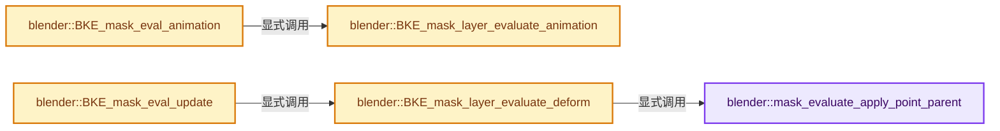

# 实现依赖专题：source/blender/blenkernel/intern/mask_evaluate.cc

[实现依赖导航](../../README.md) · [符号索引](../../../00-课程指南/02-源码与提交索引/符号依赖与实现索引.md)

本专题从正文实际调用进入，集中保存共享实现。函数有稳定锚点，可从调用处直接跳到对应完整函数；递归与互相调用通过回链组织。

## 本文件的实现关系




## 完整成员与函数实现

<a id="f-8fa3e00f09956ee5"></a>

### `blender::mask_evaluate_apply_point_parent`

实现位置：[source/blender/blenkernel/intern/mask_evaluate.cc](../../../../../../../source/blender/blenkernel/intern/mask_evaluate.cc) · L833—L840。

接口参数：

- `MaskSplinePoint *point`
- `float ctime`

**教学注释版**

<!-- annotated:da3d6e8424820d -->

```cpp
static void mask_evaluate_apply_point_parent(MaskSplinePoint *point, float ctime)
{
  float parent_matrix[3][3];
  BKE_mask_point_parent_matrix_get(point, ctime, parent_matrix);
  mul_m3_v2(parent_matrix, point->bezt.vec[0]);
  mul_m3_v2(parent_matrix, point->bezt.vec[1]);
  mul_m3_v2(parent_matrix, point->bezt.vec[2]);
}
```

<details>
<summary>核对原始源码：source/blender/blenkernel/intern/mask_evaluate.cc · L833—L840</summary>

<!-- original:da3d6e8424820d:source/blender/blenkernel/intern/mask_evaluate.cc:833:840 -->

```cpp
static void mask_evaluate_apply_point_parent(MaskSplinePoint *point, float ctime)
{
  float parent_matrix[3][3];
  BKE_mask_point_parent_matrix_get(point, ctime, parent_matrix);
  mul_m3_v2(parent_matrix, point->bezt.vec[0]);
  mul_m3_v2(parent_matrix, point->bezt.vec[1]);
  mul_m3_v2(parent_matrix, point->bezt.vec[2]);
}
```

</details>

**继续追踪实现**

- `BKE_mask_point_parent_matrix_get` → [blender::BKE_mask_point_parent_matrix_get · L1255](mask.cc.md#f-1c35a2c71cb63c40)。
- `mul_m3_v2` → [blender::mul_m3_v2 · L672](../../01-BLI基础库/intern/math_matrix_c.cc.md#f-5cdffb90189e0b6f)。

<a id="f-bed91bcdd929053e"></a>

### `blender::BKE_mask_layer_evaluate_animation`

实现位置：[source/blender/blenkernel/intern/mask_evaluate.cc](../../../../../../../source/blender/blenkernel/intern/mask_evaluate.cc) · L842—L878。

接口参数：

- `MaskLayer *masklay`
- `const float ctime`

**教学注释版**

<!-- annotated:0844795ef6dfb4 -->

```cpp
void BKE_mask_layer_evaluate_animation(MaskLayer *masklay, const float ctime)
{
  /* animation if available */
  MaskLayerShape *masklay_shape_a;
  MaskLayerShape *masklay_shape_b;
  int found = BKE_mask_layer_shape_find_frame_range(
      masklay, ctime, &masklay_shape_a, &masklay_shape_b);
  if (found) {
    if (found == 1) {
#if 0
      printf("%s: exact %d %d (%d)\n",
             __func__,
             int(ctime),
             masklay->splines_shapes.count(),
             masklay_shape_a->frame);
#endif
      BKE_mask_layer_shape_to_mask(masklay, masklay_shape_a);
    }
    else if (found == 2) {
      float w = masklay_shape_b->frame - masklay_shape_a->frame;
#if 0
      printf("%s: tween %d %d (%d %d)\n",
             __func__,
             int(ctime),
             masklay->splines_shapes.count(),
             masklay_shape_a->frame,
             masklay_shape_b->frame);
#endif
      BKE_mask_layer_shape_to_mask_interp(
          masklay, masklay_shape_a, masklay_shape_b, (ctime - masklay_shape_a->frame) / w);
    }
    else {
      /* always fail, should never happen */
      BLI_assert(found == 2);
    }
  }
}
```

<details>
<summary>核对原始源码：source/blender/blenkernel/intern/mask_evaluate.cc · L842—L878</summary>

<!-- original:0844795ef6dfb4:source/blender/blenkernel/intern/mask_evaluate.cc:842:878 -->

```cpp
void BKE_mask_layer_evaluate_animation(MaskLayer *masklay, const float ctime)
{
  /* animation if available */
  MaskLayerShape *masklay_shape_a;
  MaskLayerShape *masklay_shape_b;
  int found = BKE_mask_layer_shape_find_frame_range(
      masklay, ctime, &masklay_shape_a, &masklay_shape_b);
  if (found) {
    if (found == 1) {
#if 0
      printf("%s: exact %d %d (%d)\n",
             __func__,
             int(ctime),
             masklay->splines_shapes.count(),
             masklay_shape_a->frame);
#endif
      BKE_mask_layer_shape_to_mask(masklay, masklay_shape_a);
    }
    else if (found == 2) {
      float w = masklay_shape_b->frame - masklay_shape_a->frame;
#if 0
      printf("%s: tween %d %d (%d %d)\n",
             __func__,
             int(ctime),
             masklay->splines_shapes.count(),
             masklay_shape_a->frame,
             masklay_shape_b->frame);
#endif
      BKE_mask_layer_shape_to_mask_interp(
          masklay, masklay_shape_a, masklay_shape_b, (ctime - masklay_shape_a->frame) / w);
    }
    else {
      /* always fail, should never happen */
      BLI_assert(found == 2);
    }
  }
}
```

</details>

**继续追踪实现**

- `BKE_mask_layer_shape_find_frame_range` → [blender::BKE_mask_layer_shape_find_frame_range · L1693](mask.cc.md#f-fb2ee13cc777729b)。
- `printf` → [外部契约](https://eel.is/c++draft/)：这个边界按实际表达式及所属类型核对参数、返回值、寿命与失败行为。这里提供接口入口，不声称已解释该第三方版本的内部实现。
- `masklay->splines_shapes.count` → [调用协议](../../../00-课程指南/01-路线与规范/模板宏与动态分派协议.md)：接收对象类型依赖auto、返回值或模板实例；不按同名猜测目标。调用位置L855。
- `BKE_mask_layer_shape_to_mask` → [blender::BKE_mask_layer_shape_to_mask · L1614](mask.cc.md#f-0f8f30b351d7533b)。
- `BKE_mask_layer_shape_to_mask_interp` → [blender::BKE_mask_layer_shape_to_mask_interp · L1644](mask.cc.md#f-747e0d70a2a2abc1)。
- `BLI_assert` → [BLI_assert · L48](../../01-BLI基础库/BLI_assert.hh.md#m-57a88495704d)；[BLI_assert · L63](../../01-BLI基础库/BLI_assert.hh.md#m-d07050020cb5)。宏定义由构建条件选择。

<a id="f-2b733b56e6299615"></a>

### `blender::BKE_mask_layer_evaluate_deform`

实现位置：[source/blender/blenkernel/intern/mask_evaluate.cc](../../../../../../../source/blender/blenkernel/intern/mask_evaluate.cc) · L880—L910。

接口参数：

- `MaskLayer *masklay`
- `const float ctime`

**教学注释版**

<!-- annotated:5258e7cb2f72aa -->

```cpp
void BKE_mask_layer_evaluate_deform(MaskLayer *masklay, const float ctime)
{
  BKE_mask_layer_calc_handles(masklay);
  for (MaskSpline &spline : masklay->splines) {
    bool need_handle_recalc = false;
    BKE_mask_spline_ensure_deform(&spline);
    for (int i = 0; i < spline.tot_point; i++) {
      MaskSplinePoint *point = &spline.points[i];
      MaskSplinePoint *point_deform = &spline.runtime->points_deform[i];
      BKE_mask_point_free(point_deform);
      *point_deform = *point;
      point_deform->uw = point->uw ? MEM_dupalloc(point->uw) : nullptr;
      mask_evaluate_apply_point_parent(point_deform, ctime);
      if (ELEM(point->bezt.h1, HD_AUTO, HD_VECT)) {
        need_handle_recalc = true;
      }
    }
    /* if the spline has auto or vector handles, these need to be
     * recalculated after deformation.
     */
    if (need_handle_recalc) {
      for (int i = 0; i < spline.tot_point; i++) {
        MaskSplinePoint *point_deform = &spline.runtime->points_deform[i];
        if (ELEM(point_deform->bezt.h1, HD_AUTO, HD_VECT)) {
          BKE_mask_calc_handle_point(&spline, point_deform);
        }
      }
    }
    /* end extra calc handles loop */
  }
}
```

<details>
<summary>核对原始源码：source/blender/blenkernel/intern/mask_evaluate.cc · L880—L910</summary>

<!-- original:5258e7cb2f72aa:source/blender/blenkernel/intern/mask_evaluate.cc:880:910 -->

```cpp
void BKE_mask_layer_evaluate_deform(MaskLayer *masklay, const float ctime)
{
  BKE_mask_layer_calc_handles(masklay);
  for (MaskSpline &spline : masklay->splines) {
    bool need_handle_recalc = false;
    BKE_mask_spline_ensure_deform(&spline);
    for (int i = 0; i < spline.tot_point; i++) {
      MaskSplinePoint *point = &spline.points[i];
      MaskSplinePoint *point_deform = &spline.runtime->points_deform[i];
      BKE_mask_point_free(point_deform);
      *point_deform = *point;
      point_deform->uw = point->uw ? MEM_dupalloc(point->uw) : nullptr;
      mask_evaluate_apply_point_parent(point_deform, ctime);
      if (ELEM(point->bezt.h1, HD_AUTO, HD_VECT)) {
        need_handle_recalc = true;
      }
    }
    /* if the spline has auto or vector handles, these need to be
     * recalculated after deformation.
     */
    if (need_handle_recalc) {
      for (int i = 0; i < spline.tot_point; i++) {
        MaskSplinePoint *point_deform = &spline.runtime->points_deform[i];
        if (ELEM(point_deform->bezt.h1, HD_AUTO, HD_VECT)) {
          BKE_mask_calc_handle_point(&spline, point_deform);
        }
      }
    }
    /* end extra calc handles loop */
  }
}
```

</details>

**沿实际写入检查状态**

- `point_deform->uw = point->uw ? MEM_dupalloc(point->uw) : nullptr;`
- `need_handle_recalc = true;`

**继续追踪实现**

- `BKE_mask_layer_calc_handles` → [blender::BKE_mask_layer_calc_handles · L1501](mask.cc.md#f-15cea96633378ca7)。
- `BKE_mask_spline_ensure_deform` → [blender::BKE_mask_spline_ensure_deform · L1510](mask.cc.md#f-9955aad59695a420)。
- `BKE_mask_point_free` → [blender::BKE_mask_point_free · L1026](mask.cc.md#f-0e22fdb3b739376d)。
- `MEM_dupalloc` → [MEM_dupalloc · L627](../../07-Intern运行时与平台/guardedalloc/MEM_guardedalloc.h.md#f-78a72b71e3c57010)。
- `mask_evaluate_apply_point_parent` → [blender::mask_evaluate_apply_point_parent · L833](mask_evaluate.cc.md#f-8fa3e00f09956ee5)。
- `ELEM` → [ELEM · L88](../../07-Intern运行时与平台/ghost/intern/GHOST_utildefines.hh.md#m-d28724a15928)；[ELEM · L135](../../01-BLI基础库/BLI_utildefines.hh.md#m-d6572de7cae0)。宏定义由构建条件选择。
- `BKE_mask_calc_handle_point` → [blender::BKE_mask_calc_handle_point · L1418](mask.cc.md#f-df1668f2c215d3b7)。

<a id="f-e7dc66fc7dd5500c"></a>

### `blender::BKE_mask_eval_animation`

实现位置：[source/blender/blenkernel/intern/mask_evaluate.cc](../../../../../../../source/blender/blenkernel/intern/mask_evaluate.cc) · L912—L920。

接口参数：

- `Depsgraph *depsgraph`
- `Mask *mask`

**教学注释版**

<!-- annotated:8d755019c67993 -->

```cpp
void BKE_mask_eval_animation(Depsgraph *depsgraph, Mask *mask)
{
  float ctime = DEG_get_ctime(depsgraph);
  DEG_debug_print_eval(depsgraph, __func__, mask->id.name, mask);
  for (MaskLayer &mask_layer : mask->masklayers) {
    BKE_mask_layer_evaluate_animation(&mask_layer, ctime);
  }
  mask->runtime.last_update = DEG_get_update_count(depsgraph);
}
```

<details>
<summary>核对原始源码：source/blender/blenkernel/intern/mask_evaluate.cc · L912—L920</summary>

<!-- original:8d755019c67993:source/blender/blenkernel/intern/mask_evaluate.cc:912:920 -->

```cpp
void BKE_mask_eval_animation(Depsgraph *depsgraph, Mask *mask)
{
  float ctime = DEG_get_ctime(depsgraph);
  DEG_debug_print_eval(depsgraph, __func__, mask->id.name, mask);
  for (MaskLayer &mask_layer : mask->masklayers) {
    BKE_mask_layer_evaluate_animation(&mask_layer, ctime);
  }
  mask->runtime.last_update = DEG_get_update_count(depsgraph);
}
```

</details>

**沿实际写入检查状态**

- `mask->runtime.last_update = DEG_get_update_count(depsgraph);`

**继续追踪实现**

- `DEG_get_ctime` → [blender::DEG_get_ctime · L105](../../06-Depsgraph依赖图/intern/depsgraph_query.cc.md#f-156dee0918a22f2f)。
- `DEG_debug_print_eval` → [blender::DEG_debug_print_eval · L240](../../06-Depsgraph依赖图/intern/depsgraph_debug.cc.md#f-f2c4ea506dd14a2f)。
- `BKE_mask_layer_evaluate_animation` → [blender::BKE_mask_layer_evaluate_animation · L842](mask_evaluate.cc.md#f-bed91bcdd929053e)。
- `DEG_get_update_count` → [blender::DEG_get_update_count · L356](../../06-Depsgraph依赖图/intern/depsgraph.cc.md#f-53f32a84c1bed638)。

<a id="f-c2e69bc81e17f1f4"></a>

### `blender::BKE_mask_eval_update`

实现位置：[source/blender/blenkernel/intern/mask_evaluate.cc](../../../../../../../source/blender/blenkernel/intern/mask_evaluate.cc) · L922—L952。

接口参数：

- `Depsgraph *depsgraph`
- `Mask *mask`

**教学注释版**

<!-- annotated:f3b1e21f95aa03 -->

```cpp
void BKE_mask_eval_update(Depsgraph *depsgraph, Mask *mask)
{
  const bool is_depsgraph_active = DEG_is_active(depsgraph);
  float ctime = DEG_get_ctime(depsgraph);
  DEG_debug_print_eval(depsgraph, __func__, mask->id.name, mask);
  for (MaskLayer &mask_layer : mask->masklayers) {
    BKE_mask_layer_evaluate_deform(&mask_layer, ctime);
  }

  if (is_depsgraph_active) {
    Mask *mask_orig = DEG_get_original(mask);
    for (MaskLayer *masklay_orig = mask_orig->masklayers.first(),
                   *masklay_eval = mask->masklayers.first();
         masklay_orig != nullptr;
         masklay_orig = masklay_orig->next, masklay_eval = masklay_eval->next)
    {
      for (MaskSpline *spline_orig = masklay_orig->splines.first(),
                      *spline_eval = masklay_eval->splines.first();
           spline_orig != nullptr;
           spline_orig = spline_orig->next, spline_eval = spline_eval->next)
      {
        for (int i = 0; i < spline_eval->tot_point; i++) {
          MaskSplinePoint *point_eval = &spline_eval->points[i];
          MaskSplinePoint *point_orig = &spline_orig->points[i];
          point_orig->bezt = point_eval->bezt;
        }
      }
    }
  }
  mask->runtime.last_update = DEG_get_update_count(depsgraph);
}
```

<details>
<summary>核对原始源码：source/blender/blenkernel/intern/mask_evaluate.cc · L922—L952</summary>

<!-- original:f3b1e21f95aa03:source/blender/blenkernel/intern/mask_evaluate.cc:922:952 -->

```cpp
void BKE_mask_eval_update(Depsgraph *depsgraph, Mask *mask)
{
  const bool is_depsgraph_active = DEG_is_active(depsgraph);
  float ctime = DEG_get_ctime(depsgraph);
  DEG_debug_print_eval(depsgraph, __func__, mask->id.name, mask);
  for (MaskLayer &mask_layer : mask->masklayers) {
    BKE_mask_layer_evaluate_deform(&mask_layer, ctime);
  }

  if (is_depsgraph_active) {
    Mask *mask_orig = DEG_get_original(mask);
    for (MaskLayer *masklay_orig = mask_orig->masklayers.first(),
                   *masklay_eval = mask->masklayers.first();
         masklay_orig != nullptr;
         masklay_orig = masklay_orig->next, masklay_eval = masklay_eval->next)
    {
      for (MaskSpline *spline_orig = masklay_orig->splines.first(),
                      *spline_eval = masklay_eval->splines.first();
           spline_orig != nullptr;
           spline_orig = spline_orig->next, spline_eval = spline_eval->next)
      {
        for (int i = 0; i < spline_eval->tot_point; i++) {
          MaskSplinePoint *point_eval = &spline_eval->points[i];
          MaskSplinePoint *point_orig = &spline_orig->points[i];
          point_orig->bezt = point_eval->bezt;
        }
      }
    }
  }
  mask->runtime.last_update = DEG_get_update_count(depsgraph);
}
```

</details>

**沿实际写入检查状态**

- `masklay_orig = masklay_orig->next, masklay_eval = masklay_eval->next)`
- `spline_orig = spline_orig->next, spline_eval = spline_eval->next)`
- `point_orig->bezt = point_eval->bezt;`
- `mask->runtime.last_update = DEG_get_update_count(depsgraph);`

**继续追踪实现**

- `DEG_is_active` → [blender::DEG_is_active · L324](../../06-Depsgraph依赖图/intern/depsgraph.cc.md#f-d561ff15ce03c64a)。
- `DEG_get_ctime` → [blender::DEG_get_ctime · L105](../../06-Depsgraph依赖图/intern/depsgraph_query.cc.md#f-156dee0918a22f2f)。
- `DEG_debug_print_eval` → [blender::DEG_debug_print_eval · L240](../../06-Depsgraph依赖图/intern/depsgraph_debug.cc.md#f-f2c4ea506dd14a2f)。
- `BKE_mask_layer_evaluate_deform` → [blender::BKE_mask_layer_evaluate_deform · L880](mask_evaluate.cc.md#f-2b733b56e6299615)。
- `DEG_get_original` → [blender::DEG_get_original · L128](../../06-Depsgraph依赖图/DEG_depsgraph_query.hh.md#f-79782eab82a92d86)；[blender::DEG_get_original · L134](../../06-Depsgraph依赖图/DEG_depsgraph_query.hh.md#f-c032f06e9ef8f0cb)。同名重载需按实参类型选择。
- `mask_orig->masklayers.first` → [调用协议](../../../00-课程指南/01-路线与规范/模板宏与动态分派协议.md)：接收对象类型依赖auto、返回值或模板实例；不按同名猜测目标。调用位置L933。
- `mask->masklayers.first` → [调用协议](../../../00-课程指南/01-路线与规范/模板宏与动态分派协议.md)：接收对象类型依赖auto、返回值或模板实例；不按同名猜测目标。调用位置L934。
- `masklay_orig->splines.first` → [调用协议](../../../00-课程指南/01-路线与规范/模板宏与动态分派协议.md)：接收对象类型依赖auto、返回值或模板实例；不按同名猜测目标。调用位置L938。
- `masklay_eval->splines.first` → [调用协议](../../../00-课程指南/01-路线与规范/模板宏与动态分派协议.md)：接收对象类型依赖auto、返回值或模板实例；不按同名猜测目标。调用位置L939。
- `DEG_get_update_count` → [blender::DEG_get_update_count · L356](../../06-Depsgraph依赖图/intern/depsgraph.cc.md#f-53f32a84c1bed638)。
