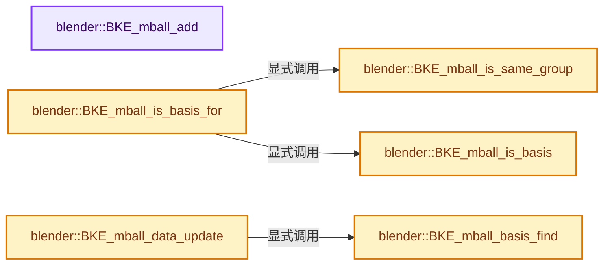
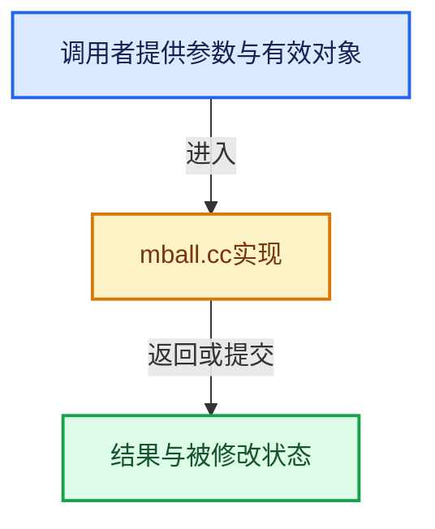

# 实现依赖专题：source/blender/blenkernel/intern/mball.cc

[实现依赖导航](../../README.md) · [符号索引](../../../00-课程指南/02-源码与提交索引/符号依赖与实现索引.md)

本专题从正文实际调用进入，集中保存共享实现。函数有稳定锚点，可从调用处直接跳到对应完整函数；递归与互相调用通过回链组织。

## 本文件的实现关系






## 完整成员与函数实现

<a id="f-238032972e7ff3ee"></a>

### `blender::BKE_mball_add`

实现位置：[source/blender/blenkernel/intern/mball.cc](../../../../../../../source/blender/blenkernel/intern/mball.cc) · L173—L177。

接口参数：

- `Main *bmain`
- `const char *name`

**教学注释版**

<!-- annotated:1e4833ed5017bc -->

```cpp
MetaBall *BKE_mball_add(Main *bmain, const char *name)
{
  MetaBall *mb = BKE_id_new<MetaBall>(bmain, name);
  return mb;
}
```

<details>
<summary>核对原始源码：source/blender/blenkernel/intern/mball.cc · L173—L177</summary>

<!-- original:1e4833ed5017bc:source/blender/blenkernel/intern/mball.cc:173:177 -->

```cpp
MetaBall *BKE_mball_add(Main *bmain, const char *name)
{
  MetaBall *mb = BKE_id_new<MetaBall>(bmain, name);
  return mb;
}
```

</details>

**结果出口**

- `return mb;`

**继续追踪实现**

- `BKE_id_new<MetaBall>` → [blender::BKE_id_new · L1612](lib_id.cc.md#f-5335c97ce0a8fbc8)。

<a id="f-4b8275ea965e6286"></a>

### `blender::BKE_mball_is_basis`

实现位置：[source/blender/blenkernel/intern/mball.cc](../../../../../../../source/blender/blenkernel/intern/mball.cc) · L255—L276。

接口参数：

- `const Object *ob`

**教学注释版**

<!-- annotated:ac35eff612a311 -->

```cpp
bool BKE_mball_is_basis(const Object *ob)
{
  /* Meta-Ball Basis Notes from Blender-2.5x
   * =======================================
   *
   * NOTE(@ideasman42): This is a can of worms.
   *
   * This really needs a rewrite/refactor its totally broken in anything other than basic cases
   * Multiple Scenes + Set Scenes & mixing meta-ball basis _should_ work but fails to update the
   * depsgraph on rename and linking into scenes or removal of basis meta-ball.
   * So take care when changing this code.
   *
   * Main idiot thing here is that the system returns #BKE_mball_basis_find()
   * objects which fail a #BKE_mball_is_basis() test.
   *
   * Not only that but the depsgraph and their areas depend on this behavior,
   * so making small fixes here isn't worth it. */

  /* Just a quick test. */
  const int len = strlen(ob->id.name);
  return !isdigit(ob->id.name[len - 1]);
}
```

<details>
<summary>核对原始源码：source/blender/blenkernel/intern/mball.cc · L255—L276</summary>

<!-- original:ac35eff612a311:source/blender/blenkernel/intern/mball.cc:255:276 -->

```cpp
bool BKE_mball_is_basis(const Object *ob)
{
  /* Meta-Ball Basis Notes from Blender-2.5x
   * =======================================
   *
   * NOTE(@ideasman42): This is a can of worms.
   *
   * This really needs a rewrite/refactor its totally broken in anything other than basic cases
   * Multiple Scenes + Set Scenes & mixing meta-ball basis _should_ work but fails to update the
   * depsgraph on rename and linking into scenes or removal of basis meta-ball.
   * So take care when changing this code.
   *
   * Main idiot thing here is that the system returns #BKE_mball_basis_find()
   * objects which fail a #BKE_mball_is_basis() test.
   *
   * Not only that but the depsgraph and their areas depend on this behavior,
   * so making small fixes here isn't worth it. */

  /* Just a quick test. */
  const int len = strlen(ob->id.name);
  return !isdigit(ob->id.name[len - 1]);
}
```

</details>

**结果出口**

- `return !isdigit(ob->id.name[len - 1]);`

**继续追踪实现**

- `strlen` → [外部契约](https://eel.is/c++draft/)：这个边界按实际表达式及所属类型核对参数、返回值、寿命与失败行为。这里提供接口入口，不声称已解释该第三方版本的内部实现。
- `isdigit` → [调用协议](../../../00-课程指南/01-路线与规范/模板宏与动态分派协议.md)：函数指针、局部可调用对象或未展开的宏；必须结合调用者环境。调用位置L275。

<a id="f-a63787be27589831"></a>

### `blender::BKE_mball_is_same_group`

实现位置：[source/blender/blenkernel/intern/mball.cc](../../../../../../../source/blender/blenkernel/intern/mball.cc) · L278—L292。

接口参数：

- `const Object *ob1`
- `const Object *ob2`

**教学注释版**

<!-- annotated:53cad6067948d2 -->

```cpp
bool BKE_mball_is_same_group(const Object *ob1, const Object *ob2)
{
  int basis1nr, basis2nr;
  char basis1name[MAX_ID_NAME], basis2name[MAX_ID_NAME];

  if (ob1->id.name[2] != ob2->id.name[2]) {
    /* Quick return in case first char of both ID's names is not the same... */
    return false;
  }

  BLI_string_split_name_number(ob1->id.name + 2, '.', basis1name, &basis1nr);
  BLI_string_split_name_number(ob2->id.name + 2, '.', basis2name, &basis2nr);

  return STREQ(basis1name, basis2name);
}
```

<details>
<summary>核对原始源码：source/blender/blenkernel/intern/mball.cc · L278—L292</summary>

<!-- original:53cad6067948d2:source/blender/blenkernel/intern/mball.cc:278:292 -->

```cpp
bool BKE_mball_is_same_group(const Object *ob1, const Object *ob2)
{
  int basis1nr, basis2nr;
  char basis1name[MAX_ID_NAME], basis2name[MAX_ID_NAME];

  if (ob1->id.name[2] != ob2->id.name[2]) {
    /* Quick return in case first char of both ID's names is not the same... */
    return false;
  }

  BLI_string_split_name_number(ob1->id.name + 2, '.', basis1name, &basis1nr);
  BLI_string_split_name_number(ob2->id.name + 2, '.', basis2name, &basis2nr);

  return STREQ(basis1name, basis2name);
}
```

</details>

**结果出口**

- `return false;`
- `return STREQ(basis1name, basis2name);`

**继续追踪实现**

- `BLI_string_split_name_number` → [blender::BLI_string_split_name_number · L190](../../01-BLI基础库/intern/string_utils.cc.md#f-a94e773e26eb8221)；[blender::BLI_string_split_name_number · L218](../../01-BLI基础库/intern/string_utils.cc.md#f-b2b541e978f36495)。同名重载需按实参类型选择。
- `STREQ` → [STREQ · L112](../../07-Intern运行时与平台/ghost/intern/GHOST_utildefines.hh.md#m-9549fb6aafd2)；[STREQ · L451](../../01-BLI基础库/BLI_utildefines.hh.md#m-c7b745bcfad2)；[STREQ · L55](../../07-Intern运行时与平台/clog/clog.cc.md#m-96e78f386894)。宏定义由构建条件选择。

<a id="f-376bfaa04c53a3e4"></a>

### `blender::BKE_mball_is_basis_for`

实现位置：[source/blender/blenkernel/intern/mball.cc](../../../../../../../source/blender/blenkernel/intern/mball.cc) · L294—L297。

接口参数：

- `const Object *ob1`
- `const Object *ob2`

**教学注释版**

<!-- annotated:afc9c9935e23ea -->

```cpp
bool BKE_mball_is_basis_for(const Object *ob1, const Object *ob2)
{
  return BKE_mball_is_same_group(ob1, ob2) && BKE_mball_is_basis(ob1);
}
```

<details>
<summary>核对原始源码：source/blender/blenkernel/intern/mball.cc · L294—L297</summary>

<!-- original:afc9c9935e23ea:source/blender/blenkernel/intern/mball.cc:294:297 -->

```cpp
bool BKE_mball_is_basis_for(const Object *ob1, const Object *ob2)
{
  return BKE_mball_is_same_group(ob1, ob2) && BKE_mball_is_basis(ob1);
}
```

</details>

**结果出口**

- `return BKE_mball_is_same_group(ob1, ob2) && BKE_mball_is_basis(ob1);`

**继续追踪实现**

- `BKE_mball_is_same_group` → [blender::BKE_mball_is_same_group · L278](mball.cc.md#f-a63787be27589831)。
- `BKE_mball_is_basis` → [blender::BKE_mball_is_basis · L255](mball.cc.md#f-4b8275ea965e6286)。

<a id="f-2f1e93e05413ab67"></a>

### `blender::BKE_mball_basis_find`

实现位置：[source/blender/blenkernel/intern/mball.cc](../../../../../../../source/blender/blenkernel/intern/mball.cc) · L417—L447。

接口参数：

- `const Main &bmain`
- `Scene *scene`
- `Object *object`

**教学注释版**

<!-- annotated:6679761a2cbe09 -->

```cpp
Object *BKE_mball_basis_find(const Main &bmain, Scene *scene, Object *object)
{
  Object *bob = object;
  int basisnr, obnr;
  char basisname[MAX_ID_NAME], obname[MAX_ID_NAME];

  BLI_string_split_name_number(object->id.name + 2, '.', basisname, &basisnr);

  for (ViewLayer &view_layer : scene->view_layers) {
    BKE_view_layer_synced_ensure(bmain, scene, &view_layer);
    for (Base &base : *BKE_view_layer_object_bases_get(&view_layer)) {
      Object *ob = base.object;
      if ((ob->type == OB_MBALL) && !(base.flag & BASE_FROM_DUPLI)) {
        if (ob != bob) {
          BLI_string_split_name_number(ob->id.name + 2, '.', obname, &obnr);

          /* Object ob has to be in same "group" ... it means,
           * that it has to have same base of its name. */
          if (STREQ(obname, basisname)) {
            if (obnr < basisnr) {
              object = ob;
              basisnr = obnr;
            }
          }
        }
      }
    }
  }

  return object;
}
```

<details>
<summary>核对原始源码：source/blender/blenkernel/intern/mball.cc · L417—L447</summary>

<!-- original:6679761a2cbe09:source/blender/blenkernel/intern/mball.cc:417:447 -->

```cpp
Object *BKE_mball_basis_find(const Main &bmain, Scene *scene, Object *object)
{
  Object *bob = object;
  int basisnr, obnr;
  char basisname[MAX_ID_NAME], obname[MAX_ID_NAME];

  BLI_string_split_name_number(object->id.name + 2, '.', basisname, &basisnr);

  for (ViewLayer &view_layer : scene->view_layers) {
    BKE_view_layer_synced_ensure(bmain, scene, &view_layer);
    for (Base &base : *BKE_view_layer_object_bases_get(&view_layer)) {
      Object *ob = base.object;
      if ((ob->type == OB_MBALL) && !(base.flag & BASE_FROM_DUPLI)) {
        if (ob != bob) {
          BLI_string_split_name_number(ob->id.name + 2, '.', obname, &obnr);

          /* Object ob has to be in same "group" ... it means,
           * that it has to have same base of its name. */
          if (STREQ(obname, basisname)) {
            if (obnr < basisnr) {
              object = ob;
              basisnr = obnr;
            }
          }
        }
      }
    }
  }

  return object;
}
```

</details>

**沿实际写入检查状态**

- `object = ob;`
- `basisnr = obnr;`

**结果出口**

- `return object;`

**继续追踪实现**

- `BLI_string_split_name_number` → [blender::BLI_string_split_name_number · L190](../../01-BLI基础库/intern/string_utils.cc.md#f-a94e773e26eb8221)；[blender::BLI_string_split_name_number · L218](../../01-BLI基础库/intern/string_utils.cc.md#f-b2b541e978f36495)。同名重载需按实参类型选择。
- `BKE_view_layer_synced_ensure` → [blender::BKE_view_layer_synced_ensure · L1035](layer.cc.md#f-602c088654ebcb63)。
- `BKE_view_layer_object_bases_get` → [blender::BKE_view_layer_object_bases_get · L202](layer_utils.cc.md#f-f7b3adc8941172e4)。
- `STREQ` → [STREQ · L112](../../07-Intern运行时与平台/ghost/intern/GHOST_utildefines.hh.md#m-9549fb6aafd2)；[STREQ · L451](../../01-BLI基础库/BLI_utildefines.hh.md#m-c7b745bcfad2)；[STREQ · L55](../../07-Intern运行时与平台/clog/clog.cc.md#m-96e78f386894)。宏定义由构建条件选择。

<a id="f-de222194de3f2ae2"></a>

### `blender::BKE_mball_data_update`

实现位置：[source/blender/blenkernel/intern/mball.cc](../../../../../../../source/blender/blenkernel/intern/mball.cc) · L648—L682。

接口参数：

- `Depsgraph *depsgraph`
- `Scene *scene`
- `Object *ob`

**教学注释版**

<!-- annotated:88c3837b8434e5 -->

```cpp
void BKE_mball_data_update(Depsgraph *depsgraph, Scene *scene, Object *ob)
{
  using namespace blender::bke;
  BLI_assert(ob->type == OB_MBALL);

  BKE_object_free_derived_caches(ob);

  const Object *basis_object = BKE_mball_basis_find(*DEG_get_bmain(depsgraph), scene, ob);
  if (ob != basis_object) {
    return;
  }

  Mesh *mesh = BKE_mball_polygonize(depsgraph, scene, ob);
  if (mesh == nullptr) {
    return;
  }

  const MetaBall *mball = id_cast<MetaBall *>(ob->data);
  mesh->mat = MEM_dupalloc(mball->mat);
  mesh->totcol = mball->totcol;

  if (ob->parent && ob->parent->type == OB_LATTICE && ob->partype == PARSKEL) {
    BKE_lattice_deform_coords(
        ob->parent,
        ob,
        reinterpret_cast<float (*)[3]>(mesh->vert_positions_for_write().data()),
        mesh->verts_num,
        0,
        nullptr,
        1.0f);
    mesh->tag_positions_changed();
  }

  ob->runtime->geometry_set_eval = new GeometrySet(GeometrySet::from_mesh(mesh));
};
```

<details>
<summary>核对原始源码：source/blender/blenkernel/intern/mball.cc · L648—L682</summary>

<!-- original:88c3837b8434e5:source/blender/blenkernel/intern/mball.cc:648:682 -->

```cpp
void BKE_mball_data_update(Depsgraph *depsgraph, Scene *scene, Object *ob)
{
  using namespace blender::bke;
  BLI_assert(ob->type == OB_MBALL);

  BKE_object_free_derived_caches(ob);

  const Object *basis_object = BKE_mball_basis_find(*DEG_get_bmain(depsgraph), scene, ob);
  if (ob != basis_object) {
    return;
  }

  Mesh *mesh = BKE_mball_polygonize(depsgraph, scene, ob);
  if (mesh == nullptr) {
    return;
  }

  const MetaBall *mball = id_cast<MetaBall *>(ob->data);
  mesh->mat = MEM_dupalloc(mball->mat);
  mesh->totcol = mball->totcol;

  if (ob->parent && ob->parent->type == OB_LATTICE && ob->partype == PARSKEL) {
    BKE_lattice_deform_coords(
        ob->parent,
        ob,
        reinterpret_cast<float (*)[3]>(mesh->vert_positions_for_write().data()),
        mesh->verts_num,
        0,
        nullptr,
        1.0f);
    mesh->tag_positions_changed();
  }

  ob->runtime->geometry_set_eval = new GeometrySet(GeometrySet::from_mesh(mesh));
};
```

</details>

**沿实际写入检查状态**

- `mesh->mat = MEM_dupalloc(mball->mat);`
- `mesh->totcol = mball->totcol;`
- `ob->runtime->geometry_set_eval = new GeometrySet(GeometrySet::from_mesh(mesh));`

**继续追踪实现**

- `BLI_assert` → [BLI_assert · L48](../../01-BLI基础库/BLI_assert.hh.md#m-57a88495704d)；[BLI_assert · L63](../../01-BLI基础库/BLI_assert.hh.md#m-d07050020cb5)。宏定义由构建条件选择。
- `BKE_object_free_derived_caches` → [blender::BKE_object_free_derived_caches · L1810](object.cc.md#f-74071902e41326eb)。
- `BKE_mball_basis_find` → [blender::BKE_mball_basis_find · L417](mball.cc.md#f-2f1e93e05413ab67)。
- `DEG_get_bmain` → [blender::DEG_get_bmain · L93](../../06-Depsgraph依赖图/intern/depsgraph_query.cc.md#f-9dfed3e433db8080)。
- `BKE_mball_polygonize` → [blender::BKE_mball_polygonize · L1366](mball_tessellate.cc.md#f-2d9986d84f2b5568)。
- `id_cast<MetaBall *>` → [blender::id_cast · L1417](../../08-其他Blender模块/makesdna/DNA_ID.h.md#f-6c8ac6412850ac5a)。
- `MEM_dupalloc` → [MEM_dupalloc · L627](../../07-Intern运行时与平台/guardedalloc/MEM_guardedalloc.h.md#f-78a72b71e3c57010)。
- `BKE_lattice_deform_coords` → [blender::BKE_lattice_deform_coords · L441](lattice_deform.cc.md#f-80ab79b9260c4b07)。
- `mesh->vert_positions_for_write().data` → [调用协议](../../../00-课程指南/01-路线与规范/模板宏与动态分派协议.md)：接收对象类型依赖auto、返回值或模板实例；不按同名猜测目标。调用位置L673。
- `mesh->vert_positions_for_write` → [Mesh::vert_positions_for_write · L1199](../../../05-几何存储与拓扑映射/03-MPoly迁移与兼容.md#f-ae8d77205112d843)。
- `mesh->tag_positions_changed` → [blender::Mesh::tag_positions_changed · L407](../../../06-隐式共享与缓存系统/10-局部更新与失效修复.md#f-90e852663d44ad53)。
- `GeometrySet::from_mesh` → [blender::bke::GeometrySet::from_mesh · L427](../../../06-隐式共享与缓存系统/05-GeometrySet读写与复制.md#f-2a5e9b771a337510)。
