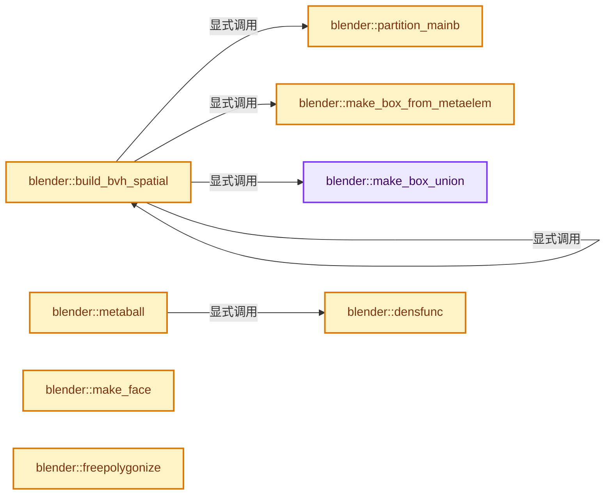

# 实现依赖专题：source/blender/blenkernel/intern/mball_tessellate.cc

[实现依赖导航](../../README.md) · [符号索引](../../../00-课程指南/02-源码与提交索引/符号依赖与实现索引.md)

本专题从正文实际调用进入，集中保存共享实现。函数有稳定锚点，可从调用处直接跳到对应完整函数；递归与互相调用通过回链组织。

## 本文件的实现关系




<a id="m-53c8803f1eb2"></a>

## 宏 `HASH`

<!-- annotated:5cca63425bfd12 -->

```cpp
#define HASH(i, j, k) ((((((i) & 31) << 5) | ((j) & 31)) << 5) | ((k) & 31))

```

<details>
<summary>核对原始源码：source/blender/blenkernel/intern/mball_tessellate.cc · L298—L299</summary>

<!-- original:5cca63425bfd12:source/blender/blenkernel/intern/mball_tessellate.cc:298:299 -->

```cpp
#define HASH(i, j, k) ((((((i) & 31) << 5) | ((j) & 31)) << 5) | ((k) & 31))

```

</details>

宏在预处理阶段展开，参数替换、重复求值和条件编译应直接从该定义检查。与普通函数不同，宏不会自动提供参数类型检查；构建配置选择哪个定义需结合外围条件。

<a id="m-48a719fa0906"></a>

## 宏 `MB_BIT`

<!-- annotated:2f62a327472d2f -->

```cpp
#define MB_BIT(i, bit) (((i) >> (bit)) & 1)
// #define FLIP(i, bit) ((i) ^ 1 << (bit)) /* flip the given bit of i */
```

<details>
<summary>核对原始源码：source/blender/blenkernel/intern/mball_tessellate.cc · L300—L301</summary>

<!-- original:2f62a327472d2f:source/blender/blenkernel/intern/mball_tessellate.cc:300:301 -->

```cpp
#define MB_BIT(i, bit) (((i) >> (bit)) & 1)
// #define FLIP(i, bit) ((i) ^ 1 << (bit)) /* flip the given bit of i */
```

</details>

宏在预处理阶段展开，参数替换、重复求值和条件编译应直接从该定义检查。与普通函数不同，宏不会自动提供参数类型检查；构建配置选择哪个定义需结合外围条件。

## 完整成员与函数实现

<a id="f-3a09d8d23f4a1f5a"></a>

### `blender::make_box_union`

实现位置：[source/blender/blenkernel/intern/mball_tessellate.cc](../../../../../../../source/blender/blenkernel/intern/mball_tessellate.cc) · L147—L156。

接口参数：

- `const BoundBox *a`
- `const Box *b`
- `Box *r_out`

**教学注释版**

<!-- annotated:8fe45b2659abc2 -->

```cpp
static void make_box_union(const BoundBox *a, const Box *b, Box *r_out)
{
  r_out->min[0] = min_ff(a->vec[0][0], b->min[0]);
  r_out->min[1] = min_ff(a->vec[0][1], b->min[1]);
  r_out->min[2] = min_ff(a->vec[0][2], b->min[2]);

  r_out->max[0] = max_ff(a->vec[6][0], b->max[0]);
  r_out->max[1] = max_ff(a->vec[6][1], b->max[1]);
  r_out->max[2] = max_ff(a->vec[6][2], b->max[2]);
}
```

<details>
<summary>核对原始源码：source/blender/blenkernel/intern/mball_tessellate.cc · L147—L156</summary>

<!-- original:8fe45b2659abc2:source/blender/blenkernel/intern/mball_tessellate.cc:147:156 -->

```cpp
static void make_box_union(const BoundBox *a, const Box *b, Box *r_out)
{
  r_out->min[0] = min_ff(a->vec[0][0], b->min[0]);
  r_out->min[1] = min_ff(a->vec[0][1], b->min[1]);
  r_out->min[2] = min_ff(a->vec[0][2], b->min[2]);

  r_out->max[0] = max_ff(a->vec[6][0], b->max[0]);
  r_out->max[1] = max_ff(a->vec[6][1], b->max[1]);
  r_out->max[2] = max_ff(a->vec[6][2], b->max[2]);
}
```

</details>

**沿实际写入检查状态**

- `r_out->min[0] = min_ff(a->vec[0][0], b->min[0]);`
- `r_out->min[1] = min_ff(a->vec[0][1], b->min[1]);`
- `r_out->min[2] = min_ff(a->vec[0][2], b->min[2]);`
- `r_out->max[0] = max_ff(a->vec[6][0], b->max[0]);`
- `r_out->max[1] = max_ff(a->vec[6][1], b->max[1]);`
- `r_out->max[2] = max_ff(a->vec[6][2], b->max[2]);`

**继续追踪实现**

- `min_ff` → [blender::min_ff · L321](../../01-BLI基础库/intern/math_base_inline.cc.md#f-5b8d83d6f191be1a)。
- `max_ff` → [blender::max_ff · L325](../../01-BLI基础库/intern/math_base_inline.cc.md#f-05a351a3afd7dc2a)。

<a id="f-592060e9e9b890b9"></a>

### `blender::make_box_from_metaelem`

实现位置：[source/blender/blenkernel/intern/mball_tessellate.cc](../../../../../../../source/blender/blenkernel/intern/mball_tessellate.cc) · L158—L163。

接口参数：

- `Box *r`
- `const MetaElem *ml`

**教学注释版**

<!-- annotated:f386a17cd84fb5 -->

```cpp
static void make_box_from_metaelem(Box *r, const MetaElem *ml)
{
  copy_v3_v3(r->max, ml->bb->vec[6]);
  copy_v3_v3(r->min, ml->bb->vec[0]);
  r->ml = ml;
}
```

<details>
<summary>核对原始源码：source/blender/blenkernel/intern/mball_tessellate.cc · L158—L163</summary>

<!-- original:f386a17cd84fb5:source/blender/blenkernel/intern/mball_tessellate.cc:158:163 -->

```cpp
static void make_box_from_metaelem(Box *r, const MetaElem *ml)
{
  copy_v3_v3(r->max, ml->bb->vec[6]);
  copy_v3_v3(r->min, ml->bb->vec[0]);
  r->ml = ml;
}
```

</details>

**沿实际写入检查状态**

- `r->ml = ml;`

**继续追踪实现**

- `copy_v3_v3` → [blender::copy_v3_v3 · L47](../../01-BLI基础库/intern/math_vector_inline.cc.md#f-037a0d5fa5060bd6)。

<a id="f-f95cc8966ce38069"></a>

### `blender::partition_mainb`

实现位置：[source/blender/blenkernel/intern/mball_tessellate.cc](../../../../../../../source/blender/blenkernel/intern/mball_tessellate.cc) · L170—L197。

接口参数：

- `MetaElem **mainb`
- `uint start`
- `uint end`
- `uint s`
- `float div`

**教学注释版**

<!-- annotated:0ee1af6a839ed1 -->

```cpp
static uint partition_mainb(MetaElem **mainb, uint start, uint end, uint s, float div)
{
  uint i = start, j = end - 1;
  div *= 2.0f;

  while (true) {
    while (i < j && div > (mainb[i]->bb->vec[6][s] + mainb[i]->bb->vec[0][s])) {
      i++;
    }
    while (j > i && div < (mainb[j]->bb->vec[6][s] + mainb[j]->bb->vec[0][s])) {
      j--;
    }

    if (i >= j) {
      break;
    }

    std::swap(mainb[i], mainb[j]);
    i++;
    j--;
  }

  if (i == start) {
    i++;
  }

  return i;
}
```

<details>
<summary>核对原始源码：source/blender/blenkernel/intern/mball_tessellate.cc · L170—L197</summary>

<!-- original:0ee1af6a839ed1:source/blender/blenkernel/intern/mball_tessellate.cc:170:197 -->

```cpp
static uint partition_mainb(MetaElem **mainb, uint start, uint end, uint s, float div)
{
  uint i = start, j = end - 1;
  div *= 2.0f;

  while (true) {
    while (i < j && div > (mainb[i]->bb->vec[6][s] + mainb[i]->bb->vec[0][s])) {
      i++;
    }
    while (j > i && div < (mainb[j]->bb->vec[6][s] + mainb[j]->bb->vec[0][s])) {
      j--;
    }

    if (i >= j) {
      break;
    }

    std::swap(mainb[i], mainb[j]);
    i++;
    j--;
  }

  if (i == start) {
    i++;
  }

  return i;
}
```

</details>

**沿实际写入检查状态**

- `div *= 2.0f;`

**结果出口**

- `return i;`

**继续追踪实现**

- `i < j && div >` → [调用协议](../../../00-课程指南/01-路线与规范/模板宏与动态分派协议.md)：函数指针、局部可调用对象或未展开的宏；必须结合调用者环境。调用位置L176。
- `std::swap` → [外部契约](https://eel.is/c++draft/)：这个边界按实际表达式及所属类型核对参数、返回值、寿命与失败行为。这里提供接口入口，不声称已解释该第三方版本的内部实现。

<a id="f-ad844590d8fa94fb"></a>

### `blender::build_bvh_spatial`

实现位置：[source/blender/blenkernel/intern/mball_tessellate.cc](../../../../../../../source/blender/blenkernel/intern/mball_tessellate.cc) · L202—L257。

接口参数：

- `PROCESS *process`
- `MetaballBVHNode *node`
- `uint start`
- `uint end`
- `const Box *allbox`

**教学注释版**

<!-- annotated:37985b1ce40ec0 -->

```cpp
static void build_bvh_spatial(
    PROCESS *process, MetaballBVHNode *node, uint start, uint end, const Box *allbox)
{
  uint part, j, s;
  float dim[3], div;

  /* Maximum bvh queue size is number of nodes which are made, equals calls to this function. */
  process->bvh_queue_size++;

  dim[0] = allbox->max[0] - allbox->min[0];
  dim[1] = allbox->max[1] - allbox->min[1];
  dim[2] = allbox->max[2] - allbox->min[2];

  s = 0;
  if (dim[1] > dim[0] && dim[1] > dim[2]) {
    s = 1;
  }
  else if (dim[2] > dim[1] && dim[2] > dim[0]) {
    s = 2;
  }

  div = allbox->min[s] + (dim[s] / 2.0f);

  part = partition_mainb(process->mainb, start, end, s, div);

  make_box_from_metaelem(&node->bb[0], process->mainb[start]);
  node->child[0] = nullptr;

  if (part > start + 1) {
    for (j = start; j < part; j++) {
      make_box_union(process->mainb[j]->bb, &node->bb[0], &node->bb[0]);
    }

    node->child[0] = static_cast<MetaballBVHNode *>(
        BLI_memarena_alloc(process->pgn_elements, sizeof(MetaballBVHNode)));
    build_bvh_spatial(process, node->child[0], start, part, &node->bb[0]);
  }

  node->child[1] = nullptr;
  if (part < end) {
    make_box_from_metaelem(&node->bb[1], process->mainb[part]);

    if (part < end - 1) {
      for (j = part; j < end; j++) {
        make_box_union(process->mainb[j]->bb, &node->bb[1], &node->bb[1]);
      }

      node->child[1] = static_cast<MetaballBVHNode *>(
          BLI_memarena_alloc(process->pgn_elements, sizeof(MetaballBVHNode)));
      build_bvh_spatial(process, node->child[1], part, end, &node->bb[1]);
    }
  }
  else {
    INIT_MINMAX(node->bb[1].min, node->bb[1].max);
  }
}
```

<details>
<summary>核对原始源码：source/blender/blenkernel/intern/mball_tessellate.cc · L202—L257</summary>

<!-- original:37985b1ce40ec0:source/blender/blenkernel/intern/mball_tessellate.cc:202:257 -->

```cpp
static void build_bvh_spatial(
    PROCESS *process, MetaballBVHNode *node, uint start, uint end, const Box *allbox)
{
  uint part, j, s;
  float dim[3], div;

  /* Maximum bvh queue size is number of nodes which are made, equals calls to this function. */
  process->bvh_queue_size++;

  dim[0] = allbox->max[0] - allbox->min[0];
  dim[1] = allbox->max[1] - allbox->min[1];
  dim[2] = allbox->max[2] - allbox->min[2];

  s = 0;
  if (dim[1] > dim[0] && dim[1] > dim[2]) {
    s = 1;
  }
  else if (dim[2] > dim[1] && dim[2] > dim[0]) {
    s = 2;
  }

  div = allbox->min[s] + (dim[s] / 2.0f);

  part = partition_mainb(process->mainb, start, end, s, div);

  make_box_from_metaelem(&node->bb[0], process->mainb[start]);
  node->child[0] = nullptr;

  if (part > start + 1) {
    for (j = start; j < part; j++) {
      make_box_union(process->mainb[j]->bb, &node->bb[0], &node->bb[0]);
    }

    node->child[0] = static_cast<MetaballBVHNode *>(
        BLI_memarena_alloc(process->pgn_elements, sizeof(MetaballBVHNode)));
    build_bvh_spatial(process, node->child[0], start, part, &node->bb[0]);
  }

  node->child[1] = nullptr;
  if (part < end) {
    make_box_from_metaelem(&node->bb[1], process->mainb[part]);

    if (part < end - 1) {
      for (j = part; j < end; j++) {
        make_box_union(process->mainb[j]->bb, &node->bb[1], &node->bb[1]);
      }

      node->child[1] = static_cast<MetaballBVHNode *>(
          BLI_memarena_alloc(process->pgn_elements, sizeof(MetaballBVHNode)));
      build_bvh_spatial(process, node->child[1], part, end, &node->bb[1]);
    }
  }
  else {
    INIT_MINMAX(node->bb[1].min, node->bb[1].max);
  }
}
```

</details>

**沿实际写入检查状态**

- `dim[0] = allbox->max[0] - allbox->min[0];`
- `dim[1] = allbox->max[1] - allbox->min[1];`
- `dim[2] = allbox->max[2] - allbox->min[2];`
- `s = 0;`
- `s = 1;`
- `s = 2;`
- `div = allbox->min[s] + (dim[s] / 2.0f);`
- `part = partition_mainb(process->mainb, start, end, s, div);`
- `node->child[0] = nullptr;`
- `node->child[0] = static_cast<MetaballBVHNode *>(`
- `node->child[1] = nullptr;`
- `node->child[1] = static_cast<MetaballBVHNode *>(`

**继续追踪实现**

- `partition_mainb` → [blender::partition_mainb · L170](mball_tessellate.cc.md#f-f95cc8966ce38069)。
- `make_box_from_metaelem` → [blender::make_box_from_metaelem · L158](mball_tessellate.cc.md#f-592060e9e9b890b9)。
- `make_box_union` → [blender::make_box_union · L147](mball_tessellate.cc.md#f-3a09d8d23f4a1f5a)。
- `BLI_memarena_alloc` → [blender::BLI_memarena_alloc · L125](../../01-BLI基础库/intern/BLI_memarena.cc.md#f-ae79828c3629e134)；[blender::BLI_memarena_alloc · L43](../../01-BLI基础库/BLI_memarena.hh.md#f-3c7ccf0d8384021b)。同名重载需按实参类型选择。
- `build_bvh_spatial` → [blender::build_bvh_spatial · L202](mball_tessellate.cc.md#f-ad844590d8fa94fb)。
- `INIT_MINMAX` → [INIT_MINMAX · L31](../../01-BLI基础库/BLI_utildefines.hh.md#m-958c70eca94e)。宏定义由构建条件选择。

<a id="f-2e9827c4cb0ac7e2"></a>

### `blender::densfunc`

实现位置：[source/blender/blenkernel/intern/mball_tessellate.cc](../../../../../../../source/blender/blenkernel/intern/mball_tessellate.cc) · L313—L405。

接口参数：

- `const MetaElem *ball`
- `float x`
- `float y`
- `float z`

**教学注释版**

<!-- annotated:9cb7783fe358b0 -->

```cpp
static float densfunc(const MetaElem *ball, float x, float y, float z)
{
  float dist2;
  float dvec[3] = {x, y, z};

  mul_m4_v3(reinterpret_cast<const float (*)[4]>(ball->imat), dvec);

  switch (ball->type) {
    case MB_BALL:
      /* do nothing */
      break;
    case MB_CUBE:
      if (dvec[2] > ball->expz) {
        dvec[2] -= ball->expz;
      }
      else if (dvec[2] < -ball->expz) {
        dvec[2] += ball->expz;
      }
      else {
        dvec[2] = 0.0;
      }
      ATTR_FALLTHROUGH;
    case MB_PLANE:
      if (dvec[1] > ball->expy) {
        dvec[1] -= ball->expy;
      }
      else if (dvec[1] < -ball->expy) {
        dvec[1] += ball->expy;
      }
      else {
        dvec[1] = 0.0;
      }
      ATTR_FALLTHROUGH;
    case MB_TUBE:
      if (dvec[0] > ball->expx) {
        dvec[0] -= ball->expx;
      }
      else if (dvec[0] < -ball->expx) {
        dvec[0] += ball->expx;
      }
      else {
        dvec[0] = 0.0;
      }
      break;
    case MB_ELLIPSOID:
      dvec[0] /= ball->expx;
      dvec[1] /= ball->expy;
      dvec[2] /= ball->expz;
      break;

    /* *** deprecated, could be removed?, do-versioned at least *** */
    case MB_TUBEX:
      if (dvec[0] > ball->len) {
        dvec[0] -= ball->len;
      }
      else if (dvec[0] < -ball->len) {
        dvec[0] += ball->len;
      }
      else {
        dvec[0] = 0.0;
      }
      break;
    case MB_TUBEY:
      if (dvec[1] > ball->len) {
        dvec[1] -= ball->len;
      }
      else if (dvec[1] < -ball->len) {
        dvec[1] += ball->len;
      }
      else {
        dvec[1] = 0.0;
      }
      break;
    case MB_TUBEZ:
      if (dvec[2] > ball->len) {
        dvec[2] -= ball->len;
      }
      else if (dvec[2] < -ball->len) {
        dvec[2] += ball->len;
      }
      else {
        dvec[2] = 0.0;
      }
      break;
      /* *** end deprecated *** */
  }

  /* ball->rad2 is inverse of squared rad */
  dist2 = 1.0f - (len_squared_v3(dvec) * ball->rad2);

  /* ball->s is negative if metaball is negative */
  return (dist2 < 0.0f) ? 0.0f : (ball->s * dist2 * dist2 * dist2);
}
```

<details>
<summary>核对原始源码：source/blender/blenkernel/intern/mball_tessellate.cc · L313—L405</summary>

<!-- original:9cb7783fe358b0:source/blender/blenkernel/intern/mball_tessellate.cc:313:405 -->

```cpp
static float densfunc(const MetaElem *ball, float x, float y, float z)
{
  float dist2;
  float dvec[3] = {x, y, z};

  mul_m4_v3(reinterpret_cast<const float (*)[4]>(ball->imat), dvec);

  switch (ball->type) {
    case MB_BALL:
      /* do nothing */
      break;
    case MB_CUBE:
      if (dvec[2] > ball->expz) {
        dvec[2] -= ball->expz;
      }
      else if (dvec[2] < -ball->expz) {
        dvec[2] += ball->expz;
      }
      else {
        dvec[2] = 0.0;
      }
      ATTR_FALLTHROUGH;
    case MB_PLANE:
      if (dvec[1] > ball->expy) {
        dvec[1] -= ball->expy;
      }
      else if (dvec[1] < -ball->expy) {
        dvec[1] += ball->expy;
      }
      else {
        dvec[1] = 0.0;
      }
      ATTR_FALLTHROUGH;
    case MB_TUBE:
      if (dvec[0] > ball->expx) {
        dvec[0] -= ball->expx;
      }
      else if (dvec[0] < -ball->expx) {
        dvec[0] += ball->expx;
      }
      else {
        dvec[0] = 0.0;
      }
      break;
    case MB_ELLIPSOID:
      dvec[0] /= ball->expx;
      dvec[1] /= ball->expy;
      dvec[2] /= ball->expz;
      break;

    /* *** deprecated, could be removed?, do-versioned at least *** */
    case MB_TUBEX:
      if (dvec[0] > ball->len) {
        dvec[0] -= ball->len;
      }
      else if (dvec[0] < -ball->len) {
        dvec[0] += ball->len;
      }
      else {
        dvec[0] = 0.0;
      }
      break;
    case MB_TUBEY:
      if (dvec[1] > ball->len) {
        dvec[1] -= ball->len;
      }
      else if (dvec[1] < -ball->len) {
        dvec[1] += ball->len;
      }
      else {
        dvec[1] = 0.0;
      }
      break;
    case MB_TUBEZ:
      if (dvec[2] > ball->len) {
        dvec[2] -= ball->len;
      }
      else if (dvec[2] < -ball->len) {
        dvec[2] += ball->len;
      }
      else {
        dvec[2] = 0.0;
      }
      break;
      /* *** end deprecated *** */
  }

  /* ball->rad2 is inverse of squared rad */
  dist2 = 1.0f - (len_squared_v3(dvec) * ball->rad2);

  /* ball->s is negative if metaball is negative */
  return (dist2 < 0.0f) ? 0.0f : (ball->s * dist2 * dist2 * dist2);
}
```

</details>

**沿实际写入检查状态**

- `dvec[2] -= ball->expz;`
- `dvec[2] += ball->expz;`
- `dvec[2] = 0.0;`
- `dvec[1] -= ball->expy;`
- `dvec[1] += ball->expy;`
- `dvec[1] = 0.0;`
- `dvec[0] -= ball->expx;`
- `dvec[0] += ball->expx;`
- `dvec[0] = 0.0;`
- `dvec[0] -= ball->len;`
- `dvec[0] += ball->len;`
- `dvec[1] -= ball->len;`
- `dvec[1] += ball->len;`
- `dvec[2] -= ball->len;`
- `dvec[2] += ball->len;`
- `dist2 = 1.0f - (len_squared_v3(dvec) * ball->rad2);`

**结果出口**

- `return (dist2 < 0.0f) ? 0.0f : (ball->s * dist2 * dist2 * dist2);`

**继续追踪实现**

- `mul_m4_v3` → [blender::mul_m4_v3 · L677](../../01-BLI基础库/intern/math_matrix_c.cc.md#f-14a8c267710d47a3)。
- `len_squared_v3` → [blender::len_squared_v3 · L724](../../01-BLI基础库/intern/math_vector_inline.cc.md#f-089409f6f09f82ef)。

<a id="f-9e150c8791e95437"></a>

### `blender::metaball`

实现位置：[source/blender/blenkernel/intern/mball_tessellate.cc](../../../../../../../source/blender/blenkernel/intern/mball_tessellate.cc) · L411—L437。

接口参数：

- `PROCESS *process`
- `float x`
- `float y`
- `float z`

**教学注释版**

<!-- annotated:04c340014a6cd6 -->

```cpp
static float metaball(PROCESS *process, float x, float y, float z)
{
  float dens = 0.0f;
  uint front = 0, back = 0;
  MetaballBVHNode *node;

  process->bvh_queue[front++] = &process->metaball_bvh;

  while (front != back) {
    node = process->bvh_queue[back++];

    for (int i = 0; i < 2; i++) {
      if ((node->bb[i].min[0] <= x) && (node->bb[i].max[0] >= x) && (node->bb[i].min[1] <= y) &&
          (node->bb[i].max[1] >= y) && (node->bb[i].min[2] <= z) && (node->bb[i].max[2] >= z))
      {
        if (node->child[i]) {
          process->bvh_queue[front++] = node->child[i];
        }
        else {
          dens += densfunc(node->bb[i].ml, x, y, z);
        }
      }
    }
  }

  return process->thresh - dens;
}
```

<details>
<summary>核对原始源码：source/blender/blenkernel/intern/mball_tessellate.cc · L411—L437</summary>

<!-- original:04c340014a6cd6:source/blender/blenkernel/intern/mball_tessellate.cc:411:437 -->

```cpp
static float metaball(PROCESS *process, float x, float y, float z)
{
  float dens = 0.0f;
  uint front = 0, back = 0;
  MetaballBVHNode *node;

  process->bvh_queue[front++] = &process->metaball_bvh;

  while (front != back) {
    node = process->bvh_queue[back++];

    for (int i = 0; i < 2; i++) {
      if ((node->bb[i].min[0] <= x) && (node->bb[i].max[0] >= x) && (node->bb[i].min[1] <= y) &&
          (node->bb[i].max[1] >= y) && (node->bb[i].min[2] <= z) && (node->bb[i].max[2] >= z))
      {
        if (node->child[i]) {
          process->bvh_queue[front++] = node->child[i];
        }
        else {
          dens += densfunc(node->bb[i].ml, x, y, z);
        }
      }
    }
  }

  return process->thresh - dens;
}
```

</details>

**沿实际写入检查状态**

- `node = process->bvh_queue[back++];`
- `dens += densfunc(node->bb[i].ml, x, y, z);`

**结果出口**

- `return process->thresh - dens;`

**继续追踪实现**

- `densfunc` → [blender::densfunc · L313](mball_tessellate.cc.md#f-2e9827c4cb0ac7e2)。

<a id="f-0ec90115f53694e0"></a>

### `blender::make_face`

实现位置：[source/blender/blenkernel/intern/mball_tessellate.cc](../../../../../../../source/blender/blenkernel/intern/mball_tessellate.cc) · L442—L488。

接口参数：

- `PROCESS *process`
- `int i1`
- `int i2`
- `int i3`
- `int i4`

**教学注释版**

<!-- annotated:2a44904d505bd9 -->

```cpp
static void make_face(PROCESS *process, int i1, int i2, int i3, int i4)
{
#ifdef USE_ACCUM_NORMAL
  float n[3];
#endif

  if (process->totindex == process->curindex) [[unlikely]] {
    process->totindex = process->totindex ? (process->totindex * 2) : MBALL_ARRAY_LEN_INIT;
    process->indices = static_cast<int (*)[4]>(
        MEM_realloc_uninitialized(process->indices, sizeof(int[4]) * process->totindex));
  }

  int *cur = process->indices[process->curindex++];

  /* Treat triangles as fake quads. */
  cur[0] = i1;
  cur[1] = i2;
  cur[2] = i3;
  cur[3] = i4;

#ifdef USE_ACCUM_NORMAL
  if (i4 == i3) {
    normal_tri_v3(n, process->co[i1], process->co[i2], process->co[i3]);
    accumulate_vertex_normals_v3(process->no[i1],
                                 process->no[i2],
                                 process->no[i3],
                                 nullptr,
                                 n,
                                 process->co[i1],
                                 process->co[i2],
                                 process->co[i3],
                                 nullptr);
  }
  else {
    normal_quad_v3(n, process->co[i1], process->co[i2], process->co[i3], process->co[i4]);
    accumulate_vertex_normals_v3(process->no[i1],
                                 process->no[i2],
                                 process->no[i3],
                                 process->no[i4],
                                 n,
                                 process->co[i1],
                                 process->co[i2],
                                 process->co[i3],
                                 process->co[i4]);
  }
#endif
}
```

<details>
<summary>核对原始源码：source/blender/blenkernel/intern/mball_tessellate.cc · L442—L488</summary>

<!-- original:2a44904d505bd9:source/blender/blenkernel/intern/mball_tessellate.cc:442:488 -->

```cpp
static void make_face(PROCESS *process, int i1, int i2, int i3, int i4)
{
#ifdef USE_ACCUM_NORMAL
  float n[3];
#endif

  if (process->totindex == process->curindex) [[unlikely]] {
    process->totindex = process->totindex ? (process->totindex * 2) : MBALL_ARRAY_LEN_INIT;
    process->indices = static_cast<int (*)[4]>(
        MEM_realloc_uninitialized(process->indices, sizeof(int[4]) * process->totindex));
  }

  int *cur = process->indices[process->curindex++];

  /* Treat triangles as fake quads. */
  cur[0] = i1;
  cur[1] = i2;
  cur[2] = i3;
  cur[3] = i4;

#ifdef USE_ACCUM_NORMAL
  if (i4 == i3) {
    normal_tri_v3(n, process->co[i1], process->co[i2], process->co[i3]);
    accumulate_vertex_normals_v3(process->no[i1],
                                 process->no[i2],
                                 process->no[i3],
                                 nullptr,
                                 n,
                                 process->co[i1],
                                 process->co[i2],
                                 process->co[i3],
                                 nullptr);
  }
  else {
    normal_quad_v3(n, process->co[i1], process->co[i2], process->co[i3], process->co[i4]);
    accumulate_vertex_normals_v3(process->no[i1],
                                 process->no[i2],
                                 process->no[i3],
                                 process->no[i4],
                                 n,
                                 process->co[i1],
                                 process->co[i2],
                                 process->co[i3],
                                 process->co[i4]);
  }
#endif
}
```

</details>

**沿实际写入检查状态**

- `process->totindex = process->totindex ? (process->totindex * 2) : MBALL_ARRAY_LEN_INIT;`
- `process->indices = static_cast<int (*)[4]>(`
- `cur[0] = i1;`
- `cur[1] = i2;`
- `cur[2] = i3;`
- `cur[3] = i4;`

**继续追踪实现**

- `MEM_realloc_uninitialized` → [MEM_realloc_uninitialized · L118](../../07-Intern运行时与平台/guardedalloc/MEM_guardedalloc.h.md#m-813b7cd3fcff)。宏定义由构建条件选择。
- `normal_tri_v3` → [blender::normal_tri_v3 · L45](../../01-BLI基础库/intern/math_geom.cc.md#f-f574cdfe156b33d2)。
- `accumulate_vertex_normals_v3` → [blender::accumulate_vertex_normals_v3 · L5244](../../01-BLI基础库/intern/math_geom.cc.md#f-2293ce2367abb069)。
- `normal_quad_v3` → [blender::normal_quad_v3 · L62](../../01-BLI基础库/intern/math_geom.cc.md#f-edc1a63efd858f34)。

<a id="f-873a2a3276f1663d"></a>

### `blender::freepolygonize`

实现位置：[source/blender/blenkernel/intern/mball_tessellate.cc](../../../../../../../source/blender/blenkernel/intern/mball_tessellate.cc) · L491—L511。

接口参数：

- `PROCESS *process`

**教学注释版**

<!-- annotated:67d5305f3953d0 -->

```cpp
static void freepolygonize(PROCESS *process)
{
  if (process->corners) {
    MEM_delete(process->corners);
  }
  if (process->edges) {
    MEM_delete(process->edges);
  }
  if (process->centers) {
    MEM_delete(process->centers);
  }
  if (process->mainb) {
    MEM_delete(process->mainb);
  }
  if (process->bvh_queue) {
    MEM_delete(process->bvh_queue);
  }
  if (process->pgn_elements) {
    BLI_memarena_free(process->pgn_elements);
  }
}
```

<details>
<summary>核对原始源码：source/blender/blenkernel/intern/mball_tessellate.cc · L491—L511</summary>

<!-- original:67d5305f3953d0:source/blender/blenkernel/intern/mball_tessellate.cc:491:511 -->

```cpp
static void freepolygonize(PROCESS *process)
{
  if (process->corners) {
    MEM_delete(process->corners);
  }
  if (process->edges) {
    MEM_delete(process->edges);
  }
  if (process->centers) {
    MEM_delete(process->centers);
  }
  if (process->mainb) {
    MEM_delete(process->mainb);
  }
  if (process->bvh_queue) {
    MEM_delete(process->bvh_queue);
  }
  if (process->pgn_elements) {
    BLI_memarena_free(process->pgn_elements);
  }
}
```

</details>

**继续追踪实现**

- `MEM_delete` → [MEM_delete · L400](../../07-Intern运行时与平台/guardedalloc/MEM_guardedalloc.h.md#f-9049ffdd1682887c)。
- `BLI_memarena_free` → [blender::BLI_memarena_free · L103](../../01-BLI基础库/intern/BLI_memarena.cc.md#f-a655794ad41d1bdf)。

<a id="f-6892afc99116301f"></a>

### `blender::docube`

实现位置：[source/blender/blenkernel/intern/mball_tessellate.cc](../../../../../../../source/blender/blenkernel/intern/mball_tessellate.cc) · L596—L668。

接口参数：

- `PROCESS *process`
- `CUBE *cube`

**教学注释版**

<!-- annotated:5490b07e224182 -->

```cpp
static void docube(PROCESS *process, CUBE *cube)
{
  INTLISTS *polys;
  CORNER *c1, *c2;
  int i, index = 0, count, indexar[8];

  /* Determine which case cube falls into. */
  for (i = 0; i < 8; i++) {
    if (cube->corners[i]->value > 0.0f) {
      index += (1 << i);
    }
  }

  /* Using faces[] table, adds neighboring cube if surface intersects face in this direction. */
  if (MB_BIT(faces[index], 0)) {
    add_cube(process, cube->i - 1, cube->j, cube->k);
  }
  if (MB_BIT(faces[index], 1)) {
    add_cube(process, cube->i + 1, cube->j, cube->k);
  }
  if (MB_BIT(faces[index], 2)) {
    add_cube(process, cube->i, cube->j - 1, cube->k);
  }
  if (MB_BIT(faces[index], 3)) {
    add_cube(process, cube->i, cube->j + 1, cube->k);
  }
  if (MB_BIT(faces[index], 4)) {
    add_cube(process, cube->i, cube->j, cube->k - 1);
  }
  if (MB_BIT(faces[index], 5)) {
    add_cube(process, cube->i, cube->j, cube->k + 1);
  }

  /* Using cubetable[], determines polygons for output. */
  for (polys = cubetable[index]; polys; polys = polys->next) {
    INTLIST *edges;

    count = 0;
    /* Sets needed vertex id's lying on the edges. */
    for (edges = polys->list; edges; edges = edges->next) {
      c1 = cube->corners[corner1[edges->i]];
      c2 = cube->corners[corner2[edges->i]];

      indexar[count] = vertid(process, c1, c2);
      count++;
    }

    /* Adds faces to output. */
    if (count > 2) {
      switch (count) {
        case 3:
          make_face(process, indexar[2], indexar[1], indexar[0], indexar[0]); /* triangle */
          break;
        case 4:
          make_face(process, indexar[3], indexar[2], indexar[1], indexar[0]);
          break;
        case 5:
          make_face(process, indexar[3], indexar[2], indexar[1], indexar[0]);
          make_face(process, indexar[4], indexar[3], indexar[0], indexar[0]); /* triangle */
          break;
        case 6:
          make_face(process, indexar[3], indexar[2], indexar[1], indexar[0]);
          make_face(process, indexar[5], indexar[4], indexar[3], indexar[0]);
          break;
        case 7:
          make_face(process, indexar[3], indexar[2], indexar[1], indexar[0]);
          make_face(process, indexar[5], indexar[4], indexar[3], indexar[0]);
          make_face(process, indexar[6], indexar[5], indexar[0], indexar[0]); /* triangle */
          break;
      }
    }
  }
}
```

<details>
<summary>核对原始源码：source/blender/blenkernel/intern/mball_tessellate.cc · L596—L668</summary>

<!-- original:5490b07e224182:source/blender/blenkernel/intern/mball_tessellate.cc:596:668 -->

```cpp
static void docube(PROCESS *process, CUBE *cube)
{
  INTLISTS *polys;
  CORNER *c1, *c2;
  int i, index = 0, count, indexar[8];

  /* Determine which case cube falls into. */
  for (i = 0; i < 8; i++) {
    if (cube->corners[i]->value > 0.0f) {
      index += (1 << i);
    }
  }

  /* Using faces[] table, adds neighboring cube if surface intersects face in this direction. */
  if (MB_BIT(faces[index], 0)) {
    add_cube(process, cube->i - 1, cube->j, cube->k);
  }
  if (MB_BIT(faces[index], 1)) {
    add_cube(process, cube->i + 1, cube->j, cube->k);
  }
  if (MB_BIT(faces[index], 2)) {
    add_cube(process, cube->i, cube->j - 1, cube->k);
  }
  if (MB_BIT(faces[index], 3)) {
    add_cube(process, cube->i, cube->j + 1, cube->k);
  }
  if (MB_BIT(faces[index], 4)) {
    add_cube(process, cube->i, cube->j, cube->k - 1);
  }
  if (MB_BIT(faces[index], 5)) {
    add_cube(process, cube->i, cube->j, cube->k + 1);
  }

  /* Using cubetable[], determines polygons for output. */
  for (polys = cubetable[index]; polys; polys = polys->next) {
    INTLIST *edges;

    count = 0;
    /* Sets needed vertex id's lying on the edges. */
    for (edges = polys->list; edges; edges = edges->next) {
      c1 = cube->corners[corner1[edges->i]];
      c2 = cube->corners[corner2[edges->i]];

      indexar[count] = vertid(process, c1, c2);
      count++;
    }

    /* Adds faces to output. */
    if (count > 2) {
      switch (count) {
        case 3:
          make_face(process, indexar[2], indexar[1], indexar[0], indexar[0]); /* triangle */
          break;
        case 4:
          make_face(process, indexar[3], indexar[2], indexar[1], indexar[0]);
          break;
        case 5:
          make_face(process, indexar[3], indexar[2], indexar[1], indexar[0]);
          make_face(process, indexar[4], indexar[3], indexar[0], indexar[0]); /* triangle */
          break;
        case 6:
          make_face(process, indexar[3], indexar[2], indexar[1], indexar[0]);
          make_face(process, indexar[5], indexar[4], indexar[3], indexar[0]);
          break;
        case 7:
          make_face(process, indexar[3], indexar[2], indexar[1], indexar[0]);
          make_face(process, indexar[5], indexar[4], indexar[3], indexar[0]);
          make_face(process, indexar[6], indexar[5], indexar[0], indexar[0]); /* triangle */
          break;
      }
    }
  }
}
```

</details>

**沿实际写入检查状态**

- `index += (1 << i);`
- `count = 0;`
- `c1 = cube->corners[corner1[edges->i]];`
- `c2 = cube->corners[corner2[edges->i]];`
- `indexar[count] = vertid(process, c1, c2);`

**继续追踪实现**

- `MB_BIT` → [MB_BIT · L300](mball_tessellate.cc.md#m-48a719fa0906)。宏定义由构建条件选择。
- `add_cube` → [blender::add_cube · L1040](mball_tessellate.cc.md#f-4ea3fc14e9c21586)。
- `vertid` → [blender::vertid · L973](mball_tessellate.cc.md#f-44903de1944490d7)。
- `make_face` → [blender::make_face · L442](mball_tessellate.cc.md#f-0ec90115f53694e0)。

<a id="f-38345a4ac5c343d0"></a>

### `blender::setcorner`

实现位置：[source/blender/blenkernel/intern/mball_tessellate.cc](../../../../../../../source/blender/blenkernel/intern/mball_tessellate.cc) · L674—L705。

接口参数：

- `PROCESS *process`
- `int i`
- `int j`
- `int k`

**教学注释版**

<!-- annotated:8eb4e3f1ff11c4 -->

```cpp
static CORNER *setcorner(PROCESS *process, int i, int j, int k)
{
  /* for speed, do corner value caching here */
  CORNER *c;
  int index;

  /* does corner exist? */
  index = HASH(i, j, k);
  c = process->corners[index];

  for (; c != nullptr; c = c->next) {
    if (c->i == i && c->j == j && c->k == k) {
      return c;
    }
  }

  c = static_cast<CORNER *>(BLI_memarena_alloc(process->pgn_elements, sizeof(CORNER)));

  c->i = i;
  c->co[0] = (float(i) - 0.5f) * process->size;
  c->j = j;
  c->co[1] = (float(j) - 0.5f) * process->size;
  c->k = k;
  c->co[2] = (float(k) - 0.5f) * process->size;

  c->value = metaball(process, c->co[0], c->co[1], c->co[2]);

  c->next = process->corners[index];
  process->corners[index] = c;

  return c;
}
```

<details>
<summary>核对原始源码：source/blender/blenkernel/intern/mball_tessellate.cc · L674—L705</summary>

<!-- original:8eb4e3f1ff11c4:source/blender/blenkernel/intern/mball_tessellate.cc:674:705 -->

```cpp
static CORNER *setcorner(PROCESS *process, int i, int j, int k)
{
  /* for speed, do corner value caching here */
  CORNER *c;
  int index;

  /* does corner exist? */
  index = HASH(i, j, k);
  c = process->corners[index];

  for (; c != nullptr; c = c->next) {
    if (c->i == i && c->j == j && c->k == k) {
      return c;
    }
  }

  c = static_cast<CORNER *>(BLI_memarena_alloc(process->pgn_elements, sizeof(CORNER)));

  c->i = i;
  c->co[0] = (float(i) - 0.5f) * process->size;
  c->j = j;
  c->co[1] = (float(j) - 0.5f) * process->size;
  c->k = k;
  c->co[2] = (float(k) - 0.5f) * process->size;

  c->value = metaball(process, c->co[0], c->co[1], c->co[2]);

  c->next = process->corners[index];
  process->corners[index] = c;

  return c;
}
```

</details>

**沿实际写入检查状态**

- `index = HASH(i, j, k);`
- `c = process->corners[index];`
- `c = static_cast<CORNER *>(BLI_memarena_alloc(process->pgn_elements, sizeof(CORNER)));`
- `c->i = i;`
- `c->co[0] = (float(i) - 0.5f) * process->size;`
- `c->j = j;`
- `c->co[1] = (float(j) - 0.5f) * process->size;`
- `c->k = k;`
- `c->co[2] = (float(k) - 0.5f) * process->size;`
- `c->value = metaball(process, c->co[0], c->co[1], c->co[2]);`
- `c->next = process->corners[index];`
- `process->corners[index] = c;`

**结果出口**

- `return c;`

**继续追踪实现**

- `HASH` → [HASH · L298](mball_tessellate.cc.md#m-53c8803f1eb2)。宏定义由构建条件选择。
- `BLI_memarena_alloc` → [blender::BLI_memarena_alloc · L125](../../01-BLI基础库/intern/BLI_memarena.cc.md#f-ae79828c3629e134)；[blender::BLI_memarena_alloc · L43](../../01-BLI基础库/BLI_memarena.hh.md#f-3c7ccf0d8384021b)。同名重载需按实参类型选择。
- `metaball` → [blender::metaball · L411](mball_tessellate.cc.md#f-9e150c8791e95437)。

<a id="f-3dc5a05da4feaad4"></a>

### `blender::nextcwedge`

实现位置：[source/blender/blenkernel/intern/mball_tessellate.cc](../../../../../../../source/blender/blenkernel/intern/mball_tessellate.cc) · L710—L739。

接口参数：

- `int edge`
- `int face`

**教学注释版**

<!-- annotated:b68555801523ec -->

```cpp
static int nextcwedge(int edge, int face)
{
  switch (edge) {
    case LB:
      return (face == L) ? LF : BN;
    case LT:
      return (face == L) ? LN : TF;
    case LN:
      return (face == L) ? LB : TN;
    case LF:
      return (face == L) ? LT : BF;
    case RB:
      return (face == R) ? RN : BF;
    case RT:
      return (face == R) ? RF : TN;
    case RN:
      return (face == R) ? RT : BN;
    case RF:
      return (face == R) ? RB : TF;
    case BN:
      return (face == B) ? RB : LN;
    case BF:
      return (face == B) ? LB : RF;
    case TN:
      return (face == T) ? LT : RN;
    case TF:
      return (face == T) ? RT : LF;
  }
  return 0;
}
```

<details>
<summary>核对原始源码：source/blender/blenkernel/intern/mball_tessellate.cc · L710—L739</summary>

<!-- original:b68555801523ec:source/blender/blenkernel/intern/mball_tessellate.cc:710:739 -->

```cpp
static int nextcwedge(int edge, int face)
{
  switch (edge) {
    case LB:
      return (face == L) ? LF : BN;
    case LT:
      return (face == L) ? LN : TF;
    case LN:
      return (face == L) ? LB : TN;
    case LF:
      return (face == L) ? LT : BF;
    case RB:
      return (face == R) ? RN : BF;
    case RT:
      return (face == R) ? RF : TN;
    case RN:
      return (face == R) ? RT : BN;
    case RF:
      return (face == R) ? RB : TF;
    case BN:
      return (face == B) ? RB : LN;
    case BF:
      return (face == B) ? LB : RF;
    case TN:
      return (face == T) ? LT : RN;
    case TF:
      return (face == T) ? RT : LF;
  }
  return 0;
}
```

</details>

**结果出口**

- `return (face == L) ? LF : BN;`
- `return (face == L) ? LN : TF;`
- `return (face == L) ? LB : TN;`
- `return (face == L) ? LT : BF;`
- `return (face == R) ? RN : BF;`
- `return (face == R) ? RF : TN;`
- `return (face == R) ? RT : BN;`
- `return (face == R) ? RB : TF;`
- `return (face == B) ? RB : LN;`
- `return (face == B) ? LB : RF;`
- `return (face == T) ? LT : RN;`
- `return (face == T) ? RT : LF;`
- `return 0;`

**继续追踪实现**

本实现没有需要继续展开的显式调用；检查返回表达式、对象转换和调用者前置条件。

<a id="f-34488fe4945c319e"></a>

### `blender::otherface`

实现位置：[source/blender/blenkernel/intern/mball_tessellate.cc](../../../../../../../source/blender/blenkernel/intern/mball_tessellate.cc) · L744—L748。

接口参数：

- `int edge`
- `int face`

**教学注释版**

<!-- annotated:79ddc247dde5dc -->

```cpp
static int otherface(int edge, int face)
{
  int other = leftface[edge];
  return face == other ? rightface[edge] : other;
}
```

<details>
<summary>核对原始源码：source/blender/blenkernel/intern/mball_tessellate.cc · L744—L748</summary>

<!-- original:79ddc247dde5dc:source/blender/blenkernel/intern/mball_tessellate.cc:744:748 -->

```cpp
static int otherface(int edge, int face)
{
  int other = leftface[edge];
  return face == other ? rightface[edge] : other;
}
```

</details>

**结果出口**

- `return face == other ? rightface[edge] : other;`

**继续追踪实现**

本实现没有需要继续展开的显式调用；检查返回表达式、对象转换和调用者前置条件。

<a id="f-877ef16296396fd6"></a>

### `blender::makecubetable`

实现位置：[source/blender/blenkernel/intern/mball_tessellate.cc](../../../../../../../source/blender/blenkernel/intern/mball_tessellate.cc) · L753—L830。

**教学注释版**

<!-- annotated:aa6e7fdad69ecb -->

```cpp
static void makecubetable()
{
  static bool is_done = false;
  int i, e, c, done[12], pos[8];

  if (is_done) {
    return;
  }
  is_done = true;

  for (i = 0; i < 256; i++) {
    for (e = 0; e < 12; e++) {
      done[e] = 0;
    }
    for (c = 0; c < 8; c++) {
      pos[c] = MB_BIT(i, c);
    }
    for (e = 0; e < 12; e++) {
      if (!done[e] && (pos[corner1[e]] != pos[corner2[e]])) {
        INTLIST *ints = nullptr;
        INTLISTS *lists = MEM_new_zeroed<INTLISTS>("mball_intlist");
        int start = e, edge = e;

        /* get face that is to right of edge from pos to neg corner: */
        int face = pos[corner1[e]] ? rightface[e] : leftface[e];

        while (true) {
          edge = nextcwedge(edge, face);
          done[edge] = 1;
          if (pos[corner1[edge]] != pos[corner2[edge]]) {
            INTLIST *tmp = ints;

            ints = MEM_new_zeroed<INTLIST>("mball_intlist");
            ints->i = edge;
            ints->next = tmp; /* add edge to head of list */

            if (edge == start) {
              break;
            }
            face = otherface(edge, face);
          }
        }
        lists->list = ints; /* add ints to head of table entry */
        lists->next = cubetable[i];
        cubetable[i] = lists;
      }
    }
  }

  for (i = 0; i < 256; i++) {
    INTLISTS *polys;
    faces[i] = 0;
    for (polys = cubetable[i]; polys; polys = polys->next) {
      INTLIST *edges;

      for (edges = polys->list; edges; edges = edges->next) {
        if (ELEM(edges->i, LB, LT, LN, LF)) {
          faces[i] |= 1 << L;
        }
        if (ELEM(edges->i, RB, RT, RN, RF)) {
          faces[i] |= 1 << R;
        }
        if (ELEM(edges->i, LB, RB, BN, BF)) {
          faces[i] |= 1 << B;
        }
        if (ELEM(edges->i, LT, RT, TN, TF)) {
          faces[i] |= 1 << T;
        }
        if (ELEM(edges->i, LN, RN, BN, TN)) {
          faces[i] |= 1 << N;
        }
        if (ELEM(edges->i, LF, RF, BF, TF)) {
          faces[i] |= 1 << F;
        }
      }
    }
  }
}
```

<details>
<summary>核对原始源码：source/blender/blenkernel/intern/mball_tessellate.cc · L753—L830</summary>

<!-- original:aa6e7fdad69ecb:source/blender/blenkernel/intern/mball_tessellate.cc:753:830 -->

```cpp
static void makecubetable()
{
  static bool is_done = false;
  int i, e, c, done[12], pos[8];

  if (is_done) {
    return;
  }
  is_done = true;

  for (i = 0; i < 256; i++) {
    for (e = 0; e < 12; e++) {
      done[e] = 0;
    }
    for (c = 0; c < 8; c++) {
      pos[c] = MB_BIT(i, c);
    }
    for (e = 0; e < 12; e++) {
      if (!done[e] && (pos[corner1[e]] != pos[corner2[e]])) {
        INTLIST *ints = nullptr;
        INTLISTS *lists = MEM_new_zeroed<INTLISTS>("mball_intlist");
        int start = e, edge = e;

        /* get face that is to right of edge from pos to neg corner: */
        int face = pos[corner1[e]] ? rightface[e] : leftface[e];

        while (true) {
          edge = nextcwedge(edge, face);
          done[edge] = 1;
          if (pos[corner1[edge]] != pos[corner2[edge]]) {
            INTLIST *tmp = ints;

            ints = MEM_new_zeroed<INTLIST>("mball_intlist");
            ints->i = edge;
            ints->next = tmp; /* add edge to head of list */

            if (edge == start) {
              break;
            }
            face = otherface(edge, face);
          }
        }
        lists->list = ints; /* add ints to head of table entry */
        lists->next = cubetable[i];
        cubetable[i] = lists;
      }
    }
  }

  for (i = 0; i < 256; i++) {
    INTLISTS *polys;
    faces[i] = 0;
    for (polys = cubetable[i]; polys; polys = polys->next) {
      INTLIST *edges;

      for (edges = polys->list; edges; edges = edges->next) {
        if (ELEM(edges->i, LB, LT, LN, LF)) {
          faces[i] |= 1 << L;
        }
        if (ELEM(edges->i, RB, RT, RN, RF)) {
          faces[i] |= 1 << R;
        }
        if (ELEM(edges->i, LB, RB, BN, BF)) {
          faces[i] |= 1 << B;
        }
        if (ELEM(edges->i, LT, RT, TN, TF)) {
          faces[i] |= 1 << T;
        }
        if (ELEM(edges->i, LN, RN, BN, TN)) {
          faces[i] |= 1 << N;
        }
        if (ELEM(edges->i, LF, RF, BF, TF)) {
          faces[i] |= 1 << F;
        }
      }
    }
  }
}
```

</details>

**沿实际写入检查状态**

- `is_done = true;`
- `done[e] = 0;`
- `pos[c] = MB_BIT(i, c);`
- `edge = nextcwedge(edge, face);`
- `done[edge] = 1;`
- `ints = MEM_new_zeroed<INTLIST>("mball_intlist");`
- `ints->i = edge;`
- `ints->next = tmp; /* add edge to head of list */`
- `face = otherface(edge, face);`
- `lists->list = ints; /* add ints to head of table entry */`
- `lists->next = cubetable[i];`
- `cubetable[i] = lists;`
- `faces[i] = 0;`
- `faces[i] |= 1 << L;`
- `faces[i] |= 1 << R;`
- `faces[i] |= 1 << B;`
- `faces[i] |= 1 << T;`
- `faces[i] |= 1 << N;`
- `faces[i] |= 1 << F;`

**继续追踪实现**

- `MB_BIT` → [MB_BIT · L300](mball_tessellate.cc.md#m-48a719fa0906)。宏定义由构建条件选择。
- `MEM_new_zeroed<INTLISTS>` → [MEM_new_zeroed · L550](../../07-Intern运行时与平台/guardedalloc/MEM_guardedalloc.h.md#f-eeb1e2a7f57dd231)；[MEM_new_zeroed · L114](../../07-Intern运行时与平台/guardedalloc/intern/mallocn.cc.md#f-e04cf01c64c8b180)。同名重载需按实参类型选择。
- `nextcwedge` → [blender::nextcwedge · L710](mball_tessellate.cc.md#f-3dc5a05da4feaad4)。
- `MEM_new_zeroed<INTLIST>` → [MEM_new_zeroed · L550](../../07-Intern运行时与平台/guardedalloc/MEM_guardedalloc.h.md#f-eeb1e2a7f57dd231)；[MEM_new_zeroed · L114](../../07-Intern运行时与平台/guardedalloc/intern/mallocn.cc.md#f-e04cf01c64c8b180)。同名重载需按实参类型选择。
- `otherface` → [blender::otherface · L744](mball_tessellate.cc.md#f-34488fe4945c319e)。
- `ELEM` → [ELEM · L88](../../07-Intern运行时与平台/ghost/intern/GHOST_utildefines.hh.md#m-d28724a15928)；[ELEM · L135](../../01-BLI基础库/BLI_utildefines.hh.md#m-d6572de7cae0)。宏定义由构建条件选择。

<a id="f-161030ab7109ffc9"></a>

### `blender::setcenter`

实现位置：[source/blender/blenkernel/intern/mball_tessellate.cc](../../../../../../../source/blender/blenkernel/intern/mball_tessellate.cc) · L858—L880。

接口参数：

- `PROCESS *process`
- `CENTERLIST *table[]`
- `const int i`
- `const int j`
- `const int k`

**教学注释版**

<!-- annotated:5e88aea56882a6 -->

```cpp
static int setcenter(PROCESS *process, CENTERLIST *table[], const int i, const int j, const int k)
{
  int index;
  CENTERLIST *newc, *l, *q;

  index = HASH(i, j, k);
  q = table[index];

  for (l = q; l != nullptr; l = l->next) {
    if (l->i == i && l->j == j && l->k == k) {
      return 1;
    }
  }

  newc = static_cast<CENTERLIST *>(BLI_memarena_alloc(process->pgn_elements, sizeof(CENTERLIST)));
  newc->i = i;
  newc->j = j;
  newc->k = k;
  newc->next = q;
  table[index] = newc;

  return 0;
}
```

<details>
<summary>核对原始源码：source/blender/blenkernel/intern/mball_tessellate.cc · L858—L880</summary>

<!-- original:5e88aea56882a6:source/blender/blenkernel/intern/mball_tessellate.cc:858:880 -->

```cpp
static int setcenter(PROCESS *process, CENTERLIST *table[], const int i, const int j, const int k)
{
  int index;
  CENTERLIST *newc, *l, *q;

  index = HASH(i, j, k);
  q = table[index];

  for (l = q; l != nullptr; l = l->next) {
    if (l->i == i && l->j == j && l->k == k) {
      return 1;
    }
  }

  newc = static_cast<CENTERLIST *>(BLI_memarena_alloc(process->pgn_elements, sizeof(CENTERLIST)));
  newc->i = i;
  newc->j = j;
  newc->k = k;
  newc->next = q;
  table[index] = newc;

  return 0;
}
```

</details>

**沿实际写入检查状态**

- `index = HASH(i, j, k);`
- `q = table[index];`
- `newc = static_cast<CENTERLIST *>(BLI_memarena_alloc(process->pgn_elements, sizeof(CENTERLIST)));`
- `newc->i = i;`
- `newc->j = j;`
- `newc->k = k;`
- `newc->next = q;`
- `table[index] = newc;`

**结果出口**

- `return 1;`
- `return 0;`

**继续追踪实现**

- `HASH` → [HASH · L298](mball_tessellate.cc.md#m-53c8803f1eb2)。宏定义由构建条件选择。
- `BLI_memarena_alloc` → [blender::BLI_memarena_alloc · L125](../../01-BLI基础库/intern/BLI_memarena.cc.md#f-ae79828c3629e134)；[blender::BLI_memarena_alloc · L43](../../01-BLI基础库/BLI_memarena.hh.md#f-3c7ccf0d8384021b)。同名重载需按实参类型选择。

<a id="f-4637df6d07151976"></a>

### `blender::setedge`

实现位置：[source/blender/blenkernel/intern/mball_tessellate.cc](../../../../../../../source/blender/blenkernel/intern/mball_tessellate.cc) · L885—L913。

接口参数：

- `PROCESS *process`
- `int i1`
- `int j1`
- `int k1`
- `int i2`
- `int j2`
- `int k2`
- `int vid`

**教学注释版**

<!-- annotated:a74cbf27bd14de -->

```cpp
static void setedge(PROCESS *process, int i1, int j1, int k1, int i2, int j2, int k2, int vid)
{
  int index;
  EDGELIST *newe;

  if (i1 > i2 || (i1 == i2 && (j1 > j2 || (j1 == j2 && k1 > k2)))) {
    int t = i1;
    i1 = i2;
    i2 = t;
    t = j1;
    j1 = j2;
    j2 = t;
    t = k1;
    k1 = k2;
    k2 = t;
  }
  index = HASH(i1, j1, k1) + HASH(i2, j2, k2);
  newe = static_cast<EDGELIST *>(BLI_memarena_alloc(process->pgn_elements, sizeof(EDGELIST)));

  newe->i1 = i1;
  newe->j1 = j1;
  newe->k1 = k1;
  newe->i2 = i2;
  newe->j2 = j2;
  newe->k2 = k2;
  newe->vid = vid;
  newe->next = process->edges[index];
  process->edges[index] = newe;
}
```

<details>
<summary>核对原始源码：source/blender/blenkernel/intern/mball_tessellate.cc · L885—L913</summary>

<!-- original:a74cbf27bd14de:source/blender/blenkernel/intern/mball_tessellate.cc:885:913 -->

```cpp
static void setedge(PROCESS *process, int i1, int j1, int k1, int i2, int j2, int k2, int vid)
{
  int index;
  EDGELIST *newe;

  if (i1 > i2 || (i1 == i2 && (j1 > j2 || (j1 == j2 && k1 > k2)))) {
    int t = i1;
    i1 = i2;
    i2 = t;
    t = j1;
    j1 = j2;
    j2 = t;
    t = k1;
    k1 = k2;
    k2 = t;
  }
  index = HASH(i1, j1, k1) + HASH(i2, j2, k2);
  newe = static_cast<EDGELIST *>(BLI_memarena_alloc(process->pgn_elements, sizeof(EDGELIST)));

  newe->i1 = i1;
  newe->j1 = j1;
  newe->k1 = k1;
  newe->i2 = i2;
  newe->j2 = j2;
  newe->k2 = k2;
  newe->vid = vid;
  newe->next = process->edges[index];
  process->edges[index] = newe;
}
```

</details>

**沿实际写入检查状态**

- `i1 = i2;`
- `i2 = t;`
- `t = j1;`
- `j1 = j2;`
- `j2 = t;`
- `t = k1;`
- `k1 = k2;`
- `k2 = t;`
- `index = HASH(i1, j1, k1) + HASH(i2, j2, k2);`
- `newe = static_cast<EDGELIST *>(BLI_memarena_alloc(process->pgn_elements, sizeof(EDGELIST)));`
- `newe->i1 = i1;`
- `newe->j1 = j1;`
- `newe->k1 = k1;`
- `newe->i2 = i2;`
- `newe->j2 = j2;`
- `newe->k2 = k2;`
- `newe->vid = vid;`
- `newe->next = process->edges[index];`
- `process->edges[index] = newe;`

**继续追踪实现**

- `HASH` → [HASH · L298](mball_tessellate.cc.md#m-53c8803f1eb2)。宏定义由构建条件选择。
- `BLI_memarena_alloc` → [blender::BLI_memarena_alloc · L125](../../01-BLI基础库/intern/BLI_memarena.cc.md#f-ae79828c3629e134)；[blender::BLI_memarena_alloc · L43](../../01-BLI基础库/BLI_memarena.hh.md#f-3c7ccf0d8384021b)。同名重载需按实参类型选择。

<a id="f-028fbfd625907ed3"></a>

### `blender::getedge`

实现位置：[source/blender/blenkernel/intern/mball_tessellate.cc](../../../../../../../source/blender/blenkernel/intern/mball_tessellate.cc) · L918—L940。

接口参数：

- `EDGELIST *table[]`
- `int i1`
- `int j1`
- `int k1`
- `int i2`
- `int j2`
- `int k2`

**教学注释版**

<!-- annotated:bb525db57a225e -->

```cpp
static int getedge(EDGELIST *table[], int i1, int j1, int k1, int i2, int j2, int k2)
{
  EDGELIST *q;

  if (i1 > i2 || (i1 == i2 && (j1 > j2 || (j1 == j2 && k1 > k2)))) {
    int t = i1;
    i1 = i2;
    i2 = t;
    t = j1;
    j1 = j2;
    j2 = t;
    t = k1;
    k1 = k2;
    k2 = t;
  }
  q = table[HASH(i1, j1, k1) + HASH(i2, j2, k2)];
  for (; q != nullptr; q = q->next) {
    if (q->i1 == i1 && q->j1 == j1 && q->k1 == k1 && q->i2 == i2 && q->j2 == j2 && q->k2 == k2) {
      return q->vid;
    }
  }
  return -1;
}
```

<details>
<summary>核对原始源码：source/blender/blenkernel/intern/mball_tessellate.cc · L918—L940</summary>

<!-- original:bb525db57a225e:source/blender/blenkernel/intern/mball_tessellate.cc:918:940 -->

```cpp
static int getedge(EDGELIST *table[], int i1, int j1, int k1, int i2, int j2, int k2)
{
  EDGELIST *q;

  if (i1 > i2 || (i1 == i2 && (j1 > j2 || (j1 == j2 && k1 > k2)))) {
    int t = i1;
    i1 = i2;
    i2 = t;
    t = j1;
    j1 = j2;
    j2 = t;
    t = k1;
    k1 = k2;
    k2 = t;
  }
  q = table[HASH(i1, j1, k1) + HASH(i2, j2, k2)];
  for (; q != nullptr; q = q->next) {
    if (q->i1 == i1 && q->j1 == j1 && q->k1 == k1 && q->i2 == i2 && q->j2 == j2 && q->k2 == k2) {
      return q->vid;
    }
  }
  return -1;
}
```

</details>

**沿实际写入检查状态**

- `i1 = i2;`
- `i2 = t;`
- `t = j1;`
- `j1 = j2;`
- `j2 = t;`
- `t = k1;`
- `k1 = k2;`
- `k2 = t;`
- `q = table[HASH(i1, j1, k1) + HASH(i2, j2, k2)];`

**结果出口**

- `return q->vid;`
- `return -1;`

**继续追踪实现**

- `HASH` → [HASH · L298](mball_tessellate.cc.md#m-53c8803f1eb2)。宏定义由构建条件选择。

<a id="f-1776cd921901054e"></a>

### `blender::addtovertices`

实现位置：[source/blender/blenkernel/intern/mball_tessellate.cc](../../../../../../../source/blender/blenkernel/intern/mball_tessellate.cc) · L945—L949。

接口参数：

- `PROCESS *process`
- `const float v[3]`
- `const float no[3]`

**教学注释版**

<!-- annotated:9d5deda2a8b0d1 -->

```cpp
static void addtovertices(PROCESS *process, const float v[3], const float no[3])
{
  process->co.append(v);
  process->no.append(no);
}
```

<details>
<summary>核对原始源码：source/blender/blenkernel/intern/mball_tessellate.cc · L945—L949</summary>

<!-- original:9d5deda2a8b0d1:source/blender/blenkernel/intern/mball_tessellate.cc:945:949 -->

```cpp
static void addtovertices(PROCESS *process, const float v[3], const float no[3])
{
  process->co.append(v);
  process->no.append(no);
}
```

</details>

**继续追踪实现**

- `process->co.append` → [调用协议](../../../00-课程指南/01-路线与规范/模板宏与动态分派协议.md)：接收对象类型依赖auto、返回值或模板实例；不按同名猜测目标。调用位置L947。
- `process->no.append` → [调用协议](../../../00-课程指南/01-路线与规范/模板宏与动态分派协议.md)：接收对象类型依赖auto、返回值或模板实例；不按同名猜测目标。调用位置L948。

<a id="f-2c470220732a0b06"></a>

### `blender::vnormal`

实现位置：[source/blender/blenkernel/intern/mball_tessellate.cc](../../../../../../../source/blender/blenkernel/intern/mball_tessellate.cc) · L957—L965。

接口参数：

- `PROCESS *process`
- `const float point[3]`
- `float r_no[3]`

**教学注释版**

<!-- annotated:3185dcdbce7da6 -->

```cpp
static void vnormal(PROCESS *process, const float point[3], float r_no[3])
{
  const float delta = process->delta;
  const float f = metaball(process, point[0], point[1], point[2]);

  r_no[0] = metaball(process, point[0] + delta, point[1], point[2]) - f;
  r_no[1] = metaball(process, point[0], point[1] + delta, point[2]) - f;
  r_no[2] = metaball(process, point[0], point[1], point[2] + delta) - f;
}
```

<details>
<summary>核对原始源码：source/blender/blenkernel/intern/mball_tessellate.cc · L957—L965</summary>

<!-- original:3185dcdbce7da6:source/blender/blenkernel/intern/mball_tessellate.cc:957:965 -->

```cpp
static void vnormal(PROCESS *process, const float point[3], float r_no[3])
{
  const float delta = process->delta;
  const float f = metaball(process, point[0], point[1], point[2]);

  r_no[0] = metaball(process, point[0] + delta, point[1], point[2]) - f;
  r_no[1] = metaball(process, point[0], point[1] + delta, point[2]) - f;
  r_no[2] = metaball(process, point[0], point[1], point[2] + delta) - f;
}
```

</details>

**沿实际写入检查状态**

- `r_no[0] = metaball(process, point[0] + delta, point[1], point[2]) - f;`
- `r_no[1] = metaball(process, point[0], point[1] + delta, point[2]) - f;`
- `r_no[2] = metaball(process, point[0], point[1], point[2] + delta) - f;`

**继续追踪实现**

- `metaball` → [blender::metaball · L411](mball_tessellate.cc.md#f-9e150c8791e95437)。

<a id="f-44903de1944490d7"></a>

### `blender::vertid`

实现位置：[source/blender/blenkernel/intern/mball_tessellate.cc](../../../../../../../source/blender/blenkernel/intern/mball_tessellate.cc) · L973—L995。

接口参数：

- `PROCESS *process`
- `const CORNER *c1`
- `const CORNER *c2`

**教学注释版**

<!-- annotated:bb5f4e0c26969d -->

```cpp
static int vertid(PROCESS *process, const CORNER *c1, const CORNER *c2)
{
  float v[3], no[3];
  int vid = getedge(process->edges, c1->i, c1->j, c1->k, c2->i, c2->j, c2->k);

  if (vid != -1) {
    return vid; /* previously computed */
  }

  converge(process, c1, c2, v); /* position */

#ifdef USE_ACCUM_NORMAL
  zero_v3(no);
#else
  vnormal(process, v, no);
#endif

  addtovertices(process, v, no); /* save vertex */
  vid = int(process->co.size()) - 1;
  setedge(process, c1->i, c1->j, c1->k, c2->i, c2->j, c2->k, vid);

  return vid;
}
```

<details>
<summary>核对原始源码：source/blender/blenkernel/intern/mball_tessellate.cc · L973—L995</summary>

<!-- original:bb5f4e0c26969d:source/blender/blenkernel/intern/mball_tessellate.cc:973:995 -->

```cpp
static int vertid(PROCESS *process, const CORNER *c1, const CORNER *c2)
{
  float v[3], no[3];
  int vid = getedge(process->edges, c1->i, c1->j, c1->k, c2->i, c2->j, c2->k);

  if (vid != -1) {
    return vid; /* previously computed */
  }

  converge(process, c1, c2, v); /* position */

#ifdef USE_ACCUM_NORMAL
  zero_v3(no);
#else
  vnormal(process, v, no);
#endif

  addtovertices(process, v, no); /* save vertex */
  vid = int(process->co.size()) - 1;
  setedge(process, c1->i, c1->j, c1->k, c2->i, c2->j, c2->k, vid);

  return vid;
}
```

</details>

**沿实际写入检查状态**

- `vid = int(process->co.size()) - 1;`

**结果出口**

- `return vid; /* previously computed */`
- `return vid;`

**继续追踪实现**

- `getedge` → [blender::getedge · L918](mball_tessellate.cc.md#f-028fbfd625907ed3)。
- `converge` → [blender::converge · L1001](mball_tessellate.cc.md#f-f705423434ec69cf)。
- `zero_v3` → [blender::zero_v3 · L26](../../01-BLI基础库/intern/math_vector_inline.cc.md#f-13235b08fdecb098)。
- `vnormal` → [blender::vnormal · L957](mball_tessellate.cc.md#f-2c470220732a0b06)。
- `addtovertices` → [blender::addtovertices · L945](mball_tessellate.cc.md#f-1776cd921901054e)。
- `process->co.size` → [调用协议](../../../00-课程指南/01-路线与规范/模板宏与动态分派协议.md)：接收对象类型依赖auto、返回值或模板实例；不按同名猜测目标。调用位置L991。
- `setedge` → [blender::setedge · L885](mball_tessellate.cc.md#f-4637df6d07151976)。

<a id="f-f705423434ec69cf"></a>

### `blender::converge`

实现位置：[source/blender/blenkernel/intern/mball_tessellate.cc](../../../../../../../source/blender/blenkernel/intern/mball_tessellate.cc) · L1001—L1035。

接口参数：

- `PROCESS *process`
- `const CORNER *c1`
- `const CORNER *c2`
- `float r_p[3]`

**教学注释版**

<!-- annotated:ae8b56657824d1 -->

```cpp
static void converge(PROCESS *process, const CORNER *c1, const CORNER *c2, float r_p[3])
{
  float c1_value, c1_co[3];
  float c2_value, c2_co[3];

  if (c1->value < c2->value) {
    c1_value = c2->value;
    copy_v3_v3(c1_co, c2->co);
    c2_value = c1->value;
    copy_v3_v3(c2_co, c1->co);
  }
  else {
    c1_value = c1->value;
    copy_v3_v3(c1_co, c1->co);
    c2_value = c2->value;
    copy_v3_v3(c2_co, c2->co);
  }

  for (uint i = 0; i < process->converge_res; i++) {
    interp_v3_v3v3(r_p, c1_co, c2_co, 0.5f);
    float dens = metaball(process, r_p[0], r_p[1], r_p[2]);

    if (dens > 0.0f) {
      c1_value = dens;
      copy_v3_v3(c1_co, r_p);
    }
    else {
      c2_value = dens;
      copy_v3_v3(c2_co, r_p);
    }
  }

  float tmp = -c1_value / (c2_value - c1_value);
  interp_v3_v3v3(r_p, c1_co, c2_co, tmp);
}
```

<details>
<summary>核对原始源码：source/blender/blenkernel/intern/mball_tessellate.cc · L1001—L1035</summary>

<!-- original:ae8b56657824d1:source/blender/blenkernel/intern/mball_tessellate.cc:1001:1035 -->

```cpp
static void converge(PROCESS *process, const CORNER *c1, const CORNER *c2, float r_p[3])
{
  float c1_value, c1_co[3];
  float c2_value, c2_co[3];

  if (c1->value < c2->value) {
    c1_value = c2->value;
    copy_v3_v3(c1_co, c2->co);
    c2_value = c1->value;
    copy_v3_v3(c2_co, c1->co);
  }
  else {
    c1_value = c1->value;
    copy_v3_v3(c1_co, c1->co);
    c2_value = c2->value;
    copy_v3_v3(c2_co, c2->co);
  }

  for (uint i = 0; i < process->converge_res; i++) {
    interp_v3_v3v3(r_p, c1_co, c2_co, 0.5f);
    float dens = metaball(process, r_p[0], r_p[1], r_p[2]);

    if (dens > 0.0f) {
      c1_value = dens;
      copy_v3_v3(c1_co, r_p);
    }
    else {
      c2_value = dens;
      copy_v3_v3(c2_co, r_p);
    }
  }

  float tmp = -c1_value / (c2_value - c1_value);
  interp_v3_v3v3(r_p, c1_co, c2_co, tmp);
}
```

</details>

**沿实际写入检查状态**

- `c1_value = c2->value;`
- `c2_value = c1->value;`
- `c1_value = c1->value;`
- `c2_value = c2->value;`
- `c1_value = dens;`
- `c2_value = dens;`

**继续追踪实现**

- `copy_v3_v3` → [blender::copy_v3_v3 · L47](../../01-BLI基础库/intern/math_vector_inline.cc.md#f-037a0d5fa5060bd6)。
- `interp_v3_v3v3` → [blender::interp_v3_v3v3 · L41](../../01-BLI基础库/intern/math_vector.cc.md#f-18251c70c00824d7)。
- `metaball` → [blender::metaball · L411](mball_tessellate.cc.md#f-9e150c8791e95437)。

<a id="f-4ea3fc14e9c21586"></a>

### `blender::add_cube`

实现位置：[source/blender/blenkernel/intern/mball_tessellate.cc](../../../../../../../source/blender/blenkernel/intern/mball_tessellate.cc) · L1040—L1062。

接口参数：

- `PROCESS *process`
- `int i`
- `int j`
- `int k`

**教学注释版**

<!-- annotated:ab1eb8e617498e -->

```cpp
static void add_cube(PROCESS *process, int i, int j, int k)
{
  CUBES *ncube;
  int n;

  /* test if cube has been found before */
  if (setcenter(process, process->centers, i, j, k) == 0) {
    /* push cube on stack: */
    ncube = static_cast<CUBES *>(BLI_memarena_alloc(process->pgn_elements, sizeof(CUBES)));
    ncube->next = process->cubes;
    process->cubes = ncube;

    ncube->cube.i = i;
    ncube->cube.j = j;
    ncube->cube.k = k;

    /* set corners of initial cube: */
    for (n = 0; n < 8; n++) {
      ncube->cube.corners[n] = setcorner(
          process, i + MB_BIT(n, 2), j + MB_BIT(n, 1), k + MB_BIT(n, 0));
    }
  }
}
```

<details>
<summary>核对原始源码：source/blender/blenkernel/intern/mball_tessellate.cc · L1040—L1062</summary>

<!-- original:ab1eb8e617498e:source/blender/blenkernel/intern/mball_tessellate.cc:1040:1062 -->

```cpp
static void add_cube(PROCESS *process, int i, int j, int k)
{
  CUBES *ncube;
  int n;

  /* test if cube has been found before */
  if (setcenter(process, process->centers, i, j, k) == 0) {
    /* push cube on stack: */
    ncube = static_cast<CUBES *>(BLI_memarena_alloc(process->pgn_elements, sizeof(CUBES)));
    ncube->next = process->cubes;
    process->cubes = ncube;

    ncube->cube.i = i;
    ncube->cube.j = j;
    ncube->cube.k = k;

    /* set corners of initial cube: */
    for (n = 0; n < 8; n++) {
      ncube->cube.corners[n] = setcorner(
          process, i + MB_BIT(n, 2), j + MB_BIT(n, 1), k + MB_BIT(n, 0));
    }
  }
}
```

</details>

**沿实际写入检查状态**

- `ncube = static_cast<CUBES *>(BLI_memarena_alloc(process->pgn_elements, sizeof(CUBES)));`
- `ncube->next = process->cubes;`
- `process->cubes = ncube;`
- `ncube->cube.i = i;`
- `ncube->cube.j = j;`
- `ncube->cube.k = k;`
- `ncube->cube.corners[n] = setcorner(`

**继续追踪实现**

- `setcenter` → [blender::setcenter · L858](mball_tessellate.cc.md#f-161030ab7109ffc9)。
- `BLI_memarena_alloc` → [blender::BLI_memarena_alloc · L125](../../01-BLI基础库/intern/BLI_memarena.cc.md#f-ae79828c3629e134)；[blender::BLI_memarena_alloc · L43](../../01-BLI基础库/BLI_memarena.hh.md#f-3c7ccf0d8384021b)。同名重载需按实参类型选择。
- `setcorner` → [blender::setcorner · L674](mball_tessellate.cc.md#f-38345a4ac5c343d0)。
- `MB_BIT` → [MB_BIT · L300](mball_tessellate.cc.md#m-48a719fa0906)。宏定义由构建条件选择。

<a id="f-c24dfe5d7e615992"></a>

### `blender::next_lattice`

实现位置：[source/blender/blenkernel/intern/mball_tessellate.cc](../../../../../../../source/blender/blenkernel/intern/mball_tessellate.cc) · L1064—L1069。

接口参数：

- `int r[3]`
- `const float pos[3]`
- `const float size`

**教学注释版**

<!-- annotated:6ba8b03ad12052 -->

```cpp
static void next_lattice(int r[3], const float pos[3], const float size)
{
  r[0] = int(ceil((pos[0] / size) + 0.5f));
  r[1] = int(ceil((pos[1] / size) + 0.5f));
  r[2] = int(ceil((pos[2] / size) + 0.5f));
}
```

<details>
<summary>核对原始源码：source/blender/blenkernel/intern/mball_tessellate.cc · L1064—L1069</summary>

<!-- original:6ba8b03ad12052:source/blender/blenkernel/intern/mball_tessellate.cc:1064:1069 -->

```cpp
static void next_lattice(int r[3], const float pos[3], const float size)
{
  r[0] = int(ceil((pos[0] / size) + 0.5f));
  r[1] = int(ceil((pos[1] / size) + 0.5f));
  r[2] = int(ceil((pos[2] / size) + 0.5f));
}
```

</details>

**沿实际写入检查状态**

- `r[0] = int(ceil((pos[0] / size) + 0.5f));`
- `r[1] = int(ceil((pos[1] / size) + 0.5f));`
- `r[2] = int(ceil((pos[2] / size) + 0.5f));`

**继续追踪实现**

- `ceil` → [外部契约](https://eel.is/c++draft/)：这个边界按实际表达式及所属类型核对参数、返回值、寿命与失败行为。这里提供接口入口，不声称已解释该第三方版本的内部实现。

<a id="f-cf2426c48e359890"></a>

### `blender::prev_lattice`

实现位置：[source/blender/blenkernel/intern/mball_tessellate.cc](../../../../../../../source/blender/blenkernel/intern/mball_tessellate.cc) · L1070—L1076。

接口参数：

- `int r[3]`
- `const float pos[3]`
- `const float size`

**教学注释版**

<!-- annotated:2152ffe12ba8c5 -->

```cpp
static void prev_lattice(int r[3], const float pos[3], const float size)
{
  next_lattice(r, pos, size);
  r[0]--;
  r[1]--;
  r[2]--;
}
```

<details>
<summary>核对原始源码：source/blender/blenkernel/intern/mball_tessellate.cc · L1070—L1076</summary>

<!-- original:2152ffe12ba8c5:source/blender/blenkernel/intern/mball_tessellate.cc:1070:1076 -->

```cpp
static void prev_lattice(int r[3], const float pos[3], const float size)
{
  next_lattice(r, pos, size);
  r[0]--;
  r[1]--;
  r[2]--;
}
```

</details>

**继续追踪实现**

- `next_lattice` → [blender::next_lattice · L1064](mball_tessellate.cc.md#f-c24dfe5d7e615992)。

<a id="f-bd8e5337e9ffdd3e"></a>

### `blender::closest_latice`

实现位置：[source/blender/blenkernel/intern/mball_tessellate.cc](../../../../../../../source/blender/blenkernel/intern/mball_tessellate.cc) · L1077—L1082。

接口参数：

- `int r[3]`
- `const float pos[3]`
- `const float size`

**教学注释版**

<!-- annotated:0bdb7dbfabce3a -->

```cpp
static void closest_latice(int r[3], const float pos[3], const float size)
{
  r[0] = int(floorf(pos[0] / size + 1.0f));
  r[1] = int(floorf(pos[1] / size + 1.0f));
  r[2] = int(floorf(pos[2] / size + 1.0f));
}
```

<details>
<summary>核对原始源码：source/blender/blenkernel/intern/mball_tessellate.cc · L1077—L1082</summary>

<!-- original:0bdb7dbfabce3a:source/blender/blenkernel/intern/mball_tessellate.cc:1077:1082 -->

```cpp
static void closest_latice(int r[3], const float pos[3], const float size)
{
  r[0] = int(floorf(pos[0] / size + 1.0f));
  r[1] = int(floorf(pos[1] / size + 1.0f));
  r[2] = int(floorf(pos[2] / size + 1.0f));
}
```

</details>

**沿实际写入检查状态**

- `r[0] = int(floorf(pos[0] / size + 1.0f));`
- `r[1] = int(floorf(pos[1] / size + 1.0f));`
- `r[2] = int(floorf(pos[2] / size + 1.0f));`

**继续追踪实现**

- `floorf` → [floorf · L22](../../07-Intern运行时与平台/cycles/kernel/svm/radial_tiling_shared.h.md#m-fb64dda1b0f0)；[floorf · L44](../../07-Intern运行时与平台/cycles/kernel/svm/radial_tiling_shared.h.md#m-25e4a157b53d)；[floorf · L75](../../07-Intern运行时与平台/cycles/kernel/svm/radial_tiling_shared.h.md#m-e128f662cbe8)；[floorf · L26](../../01-BLI基础库/intern/radial_tiling_shared.hh.md#m-ebadf845d492)；[floorf · L48](../../01-BLI基础库/intern/radial_tiling_shared.hh.md#m-efe0b148573a)；[floorf · L79](../../01-BLI基础库/intern/radial_tiling_shared.hh.md#m-9df2f26758e8)；[floorf · L22](../../07-Intern运行时与平台/cycles/kernel/osl/shaders/node_radial_tiling_shared.h.md#m-6b2e29ad4b19)；[floorf · L44](../../07-Intern运行时与平台/cycles/kernel/osl/shaders/node_radial_tiling_shared.h.md#m-f90222d9b445)；[floorf · L75](../../07-Intern运行时与平台/cycles/kernel/osl/shaders/node_radial_tiling_shared.h.md#m-938380992bb5)；[floorf · L172](../../07-Intern运行时与平台/cycles/kernel/device/oneapi/compat.h.md#m-176475a253a6)；[floorf · L270](../../07-Intern运行时与平台/cycles/kernel/device/metal/compat.h.md#m-fb37dbc77698)；[floorf · L49](../../08-其他Blender模块/gpu/GPU_shader_shared_utils.hh.md#m-e7115fdd7560)；[floorf · L70](../../08-其他Blender模块/gpu/GPU_shader_shared_utils.hh.md#m-aee5f6a438e4)。宏定义由构建条件选择。

<a id="f-0fcc33648d4f8b59"></a>

### `blender::find_first_points`

实现位置：[source/blender/blenkernel/intern/mball_tessellate.cc](../../../../../../../source/blender/blenkernel/intern/mball_tessellate.cc) · L1087—L1130。

接口参数：

- `PROCESS *process`
- `const uint em`

**教学注释版**

<!-- annotated:022640f4f23b03 -->

```cpp
static void find_first_points(PROCESS *process, const uint em)
{
  const MetaElem *ml;
  int3 center, lbn, rtf, it, dir, add;
  float tmp[3], a, b;

  ml = process->mainb[em];

  mid_v3_v3v3(tmp, ml->bb->vec[0], ml->bb->vec[6]);
  closest_latice(center, tmp, process->size);
  prev_lattice(lbn, ml->bb->vec[0], process->size);
  next_lattice(rtf, ml->bb->vec[6], process->size);

  for (dir[0] = -1; dir[0] <= 1; dir[0]++) {
    for (dir[1] = -1; dir[1] <= 1; dir[1]++) {
      for (dir[2] = -1; dir[2] <= 1; dir[2]++) {
        if (dir[0] == 0 && dir[1] == 0 && dir[2] == 0) {
          continue;
        }

        copy_v3_v3_int(it, center);

        b = setcorner(process, it[0], it[1], it[2])->value;
        do {
          it[0] += dir[0];
          it[1] += dir[1];
          it[2] += dir[2];
          a = b;
          b = setcorner(process, it[0], it[1], it[2])->value;

          if (a * b < 0.0f) {
            add[0] = it[0] - dir[0];
            add[1] = it[1] - dir[1];
            add[2] = it[2] - dir[2];
            add = math::min(add, it);
            add_cube(process, add[0], add[1], add[2]);
            break;
          }
        } while ((it[0] > lbn[0]) && (it[1] > lbn[1]) && (it[2] > lbn[2]) && (it[0] < rtf[0]) &&
                 (it[1] < rtf[1]) && (it[2] < rtf[2]));
      }
    }
  }
}
```

<details>
<summary>核对原始源码：source/blender/blenkernel/intern/mball_tessellate.cc · L1087—L1130</summary>

<!-- original:022640f4f23b03:source/blender/blenkernel/intern/mball_tessellate.cc:1087:1130 -->

```cpp
static void find_first_points(PROCESS *process, const uint em)
{
  const MetaElem *ml;
  int3 center, lbn, rtf, it, dir, add;
  float tmp[3], a, b;

  ml = process->mainb[em];

  mid_v3_v3v3(tmp, ml->bb->vec[0], ml->bb->vec[6]);
  closest_latice(center, tmp, process->size);
  prev_lattice(lbn, ml->bb->vec[0], process->size);
  next_lattice(rtf, ml->bb->vec[6], process->size);

  for (dir[0] = -1; dir[0] <= 1; dir[0]++) {
    for (dir[1] = -1; dir[1] <= 1; dir[1]++) {
      for (dir[2] = -1; dir[2] <= 1; dir[2]++) {
        if (dir[0] == 0 && dir[1] == 0 && dir[2] == 0) {
          continue;
        }

        copy_v3_v3_int(it, center);

        b = setcorner(process, it[0], it[1], it[2])->value;
        do {
          it[0] += dir[0];
          it[1] += dir[1];
          it[2] += dir[2];
          a = b;
          b = setcorner(process, it[0], it[1], it[2])->value;

          if (a * b < 0.0f) {
            add[0] = it[0] - dir[0];
            add[1] = it[1] - dir[1];
            add[2] = it[2] - dir[2];
            add = math::min(add, it);
            add_cube(process, add[0], add[1], add[2]);
            break;
          }
        } while ((it[0] > lbn[0]) && (it[1] > lbn[1]) && (it[2] > lbn[2]) && (it[0] < rtf[0]) &&
                 (it[1] < rtf[1]) && (it[2] < rtf[2]));
      }
    }
  }
}
```

</details>

**沿实际写入检查状态**

- `ml = process->mainb[em];`
- `b = setcorner(process, it[0], it[1], it[2])->value;`
- `it[0] += dir[0];`
- `it[1] += dir[1];`
- `it[2] += dir[2];`
- `a = b;`
- `add[0] = it[0] - dir[0];`
- `add[1] = it[1] - dir[1];`
- `add[2] = it[2] - dir[2];`
- `add = math::min(add, it);`

**继续追踪实现**

- `mid_v3_v3v3` → [blender::mid_v3_v3v3 · L183](../../01-BLI基础库/intern/math_vector.cc.md#f-b748c1b0b472ad9b)。
- `closest_latice` → [blender::closest_latice · L1077](mball_tessellate.cc.md#f-bd8e5337e9ffdd3e)。
- `prev_lattice` → [blender::prev_lattice · L1070](mball_tessellate.cc.md#f-cf2426c48e359890)。
- `next_lattice` → [blender::next_lattice · L1064](mball_tessellate.cc.md#f-c24dfe5d7e615992)。
- `copy_v3_v3_int` → [blender::copy_v3_v3_int · L135](../../01-BLI基础库/intern/math_vector_inline.cc.md#f-f2fe0c32e364418e)。
- `setcorner` → [blender::setcorner · L674](mball_tessellate.cc.md#f-38345a4ac5c343d0)。
- `math::min` → [blender::math::min · L56](../../01-BLI基础库/BLI_math_vector.hh.md#f-ee6ead51e4bb3364)；[blender::math::min · L65](../../01-BLI基础库/BLI_math_vector.hh.md#f-f65ce48b3051cce3)；[blender::math::min · L81](../../01-BLI基础库/BLI_math_vector.hh.md#f-9c602d29fab41795)；[blender::math::min · L43](../../01-BLI基础库/BLI_math_base.hh.md#f-72ff0c229e6c09b0)。同名重载需按实参类型选择。
- `add_cube` → [blender::add_cube · L1040](mball_tessellate.cc.md#f-4ea3fc14e9c21586)。

<a id="f-f506b31e3011c96c"></a>

### `blender::polygonize`

实现位置：[source/blender/blenkernel/intern/mball_tessellate.cc](../../../../../../../source/blender/blenkernel/intern/mball_tessellate.cc) · L1138—L1160。

接口参数：

- `PROCESS *process`

**教学注释版**

<!-- annotated:62708768af588c -->

```cpp
static void polygonize(PROCESS *process)
{
  CUBE c;

  process->centers = MEM_new_array_zeroed<CENTERLIST *>(HASHSIZE, "mbproc->centers");
  process->corners = MEM_new_array_zeroed<CORNER *>(HASHSIZE, "mbproc->corners");
  process->edges = MEM_new_array_zeroed<EDGELIST *>(2 * HASHSIZE, "mbproc->edges");
  process->bvh_queue = MEM_new_array_zeroed<MetaballBVHNode *>(process->bvh_queue_size,
                                                               "Metaball BVH Queue");

  makecubetable();

  for (uint i = 0; i < process->totelem; i++) {
    find_first_points(process, i);
  }

  while (process->cubes != nullptr) {
    c = process->cubes->cube;
    process->cubes = process->cubes->next;

    docube(process, &c);
  }
}
```

<details>
<summary>核对原始源码：source/blender/blenkernel/intern/mball_tessellate.cc · L1138—L1160</summary>

<!-- original:62708768af588c:source/blender/blenkernel/intern/mball_tessellate.cc:1138:1160 -->

```cpp
static void polygonize(PROCESS *process)
{
  CUBE c;

  process->centers = MEM_new_array_zeroed<CENTERLIST *>(HASHSIZE, "mbproc->centers");
  process->corners = MEM_new_array_zeroed<CORNER *>(HASHSIZE, "mbproc->corners");
  process->edges = MEM_new_array_zeroed<EDGELIST *>(2 * HASHSIZE, "mbproc->edges");
  process->bvh_queue = MEM_new_array_zeroed<MetaballBVHNode *>(process->bvh_queue_size,
                                                               "Metaball BVH Queue");

  makecubetable();

  for (uint i = 0; i < process->totelem; i++) {
    find_first_points(process, i);
  }

  while (process->cubes != nullptr) {
    c = process->cubes->cube;
    process->cubes = process->cubes->next;

    docube(process, &c);
  }
}
```

</details>

**沿实际写入检查状态**

- `process->centers = MEM_new_array_zeroed<CENTERLIST *>(HASHSIZE, "mbproc->centers");`
- `process->corners = MEM_new_array_zeroed<CORNER *>(HASHSIZE, "mbproc->corners");`
- `process->edges = MEM_new_array_zeroed<EDGELIST *>(2 * HASHSIZE, "mbproc->edges");`
- `process->bvh_queue = MEM_new_array_zeroed<MetaballBVHNode *>(process->bvh_queue_size,`
- `c = process->cubes->cube;`
- `process->cubes = process->cubes->next;`

**继续追踪实现**

- `MEM_new_array_zeroed<CENTERLIST *>` → [MEM_new_array_zeroed · L566](../../07-Intern运行时与平台/guardedalloc/MEM_guardedalloc.h.md#f-3a0cf63fb5216500)；[MEM_new_array_zeroed · L119](../../07-Intern运行时与平台/guardedalloc/intern/mallocn.cc.md#f-6825557da566fdbe)。同名重载需按实参类型选择。
- `MEM_new_array_zeroed<CORNER *>` → [MEM_new_array_zeroed · L566](../../07-Intern运行时与平台/guardedalloc/MEM_guardedalloc.h.md#f-3a0cf63fb5216500)；[MEM_new_array_zeroed · L119](../../07-Intern运行时与平台/guardedalloc/intern/mallocn.cc.md#f-6825557da566fdbe)。同名重载需按实参类型选择。
- `MEM_new_array_zeroed<EDGELIST *>` → [MEM_new_array_zeroed · L566](../../07-Intern运行时与平台/guardedalloc/MEM_guardedalloc.h.md#f-3a0cf63fb5216500)；[MEM_new_array_zeroed · L119](../../07-Intern运行时与平台/guardedalloc/intern/mallocn.cc.md#f-6825557da566fdbe)。同名重载需按实参类型选择。
- `MEM_new_array_zeroed<MetaballBVHNode *>` → [MEM_new_array_zeroed · L566](../../07-Intern运行时与平台/guardedalloc/MEM_guardedalloc.h.md#f-3a0cf63fb5216500)；[MEM_new_array_zeroed · L119](../../07-Intern运行时与平台/guardedalloc/intern/mallocn.cc.md#f-6825557da566fdbe)。同名重载需按实参类型选择。
- `makecubetable` → [blender::makecubetable · L753](mball_tessellate.cc.md#f-877ef16296396fd6)。
- `find_first_points` → [blender::find_first_points · L1087](mball_tessellate.cc.md#f-0fcc33648d4f8b59)。
- `docube` → [blender::docube · L596](mball_tessellate.cc.md#f-6892afc99116301f)。

<a id="f-7b25ed037e63cd92"></a>

### `blender::object_has_zero_axis_matrix`

实现位置：[source/blender/blenkernel/intern/mball_tessellate.cc](../../../../../../../source/blender/blenkernel/intern/mball_tessellate.cc) · L1162—L1173。

接口参数：

- `const Object *bob`

**教学注释版**

<!-- annotated:d1a1982b2c3d0a -->

```cpp
static bool object_has_zero_axis_matrix(const Object *bob)
{
  if (has_zero_axis_m4(bob->object_to_world().ptr())) {
    return true;
  }
  for (Object *pob = bob->parent; pob; pob = pob->parent) {
    if (has_zero_axis_m4(pob->object_to_world().ptr())) {
      return true;
    }
  }
  return false;
}
```

<details>
<summary>核对原始源码：source/blender/blenkernel/intern/mball_tessellate.cc · L1162—L1173</summary>

<!-- original:d1a1982b2c3d0a:source/blender/blenkernel/intern/mball_tessellate.cc:1162:1173 -->

```cpp
static bool object_has_zero_axis_matrix(const Object *bob)
{
  if (has_zero_axis_m4(bob->object_to_world().ptr())) {
    return true;
  }
  for (Object *pob = bob->parent; pob; pob = pob->parent) {
    if (has_zero_axis_m4(pob->object_to_world().ptr())) {
      return true;
    }
  }
  return false;
}
```

</details>

**结果出口**

- `return true;`
- `return false;`

**继续追踪实现**

- `has_zero_axis_m4` → [blender::has_zero_axis_m4 · L2896](../../01-BLI基础库/intern/math_matrix_c.cc.md#f-179bc8eb13c20f1a)。
- `bob->object_to_world().ptr` → [调用协议](../../../00-课程指南/01-路线与规范/模板宏与动态分派协议.md)：接收对象类型依赖auto、返回值或模板实例；不按同名猜测目标。调用位置L1164。
- `bob->object_to_world` → [blender::Object::object_to_world · L5761](object.cc.md#f-12fc20026327d50c)。
- `pob->object_to_world().ptr` → [调用协议](../../../00-课程指南/01-路线与规范/模板宏与动态分派协议.md)：接收对象类型依赖auto、返回值或模板实例；不按同名猜测目标。调用位置L1168。
- `pob->object_to_world` → [blender::Object::object_to_world · L5761](object.cc.md#f-12fc20026327d50c)。

<a id="f-044866476268926a"></a>

### `blender::init_meta`

实现位置：[source/blender/blenkernel/intern/mball_tessellate.cc](../../../../../../../source/blender/blenkernel/intern/mball_tessellate.cc) · L1180—L1364。

接口参数：

- `Depsgraph *depsgraph`
- `PROCESS *process`
- `Scene *scene`
- `Object *ob`

**教学注释版**

<!-- annotated:1a2816f7ed14ce -->

```cpp
static void init_meta(Depsgraph *depsgraph, PROCESS *process, Scene *scene, Object *ob)
{
  Scene *sce_iter = scene;
  Base *base;
  Object *bob;
  int obnr;
  char obname[MAX_ID_NAME];
  SceneBaseIter iter;
  const eEvaluationMode deg_eval_mode = DEG_get_mode(depsgraph);
  const short parenting_dupli_transflag = (OB_DUPLIFACES | OB_DUPLIVERTS);

  /* Copy object matrices to cope with duplicators from #BKE_scene_base_iter_next. */
  float obinv[4][4], obmat[4][4];
  copy_m4_m4(obmat, ob->object_to_world().ptr());
  invert_m4_m4(obinv, ob->object_to_world().ptr());

  BLI_string_split_name_number(ob->id.name + 2, '.', obname, &obnr);

  /* make main array */
  BKE_scene_base_iter_next(depsgraph, &iter, &sce_iter, 0, nullptr, nullptr);
  while (BKE_scene_base_iter_next(depsgraph, &iter, &sce_iter, 1, &base, &bob)) {
    if (bob->type != OB_MBALL) {
      continue;
    }

    /* If this metaball is the original that's used for duplication, only have it visible when
     * the instancer is visible too. */
    if ((base->flag_legacy & OB_FROMDUPLI) == 0 && ob->parent != nullptr &&
        (ob->parent->transflag & parenting_dupli_transflag) != 0 &&
        (BKE_object_visibility(ob->parent, deg_eval_mode) & OB_VISIBLE_SELF) == 0)
    {
      continue;
    }

    if (bob == ob && (base->flag_legacy & OB_FROMDUPLI) == 0) {
      /* Pass. */
    }
    else {
      char name[MAX_ID_NAME];
      int nr;
      BLI_string_split_name_number(bob->id.name + 2, '.', name, &nr);
      if (!STREQ(obname, name)) {
        /* Not part of the mother-ball, continue. */
        continue;
      }
    }

    /* When metaball object has zero scale, then MetaElem to this MetaBall
     * will not be put to `mainb` array. */
    if (object_has_zero_axis_matrix(bob)) {
      continue;
    }

    const MetaBall *mb = id_cast<MetaBall *>(bob->data);
    for (const MetaElem &ml : mb->editelems ? *mb->editelems : mb->elems) {
      if (ml.flag & MB_HIDE) {
        continue;
      }
      float pos[4][4], rot[4][4];
      float expx, expy, expz;
      float3 tempmin, tempmax;

      /* make a copy because of duplicates */
      MetaElem *new_ml = static_cast<MetaElem *>(
          BLI_memarena_alloc(process->pgn_elements, sizeof(MetaElem)));
      *(new_ml) = ml;
      new_ml->bb = static_cast<BoundBox *>(
          BLI_memarena_alloc(process->pgn_elements, sizeof(BoundBox)));
      new_ml->mat = static_cast<float *>(
          BLI_memarena_alloc(process->pgn_elements, sizeof(float[4][4])));
      new_ml->imat = static_cast<float *>(
          BLI_memarena_alloc(process->pgn_elements, sizeof(float[4][4])));

      /* too big stiffness seems only ugly due to linear interpolation
       * no need to have possibility for too big stiffness */
      if (ml.s > 10.0f) {
        new_ml->s = 10.0f;
      }
      else {
        new_ml->s = ml.s;
      }

      /* if metaball is negative, set stiffness negative */
      if (new_ml->flag & MB_NEGATIVE) {
        new_ml->s = -new_ml->s;
      }

      /* Translation of MetaElem */
      unit_m4(pos);
      pos[3][0] = ml.x;
      pos[3][1] = ml.y;
      pos[3][2] = ml.z;

      /* Rotation of MetaElem is stored in quat */
      quat_to_mat4(rot, ml.quat);

      /* Matrix multiply is as follows:
       *   basis object space ->
       *   world ->
       *   ml object space ->
       *   position ->
       *   rotation ->
       *   ml local space
       */
      mul_m4_series((float (*)[4])new_ml->mat, obinv, bob->object_to_world().ptr(), pos, rot);
      /* ml local space -> basis object space */
      invert_m4_m4(reinterpret_cast<float (*)[4]>(new_ml->imat),
                   reinterpret_cast<float (*)[4]>(new_ml->mat));

      /* rad2 is inverse of squared radius */
      new_ml->rad2 = 1 / (ml.rad * ml.rad);

      /* initial dimensions = radius */
      expx = ml.rad;
      expy = ml.rad;
      expz = ml.rad;

      switch (ml.type) {
        case MB_BALL:
        case MB_TUBEX:
        case MB_TUBEY:
        case MB_TUBEZ:
          break;
        case MB_CUBE: /* cube is "expanded" by expz, expy and expx */
          expz += ml.expz;
          ATTR_FALLTHROUGH;
        case MB_PLANE: /* plane is "expanded" by expy and expx */
          expy += ml.expy;
          ATTR_FALLTHROUGH;
        case MB_TUBE: /* tube is "expanded" by expx */
          expx += ml.expx;
          break;
        case MB_ELLIPSOID: /* ellipsoid is "stretched" by exp* */
          expx *= ml.expx;
          expy *= ml.expy;
          expz *= ml.expz;
          break;
      }

      /* untransformed Bounding Box of MetaElem */
      /* TODO: its possible the elem type has been changed and the exp*
       * values can use a fallback. */
      copy_v3_fl3(new_ml->bb->vec[0], -expx, -expy, -expz); /* 0 */
      copy_v3_fl3(new_ml->bb->vec[1], +expx, -expy, -expz); /* 1 */
      copy_v3_fl3(new_ml->bb->vec[2], +expx, +expy, -expz); /* 2 */
      copy_v3_fl3(new_ml->bb->vec[3], -expx, +expy, -expz); /* 3 */
      copy_v3_fl3(new_ml->bb->vec[4], -expx, -expy, +expz); /* 4 */
      copy_v3_fl3(new_ml->bb->vec[5], +expx, -expy, +expz); /* 5 */
      copy_v3_fl3(new_ml->bb->vec[6], +expx, +expy, +expz); /* 6 */
      copy_v3_fl3(new_ml->bb->vec[7], -expx, +expy, +expz); /* 7 */

      /* Transformation of meta-elem bounding-box. */
      for (uint i = 0; i < 8; i++) {
        mul_m4_v3(reinterpret_cast<float (*)[4]>(new_ml->mat), new_ml->bb->vec[i]);
      }

      /* Find max and min of transformed bounding-box. */
      INIT_MINMAX(tempmin, tempmax);
      for (uint i = 0; i < 8; i++) {
        math::min_max(float3(new_ml->bb->vec[i]), tempmin, tempmax);
      }

      /* Set only point 0 and 6 - AABB of meta-elem. */
      copy_v3_v3(new_ml->bb->vec[0], tempmin);
      copy_v3_v3(new_ml->bb->vec[6], tempmax);

      /* add new_ml to mainb[] */
      if (process->totelem == process->mem) [[unlikely]] {
        process->mem = process->mem * 2 + 10;
        process->mainb = static_cast<MetaElem **>(
            MEM_realloc_uninitialized(process->mainb, sizeof(MetaElem *) * process->mem));
      }
      process->mainb[process->totelem++] = new_ml;
    }
  }

  /* Compute AABB of all meta-elems. */
  if (process->totelem > 0) {
    copy_v3_v3(process->allbb.min, process->mainb[0]->bb->vec[0]);
    copy_v3_v3(process->allbb.max, process->mainb[0]->bb->vec[6]);
    for (uint i = 1; i < process->totelem; i++) {
      make_box_union(process->mainb[i]->bb, &process->allbb, &process->allbb);
    }
  }
}
```

<details>
<summary>核对原始源码：source/blender/blenkernel/intern/mball_tessellate.cc · L1180—L1364</summary>

<!-- original:1a2816f7ed14ce:source/blender/blenkernel/intern/mball_tessellate.cc:1180:1364 -->

```cpp
static void init_meta(Depsgraph *depsgraph, PROCESS *process, Scene *scene, Object *ob)
{
  Scene *sce_iter = scene;
  Base *base;
  Object *bob;
  int obnr;
  char obname[MAX_ID_NAME];
  SceneBaseIter iter;
  const eEvaluationMode deg_eval_mode = DEG_get_mode(depsgraph);
  const short parenting_dupli_transflag = (OB_DUPLIFACES | OB_DUPLIVERTS);

  /* Copy object matrices to cope with duplicators from #BKE_scene_base_iter_next. */
  float obinv[4][4], obmat[4][4];
  copy_m4_m4(obmat, ob->object_to_world().ptr());
  invert_m4_m4(obinv, ob->object_to_world().ptr());

  BLI_string_split_name_number(ob->id.name + 2, '.', obname, &obnr);

  /* make main array */
  BKE_scene_base_iter_next(depsgraph, &iter, &sce_iter, 0, nullptr, nullptr);
  while (BKE_scene_base_iter_next(depsgraph, &iter, &sce_iter, 1, &base, &bob)) {
    if (bob->type != OB_MBALL) {
      continue;
    }

    /* If this metaball is the original that's used for duplication, only have it visible when
     * the instancer is visible too. */
    if ((base->flag_legacy & OB_FROMDUPLI) == 0 && ob->parent != nullptr &&
        (ob->parent->transflag & parenting_dupli_transflag) != 0 &&
        (BKE_object_visibility(ob->parent, deg_eval_mode) & OB_VISIBLE_SELF) == 0)
    {
      continue;
    }

    if (bob == ob && (base->flag_legacy & OB_FROMDUPLI) == 0) {
      /* Pass. */
    }
    else {
      char name[MAX_ID_NAME];
      int nr;
      BLI_string_split_name_number(bob->id.name + 2, '.', name, &nr);
      if (!STREQ(obname, name)) {
        /* Not part of the mother-ball, continue. */
        continue;
      }
    }

    /* When metaball object has zero scale, then MetaElem to this MetaBall
     * will not be put to `mainb` array. */
    if (object_has_zero_axis_matrix(bob)) {
      continue;
    }

    const MetaBall *mb = id_cast<MetaBall *>(bob->data);
    for (const MetaElem &ml : mb->editelems ? *mb->editelems : mb->elems) {
      if (ml.flag & MB_HIDE) {
        continue;
      }
      float pos[4][4], rot[4][4];
      float expx, expy, expz;
      float3 tempmin, tempmax;

      /* make a copy because of duplicates */
      MetaElem *new_ml = static_cast<MetaElem *>(
          BLI_memarena_alloc(process->pgn_elements, sizeof(MetaElem)));
      *(new_ml) = ml;
      new_ml->bb = static_cast<BoundBox *>(
          BLI_memarena_alloc(process->pgn_elements, sizeof(BoundBox)));
      new_ml->mat = static_cast<float *>(
          BLI_memarena_alloc(process->pgn_elements, sizeof(float[4][4])));
      new_ml->imat = static_cast<float *>(
          BLI_memarena_alloc(process->pgn_elements, sizeof(float[4][4])));

      /* too big stiffness seems only ugly due to linear interpolation
       * no need to have possibility for too big stiffness */
      if (ml.s > 10.0f) {
        new_ml->s = 10.0f;
      }
      else {
        new_ml->s = ml.s;
      }

      /* if metaball is negative, set stiffness negative */
      if (new_ml->flag & MB_NEGATIVE) {
        new_ml->s = -new_ml->s;
      }

      /* Translation of MetaElem */
      unit_m4(pos);
      pos[3][0] = ml.x;
      pos[3][1] = ml.y;
      pos[3][2] = ml.z;

      /* Rotation of MetaElem is stored in quat */
      quat_to_mat4(rot, ml.quat);

      /* Matrix multiply is as follows:
       *   basis object space ->
       *   world ->
       *   ml object space ->
       *   position ->
       *   rotation ->
       *   ml local space
       */
      mul_m4_series((float (*)[4])new_ml->mat, obinv, bob->object_to_world().ptr(), pos, rot);
      /* ml local space -> basis object space */
      invert_m4_m4(reinterpret_cast<float (*)[4]>(new_ml->imat),
                   reinterpret_cast<float (*)[4]>(new_ml->mat));

      /* rad2 is inverse of squared radius */
      new_ml->rad2 = 1 / (ml.rad * ml.rad);

      /* initial dimensions = radius */
      expx = ml.rad;
      expy = ml.rad;
      expz = ml.rad;

      switch (ml.type) {
        case MB_BALL:
        case MB_TUBEX:
        case MB_TUBEY:
        case MB_TUBEZ:
          break;
        case MB_CUBE: /* cube is "expanded" by expz, expy and expx */
          expz += ml.expz;
          ATTR_FALLTHROUGH;
        case MB_PLANE: /* plane is "expanded" by expy and expx */
          expy += ml.expy;
          ATTR_FALLTHROUGH;
        case MB_TUBE: /* tube is "expanded" by expx */
          expx += ml.expx;
          break;
        case MB_ELLIPSOID: /* ellipsoid is "stretched" by exp* */
          expx *= ml.expx;
          expy *= ml.expy;
          expz *= ml.expz;
          break;
      }

      /* untransformed Bounding Box of MetaElem */
      /* TODO: its possible the elem type has been changed and the exp*
       * values can use a fallback. */
      copy_v3_fl3(new_ml->bb->vec[0], -expx, -expy, -expz); /* 0 */
      copy_v3_fl3(new_ml->bb->vec[1], +expx, -expy, -expz); /* 1 */
      copy_v3_fl3(new_ml->bb->vec[2], +expx, +expy, -expz); /* 2 */
      copy_v3_fl3(new_ml->bb->vec[3], -expx, +expy, -expz); /* 3 */
      copy_v3_fl3(new_ml->bb->vec[4], -expx, -expy, +expz); /* 4 */
      copy_v3_fl3(new_ml->bb->vec[5], +expx, -expy, +expz); /* 5 */
      copy_v3_fl3(new_ml->bb->vec[6], +expx, +expy, +expz); /* 6 */
      copy_v3_fl3(new_ml->bb->vec[7], -expx, +expy, +expz); /* 7 */

      /* Transformation of meta-elem bounding-box. */
      for (uint i = 0; i < 8; i++) {
        mul_m4_v3(reinterpret_cast<float (*)[4]>(new_ml->mat), new_ml->bb->vec[i]);
      }

      /* Find max and min of transformed bounding-box. */
      INIT_MINMAX(tempmin, tempmax);
      for (uint i = 0; i < 8; i++) {
        math::min_max(float3(new_ml->bb->vec[i]), tempmin, tempmax);
      }

      /* Set only point 0 and 6 - AABB of meta-elem. */
      copy_v3_v3(new_ml->bb->vec[0], tempmin);
      copy_v3_v3(new_ml->bb->vec[6], tempmax);

      /* add new_ml to mainb[] */
      if (process->totelem == process->mem) [[unlikely]] {
        process->mem = process->mem * 2 + 10;
        process->mainb = static_cast<MetaElem **>(
            MEM_realloc_uninitialized(process->mainb, sizeof(MetaElem *) * process->mem));
      }
      process->mainb[process->totelem++] = new_ml;
    }
  }

  /* Compute AABB of all meta-elems. */
  if (process->totelem > 0) {
    copy_v3_v3(process->allbb.min, process->mainb[0]->bb->vec[0]);
    copy_v3_v3(process->allbb.max, process->mainb[0]->bb->vec[6]);
    for (uint i = 1; i < process->totelem; i++) {
      make_box_union(process->mainb[i]->bb, &process->allbb, &process->allbb);
    }
  }
}
```

</details>

**沿实际写入检查状态**

- `new_ml->bb = static_cast<BoundBox *>(`
- `new_ml->mat = static_cast<float *>(`
- `new_ml->imat = static_cast<float *>(`
- `new_ml->s = 10.0f;`
- `new_ml->s = ml.s;`
- `new_ml->s = -new_ml->s;`
- `pos[3][0] = ml.x;`
- `pos[3][1] = ml.y;`
- `pos[3][2] = ml.z;`
- `new_ml->rad2 = 1 / (ml.rad * ml.rad);`
- `expx = ml.rad;`
- `expy = ml.rad;`
- `expz = ml.rad;`
- `expz += ml.expz;`
- `expy += ml.expy;`
- `expx += ml.expx;`
- `expx *= ml.expx;`
- `expy *= ml.expy;`
- `expz *= ml.expz;`
- `process->mem = process->mem * 2 + 10;`
- `process->mainb = static_cast<MetaElem **>(`

**继续追踪实现**

- `DEG_get_mode` → [blender::DEG_get_mode · L99](../../06-Depsgraph依赖图/intern/depsgraph_query.cc.md#f-fa117f51322cd95c)。
- `copy_m4_m4` → [blender::copy_m4_m4 · L84](../../01-BLI基础库/intern/math_matrix_c.cc.md#f-b4390cf8c94710f5)。
- `ob->object_to_world().ptr` → [调用协议](../../../00-课程指南/01-路线与规范/模板宏与动态分派协议.md)：接收对象类型依赖auto、返回值或模板实例；不按同名猜测目标。调用位置L1193。
- `ob->object_to_world` → [blender::Object::object_to_world · L5761](object.cc.md#f-12fc20026327d50c)。
- `invert_m4_m4` → [blender::invert_m4_m4 · L1150](../../01-BLI基础库/intern/math_matrix_c.cc.md#f-c75789f10cdd5b92)。
- `BLI_string_split_name_number` → [blender::BLI_string_split_name_number · L190](../../01-BLI基础库/intern/string_utils.cc.md#f-a94e773e26eb8221)；[blender::BLI_string_split_name_number · L218](../../01-BLI基础库/intern/string_utils.cc.md#f-b2b541e978f36495)。同名重载需按实参类型选择。
- `BKE_scene_base_iter_next` → [blender::BKE_scene_base_iter_next · L2278](scene.cc.md#f-3bf7a317c96dd9cc)。
- `BKE_object_visibility` → [blender::BKE_object_visibility · L2063](object.cc.md#f-097dd8f6158083c2)。
- `STREQ` → [STREQ · L112](../../07-Intern运行时与平台/ghost/intern/GHOST_utildefines.hh.md#m-9549fb6aafd2)；[STREQ · L451](../../01-BLI基础库/BLI_utildefines.hh.md#m-c7b745bcfad2)；[STREQ · L55](../../07-Intern运行时与平台/clog/clog.cc.md#m-96e78f386894)。宏定义由构建条件选择。
- `object_has_zero_axis_matrix` → [blender::object_has_zero_axis_matrix · L1162](mball_tessellate.cc.md#f-7b25ed037e63cd92)。
- `id_cast<MetaBall *>` → [blender::id_cast · L1417](../../08-其他Blender模块/makesdna/DNA_ID.h.md#f-6c8ac6412850ac5a)。
- `BLI_memarena_alloc` → [blender::BLI_memarena_alloc · L125](../../01-BLI基础库/intern/BLI_memarena.cc.md#f-ae79828c3629e134)；[blender::BLI_memarena_alloc · L43](../../01-BLI基础库/BLI_memarena.hh.md#f-3c7ccf0d8384021b)。同名重载需按实参类型选择。
- `unit_m4` → [blender::unit_m4 · L55](../../01-BLI基础库/intern/math_matrix_c.cc.md#f-e6cd812aae119176)。
- `quat_to_mat4` → [blender::quat_to_mat4 · L244](../../01-BLI基础库/intern/math_rotation_c.cc.md#f-bc5e4af4dfd4dff1)。
- `mul_m4_series` → [mul_m4_series · L175](../../01-BLI基础库/BLI_math_matrix_c.hh.md#m-5c76fa91d8c7)。宏定义由构建条件选择。
- `bob->object_to_world().ptr` → [调用协议](../../../00-课程指南/01-路线与规范/模板宏与动态分派协议.md)：接收对象类型依赖auto、返回值或模板实例；不按同名猜测目标。调用位置L1284。
- `bob->object_to_world` → [blender::Object::object_to_world · L5761](object.cc.md#f-12fc20026327d50c)。
- `copy_v3_fl3` → [blender::copy_v3_fl3 · L240](../../01-BLI基础库/intern/math_vector_inline.cc.md#f-16dac73e7ccf137f)。
- `mul_m4_v3` → [blender::mul_m4_v3 · L677](../../01-BLI基础库/intern/math_matrix_c.cc.md#f-14a8c267710d47a3)。
- `INIT_MINMAX` → [INIT_MINMAX · L31](../../01-BLI基础库/BLI_utildefines.hh.md#m-958c70eca94e)。宏定义由构建条件选择。
- `math::min_max` → [blender::math::min_max · L331](../../01-BLI基础库/BLI_math_vector.hh.md#f-d0ca25e982d9489c)；[blender::math::min_max · L99](../../01-BLI基础库/BLI_math_base.hh.md#f-d076aca4030981e7)。同名重载需按实参类型选择。
- `float3` → [float3 · L641](../../08-其他Blender模块/compositor/algorithms/intern/smaa.cc.md#m-0ea8254cfdb4)。宏定义由构建条件选择。
- `copy_v3_v3` → [blender::copy_v3_v3 · L47](../../01-BLI基础库/intern/math_vector_inline.cc.md#f-037a0d5fa5060bd6)。
- `MEM_realloc_uninitialized` → [MEM_realloc_uninitialized · L118](../../07-Intern运行时与平台/guardedalloc/MEM_guardedalloc.h.md#m-813b7cd3fcff)。宏定义由构建条件选择。
- `make_box_union` → [blender::make_box_union · L147](mball_tessellate.cc.md#f-3a09d8d23f4a1f5a)。

<a id="f-2d9986d84f2b5568"></a>

### `blender::BKE_mball_polygonize`

实现位置：[source/blender/blenkernel/intern/mball_tessellate.cc](../../../../../../../source/blender/blenkernel/intern/mball_tessellate.cc) · L1366—L1482。

接口参数：

- `Depsgraph *depsgraph`
- `Scene *scene`
- `Object *ob`

**教学注释版**

<!-- annotated:3475252a9eef95 -->

```cpp
Mesh *BKE_mball_polygonize(Depsgraph *depsgraph, Scene *scene, Object *ob)
{
  PROCESS process{};
  const bool is_render = DEG_get_mode(depsgraph) == DAG_EVAL_RENDER;

  MetaBall *mb = id_cast<MetaBall *>(ob->data);

  process.thresh = mb->thresh;

  if (process.thresh < 0.001f) {
    process.converge_res = 16;
  }
  else if (process.thresh < 0.01f) {
    process.converge_res = 8;
  }
  else if (process.thresh < 0.1f) {
    process.converge_res = 4;
  }
  else {
    process.converge_res = 2;
  }

  if (!is_render && (mb->flag == MB_UPDATE_NEVER)) {
    return nullptr;
  }
  if ((G.moving & (G_TRANSFORM_OBJ | G_TRANSFORM_EDIT)) && mb->flag == MB_UPDATE_FAST) {
    return nullptr;
  }

  if (is_render) {
    process.size = mb->rendersize;
  }
  else {
    process.size = mb->wiresize;
    if ((G.moving & (G_TRANSFORM_OBJ | G_TRANSFORM_EDIT)) && mb->flag == MB_UPDATE_HALFRES) {
      process.size *= 2.0f;
    }
  }

  process.delta = process.size * 0.001f;

  process.co.reserve(MBALL_ARRAY_LEN_INIT);
  process.no.reserve(MBALL_ARRAY_LEN_INIT);
  process.pgn_elements = BLI_memarena_new(BLI_MEMARENA_STD_BUFSIZE, "Metaball memarena");

  /* initialize all mainb (MetaElems) */
  init_meta(depsgraph, &process, scene, ob);
  if (process.totelem == 0) {
    freepolygonize(&process);
    return nullptr;
  }

  build_bvh_spatial(&process, &process.metaball_bvh, 0, process.totelem, &process.allbb);

  {
    /* Don't polygonize meta-balls with too high resolution (base meta-ball too small).
     * NOTE: Epsilon was 0.0001f but this was giving problems for blood animation for
     * the open movie "Sintel", using 0.00001f. */
    const float eps = 0.00001f;
    const float4x4 &object_to_world = ob->object_to_world();
    for (int i = 0; i < 3; i++) {
      if (math::length_squared(object_to_world[i].xyz()) <
          math::square(eps * (process.allbb.max[i] - process.allbb.min[i])))
      {
        freepolygonize(&process);
        return nullptr;
      }
    }
  }

  polygonize(&process);
  if (process.curindex == 0) {
    freepolygonize(&process);
    return nullptr;
  }

  freepolygonize(&process);

  int corners_num = 0;
  for (uint i = 0; i < process.curindex; i++) {
    const int *indices = process.indices[i];
    const int count = indices[2] != indices[3] ? 4 : 3;
    corners_num += count;
  }

  Mesh *mesh = BKE_mesh_new_nomain(int(process.co.size()), 0, int(process.curindex), corners_num);
  mesh->vert_positions_for_write().copy_from(process.co);
  MutableSpan<int> face_offsets = mesh->face_offsets_for_write();
  MutableSpan<int> corner_verts = mesh->corner_verts_for_write();

  int loop_offset = 0;
  for (int i = 0; i < mesh->faces_num; i++) {
    const int *indices = process.indices[i];

    const int count = indices[2] != indices[3] ? 4 : 3;
    face_offsets[i] = loop_offset;

    corner_verts[loop_offset] = indices[0];
    corner_verts[loop_offset + 1] = indices[1];
    corner_verts[loop_offset + 2] = indices[2];
    if (count == 4) {
      corner_verts[loop_offset + 3] = indices[3];
    }

    loop_offset += count;
  }
  MEM_delete(process.indices);

  for (int i = 0; i < mesh->verts_num; i++) {
    normalize_v3(process.no[i]);
  }
  // [讲解] std::move：把表达式转换成可供移动重载选择的值类别；不保证真的移动，不结束源对象寿命，对const值可能选择复制。
  bke::mesh_vert_normals_assign(*mesh, std::move(process.no));

  bke::mesh_calc_edges(*mesh, false, false);

  return mesh;
}
```

<details>
<summary>核对原始源码：source/blender/blenkernel/intern/mball_tessellate.cc · L1366—L1482</summary>

<!-- original:3475252a9eef95:source/blender/blenkernel/intern/mball_tessellate.cc:1366:1482 -->

```cpp
Mesh *BKE_mball_polygonize(Depsgraph *depsgraph, Scene *scene, Object *ob)
{
  PROCESS process{};
  const bool is_render = DEG_get_mode(depsgraph) == DAG_EVAL_RENDER;

  MetaBall *mb = id_cast<MetaBall *>(ob->data);

  process.thresh = mb->thresh;

  if (process.thresh < 0.001f) {
    process.converge_res = 16;
  }
  else if (process.thresh < 0.01f) {
    process.converge_res = 8;
  }
  else if (process.thresh < 0.1f) {
    process.converge_res = 4;
  }
  else {
    process.converge_res = 2;
  }

  if (!is_render && (mb->flag == MB_UPDATE_NEVER)) {
    return nullptr;
  }
  if ((G.moving & (G_TRANSFORM_OBJ | G_TRANSFORM_EDIT)) && mb->flag == MB_UPDATE_FAST) {
    return nullptr;
  }

  if (is_render) {
    process.size = mb->rendersize;
  }
  else {
    process.size = mb->wiresize;
    if ((G.moving & (G_TRANSFORM_OBJ | G_TRANSFORM_EDIT)) && mb->flag == MB_UPDATE_HALFRES) {
      process.size *= 2.0f;
    }
  }

  process.delta = process.size * 0.001f;

  process.co.reserve(MBALL_ARRAY_LEN_INIT);
  process.no.reserve(MBALL_ARRAY_LEN_INIT);
  process.pgn_elements = BLI_memarena_new(BLI_MEMARENA_STD_BUFSIZE, "Metaball memarena");

  /* initialize all mainb (MetaElems) */
  init_meta(depsgraph, &process, scene, ob);
  if (process.totelem == 0) {
    freepolygonize(&process);
    return nullptr;
  }

  build_bvh_spatial(&process, &process.metaball_bvh, 0, process.totelem, &process.allbb);

  {
    /* Don't polygonize meta-balls with too high resolution (base meta-ball too small).
     * NOTE: Epsilon was 0.0001f but this was giving problems for blood animation for
     * the open movie "Sintel", using 0.00001f. */
    const float eps = 0.00001f;
    const float4x4 &object_to_world = ob->object_to_world();
    for (int i = 0; i < 3; i++) {
      if (math::length_squared(object_to_world[i].xyz()) <
          math::square(eps * (process.allbb.max[i] - process.allbb.min[i])))
      {
        freepolygonize(&process);
        return nullptr;
      }
    }
  }

  polygonize(&process);
  if (process.curindex == 0) {
    freepolygonize(&process);
    return nullptr;
  }

  freepolygonize(&process);

  int corners_num = 0;
  for (uint i = 0; i < process.curindex; i++) {
    const int *indices = process.indices[i];
    const int count = indices[2] != indices[3] ? 4 : 3;
    corners_num += count;
  }

  Mesh *mesh = BKE_mesh_new_nomain(int(process.co.size()), 0, int(process.curindex), corners_num);
  mesh->vert_positions_for_write().copy_from(process.co);
  MutableSpan<int> face_offsets = mesh->face_offsets_for_write();
  MutableSpan<int> corner_verts = mesh->corner_verts_for_write();

  int loop_offset = 0;
  for (int i = 0; i < mesh->faces_num; i++) {
    const int *indices = process.indices[i];

    const int count = indices[2] != indices[3] ? 4 : 3;
    face_offsets[i] = loop_offset;

    corner_verts[loop_offset] = indices[0];
    corner_verts[loop_offset + 1] = indices[1];
    corner_verts[loop_offset + 2] = indices[2];
    if (count == 4) {
      corner_verts[loop_offset + 3] = indices[3];
    }

    loop_offset += count;
  }
  MEM_delete(process.indices);

  for (int i = 0; i < mesh->verts_num; i++) {
    normalize_v3(process.no[i]);
  }
  bke::mesh_vert_normals_assign(*mesh, std::move(process.no));

  bke::mesh_calc_edges(*mesh, false, false);

  return mesh;
}
```

</details>

**沿实际写入检查状态**

- `process.thresh = mb->thresh;`
- `process.converge_res = 16;`
- `process.converge_res = 8;`
- `process.converge_res = 4;`
- `process.converge_res = 2;`
- `process.size = mb->rendersize;`
- `process.size = mb->wiresize;`
- `process.size *= 2.0f;`
- `process.delta = process.size * 0.001f;`
- `process.pgn_elements = BLI_memarena_new(BLI_MEMARENA_STD_BUFSIZE, "Metaball memarena");`
- `corners_num += count;`
- `face_offsets[i] = loop_offset;`
- `corner_verts[loop_offset] = indices[0];`
- `loop_offset += count;`

**结果出口**

- `return nullptr;`
- `return mesh;`

**继续追踪实现**

- `DEG_get_mode` → [blender::DEG_get_mode · L99](../../06-Depsgraph依赖图/intern/depsgraph_query.cc.md#f-fa117f51322cd95c)。
- `id_cast<MetaBall *>` → [blender::id_cast · L1417](../../08-其他Blender模块/makesdna/DNA_ID.h.md#f-6c8ac6412850ac5a)。
- `process.co.reserve` → [调用协议](../../../00-课程指南/01-路线与规范/模板宏与动态分派协议.md)：接收对象类型依赖auto、返回值或模板实例；不按同名猜测目标。调用位置L1407。
- `process.no.reserve` → [调用协议](../../../00-课程指南/01-路线与规范/模板宏与动态分派协议.md)：接收对象类型依赖auto、返回值或模板实例；不按同名猜测目标。调用位置L1408。
- `BLI_memarena_new` → [blender::BLI_memarena_new · L73](../../01-BLI基础库/intern/BLI_memarena.cc.md#f-590ef4f6ab548c98)。
- `init_meta` → [blender::init_meta · L1180](mball_tessellate.cc.md#f-044866476268926a)。
- `freepolygonize` → [blender::freepolygonize · L491](mball_tessellate.cc.md#f-873a2a3276f1663d)。
- `build_bvh_spatial` → [blender::build_bvh_spatial · L202](mball_tessellate.cc.md#f-ad844590d8fa94fb)。
- `ob->object_to_world` → [blender::Object::object_to_world · L5761](object.cc.md#f-12fc20026327d50c)。
- `math::length_squared` → [blender::math::length_squared · L452](../../01-BLI基础库/BLI_math_vector.hh.md#f-b1e1749f57230265)。
- `object_to_world[i].xyz` → [调用协议](../../../00-课程指南/01-路线与规范/模板宏与动态分派协议.md)：接收对象类型依赖auto、返回值或模板实例；不按同名猜测目标。调用位置L1427。
- `math::square` → [blender::math::square · L278](../../01-BLI基础库/BLI_math_vector.hh.md#f-6c1248be60a2c7c0)；[blender::math::square · L209](../../01-BLI基础库/BLI_math_base.hh.md#f-0dc33df9518a5e2d)。同名重载需按实参类型选择。
- `polygonize` → [blender::polygonize · L1138](mball_tessellate.cc.md#f-f506b31e3011c96c)。
- `BKE_mesh_new_nomain` → [BKE_mesh_new_nomain · L1376](../../../05-几何存储与拓扑映射/03-MPoly迁移与兼容.md#f-d63806a6e34190f2)。
- `process.co.size` → [调用协议](../../../00-课程指南/01-路线与规范/模板宏与动态分派协议.md)：接收对象类型依赖auto、返回值或模板实例；不按同名猜测目标。调用位置L1451。
- `mesh->vert_positions_for_write().copy_from` → [调用协议](../../../00-课程指南/01-路线与规范/模板宏与动态分派协议.md)：接收对象类型依赖auto、返回值或模板实例；不按同名猜测目标。调用位置L1452。
- `mesh->vert_positions_for_write` → [Mesh::vert_positions_for_write · L1199](../../../05-几何存储与拓扑映射/03-MPoly迁移与兼容.md#f-ae8d77205112d843)。
- `mesh->face_offsets_for_write` → [Mesh::face_offsets_for_write · L1228](../../../05-几何存储与拓扑映射/03-MPoly迁移与兼容.md#f-483f42747ab436a2)。
- `mesh->corner_verts_for_write` → [Mesh::corner_verts_for_write · L1246](../../../05-几何存储与拓扑映射/03-MPoly迁移与兼容.md#f-6dfaf316a81ba215)。
- `MEM_delete` → [MEM_delete · L400](../../07-Intern运行时与平台/guardedalloc/MEM_guardedalloc.h.md#f-9049ffdd1682887c)。
- `normalize_v3` → [blender::normalize_v3 · L933](../../01-BLI基础库/intern/math_vector_inline.cc.md#f-5f3257e657ef732c)。
- `bke::mesh_vert_normals_assign` → [blender::bke::mesh_vert_normals_assign · L50](../../../06-隐式共享与缓存系统/08-法线缓存的真实依赖.md#f-8b1f54645380b8f0)；[blender::bke::mesh_vert_normals_assign · L56](../../../06-隐式共享与缓存系统/08-法线缓存的真实依赖.md#f-aacbc38a0e8cd621)。同名重载需按实参类型选择。
- `std::move` → [外部契约](https://eel.is/c++draft/utility.forward)：把表达式转换成可供移动重载选择的值类别；不保证真的移动，不结束源对象寿命，对const值可能选择复制。
- `bke::mesh_calc_edges` → [blender::bke::mesh_calc_edges · L234](mesh_calc_edges.cc.md#f-8dc1463382ec6743)；[blender::bke::mesh_calc_edges · L578](mesh_calc_edges.cc.md#f-1312012cc732ca47)。同名重载需按实参类型选择。
