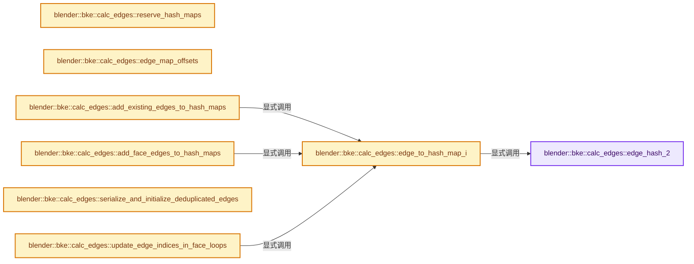
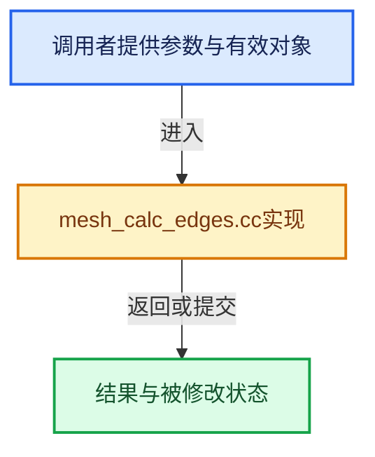

# 实现依赖专题：source/blender/blenkernel/intern/mesh_calc_edges.cc

[实现依赖导航](../../README.md) · [符号索引](../../../00-课程指南/02-源码与提交索引/符号依赖与实现索引.md)

本专题从正文实际调用进入，集中保存共享实现。函数有稳定锚点，可从调用处直接跳到对应完整函数；递归与互相调用通过回链组织。

## 本文件的实现关系






## 完整成员与函数实现

<a id="f-8657d084bdbe2c4d"></a>

### `blender::bke::calc_edges::edge_hash_2`

实现位置：[source/blender/blenkernel/intern/mesh_calc_edges.cc](../../../../../../../source/blender/blenkernel/intern/mesh_calc_edges.cc) · L32—L35。

接口参数：

- `const OrderedEdge &edge`

**教学注释版**

<!-- annotated:4c9fed3a965ea3 -->

```cpp
static uint64_t edge_hash_2(const OrderedEdge &edge)
{
  return edge.v_low;
}
```

<details>
<summary>核对原始源码：source/blender/blenkernel/intern/mesh_calc_edges.cc · L32—L35</summary>

<!-- original:4c9fed3a965ea3:source/blender/blenkernel/intern/mesh_calc_edges.cc:32:35 -->

```cpp
static uint64_t edge_hash_2(const OrderedEdge &edge)
{
  return edge.v_low;
}
```

</details>

**结果出口**

- `return edge.v_low;`

**继续追踪实现**

本实现没有需要继续展开的显式调用；检查返回表达式、对象转换和调用者前置条件。

<a id="f-b7a3aa312636d26b"></a>

### `blender::bke::calc_edges::reserve_hash_maps`

实现位置：[source/blender/blenkernel/intern/mesh_calc_edges.cc](../../../../../../../source/blender/blenkernel/intern/mesh_calc_edges.cc) · L45—L52。

接口参数：

- `const Mesh &mesh`
- `const bool keep_existing_edges`
- `MutableSpan<EdgeMap> edge_maps`

**教学注释版**

<!-- annotated:d81d5868032325 -->

```cpp
static void reserve_hash_maps(const Mesh &mesh,
                              const bool keep_existing_edges,
                              MutableSpan<EdgeMap> edge_maps)
{
  // [讲解] std::max：按比较关系选取较大值。本讲解中的增长公式同时满足最低请求和几何增长；若保存返回引用，还需注意实参寿命。
  const int totedge_guess = std::max(keep_existing_edges ? mesh.edges_num : 0, mesh.faces_num * 2);
  threading::parallel_for_each(
      // [讲解] edge_maps.size：查询视图长度或生成对应有效索引区间。
      edge_maps, [&](EdgeMap &edge_map) { edge_map.reserve(totedge_guess / edge_maps.size()); });
}
```

<details>
<summary>核对原始源码：source/blender/blenkernel/intern/mesh_calc_edges.cc · L45—L52</summary>

<!-- original:d81d5868032325:source/blender/blenkernel/intern/mesh_calc_edges.cc:45:52 -->

```cpp
static void reserve_hash_maps(const Mesh &mesh,
                              const bool keep_existing_edges,
                              MutableSpan<EdgeMap> edge_maps)
{
  const int totedge_guess = std::max(keep_existing_edges ? mesh.edges_num : 0, mesh.faces_num * 2);
  threading::parallel_for_each(
      edge_maps, [&](EdgeMap &edge_map) { edge_map.reserve(totedge_guess / edge_maps.size()); });
}
```

</details>

**继续追踪实现**

- `std::max` → [外部契约](https://eel.is/c++draft/alg.min.max)：按比较关系选取较大值。本讲解中的增长公式同时满足最低请求和几何增长；若保存返回引用，还需注意实参寿命。
- `threading::parallel_for_each` → [blender::threading::parallel_for_each · L30](../../../11-Depsgraph与并行任务系统/07-任务池与TBB接入.md#f-d5604027445ef0f5)。
- `edge_map.reserve` → [调用协议](../../../00-课程指南/01-路线与规范/模板宏与动态分派协议.md)：由接收对象具体类型或运行时策略提供实现。调用位置L51。
- `edge_maps.size` → [blender::MutableSpan::size · L499](../../../01-基础容器与现代CPP/06-MutableSpan可写视图.md#f-1de6a66839c304a8)；[blender::gpu::shader::parser::MutableSpan::size · L87](../../08-其他Blender模块/gpu/shader_tool/utils.hh.md#f-5e684af6ee7990e9)。同名重载需按实参类型选择。

<a id="f-74565f2732a232be"></a>

### `blender::bke::calc_edges::edge_map_offsets`

实现位置：[source/blender/blenkernel/intern/mesh_calc_edges.cc](../../../../../../../source/blender/blenkernel/intern/mesh_calc_edges.cc) · L54—L61。

接口参数：

- `const Span<EdgeMap> maps`
- `Array<int> &r_sizes`

**教学注释版**

<!-- annotated:7a2e844817ce97 -->

```cpp
static OffsetIndices<int> edge_map_offsets(const Span<EdgeMap> maps, Array<int> &r_sizes)
{
  // [讲解] r_sizes.reinitialize：以新长度重建数组。
  r_sizes.reinitialize(maps.size() + 1);
  // [讲解] maps.index_range：查询视图长度或生成对应有效索引区间。
  for (const int map_i : maps.index_range()) {
    r_sizes[map_i] = maps[map_i].size();
  }
  return offset_indices::accumulate_counts_to_offsets(r_sizes);
}
```

<details>
<summary>核对原始源码：source/blender/blenkernel/intern/mesh_calc_edges.cc · L54—L61</summary>

<!-- original:7a2e844817ce97:source/blender/blenkernel/intern/mesh_calc_edges.cc:54:61 -->

```cpp
static OffsetIndices<int> edge_map_offsets(const Span<EdgeMap> maps, Array<int> &r_sizes)
{
  r_sizes.reinitialize(maps.size() + 1);
  for (const int map_i : maps.index_range()) {
    r_sizes[map_i] = maps[map_i].size();
  }
  return offset_indices::accumulate_counts_to_offsets(r_sizes);
}
```

</details>

**沿实际写入检查状态**

- `r_sizes[map_i] = maps[map_i].size();`

**结果出口**

- `return offset_indices::accumulate_counts_to_offsets(r_sizes);`

**继续追踪实现**

- `r_sizes.reinitialize` → [blender::Array::reinitialize · L430](../../../01-基础容器与现代CPP/08-Array复制移动与销毁.md#f-3414f619e246b688)。
- `maps.size` → [blender::Span::size · L256](../../../01-基础容器与现代CPP/05-Span只读连续视图.md#f-5f80fa006089c998)。
- `maps.index_range` → [blender::Span::index_range · L405](../../../01-基础容器与现代CPP/05-Span只读连续视图.md#f-caaa9b06e13e53e0)。
- `maps[map_i].size` → [调用协议](../../../00-课程指南/01-路线与规范/模板宏与动态分派协议.md)：接收对象类型依赖auto、返回值或模板实例；不按同名猜测目标。调用位置L58。
- `offset_indices::accumulate_counts_to_offsets` → [blender::offset_indices::accumulate_counts_to_offsets · L24](../../../05-几何存储与拓扑映射/05-邻接关系与前缀和.md#f-cfa9fbd186afcdd5)。

<a id="f-25063c0d05171d30"></a>

### `blender::bke::calc_edges::edge_to_hash_map_i`

实现位置：[source/blender/blenkernel/intern/mesh_calc_edges.cc](../../../../../../../source/blender/blenkernel/intern/mesh_calc_edges.cc) · L63—L66。

接口参数：

- `const OrderedEdge edge`
- `const uint32_t parallel_mask`

**教学注释版**

<!-- annotated:7371f8f774048a -->

```cpp
static int edge_to_hash_map_i(const OrderedEdge edge, const uint32_t parallel_mask)
{
  return parallel_mask & edge_hash_2(edge);
}
```

<details>
<summary>核对原始源码：source/blender/blenkernel/intern/mesh_calc_edges.cc · L63—L66</summary>

<!-- original:7371f8f774048a:source/blender/blenkernel/intern/mesh_calc_edges.cc:63:66 -->

```cpp
static int edge_to_hash_map_i(const OrderedEdge edge, const uint32_t parallel_mask)
{
  return parallel_mask & edge_hash_2(edge);
}
```

</details>

**结果出口**

- `return parallel_mask & edge_hash_2(edge);`

**继续追踪实现**

- `edge_hash_2` → [blender::bke::calc_edges::edge_hash_2 · L32](mesh_calc_edges.cc.md#f-8657d084bdbe2c4d)。

<a id="f-035313f85c7d266f"></a>

### `blender::bke::calc_edges::add_existing_edges_to_hash_maps`

实现位置：[source/blender/blenkernel/intern/mesh_calc_edges.cc](../../../../../../../source/blender/blenkernel/intern/mesh_calc_edges.cc) · L68—L84。

接口参数：

- `const Mesh &mesh`
- `const uint32_t parallel_mask`
- `MutableSpan<EdgeMap> edge_maps`

**教学注释版**

<!-- annotated:3ebd18080252ba -->

```cpp
static void add_existing_edges_to_hash_maps(const Mesh &mesh,
                                            const uint32_t parallel_mask,
                                            MutableSpan<EdgeMap> edge_maps)
{
  /* Assume existing edges are valid. */
  const Span<int2> edges = mesh.edges();
  threading::parallel_for_each(edge_maps, [&](EdgeMap &edge_map) {
    // [讲解] edge_maps.data：返回借用范围的地址。
    const int task_index = &edge_map - edge_maps.data();
    for (const int2 edge : edges) {
      const OrderedEdge ordered_edge(edge);
      /* Only add the edge when it belongs into this map. */
      if (task_index == edge_to_hash_map_i(ordered_edge, parallel_mask)) {
        edge_map.add(ordered_edge);
      }
    }
  });
}
```

<details>
<summary>核对原始源码：source/blender/blenkernel/intern/mesh_calc_edges.cc · L68—L84</summary>

<!-- original:3ebd18080252ba:source/blender/blenkernel/intern/mesh_calc_edges.cc:68:84 -->

```cpp
static void add_existing_edges_to_hash_maps(const Mesh &mesh,
                                            const uint32_t parallel_mask,
                                            MutableSpan<EdgeMap> edge_maps)
{
  /* Assume existing edges are valid. */
  const Span<int2> edges = mesh.edges();
  threading::parallel_for_each(edge_maps, [&](EdgeMap &edge_map) {
    const int task_index = &edge_map - edge_maps.data();
    for (const int2 edge : edges) {
      const OrderedEdge ordered_edge(edge);
      /* Only add the edge when it belongs into this map. */
      if (task_index == edge_to_hash_map_i(ordered_edge, parallel_mask)) {
        edge_map.add(ordered_edge);
      }
    }
  });
}
```

</details>

**继续追踪实现**

- `mesh.edges` → [Mesh::edges · L1205](../../../05-几何存储与拓扑映射/03-MPoly迁移与兼容.md#f-7232f6756b674d12)。
- `threading::parallel_for_each` → [blender::threading::parallel_for_each · L30](../../../11-Depsgraph与并行任务系统/07-任务池与TBB接入.md#f-d5604027445ef0f5)。
- `edge_maps.data` → [blender::MutableSpan::data · L545](../../../01-基础容器与现代CPP/06-MutableSpan可写视图.md#f-eb45a6e4d8211efd)；[blender::gpu::shader::parser::MutableSpan::data · L82](../../08-其他Blender模块/gpu/shader_tool/utils.hh.md#f-ad0a09cec9741c65)。同名重载需按实参类型选择。
- `edge_to_hash_map_i` → [blender::bke::calc_edges::edge_to_hash_map_i · L63](mesh_calc_edges.cc.md#f-25063c0d05171d30)。
- `edge_map.add` → [调用协议](../../../00-课程指南/01-路线与规范/模板宏与动态分派协议.md)：由接收对象具体类型或运行时策略提供实现。调用位置L80。

<a id="f-ef8a104be2074bb2"></a>

### `blender::bke::calc_edges::add_face_edges_to_hash_maps`

实现位置：[source/blender/blenkernel/intern/mesh_calc_edges.cc](../../../../../../../source/blender/blenkernel/intern/mesh_calc_edges.cc) · L86—L107。

接口参数：

- `const Mesh &mesh`
- `const uint32_t parallel_mask`
- `MutableSpan<EdgeMap> edge_maps`

**教学注释版**

<!-- annotated:c4fe26fb3d67b4 -->

```cpp
static void add_face_edges_to_hash_maps(const Mesh &mesh,
                                        const uint32_t parallel_mask,
                                        MutableSpan<EdgeMap> edge_maps)
{
  const OffsetIndices<int> faces = mesh.faces();
  const Span<int> corner_verts = mesh.corner_verts();
  threading::parallel_for_each(edge_maps, [&](EdgeMap &edge_map) {
    // [讲解] edge_maps.data：返回借用范围的地址。
    const int task_index = &edge_map - edge_maps.data();
    for (const int face_i : faces.index_range()) {
      const IndexRange face = faces[face_i];
      for (const int corner : face) {
        const int vert = corner_verts[corner];
        const int vert_prev = corner_verts[bke::mesh::face_corner_prev(face, corner)];
        const OrderedEdge ordered_edge(vert_prev, vert);
        /* Only add the edge when it belongs into this map. */
        if (task_index == edge_to_hash_map_i(ordered_edge, parallel_mask)) {
          edge_map.add(ordered_edge);
        }
      }
    }
  });
}
```

<details>
<summary>核对原始源码：source/blender/blenkernel/intern/mesh_calc_edges.cc · L86—L107</summary>

<!-- original:c4fe26fb3d67b4:source/blender/blenkernel/intern/mesh_calc_edges.cc:86:107 -->

```cpp
static void add_face_edges_to_hash_maps(const Mesh &mesh,
                                        const uint32_t parallel_mask,
                                        MutableSpan<EdgeMap> edge_maps)
{
  const OffsetIndices<int> faces = mesh.faces();
  const Span<int> corner_verts = mesh.corner_verts();
  threading::parallel_for_each(edge_maps, [&](EdgeMap &edge_map) {
    const int task_index = &edge_map - edge_maps.data();
    for (const int face_i : faces.index_range()) {
      const IndexRange face = faces[face_i];
      for (const int corner : face) {
        const int vert = corner_verts[corner];
        const int vert_prev = corner_verts[bke::mesh::face_corner_prev(face, corner)];
        const OrderedEdge ordered_edge(vert_prev, vert);
        /* Only add the edge when it belongs into this map. */
        if (task_index == edge_to_hash_map_i(ordered_edge, parallel_mask)) {
          edge_map.add(ordered_edge);
        }
      }
    }
  });
}
```

</details>

**继续追踪实现**

- `mesh.faces` → [Mesh::faces · L1217](../../../05-几何存储与拓扑映射/03-MPoly迁移与兼容.md#f-ea444760154e17b2)。
- `mesh.corner_verts` → [Mesh::corner_verts · L1238](../../../05-几何存储与拓扑映射/03-MPoly迁移与兼容.md#f-a59c61f583b64bc4)。
- `threading::parallel_for_each` → [blender::threading::parallel_for_each · L30](../../../11-Depsgraph与并行任务系统/07-任务池与TBB接入.md#f-d5604027445ef0f5)。
- `edge_maps.data` → [blender::MutableSpan::data · L545](../../../01-基础容器与现代CPP/06-MutableSpan可写视图.md#f-eb45a6e4d8211efd)；[blender::gpu::shader::parser::MutableSpan::data · L82](../../08-其他Blender模块/gpu/shader_tool/utils.hh.md#f-ad0a09cec9741c65)。同名重载需按实参类型选择。
- `faces.index_range` → [blender::offset_indices::OffsetIndices::index_range · L77](../../../05-几何存储与拓扑映射/02-OffsetIndices完整接口.md#f-19b5ca1456de007d)。
- `bke::mesh::face_corner_prev` → [blender::bke::mesh::face_corner_prev · L306](../../../05-几何存储与拓扑映射/01-Mesh顶点边面角点.md#f-7d8f15af3216c9f5)。
- `edge_to_hash_map_i` → [blender::bke::calc_edges::edge_to_hash_map_i · L63](mesh_calc_edges.cc.md#f-25063c0d05171d30)。
- `edge_map.add` → [调用协议](../../../00-课程指南/01-路线与规范/模板宏与动态分派协议.md)：由接收对象具体类型或运行时策略提供实现。调用位置L102。

<a id="f-31f7d8303344329e"></a>

### `blender::bke::calc_edges::serialize_and_initialize_deduplicated_edges`

实现位置：[source/blender/blenkernel/intern/mesh_calc_edges.cc](../../../../../../../source/blender/blenkernel/intern/mesh_calc_edges.cc) · L109—L134。

接口参数：

- `MutableSpan<EdgeMap> edge_maps`
- `const OffsetIndices<int> edge_offsets`
- `const OffsetIndices<int> prefix_skip_offsets`
- `MutableSpan<int2> new_edges`

**教学注释版**

<!-- annotated:4650c7f7664846 -->

```cpp
static void serialize_and_initialize_deduplicated_edges(
    MutableSpan<EdgeMap> edge_maps,
    const OffsetIndices<int> edge_offsets,
    const OffsetIndices<int> prefix_skip_offsets,
    MutableSpan<int2> new_edges)
{
  threading::parallel_for_each(edge_maps, [&](EdgeMap &edge_map) {
    // [讲解] edge_maps.data：返回借用范围的地址。
    const int task_index = &edge_map - edge_maps.data();
    if (edge_offsets[task_index].is_empty()) {
      return;
    }

    if (prefix_skip_offsets[task_index].size() == edge_offsets[task_index].size()) {
      return;
    }

    const IndexRange all_map_edges = edge_offsets[task_index];
    const IndexRange prefix_to_skip = prefix_skip_offsets[task_index];
    const IndexRange map_edges = IndexRange::from_begin_size(
        // [讲解] all_map_edges.start：读取连续区间或分组的边界信息。
        all_map_edges.start() - prefix_to_skip.start(),
        // [讲解] all_map_edges.size：读取连续区间或分组的边界信息。
        all_map_edges.size() - prefix_to_skip.size());

    // [讲解] new_edges.slice：建立原连续范围的子视图。
    MutableSpan<int2> result_edges = new_edges.slice(map_edges);
    // [讲解] result_edges.copy_from：修改已有目标元素，不改变底层容器长度。
    result_edges.copy_from(edge_map.as_span().drop_front(prefix_to_skip.size()).cast<int2>());
  });
}
```

<details>
<summary>核对原始源码：source/blender/blenkernel/intern/mesh_calc_edges.cc · L109—L134</summary>

<!-- original:4650c7f7664846:source/blender/blenkernel/intern/mesh_calc_edges.cc:109:134 -->

```cpp
static void serialize_and_initialize_deduplicated_edges(
    MutableSpan<EdgeMap> edge_maps,
    const OffsetIndices<int> edge_offsets,
    const OffsetIndices<int> prefix_skip_offsets,
    MutableSpan<int2> new_edges)
{
  threading::parallel_for_each(edge_maps, [&](EdgeMap &edge_map) {
    const int task_index = &edge_map - edge_maps.data();
    if (edge_offsets[task_index].is_empty()) {
      return;
    }

    if (prefix_skip_offsets[task_index].size() == edge_offsets[task_index].size()) {
      return;
    }

    const IndexRange all_map_edges = edge_offsets[task_index];
    const IndexRange prefix_to_skip = prefix_skip_offsets[task_index];
    const IndexRange map_edges = IndexRange::from_begin_size(
        all_map_edges.start() - prefix_to_skip.start(),
        all_map_edges.size() - prefix_to_skip.size());

    MutableSpan<int2> result_edges = new_edges.slice(map_edges);
    result_edges.copy_from(edge_map.as_span().drop_front(prefix_to_skip.size()).cast<int2>());
  });
}
```

</details>

**继续追踪实现**

- `threading::parallel_for_each` → [blender::threading::parallel_for_each · L30](../../../11-Depsgraph与并行任务系统/07-任务池与TBB接入.md#f-d5604027445ef0f5)。
- `edge_maps.data` → [blender::MutableSpan::data · L545](../../../01-基础容器与现代CPP/06-MutableSpan可写视图.md#f-eb45a6e4d8211efd)；[blender::gpu::shader::parser::MutableSpan::data · L82](../../08-其他Blender模块/gpu/shader_tool/utils.hh.md#f-ad0a09cec9741c65)。同名重载需按实参类型选择。
- `edge_offsets[task_index].is_empty` → [调用协议](../../../00-课程指南/01-路线与规范/模板宏与动态分派协议.md)：接收对象类型依赖auto、返回值或模板实例；不按同名猜测目标。调用位置L117。
- `prefix_skip_offsets[task_index].size` → [调用协议](../../../00-课程指南/01-路线与规范/模板宏与动态分派协议.md)：接收对象类型依赖auto、返回值或模板实例；不按同名猜测目标。调用位置L121。
- `edge_offsets[task_index].size` → [调用协议](../../../00-课程指南/01-路线与规范/模板宏与动态分派协议.md)：接收对象类型依赖auto、返回值或模板实例；不按同名猜测目标。调用位置L121。
- `IndexRange::from_begin_size` → [blender::IndexRange::from_begin_size · L73](../../../01-基础容器与现代CPP/04-IndexRange连续整数区间.md#f-392d3c73c80f255d)。
- `all_map_edges.start` → [blender::IndexRange::start · L243](../../../01-基础容器与现代CPP/04-IndexRange连续整数区间.md#f-99d2195bd9cfd1f0)。
- `prefix_to_skip.start` → [blender::IndexRange::start · L243](../../../01-基础容器与现代CPP/04-IndexRange连续整数区间.md#f-99d2195bd9cfd1f0)。
- `all_map_edges.size` → [blender::IndexRange::size · L156](../../../01-基础容器与现代CPP/04-IndexRange连续整数区间.md#f-05f66c3ebb2fdfec)。
- `prefix_to_skip.size` → [blender::IndexRange::size · L156](../../../01-基础容器与现代CPP/04-IndexRange连续整数区间.md#f-05f66c3ebb2fdfec)。
- `new_edges.slice` → [blender::MutableSpan::slice · L579](../../../01-基础容器与现代CPP/06-MutableSpan可写视图.md#f-6808b4aefbf58808)；[blender::MutableSpan::slice · L587](../../../01-基础容器与现代CPP/06-MutableSpan可写视图.md#f-c05b010821861e4f)。同名重载需按实参类型选择。
- `result_edges.copy_from` → [blender::MutableSpan::copy_from · L745](../../../01-基础容器与现代CPP/06-MutableSpan可写视图.md#f-e4f099b1497adddb)。
- `edge_map.as_span().drop_front(prefix_to_skip.size()).cast<int2>` → [调用协议](../../../00-课程指南/01-路线与规范/模板宏与动态分派协议.md)：接收对象类型依赖auto、返回值或模板实例；不按同名猜测目标。调用位置L132。
- `edge_map.as_span().drop_front` → [调用协议](../../../00-课程指南/01-路线与规范/模板宏与动态分派协议.md)：接收对象类型依赖auto、返回值或模板实例；不按同名猜测目标。调用位置L132。
- `edge_map.as_span` → [调用协议](../../../00-课程指南/01-路线与规范/模板宏与动态分派协议.md)：由接收对象具体类型或运行时策略提供实现。调用位置L132。

<a id="f-1e0e4cd822b4fe7d"></a>

### `blender::bke::calc_edges::update_edge_indices_in_face_loops`

实现位置：[source/blender/blenkernel/intern/mesh_calc_edges.cc](../../../../../../../source/blender/blenkernel/intern/mesh_calc_edges.cc) · L136—L158。

接口参数：

- `const OffsetIndices<int> faces`
- `const Span<int> corner_verts`
- `const Span<EdgeMap> edge_maps`
- `const uint32_t parallel_mask`
- `const OffsetIndices<int> edge_offsets`
- `MutableSpan<int> corner_edges`

**教学注释版**

<!-- annotated:59c65f2d25ac2b -->

```cpp
static void update_edge_indices_in_face_loops(const OffsetIndices<int> faces,
                                              const Span<int> corner_verts,
                                              const Span<EdgeMap> edge_maps,
                                              const uint32_t parallel_mask,
                                              const OffsetIndices<int> edge_offsets,
                                              MutableSpan<int> corner_edges)
{
  threading::parallel_for(faces.index_range(), 100, [&](IndexRange range) {
    for (const int face_index : range) {
      const IndexRange face = faces[face_index];
      for (const int corner : face) {
        const int vert = corner_verts[corner];
        const int vert_prev = corner_verts[bke::mesh::face_corner_next(face, corner)];
        const OrderedEdge ordered_edge(vert_prev, vert);
        const int task_index = edge_to_hash_map_i(ordered_edge, parallel_mask);
        const EdgeMap &edge_map = edge_maps[task_index];
        const int edge_i = edge_map.index_of(ordered_edge);
        const int edge_index = edge_offsets[task_index][edge_i];
        corner_edges[corner] = edge_index;
      }
    }
  });
}
```

<details>
<summary>核对原始源码：source/blender/blenkernel/intern/mesh_calc_edges.cc · L136—L158</summary>

<!-- original:59c65f2d25ac2b:source/blender/blenkernel/intern/mesh_calc_edges.cc:136:158 -->

```cpp
static void update_edge_indices_in_face_loops(const OffsetIndices<int> faces,
                                              const Span<int> corner_verts,
                                              const Span<EdgeMap> edge_maps,
                                              const uint32_t parallel_mask,
                                              const OffsetIndices<int> edge_offsets,
                                              MutableSpan<int> corner_edges)
{
  threading::parallel_for(faces.index_range(), 100, [&](IndexRange range) {
    for (const int face_index : range) {
      const IndexRange face = faces[face_index];
      for (const int corner : face) {
        const int vert = corner_verts[corner];
        const int vert_prev = corner_verts[bke::mesh::face_corner_next(face, corner)];
        const OrderedEdge ordered_edge(vert_prev, vert);
        const int task_index = edge_to_hash_map_i(ordered_edge, parallel_mask);
        const EdgeMap &edge_map = edge_maps[task_index];
        const int edge_i = edge_map.index_of(ordered_edge);
        const int edge_index = edge_offsets[task_index][edge_i];
        corner_edges[corner] = edge_index;
      }
    }
  });
}
```

</details>

**沿实际写入检查状态**

- `corner_edges[corner] = edge_index;`

**继续追踪实现**

- `threading::parallel_for` → [blender::threading::parallel_for · L68](../../../11-Depsgraph与并行任务系统/07-任务池与TBB接入.md#f-838294754c24426c)。
- `faces.index_range` → [blender::offset_indices::OffsetIndices::index_range · L77](../../../05-几何存储与拓扑映射/02-OffsetIndices完整接口.md#f-19b5ca1456de007d)。
- `bke::mesh::face_corner_next` → [blender::bke::mesh::face_corner_next · L315](../../../05-几何存储与拓扑映射/01-Mesh顶点边面角点.md#f-bf639df87b51fe48)。
- `edge_to_hash_map_i` → [blender::bke::calc_edges::edge_to_hash_map_i · L63](mesh_calc_edges.cc.md#f-25063c0d05171d30)。
- `edge_map.index_of` → [调用协议](../../../00-课程指南/01-路线与规范/模板宏与动态分派协议.md)：由接收对象具体类型或运行时策略提供实现。调用位置L152。

<a id="f-01365f6ccb6830d2"></a>

### `blender::bke::calc_edges::get_parallel_maps_count`

实现位置：[source/blender/blenkernel/intern/mesh_calc_edges.cc](../../../../../../../source/blender/blenkernel/intern/mesh_calc_edges.cc) · L160—L170。

接口参数：

- `const Mesh &mesh`

**教学注释版**

<!-- annotated:5730bc3e954adb -->

```cpp
static int get_parallel_maps_count(const Mesh &mesh)
{
  /* Don't use parallelization when the mesh is small. */
  if (mesh.faces_num < 1000) {
    return 1;
  }
  /* Use at most 8 separate hash tables. Using more threads has diminishing returns. These threads
   * are better off doing something more useful instead. */
  const int system_thread_count = BLI_system_thread_count();
  // [讲解] std::min：按比较关系选取较小值；截断范围时还需先满足非负和可表示范围，min本身不会证明边界安全。
  return power_of_2_min_i(std::min(8, system_thread_count));
}
```

<details>
<summary>核对原始源码：source/blender/blenkernel/intern/mesh_calc_edges.cc · L160—L170</summary>

<!-- original:5730bc3e954adb:source/blender/blenkernel/intern/mesh_calc_edges.cc:160:170 -->

```cpp
static int get_parallel_maps_count(const Mesh &mesh)
{
  /* Don't use parallelization when the mesh is small. */
  if (mesh.faces_num < 1000) {
    return 1;
  }
  /* Use at most 8 separate hash tables. Using more threads has diminishing returns. These threads
   * are better off doing something more useful instead. */
  const int system_thread_count = BLI_system_thread_count();
  return power_of_2_min_i(std::min(8, system_thread_count));
}
```

</details>

**结果出口**

- `return 1;`
- `return power_of_2_min_i(std::min(8, system_thread_count));`

**继续追踪实现**

- `BLI_system_thread_count` → [BLI_system_thread_count · L258](../../01-BLI基础库/intern/threads.cc.md#f-12aff71a24fecec4)。
- `power_of_2_min_i` → [blender::power_of_2_min_i · L123](../../01-BLI基础库/intern/math_base_inline.cc.md#f-9bbfa512c2df99c4)。
- `std::min` → [外部契约](https://eel.is/c++draft/alg.min.max)：按比较关系选取较小值；截断范围时还需先满足非负和可表示范围，min本身不会证明边界安全。

<a id="f-133dc140807623c1"></a>

### `blender::bke::calc_edges::clear_hash_tables`

实现位置：[source/blender/blenkernel/intern/mesh_calc_edges.cc](../../../../../../../source/blender/blenkernel/intern/mesh_calc_edges.cc) · L172—L175。

接口参数：

- `MutableSpan<EdgeMap> edge_maps`

**教学注释版**

<!-- annotated:8bfae20967b48e -->

```cpp
static void clear_hash_tables(MutableSpan<EdgeMap> edge_maps)
{
  threading::parallel_for_each(edge_maps, [](EdgeMap &edge_map) { edge_map.clear(); });
}
```

<details>
<summary>核对原始源码：source/blender/blenkernel/intern/mesh_calc_edges.cc · L172—L175</summary>

<!-- original:8bfae20967b48e:source/blender/blenkernel/intern/mesh_calc_edges.cc:172:175 -->

```cpp
static void clear_hash_tables(MutableSpan<EdgeMap> edge_maps)
{
  threading::parallel_for_each(edge_maps, [](EdgeMap &edge_map) { edge_map.clear(); });
}
```

</details>

**继续追踪实现**

- `threading::parallel_for_each` → [blender::threading::parallel_for_each · L30](../../../11-Depsgraph与并行任务系统/07-任务池与TBB接入.md#f-d5604027445ef0f5)。
- `edge_map.clear` → [EdgeMap::clear · L793](../../07-Intern运行时与平台/cycles/blender/util.h.md#f-f65184d8131f6720)。

<a id="f-9cbd78a58935b459"></a>

### `blender::bke::calc_edges::mask_first_distinct_edges`

实现位置：[source/blender/blenkernel/intern/mesh_calc_edges.cc](../../../../../../../source/blender/blenkernel/intern/mesh_calc_edges.cc) · L177—L211。

接口参数：

- `const Span<int2> edges`
- `const IndexMask &edges_to_check`
- `const Span<EdgeMap> edge_maps`
- `const uint32_t parallel_mask`
- `const OffsetIndices<int> edge_offsets`
- `IndexMaskMemory &memory`

**教学注释版**

<!-- annotated:ab3863e78ee76b -->

```cpp
static IndexMask mask_first_distinct_edges(const Span<int2> edges,
                                           const IndexMask &edges_to_check,
                                           const Span<EdgeMap> edge_maps,
                                           const uint32_t parallel_mask,
                                           const OffsetIndices<int> edge_offsets,
                                           IndexMaskMemory &memory)
{
  if (edges_to_check.is_empty()) {
    return {};
  }

  // [讲解] std::numeric_limits<int>::max：按比较关系选取较大值。本讲解中的增长公式同时满足最低请求和几何增长；若保存返回引用，还需注意实参寿命。
  constexpr int no_original_edge = std::numeric_limits<int>::max();
  Array<int> map_edge_to_first_original(edge_offsets.total_size());
  // [讲解] map_edge_to_first_original.as_mutable_span：提供数组的借用访问入口。
  map_edge_to_first_original.as_mutable_span().fill(no_original_edge);

  /* TODO: Lock-free parallel version? BLI' "atomic::min<T>(T&, T);" ? */
  edges_to_check.foreach_index_optimized<int>([&](const int edge_i) {
    const OrderedEdge edge = edges[edge_i];
    const int map_i = calc_edges::edge_to_hash_map_i(edge, parallel_mask);
    const int edge_index = edge_maps[map_i].index_of(edge);

    int &original_edge = map_edge_to_first_original[edge_offsets[map_i][edge_index]];
    original_edge = math::min(original_edge, edge_i);
  });

  /* Note: #map_edge_to_first_original might still contains #no_original_edge if edges was both non
   * distinct and not full set. */

  return IndexMask::from_predicate(edges_to_check, memory, [&](const int srd_edge_i) {
    const OrderedEdge edge = edges[srd_edge_i];
    const int map_i = calc_edges::edge_to_hash_map_i(edge, parallel_mask);
    const int edge_index = edge_maps[map_i].index_of(edge);
    return map_edge_to_first_original[edge_offsets[map_i][edge_index]] == srd_edge_i;
  });
}
```

<details>
<summary>核对原始源码：source/blender/blenkernel/intern/mesh_calc_edges.cc · L177—L211</summary>

<!-- original:ab3863e78ee76b:source/blender/blenkernel/intern/mesh_calc_edges.cc:177:211 -->

```cpp
static IndexMask mask_first_distinct_edges(const Span<int2> edges,
                                           const IndexMask &edges_to_check,
                                           const Span<EdgeMap> edge_maps,
                                           const uint32_t parallel_mask,
                                           const OffsetIndices<int> edge_offsets,
                                           IndexMaskMemory &memory)
{
  if (edges_to_check.is_empty()) {
    return {};
  }

  constexpr int no_original_edge = std::numeric_limits<int>::max();
  Array<int> map_edge_to_first_original(edge_offsets.total_size());
  map_edge_to_first_original.as_mutable_span().fill(no_original_edge);

  /* TODO: Lock-free parallel version? BLI' "atomic::min<T>(T&, T);" ? */
  edges_to_check.foreach_index_optimized<int>([&](const int edge_i) {
    const OrderedEdge edge = edges[edge_i];
    const int map_i = calc_edges::edge_to_hash_map_i(edge, parallel_mask);
    const int edge_index = edge_maps[map_i].index_of(edge);

    int &original_edge = map_edge_to_first_original[edge_offsets[map_i][edge_index]];
    original_edge = math::min(original_edge, edge_i);
  });

  /* Note: #map_edge_to_first_original might still contains #no_original_edge if edges was both non
   * distinct and not full set. */

  return IndexMask::from_predicate(edges_to_check, memory, [&](const int srd_edge_i) {
    const OrderedEdge edge = edges[srd_edge_i];
    const int map_i = calc_edges::edge_to_hash_map_i(edge, parallel_mask);
    const int edge_index = edge_maps[map_i].index_of(edge);
    return map_edge_to_first_original[edge_offsets[map_i][edge_index]] == srd_edge_i;
  });
}
```

</details>

**沿实际写入检查状态**

- `original_edge = math::min(original_edge, edge_i);`

**结果出口**

- `return {};`
- `return IndexMask::from_predicate(edges_to_check, memory, [&](const int srd_edge_i) {`
- `return map_edge_to_first_original[edge_offsets[map_i][edge_index]] == srd_edge_i;`

**继续追踪实现**

- `edges_to_check.is_empty` → [blender::index_mask::IndexMask::is_empty · L748](../../../04-虚拟数组与索引选择/09-分段存储与遍历.md#f-190ac996386064f4)。
- `std::numeric_limits<int>::max` → [外部契约](https://eel.is/c++draft/alg.min.max)：按比较关系选取较大值。本讲解中的增长公式同时满足最低请求和几何增长；若保存返回引用，还需注意实参寿命。
- `edge_offsets.total_size` → [blender::offset_indices::OffsetIndices::total_size · L58](../../../05-几何存储与拓扑映射/02-OffsetIndices完整接口.md#f-c111ffdac7a19248)。
- `map_edge_to_first_original.as_mutable_span().fill` → [调用协议](../../../00-课程指南/01-路线与规范/模板宏与动态分派协议.md)：接收对象类型依赖auto、返回值或模板实例；不按同名猜测目标。调用位置L190。
- `map_edge_to_first_original.as_mutable_span` → [blender::Array::as_mutable_span · L259](../../../01-基础容器与现代CPP/08-Array复制移动与销毁.md#f-4e91de9f1337c144)。
- `edges_to_check.foreach_index_optimized<int>` → [blender::index_mask::IndexMask::foreach_index_optimized · L937](../../../04-虚拟数组与索引选择/12-重构历史与基准练习.md#f-a2c3e7876407eaaf)。
- `calc_edges::edge_to_hash_map_i` → [blender::bke::calc_edges::edge_to_hash_map_i · L63](mesh_calc_edges.cc.md#f-25063c0d05171d30)。
- `edge_maps[map_i].index_of` → [调用协议](../../../00-课程指南/01-路线与规范/模板宏与动态分派协议.md)：接收对象类型依赖auto、返回值或模板实例；不按同名猜测目标。调用位置L196。
- `math::min` → [blender::math::min · L56](../../01-BLI基础库/BLI_math_vector.hh.md#f-ee6ead51e4bb3364)；[blender::math::min · L65](../../01-BLI基础库/BLI_math_vector.hh.md#f-f65ce48b3051cce3)；[blender::math::min · L81](../../01-BLI基础库/BLI_math_vector.hh.md#f-9c602d29fab41795)；[blender::math::min · L43](../../01-BLI基础库/BLI_math_base.hh.md#f-72ff0c229e6c09b0)。同名重载需按实参类型选择。
- `IndexMask::from_predicate` → [blender::index_mask::IndexMask::from_predicate · L1073](../../../04-虚拟数组与索引选择/12-重构历史与基准练习.md#f-3864daa059098df8)。

<a id="f-2d06c072b1034597"></a>

### `blender::bke::calc_edges::map_edge_to_span_index`

实现位置：[source/blender/blenkernel/intern/mesh_calc_edges.cc](../../../../../../../source/blender/blenkernel/intern/mesh_calc_edges.cc) · L213—L230。

接口参数：

- `const Span<int2> edges`
- `const Span<EdgeMap> edge_maps`
- `const uint32_t parallel_mask`
- `const OffsetIndices<int> edge_offsets`
- `MutableSpan<int> indices`

**教学注释版**

<!-- annotated:d3b247ef3bc714 -->

```cpp
static void map_edge_to_span_index(const Span<int2> edges,
                                   const Span<EdgeMap> edge_maps,
                                   const uint32_t parallel_mask,
                                   const OffsetIndices<int> edge_offsets,
                                   MutableSpan<int> indices)
{
  // [讲解] edge_maps.index_range：查询视图长度或生成对应有效索引区间。
  threading::parallel_for_each(edge_maps.index_range(), [&](const int map_i) {
    int edge_map_iter = 0;
    for (const int edge_i : edges.index_range()) {
      const int edge_map = calc_edges::edge_to_hash_map_i(edges[edge_i], parallel_mask);
      if (map_i != edge_map) {
        continue;
      }
      indices[edge_offsets[edge_map][edge_map_iter]] = edge_i;
      edge_map_iter++;
    }
  });
}
```

<details>
<summary>核对原始源码：source/blender/blenkernel/intern/mesh_calc_edges.cc · L213—L230</summary>

<!-- original:d3b247ef3bc714:source/blender/blenkernel/intern/mesh_calc_edges.cc:213:230 -->

```cpp
static void map_edge_to_span_index(const Span<int2> edges,
                                   const Span<EdgeMap> edge_maps,
                                   const uint32_t parallel_mask,
                                   const OffsetIndices<int> edge_offsets,
                                   MutableSpan<int> indices)
{
  threading::parallel_for_each(edge_maps.index_range(), [&](const int map_i) {
    int edge_map_iter = 0;
    for (const int edge_i : edges.index_range()) {
      const int edge_map = calc_edges::edge_to_hash_map_i(edges[edge_i], parallel_mask);
      if (map_i != edge_map) {
        continue;
      }
      indices[edge_offsets[edge_map][edge_map_iter]] = edge_i;
      edge_map_iter++;
    }
  });
}
```

</details>

**沿实际写入检查状态**

- `indices[edge_offsets[edge_map][edge_map_iter]] = edge_i;`

**继续追踪实现**

- `threading::parallel_for_each` → [blender::threading::parallel_for_each · L30](../../../11-Depsgraph与并行任务系统/07-任务池与TBB接入.md#f-d5604027445ef0f5)。
- `edge_maps.index_range` → [blender::Span::index_range · L405](../../../01-基础容器与现代CPP/05-Span只读连续视图.md#f-caaa9b06e13e53e0)。
- `edges.index_range` → [blender::Span::index_range · L405](../../../01-基础容器与现代CPP/05-Span只读连续视图.md#f-caaa9b06e13e53e0)。
- `calc_edges::edge_to_hash_map_i` → [blender::bke::calc_edges::edge_to_hash_map_i · L63](mesh_calc_edges.cc.md#f-25063c0d05171d30)。

<a id="f-8dc1463382ec6743"></a>

### `blender::bke::mesh_calc_edges`

实现位置：[source/blender/blenkernel/intern/mesh_calc_edges.cc](../../../../../../../source/blender/blenkernel/intern/mesh_calc_edges.cc) · L234—L576。

接口参数：

- `Mesh &mesh`
- `bool keep_existing_edges`
- `const bool select_new_edges`
- `const AttributeFilter &attribute_filter`

**教学注释版**

<!-- annotated:6bd8a96c648a58 -->

```cpp
void mesh_calc_edges(Mesh &mesh,
                     bool keep_existing_edges,
                     const bool select_new_edges,
                     const AttributeFilter &attribute_filter)
{

  if (mesh.edges_num == 0 && mesh.corners_num == 0) {
    /* BLI_assert(mesh_is_valid(mesh)); */
    return;
  }

  if (mesh.corners_num == 0 && !keep_existing_edges) {
    CustomData_free(&mesh.edge_data);
    mesh.edges_num = 0;
    mesh.tag_loose_edges_none();
    /* BLI_assert(mesh_is_valid(mesh)); */
    return;
  }

  BLI_assert(std::all_of(mesh.edges().begin(), mesh.edges().end(), [&](const int2 edge) {
    return edge.x != edge.y;
  }));

  /* Parallelization is achieved by having multiple hash tables for different subsets of edges.
   * Each edge is assigned to one of the hash maps based on the lower bits of a hash value. */
  const int parallel_maps = calc_edges::get_parallel_maps_count(mesh);
  BLI_assert(is_power_of_2_i(parallel_maps));
  const uint32_t parallel_mask = uint32_t(parallel_maps) - 1;
  Array<calc_edges::EdgeMap> edge_maps(parallel_maps);
  calc_edges::reserve_hash_maps(mesh, keep_existing_edges, edge_maps);

  // [讲解] edge_maps.size：查询固定有效长度及其索引范围。
  Array<int> original_edge_maps_prefix_size(edge_maps.size() + 1, 0);
  if (keep_existing_edges) {
    calc_edges::add_existing_edges_to_hash_maps(mesh, parallel_mask, edge_maps);
    calc_edges::edge_map_offsets(edge_maps, original_edge_maps_prefix_size);
  }
  // [讲解] original_edge_maps_prefix_size.as_span：提供数组的借用访问入口。
  const OffsetIndices<int> original_edge_maps_prefix(original_edge_maps_prefix_size.as_span());
  const int original_unique_edge_num = original_edge_maps_prefix.total_size();
  const bool original_edges_are_distinct = original_unique_edge_num == mesh.edges_num;

  if (mesh.corners_num == 0 && keep_existing_edges && original_edges_are_distinct) {
    /* BLI_assert(mesh_is_valid(&mesh)); */
    return;
  }

  calc_edges::add_face_edges_to_hash_maps(mesh, parallel_mask, edge_maps);
  Array<int> edge_sizes;
  const OffsetIndices<int> edge_offsets = calc_edges::edge_map_offsets(edge_maps, edge_sizes);
  const bool no_new_edges = edge_offsets.total_size() == original_unique_edge_num;

  MutableAttributeAccessor dst_attributes = mesh.attributes_for_write();
  dst_attributes.add<int>(".corner_edge", AttrDomain::Corner, AttributeInitConstruct());
  MutableSpan<int> corner_edges = mesh.corner_edges_for_write();
#ifndef NDEBUG
  // [讲解] corner_edges.fill：修改已有目标元素，不改变底层容器长度。
  corner_edges.fill(-1);
#endif

  const int result_edges_num = edge_offsets.total_size();

  const OffsetIndices<int> faces = mesh.faces();
  const Span<int2> original_edges = mesh.edges();
  const Span<int> corner_verts = mesh.corner_verts();
  if (keep_existing_edges && original_edges_are_distinct && no_new_edges) {
    /* We need a way to say from caller side if we should generate corner edge attribute even in
     * that case. TODO: make this optional. */
    calc_edges::update_edge_indices_in_face_loops(
        faces, corner_verts, edge_maps, parallel_mask, edge_offsets, corner_edges);

    Array<int> edge_map_to_result_index(result_edges_num);
#ifndef NDEBUG
    // [讲解] edge_map_to_result_index.as_mutable_span：提供数组的借用访问入口。
    edge_map_to_result_index.as_mutable_span().fill(-1);
#endif
    calc_edges::map_edge_to_span_index(
        original_edges, edge_maps, parallel_mask, edge_offsets, edge_map_to_result_index);
    array_utils::gather(edge_map_to_result_index.as_span(), corner_edges.as_span(), corner_edges);

    BLI_assert(!corner_edges.contains(-1));
    BLI_assert(mesh_is_valid(mesh));
    return;
  }

  IndexMaskMemory memory;
  IndexRange back_range_of_new_edges;
  IndexMask src_to_dst_mask;

  auto *edge_verts_data = new ImplicitSharedValue<Array<int2>>(result_edges_num);
  MutableSpan<int2> edge_verts = edge_verts_data->data;
#ifndef NDEBUG
  edge_verts.fill(int2(-1));
#endif

  if (keep_existing_edges) {
    back_range_of_new_edges = IndexRange(result_edges_num).drop_front(original_unique_edge_num);

    if (original_edges_are_distinct) {
      src_to_dst_mask = IndexRange(original_unique_edge_num);
    }
    else {
      src_to_dst_mask = calc_edges::mask_first_distinct_edges(original_edges,
                                                              // [讲解] original_edges.index_range：查询视图长度或生成对应有效索引区间。
                                                              original_edges.index_range(),
                                                              edge_maps,
                                                              parallel_mask,
                                                              edge_offsets,
                                                              memory);
    }
    BLI_assert(src_to_dst_mask.size() == original_unique_edge_num);

    array_utils::gather(
        // [讲解] edge_verts.take_front：从两端裁去或选取一定数量元素形成新视图。
        original_edges, src_to_dst_mask, edge_verts.take_front(original_unique_edge_num));

    /* In order to reduce permutations of edge attributes we must provide result edge indices near
     * to original. */
    Array<int> edge_map_to_result_index(result_edges_num);
#ifndef NDEBUG
    edge_map_to_result_index.as_mutable_span().fill(-1);
#endif

    if (original_edges_are_distinct) {
      /* TODO: Do we can group edges by .low vertex? Or by hash, but with Span<int> of edges by
       * group?... */
      calc_edges::map_edge_to_span_index(original_edges.take_front(mesh.edges_num),
                                         edge_maps,
                                         parallel_mask,
                                         edge_offsets,
                                         edge_map_to_result_index);
    }
    else {
      src_to_dst_mask.foreach_index(
          [&](const int src_index, const int dst_index) {
            const OrderedEdge edge = original_edges[src_index];
            const int map_i = calc_edges::edge_to_hash_map_i(edge, parallel_mask);
            const int edge_index = edge_maps[map_i].index_of(edge);
            edge_map_to_result_index[edge_offsets[map_i][edge_index]] = dst_index;
          },
          exec_mode::grain_size(1024));
    }

    if (!no_new_edges) {
      BLI_assert(edge_offsets.data().size() == original_edge_maps_prefix.data().size());

      /* TODO: Check if all new edges are range. */
      const int new_edges_start = original_unique_edge_num;
      for (const int map_i : edge_maps.index_range()) {
        const IndexRange map_edges = edge_offsets[map_i];
        const IndexRange prefix_edges = original_edge_maps_prefix[map_i];
        const IndexRange new_edges_in_map = map_edges.drop_front(prefix_edges.size());

        // [讲解] map_edges.start：读取连续区间或分组的边界信息。
        const int new_edges_start_pos = map_edges.start() - prefix_edges.start();
        const int map_new_edges_start = new_edges_start + new_edges_start_pos;
        array_utils::fill_index_range(
            edge_map_to_result_index.as_mutable_span().slice(new_edges_in_map),
            map_new_edges_start);
      }
    }

    BLI_assert(!edge_map_to_result_index.as_span().contains(-1));
    calc_edges::update_edge_indices_in_face_loops(
        faces, corner_verts, edge_maps, parallel_mask, edge_offsets, corner_edges);
    array_utils::gather(edge_map_to_result_index.as_span(), corner_edges.as_span(), corner_edges);

    calc_edges::serialize_and_initialize_deduplicated_edges(
        edge_maps,
        edge_offsets,
        original_edge_maps_prefix,
        // [讲解] edge_verts.drop_front：从两端裁去或选取一定数量元素形成新视图。
        edge_verts.drop_front(original_unique_edge_num));
  }
  else {
    if (mesh.edges_num != 0) {
      const IndexMask original_corner_edges = IndexMask::from_predicate(
          IndexRange(mesh.edges_num), memory, [&](const int edge_i) {
            const OrderedEdge edge = original_edges[edge_i];
            const int map_i = calc_edges::edge_to_hash_map_i(edge, parallel_mask);
            return edge_maps[map_i].contains(edge);
          });
      src_to_dst_mask = calc_edges::mask_first_distinct_edges(
          original_edges, original_corner_edges, edge_maps, parallel_mask, edge_offsets, memory);

      const int old_corner_edges_num = src_to_dst_mask.size();
      back_range_of_new_edges = IndexRange(result_edges_num).drop_front(old_corner_edges_num);

      Array<int> edge_map_to_result_index;
      if (!src_to_dst_mask.is_empty()) {
        /* TODO: Check if mask is range. */
        // [讲解] edge_map_to_result_index.reinitialize：以新长度重建数组。
        edge_map_to_result_index.reinitialize(result_edges_num);
        edge_map_to_result_index.as_mutable_span().fill(1);
        src_to_dst_mask.foreach_index([&](const int original_edge_i) {
          const OrderedEdge edge = original_edges[original_edge_i];
          const int edge_map = calc_edges::edge_to_hash_map_i(edge, parallel_mask);
          const int edge_index = edge_maps[edge_map].index_of(edge);
          edge_map_to_result_index[edge_offsets[edge_map][edge_index]] = 0;
        });

        offset_indices::accumulate_counts_to_offsets(edge_map_to_result_index.as_mutable_span(),
                                                     old_corner_edges_num);

        src_to_dst_mask.foreach_index([&](const int original_edge_i, const int dst_edge_i) {
          const OrderedEdge edge = original_edges[original_edge_i];
          const int edge_map = calc_edges::edge_to_hash_map_i(edge, parallel_mask);
          const int edge_index = edge_maps[edge_map].index_of(edge);
          edge_map_to_result_index[edge_offsets[edge_map][edge_index]] = dst_edge_i;
        });

        array_utils::gather(
            original_edges, src_to_dst_mask, edge_verts.take_front(old_corner_edges_num));

        threading::parallel_for_each(edge_maps, [&](calc_edges::EdgeMap &edge_map) {
          // [讲解] edge_maps.data：提供数组的借用访问入口。
          const int task_index = &edge_map - edge_maps.data();
          if (edge_offsets[task_index].is_empty()) {
            return;
          }

          array_utils::scatter<int2>(
              edge_map.as_span().cast<int2>(),
              edge_map_to_result_index.as_span().slice(edge_offsets[task_index]),
              edge_verts);
        });

        calc_edges::update_edge_indices_in_face_loops(
            faces, corner_verts, edge_maps, parallel_mask, edge_offsets, corner_edges);

        array_utils::gather(
            edge_map_to_result_index.as_span(), corner_edges.as_span(), corner_edges);
      }
      else {
        calc_edges::update_edge_indices_in_face_loops(
            faces, corner_verts, edge_maps, parallel_mask, edge_offsets, corner_edges);
        calc_edges::serialize_and_initialize_deduplicated_edges(
            edge_maps, edge_offsets, original_edge_maps_prefix, edge_verts);
      }
    }
    else {
      back_range_of_new_edges = IndexRange(result_edges_num);
      BLI_assert(original_edge_maps_prefix.total_size() == 0);
      calc_edges::update_edge_indices_in_face_loops(
          faces, corner_verts, edge_maps, parallel_mask, edge_offsets, corner_edges);
      calc_edges::serialize_and_initialize_deduplicated_edges(
          edge_maps, edge_offsets, original_edge_maps_prefix, edge_verts);
    }
  }

  BLI_assert(std::all_of(
      // [讲解] edge_verts.begin：返回借用范围的地址。
      edge_verts.begin(), edge_verts.end(), [&](const int2 edge) { return edge.x != edge.y; }));

  BLI_assert(!corner_edges.contains(-1));
  BLI_assert(!edge_verts.contains(int2(-1)));

  BLI_assert(src_to_dst_mask.size() + back_range_of_new_edges.size() == result_edges_num);
  // [讲解] back_range_of_new_edges.one_after_last：读取连续区间或分组的边界信息。
  BLI_assert(back_range_of_new_edges.one_after_last() == result_edges_num);

  Vector<std::string> attributes_to_drop;
  /* TODO: Need ::all_pass() on #attribute_filter to know if this loop can be skipped. */
  mesh.attributes().foreach_attribute([&](const AttributeIter &attribute) {
    if (attribute.data_type == AttrType::String) {
      return;
    }
    if (attribute.domain != AttrDomain::Edge) {
      return;
    }
    if (!attribute_filter.allow_skip(attribute.name)) {
      return;
    }
    // [讲解] attributes_to_drop.append：在尾部建立新元素，必要时先扩大存储。
    attributes_to_drop.append(attribute.name);
  });

  for (const StringRef attribute : attributes_to_drop) {
    dst_attributes.remove(attribute);
  }

  mesh.attribute_storage.wrap().remove(".edge_verts");
  for (bke::Attribute &attr : mesh.attribute_storage.wrap()) {
    if (attr.domain() != bke::AttrDomain::Edge) {
      continue;
    }
    switch (attr.storage_type()) {
      case AttrStorageType::Single: {
        break;
      }
      case AttrStorageType::Array: {
        const CPPType &type = bke::attribute_type_to_cpp_type(attr.data_type());
        const auto &src_data = std::get<bke::Attribute::ArrayData>(attr.data());
        auto dst_data = bke::Attribute::ArrayData::from_uninitialized(type, result_edges_num);
        const GSpan src(type, src_data.data, mesh.edges_num);
        GMutableSpan dst(type, dst_data.data, result_edges_num);
        array_utils::gather(src, src_to_dst_mask, dst.take_front(src_to_dst_mask.size()));
        type.fill_construct_n(type.default_value(),
                              // [讲解] dst.slice：建立原连续范围的子视图。
                              dst.slice(back_range_of_new_edges).data(),
                              dst.slice(back_range_of_new_edges).size());
        // [讲解] std::move：把表达式转换成可供移动重载选择的值类别；不保证真的移动，不结束源对象寿命，对const值可能选择复制。
        attr.assign_data(std::move(dst_data));
        break;
      }
    }
  }

  {
    const int orig_index_layer = CustomData_get_layer_index(&mesh.edge_data, CD_ORIGINDEX);
    if (orig_index_layer != -1) {
      CustomDataLayer &layer = mesh.edge_data.layers[orig_index_layer];
      const int *src_data = static_cast<const int *>(layer.data);

      int *dst_data = MEM_new_array_uninitialized<int>(result_edges_num, __func__);
      MutableSpan dst(dst_data, result_edges_num);
      if (src_data != nullptr) {
        const Span src(src_data, mesh.edges_num);
        array_utils::gather(src, src_to_dst_mask, dst.take_front(src_to_dst_mask.size()));
      }
      dst.slice(back_range_of_new_edges).fill(-1);
      layer.sharing_info->remove_user_and_delete_if_last();
      layer.data = dst_data;
      layer.sharing_info = implicit_sharing::info_for_mem_free(dst_data);
    }
  }

  mesh.edges_num = result_edges_num;

  dst_attributes.add<int2>(
      ".edge_verts", AttrDomain::Edge, AttributeInitShared(edge_verts.data(), *edge_verts_data));
  edge_verts_data->remove_user_and_delete_if_last();

  if (select_new_edges) {
    dst_attributes.remove(".select_edge");
    if (ELEM(back_range_of_new_edges.size(), 0, mesh.edges_num)) {
      const bool fill_value = back_range_of_new_edges.size() == mesh.edges_num;
      dst_attributes.add<bool>(".select_edge", AttrDomain::Edge, AttributeInitValue(fill_value));
    }
    else {
      SpanAttributeWriter<bool> select_edge = dst_attributes.lookup_or_add_for_write_span<bool>(
          ".select_edge", AttrDomain::Edge);
      select_edge.span.drop_back(back_range_of_new_edges.size()).fill(false);
      select_edge.span.take_back(back_range_of_new_edges.size()).fill(true);
      select_edge.finish();
    }
  }

  if (!keep_existing_edges) {
    /* All edges are rebuilt from the faces, so there are no loose edges. */
    mesh.tag_loose_edges_none();
  }

  /* Explicitly clear edge maps, because that way it can be parallelized. */
  calc_edges::clear_hash_tables(edge_maps);

  /* BLI_assert(mesh_is_valid(mesh)); */
}
```

<details>
<summary>核对原始源码：source/blender/blenkernel/intern/mesh_calc_edges.cc · L234—L576</summary>

<!-- original:6bd8a96c648a58:source/blender/blenkernel/intern/mesh_calc_edges.cc:234:576 -->

```cpp
void mesh_calc_edges(Mesh &mesh,
                     bool keep_existing_edges,
                     const bool select_new_edges,
                     const AttributeFilter &attribute_filter)
{

  if (mesh.edges_num == 0 && mesh.corners_num == 0) {
    /* BLI_assert(mesh_is_valid(mesh)); */
    return;
  }

  if (mesh.corners_num == 0 && !keep_existing_edges) {
    CustomData_free(&mesh.edge_data);
    mesh.edges_num = 0;
    mesh.tag_loose_edges_none();
    /* BLI_assert(mesh_is_valid(mesh)); */
    return;
  }

  BLI_assert(std::all_of(mesh.edges().begin(), mesh.edges().end(), [&](const int2 edge) {
    return edge.x != edge.y;
  }));

  /* Parallelization is achieved by having multiple hash tables for different subsets of edges.
   * Each edge is assigned to one of the hash maps based on the lower bits of a hash value. */
  const int parallel_maps = calc_edges::get_parallel_maps_count(mesh);
  BLI_assert(is_power_of_2_i(parallel_maps));
  const uint32_t parallel_mask = uint32_t(parallel_maps) - 1;
  Array<calc_edges::EdgeMap> edge_maps(parallel_maps);
  calc_edges::reserve_hash_maps(mesh, keep_existing_edges, edge_maps);

  Array<int> original_edge_maps_prefix_size(edge_maps.size() + 1, 0);
  if (keep_existing_edges) {
    calc_edges::add_existing_edges_to_hash_maps(mesh, parallel_mask, edge_maps);
    calc_edges::edge_map_offsets(edge_maps, original_edge_maps_prefix_size);
  }
  const OffsetIndices<int> original_edge_maps_prefix(original_edge_maps_prefix_size.as_span());
  const int original_unique_edge_num = original_edge_maps_prefix.total_size();
  const bool original_edges_are_distinct = original_unique_edge_num == mesh.edges_num;

  if (mesh.corners_num == 0 && keep_existing_edges && original_edges_are_distinct) {
    /* BLI_assert(mesh_is_valid(&mesh)); */
    return;
  }

  calc_edges::add_face_edges_to_hash_maps(mesh, parallel_mask, edge_maps);
  Array<int> edge_sizes;
  const OffsetIndices<int> edge_offsets = calc_edges::edge_map_offsets(edge_maps, edge_sizes);
  const bool no_new_edges = edge_offsets.total_size() == original_unique_edge_num;

  MutableAttributeAccessor dst_attributes = mesh.attributes_for_write();
  dst_attributes.add<int>(".corner_edge", AttrDomain::Corner, AttributeInitConstruct());
  MutableSpan<int> corner_edges = mesh.corner_edges_for_write();
#ifndef NDEBUG
  corner_edges.fill(-1);
#endif

  const int result_edges_num = edge_offsets.total_size();

  const OffsetIndices<int> faces = mesh.faces();
  const Span<int2> original_edges = mesh.edges();
  const Span<int> corner_verts = mesh.corner_verts();
  if (keep_existing_edges && original_edges_are_distinct && no_new_edges) {
    /* We need a way to say from caller side if we should generate corner edge attribute even in
     * that case. TODO: make this optional. */
    calc_edges::update_edge_indices_in_face_loops(
        faces, corner_verts, edge_maps, parallel_mask, edge_offsets, corner_edges);

    Array<int> edge_map_to_result_index(result_edges_num);
#ifndef NDEBUG
    edge_map_to_result_index.as_mutable_span().fill(-1);
#endif
    calc_edges::map_edge_to_span_index(
        original_edges, edge_maps, parallel_mask, edge_offsets, edge_map_to_result_index);
    array_utils::gather(edge_map_to_result_index.as_span(), corner_edges.as_span(), corner_edges);

    BLI_assert(!corner_edges.contains(-1));
    BLI_assert(mesh_is_valid(mesh));
    return;
  }

  IndexMaskMemory memory;
  IndexRange back_range_of_new_edges;
  IndexMask src_to_dst_mask;

  auto *edge_verts_data = new ImplicitSharedValue<Array<int2>>(result_edges_num);
  MutableSpan<int2> edge_verts = edge_verts_data->data;
#ifndef NDEBUG
  edge_verts.fill(int2(-1));
#endif

  if (keep_existing_edges) {
    back_range_of_new_edges = IndexRange(result_edges_num).drop_front(original_unique_edge_num);

    if (original_edges_are_distinct) {
      src_to_dst_mask = IndexRange(original_unique_edge_num);
    }
    else {
      src_to_dst_mask = calc_edges::mask_first_distinct_edges(original_edges,
                                                              original_edges.index_range(),
                                                              edge_maps,
                                                              parallel_mask,
                                                              edge_offsets,
                                                              memory);
    }
    BLI_assert(src_to_dst_mask.size() == original_unique_edge_num);

    array_utils::gather(
        original_edges, src_to_dst_mask, edge_verts.take_front(original_unique_edge_num));

    /* In order to reduce permutations of edge attributes we must provide result edge indices near
     * to original. */
    Array<int> edge_map_to_result_index(result_edges_num);
#ifndef NDEBUG
    edge_map_to_result_index.as_mutable_span().fill(-1);
#endif

    if (original_edges_are_distinct) {
      /* TODO: Do we can group edges by .low vertex? Or by hash, but with Span<int> of edges by
       * group?... */
      calc_edges::map_edge_to_span_index(original_edges.take_front(mesh.edges_num),
                                         edge_maps,
                                         parallel_mask,
                                         edge_offsets,
                                         edge_map_to_result_index);
    }
    else {
      src_to_dst_mask.foreach_index(
          [&](const int src_index, const int dst_index) {
            const OrderedEdge edge = original_edges[src_index];
            const int map_i = calc_edges::edge_to_hash_map_i(edge, parallel_mask);
            const int edge_index = edge_maps[map_i].index_of(edge);
            edge_map_to_result_index[edge_offsets[map_i][edge_index]] = dst_index;
          },
          exec_mode::grain_size(1024));
    }

    if (!no_new_edges) {
      BLI_assert(edge_offsets.data().size() == original_edge_maps_prefix.data().size());

      /* TODO: Check if all new edges are range. */
      const int new_edges_start = original_unique_edge_num;
      for (const int map_i : edge_maps.index_range()) {
        const IndexRange map_edges = edge_offsets[map_i];
        const IndexRange prefix_edges = original_edge_maps_prefix[map_i];
        const IndexRange new_edges_in_map = map_edges.drop_front(prefix_edges.size());

        const int new_edges_start_pos = map_edges.start() - prefix_edges.start();
        const int map_new_edges_start = new_edges_start + new_edges_start_pos;
        array_utils::fill_index_range(
            edge_map_to_result_index.as_mutable_span().slice(new_edges_in_map),
            map_new_edges_start);
      }
    }

    BLI_assert(!edge_map_to_result_index.as_span().contains(-1));
    calc_edges::update_edge_indices_in_face_loops(
        faces, corner_verts, edge_maps, parallel_mask, edge_offsets, corner_edges);
    array_utils::gather(edge_map_to_result_index.as_span(), corner_edges.as_span(), corner_edges);

    calc_edges::serialize_and_initialize_deduplicated_edges(
        edge_maps,
        edge_offsets,
        original_edge_maps_prefix,
        edge_verts.drop_front(original_unique_edge_num));
  }
  else {
    if (mesh.edges_num != 0) {
      const IndexMask original_corner_edges = IndexMask::from_predicate(
          IndexRange(mesh.edges_num), memory, [&](const int edge_i) {
            const OrderedEdge edge = original_edges[edge_i];
            const int map_i = calc_edges::edge_to_hash_map_i(edge, parallel_mask);
            return edge_maps[map_i].contains(edge);
          });
      src_to_dst_mask = calc_edges::mask_first_distinct_edges(
          original_edges, original_corner_edges, edge_maps, parallel_mask, edge_offsets, memory);

      const int old_corner_edges_num = src_to_dst_mask.size();
      back_range_of_new_edges = IndexRange(result_edges_num).drop_front(old_corner_edges_num);

      Array<int> edge_map_to_result_index;
      if (!src_to_dst_mask.is_empty()) {
        /* TODO: Check if mask is range. */
        edge_map_to_result_index.reinitialize(result_edges_num);
        edge_map_to_result_index.as_mutable_span().fill(1);
        src_to_dst_mask.foreach_index([&](const int original_edge_i) {
          const OrderedEdge edge = original_edges[original_edge_i];
          const int edge_map = calc_edges::edge_to_hash_map_i(edge, parallel_mask);
          const int edge_index = edge_maps[edge_map].index_of(edge);
          edge_map_to_result_index[edge_offsets[edge_map][edge_index]] = 0;
        });

        offset_indices::accumulate_counts_to_offsets(edge_map_to_result_index.as_mutable_span(),
                                                     old_corner_edges_num);

        src_to_dst_mask.foreach_index([&](const int original_edge_i, const int dst_edge_i) {
          const OrderedEdge edge = original_edges[original_edge_i];
          const int edge_map = calc_edges::edge_to_hash_map_i(edge, parallel_mask);
          const int edge_index = edge_maps[edge_map].index_of(edge);
          edge_map_to_result_index[edge_offsets[edge_map][edge_index]] = dst_edge_i;
        });

        array_utils::gather(
            original_edges, src_to_dst_mask, edge_verts.take_front(old_corner_edges_num));

        threading::parallel_for_each(edge_maps, [&](calc_edges::EdgeMap &edge_map) {
          const int task_index = &edge_map - edge_maps.data();
          if (edge_offsets[task_index].is_empty()) {
            return;
          }

          array_utils::scatter<int2>(
              edge_map.as_span().cast<int2>(),
              edge_map_to_result_index.as_span().slice(edge_offsets[task_index]),
              edge_verts);
        });

        calc_edges::update_edge_indices_in_face_loops(
            faces, corner_verts, edge_maps, parallel_mask, edge_offsets, corner_edges);

        array_utils::gather(
            edge_map_to_result_index.as_span(), corner_edges.as_span(), corner_edges);
      }
      else {
        calc_edges::update_edge_indices_in_face_loops(
            faces, corner_verts, edge_maps, parallel_mask, edge_offsets, corner_edges);
        calc_edges::serialize_and_initialize_deduplicated_edges(
            edge_maps, edge_offsets, original_edge_maps_prefix, edge_verts);
      }
    }
    else {
      back_range_of_new_edges = IndexRange(result_edges_num);
      BLI_assert(original_edge_maps_prefix.total_size() == 0);
      calc_edges::update_edge_indices_in_face_loops(
          faces, corner_verts, edge_maps, parallel_mask, edge_offsets, corner_edges);
      calc_edges::serialize_and_initialize_deduplicated_edges(
          edge_maps, edge_offsets, original_edge_maps_prefix, edge_verts);
    }
  }

  BLI_assert(std::all_of(
      edge_verts.begin(), edge_verts.end(), [&](const int2 edge) { return edge.x != edge.y; }));

  BLI_assert(!corner_edges.contains(-1));
  BLI_assert(!edge_verts.contains(int2(-1)));

  BLI_assert(src_to_dst_mask.size() + back_range_of_new_edges.size() == result_edges_num);
  BLI_assert(back_range_of_new_edges.one_after_last() == result_edges_num);

  Vector<std::string> attributes_to_drop;
  /* TODO: Need ::all_pass() on #attribute_filter to know if this loop can be skipped. */
  mesh.attributes().foreach_attribute([&](const AttributeIter &attribute) {
    if (attribute.data_type == AttrType::String) {
      return;
    }
    if (attribute.domain != AttrDomain::Edge) {
      return;
    }
    if (!attribute_filter.allow_skip(attribute.name)) {
      return;
    }
    attributes_to_drop.append(attribute.name);
  });

  for (const StringRef attribute : attributes_to_drop) {
    dst_attributes.remove(attribute);
  }

  mesh.attribute_storage.wrap().remove(".edge_verts");
  for (bke::Attribute &attr : mesh.attribute_storage.wrap()) {
    if (attr.domain() != bke::AttrDomain::Edge) {
      continue;
    }
    switch (attr.storage_type()) {
      case AttrStorageType::Single: {
        break;
      }
      case AttrStorageType::Array: {
        const CPPType &type = bke::attribute_type_to_cpp_type(attr.data_type());
        const auto &src_data = std::get<bke::Attribute::ArrayData>(attr.data());
        auto dst_data = bke::Attribute::ArrayData::from_uninitialized(type, result_edges_num);
        const GSpan src(type, src_data.data, mesh.edges_num);
        GMutableSpan dst(type, dst_data.data, result_edges_num);
        array_utils::gather(src, src_to_dst_mask, dst.take_front(src_to_dst_mask.size()));
        type.fill_construct_n(type.default_value(),
                              dst.slice(back_range_of_new_edges).data(),
                              dst.slice(back_range_of_new_edges).size());
        attr.assign_data(std::move(dst_data));
        break;
      }
    }
  }

  {
    const int orig_index_layer = CustomData_get_layer_index(&mesh.edge_data, CD_ORIGINDEX);
    if (orig_index_layer != -1) {
      CustomDataLayer &layer = mesh.edge_data.layers[orig_index_layer];
      const int *src_data = static_cast<const int *>(layer.data);

      int *dst_data = MEM_new_array_uninitialized<int>(result_edges_num, __func__);
      MutableSpan dst(dst_data, result_edges_num);
      if (src_data != nullptr) {
        const Span src(src_data, mesh.edges_num);
        array_utils::gather(src, src_to_dst_mask, dst.take_front(src_to_dst_mask.size()));
      }
      dst.slice(back_range_of_new_edges).fill(-1);
      layer.sharing_info->remove_user_and_delete_if_last();
      layer.data = dst_data;
      layer.sharing_info = implicit_sharing::info_for_mem_free(dst_data);
    }
  }

  mesh.edges_num = result_edges_num;

  dst_attributes.add<int2>(
      ".edge_verts", AttrDomain::Edge, AttributeInitShared(edge_verts.data(), *edge_verts_data));
  edge_verts_data->remove_user_and_delete_if_last();

  if (select_new_edges) {
    dst_attributes.remove(".select_edge");
    if (ELEM(back_range_of_new_edges.size(), 0, mesh.edges_num)) {
      const bool fill_value = back_range_of_new_edges.size() == mesh.edges_num;
      dst_attributes.add<bool>(".select_edge", AttrDomain::Edge, AttributeInitValue(fill_value));
    }
    else {
      SpanAttributeWriter<bool> select_edge = dst_attributes.lookup_or_add_for_write_span<bool>(
          ".select_edge", AttrDomain::Edge);
      select_edge.span.drop_back(back_range_of_new_edges.size()).fill(false);
      select_edge.span.take_back(back_range_of_new_edges.size()).fill(true);
      select_edge.finish();
    }
  }

  if (!keep_existing_edges) {
    /* All edges are rebuilt from the faces, so there are no loose edges. */
    mesh.tag_loose_edges_none();
  }

  /* Explicitly clear edge maps, because that way it can be parallelized. */
  calc_edges::clear_hash_tables(edge_maps);

  /* BLI_assert(mesh_is_valid(mesh)); */
}
```

</details>

**沿实际写入检查状态**

- `mesh.edges_num = 0;`
- `back_range_of_new_edges = IndexRange(result_edges_num).drop_front(original_unique_edge_num);`
- `src_to_dst_mask = IndexRange(original_unique_edge_num);`
- `src_to_dst_mask = calc_edges::mask_first_distinct_edges(original_edges,`
- `edge_map_to_result_index[edge_offsets[map_i][edge_index]] = dst_index;`
- `src_to_dst_mask = calc_edges::mask_first_distinct_edges(`
- `back_range_of_new_edges = IndexRange(result_edges_num).drop_front(old_corner_edges_num);`
- `edge_map_to_result_index[edge_offsets[edge_map][edge_index]] = 0;`
- `edge_map_to_result_index[edge_offsets[edge_map][edge_index]] = dst_edge_i;`
- `back_range_of_new_edges = IndexRange(result_edges_num);`
- `layer.data = dst_data;`
- `layer.sharing_info = implicit_sharing::info_for_mem_free(dst_data);`
- `mesh.edges_num = result_edges_num;`

**结果出口**

- `return edge.x != edge.y;`
- `return edge_maps[map_i].contains(edge);`

**继续追踪实现**

- `CustomData_free` → [blender::CustomData_free · L2501](customdata.cc.md#f-af45329c2d7b60ae)。
- `mesh.tag_loose_edges_none` → [blender::Mesh::tag_loose_edges_none · L218](../../../06-隐式共享与缓存系统/10-局部更新与失效修复.md#f-ce3d1779ee275444)。
- `BLI_assert` → [BLI_assert · L48](../../01-BLI基础库/BLI_assert.hh.md#m-57a88495704d)；[BLI_assert · L63](../../01-BLI基础库/BLI_assert.hh.md#m-d07050020cb5)。宏定义由构建条件选择。
- `std::all_of` → [外部契约](https://eel.is/c++draft/)：这个边界按实际表达式及所属类型核对参数、返回值、寿命与失败行为。这里提供接口入口，不声称已解释该第三方版本的内部实现。
- `mesh.edges().begin` → [调用协议](../../../00-课程指南/01-路线与规范/模板宏与动态分派协议.md)：接收对象类型依赖auto、返回值或模板实例；不按同名猜测目标。调用位置L253。
- `mesh.edges` → [Mesh::edges · L1205](../../../05-几何存储与拓扑映射/03-MPoly迁移与兼容.md#f-7232f6756b674d12)。
- `mesh.edges().end` → [调用协议](../../../00-课程指南/01-路线与规范/模板宏与动态分派协议.md)：接收对象类型依赖auto、返回值或模板实例；不按同名猜测目标。调用位置L253。
- `calc_edges::get_parallel_maps_count` → [blender::bke::calc_edges::get_parallel_maps_count · L160](mesh_calc_edges.cc.md#f-01365f6ccb6830d2)。
- `is_power_of_2_i` → [blender::is_power_of_2_i · L105](../../01-BLI基础库/intern/math_base_inline.cc.md#f-122f291f1e7250f2)。
- `calc_edges::reserve_hash_maps` → [blender::bke::calc_edges::reserve_hash_maps · L45](mesh_calc_edges.cc.md#f-b7a3aa312636d26b)。
- `edge_maps.size` → [blender::Array::size · L267](../../../01-基础容器与现代CPP/08-Array复制移动与销毁.md#f-c13f1b5a44f423b2)。
- `calc_edges::add_existing_edges_to_hash_maps` → [blender::bke::calc_edges::add_existing_edges_to_hash_maps · L68](mesh_calc_edges.cc.md#f-035313f85c7d266f)。
- `calc_edges::edge_map_offsets` → [blender::bke::calc_edges::edge_map_offsets · L54](mesh_calc_edges.cc.md#f-74565f2732a232be)。
- `original_edge_maps_prefix_size.as_span` → [blender::Array::as_span · L254](../../../01-基础容器与现代CPP/08-Array复制移动与销毁.md#f-05fc77056a242032)。
- `original_edge_maps_prefix.total_size` → [blender::offset_indices::OffsetIndices::total_size · L58](../../../05-几何存储与拓扑映射/02-OffsetIndices完整接口.md#f-c111ffdac7a19248)。
- `calc_edges::add_face_edges_to_hash_maps` → [blender::bke::calc_edges::add_face_edges_to_hash_maps · L86](mesh_calc_edges.cc.md#f-ef8a104be2074bb2)。
- `edge_offsets.total_size` → [blender::offset_indices::OffsetIndices::total_size · L58](../../../05-几何存储与拓扑映射/02-OffsetIndices完整接口.md#f-c111ffdac7a19248)。
- `mesh.attributes_for_write` → [Mesh::attributes_for_write · L1303](../../../05-几何存储与拓扑映射/03-MPoly迁移与兼容.md#f-ca7af2f1a15f0bc4)。
- `dst_attributes.add<int>` → [blender::bke::MutableAttributeAccessor::add · L769](../../../05-几何存储与拓扑映射/08-AttributeAccessor接口.md#f-5fa7f06d7e22891a)；[blender::bke::MutableAttributeAccessor::add · L785](../../../05-几何存储与拓扑映射/08-AttributeAccessor接口.md#f-42998ceb23ada8cc)。同名重载需按实参类型选择。
- `AttributeInitConstruct` → [blender::bke::AttributeInitConstruct::AttributeInitConstruct · L90](../../../05-几何存储与拓扑映射/08-AttributeAccessor接口.md#f-864cb8bb6c1e50b4)。
- `mesh.corner_edges_for_write` → [Mesh::corner_edges_for_write · L1260](../../../05-几何存储与拓扑映射/03-MPoly迁移与兼容.md#f-51e939a4353adb83)。
- `corner_edges.fill` → [blender::MutableSpan::fill · L523](../../../01-基础容器与现代CPP/06-MutableSpan可写视图.md#f-8daedd52c727ec26)。
- `mesh.faces` → [Mesh::faces · L1217](../../../05-几何存储与拓扑映射/03-MPoly迁移与兼容.md#f-ea444760154e17b2)。
- `mesh.corner_verts` → [Mesh::corner_verts · L1238](../../../05-几何存储与拓扑映射/03-MPoly迁移与兼容.md#f-a59c61f583b64bc4)。
- `calc_edges::update_edge_indices_in_face_loops` → [blender::bke::calc_edges::update_edge_indices_in_face_loops · L136](mesh_calc_edges.cc.md#f-1e0e4cd822b4fe7d)。
- `edge_map_to_result_index.as_mutable_span().fill` → [调用协议](../../../00-课程指南/01-路线与规范/模板宏与动态分派协议.md)：接收对象类型依赖auto、返回值或模板实例；不按同名猜测目标。调用位置L304。
- `edge_map_to_result_index.as_mutable_span` → [blender::Array::as_mutable_span · L259](../../../01-基础容器与现代CPP/08-Array复制移动与销毁.md#f-4e91de9f1337c144)。
- `calc_edges::map_edge_to_span_index` → [blender::bke::calc_edges::map_edge_to_span_index · L213](mesh_calc_edges.cc.md#f-2d06c072b1034597)。
- `array_utils::gather` → [blender::array_utils::gather · L187](../../../01-基础容器与现代CPP/20-容器选择与独立实现.md#f-1760adec5858a42f)；[blender::array_utils::gather · L209](../../../01-基础容器与现代CPP/20-容器选择与独立实现.md#f-a9f65820788454bf)；[blender::array_utils::gather · L225](../../../01-基础容器与现代CPP/20-容器选择与独立实现.md#f-279764b4196f0b63)；[blender::array_utils::gather · L237](../../../01-基础容器与现代CPP/20-容器选择与独立实现.md#f-e310fd489b49341b)；[blender::array_utils::gather · L268](../../../01-基础容器与现代CPP/20-容器选择与独立实现.md#f-7b21c29791903615)；[blender::array_utils::gather · L63](../../01-BLI基础库/intern/array_utils.cc.md#f-5c2b501b03ddbb1f)；[blender::array_utils::gather · L82](../../01-BLI基础库/intern/array_utils.cc.md#f-ea4dd9e673fe81e4)。同名重载需按实参类型选择。
- `edge_map_to_result_index.as_span` → [blender::Array::as_span · L254](../../../01-基础容器与现代CPP/08-Array复制移动与销毁.md#f-05fc77056a242032)。
- `corner_edges.as_span` → [blender::MutableSpan::as_span · L667](../../../01-基础容器与现代CPP/06-MutableSpan可写视图.md#f-d0c35de0cfb9761e)。
- `corner_edges.contains` → [blender::MutableSpan::contains · L721](../../../01-基础容器与现代CPP/06-MutableSpan可写视图.md#f-6c4a9f3c2e01f236)。
- `mesh_is_valid` → [blender::bke::mesh_is_valid · L987](mesh_validate.cc.md#f-28e31f7aa8bc7c9e)。
- `edge_verts.fill` → [blender::MutableSpan::fill · L523](../../../01-基础容器与现代CPP/06-MutableSpan可写视图.md#f-8daedd52c727ec26)。
- `int2` → [int2 · L643](../../08-其他Blender模块/compositor/algorithms/intern/smaa.cc.md#m-8960c8e6139d)。宏定义由构建条件选择。
- `IndexRange(result_edges_num).drop_front` → [调用协议](../../../00-课程指南/01-路线与规范/模板宏与动态分派协议.md)：接收对象类型依赖auto、返回值或模板实例；不按同名猜测目标。调用位置L326。
- `IndexRange` → [blender::IndexRange](../../01-BLI基础库/BLI_index_range.hh.md#t-caa3466d6776)；[blender::gpu::shader::parser::IndexRange](../../08-其他Blender模块/gpu/shader_tool/utils.hh.md#t-82d2bd4ea71c)；[blender::IndexRange](../../08-其他Blender模块/makesdna/DNA_node_types.h.md#t-0448cc889d39)。
- `calc_edges::mask_first_distinct_edges` → [blender::bke::calc_edges::mask_first_distinct_edges · L177](mesh_calc_edges.cc.md#f-9cbd78a58935b459)。
- `original_edges.index_range` → [blender::Span::index_range · L405](../../../01-基础容器与现代CPP/05-Span只读连续视图.md#f-caaa9b06e13e53e0)。
- `src_to_dst_mask.size` → [blender::index_mask::IndexMask::size · L743](../../../04-虚拟数组与索引选择/09-分段存储与遍历.md#f-0163b32abc9a0d9c)。
- `edge_verts.take_front` → [blender::MutableSpan::take_front · L635](../../../01-基础容器与现代CPP/06-MutableSpan可写视图.md#f-0a0235d84ddc265d)。
- `original_edges.take_front` → [blender::Span::take_front · L197](../../../01-基础容器与现代CPP/05-Span只读连续视图.md#f-1556b8b4aac9d42f)。
- `src_to_dst_mask.foreach_index` → [blender::index_mask::IndexMask::foreach_index · L855](../../../04-虚拟数组与索引选择/09-分段存储与遍历.md#f-cd6cd317e2e2812c)。
- `calc_edges::edge_to_hash_map_i` → [blender::bke::calc_edges::edge_to_hash_map_i · L63](mesh_calc_edges.cc.md#f-25063c0d05171d30)。
- `edge_maps[map_i].index_of` → [调用协议](../../../00-课程指南/01-路线与规范/模板宏与动态分派协议.md)：接收对象类型依赖auto、返回值或模板实例；不按同名猜测目标。调用位置L365。
- `exec_mode::grain_size` → [blender::exec_mode::grain_size · L79](../../01-BLI基础库/BLI_execution_mode.hh.md#f-0b4fc2f9fa6e66e7)。
- `edge_offsets.data().size` → [调用协议](../../../00-课程指南/01-路线与规范/模板宏与动态分派协议.md)：接收对象类型依赖auto、返回值或模板实例；不按同名猜测目标。调用位置L372。
- `edge_offsets.data` → [blender::offset_indices::OffsetIndices::data · L109](../../../05-几何存储与拓扑映射/02-OffsetIndices完整接口.md#f-aab71e7e2c02fc06)。
- `original_edge_maps_prefix.data().size` → [调用协议](../../../00-课程指南/01-路线与规范/模板宏与动态分派协议.md)：接收对象类型依赖auto、返回值或模板实例；不按同名猜测目标。调用位置L372。
- `original_edge_maps_prefix.data` → [blender::offset_indices::OffsetIndices::data · L109](../../../05-几何存储与拓扑映射/02-OffsetIndices完整接口.md#f-aab71e7e2c02fc06)。
- `edge_maps.index_range` → [blender::Array::index_range · L371](../../../01-基础容器与现代CPP/08-Array复制移动与销毁.md#f-50a09e14742887a0)。
- `map_edges.drop_front` → [blender::IndexRange::drop_front · L306](../../../01-基础容器与现代CPP/04-IndexRange连续整数区间.md#f-ef3101407d982c90)。
- `prefix_edges.size` → [blender::IndexRange::size · L156](../../../01-基础容器与现代CPP/04-IndexRange连续整数区间.md#f-05f66c3ebb2fdfec)。
- `map_edges.start` → [blender::IndexRange::start · L243](../../../01-基础容器与现代CPP/04-IndexRange连续整数区间.md#f-99d2195bd9cfd1f0)。
- `prefix_edges.start` → [blender::IndexRange::start · L243](../../../01-基础容器与现代CPP/04-IndexRange连续整数区间.md#f-99d2195bd9cfd1f0)。
- `array_utils::fill_index_range` → [blender::array_utils::fill_index_range · L434](../../../05-几何存储与拓扑映射/07-分组访问与反向索引.md#f-f8128b104d76df0f)；[blender::array_utils::fill_index_range · L439](../../../05-几何存储与拓扑映射/07-分组访问与反向索引.md#f-95ca84458bfc7e7e)；[blender::array_utils::fill_index_range · L445](../../../05-几何存储与拓扑映射/07-分组访问与反向索引.md#f-c11b114c213cd61a)。同名重载需按实参类型选择。
- `edge_map_to_result_index.as_mutable_span().slice` → [调用协议](../../../00-课程指南/01-路线与规范/模板宏与动态分派协议.md)：接收对象类型依赖auto、返回值或模板实例；不按同名猜测目标。调用位置L384。
- `edge_map_to_result_index.as_span().contains` → [调用协议](../../../00-课程指南/01-路线与规范/模板宏与动态分派协议.md)：接收对象类型依赖auto、返回值或模板实例；不按同名猜测目标。调用位置L389。
- `calc_edges::serialize_and_initialize_deduplicated_edges` → [blender::bke::calc_edges::serialize_and_initialize_deduplicated_edges · L109](mesh_calc_edges.cc.md#f-31f7d8303344329e)。
- `edge_verts.drop_front` → [blender::MutableSpan::drop_front · L613](../../../01-基础容器与现代CPP/06-MutableSpan可写视图.md#f-3ed1464d2e0d1608)。
- `IndexMask::from_predicate` → [blender::index_mask::IndexMask::from_predicate · L1073](../../../04-虚拟数组与索引选择/12-重构历史与基准练习.md#f-3864daa059098df8)。
- `edge_maps[map_i].contains` → [调用协议](../../../00-课程指南/01-路线与规范/模板宏与动态分派协议.md)：接收对象类型依赖auto、返回值或模板实例；不按同名猜测目标。调用位置L406。
- `src_to_dst_mask.is_empty` → [blender::index_mask::IndexMask::is_empty · L748](../../../04-虚拟数组与索引选择/09-分段存储与遍历.md#f-190ac996386064f4)。
- `edge_map_to_result_index.reinitialize` → [blender::Array::reinitialize · L430](../../../01-基础容器与现代CPP/08-Array复制移动与销毁.md#f-3414f619e246b688)。
- `edge_maps[edge_map].index_of` → [调用协议](../../../00-课程指南/01-路线与规范/模板宏与动态分派协议.md)：接收对象类型依赖auto、返回值或模板实例；不按同名猜测目标。调用位置L422。
- `offset_indices::accumulate_counts_to_offsets` → [blender::offset_indices::accumulate_counts_to_offsets · L24](../../../05-几何存储与拓扑映射/05-邻接关系与前缀和.md#f-cfa9fbd186afcdd5)。
- `threading::parallel_for_each` → [blender::threading::parallel_for_each · L30](../../../11-Depsgraph与并行任务系统/07-任务池与TBB接入.md#f-d5604027445ef0f5)。
- `edge_maps.data` → [blender::Array::data · L323](../../../01-基础容器与现代CPP/08-Array复制移动与销毁.md#f-95648c799002f4ba)；[blender::Array::data · L327](../../../01-基础容器与现代CPP/08-Array复制移动与销毁.md#f-50c18301f8c40f9e)。同名重载需按实参类型选择。
- `edge_offsets[task_index].is_empty` → [调用协议](../../../00-课程指南/01-路线与规范/模板宏与动态分派协议.md)：接收对象类型依赖auto、返回值或模板实例；不按同名猜测目标。调用位置L441。
- `array_utils::scatter<int2>` → [blender::array_utils::scatter · L135](../../../01-基础容器与现代CPP/20-容器选择与独立实现.md#f-b15429f5fef4369f)；[blender::array_utils::scatter · L155](../../../01-基础容器与现代CPP/20-容器选择与独立实现.md#f-6244f1765e33f6ab)。同名重载需按实参类型选择。
- `edge_map.as_span().cast<int2>` → [调用协议](../../../00-课程指南/01-路线与规范/模板宏与动态分派协议.md)：接收对象类型依赖auto、返回值或模板实例；不按同名猜测目标。调用位置L446。
- `edge_map.as_span` → [调用协议](../../../00-课程指南/01-路线与规范/模板宏与动态分派协议.md)：由接收对象具体类型或运行时策略提供实现。调用位置L446。
- `edge_map_to_result_index.as_span().slice` → [调用协议](../../../00-课程指南/01-路线与规范/模板宏与动态分派协议.md)：接收对象类型依赖auto、返回值或模板实例；不按同名猜测目标。调用位置L447。
- `edge_verts.begin` → [blender::MutableSpan::begin · L550](../../../01-基础容器与现代CPP/06-MutableSpan可写视图.md#f-02a6b28889d59da1)；[blender::gpu::shader::parser::MutableSpan::begin · L97](../../08-其他Blender模块/gpu/shader_tool/utils.hh.md#f-707ab8fcbd90899b)；[blender::gpu::shader::parser::MutableSpan::begin · L106](../../08-其他Blender模块/gpu/shader_tool/utils.hh.md#f-24291c7b5f37860b)。同名重载需按实参类型选择。
- `edge_verts.end` → [blender::MutableSpan::end · L554](../../../01-基础容器与现代CPP/06-MutableSpan可写视图.md#f-4bf60034b9ddbc44)；[blender::gpu::shader::parser::MutableSpan::end · L101](../../08-其他Blender模块/gpu/shader_tool/utils.hh.md#f-21cd00bb95944779)；[blender::gpu::shader::parser::MutableSpan::end · L110](../../08-其他Blender模块/gpu/shader_tool/utils.hh.md#f-b75205cae5a07f2c)。同名重载需按实参类型选择。
- `edge_verts.contains` → [blender::MutableSpan::contains · L721](../../../01-基础容器与现代CPP/06-MutableSpan可写视图.md#f-6c4a9f3c2e01f236)。
- `back_range_of_new_edges.size` → [blender::IndexRange::size · L156](../../../01-基础容器与现代CPP/04-IndexRange连续整数区间.md#f-05f66c3ebb2fdfec)。
- `back_range_of_new_edges.one_after_last` → [blender::IndexRange::one_after_last · L235](../../../01-基础容器与现代CPP/04-IndexRange连续整数区间.md#f-ed04bec9c731fc86)。
- `mesh.attributes().foreach_attribute` → [调用协议](../../../00-课程指南/01-路线与规范/模板宏与动态分派协议.md)：接收对象类型依赖auto、返回值或模板实例；不按同名猜测目标。调用位置L485。
- `mesh.attributes` → [Mesh::attributes · L1298](../../../05-几何存储与拓扑映射/03-MPoly迁移与兼容.md#f-607bbfe3e57cfc7f)。
- `attribute_filter.allow_skip` → [blender::bke::AttributeFilter::allow_skip · L49](../../../10-引用生命周期与Closure/04-引用传播与过滤.md#f-58a977257551e818)。
- `attributes_to_drop.append` → [blender::Vector::append · L498](../../../01-基础容器与现代CPP/11-Vector插入删除与重排.md#f-5bde268a69e443ec)；[blender::Vector::append · L502](../../../01-基础容器与现代CPP/11-Vector插入删除与重排.md#f-591e0b15e6308532)。同名重载需按实参类型选择。
- `dst_attributes.remove` → [blender::bke::MutableAttributeAccessor::remove · L1007](../../../05-几何存储与拓扑映射/08-AttributeAccessor接口.md#f-70cc562b046f24be)。
- `mesh.attribute_storage.wrap().remove` → [调用协议](../../../00-课程指南/01-路线与规范/模板宏与动态分派协议.md)：接收对象类型依赖auto、返回值或模板实例；不按同名猜测目标。调用位置L502。
- `mesh.attribute_storage.wrap` → [调用协议](../../../00-课程指南/01-路线与规范/模板宏与动态分派协议.md)：接收对象类型依赖auto、返回值或模板实例；不按同名猜测目标。调用位置L502。
- `attr.domain` → [调用协议](../../../00-课程指南/01-路线与规范/模板宏与动态分派协议.md)：接收对象类型依赖auto、返回值或模板实例；不按同名猜测目标。调用位置L504。
- `attr.storage_type` → [调用协议](../../../00-课程指南/01-路线与规范/模板宏与动态分派协议.md)：接收对象类型依赖auto、返回值或模板实例；不按同名猜测目标。调用位置L507。
- `bke::attribute_type_to_cpp_type` → [blender::bke::attribute_type_to_cpp_type · L44](attribute_access.cc.md#f-69deacfd0fca6244)。
- `attr.data_type` → [调用协议](../../../00-课程指南/01-路线与规范/模板宏与动态分派协议.md)：接收对象类型依赖auto、返回值或模板实例；不按同名猜测目标。调用位置L512。
- `std::get<bke::Attribute::ArrayData>` → [外部契约](https://eel.is/c++draft/)：这个边界按实际表达式及所属类型核对参数、返回值、寿命与失败行为。这里提供接口入口，不声称已解释该第三方版本的内部实现。
- `attr.data` → [调用协议](../../../00-课程指南/01-路线与规范/模板宏与动态分派协议.md)：接收对象类型依赖auto、返回值或模板实例；不按同名猜测目标。调用位置L513。
- `bke::Attribute::ArrayData::from_uninitialized` → [blender::bke::Attribute::ArrayData::from_uninitialized · L91](attribute_storage.cc.md#f-303c463a30d7d1ff)。
- `dst.take_front` → [blender::MutableSpan::take_front · L635](../../../01-基础容器与现代CPP/06-MutableSpan可写视图.md#f-0a0235d84ddc265d)。
- `type.fill_construct_n` → [blender::CPPType::fill_construct_n · L688](../../../03-内存分配与运行时类型/09-CPPType复制移动重定位.md#f-705024b9be263717)。
- `type.default_value` → [blender::CPPType::default_value · L743](../../../03-内存分配与运行时类型/09-CPPType复制移动重定位.md#f-95e76cbe74b383e8)。
- `dst.slice(back_range_of_new_edges).data` → [调用协议](../../../00-课程指南/01-路线与规范/模板宏与动态分派协议.md)：接收对象类型依赖auto、返回值或模板实例；不按同名猜测目标。调用位置L519。
- `dst.slice` → [blender::MutableSpan::slice · L579](../../../01-基础容器与现代CPP/06-MutableSpan可写视图.md#f-6808b4aefbf58808)；[blender::MutableSpan::slice · L587](../../../01-基础容器与现代CPP/06-MutableSpan可写视图.md#f-c05b010821861e4f)。同名重载需按实参类型选择。
- `dst.slice(back_range_of_new_edges).size` → [调用协议](../../../00-课程指南/01-路线与规范/模板宏与动态分派协议.md)：接收对象类型依赖auto、返回值或模板实例；不按同名猜测目标。调用位置L520。
- `attr.assign_data` → [调用协议](../../../00-课程指南/01-路线与规范/模板宏与动态分派协议.md)：接收对象类型依赖auto、返回值或模板实例；不按同名猜测目标。调用位置L521。
- `std::move` → [外部契约](https://eel.is/c++draft/utility.forward)：把表达式转换成可供移动重载选择的值类别；不保证真的移动，不结束源对象寿命，对const值可能选择复制。
- `CustomData_get_layer_index` → [blender::CustomData_get_layer_index · L2556](customdata.cc.md#f-e6d99d20af929991)。
- `MEM_new_array_uninitialized<int>` → [MEM_new_array_uninitialized · L608](../../07-Intern运行时与平台/guardedalloc/MEM_guardedalloc.h.md#f-b7103eae8eb57b05)；[MEM_new_array_uninitialized · L129](../../07-Intern运行时与平台/guardedalloc/intern/mallocn.cc.md#f-bf6ef4ddcfb6e5df)。同名重载需按实参类型选择。
- `dst.slice(back_range_of_new_edges).fill` → [调用协议](../../../00-课程指南/01-路线与规范/模板宏与动态分派协议.md)：接收对象类型依赖auto、返回值或模板实例；不按同名猜测目标。调用位置L539。
- `layer.sharing_info->remove_user_and_delete_if_last` → [调用协议](../../../00-课程指南/01-路线与规范/模板宏与动态分派协议.md)：接收对象类型依赖auto、返回值或模板实例；不按同名猜测目标。调用位置L540。
- `implicit_sharing::info_for_mem_free` → [blender::implicit_sharing::info_for_mem_free · L301](../../../06-隐式共享与缓存系统/02-ImplicitSharingInfo计数.md#f-7ad95caa930eb54d)。
- `dst_attributes.add<int2>` → [blender::bke::MutableAttributeAccessor::add · L769](../../../05-几何存储与拓扑映射/08-AttributeAccessor接口.md#f-5fa7f06d7e22891a)；[blender::bke::MutableAttributeAccessor::add · L785](../../../05-几何存储与拓扑映射/08-AttributeAccessor接口.md#f-42998ceb23ada8cc)。同名重载需按实参类型选择。
- `AttributeInitShared` → [blender::bke::AttributeInitShared::AttributeInitShared · L132](../../../05-几何存储与拓扑映射/08-AttributeAccessor接口.md#f-d833f311804f775e)。
- `edge_verts.data` → [blender::MutableSpan::data · L545](../../../01-基础容器与现代CPP/06-MutableSpan可写视图.md#f-eb45a6e4d8211efd)；[blender::gpu::shader::parser::MutableSpan::data · L82](../../08-其他Blender模块/gpu/shader_tool/utils.hh.md#f-ad0a09cec9741c65)。同名重载需按实参类型选择。
- `edge_verts_data->remove_user_and_delete_if_last` → [调用协议](../../../00-课程指南/01-路线与规范/模板宏与动态分派协议.md)：接收对象类型依赖auto、返回值或模板实例；不按同名猜测目标。调用位置L550。
- `ELEM` → [ELEM · L88](../../07-Intern运行时与平台/ghost/intern/GHOST_utildefines.hh.md#m-d28724a15928)；[ELEM · L135](../../01-BLI基础库/BLI_utildefines.hh.md#m-d6572de7cae0)。宏定义由构建条件选择。
- `dst_attributes.add<bool>` → [blender::bke::MutableAttributeAccessor::add · L769](../../../05-几何存储与拓扑映射/08-AttributeAccessor接口.md#f-5fa7f06d7e22891a)；[blender::bke::MutableAttributeAccessor::add · L785](../../../05-几何存储与拓扑映射/08-AttributeAccessor接口.md#f-42998ceb23ada8cc)。同名重载需按实参类型选择。
- `AttributeInitValue` → [blender::bke::AttributeInitValue::AttributeInitValue · L100](../../../05-几何存储与拓扑映射/08-AttributeAccessor接口.md#f-cd502d5742ad6d0f)；[blender::bke::AttributeInitValue::AttributeInitValue · L104](../../../05-几何存储与拓扑映射/08-AttributeAccessor接口.md#f-54b1dad08bff7914)。同名重载需按实参类型选择。
- `dst_attributes.lookup_or_add_for_write_span<bool>` → [blender::bke::MutableAttributeAccessor::lookup_or_add_for_write_span · L533](attribute_access.cc.md#f-c533eff1b9a4973e)。
- `select_edge.span.drop_back(back_range_of_new_edges.size()).fill` → [调用协议](../../../00-课程指南/01-路线与规范/模板宏与动态分派协议.md)：接收对象类型依赖auto、返回值或模板实例；不按同名猜测目标。调用位置L561。
- `select_edge.span.drop_back` → [调用协议](../../../00-课程指南/01-路线与规范/模板宏与动态分派协议.md)：接收对象类型依赖auto、返回值或模板实例；不按同名猜测目标。调用位置L561。
- `select_edge.span.take_back(back_range_of_new_edges.size()).fill` → [调用协议](../../../00-课程指南/01-路线与规范/模板宏与动态分派协议.md)：接收对象类型依赖auto、返回值或模板实例；不按同名猜测目标。调用位置L562。
- `select_edge.span.take_back` → [调用协议](../../../00-课程指南/01-路线与规范/模板宏与动态分派协议.md)：接收对象类型依赖auto、返回值或模板实例；不按同名猜测目标。调用位置L562。
- `select_edge.finish` → [blender::bke::SpanAttributeWriter::finish · L279](../../../05-几何存储与拓扑映射/08-AttributeAccessor接口.md#f-585970a3b1bd4da4)。
- `calc_edges::clear_hash_tables` → [blender::bke::calc_edges::clear_hash_tables · L172](mesh_calc_edges.cc.md#f-133dc140807623c1)。

<a id="f-1312012cc732ca47"></a>

### `blender::bke::mesh_calc_edges`

实现位置：[source/blender/blenkernel/intern/mesh_calc_edges.cc](../../../../../../../source/blender/blenkernel/intern/mesh_calc_edges.cc) · L578—L581。

接口参数：

- `Mesh &mesh`
- `bool keep_existing_edges`
- `const bool select_new_edges`

**教学注释版**

<!-- annotated:5ef4322bdd1099 -->

```cpp
void mesh_calc_edges(Mesh &mesh, bool keep_existing_edges, const bool select_new_edges)
{
  mesh_calc_edges(mesh, keep_existing_edges, select_new_edges, AttributeFilter::default_filter());
}
```

<details>
<summary>核对原始源码：source/blender/blenkernel/intern/mesh_calc_edges.cc · L578—L581</summary>

<!-- original:5ef4322bdd1099:source/blender/blenkernel/intern/mesh_calc_edges.cc:578:581 -->

```cpp
void mesh_calc_edges(Mesh &mesh, bool keep_existing_edges, const bool select_new_edges)
{
  mesh_calc_edges(mesh, keep_existing_edges, select_new_edges, AttributeFilter::default_filter());
}
```

</details>

**继续追踪实现**

- `mesh_calc_edges` → [blender::bke::mesh_calc_edges · L234](mesh_calc_edges.cc.md#f-8dc1463382ec6743)；[blender::bke::mesh_calc_edges · L578](mesh_calc_edges.cc.md#f-1312012cc732ca47)。同名重载需按实参类型选择。
- `AttributeFilter::default_filter` → [blender::bke::AttributeFilter::default_filter · L54](../../../10-引用生命周期与Closure/04-引用传播与过滤.md#f-a2b95eee7b748d9b)。
