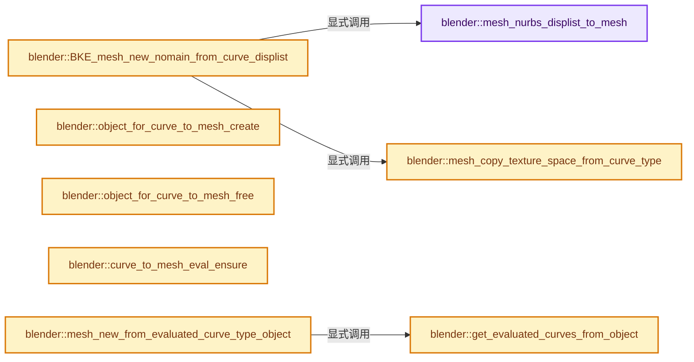
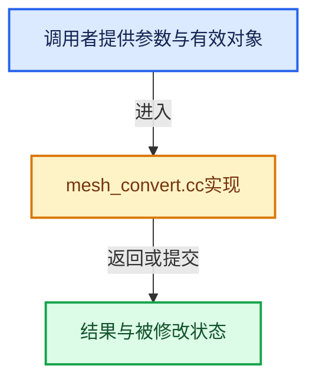

# 实现依赖专题：source/blender/blenkernel/intern/mesh_convert.cc

[实现依赖导航](../../README.md) · [符号索引](../../../00-课程指南/02-源码与提交索引/符号依赖与实现索引.md)

本专题从正文实际调用进入，集中保存共享实现。函数有稳定锚点，可从调用处直接跳到对应完整函数；递归与互相调用通过回链组织。

## 本文件的实现关系






## 完整成员与函数实现

<a id="f-faa09516805af2eb"></a>

### `blender::mesh_nurbs_displist_to_mesh`

实现位置：[source/blender/blenkernel/intern/mesh_convert.cc](../../../../../../../source/blender/blenkernel/intern/mesh_convert.cc) · L61—L307。

接口参数：

- `const Curve *cu`
- `const ListBaseT<DispList> *dispbase`

**教学注释版**

<!-- annotated:85e6022c3cb047 -->

```cpp
static Mesh *mesh_nurbs_displist_to_mesh(const Curve *cu, const ListBaseT<DispList> *dispbase)
{
  using namespace blender::bke;
  int a, b, ofs;
  const bool conv_polys = (
      /* 2D polys are filled with #DispList.type == #DL_INDEX3. */
      (CU_DO_2DFILL(cu) == false) ||
      /* surf polys are never filled */
      (cu->ob_type == OB_SURF));

  /* count */
  int totvert = 0;
  int totedge = 0;
  int faces_num = 0;
  int totloop = 0;
  for (const DispList &dl : *dispbase) {
    if (dl.type == DL_SEGM) {
      totvert += dl.parts * dl.nr;
      totedge += dl.parts * (dl.nr - 1);
    }
    else if (dl.type == DL_POLY) {
      if (conv_polys) {
        totvert += dl.parts * dl.nr;
        totedge += dl.parts * dl.nr;
      }
    }
    else if (dl.type == DL_SURF) {
      if (dl.parts != 0) {
        int tot;
        totvert += dl.parts * dl.nr;
        tot = (((dl.flag & DL_CYCL_U) ? 1 : 0) + (dl.nr - 1)) *
              (((dl.flag & DL_CYCL_V) ? 1 : 0) + (dl.parts - 1));
        faces_num += tot;
        totloop += tot * 4;
      }
    }
    else if (dl.type == DL_INDEX3) {
      int tot;
      totvert += dl.nr;
      tot = dl.parts;
      faces_num += tot;
      totloop += tot * 3;
    }
  }

  if (totvert == 0) {
    return BKE_mesh_new_nomain(0, 0, 0, 0);
  }

  Mesh *mesh = BKE_mesh_new_nomain(totvert, totedge, faces_num, totloop);
  MutableSpan<float3> positions = mesh->vert_positions_for_write();
  MutableSpan<int2> edges = mesh->edges_for_write();
  MutableSpan<int> face_offsets = mesh->face_offsets_for_write();
  MutableSpan<int> corner_verts = mesh->corner_verts_for_write();

  MutableAttributeAccessor attributes = mesh->attributes_for_write();
  SpanAttributeWriter<int> material_indices = attributes.lookup_or_add_for_write_only_span<int>(
      "material_index", AttrDomain::Face);
  SpanAttributeWriter<bool> sharp_faces = attributes.lookup_or_add_for_write_span<bool>(
      "sharp_face", AttrDomain::Face);
  const StringRef uv_name = DATA_("UVMap");
  SpanAttributeWriter<float2> uv_attribute = attributes.lookup_or_add_for_write_span<float2>(
      uv_name, AttrDomain::Corner);
  mesh->uv_maps_active_set(uv_name);
  mesh->uv_maps_default_set(uv_name);
  MutableSpan<float2> uv_map = uv_attribute.span;

  int dst_vert = 0;
  int dst_edge = 0;
  int dst_poly = 0;
  int dst_loop = 0;
  for (const DispList &dl : *dispbase) {
    const bool is_smooth = (dl.rt & CU_SMOOTH) != 0;

    if (dl.type == DL_SEGM) {
      const int startvert = dst_vert;
      a = dl.parts * dl.nr;
      const float *data = dl.verts;
      while (a--) {
        copy_v3_v3(positions[dst_vert], data);
        data += 3;
        dst_vert++;
      }

      for (a = 0; a < dl.parts; a++) {
        ofs = a * dl.nr;
        for (b = 1; b < dl.nr; b++) {
          edges[dst_edge][0] = startvert + ofs + b - 1;
          edges[dst_edge][1] = startvert + ofs + b;

          dst_edge++;
        }
      }
    }
    else if (dl.type == DL_POLY) {
      if (conv_polys) {
        const int startvert = dst_vert;
        a = dl.parts * dl.nr;
        const float *data = dl.verts;
        while (a--) {
          copy_v3_v3(positions[dst_vert], data);
          data += 3;
          dst_vert++;
        }

        for (a = 0; a < dl.parts; a++) {
          ofs = a * dl.nr;
          for (b = 0; b < dl.nr; b++) {
            edges[dst_edge][0] = startvert + ofs + b;
            if (b == dl.nr - 1) {
              edges[dst_edge][1] = startvert + ofs;
            }
            else {
              edges[dst_edge][1] = startvert + ofs + b + 1;
            }
            dst_edge++;
          }
        }
      }
    }
    else if (dl.type == DL_INDEX3) {
      const int startvert = dst_vert;
      a = dl.nr;
      const float *data = dl.verts;
      while (a--) {
        copy_v3_v3(positions[dst_vert], data);
        data += 3;
        dst_vert++;
      }

      a = dl.parts;
      const int *index = dl.index;
      while (a--) {
        corner_verts[dst_loop + 0] = startvert + index[0];
        corner_verts[dst_loop + 1] = startvert + index[2];
        corner_verts[dst_loop + 2] = startvert + index[1];
        face_offsets[dst_poly] = dst_loop;
        material_indices.span[dst_poly] = dl.col;

        for (int i = 0; i < 3; i++) {
          uv_map[dst_loop + i][0] = (corner_verts[dst_loop + i] - startvert) / float(dl.nr - 1);
          uv_map[dst_loop + i][1] = 0.0f;
        }

        sharp_faces.span[dst_poly] = !is_smooth;
        dst_poly++;
        dst_loop += 3;
        index += 3;
      }
    }
    else if (dl.type == DL_SURF) {
      const int startvert = dst_vert;
      a = dl.parts * dl.nr;
      const float *data = dl.verts;
      while (a--) {
        copy_v3_v3(positions[dst_vert], data);
        data += 3;
        dst_vert++;
      }

      for (a = 0; a < dl.parts; a++) {

        if ((dl.flag & DL_CYCL_V) == 0 && a == dl.parts - 1) {
          break;
        }

        int p1, p2, p3, p4;
        if (dl.flag & DL_CYCL_U) {    /* p2 -> p1 -> */
          p1 = startvert + dl.nr * a; /* p4 -> p3 -> */
          p2 = p1 + dl.nr - 1;        /* -----> next row */
          p3 = p1 + dl.nr;
          p4 = p2 + dl.nr;
          b = 0;
        }
        else {
          p2 = startvert + dl.nr * a;
          p1 = p2 + 1;
          p4 = p2 + dl.nr;
          p3 = p1 + dl.nr;
          b = 1;
        }
        if ((dl.flag & DL_CYCL_V) && a == dl.parts - 1) {
          p3 -= dl.parts * dl.nr;
          p4 -= dl.parts * dl.nr;
        }

        for (; b < dl.nr; b++) {
          corner_verts[dst_loop + 0] = p1;
          corner_verts[dst_loop + 1] = p3;
          corner_verts[dst_loop + 2] = p4;
          corner_verts[dst_loop + 3] = p2;
          face_offsets[dst_poly] = dst_loop;
          material_indices.span[dst_poly] = dl.col;

          int orco_sizeu = dl.nr - 1;
          int orco_sizev = dl.parts - 1;

          /* exception as handled in convertblender.c too */
          if (dl.flag & DL_CYCL_U) {
            orco_sizeu++;
            if (dl.flag & DL_CYCL_V) {
              orco_sizev++;
            }
          }
          else if (dl.flag & DL_CYCL_V) {
            orco_sizev++;
          }

          for (int i = 0; i < 4; i++) {
            /* find uv based on vertex index into grid array */
            int v = corner_verts[dst_loop + i] - startvert;

            uv_map[dst_loop + i][0] = (v / dl.nr) / float(orco_sizev);
            uv_map[dst_loop + i][1] = (v % dl.nr) / float(orco_sizeu);

            /* cyclic correction */
            if (ELEM(i, 1, 2) && uv_map[dst_loop + i][0] == 0.0f) {
              uv_map[dst_loop + i][0] = 1.0f;
            }
            if (ELEM(i, 0, 1) && uv_map[dst_loop + i][1] == 0.0f) {
              uv_map[dst_loop + i][1] = 1.0f;
            }
          }

          sharp_faces.span[dst_poly] = !is_smooth;
          dst_poly++;
          dst_loop += 4;

          p4 = p3;
          p3++;
          p2 = p1;
          p1++;
        }
      }
    }
  }

  if (faces_num) {
    mesh_calc_edges(*mesh, true, false);
  }

  material_indices.finish();
  sharp_faces.finish();
  uv_attribute.finish();

  return mesh;
}
```

<details>
<summary>核对原始源码：source/blender/blenkernel/intern/mesh_convert.cc · L61—L307</summary>

<!-- original:85e6022c3cb047:source/blender/blenkernel/intern/mesh_convert.cc:61:307 -->

```cpp
static Mesh *mesh_nurbs_displist_to_mesh(const Curve *cu, const ListBaseT<DispList> *dispbase)
{
  using namespace blender::bke;
  int a, b, ofs;
  const bool conv_polys = (
      /* 2D polys are filled with #DispList.type == #DL_INDEX3. */
      (CU_DO_2DFILL(cu) == false) ||
      /* surf polys are never filled */
      (cu->ob_type == OB_SURF));

  /* count */
  int totvert = 0;
  int totedge = 0;
  int faces_num = 0;
  int totloop = 0;
  for (const DispList &dl : *dispbase) {
    if (dl.type == DL_SEGM) {
      totvert += dl.parts * dl.nr;
      totedge += dl.parts * (dl.nr - 1);
    }
    else if (dl.type == DL_POLY) {
      if (conv_polys) {
        totvert += dl.parts * dl.nr;
        totedge += dl.parts * dl.nr;
      }
    }
    else if (dl.type == DL_SURF) {
      if (dl.parts != 0) {
        int tot;
        totvert += dl.parts * dl.nr;
        tot = (((dl.flag & DL_CYCL_U) ? 1 : 0) + (dl.nr - 1)) *
              (((dl.flag & DL_CYCL_V) ? 1 : 0) + (dl.parts - 1));
        faces_num += tot;
        totloop += tot * 4;
      }
    }
    else if (dl.type == DL_INDEX3) {
      int tot;
      totvert += dl.nr;
      tot = dl.parts;
      faces_num += tot;
      totloop += tot * 3;
    }
  }

  if (totvert == 0) {
    return BKE_mesh_new_nomain(0, 0, 0, 0);
  }

  Mesh *mesh = BKE_mesh_new_nomain(totvert, totedge, faces_num, totloop);
  MutableSpan<float3> positions = mesh->vert_positions_for_write();
  MutableSpan<int2> edges = mesh->edges_for_write();
  MutableSpan<int> face_offsets = mesh->face_offsets_for_write();
  MutableSpan<int> corner_verts = mesh->corner_verts_for_write();

  MutableAttributeAccessor attributes = mesh->attributes_for_write();
  SpanAttributeWriter<int> material_indices = attributes.lookup_or_add_for_write_only_span<int>(
      "material_index", AttrDomain::Face);
  SpanAttributeWriter<bool> sharp_faces = attributes.lookup_or_add_for_write_span<bool>(
      "sharp_face", AttrDomain::Face);
  const StringRef uv_name = DATA_("UVMap");
  SpanAttributeWriter<float2> uv_attribute = attributes.lookup_or_add_for_write_span<float2>(
      uv_name, AttrDomain::Corner);
  mesh->uv_maps_active_set(uv_name);
  mesh->uv_maps_default_set(uv_name);
  MutableSpan<float2> uv_map = uv_attribute.span;

  int dst_vert = 0;
  int dst_edge = 0;
  int dst_poly = 0;
  int dst_loop = 0;
  for (const DispList &dl : *dispbase) {
    const bool is_smooth = (dl.rt & CU_SMOOTH) != 0;

    if (dl.type == DL_SEGM) {
      const int startvert = dst_vert;
      a = dl.parts * dl.nr;
      const float *data = dl.verts;
      while (a--) {
        copy_v3_v3(positions[dst_vert], data);
        data += 3;
        dst_vert++;
      }

      for (a = 0; a < dl.parts; a++) {
        ofs = a * dl.nr;
        for (b = 1; b < dl.nr; b++) {
          edges[dst_edge][0] = startvert + ofs + b - 1;
          edges[dst_edge][1] = startvert + ofs + b;

          dst_edge++;
        }
      }
    }
    else if (dl.type == DL_POLY) {
      if (conv_polys) {
        const int startvert = dst_vert;
        a = dl.parts * dl.nr;
        const float *data = dl.verts;
        while (a--) {
          copy_v3_v3(positions[dst_vert], data);
          data += 3;
          dst_vert++;
        }

        for (a = 0; a < dl.parts; a++) {
          ofs = a * dl.nr;
          for (b = 0; b < dl.nr; b++) {
            edges[dst_edge][0] = startvert + ofs + b;
            if (b == dl.nr - 1) {
              edges[dst_edge][1] = startvert + ofs;
            }
            else {
              edges[dst_edge][1] = startvert + ofs + b + 1;
            }
            dst_edge++;
          }
        }
      }
    }
    else if (dl.type == DL_INDEX3) {
      const int startvert = dst_vert;
      a = dl.nr;
      const float *data = dl.verts;
      while (a--) {
        copy_v3_v3(positions[dst_vert], data);
        data += 3;
        dst_vert++;
      }

      a = dl.parts;
      const int *index = dl.index;
      while (a--) {
        corner_verts[dst_loop + 0] = startvert + index[0];
        corner_verts[dst_loop + 1] = startvert + index[2];
        corner_verts[dst_loop + 2] = startvert + index[1];
        face_offsets[dst_poly] = dst_loop;
        material_indices.span[dst_poly] = dl.col;

        for (int i = 0; i < 3; i++) {
          uv_map[dst_loop + i][0] = (corner_verts[dst_loop + i] - startvert) / float(dl.nr - 1);
          uv_map[dst_loop + i][1] = 0.0f;
        }

        sharp_faces.span[dst_poly] = !is_smooth;
        dst_poly++;
        dst_loop += 3;
        index += 3;
      }
    }
    else if (dl.type == DL_SURF) {
      const int startvert = dst_vert;
      a = dl.parts * dl.nr;
      const float *data = dl.verts;
      while (a--) {
        copy_v3_v3(positions[dst_vert], data);
        data += 3;
        dst_vert++;
      }

      for (a = 0; a < dl.parts; a++) {

        if ((dl.flag & DL_CYCL_V) == 0 && a == dl.parts - 1) {
          break;
        }

        int p1, p2, p3, p4;
        if (dl.flag & DL_CYCL_U) {    /* p2 -> p1 -> */
          p1 = startvert + dl.nr * a; /* p4 -> p3 -> */
          p2 = p1 + dl.nr - 1;        /* -----> next row */
          p3 = p1 + dl.nr;
          p4 = p2 + dl.nr;
          b = 0;
        }
        else {
          p2 = startvert + dl.nr * a;
          p1 = p2 + 1;
          p4 = p2 + dl.nr;
          p3 = p1 + dl.nr;
          b = 1;
        }
        if ((dl.flag & DL_CYCL_V) && a == dl.parts - 1) {
          p3 -= dl.parts * dl.nr;
          p4 -= dl.parts * dl.nr;
        }

        for (; b < dl.nr; b++) {
          corner_verts[dst_loop + 0] = p1;
          corner_verts[dst_loop + 1] = p3;
          corner_verts[dst_loop + 2] = p4;
          corner_verts[dst_loop + 3] = p2;
          face_offsets[dst_poly] = dst_loop;
          material_indices.span[dst_poly] = dl.col;

          int orco_sizeu = dl.nr - 1;
          int orco_sizev = dl.parts - 1;

          /* exception as handled in convertblender.c too */
          if (dl.flag & DL_CYCL_U) {
            orco_sizeu++;
            if (dl.flag & DL_CYCL_V) {
              orco_sizev++;
            }
          }
          else if (dl.flag & DL_CYCL_V) {
            orco_sizev++;
          }

          for (int i = 0; i < 4; i++) {
            /* find uv based on vertex index into grid array */
            int v = corner_verts[dst_loop + i] - startvert;

            uv_map[dst_loop + i][0] = (v / dl.nr) / float(orco_sizev);
            uv_map[dst_loop + i][1] = (v % dl.nr) / float(orco_sizeu);

            /* cyclic correction */
            if (ELEM(i, 1, 2) && uv_map[dst_loop + i][0] == 0.0f) {
              uv_map[dst_loop + i][0] = 1.0f;
            }
            if (ELEM(i, 0, 1) && uv_map[dst_loop + i][1] == 0.0f) {
              uv_map[dst_loop + i][1] = 1.0f;
            }
          }

          sharp_faces.span[dst_poly] = !is_smooth;
          dst_poly++;
          dst_loop += 4;

          p4 = p3;
          p3++;
          p2 = p1;
          p1++;
        }
      }
    }
  }

  if (faces_num) {
    mesh_calc_edges(*mesh, true, false);
  }

  material_indices.finish();
  sharp_faces.finish();
  uv_attribute.finish();

  return mesh;
}
```

</details>

**沿实际写入检查状态**

- `totvert += dl.parts * dl.nr;`
- `totedge += dl.parts * (dl.nr - 1);`
- `totedge += dl.parts * dl.nr;`
- `tot = (((dl.flag & DL_CYCL_U) ? 1 : 0) + (dl.nr - 1)) *`
- `faces_num += tot;`
- `totloop += tot * 4;`
- `totvert += dl.nr;`
- `tot = dl.parts;`
- `totloop += tot * 3;`
- `a = dl.parts * dl.nr;`
- `data += 3;`
- `ofs = a * dl.nr;`
- `edges[dst_edge][0] = startvert + ofs + b - 1;`
- `edges[dst_edge][1] = startvert + ofs + b;`
- `edges[dst_edge][0] = startvert + ofs + b;`
- `edges[dst_edge][1] = startvert + ofs;`
- `edges[dst_edge][1] = startvert + ofs + b + 1;`
- `a = dl.nr;`
- `a = dl.parts;`
- `face_offsets[dst_poly] = dst_loop;`
- `material_indices.span[dst_poly] = dl.col;`
- `sharp_faces.span[dst_poly] = !is_smooth;`
- `dst_loop += 3;`
- `index += 3;`
- `p1 = startvert + dl.nr * a; /* p4 -> p3 -> */`
- `p2 = p1 + dl.nr - 1;        /* -----> next row */`
- `p3 = p1 + dl.nr;`
- `p4 = p2 + dl.nr;`
- `b = 0;`
- `p2 = startvert + dl.nr * a;`
- `p1 = p2 + 1;`
- `b = 1;`
- `p3 -= dl.parts * dl.nr;`
- `p4 -= dl.parts * dl.nr;`
- `dst_loop += 4;`
- `p4 = p3;`
- `p2 = p1;`

**结果出口**

- `return BKE_mesh_new_nomain(0, 0, 0, 0);`
- `return mesh;`

**继续追踪实现**

- `CU_DO_2DFILL` → [CU_DO_2DFILL · L96](../BKE_curve.hh.md#m-b3dd99c47394)。宏定义由构建条件选择。
- `BKE_mesh_new_nomain` → [BKE_mesh_new_nomain · L1376](../../../05-几何存储与拓扑映射/03-MPoly迁移与兼容.md#f-d63806a6e34190f2)。
- `mesh->vert_positions_for_write` → [Mesh::vert_positions_for_write · L1199](../../../05-几何存储与拓扑映射/03-MPoly迁移与兼容.md#f-ae8d77205112d843)。
- `mesh->edges_for_write` → [Mesh::edges_for_write · L1211](../../../05-几何存储与拓扑映射/03-MPoly迁移与兼容.md#f-a4c919c44eeede7c)。
- `mesh->face_offsets_for_write` → [Mesh::face_offsets_for_write · L1228](../../../05-几何存储与拓扑映射/03-MPoly迁移与兼容.md#f-483f42747ab436a2)。
- `mesh->corner_verts_for_write` → [Mesh::corner_verts_for_write · L1246](../../../05-几何存储与拓扑映射/03-MPoly迁移与兼容.md#f-6dfaf316a81ba215)。
- `mesh->attributes_for_write` → [Mesh::attributes_for_write · L1303](../../../05-几何存储与拓扑映射/03-MPoly迁移与兼容.md#f-ca7af2f1a15f0bc4)。
- `attributes.lookup_or_add_for_write_only_span<int>` → [blender::bke::MutableAttributeAccessor::lookup_or_add_for_write_only_span · L546](attribute_access.cc.md#f-97af899f7983a038)。
- `attributes.lookup_or_add_for_write_span<bool>` → [blender::bke::MutableAttributeAccessor::lookup_or_add_for_write_span · L533](attribute_access.cc.md#f-c533eff1b9a4973e)。
- `DATA_` → [DATA_ · L52](../../08-其他Blender模块/blentranslation/BLT_translation.hh.md#m-178736083f83)。宏定义由构建条件选择。
- `attributes.lookup_or_add_for_write_span<float2>` → [blender::bke::MutableAttributeAccessor::lookup_or_add_for_write_span · L533](attribute_access.cc.md#f-c533eff1b9a4973e)。
- `mesh->uv_maps_active_set` → [Mesh::uv_maps_active_set · L1346](../../../05-几何存储与拓扑映射/03-MPoly迁移与兼容.md#f-bcaa0129e8e6bbb3)。
- `mesh->uv_maps_default_set` → [Mesh::uv_maps_default_set · L1361](../../../05-几何存储与拓扑映射/03-MPoly迁移与兼容.md#f-d754397489bfa6aa)。
- `copy_v3_v3` → [blender::copy_v3_v3 · L47](../../01-BLI基础库/intern/math_vector_inline.cc.md#f-037a0d5fa5060bd6)。
- `ELEM` → [ELEM · L88](../../07-Intern运行时与平台/ghost/intern/GHOST_utildefines.hh.md#m-d28724a15928)；[ELEM · L135](../../01-BLI基础库/BLI_utildefines.hh.md#m-d6572de7cae0)。宏定义由构建条件选择。
- `mesh_calc_edges` → [blender::bke::mesh_calc_edges · L234](mesh_calc_edges.cc.md#f-8dc1463382ec6743)；[blender::bke::mesh_calc_edges · L578](mesh_calc_edges.cc.md#f-1312012cc732ca47)。同名重载需按实参类型选择。
- `material_indices.finish` → [blender::bke::SpanAttributeWriter::finish · L279](../../../05-几何存储与拓扑映射/08-AttributeAccessor接口.md#f-585970a3b1bd4da4)。
- `sharp_faces.finish` → [blender::bke::SpanAttributeWriter::finish · L279](../../../05-几何存储与拓扑映射/08-AttributeAccessor接口.md#f-585970a3b1bd4da4)。
- `uv_attribute.finish` → [blender::bke::SpanAttributeWriter::finish · L279](../../../05-几何存储与拓扑映射/08-AttributeAccessor接口.md#f-585970a3b1bd4da4)。

<a id="f-b96e9f2d5497cefe"></a>

### `blender::mesh_copy_texture_space_from_curve_type`

实现位置：[source/blender/blenkernel/intern/mesh_convert.cc](../../../../../../../source/blender/blenkernel/intern/mesh_convert.cc) · L316—L322。

接口参数：

- `const Curve *cu`
- `Mesh *mesh`

**教学注释版**

<!-- annotated:5d9012a759e657 -->

```cpp
static void mesh_copy_texture_space_from_curve_type(const Curve *cu, Mesh *mesh)
{
  mesh->texspace_flag = eMesh_TexSpaceFlag(cu->texspace_flag & ~CU_TEXSPACE_FLAG_AUTO);
  copy_v3_v3(mesh->texspace_location, cu->texspace_location);
  copy_v3_v3(mesh->texspace_size, cu->texspace_size);
  BKE_mesh_texspace_calc(mesh);
}
```

<details>
<summary>核对原始源码：source/blender/blenkernel/intern/mesh_convert.cc · L316—L322</summary>

<!-- original:5d9012a759e657:source/blender/blenkernel/intern/mesh_convert.cc:316:322 -->

```cpp
static void mesh_copy_texture_space_from_curve_type(const Curve *cu, Mesh *mesh)
{
  mesh->texspace_flag = eMesh_TexSpaceFlag(cu->texspace_flag & ~CU_TEXSPACE_FLAG_AUTO);
  copy_v3_v3(mesh->texspace_location, cu->texspace_location);
  copy_v3_v3(mesh->texspace_size, cu->texspace_size);
  BKE_mesh_texspace_calc(mesh);
}
```

</details>

**沿实际写入检查状态**

- `mesh->texspace_flag = eMesh_TexSpaceFlag(cu->texspace_flag & ~CU_TEXSPACE_FLAG_AUTO);`

**继续追踪实现**

- `eMesh_TexSpaceFlag` → [blender::eMesh_TexSpaceFlag](../../08-其他Blender模块/makesdna/DNA_mesh_types.h.md#t-317087543416)。
- `copy_v3_v3` → [blender::copy_v3_v3 · L47](../../01-BLI基础库/intern/math_vector_inline.cc.md#f-037a0d5fa5060bd6)。
- `BKE_mesh_texspace_calc` → [BKE_mesh_texspace_calc · L1653](../../../05-几何存储与拓扑映射/03-MPoly迁移与兼容.md#f-6bc56fb8c90adbe6)。

<a id="f-1e80d96d2f1dd3b3"></a>

### `blender::BKE_mesh_new_nomain_from_curve_displist`

实现位置：[source/blender/blenkernel/intern/mesh_convert.cc](../../../../../../../source/blender/blenkernel/intern/mesh_convert.cc) · L324—L335。

接口参数：

- `const Object *ob`
- `const ListBaseT<DispList> *dispbase`

**教学注释版**

<!-- annotated:4c9fc093ce9bf6 -->

```cpp
Mesh *BKE_mesh_new_nomain_from_curve_displist(const Object *ob,
                                              const ListBaseT<DispList> *dispbase)
{
  const Curve *cu = id_cast<const Curve *>(ob->data);

  Mesh *mesh = mesh_nurbs_displist_to_mesh(cu, dispbase);
  mesh_copy_texture_space_from_curve_type(cu, mesh);
  mesh->mat = MEM_dupalloc(cu->mat);
  mesh->totcol = cu->totcol;

  return mesh;
}
```

<details>
<summary>核对原始源码：source/blender/blenkernel/intern/mesh_convert.cc · L324—L335</summary>

<!-- original:4c9fc093ce9bf6:source/blender/blenkernel/intern/mesh_convert.cc:324:335 -->

```cpp
Mesh *BKE_mesh_new_nomain_from_curve_displist(const Object *ob,
                                              const ListBaseT<DispList> *dispbase)
{
  const Curve *cu = id_cast<const Curve *>(ob->data);

  Mesh *mesh = mesh_nurbs_displist_to_mesh(cu, dispbase);
  mesh_copy_texture_space_from_curve_type(cu, mesh);
  mesh->mat = MEM_dupalloc(cu->mat);
  mesh->totcol = cu->totcol;

  return mesh;
}
```

</details>

**沿实际写入检查状态**

- `mesh->mat = MEM_dupalloc(cu->mat);`
- `mesh->totcol = cu->totcol;`

**结果出口**

- `return mesh;`

**继续追踪实现**

- `id_cast<const Curve *>` → [blender::id_cast · L1417](../../08-其他Blender模块/makesdna/DNA_ID.h.md#f-6c8ac6412850ac5a)。
- `mesh_nurbs_displist_to_mesh` → [blender::mesh_nurbs_displist_to_mesh · L61](mesh_convert.cc.md#f-faa09516805af2eb)。
- `mesh_copy_texture_space_from_curve_type` → [blender::mesh_copy_texture_space_from_curve_type · L316](mesh_convert.cc.md#f-b96e9f2d5497cefe)。
- `MEM_dupalloc` → [MEM_dupalloc · L627](../../07-Intern运行时与平台/guardedalloc/MEM_guardedalloc.h.md#f-78a72b71e3c57010)。

<a id="f-f54b6004b7af5b61"></a>

### `blender::object_for_curve_to_mesh_create`

实现位置：[source/blender/blenkernel/intern/mesh_convert.cc](../../../../../../../source/blender/blenkernel/intern/mesh_convert.cc) · L630—L660。

接口参数：

- `const Object *object`

**教学注释版**

<!-- annotated:92111b496a4911 -->

```cpp
static Object *object_for_curve_to_mesh_create(const Object *object)
{
  const Curve *curve = id_cast<const Curve *>(object->data);

  /* Create a temporary object which can be evaluated and modified by generic
   * curve evaluation (hence the #LIB_ID_COPY_SET_COPIED_ON_WRITE flag). */
  Object *temp_object = id_cast<Object *>(BKE_id_copy_ex(
      nullptr, &object->id, nullptr, LIB_ID_COPY_LOCALIZE | LIB_ID_COPY_SET_COPIED_ON_WRITE));

  /* Remove all modifiers, since we don't want them to be applied. */
  BKE_object_free_modifiers(temp_object, LIB_ID_CREATE_NO_USER_REFCOUNT);

  /* Need to create copy of curve itself as well, since it will be changed by the curve evaluation
   * process. NOTE: Copies the data, but not the shape-keys. */
  temp_object->data = BKE_id_copy_ex(nullptr,
                                     static_cast<const ID *>(object->data),
                                     nullptr,
                                     LIB_ID_COPY_LOCALIZE | LIB_ID_COPY_SET_COPIED_ON_WRITE);
  Curve *temp_curve = id_cast<Curve *>(temp_object->data);

  /* Make sure texture space is calculated for a copy of curve, it will be used for the final
   * result. */
  BKE_curve_texspace_calc(temp_curve);

  /* Temporarily set edit so we get updates from edit mode, but also because for text data-blocks
   * copying it while in edit mode gives invalid data structures. */
  temp_curve->editfont = curve->editfont;
  temp_curve->editnurb = curve->editnurb;

  return temp_object;
}
```

<details>
<summary>核对原始源码：source/blender/blenkernel/intern/mesh_convert.cc · L630—L660</summary>

<!-- original:92111b496a4911:source/blender/blenkernel/intern/mesh_convert.cc:630:660 -->

```cpp
static Object *object_for_curve_to_mesh_create(const Object *object)
{
  const Curve *curve = id_cast<const Curve *>(object->data);

  /* Create a temporary object which can be evaluated and modified by generic
   * curve evaluation (hence the #LIB_ID_COPY_SET_COPIED_ON_WRITE flag). */
  Object *temp_object = id_cast<Object *>(BKE_id_copy_ex(
      nullptr, &object->id, nullptr, LIB_ID_COPY_LOCALIZE | LIB_ID_COPY_SET_COPIED_ON_WRITE));

  /* Remove all modifiers, since we don't want them to be applied. */
  BKE_object_free_modifiers(temp_object, LIB_ID_CREATE_NO_USER_REFCOUNT);

  /* Need to create copy of curve itself as well, since it will be changed by the curve evaluation
   * process. NOTE: Copies the data, but not the shape-keys. */
  temp_object->data = BKE_id_copy_ex(nullptr,
                                     static_cast<const ID *>(object->data),
                                     nullptr,
                                     LIB_ID_COPY_LOCALIZE | LIB_ID_COPY_SET_COPIED_ON_WRITE);
  Curve *temp_curve = id_cast<Curve *>(temp_object->data);

  /* Make sure texture space is calculated for a copy of curve, it will be used for the final
   * result. */
  BKE_curve_texspace_calc(temp_curve);

  /* Temporarily set edit so we get updates from edit mode, but also because for text data-blocks
   * copying it while in edit mode gives invalid data structures. */
  temp_curve->editfont = curve->editfont;
  temp_curve->editnurb = curve->editnurb;

  return temp_object;
}
```

</details>

**沿实际写入检查状态**

- `temp_object->data = BKE_id_copy_ex(nullptr,`
- `temp_curve->editfont = curve->editfont;`
- `temp_curve->editnurb = curve->editnurb;`

**结果出口**

- `return temp_object;`

**继续追踪实现**

- `id_cast<const Curve *>` → [blender::id_cast · L1417](../../08-其他Blender模块/makesdna/DNA_ID.h.md#f-6c8ac6412850ac5a)。
- `id_cast<Object *>` → [blender::id_cast · L1417](../../08-其他Blender模块/makesdna/DNA_ID.h.md#f-6c8ac6412850ac5a)。
- `BKE_id_copy_ex` → [blender::BKE_id_copy_ex · L851](lib_id.cc.md#f-24272170c95f49fb)。
- `BKE_object_free_modifiers` → [blender::BKE_object_free_modifiers · L1337](object.cc.md#f-f8dd3f8f0ede989d)。
- `id_cast<Curve *>` → [blender::id_cast · L1417](../../08-其他Blender模块/makesdna/DNA_ID.h.md#f-6c8ac6412850ac5a)。
- `BKE_curve_texspace_calc` → [blender::BKE_curve_texspace_calc · L490](curve.cc.md#f-1135d8c6c8f6bff1)。

<a id="f-112df4d09b5f11aa"></a>

### `blender::object_for_curve_to_mesh_free`

实现位置：[source/blender/blenkernel/intern/mesh_convert.cc](../../../../../../../source/blender/blenkernel/intern/mesh_convert.cc) · L662—L682。

接口参数：

- `Object *temp_object`

**教学注释版**

<!-- annotated:04807f2de41f50 -->

```cpp
static void object_for_curve_to_mesh_free(Object *temp_object)
{
  /* Clear edit mode pointers that were explicitly copied to the temporary curve. */
  ID *final_object_data = temp_object->data;
  if (GS(final_object_data->name) == ID_CU_LEGACY) {
    Curve &curve = *reinterpret_cast<Curve *>(final_object_data);
    curve.editfont = nullptr;
    curve.editnurb = nullptr;
  }

  /* Only free the final object data if it is *not* stored in the #data_eval field. This is still
   * necessary because #temp_object's data could be replaced by a #Curve data-block that isn't also
   * assigned to #data_eval. */
  const bool object_data_stored_in_data_eval = final_object_data ==
                                               temp_object->runtime->data_eval;

  BKE_id_free(nullptr, temp_object);
  if (!object_data_stored_in_data_eval) {
    BKE_id_free(nullptr, final_object_data);
  }
}
```

<details>
<summary>核对原始源码：source/blender/blenkernel/intern/mesh_convert.cc · L662—L682</summary>

<!-- original:04807f2de41f50:source/blender/blenkernel/intern/mesh_convert.cc:662:682 -->

```cpp
static void object_for_curve_to_mesh_free(Object *temp_object)
{
  /* Clear edit mode pointers that were explicitly copied to the temporary curve. */
  ID *final_object_data = temp_object->data;
  if (GS(final_object_data->name) == ID_CU_LEGACY) {
    Curve &curve = *reinterpret_cast<Curve *>(final_object_data);
    curve.editfont = nullptr;
    curve.editnurb = nullptr;
  }

  /* Only free the final object data if it is *not* stored in the #data_eval field. This is still
   * necessary because #temp_object's data could be replaced by a #Curve data-block that isn't also
   * assigned to #data_eval. */
  const bool object_data_stored_in_data_eval = final_object_data ==
                                               temp_object->runtime->data_eval;

  BKE_id_free(nullptr, temp_object);
  if (!object_data_stored_in_data_eval) {
    BKE_id_free(nullptr, final_object_data);
  }
}
```

</details>

**沿实际写入检查状态**

- `curve.editfont = nullptr;`
- `curve.editnurb = nullptr;`

**继续追踪实现**

- `GS` → [blender::GS · L410](../../08-其他Blender模块/makesdna/DNA_ID.h.md#f-c3ff509f79f21b05)。
- `BKE_id_free` → [blender::BKE_id_free · L224](lib_id_delete.cc.md#f-28ed02c41d0f2d5b)。

<a id="f-c2aaed92f00ffc02"></a>

### `blender::curve_to_mesh_eval_ensure`

实现位置：[source/blender/blenkernel/intern/mesh_convert.cc](../../../../../../../source/blender/blenkernel/intern/mesh_convert.cc) · L687—L737。

接口参数：

- `Object &object`

**教学注释版**

<!-- annotated:3dc596b2c1396a -->

```cpp
static void curve_to_mesh_eval_ensure(Object &object)
{
  BLI_assert(GS(object.data->name) == ID_CU_LEGACY);
  Curve &curve = *id_cast<Curve *>(object.data);
  /* Clear all modifiers for the bevel object.
   *
   * This is because they can not be reliably evaluated for an original object (at least because
   * the state of dependencies is not know).
   *
   * So we create temporary copy of the object which will use same data as the original bevel, but
   * will have no modifiers. */
  Object bevel_object = dna::shallow_zero_initialize();
  bke::ObjectRuntime bevel_runtime;
  if (curve.bevobj != nullptr) {
    bevel_object = dna::shallow_copy(*curve.bevobj);
    bevel_runtime = *curve.bevobj->runtime;
    bevel_object.runtime = &bevel_runtime;

    bevel_object.modifiers.clear_no_delete();
    BKE_object_runtime_reset(&bevel_object);
    curve.bevobj = &bevel_object;
  }

  /* Same thing for taper. */
  Object taper_object = dna::shallow_zero_initialize();
  bke::ObjectRuntime taper_runtime;
  if (curve.taperobj != nullptr) {
    taper_object = dna::shallow_copy(*curve.taperobj);
    taper_runtime = *curve.taperobj->runtime;
    taper_object.runtime = &taper_runtime;

    taper_object.modifiers.clear_no_delete();
    BKE_object_runtime_reset(&taper_object);
    curve.taperobj = &taper_object;
  }

  /* NOTE: We don't have dependency graph or scene here, so we pass nullptr. This is all fine since
   * they are only used for modifier stack, which we have explicitly disabled for all objects.
   *
   * TODO(sergey): This is a very fragile logic, but proper solution requires re-writing quite a
   * bit of internal functions (#BKE_mesh_nomain_to_mesh) and also Mesh From Curve operator.
   * Brecht says hold off with that. */
  BKE_displist_make_curveTypes(nullptr, nullptr, &object, true);

  if (bevel_object.runtime) {
    BKE_object_runtime_free_data(&bevel_object);
  }
  if (taper_object.runtime) {
    BKE_object_runtime_free_data(&taper_object);
  }
}
```

<details>
<summary>核对原始源码：source/blender/blenkernel/intern/mesh_convert.cc · L687—L737</summary>

<!-- original:3dc596b2c1396a:source/blender/blenkernel/intern/mesh_convert.cc:687:737 -->

```cpp
static void curve_to_mesh_eval_ensure(Object &object)
{
  BLI_assert(GS(object.data->name) == ID_CU_LEGACY);
  Curve &curve = *id_cast<Curve *>(object.data);
  /* Clear all modifiers for the bevel object.
   *
   * This is because they can not be reliably evaluated for an original object (at least because
   * the state of dependencies is not know).
   *
   * So we create temporary copy of the object which will use same data as the original bevel, but
   * will have no modifiers. */
  Object bevel_object = dna::shallow_zero_initialize();
  bke::ObjectRuntime bevel_runtime;
  if (curve.bevobj != nullptr) {
    bevel_object = dna::shallow_copy(*curve.bevobj);
    bevel_runtime = *curve.bevobj->runtime;
    bevel_object.runtime = &bevel_runtime;

    bevel_object.modifiers.clear_no_delete();
    BKE_object_runtime_reset(&bevel_object);
    curve.bevobj = &bevel_object;
  }

  /* Same thing for taper. */
  Object taper_object = dna::shallow_zero_initialize();
  bke::ObjectRuntime taper_runtime;
  if (curve.taperobj != nullptr) {
    taper_object = dna::shallow_copy(*curve.taperobj);
    taper_runtime = *curve.taperobj->runtime;
    taper_object.runtime = &taper_runtime;

    taper_object.modifiers.clear_no_delete();
    BKE_object_runtime_reset(&taper_object);
    curve.taperobj = &taper_object;
  }

  /* NOTE: We don't have dependency graph or scene here, so we pass nullptr. This is all fine since
   * they are only used for modifier stack, which we have explicitly disabled for all objects.
   *
   * TODO(sergey): This is a very fragile logic, but proper solution requires re-writing quite a
   * bit of internal functions (#BKE_mesh_nomain_to_mesh) and also Mesh From Curve operator.
   * Brecht says hold off with that. */
  BKE_displist_make_curveTypes(nullptr, nullptr, &object, true);

  if (bevel_object.runtime) {
    BKE_object_runtime_free_data(&bevel_object);
  }
  if (taper_object.runtime) {
    BKE_object_runtime_free_data(&taper_object);
  }
}
```

</details>

**沿实际写入检查状态**

- `bevel_object = dna::shallow_copy(*curve.bevobj);`
- `bevel_runtime = *curve.bevobj->runtime;`
- `bevel_object.runtime = &bevel_runtime;`
- `curve.bevobj = &bevel_object;`
- `taper_object = dna::shallow_copy(*curve.taperobj);`
- `taper_runtime = *curve.taperobj->runtime;`
- `taper_object.runtime = &taper_runtime;`
- `curve.taperobj = &taper_object;`

**继续追踪实现**

- `BLI_assert` → [BLI_assert · L48](../../01-BLI基础库/BLI_assert.hh.md#m-57a88495704d)；[BLI_assert · L63](../../01-BLI基础库/BLI_assert.hh.md#m-d07050020cb5)。宏定义由构建条件选择。
- `GS` → [blender::GS · L410](../../08-其他Blender模块/makesdna/DNA_ID.h.md#f-c3ff509f79f21b05)。
- `id_cast<Curve *>` → [blender::id_cast · L1417](../../08-其他Blender模块/makesdna/DNA_ID.h.md#f-6c8ac6412850ac5a)。
- `dna::shallow_zero_initialize` → [blender::dna::shallow_zero_initialize · L159](../../08-其他Blender模块/makesdna/DNA_defs.h.md#f-1855e6cb8e8cfb60)。
- `dna::shallow_copy` → [blender::dna::shallow_copy · L146](../../08-其他Blender模块/makesdna/DNA_defs.h.md#f-84b6eda95a1c994c)。
- `bevel_object.modifiers.clear_no_delete` → [调用协议](../../../00-课程指南/01-路线与规范/模板宏与动态分派协议.md)：接收对象类型依赖auto、返回值或模板实例；不按同名猜测目标。调用位置L705。
- `BKE_object_runtime_reset` → [blender::BKE_object_runtime_reset · L5202](object.cc.md#f-3105123c9494d02c)。
- `taper_object.modifiers.clear_no_delete` → [调用协议](../../../00-课程指南/01-路线与规范/模板宏与动态分派协议.md)：接收对象类型依赖auto、返回值或模板实例；不按同名猜测目标。调用位置L718。
- `BKE_displist_make_curveTypes` → [blender::BKE_displist_make_curveTypes · L1688](displist.cc.md#f-104e42208a4d8e29)。
- `BKE_object_runtime_free_data` → [blender::BKE_object_runtime_free_data · L5223](object.cc.md#f-5fd92979c4e450fc)。

<a id="f-888bc12118be8138"></a>

### `blender::get_evaluated_curves_from_object`

实现位置：[source/blender/blenkernel/intern/mesh_convert.cc](../../../../../../../source/blender/blenkernel/intern/mesh_convert.cc) · L739—L745。

接口参数：

- `const Object *object`

**教学注释版**

<!-- annotated:19d07c646445f2 -->

```cpp
static const Curves *get_evaluated_curves_from_object(const Object *object)
{
  if (bke::GeometrySet *geometry_set_eval = object->runtime->geometry_set_eval) {
    return geometry_set_eval->get_curves();
  }
  return nullptr;
}
```

<details>
<summary>核对原始源码：source/blender/blenkernel/intern/mesh_convert.cc · L739—L745</summary>

<!-- original:19d07c646445f2:source/blender/blenkernel/intern/mesh_convert.cc:739:745 -->

```cpp
static const Curves *get_evaluated_curves_from_object(const Object *object)
{
  if (bke::GeometrySet *geometry_set_eval = object->runtime->geometry_set_eval) {
    return geometry_set_eval->get_curves();
  }
  return nullptr;
}
```

</details>

**结果出口**

- `return geometry_set_eval->get_curves();`
- `return nullptr;`

**继续追踪实现**

- `geometry_set_eval->get_curves` → [blender::bke::GeometrySet::get_curves · L339](../../../06-隐式共享与缓存系统/05-GeometrySet读写与复制.md#f-1d7b3a3ddbc6c57b)。

<a id="f-fa83ceec4ff65bbc"></a>

### `blender::mesh_new_from_evaluated_curve_type_object`

实现位置：[source/blender/blenkernel/intern/mesh_convert.cc](../../../../../../../source/blender/blenkernel/intern/mesh_convert.cc) · L747—L756。

接口参数：

- `const Object *evaluated_object`

**教学注释版**

<!-- annotated:336be7ac699112 -->

```cpp
static Mesh *mesh_new_from_evaluated_curve_type_object(const Object *evaluated_object)
{
  if (const Mesh *mesh = BKE_object_get_evaluated_mesh(evaluated_object)) {
    return BKE_mesh_copy_for_eval(*mesh);
  }
  if (const Curves *curves = get_evaluated_curves_from_object(evaluated_object)) {
    return bke::curve_to_wire_mesh(curves->geometry.wrap());
  }
  return nullptr;
}
```

<details>
<summary>核对原始源码：source/blender/blenkernel/intern/mesh_convert.cc · L747—L756</summary>

<!-- original:336be7ac699112:source/blender/blenkernel/intern/mesh_convert.cc:747:756 -->

```cpp
static Mesh *mesh_new_from_evaluated_curve_type_object(const Object *evaluated_object)
{
  if (const Mesh *mesh = BKE_object_get_evaluated_mesh(evaluated_object)) {
    return BKE_mesh_copy_for_eval(*mesh);
  }
  if (const Curves *curves = get_evaluated_curves_from_object(evaluated_object)) {
    return bke::curve_to_wire_mesh(curves->geometry.wrap());
  }
  return nullptr;
}
```

</details>

**结果出口**

- `return BKE_mesh_copy_for_eval(*mesh);`
- `return bke::curve_to_wire_mesh(curves->geometry.wrap());`
- `return nullptr;`

**继续追踪实现**

- `BKE_object_get_evaluated_mesh` → [blender::BKE_object_get_evaluated_mesh · L4436](object.cc.md#f-51b5453b29547868)。
- `BKE_mesh_copy_for_eval` → [BKE_mesh_copy_for_eval · L1577](../../../05-几何存储与拓扑映射/03-MPoly迁移与兼容.md#f-32e8f0e51faecc10)。
- `get_evaluated_curves_from_object` → [blender::get_evaluated_curves_from_object · L739](mesh_convert.cc.md#f-888bc12118be8138)。
- `bke::curve_to_wire_mesh` → [blender::bke::curve_to_wire_mesh · L1099](curve_to_mesh_convert.cc.md#f-f76121f9ba778d62)。
- `curves->geometry.wrap` → [调用协议](../../../00-课程指南/01-路线与规范/模板宏与动态分派协议.md)：接收对象类型依赖auto、返回值或模板实例；不按同名猜测目标。调用位置L753。

<a id="f-47a4b959b5ee5d6a"></a>

### `blender::mesh_new_from_curve_type_object`

实现位置：[source/blender/blenkernel/intern/mesh_convert.cc](../../../../../../../source/blender/blenkernel/intern/mesh_convert.cc) · L758—L790。

接口参数：

- `const Object *object`

**教学注释版**

<!-- annotated:24183e460de679 -->

```cpp
static Mesh *mesh_new_from_curve_type_object(const Object *object)
{
  /* If the object is evaluated, it should either have an evaluated mesh or curve data already.
   * The mesh can be duplicated, or the curve converted to wire mesh edges. */
  if (DEG_is_evaluated(object)) {
    return mesh_new_from_evaluated_curve_type_object(object);
  }

  /* Otherwise, create a temporary "fake" evaluated object and try again. This might have
   * different results, since in order to avoid having adverse affects to other original objects,
   * modifiers are cleared. An alternative would be to create a temporary depsgraph only for this
   * object and its dependencies. */
  Object *temp_object = object_for_curve_to_mesh_create(object);
  ID *temp_data = temp_object->data;
  curve_to_mesh_eval_ensure(*temp_object);

  /* If evaluating the curve replaced object data with different data, free the original data. */
  if (temp_data != temp_object->data) {
    if (GS(temp_data->name) == ID_CU_LEGACY) {
      /* Clear edit mode pointers that were explicitly copied to the temporary curve. */
      Curve *curve = reinterpret_cast<Curve *>(temp_data);
      curve->editfont = nullptr;
      curve->editnurb = nullptr;
    }
    BKE_id_free(nullptr, temp_data);
  }

  Mesh *mesh = mesh_new_from_evaluated_curve_type_object(temp_object);

  object_for_curve_to_mesh_free(temp_object);

  return mesh;
}
```

<details>
<summary>核对原始源码：source/blender/blenkernel/intern/mesh_convert.cc · L758—L790</summary>

<!-- original:24183e460de679:source/blender/blenkernel/intern/mesh_convert.cc:758:790 -->

```cpp
static Mesh *mesh_new_from_curve_type_object(const Object *object)
{
  /* If the object is evaluated, it should either have an evaluated mesh or curve data already.
   * The mesh can be duplicated, or the curve converted to wire mesh edges. */
  if (DEG_is_evaluated(object)) {
    return mesh_new_from_evaluated_curve_type_object(object);
  }

  /* Otherwise, create a temporary "fake" evaluated object and try again. This might have
   * different results, since in order to avoid having adverse affects to other original objects,
   * modifiers are cleared. An alternative would be to create a temporary depsgraph only for this
   * object and its dependencies. */
  Object *temp_object = object_for_curve_to_mesh_create(object);
  ID *temp_data = temp_object->data;
  curve_to_mesh_eval_ensure(*temp_object);

  /* If evaluating the curve replaced object data with different data, free the original data. */
  if (temp_data != temp_object->data) {
    if (GS(temp_data->name) == ID_CU_LEGACY) {
      /* Clear edit mode pointers that were explicitly copied to the temporary curve. */
      Curve *curve = reinterpret_cast<Curve *>(temp_data);
      curve->editfont = nullptr;
      curve->editnurb = nullptr;
    }
    BKE_id_free(nullptr, temp_data);
  }

  Mesh *mesh = mesh_new_from_evaluated_curve_type_object(temp_object);

  object_for_curve_to_mesh_free(temp_object);

  return mesh;
}
```

</details>

**沿实际写入检查状态**

- `curve->editfont = nullptr;`
- `curve->editnurb = nullptr;`

**结果出口**

- `return mesh_new_from_evaluated_curve_type_object(object);`
- `return mesh;`

**继续追踪实现**

- `DEG_is_evaluated` → [blender::DEG_is_evaluated · L170](../../06-Depsgraph依赖图/DEG_depsgraph_query.hh.md#f-23a1423b8d446719)。
- `mesh_new_from_evaluated_curve_type_object` → [blender::mesh_new_from_evaluated_curve_type_object · L747](mesh_convert.cc.md#f-fa83ceec4ff65bbc)。
- `object_for_curve_to_mesh_create` → [blender::object_for_curve_to_mesh_create · L630](mesh_convert.cc.md#f-f54b6004b7af5b61)。
- `curve_to_mesh_eval_ensure` → [blender::curve_to_mesh_eval_ensure · L687](mesh_convert.cc.md#f-c2aaed92f00ffc02)。
- `GS` → [blender::GS · L410](../../08-其他Blender模块/makesdna/DNA_ID.h.md#f-c3ff509f79f21b05)。
- `BKE_id_free` → [blender::BKE_id_free · L224](lib_id_delete.cc.md#f-28ed02c41d0f2d5b)。
- `object_for_curve_to_mesh_free` → [blender::object_for_curve_to_mesh_free · L662](mesh_convert.cc.md#f-112df4d09b5f11aa)。

<a id="f-f2e8dd018041dcdd"></a>

### `blender::mesh_new_from_mball_object`

实现位置：[source/blender/blenkernel/intern/mesh_convert.cc](../../../../../../../source/blender/blenkernel/intern/mesh_convert.cc) · L792—L809。

接口参数：

- `Object *object`

**教学注释版**

<!-- annotated:d6cf11c264459e -->

```cpp
static Mesh *mesh_new_from_mball_object(Object *object)
{
  /* NOTE: We can only create mesh for a polygonized meta ball. This figures out all original meta
   * balls and all evaluated child meta balls (since polygonization is only stored in the mother
   * ball).
   *
   * Create empty mesh so script-authors don't run into None objects. */
  if (!DEG_is_evaluated(object)) {
    return BKE_id_new_nomain<Mesh>((object->data)->name + 2);
  }

  const Mesh *mesh_eval = BKE_object_get_evaluated_mesh(object);
  if (mesh_eval == nullptr) {
    return BKE_id_new_nomain<Mesh>((object->data)->name + 2);
  }

  return BKE_mesh_copy_for_eval(*mesh_eval);
}
```

<details>
<summary>核对原始源码：source/blender/blenkernel/intern/mesh_convert.cc · L792—L809</summary>

<!-- original:d6cf11c264459e:source/blender/blenkernel/intern/mesh_convert.cc:792:809 -->

```cpp
static Mesh *mesh_new_from_mball_object(Object *object)
{
  /* NOTE: We can only create mesh for a polygonized meta ball. This figures out all original meta
   * balls and all evaluated child meta balls (since polygonization is only stored in the mother
   * ball).
   *
   * Create empty mesh so script-authors don't run into None objects. */
  if (!DEG_is_evaluated(object)) {
    return BKE_id_new_nomain<Mesh>((object->data)->name + 2);
  }

  const Mesh *mesh_eval = BKE_object_get_evaluated_mesh(object);
  if (mesh_eval == nullptr) {
    return BKE_id_new_nomain<Mesh>((object->data)->name + 2);
  }

  return BKE_mesh_copy_for_eval(*mesh_eval);
}
```

</details>

**结果出口**

- `return BKE_id_new_nomain<Mesh>((object->data)->name + 2);`
- `return BKE_mesh_copy_for_eval(*mesh_eval);`

**继续追踪实现**

- `DEG_is_evaluated` → [blender::DEG_is_evaluated · L170](../../06-Depsgraph依赖图/DEG_depsgraph_query.hh.md#f-23a1423b8d446719)。
- `BKE_id_new_nomain<Mesh>` → [blender::BKE_id_new_nomain · L1617](lib_id.cc.md#f-b72d7abbfd8aeae3)。
- `BKE_object_get_evaluated_mesh` → [blender::BKE_object_get_evaluated_mesh · L4436](object.cc.md#f-51b5453b29547868)。
- `BKE_mesh_copy_for_eval` → [BKE_mesh_copy_for_eval · L1577](../../../05-几何存储与拓扑映射/03-MPoly迁移与兼容.md#f-32e8f0e51faecc10)。

<a id="f-a1b1d87498dbbf3c"></a>

### `blender::mesh_new_from_mesh`

实现位置：[source/blender/blenkernel/intern/mesh_convert.cc](../../../../../../../source/blender/blenkernel/intern/mesh_convert.cc) · L811—L828。

接口参数：

- `Object *object`
- `const Mesh *mesh`
- `const bool ensure_subdivision`

**教学注释版**

<!-- annotated:d7bdbb9aea2ca1 -->

```cpp
static Mesh *mesh_new_from_mesh(Object *object, const Mesh *mesh, const bool ensure_subdivision)
{
  /* While we could copy this into the new mesh,
   * add the data to 'mesh' so future calls to this function don't need to re-convert the data. */
  if (mesh->runtime->wrapper_type == ME_WRAPPER_TYPE_BMESH) {
    BKE_mesh_wrapper_ensure_mdata(const_cast<Mesh *>(mesh));
  }
  else if (ensure_subdivision) {
    mesh = BKE_mesh_wrapper_ensure_subdivision(const_cast<Mesh *>(mesh));
  }

  Mesh *mesh_result = id_cast<Mesh *>(BKE_id_copy_ex(
      nullptr, &mesh->id, nullptr, LIB_ID_CREATE_NO_MAIN | LIB_ID_CREATE_NO_USER_REFCOUNT));
  /* NOTE: Materials should already be copied. */
  /* Copy original mesh name. This is because edit meshes might not have one properly set name. */
  STRNCPY(mesh_result->id.name, object->data->name);
  return mesh_result;
}
```

<details>
<summary>核对原始源码：source/blender/blenkernel/intern/mesh_convert.cc · L811—L828</summary>

<!-- original:d7bdbb9aea2ca1:source/blender/blenkernel/intern/mesh_convert.cc:811:828 -->

```cpp
static Mesh *mesh_new_from_mesh(Object *object, const Mesh *mesh, const bool ensure_subdivision)
{
  /* While we could copy this into the new mesh,
   * add the data to 'mesh' so future calls to this function don't need to re-convert the data. */
  if (mesh->runtime->wrapper_type == ME_WRAPPER_TYPE_BMESH) {
    BKE_mesh_wrapper_ensure_mdata(const_cast<Mesh *>(mesh));
  }
  else if (ensure_subdivision) {
    mesh = BKE_mesh_wrapper_ensure_subdivision(const_cast<Mesh *>(mesh));
  }

  Mesh *mesh_result = id_cast<Mesh *>(BKE_id_copy_ex(
      nullptr, &mesh->id, nullptr, LIB_ID_CREATE_NO_MAIN | LIB_ID_CREATE_NO_USER_REFCOUNT));
  /* NOTE: Materials should already be copied. */
  /* Copy original mesh name. This is because edit meshes might not have one properly set name. */
  STRNCPY(mesh_result->id.name, object->data->name);
  return mesh_result;
}
```

</details>

**沿实际写入检查状态**

- `mesh = BKE_mesh_wrapper_ensure_subdivision(const_cast<Mesh *>(mesh));`

**结果出口**

- `return mesh_result;`

**继续追踪实现**

- `BKE_mesh_wrapper_ensure_mdata` → [blender::BKE_mesh_wrapper_ensure_mdata · L79](mesh_wrapper.cc.md#f-391cdba59bba6a12)。
- `BKE_mesh_wrapper_ensure_subdivision` → [blender::BKE_mesh_wrapper_ensure_subdivision · L380](mesh_wrapper.cc.md#f-a140cbf2ffa716c8)；[blender::BKE_mesh_wrapper_ensure_subdivision · L403](mesh_wrapper.cc.md#f-3f4bc2c278da5751)。同名重载需按实参类型选择。
- `id_cast<Mesh *>` → [blender::id_cast · L1417](../../08-其他Blender模块/makesdna/DNA_ID.h.md#f-6c8ac6412850ac5a)。
- `BKE_id_copy_ex` → [blender::BKE_id_copy_ex · L851](lib_id.cc.md#f-24272170c95f49fb)。
- `STRNCPY` → [blender::STRNCPY · L690](../../01-BLI基础库/BLI_string.hh.md#f-6b2d861724026be6)。

<a id="f-d9e4a223bc44d843"></a>

### `blender::mesh_new_from_mesh_object_with_layers`

实现位置：[source/blender/blenkernel/intern/mesh_convert.cc](../../../../../../../source/blender/blenkernel/intern/mesh_convert.cc) · L830—L881。

接口参数：

- `Depsgraph *depsgraph`
- `Object *object`
- `const bool preserve_origindex`
- `const bool ensure_subdivision`

**教学注释版**

<!-- annotated:34eca77f394aa2 -->

```cpp
static Mesh *mesh_new_from_mesh_object_with_layers(Depsgraph *depsgraph,
                                                   Object *object,
                                                   const bool preserve_origindex,
                                                   const bool ensure_subdivision)
{
  if (DEG_is_original(object)) {
    return mesh_new_from_mesh(object, id_cast<Mesh *>(object->data), ensure_subdivision);
  }

  if (depsgraph == nullptr) {
    return nullptr;
  }

  Object object_for_eval = dna::shallow_copy(*object);
  bke::ObjectRuntime runtime = *object->runtime;
  object_for_eval.runtime = &runtime;

  if (object_for_eval.runtime->data_orig != nullptr) {
    object_for_eval.data = object_for_eval.runtime->data_orig;
  }

  Scene *scene = DEG_get_evaluated_scene(depsgraph);
  CustomData_MeshMasks mask = CD_MASK_MESH;
  if (preserve_origindex) {
    mask.vmask |= CD_MASK_ORIGINDEX;
    mask.emask |= CD_MASK_ORIGINDEX;
    mask.lmask |= CD_MASK_ORIGINDEX;
    mask.pmask |= CD_MASK_ORIGINDEX;
  }

  Mesh *result = bke::mesh_create_eval_final(depsgraph, scene, &object_for_eval, &mask);

  if (ensure_subdivision) {
    /* Returns a borrowed reference which is still owned by `result`.
     * Steal the reference from `result` which can then be freed. */
    Mesh *result_maybe_subdiv = BKE_mesh_wrapper_ensure_subdivision(result);
    if (result != result_maybe_subdiv) {
      /* Expected, but assert this is the case. */
      BLI_assert(result->runtime->mesh_eval == result_maybe_subdiv);
      if (result->runtime->mesh_eval == result_maybe_subdiv) {
        result->runtime->mesh_eval = nullptr;
        BKE_id_free(nullptr, result);
        result = result_maybe_subdiv;
        /* Don't inherit shape keys, they are not valid anymore.
         * See #mesh_build_data for why they are on the subdiv wrapper at all. */
        result->key = nullptr;
      }
    }
  }

  return result;
}
```

<details>
<summary>核对原始源码：source/blender/blenkernel/intern/mesh_convert.cc · L830—L881</summary>

<!-- original:34eca77f394aa2:source/blender/blenkernel/intern/mesh_convert.cc:830:881 -->

```cpp
static Mesh *mesh_new_from_mesh_object_with_layers(Depsgraph *depsgraph,
                                                   Object *object,
                                                   const bool preserve_origindex,
                                                   const bool ensure_subdivision)
{
  if (DEG_is_original(object)) {
    return mesh_new_from_mesh(object, id_cast<Mesh *>(object->data), ensure_subdivision);
  }

  if (depsgraph == nullptr) {
    return nullptr;
  }

  Object object_for_eval = dna::shallow_copy(*object);
  bke::ObjectRuntime runtime = *object->runtime;
  object_for_eval.runtime = &runtime;

  if (object_for_eval.runtime->data_orig != nullptr) {
    object_for_eval.data = object_for_eval.runtime->data_orig;
  }

  Scene *scene = DEG_get_evaluated_scene(depsgraph);
  CustomData_MeshMasks mask = CD_MASK_MESH;
  if (preserve_origindex) {
    mask.vmask |= CD_MASK_ORIGINDEX;
    mask.emask |= CD_MASK_ORIGINDEX;
    mask.lmask |= CD_MASK_ORIGINDEX;
    mask.pmask |= CD_MASK_ORIGINDEX;
  }

  Mesh *result = bke::mesh_create_eval_final(depsgraph, scene, &object_for_eval, &mask);

  if (ensure_subdivision) {
    /* Returns a borrowed reference which is still owned by `result`.
     * Steal the reference from `result` which can then be freed. */
    Mesh *result_maybe_subdiv = BKE_mesh_wrapper_ensure_subdivision(result);
    if (result != result_maybe_subdiv) {
      /* Expected, but assert this is the case. */
      BLI_assert(result->runtime->mesh_eval == result_maybe_subdiv);
      if (result->runtime->mesh_eval == result_maybe_subdiv) {
        result->runtime->mesh_eval = nullptr;
        BKE_id_free(nullptr, result);
        result = result_maybe_subdiv;
        /* Don't inherit shape keys, they are not valid anymore.
         * See #mesh_build_data for why they are on the subdiv wrapper at all. */
        result->key = nullptr;
      }
    }
  }

  return result;
}
```

</details>

**沿实际写入检查状态**

- `object_for_eval.runtime = &runtime;`
- `object_for_eval.data = object_for_eval.runtime->data_orig;`
- `mask.vmask |= CD_MASK_ORIGINDEX;`
- `mask.emask |= CD_MASK_ORIGINDEX;`
- `mask.lmask |= CD_MASK_ORIGINDEX;`
- `mask.pmask |= CD_MASK_ORIGINDEX;`
- `result->runtime->mesh_eval = nullptr;`
- `result = result_maybe_subdiv;`
- `result->key = nullptr;`

**结果出口**

- `return mesh_new_from_mesh(object, id_cast<Mesh *>(object->data), ensure_subdivision);`
- `return nullptr;`
- `return result;`

**继续追踪实现**

- `DEG_is_original` → [blender::DEG_is_original · L158](../../06-Depsgraph依赖图/DEG_depsgraph_query.hh.md#f-729ea058ec76a2a8)。
- `mesh_new_from_mesh` → [blender::mesh_new_from_mesh · L811](mesh_convert.cc.md#f-a1b1d87498dbbf3c)。
- `id_cast<Mesh *>` → [blender::id_cast · L1417](../../08-其他Blender模块/makesdna/DNA_ID.h.md#f-6c8ac6412850ac5a)。
- `dna::shallow_copy` → [blender::dna::shallow_copy · L146](../../08-其他Blender模块/makesdna/DNA_defs.h.md#f-84b6eda95a1c994c)。
- `DEG_get_evaluated_scene` → [blender::DEG_get_evaluated_scene · L212](../../06-Depsgraph依赖图/intern/depsgraph_query.cc.md#f-be7729d26a71d3fd)。
- `bke::mesh_create_eval_final` → [blender::bke::mesh_create_eval_final · L1109](mesh_data_update.cc.md#f-ac0680df4c8c74dd)。
- `BKE_mesh_wrapper_ensure_subdivision` → [blender::BKE_mesh_wrapper_ensure_subdivision · L380](mesh_wrapper.cc.md#f-a140cbf2ffa716c8)；[blender::BKE_mesh_wrapper_ensure_subdivision · L403](mesh_wrapper.cc.md#f-3f4bc2c278da5751)。同名重载需按实参类型选择。
- `BLI_assert` → [BLI_assert · L48](../../01-BLI基础库/BLI_assert.hh.md#m-57a88495704d)；[BLI_assert · L63](../../01-BLI基础库/BLI_assert.hh.md#m-d07050020cb5)。宏定义由构建条件选择。
- `BKE_id_free` → [blender::BKE_id_free · L224](lib_id_delete.cc.md#f-28ed02c41d0f2d5b)。

<a id="f-5995577746e9b4fc"></a>

### `blender::mesh_new_from_mesh_object`

实现位置：[source/blender/blenkernel/intern/mesh_convert.cc](../../../../../../../source/blender/blenkernel/intern/mesh_convert.cc) · L883—L907。

接口参数：

- `Depsgraph *depsgraph`
- `Object *object`
- `const bool preserve_all_data_layers`
- `const bool preserve_origindex`
- `const bool use_subdivision`

**教学注释版**

<!-- annotated:a2feeb6de4e974 -->

```cpp
static Mesh *mesh_new_from_mesh_object(Depsgraph *depsgraph,
                                       Object *object,
                                       const bool preserve_all_data_layers,
                                       const bool preserve_origindex,
                                       const bool use_subdivision)
{
  /* This function tries to reevaluate the object from the original data. If the original object
   * was not a mesh object, this won't work because it uses mesh object evaluation which assumes
   * the type of the original object data. */
  if (!(object->runtime->data_orig && GS(object->runtime->data_orig->name) != ID_ME) &&
      (preserve_all_data_layers || preserve_origindex))
  {
    return mesh_new_from_mesh_object_with_layers(
        depsgraph, object, preserve_origindex, use_subdivision);
  }
  const Mesh *mesh_input = id_cast<const Mesh *>(object->data);
  /* If we are in edit mode, use evaluated mesh from edit structure, matching to what
   * viewport is using for visualization. */
  if (mesh_input->runtime->edit_mesh != nullptr) {
    if (const Mesh *editmesh_eval_final = BKE_object_get_editmesh_eval_final(object)) {
      mesh_input = editmesh_eval_final;
    }
  }
  return mesh_new_from_mesh(object, mesh_input, use_subdivision);
}
```

<details>
<summary>核对原始源码：source/blender/blenkernel/intern/mesh_convert.cc · L883—L907</summary>

<!-- original:a2feeb6de4e974:source/blender/blenkernel/intern/mesh_convert.cc:883:907 -->

```cpp
static Mesh *mesh_new_from_mesh_object(Depsgraph *depsgraph,
                                       Object *object,
                                       const bool preserve_all_data_layers,
                                       const bool preserve_origindex,
                                       const bool use_subdivision)
{
  /* This function tries to reevaluate the object from the original data. If the original object
   * was not a mesh object, this won't work because it uses mesh object evaluation which assumes
   * the type of the original object data. */
  if (!(object->runtime->data_orig && GS(object->runtime->data_orig->name) != ID_ME) &&
      (preserve_all_data_layers || preserve_origindex))
  {
    return mesh_new_from_mesh_object_with_layers(
        depsgraph, object, preserve_origindex, use_subdivision);
  }
  const Mesh *mesh_input = id_cast<const Mesh *>(object->data);
  /* If we are in edit mode, use evaluated mesh from edit structure, matching to what
   * viewport is using for visualization. */
  if (mesh_input->runtime->edit_mesh != nullptr) {
    if (const Mesh *editmesh_eval_final = BKE_object_get_editmesh_eval_final(object)) {
      mesh_input = editmesh_eval_final;
    }
  }
  return mesh_new_from_mesh(object, mesh_input, use_subdivision);
}
```

</details>

**沿实际写入检查状态**

- `mesh_input = editmesh_eval_final;`

**结果出口**

- `return mesh_new_from_mesh_object_with_layers(`
- `return mesh_new_from_mesh(object, mesh_input, use_subdivision);`

**继续追踪实现**

- `GS` → [blender::GS · L410](../../08-其他Blender模块/makesdna/DNA_ID.h.md#f-c3ff509f79f21b05)。
- `mesh_new_from_mesh_object_with_layers` → [blender::mesh_new_from_mesh_object_with_layers · L830](mesh_convert.cc.md#f-d9e4a223bc44d843)。
- `id_cast<const Mesh *>` → [blender::id_cast · L1417](../../08-其他Blender模块/makesdna/DNA_ID.h.md#f-6c8ac6412850ac5a)。
- `BKE_object_get_editmesh_eval_final` → [blender::BKE_object_get_editmesh_eval_final · L4477](object.cc.md#f-1788f7ea6bf8faec)。
- `mesh_new_from_mesh` → [blender::mesh_new_from_mesh · L811](mesh_convert.cc.md#f-a1b1d87498dbbf3c)。

<a id="f-9e0b13b74fc13c73"></a>

### `blender::BKE_mesh_new_from_object`

实现位置：[source/blender/blenkernel/intern/mesh_convert.cc](../../../../../../../source/blender/blenkernel/intern/mesh_convert.cc) · L909—L953。

接口参数：

- `Depsgraph *depsgraph`
- `Object *object`
- `const bool preserve_all_data_layers`
- `const bool preserve_origindex`
- `const bool ensure_subdivision`

**教学注释版**

<!-- annotated:40cd97d85760f2 -->

```cpp
Mesh *BKE_mesh_new_from_object(Depsgraph *depsgraph,
                               Object *object,
                               const bool preserve_all_data_layers,
                               const bool preserve_origindex,
                               const bool ensure_subdivision)
{
  Mesh *new_mesh = nullptr;
  switch (object->type) {
    case OB_FONT:
    case OB_CURVES_LEGACY:
    case OB_SURF:
      new_mesh = mesh_new_from_curve_type_object(object);
      break;
    case OB_MBALL:
      new_mesh = mesh_new_from_mball_object(object);
      break;
    case OB_MESH:
      new_mesh = mesh_new_from_mesh_object(
          depsgraph, object, preserve_all_data_layers, preserve_origindex, ensure_subdivision);
      break;
    default:
      /* Object does not have geometry data. */
      return nullptr;
  }
  if (new_mesh == nullptr) {
    /* Happens in special cases like request of mesh for non-mother meta ball. */
    return nullptr;
  }

  /* The result must have 0 users, since it's just a mesh which is free-dangling data-block.
   * All the conversion functions are supposed to ensure mesh is not counted. */
  BLI_assert(new_mesh->id.us == 0);

  /* It is possible that mesh came from modifier stack evaluation, which preserves edit_mesh
   * pointer (which allows draw manager to access edit mesh when drawing). Normally this does
   * not cause ownership problems because evaluated object runtime is keeping track of the real
   * ownership.
   *
   * Here we are constructing a mesh which is supposed to be independent, which means no shared
   * ownership is allowed, so we make sure edit mesh is reset to nullptr (which is similar to as if
   * one duplicates the objects and applies all the modifiers). */
  new_mesh->runtime->edit_mesh = nullptr;

  return new_mesh;
}
```

<details>
<summary>核对原始源码：source/blender/blenkernel/intern/mesh_convert.cc · L909—L953</summary>

<!-- original:40cd97d85760f2:source/blender/blenkernel/intern/mesh_convert.cc:909:953 -->

```cpp
Mesh *BKE_mesh_new_from_object(Depsgraph *depsgraph,
                               Object *object,
                               const bool preserve_all_data_layers,
                               const bool preserve_origindex,
                               const bool ensure_subdivision)
{
  Mesh *new_mesh = nullptr;
  switch (object->type) {
    case OB_FONT:
    case OB_CURVES_LEGACY:
    case OB_SURF:
      new_mesh = mesh_new_from_curve_type_object(object);
      break;
    case OB_MBALL:
      new_mesh = mesh_new_from_mball_object(object);
      break;
    case OB_MESH:
      new_mesh = mesh_new_from_mesh_object(
          depsgraph, object, preserve_all_data_layers, preserve_origindex, ensure_subdivision);
      break;
    default:
      /* Object does not have geometry data. */
      return nullptr;
  }
  if (new_mesh == nullptr) {
    /* Happens in special cases like request of mesh for non-mother meta ball. */
    return nullptr;
  }

  /* The result must have 0 users, since it's just a mesh which is free-dangling data-block.
   * All the conversion functions are supposed to ensure mesh is not counted. */
  BLI_assert(new_mesh->id.us == 0);

  /* It is possible that mesh came from modifier stack evaluation, which preserves edit_mesh
   * pointer (which allows draw manager to access edit mesh when drawing). Normally this does
   * not cause ownership problems because evaluated object runtime is keeping track of the real
   * ownership.
   *
   * Here we are constructing a mesh which is supposed to be independent, which means no shared
   * ownership is allowed, so we make sure edit mesh is reset to nullptr (which is similar to as if
   * one duplicates the objects and applies all the modifiers). */
  new_mesh->runtime->edit_mesh = nullptr;

  return new_mesh;
}
```

</details>

**沿实际写入检查状态**

- `new_mesh = mesh_new_from_curve_type_object(object);`
- `new_mesh = mesh_new_from_mball_object(object);`
- `new_mesh = mesh_new_from_mesh_object(`
- `new_mesh->runtime->edit_mesh = nullptr;`

**结果出口**

- `return nullptr;`
- `return new_mesh;`

**继续追踪实现**

- `mesh_new_from_curve_type_object` → [blender::mesh_new_from_curve_type_object · L758](mesh_convert.cc.md#f-47a4b959b5ee5d6a)。
- `mesh_new_from_mball_object` → [blender::mesh_new_from_mball_object · L792](mesh_convert.cc.md#f-f2e8dd018041dcdd)。
- `mesh_new_from_mesh_object` → [blender::mesh_new_from_mesh_object · L883](mesh_convert.cc.md#f-5995577746e9b4fc)。
- `BLI_assert` → [BLI_assert · L48](../../01-BLI基础库/BLI_assert.hh.md#m-57a88495704d)；[BLI_assert · L63](../../01-BLI基础库/BLI_assert.hh.md#m-d07050020cb5)。宏定义由构建条件选择。
