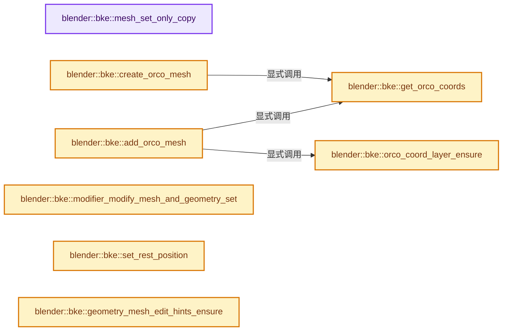

# 实现依赖专题：source/blender/blenkernel/intern/mesh_data_update.cc

[实现依赖导航](../../README.md) · [符号索引](../../../00-课程指南/02-源码与提交索引/符号依赖与实现索引.md)

本专题从正文实际调用进入，集中保存共享实现。函数有稳定锚点，可从调用处直接跳到对应完整函数；递归与互相调用通过回链组织。

## 本文件的实现关系




<a id="m-0a2a0c568e5d"></a>

## 宏 `ASSERT_IS_VALID_MESH_INPUT`

<!-- annotated:7d1dfffd78b1dd -->

```cpp
#  define ASSERT_IS_VALID_MESH_INPUT(mesh) (BLI_assert(mesh_is_valid(*mesh)))
#  define ASSERT_IS_VALID_MESH_OUTPUT(mesh) \
```

<details>
<summary>核对原始源码：source/blender/blenkernel/intern/mesh_data_update.cc · L60—L61</summary>

<!-- original:7d1dfffd78b1dd:source/blender/blenkernel/intern/mesh_data_update.cc:60:61 -->

```cpp
#  define ASSERT_IS_VALID_MESH_INPUT(mesh) (BLI_assert(mesh_is_valid(*mesh)))
#  define ASSERT_IS_VALID_MESH_OUTPUT(mesh) \
```

</details>

宏在预处理阶段展开，参数替换、重复求值和条件编译应直接从该定义检查。与普通函数不同，宏不会自动提供参数类型检查；构建配置选择哪个定义需结合外围条件。

<a id="m-b6a277743c43"></a>

## 宏 `ASSERT_IS_VALID_MESH_OUTPUT`

<!-- annotated:0c5a1cef7c4fcc -->

```cpp
#  define ASSERT_IS_VALID_MESH_OUTPUT(mesh) \
    (BLI_assert((mesh == nullptr) || (mesh_is_valid(*mesh))))
#else
```

<details>
<summary>核对原始源码：source/blender/blenkernel/intern/mesh_data_update.cc · L61—L63</summary>

<!-- original:0c5a1cef7c4fcc:source/blender/blenkernel/intern/mesh_data_update.cc:61:63 -->

```cpp
#  define ASSERT_IS_VALID_MESH_OUTPUT(mesh) \
    (BLI_assert((mesh == nullptr) || (mesh_is_valid(*mesh))))
#else
```

</details>

宏在预处理阶段展开，参数替换、重复求值和条件编译应直接从该定义检查。与普通函数不同，宏不会自动提供参数类型检查；构建配置选择哪个定义需结合外围条件。

<a id="m-4f637c9b6f8b"></a>

## 宏 `ASSERT_IS_VALID_MESH_INPUT`

<!-- annotated:ca6724ed208b2e -->

```cpp
#  define ASSERT_IS_VALID_MESH_INPUT(mesh) \
    { \
      (void)mesh; \
    };
#  define ASSERT_IS_VALID_MESH_OUTPUT(mesh) \
```

<details>
<summary>核对原始源码：source/blender/blenkernel/intern/mesh_data_update.cc · L64—L68</summary>

<!-- original:ca6724ed208b2e:source/blender/blenkernel/intern/mesh_data_update.cc:64:68 -->

```cpp
#  define ASSERT_IS_VALID_MESH_INPUT(mesh) \
    { \
      (void)mesh; \
    };
#  define ASSERT_IS_VALID_MESH_OUTPUT(mesh) \
```

</details>

宏在预处理阶段展开，参数替换、重复求值和条件编译应直接从该定义检查。与普通函数不同，宏不会自动提供参数类型检查；构建配置选择哪个定义需结合外围条件。

<a id="m-fe3387876ae8"></a>

## 宏 `ASSERT_IS_VALID_MESH_OUTPUT`

<!-- annotated:8240759b6e3b29 -->

```cpp
#  define ASSERT_IS_VALID_MESH_OUTPUT(mesh) \
    { \
      (void)mesh; \
    };

```

<details>
<summary>核对原始源码：source/blender/blenkernel/intern/mesh_data_update.cc · L68—L72</summary>

<!-- original:8240759b6e3b29:source/blender/blenkernel/intern/mesh_data_update.cc:68:72 -->

```cpp
#  define ASSERT_IS_VALID_MESH_OUTPUT(mesh) \
    { \
      (void)mesh; \
    };

```

</details>

宏在预处理阶段展开，参数替换、重复求值和条件编译应直接从该定义检查。与普通函数不同，宏不会自动提供参数类型检查；构建配置选择哪个定义需结合外围条件。

## 完整成员与函数实现

<a id="f-52467a65fd952ff3"></a>

### `blender::bke::mesh_set_only_copy`

实现位置：[source/blender/blenkernel/intern/mesh_data_update.cc](../../../../../../../source/blender/blenkernel/intern/mesh_data_update.cc) · L77—L89。

接口参数：

- `Mesh *mesh`
- `const CustomData_MeshMasks *mask`

**教学注释版**

<!-- annotated:2b41e54e236b3d -->

```cpp
static void mesh_set_only_copy(Mesh *mesh, const CustomData_MeshMasks *mask)
{
  CustomData_set_only_copy(&mesh->vert_data, mask->vmask);
  CustomData_set_only_copy(&mesh->edge_data, mask->emask);
  CustomData_set_only_copy(&mesh->fdata_legacy, mask->fmask);
  /* this wasn't in 2.63 and is disabled for 2.64 because it gives problems with
   * weight paint mode when there are modifiers applied, needs further investigation,
   * see replies to r50969, Campbell */
#if 0
  CustomData_set_only_copy(&mesh->ldata, mask->lmask);
  CustomData_set_only_copy(&mesh->pdata, mask->pmask);
#endif
}
```

<details>
<summary>核对原始源码：source/blender/blenkernel/intern/mesh_data_update.cc · L77—L89</summary>

<!-- original:2b41e54e236b3d:source/blender/blenkernel/intern/mesh_data_update.cc:77:89 -->

```cpp
static void mesh_set_only_copy(Mesh *mesh, const CustomData_MeshMasks *mask)
{
  CustomData_set_only_copy(&mesh->vert_data, mask->vmask);
  CustomData_set_only_copy(&mesh->edge_data, mask->emask);
  CustomData_set_only_copy(&mesh->fdata_legacy, mask->fmask);
  /* this wasn't in 2.63 and is disabled for 2.64 because it gives problems with
   * weight paint mode when there are modifiers applied, needs further investigation,
   * see replies to r50969, Campbell */
#if 0
  CustomData_set_only_copy(&mesh->ldata, mask->lmask);
  CustomData_set_only_copy(&mesh->pdata, mask->pmask);
#endif
}
```

</details>

**继续追踪实现**

- `CustomData_set_only_copy` → [blender::CustomData_set_only_copy · L3049](customdata.cc.md#f-f4b6f8cd9d49fdaf)。

<a id="f-e52439bc4fab1c75"></a>

### `blender::bke::get_orco_coords`

实现位置：[source/blender/blenkernel/intern/mesh_data_update.cc](../../../../../../../source/blender/blenkernel/intern/mesh_data_update.cc) · L92—L126。

接口参数：

- `const Object &ob`
- `BMesh *bm`
- `eCustomDataType layer_type`
- `Array<float3> &storage`

**教学注释版**

<!-- annotated:910a43128cc1da -->

```cpp
static Span<float3> get_orco_coords(const Object &ob,
                                    BMesh *bm,
                                    eCustomDataType layer_type,
                                    Array<float3> &storage)
{
  if (layer_type == CD_ORCO) {

    if (bm) {
      storage = BM_mesh_vert_coords_alloc(bm);
      return storage;
    }
    storage = BKE_mesh_orco_verts_get(&ob);
    return storage;
  }
  if (layer_type == CD_CLOTH_ORCO) {
    /* apply shape key for cloth, this should really be solved
     * by a more flexible customdata system, but not simple */
    if (!bm) {
      const ClothModifierData *clmd = reinterpret_cast<const ClothModifierData *>(
          BKE_modifiers_findby_type(&ob, eModifierType_Cloth));
      if (clmd && clmd->sim_parms->shapekey_rest) {
        const KeyBlock *kb = BKE_keyblock_find_by_index(
            BKE_key_from_object(const_cast<Object *>(&ob)), clmd->sim_parms->shapekey_rest);

        if (kb && kb->data) {
          return {static_cast<const float3 *>(kb->data), kb->totelem};
        }
      }
    }

    return {};
  }

  return {};
}
```

<details>
<summary>核对原始源码：source/blender/blenkernel/intern/mesh_data_update.cc · L92—L126</summary>

<!-- original:910a43128cc1da:source/blender/blenkernel/intern/mesh_data_update.cc:92:126 -->

```cpp
static Span<float3> get_orco_coords(const Object &ob,
                                    BMesh *bm,
                                    eCustomDataType layer_type,
                                    Array<float3> &storage)
{
  if (layer_type == CD_ORCO) {

    if (bm) {
      storage = BM_mesh_vert_coords_alloc(bm);
      return storage;
    }
    storage = BKE_mesh_orco_verts_get(&ob);
    return storage;
  }
  if (layer_type == CD_CLOTH_ORCO) {
    /* apply shape key for cloth, this should really be solved
     * by a more flexible customdata system, but not simple */
    if (!bm) {
      const ClothModifierData *clmd = reinterpret_cast<const ClothModifierData *>(
          BKE_modifiers_findby_type(&ob, eModifierType_Cloth));
      if (clmd && clmd->sim_parms->shapekey_rest) {
        const KeyBlock *kb = BKE_keyblock_find_by_index(
            BKE_key_from_object(const_cast<Object *>(&ob)), clmd->sim_parms->shapekey_rest);

        if (kb && kb->data) {
          return {static_cast<const float3 *>(kb->data), kb->totelem};
        }
      }
    }

    return {};
  }

  return {};
}
```

</details>

**沿实际写入检查状态**

- `storage = BM_mesh_vert_coords_alloc(bm);`
- `storage = BKE_mesh_orco_verts_get(&ob);`

**结果出口**

- `return storage;`
- `return {static_cast<const float3 *>(kb->data), kb->totelem};`
- `return {};`

**继续追踪实现**

- `BM_mesh_vert_coords_alloc` → [blender::BM_mesh_vert_coords_alloc · L1337](../../08-其他Blender模块/bmesh/intern/bmesh_mesh.cc.md#f-bc4760be1676a19c)。
- `BKE_mesh_orco_verts_get` → [BKE_mesh_orco_verts_get · L1724](../../../05-几何存储与拓扑映射/03-MPoly迁移与兼容.md#f-bbe92d4086086176)。
- `BKE_modifiers_findby_type` → [blender::BKE_modifiers_findby_type · L256](modifier.cc.md#f-9f6b6b9b4343d30f)。
- `BKE_keyblock_find_by_index` → [blender::BKE_keyblock_find_by_index · L1425](key.cc.md#f-0693ed595207ecc7)。
- `BKE_key_from_object` → [blender::BKE_key_from_object · L1311](key.cc.md#f-c191304ae3a652d6)。

<a id="f-5b4ed153713a68c1"></a>

### `blender::bke::create_orco_mesh`

实现位置：[source/blender/blenkernel/intern/mesh_data_update.cc](../../../../../../../source/blender/blenkernel/intern/mesh_data_update.cc) · L128—L148。

接口参数：

- `const Object &ob`
- `const Mesh &mesh`
- `BMesh *bm`
- `eCustomDataType layer`

**教学注释版**

<!-- annotated:dfcbe495c5d407 -->

```cpp
static Mesh *create_orco_mesh(const Object &ob, const Mesh &mesh, BMesh *bm, eCustomDataType layer)
{
  Mesh *orco_mesh;
  if (bm) {
    orco_mesh = BKE_mesh_from_bmesh_for_eval_nomain(bm, nullptr, &mesh);
    BKE_mesh_ensure_default_orig_index_customdata(orco_mesh);
  }
  else {
    orco_mesh = BKE_mesh_copy_for_eval(mesh);
  }

  Array<float3> storage;
  const Span<float3> orco = get_orco_coords(ob, bm, layer, storage);

  // [讲解] orco.is_empty：查询视图长度或生成对应有效索引区间。
  if (!orco.is_empty()) {
    orco_mesh->vert_positions_for_write().copy_from(orco);
    orco_mesh->tag_positions_changed();
  }

  return orco_mesh;
}
```

<details>
<summary>核对原始源码：source/blender/blenkernel/intern/mesh_data_update.cc · L128—L148</summary>

<!-- original:dfcbe495c5d407:source/blender/blenkernel/intern/mesh_data_update.cc:128:148 -->

```cpp
static Mesh *create_orco_mesh(const Object &ob, const Mesh &mesh, BMesh *bm, eCustomDataType layer)
{
  Mesh *orco_mesh;
  if (bm) {
    orco_mesh = BKE_mesh_from_bmesh_for_eval_nomain(bm, nullptr, &mesh);
    BKE_mesh_ensure_default_orig_index_customdata(orco_mesh);
  }
  else {
    orco_mesh = BKE_mesh_copy_for_eval(mesh);
  }

  Array<float3> storage;
  const Span<float3> orco = get_orco_coords(ob, bm, layer, storage);

  if (!orco.is_empty()) {
    orco_mesh->vert_positions_for_write().copy_from(orco);
    orco_mesh->tag_positions_changed();
  }

  return orco_mesh;
}
```

</details>

**沿实际写入检查状态**

- `orco_mesh = BKE_mesh_from_bmesh_for_eval_nomain(bm, nullptr, &mesh);`
- `orco_mesh = BKE_mesh_copy_for_eval(mesh);`

**结果出口**

- `return orco_mesh;`

**继续追踪实现**

- `BKE_mesh_from_bmesh_for_eval_nomain` → [BKE_mesh_from_bmesh_for_eval_nomain · L1620](../../../05-几何存储与拓扑映射/03-MPoly迁移与兼容.md#f-92b713674a1be50c)。
- `BKE_mesh_ensure_default_orig_index_customdata` → [BKE_mesh_ensure_default_orig_index_customdata · L1640](../../../05-几何存储与拓扑映射/03-MPoly迁移与兼容.md#f-293b886fbcab7b85)。
- `BKE_mesh_copy_for_eval` → [BKE_mesh_copy_for_eval · L1577](../../../05-几何存储与拓扑映射/03-MPoly迁移与兼容.md#f-32e8f0e51faecc10)。
- `get_orco_coords` → [blender::bke::get_orco_coords · L92](mesh_data_update.cc.md#f-e52439bc4fab1c75)。
- `orco.is_empty` → [blender::Span::is_empty · L264](../../../01-基础容器与现代CPP/05-Span只读连续视图.md#f-8cc1d7ba8feb50e6)。
- `orco_mesh->vert_positions_for_write().copy_from` → [调用协议](../../../00-课程指南/01-路线与规范/模板宏与动态分派协议.md)：接收对象类型依赖auto、返回值或模板实例；不按同名猜测目标。调用位置L143。
- `orco_mesh->vert_positions_for_write` → [Mesh::vert_positions_for_write · L1199](../../../05-几何存储与拓扑映射/03-MPoly迁移与兼容.md#f-ae8d77205112d843)。
- `orco_mesh->tag_positions_changed` → [blender::Mesh::tag_positions_changed · L407](../../../06-隐式共享与缓存系统/10-局部更新与失效修复.md#f-90e852663d44ad53)。

<a id="f-172ab8c6611f92da"></a>

### `blender::bke::orco_coord_layer_ensure`

实现位置：[source/blender/blenkernel/intern/mesh_data_update.cc](../../../../../../../source/blender/blenkernel/intern/mesh_data_update.cc) · L150—L157。

接口参数：

- `Mesh &mesh`
- `const eCustomDataType layer`

**教学注释版**

<!-- annotated:596d4594a00e0e -->

```cpp
static MutableSpan<float3> orco_coord_layer_ensure(Mesh &mesh, const eCustomDataType layer)
{
  void *data = CustomData_get_layer_for_write(&mesh.vert_data, layer, mesh.verts_num);
  if (!data) {
    data = CustomData_add_layer(&mesh.vert_data, layer, CD_CONSTRUCT, mesh.verts_num);
  }
  return MutableSpan(reinterpret_cast<float3 *>(data), mesh.verts_num);
}
```

<details>
<summary>核对原始源码：source/blender/blenkernel/intern/mesh_data_update.cc · L150—L157</summary>

<!-- original:596d4594a00e0e:source/blender/blenkernel/intern/mesh_data_update.cc:150:157 -->

```cpp
static MutableSpan<float3> orco_coord_layer_ensure(Mesh &mesh, const eCustomDataType layer)
{
  void *data = CustomData_get_layer_for_write(&mesh.vert_data, layer, mesh.verts_num);
  if (!data) {
    data = CustomData_add_layer(&mesh.vert_data, layer, CD_CONSTRUCT, mesh.verts_num);
  }
  return MutableSpan(reinterpret_cast<float3 *>(data), mesh.verts_num);
}
```

</details>

**沿实际写入检查状态**

- `data = CustomData_add_layer(&mesh.vert_data, layer, CD_CONSTRUCT, mesh.verts_num);`

**结果出口**

- `return MutableSpan(reinterpret_cast<float3 *>(data), mesh.verts_num);`

**继续追踪实现**

- `CustomData_get_layer_for_write` → [blender::CustomData_get_layer_for_write · L3318](customdata.cc.md#f-6af158905e2c1274)。
- `CustomData_add_layer` → [blender::CustomData_add_layer · L2851](customdata.cc.md#f-4c7988e825541059)。
- `MutableSpan` → [blender::MutableSpan::MutableSpan · L462](../../../01-基础容器与现代CPP/06-MutableSpan可写视图.md#f-0f07034aaffc3384)；[blender::MutableSpan::MutableSpan · L464](../../../01-基础容器与现代CPP/06-MutableSpan可写视图.md#f-39977234ad0ce192)；[blender::MutableSpan::MutableSpan · L466](../../../01-基础容器与现代CPP/06-MutableSpan可写视图.md#f-ee249b5042dd38aa)；[blender::MutableSpan::MutableSpan · L468](../../../01-基础容器与现代CPP/06-MutableSpan可写视图.md#f-479c5f85921e531f)；[blender::MutableSpan::MutableSpan · L477](../../../01-基础容器与现代CPP/06-MutableSpan可写视图.md#f-afcce5325e6f19e0)。同名重载需按实参类型选择。

<a id="f-e546df23bea78e04"></a>

### `blender::bke::add_orco_mesh`

实现位置：[source/blender/blenkernel/intern/mesh_data_update.cc](../../../../../../../source/blender/blenkernel/intern/mesh_data_update.cc) · L159—L191。

接口参数：

- `Object &ob`
- `BMesh *bm`
- `Mesh &mesh`
- `const Mesh *mesh_orco`
- `const eCustomDataType layer`

**教学注释版**

<!-- annotated:c3dfa453320504 -->

```cpp
static void add_orco_mesh(
    Object &ob, BMesh *bm, Mesh &mesh, const Mesh *mesh_orco, const eCustomDataType layer)
{
  const int totvert = mesh.verts_num;

  MutableSpan<float3> layer_orco;
  if (mesh_orco) {
    layer_orco = orco_coord_layer_ensure(mesh, layer);

    if (mesh_orco->verts_num == totvert) {
      // [讲解] layer_orco.copy_from：修改已有目标元素，不改变底层容器长度。
      layer_orco.copy_from(mesh_orco->vert_positions());
    }
    else {
      layer_orco.copy_from(mesh.vert_positions());
    }
  }
  else {
    /* TODO(@sybren): `totvert` should potentially change here, as `ob->data`
     * or `em` may have a different number of vertices than the evaluated `mesh`. */
    Array<float3> storage;
    const Span<float3> orco = get_orco_coords(ob, bm, layer, storage);
    // [讲解] orco.is_empty：查询视图长度或生成对应有效索引区间。
    if (!orco.is_empty()) {
      layer_orco = orco_coord_layer_ensure(mesh, layer);
      layer_orco.copy_from(orco);
    }
  }

  if (!layer_orco.is_empty()) {
    if (layer == CD_ORCO) {
      BKE_mesh_orco_verts_transform(id_cast<Mesh *>(ob.data), layer_orco, false);
    }
  }
}
```

<details>
<summary>核对原始源码：source/blender/blenkernel/intern/mesh_data_update.cc · L159—L191</summary>

<!-- original:c3dfa453320504:source/blender/blenkernel/intern/mesh_data_update.cc:159:191 -->

```cpp
static void add_orco_mesh(
    Object &ob, BMesh *bm, Mesh &mesh, const Mesh *mesh_orco, const eCustomDataType layer)
{
  const int totvert = mesh.verts_num;

  MutableSpan<float3> layer_orco;
  if (mesh_orco) {
    layer_orco = orco_coord_layer_ensure(mesh, layer);

    if (mesh_orco->verts_num == totvert) {
      layer_orco.copy_from(mesh_orco->vert_positions());
    }
    else {
      layer_orco.copy_from(mesh.vert_positions());
    }
  }
  else {
    /* TODO(@sybren): `totvert` should potentially change here, as `ob->data`
     * or `em` may have a different number of vertices than the evaluated `mesh`. */
    Array<float3> storage;
    const Span<float3> orco = get_orco_coords(ob, bm, layer, storage);
    if (!orco.is_empty()) {
      layer_orco = orco_coord_layer_ensure(mesh, layer);
      layer_orco.copy_from(orco);
    }
  }

  if (!layer_orco.is_empty()) {
    if (layer == CD_ORCO) {
      BKE_mesh_orco_verts_transform(id_cast<Mesh *>(ob.data), layer_orco, false);
    }
  }
}
```

</details>

**沿实际写入检查状态**

- `layer_orco = orco_coord_layer_ensure(mesh, layer);`

**继续追踪实现**

- `orco_coord_layer_ensure` → [blender::bke::orco_coord_layer_ensure · L150](mesh_data_update.cc.md#f-172ab8c6611f92da)。
- `layer_orco.copy_from` → [blender::MutableSpan::copy_from · L745](../../../01-基础容器与现代CPP/06-MutableSpan可写视图.md#f-e4f099b1497adddb)。
- `mesh_orco->vert_positions` → [Mesh::vert_positions · L1193](../../../05-几何存储与拓扑映射/03-MPoly迁移与兼容.md#f-ae4177e5c5f2b371)。
- `mesh.vert_positions` → [Mesh::vert_positions · L1193](../../../05-几何存储与拓扑映射/03-MPoly迁移与兼容.md#f-ae4177e5c5f2b371)。
- `get_orco_coords` → [blender::bke::get_orco_coords · L92](mesh_data_update.cc.md#f-e52439bc4fab1c75)。
- `orco.is_empty` → [blender::Span::is_empty · L264](../../../01-基础容器与现代CPP/05-Span只读连续视图.md#f-8cc1d7ba8feb50e6)。
- `layer_orco.is_empty` → [blender::MutableSpan::is_empty · L515](../../../01-基础容器与现代CPP/06-MutableSpan可写视图.md#f-be88df1422757437)。
- `BKE_mesh_orco_verts_transform` → [BKE_mesh_orco_verts_transform · L1737](../../../05-几何存储与拓扑映射/03-MPoly迁移与兼容.md#f-0310af64073b6afe)；[BKE_mesh_orco_verts_transform · L1760](../../../05-几何存储与拓扑映射/03-MPoly迁移与兼容.md#f-1e12235ffe4ed6d7)。同名重载需按实参类型选择。
- `id_cast<Mesh *>` → [blender::id_cast · L1417](../../08-其他Blender模块/makesdna/DNA_ID.h.md#f-6c8ac6412850ac5a)。

<a id="f-533c3aed387202f3"></a>

### `blender::bke::modifier_modify_mesh_and_geometry_set`

实现位置：[source/blender/blenkernel/intern/mesh_data_update.cc](../../../../../../../source/blender/blenkernel/intern/mesh_data_update.cc) · L201—L236。

接口参数：

- `ModifierData *md`
- `const ModifierEvalContext &mectx`
- `const Mesh &input_mesh`
- `GeometrySet &geometry_set`

**教学注释版**

<!-- annotated:bfc20022be2370 -->

```cpp
static void modifier_modify_mesh_and_geometry_set(ModifierData *md,
                                                  const ModifierEvalContext &mectx,
                                                  const Mesh &input_mesh,
                                                  GeometrySet &geometry_set)
{
  const ModifierTypeInfo *mti = BKE_modifier_get_info(md->type);
  if (mti->modify_geometry_set) {
    if (const Mesh *mesh = geometry_set.get_mesh()) {
      if (mesh->runtime->wrapper_type != ME_WRAPPER_TYPE_MDATA) {
        Mesh *mesh_mut = geometry_set.get_mesh_for_write();
        /* For performance reasons, this should be called by the modifier and/or
         * nodes themselves at some point. */
        BKE_mesh_wrapper_ensure_mdata(mesh_mut);
      }
      ASSERT_IS_VALID_MESH_INPUT(geometry_set.get_mesh());
    }
    mti->modify_geometry_set(md, &mectx, &geometry_set);
    if (const Mesh *mesh = geometry_set.get_mesh()) {
      ASSERT_IS_VALID_MESH_OUTPUT(mesh);
    }
  }
  else {
    if (Mesh *mesh = geometry_set.get_mesh_for_write()) {
      ASSERT_IS_VALID_MESH_INPUT(mesh);
      Mesh *result = BKE_modifier_modify_mesh(md, &mectx, mesh);
      ASSERT_IS_VALID_MESH_OUTPUT(result);
      geometry_set.replace_mesh(result);
    }
  }

  if (!geometry_set.has_mesh()) {
    Mesh *mesh = BKE_mesh_new_nomain(0, 0, 0, 0);
    BKE_mesh_copy_parameters_for_eval(mesh, &input_mesh);
    geometry_set.replace_mesh(mesh);
  }
}
```

<details>
<summary>核对原始源码：source/blender/blenkernel/intern/mesh_data_update.cc · L201—L236</summary>

<!-- original:bfc20022be2370:source/blender/blenkernel/intern/mesh_data_update.cc:201:236 -->

```cpp
static void modifier_modify_mesh_and_geometry_set(ModifierData *md,
                                                  const ModifierEvalContext &mectx,
                                                  const Mesh &input_mesh,
                                                  GeometrySet &geometry_set)
{
  const ModifierTypeInfo *mti = BKE_modifier_get_info(md->type);
  if (mti->modify_geometry_set) {
    if (const Mesh *mesh = geometry_set.get_mesh()) {
      if (mesh->runtime->wrapper_type != ME_WRAPPER_TYPE_MDATA) {
        Mesh *mesh_mut = geometry_set.get_mesh_for_write();
        /* For performance reasons, this should be called by the modifier and/or
         * nodes themselves at some point. */
        BKE_mesh_wrapper_ensure_mdata(mesh_mut);
      }
      ASSERT_IS_VALID_MESH_INPUT(geometry_set.get_mesh());
    }
    mti->modify_geometry_set(md, &mectx, &geometry_set);
    if (const Mesh *mesh = geometry_set.get_mesh()) {
      ASSERT_IS_VALID_MESH_OUTPUT(mesh);
    }
  }
  else {
    if (Mesh *mesh = geometry_set.get_mesh_for_write()) {
      ASSERT_IS_VALID_MESH_INPUT(mesh);
      Mesh *result = BKE_modifier_modify_mesh(md, &mectx, mesh);
      ASSERT_IS_VALID_MESH_OUTPUT(result);
      geometry_set.replace_mesh(result);
    }
  }

  if (!geometry_set.has_mesh()) {
    Mesh *mesh = BKE_mesh_new_nomain(0, 0, 0, 0);
    BKE_mesh_copy_parameters_for_eval(mesh, &input_mesh);
    geometry_set.replace_mesh(mesh);
  }
}
```

</details>

**继续追踪实现**

- `BKE_modifier_get_info` → [blender::BKE_modifier_get_info · L120](modifier.cc.md#f-88218d6d450f0291)。
- `geometry_set.get_mesh` → [blender::bke::GeometrySet::get_mesh · L315](../../../06-隐式共享与缓存系统/05-GeometrySet读写与复制.md#f-25151145065d998b)。
- `geometry_set.get_mesh_for_write` → [blender::bke::GeometrySet::get_mesh_for_write · L562](../../../06-隐式共享与缓存系统/05-GeometrySet读写与复制.md#f-0988a6845ad4e207)。
- `BKE_mesh_wrapper_ensure_mdata` → [blender::BKE_mesh_wrapper_ensure_mdata · L79](mesh_wrapper.cc.md#f-391cdba59bba6a12)。
- `ASSERT_IS_VALID_MESH_INPUT` → [ASSERT_IS_VALID_MESH_INPUT · L60](mesh_data_update.cc.md#m-0a2a0c568e5d)；[ASSERT_IS_VALID_MESH_INPUT · L64](mesh_data_update.cc.md#m-4f637c9b6f8b)。宏定义由构建条件选择。
- `mti->modify_geometry_set` → [blender::modify_geometry_set · L243](../../08-其他Blender模块/modifiers/intern/MOD_grease_pencil_noise.cc.md#f-230f261ee5b301b9)；[blender::modify_geometry_set · L218](../../08-其他Blender模块/modifiers/intern/MOD_grease_pencil_multiply.cc.md#f-20b39fa517056ba3)；[blender::modify_geometry_set · L184](../../08-其他Blender模块/modifiers/intern/MOD_grease_pencil_mirror.cc.md#f-3dc669ce25b45890)；[blender::modify_geometry_set · L303](../../08-其他Blender模块/modifiers/intern/MOD_volume_displace.cc.md#f-ebaffe948c472b25)；[blender::modify_geometry_set · L245](../../08-其他Blender模块/modifiers/intern/MOD_grease_pencil_length.cc.md#f-115999e601704e66)；[blender::modify_geometry_set · L127](../../08-其他Blender模块/modifiers/intern/MOD_grease_pencil_lattice.cc.md#f-08d3356602673303)；[blender::modify_geometry_set · L237](../../08-其他Blender模块/modifiers/intern/MOD_grease_pencil_hook.cc.md#f-7d8cba698be3f21f)；[blender::modify_geometry_set · L648](../../08-其他Blender模块/modifiers/intern/MOD_grease_pencil_envelope.cc.md#f-89a88be68c707af7)；[blender::modify_geometry_set · L383](../../08-其他Blender模块/modifiers/intern/MOD_grease_pencil_dash.cc.md#f-77a5c0cf948381ba)；[blender::modify_geometry_set · L186](../../08-其他Blender模块/modifiers/intern/MOD_grease_pencil_color.cc.md#f-b7d9cea51cff81d7)；[blender::modify_geometry_set · L708](../../08-其他Blender模块/modifiers/intern/MOD_grease_pencil_build.cc.md#f-5dd5fbb27a45198a)；[blender::modify_geometry_set · L256](../../08-其他Blender模块/modifiers/intern/MOD_grease_pencil_array.cc.md#f-5bbc1bf941a9346b)；[blender::modify_geometry_set · L228](../../08-其他Blender模块/modifiers/intern/MOD_grease_pencil_armature.cc.md#f-aa0222d18ac7bd5e)；[blender::modify_geometry_set · L1862](../../08-其他Blender模块/modifiers/intern/MOD_nodes.cc.md#f-2a30b7b16d4a8c31)；[blender::modify_geometry_set · L176](../../08-其他Blender模块/modifiers/intern/MOD_mesh_to_volume.cc.md#f-d3eb652ca6ad569c)；[blender::modify_geometry_set · L146](../../08-其他Blender模块/modifiers/intern/MOD_meshsequencecache.cc.md#f-293a594730db07db)；[blender::modify_geometry_set · L873](../../08-其他Blender模块/modifiers/intern/MOD_lineart.cc.md#f-5f731799aa2bb8f9)；[blender::modify_geometry_set · L212](../../08-其他Blender模块/modifiers/intern/MOD_grease_pencil_weight_proximity.cc.md#f-ea5a620d5c23e64e)；[blender::modify_geometry_set · L192](../../08-其他Blender模块/modifiers/intern/MOD_grease_pencil_weight_angle.cc.md#f-782ecf61845b0827)；[blender::modify_geometry_set · L409](../../08-其他Blender模块/modifiers/intern/MOD_grease_pencil_tint.cc.md#f-54a72eb9cf6cff28)；[blender::modify_geometry_set · L480](../../08-其他Blender模块/modifiers/intern/MOD_grease_pencil_time.cc.md#f-9ab3d6f606c2eab8)；[blender::modify_geometry_set · L150](../../08-其他Blender模块/modifiers/intern/MOD_grease_pencil_thickness.cc.md#f-4e7b0f538b12bed5)；[blender::modify_geometry_set · L276](../../08-其他Blender模块/modifiers/intern/MOD_grease_pencil_texture.cc.md#f-1ff4ec887af41ab7)；[blender::modify_geometry_set · L130](../../08-其他Blender模块/modifiers/intern/MOD_grease_pencil_subdiv.cc.md#f-931890f60d4fecdf)；[blender::modify_geometry_set · L202](../../08-其他Blender模块/modifiers/intern/MOD_grease_pencil_smooth.cc.md#f-b3cfc63152b3b8cf)；[blender::modify_geometry_set · L161](../../08-其他Blender模块/modifiers/intern/MOD_grease_pencil_simplify.cc.md#f-43ffd26310c793e0)；[blender::modify_geometry_set · L204](../../08-其他Blender模块/modifiers/intern/MOD_grease_pencil_shrinkwrap.cc.md#f-46686f6c416f5e15)；[blender::modify_geometry_set · L231](../../08-其他Blender模块/modifiers/intern/MOD_grease_pencil_outline.cc.md#f-fa4d9a8d843e52d6)；[blender::modify_geometry_set · L206](../../08-其他Blender模块/modifiers/intern/MOD_grease_pencil_opacity.cc.md#f-e612ca2075a8aa0f)；[blender::modify_geometry_set · L359](../../08-其他Blender模块/modifiers/intern/MOD_grease_pencil_offset.cc.md#f-efbe77084a15801e)。同名重载需按实参类型选择。
- `ASSERT_IS_VALID_MESH_OUTPUT` → [ASSERT_IS_VALID_MESH_OUTPUT · L61](mesh_data_update.cc.md#m-b6a277743c43)；[ASSERT_IS_VALID_MESH_OUTPUT · L68](mesh_data_update.cc.md#m-fe3387876ae8)。宏定义由构建条件选择。
- `BKE_modifier_modify_mesh` → [blender::BKE_modifier_modify_mesh · L964](modifier.cc.md#f-047910ba5cbaad4e)。
- `geometry_set.replace_mesh` → [blender::bke::GeometrySet::replace_mesh · L477](../../../06-隐式共享与缓存系统/05-GeometrySet读写与复制.md#f-bf82c30bb38f2007)。
- `geometry_set.has_mesh` → [blender::bke::GeometrySet::has_mesh · L321](../../../06-隐式共享与缓存系统/05-GeometrySet读写与复制.md#f-8d9a6e8a3a3c9006)。
- `BKE_mesh_new_nomain` → [BKE_mesh_new_nomain · L1376](../../../05-几何存储与拓扑映射/03-MPoly迁移与兼容.md#f-d63806a6e34190f2)。
- `BKE_mesh_copy_parameters_for_eval` → [BKE_mesh_copy_parameters_for_eval · L1484](../../../05-几何存储与拓扑映射/03-MPoly迁移与兼容.md#f-71bebe4e73fe4c13)。

<a id="f-9503956789a08857"></a>

### `blender::bke::set_rest_position`

实现位置：[source/blender/blenkernel/intern/mesh_data_update.cc](../../../../../../../source/blender/blenkernel/intern/mesh_data_update.cc) · L238—L255。

接口参数：

- `Mesh &mesh`

**教学注释版**

<!-- annotated:b025fb015228e7 -->

```cpp
static void set_rest_position(Mesh &mesh)
{
  MutableAttributeAccessor attributes = mesh.attributes_for_write();
  const AttributeReader positions = attributes.lookup<float3>("position");
  attributes.remove("rest_position");
  if (positions) {
    if (positions.sharing_info && positions.varray.is_span()) {
      attributes.add<float3>("rest_position",
                             AttrDomain::Point,
                             AttributeInitShared(positions.varray.get_internal_span().data(),
                                                 *positions.sharing_info));
    }
    else {
      attributes.add<float3>(
          "rest_position", AttrDomain::Point, AttributeInitVArray(positions.varray));
    }
  }
}
```

<details>
<summary>核对原始源码：source/blender/blenkernel/intern/mesh_data_update.cc · L238—L255</summary>

<!-- original:b025fb015228e7:source/blender/blenkernel/intern/mesh_data_update.cc:238:255 -->

```cpp
static void set_rest_position(Mesh &mesh)
{
  MutableAttributeAccessor attributes = mesh.attributes_for_write();
  const AttributeReader positions = attributes.lookup<float3>("position");
  attributes.remove("rest_position");
  if (positions) {
    if (positions.sharing_info && positions.varray.is_span()) {
      attributes.add<float3>("rest_position",
                             AttrDomain::Point,
                             AttributeInitShared(positions.varray.get_internal_span().data(),
                                                 *positions.sharing_info));
    }
    else {
      attributes.add<float3>(
          "rest_position", AttrDomain::Point, AttributeInitVArray(positions.varray));
    }
  }
}
```

</details>

**继续追踪实现**

- `mesh.attributes_for_write` → [Mesh::attributes_for_write · L1303](../../../05-几何存储与拓扑映射/03-MPoly迁移与兼容.md#f-ca7af2f1a15f0bc4)。
- `attributes.lookup<float3>` → [blender::bke::AttributeStorage::lookup · L218](attribute_storage.cc.md#f-7fdc83fb77004833)；[blender::bke::AttributeStorage::lookup · L228](attribute_storage.cc.md#f-4c9ec35a31afcd06)；[blender::bke::AttributeAccessor::lookup · L401](attribute_access.cc.md#f-4673351b7bb3b651)。同名重载需按实参类型选择。
- `attributes.remove` → [blender::bke::MutableAttributeAccessor::remove · L1007](../../../05-几何存储与拓扑映射/08-AttributeAccessor接口.md#f-70cc562b046f24be)。
- `positions.varray.is_span` → [调用协议](../../../00-课程指南/01-路线与规范/模板宏与动态分派协议.md)：接收对象类型依赖auto、返回值或模板实例；不按同名猜测目标。调用位置L244。
- `attributes.add<float3>` → [blender::bke::MutableAttributeAccessor::add · L769](../../../05-几何存储与拓扑映射/08-AttributeAccessor接口.md#f-5fa7f06d7e22891a)；[blender::bke::MutableAttributeAccessor::add · L785](../../../05-几何存储与拓扑映射/08-AttributeAccessor接口.md#f-42998ceb23ada8cc)。同名重载需按实参类型选择。
- `AttributeInitShared` → [blender::bke::AttributeInitShared::AttributeInitShared · L132](../../../05-几何存储与拓扑映射/08-AttributeAccessor接口.md#f-d833f311804f775e)。
- `positions.varray.get_internal_span().data` → [调用协议](../../../00-课程指南/01-路线与规范/模板宏与动态分派协议.md)：接收对象类型依赖auto、返回值或模板实例；不按同名猜测目标。调用位置L247。
- `positions.varray.get_internal_span` → [调用协议](../../../00-课程指南/01-路线与规范/模板宏与动态分派协议.md)：接收对象类型依赖auto、返回值或模板实例；不按同名猜测目标。调用位置L247。
- `AttributeInitVArray` → [blender::bke::AttributeInitVArray::AttributeInitVArray · L121](../../../05-几何存储与拓扑映射/08-AttributeAccessor接口.md#f-956e4152f3f1e0b2)。

<a id="f-b5eae14bec08e752"></a>

### `blender::bke::geometry_mesh_edit_hints_ensure`

实现位置：[source/blender/blenkernel/intern/mesh_data_update.cc](../../../../../../../source/blender/blenkernel/intern/mesh_data_update.cc) · L257—L264。

接口参数：

- `GeometrySet &geometry`

**教学注释版**

<!-- annotated:f0764e8faabab1 -->

```cpp
static MeshEditHints &geometry_mesh_edit_hints_ensure(GeometrySet &geometry)
{
  auto &edit_data = geometry.get_component_for_write<GeometryComponentEditData>();
  if (!edit_data.mesh_edit_hints_) {
    // [讲解] std::make_unique<MeshEditHints>：创建独占拥有的对象，拥有关系可移动，get返回的借用指针不自动延长寿命。
    edit_data.mesh_edit_hints_ = std::make_unique<MeshEditHints>();
  }
  return *edit_data.mesh_edit_hints_;
}
```

<details>
<summary>核对原始源码：source/blender/blenkernel/intern/mesh_data_update.cc · L257—L264</summary>

<!-- original:f0764e8faabab1:source/blender/blenkernel/intern/mesh_data_update.cc:257:264 -->

```cpp
static MeshEditHints &geometry_mesh_edit_hints_ensure(GeometrySet &geometry)
{
  auto &edit_data = geometry.get_component_for_write<GeometryComponentEditData>();
  if (!edit_data.mesh_edit_hints_) {
    edit_data.mesh_edit_hints_ = std::make_unique<MeshEditHints>();
  }
  return *edit_data.mesh_edit_hints_;
}
```

</details>

**沿实际写入检查状态**

- `edit_data.mesh_edit_hints_ = std::make_unique<MeshEditHints>();`

**结果出口**

- `return *edit_data.mesh_edit_hints_;`

**继续追踪实现**

- `geometry.get_component_for_write<GeometryComponentEditData>` → [blender::bke::GeometrySet::get_component_for_write · L119](../../../06-隐式共享与缓存系统/05-GeometrySet读写与复制.md#f-21eccb196f5b9a78)。
- `std::make_unique<MeshEditHints>` → [外部契约](https://eel.is/c++draft/unique.ptr.create)：创建独占拥有的对象，拥有关系可移动，get返回的借用指针不自动延长寿命。

<a id="f-10bc7522a1beb2fe"></a>

### `blender::bke::mesh_eval_assign_key`

实现位置：[source/blender/blenkernel/intern/mesh_data_update.cc](../../../../../../../source/blender/blenkernel/intern/mesh_data_update.cc) · L266—L272。

接口参数：

- `GeometrySet &geometry`
- `Key *key`

**教学注释版**

<!-- annotated:435b1a6635ac76 -->

```cpp
static void mesh_eval_assign_key(GeometrySet &geometry, Key *key)
{
  BLI_assert(DEG_is_evaluated_id(&key->id));
  if (const Mesh *mesh = geometry.get_mesh(); mesh && mesh->key != key) {
    geometry.get_mesh_for_write()->key = key;
  }
}
```

<details>
<summary>核对原始源码：source/blender/blenkernel/intern/mesh_data_update.cc · L266—L272</summary>

<!-- original:435b1a6635ac76:source/blender/blenkernel/intern/mesh_data_update.cc:266:272 -->

```cpp
static void mesh_eval_assign_key(GeometrySet &geometry, Key *key)
{
  BLI_assert(DEG_is_evaluated_id(&key->id));
  if (const Mesh *mesh = geometry.get_mesh(); mesh && mesh->key != key) {
    geometry.get_mesh_for_write()->key = key;
  }
}
```

</details>

**继续追踪实现**

- `BLI_assert` → [BLI_assert · L48](../../01-BLI基础库/BLI_assert.hh.md#m-57a88495704d)；[BLI_assert · L63](../../01-BLI基础库/BLI_assert.hh.md#m-d07050020cb5)。宏定义由构建条件选择。
- `DEG_is_evaluated_id` → [blender::DEG_is_evaluated_id · L338](../../06-Depsgraph依赖图/intern/depsgraph_query.cc.md#f-96310685368dcb56)。
- `geometry.get_mesh` → [blender::bke::GeometrySet::get_mesh · L315](../../../06-隐式共享与缓存系统/05-GeometrySet读写与复制.md#f-25151145065d998b)。
- `geometry.get_mesh_for_write` → [blender::bke::GeometrySet::get_mesh_for_write · L562](../../../06-隐式共享与缓存系统/05-GeometrySet读写与复制.md#f-0988a6845ad4e207)。

<a id="f-e3c34eda6f35a7a5"></a>

### `blender::bke::mesh_calc_modifiers`

实现位置：[source/blender/blenkernel/intern/mesh_data_update.cc](../../../../../../../source/blender/blenkernel/intern/mesh_data_update.cc) · L274—L640。

接口参数：

- `Depsgraph &depsgraph`
- `const Scene &scene`
- `Object &ob`
- `const bool use_deform`
- `const bool need_mapping`
- `const CustomData_MeshMasks &dataMask`
- `const bool use_cache`

**教学注释版**

<!-- annotated:fbb7a547beb6bf -->

```cpp
static GeometrySet mesh_calc_modifiers(Depsgraph &depsgraph,
                                       const Scene &scene,
                                       Object &ob,
                                       const bool use_deform,
                                       const bool need_mapping,
                                       const CustomData_MeshMasks &dataMask,
                                       const bool use_cache)
{
  /* Add the deform mesh to the geometry set after evaluating all modifiers in case
   * it's removed. */
  GeometryComponentPtr mesh_deform;
  const Mesh &mesh_input = *id_cast<const Mesh *>(ob.data);

  GeometrySet geometry_set = GeometrySet::from_mesh(const_cast<Mesh *>(&mesh_input),
                                                    GeometryOwnershipType::ReadOnly);

  /* Mesh with constructive modifiers but no deformation applied. Tracked
   * along with final mesh if undeformed / orco coordinates are requested
   * for texturing. */
  Mesh *mesh_orco = nullptr;
  Mesh *mesh_orco_cloth = nullptr;

  /* Modifier evaluation modes. */
  const bool use_render = (DEG_get_mode(&depsgraph) == DAG_EVAL_RENDER);
  const int required_mode = use_render ? eModifierMode_Render : eModifierMode_Realtime;

  /* Sculpt can skip certain modifiers. */
  const bool has_multires = BKE_sculpt_multires_active(&scene, &ob) != nullptr;
  bool multires_applied = false;
  const bool sculpt_mode = ob.mode & OB_MODE_SCULPT && ob.runtime->sculpt_session && !use_render;
  const bool sculpt_dyntopo = (sculpt_mode && ob.runtime->sculpt_session->bm) && !use_render;

  /* Modifier evaluation contexts for different types of modifiers. */
  ModifierApplyFlag apply_render = use_render ? MOD_APPLY_RENDER : ModifierApplyFlag(0);
  ModifierApplyFlag apply_cache = use_cache ? MOD_APPLY_USECACHE : ModifierApplyFlag(0);
  const ModifierEvalContext mectx = {&depsgraph, &ob, apply_render | apply_cache};
  const ModifierEvalContext mectx_orco = {&depsgraph, &ob, apply_render | MOD_APPLY_ORCO};

  /* Get effective list of modifiers to execute. Some effects like shape keys
   * are added as virtual modifiers before the user created modifiers. */
  VirtualModifierData virtual_modifier_data;
  ModifierData *firstmd = BKE_modifiers_get_virtual_modifierlist(&ob, &virtual_modifier_data);
  ModifierData *md = firstmd;

  /* Compute accumulated datamasks needed by each modifier. It helps to do
   * this fine grained so that for example vertex groups are preserved up to
   * an armature modifier, but not through a following subsurf modifier where
   * subdividing them is expensive. */
  CustomData_MeshMasks final_datamask = dataMask;
  CDMaskLink *datamasks = BKE_modifier_calc_data_masks(&scene, md, &final_datamask, required_mode);
  CDMaskLink *md_datamask = datamasks;
  /* XXX Always copying POLYINDEX, else tessellated data are no more valid! */
  CustomData_MeshMasks append_mask = CD_MASK_BAREMESH_ORIGINDEX;

  /* Clear errors before evaluation. */
  BKE_modifiers_clear_errors(&ob);

  if (ob.modifier_flag & OB_MODIFIER_FLAG_ADD_REST_POSITION) {
    if (Mesh *mesh = geometry_set.get_mesh_for_write()) {
      set_rest_position(*mesh);
    }
  }

  /* Apply all leading deform modifiers. */
  if (use_deform) {
    for (; md; md = md->next, md_datamask = md_datamask->next) {
      const ModifierTypeInfo *mti = BKE_modifier_get_info(md->type);

      if (!BKE_modifier_is_enabled(&scene, md, required_mode)) {
        continue;
      }

      if (mti->type == ModifierTypeType::OnlyDeform && !sculpt_dyntopo) {
        ScopedModifierTimer modifier_timer{*md};
        if (Mesh *mesh = geometry_set.get_mesh_for_write()) {
          if (mti->required_data_mask) {
            CustomData_MeshMasks mask{};
            mti->required_data_mask(md, &mask);
            if (mask.vmask & CD_MASK_ORCO) {
              add_orco_mesh(ob, nullptr, *mesh, nullptr, CD_ORCO);
            }
          }

          BKE_modifier_deform_verts(md, &mectx, mesh, mesh->vert_positions_for_write());
        }
      }
      else {
        break;
      }
    }

    /* Result of all leading deforming modifiers is cached for
     * places that wish to use the original mesh but with deformed
     * coordinates (like vertex paint). */
    mesh_deform = geometry_set.get_component_ptr(GeometryComponent::Type::Mesh);
  }

  /* Apply all remaining constructive and deforming modifiers. */
  bool have_non_onlydeform_modifiers_applied = false;
  for (; md; md = md->next, md_datamask = md_datamask->next) {
    const ModifierTypeInfo *mti = BKE_modifier_get_info(md->type);

    if (!BKE_modifier_is_enabled(&scene, md, required_mode)) {
      continue;
    }

    if (mti->type == ModifierTypeType::OnlyDeform && !use_deform) {
      continue;
    }

    if ((mti->flags & eModifierTypeFlag_RequiresOriginalData) &&
        have_non_onlydeform_modifiers_applied)
    {
      BKE_modifier_set_error(&ob, md, "Modifier requires original data, bad stack position");
      continue;
    }

    if (sculpt_mode && (!has_multires || multires_applied || sculpt_dyntopo)) {
      bool unsupported = false;

      if (md->type == eModifierType_Multires &&
          (reinterpret_cast<MultiresModifierData *>(md))->sculptlvl == 0)
      {
        /* If multires is on level 0 skip it silently without warning message. */
        if (!sculpt_dyntopo) {
          continue;
        }
      }

      if (sculpt_dyntopo) {
        unsupported = true;
      }

      /* While rare, it's possible for a sculpt object to be loaded into a scene
       * that doesn't have sculpt tool-settings initialized, see #159457. */
      if (Sculpt *sculpt = scene.toolsettings->sculpt) {
        if (sculpt->flags & SCULPT_ONLY_DEFORM) {
          unsupported |= (mti->type != ModifierTypeType::OnlyDeform);
        }
      }

      unsupported |= multires_applied;

      if (unsupported) {
        if (sculpt_dyntopo) {
          BKE_modifier_set_error(&ob, md, "Not supported in dyntopo");
        }
        else {
          BKE_modifier_set_error(&ob, md, "Not supported in sculpt mode");
        }
        continue;
      }
    }

    if (need_mapping && !BKE_modifier_supports_mapping(md)) {
      continue;
    }

    ScopedModifierTimer modifier_timer{*md};

    /* Add orco mesh as layer if needed by this modifier. */
    if (mesh_orco && mti->required_data_mask) {
      if (Mesh *mesh = geometry_set.get_mesh_for_write()) {
        CustomData_MeshMasks mask = {0};
        mti->required_data_mask(md, &mask);
        if (mask.vmask & CD_MASK_ORCO) {
          add_orco_mesh(ob, nullptr, *mesh, mesh_orco, CD_ORCO);
        }
      }
    }

    if (mti->type == ModifierTypeType::OnlyDeform) {
      if (Mesh *mesh = geometry_set.get_mesh_for_write()) {
        ASSERT_IS_VALID_MESH_INPUT(mesh);
        BKE_modifier_deform_verts(md, &mectx, mesh, mesh->vert_positions_for_write());
        ASSERT_IS_VALID_MESH_OUTPUT(mesh);
      }
    }
    else {
      bool check_for_needs_mapping = false;
      if (have_non_onlydeform_modifiers_applied == false) {
        check_for_needs_mapping = true;
      }
      have_non_onlydeform_modifiers_applied = true;

      /* determine which data layers are needed by following modifiers */
      CustomData_MeshMasks nextmask = md_datamask->next ? md_datamask->next->mask : final_datamask;

      if (Mesh *mesh = geometry_set.get_mesh_for_write()) {
        if (check_for_needs_mapping) {
          /* Initialize original indices the first time we evaluate a
           * constructive modifier. Modifiers will then do mapping mostly
           * automatic by copying them through CustomData_copy_data along
           * with other data.
           *
           * These are created when either requested by evaluation, or if
           * following modifiers requested them. */
          if (need_mapping ||
              ((nextmask.vmask | nextmask.emask | nextmask.pmask) & CD_MASK_ORIGINDEX))
          {
            /* Not worth parallelizing this,
             * gives less than 0.1% overall speedup in best of best cases... */
            array_utils::fill_index_range<int>(
                {static_cast<int *>(CustomData_add_layer(
                     &mesh->vert_data, CD_ORIGINDEX, CD_CONSTRUCT, mesh->verts_num)),
                 mesh->verts_num});
            array_utils::fill_index_range<int>(
                {static_cast<int *>(CustomData_add_layer(
                     &mesh->edge_data, CD_ORIGINDEX, CD_CONSTRUCT, mesh->edges_num)),
                 mesh->edges_num});
            array_utils::fill_index_range<int>(
                {static_cast<int *>(CustomData_add_layer(
                     &mesh->face_data, CD_ORIGINDEX, CD_CONSTRUCT, mesh->faces_num)),
                 mesh->faces_num});
          }
        }

        /* set the Mesh to only copy needed data */
        CustomData_MeshMasks mask = md_datamask->mask;
        /* needMapping check here fixes bug #28112, otherwise it's
         * possible that it won't be copied */
        CustomData_MeshMasks_update(&mask, &append_mask);
        if (need_mapping) {
          mask.vmask |= CD_MASK_ORIGINDEX;
          mask.emask |= CD_MASK_ORIGINDEX;
          mask.pmask |= CD_MASK_ORIGINDEX;
        }
        mesh_set_only_copy(mesh, &mask);

        /* add cloth rest shape key if needed */
        if (mask.vmask & CD_MASK_CLOTH_ORCO) {
          add_orco_mesh(ob, nullptr, *mesh, mesh_orco, CD_CLOTH_ORCO);
        }

        /* add an origspace layer if needed */
        if ((md_datamask->mask.lmask) & CD_MASK_ORIGSPACE_MLOOP) {
          if (!CustomData_has_layer(&mesh->corner_data, CD_ORIGSPACE_MLOOP)) {
            CustomData_add_layer(
                &mesh->corner_data, CD_ORIGSPACE_MLOOP, CD_SET_DEFAULT, mesh->corners_num);
            mesh_init_origspace(*mesh);
          }
        }
      }

      modifier_modify_mesh_and_geometry_set(md, mectx, mesh_input, geometry_set);

      /* create an orco mesh in parallel */
      if (nextmask.vmask & CD_MASK_ORCO) {
        if (!mesh_orco) {
          mesh_orco = create_orco_mesh(ob, mesh_input, nullptr, CD_ORCO);
        }

        nextmask.vmask &= ~CD_MASK_ORCO;
        CustomData_MeshMasks temp_cddata_masks = {0};
        temp_cddata_masks.vmask = CD_MASK_ORIGINDEX;
        temp_cddata_masks.emask = CD_MASK_ORIGINDEX;
        temp_cddata_masks.fmask = CD_MASK_ORIGINDEX;
        temp_cddata_masks.pmask = CD_MASK_ORIGINDEX;

        if (mti->required_data_mask != nullptr) {
          mti->required_data_mask(md, &temp_cddata_masks);
        }
        CustomData_MeshMasks_update(&temp_cddata_masks, &nextmask);
        mesh_set_only_copy(mesh_orco, &temp_cddata_masks);

        ASSERT_IS_VALID_MESH_INPUT(mesh_orco);
        Mesh *mesh_next = BKE_modifier_modify_mesh(md, &mectx_orco, mesh_orco);
        ASSERT_IS_VALID_MESH_OUTPUT(mesh_next);

        if (mesh_next) {
          /* if the modifier returned a new mesh, release the old one */
          if (mesh_orco != mesh_next) {
            BLI_assert(mesh_orco != &mesh_input);
            BKE_id_free(nullptr, mesh_orco);
          }

          mesh_orco = mesh_next;
        }
      }

      /* create cloth orco mesh in parallel */
      if (nextmask.vmask & CD_MASK_CLOTH_ORCO) {
        if (!mesh_orco_cloth) {
          mesh_orco_cloth = create_orco_mesh(ob, mesh_input, nullptr, CD_CLOTH_ORCO);
        }

        nextmask.vmask &= ~CD_MASK_CLOTH_ORCO;
        nextmask.vmask |= CD_MASK_ORIGINDEX;
        nextmask.emask |= CD_MASK_ORIGINDEX;
        nextmask.pmask |= CD_MASK_ORIGINDEX;
        mesh_set_only_copy(mesh_orco_cloth, &nextmask);

        ASSERT_IS_VALID_MESH_INPUT(mesh_orco_cloth);
        Mesh *mesh_next = BKE_modifier_modify_mesh(md, &mectx_orco, mesh_orco_cloth);
        ASSERT_IS_VALID_MESH_OUTPUT(mesh_next);

        if (mesh_next) {
          /* if the modifier returned a new mesh, release the old one */
          if (mesh_orco_cloth != mesh_next) {
            BLI_assert(mesh_orco != &mesh_input);
            BKE_id_free(nullptr, mesh_orco_cloth);
          }

          mesh_orco_cloth = mesh_next;
        }
      }

      if (const Mesh *mesh = geometry_set.get_mesh()) {
        if (mesh->runtime->deformed_only) {
          Mesh *mesh_mut = geometry_set.get_mesh_for_write();
          mesh_mut->runtime->deformed_only = false;
        }
      }
    }

    if (sculpt_mode && md->type == eModifierType_Multires) {
      multires_applied = true;
    }
  }

  if (mesh_deform) {
    MeshEditHints &edit_data = geometry_mesh_edit_hints_ensure(geometry_set);
    // [讲解] std::move：把表达式转换成可供移动重载选择的值类别；不保证真的移动，不结束源对象寿命，对const值可能选择复制。
    edit_data.mesh_deform = std::move(mesh_deform);
  }

  BLI_linklist_free(reinterpret_cast<LinkNode *>(datamasks), nullptr);

  for (md = firstmd; md; md = md->next) {
    BKE_modifier_free_temporary_data(md);
  }

  /* Add orco coordinates to final and deformed mesh if requested. */
  if (final_datamask.vmask & CD_MASK_ORCO) {
    /* No need in ORCO layer if the mesh was not deformed or modified: undeformed mesh in this case
     * matches input mesh. */
    if (geometry_set.get_mesh() != &mesh_input) {
      add_orco_mesh(ob, nullptr, *geometry_set.get_mesh_for_write(), mesh_orco, CD_ORCO);
    }

    if (geometry_set.has<GeometryComponentEditData>()) {
      auto &component = geometry_set.get_component_for_write<GeometryComponentEditData>();
      if (component.mesh_edit_hints_ && component.mesh_edit_hints_->mesh_deform) {
        auto &mesh_deform = static_cast<MeshComponent &>(
            component.mesh_edit_hints_->mesh_deform.ensure_mutable_inplace());
        add_orco_mesh(ob, nullptr, *mesh_deform.get_for_write(), nullptr, CD_ORCO);
      }
    }
  }

  if (mesh_orco) {
    BKE_id_free(nullptr, mesh_orco);
  }
  if (mesh_orco_cloth) {
    BKE_id_free(nullptr, mesh_orco_cloth);
  }

  /* Remove temporary data layer only needed for modifier evaluation.
   * Save some memory, and ensure GPU subdivision does not need to deal with this. */
  if (const Mesh *mesh = geometry_set.get_mesh()) {
    if (CustomData_has_layer(&mesh->vert_data, CD_CLOTH_ORCO)) {
      Mesh *mesh_mut = geometry_set.get_mesh_for_write();
      CustomData_free_layers(&mesh_mut->vert_data, CD_CLOTH_ORCO);
    }
  }

  return geometry_set;
}
```

<details>
<summary>核对原始源码：source/blender/blenkernel/intern/mesh_data_update.cc · L274—L640</summary>

<!-- original:fbb7a547beb6bf:source/blender/blenkernel/intern/mesh_data_update.cc:274:640 -->

```cpp
static GeometrySet mesh_calc_modifiers(Depsgraph &depsgraph,
                                       const Scene &scene,
                                       Object &ob,
                                       const bool use_deform,
                                       const bool need_mapping,
                                       const CustomData_MeshMasks &dataMask,
                                       const bool use_cache)
{
  /* Add the deform mesh to the geometry set after evaluating all modifiers in case
   * it's removed. */
  GeometryComponentPtr mesh_deform;
  const Mesh &mesh_input = *id_cast<const Mesh *>(ob.data);

  GeometrySet geometry_set = GeometrySet::from_mesh(const_cast<Mesh *>(&mesh_input),
                                                    GeometryOwnershipType::ReadOnly);

  /* Mesh with constructive modifiers but no deformation applied. Tracked
   * along with final mesh if undeformed / orco coordinates are requested
   * for texturing. */
  Mesh *mesh_orco = nullptr;
  Mesh *mesh_orco_cloth = nullptr;

  /* Modifier evaluation modes. */
  const bool use_render = (DEG_get_mode(&depsgraph) == DAG_EVAL_RENDER);
  const int required_mode = use_render ? eModifierMode_Render : eModifierMode_Realtime;

  /* Sculpt can skip certain modifiers. */
  const bool has_multires = BKE_sculpt_multires_active(&scene, &ob) != nullptr;
  bool multires_applied = false;
  const bool sculpt_mode = ob.mode & OB_MODE_SCULPT && ob.runtime->sculpt_session && !use_render;
  const bool sculpt_dyntopo = (sculpt_mode && ob.runtime->sculpt_session->bm) && !use_render;

  /* Modifier evaluation contexts for different types of modifiers. */
  ModifierApplyFlag apply_render = use_render ? MOD_APPLY_RENDER : ModifierApplyFlag(0);
  ModifierApplyFlag apply_cache = use_cache ? MOD_APPLY_USECACHE : ModifierApplyFlag(0);
  const ModifierEvalContext mectx = {&depsgraph, &ob, apply_render | apply_cache};
  const ModifierEvalContext mectx_orco = {&depsgraph, &ob, apply_render | MOD_APPLY_ORCO};

  /* Get effective list of modifiers to execute. Some effects like shape keys
   * are added as virtual modifiers before the user created modifiers. */
  VirtualModifierData virtual_modifier_data;
  ModifierData *firstmd = BKE_modifiers_get_virtual_modifierlist(&ob, &virtual_modifier_data);
  ModifierData *md = firstmd;

  /* Compute accumulated datamasks needed by each modifier. It helps to do
   * this fine grained so that for example vertex groups are preserved up to
   * an armature modifier, but not through a following subsurf modifier where
   * subdividing them is expensive. */
  CustomData_MeshMasks final_datamask = dataMask;
  CDMaskLink *datamasks = BKE_modifier_calc_data_masks(&scene, md, &final_datamask, required_mode);
  CDMaskLink *md_datamask = datamasks;
  /* XXX Always copying POLYINDEX, else tessellated data are no more valid! */
  CustomData_MeshMasks append_mask = CD_MASK_BAREMESH_ORIGINDEX;

  /* Clear errors before evaluation. */
  BKE_modifiers_clear_errors(&ob);

  if (ob.modifier_flag & OB_MODIFIER_FLAG_ADD_REST_POSITION) {
    if (Mesh *mesh = geometry_set.get_mesh_for_write()) {
      set_rest_position(*mesh);
    }
  }

  /* Apply all leading deform modifiers. */
  if (use_deform) {
    for (; md; md = md->next, md_datamask = md_datamask->next) {
      const ModifierTypeInfo *mti = BKE_modifier_get_info(md->type);

      if (!BKE_modifier_is_enabled(&scene, md, required_mode)) {
        continue;
      }

      if (mti->type == ModifierTypeType::OnlyDeform && !sculpt_dyntopo) {
        ScopedModifierTimer modifier_timer{*md};
        if (Mesh *mesh = geometry_set.get_mesh_for_write()) {
          if (mti->required_data_mask) {
            CustomData_MeshMasks mask{};
            mti->required_data_mask(md, &mask);
            if (mask.vmask & CD_MASK_ORCO) {
              add_orco_mesh(ob, nullptr, *mesh, nullptr, CD_ORCO);
            }
          }

          BKE_modifier_deform_verts(md, &mectx, mesh, mesh->vert_positions_for_write());
        }
      }
      else {
        break;
      }
    }

    /* Result of all leading deforming modifiers is cached for
     * places that wish to use the original mesh but with deformed
     * coordinates (like vertex paint). */
    mesh_deform = geometry_set.get_component_ptr(GeometryComponent::Type::Mesh);
  }

  /* Apply all remaining constructive and deforming modifiers. */
  bool have_non_onlydeform_modifiers_applied = false;
  for (; md; md = md->next, md_datamask = md_datamask->next) {
    const ModifierTypeInfo *mti = BKE_modifier_get_info(md->type);

    if (!BKE_modifier_is_enabled(&scene, md, required_mode)) {
      continue;
    }

    if (mti->type == ModifierTypeType::OnlyDeform && !use_deform) {
      continue;
    }

    if ((mti->flags & eModifierTypeFlag_RequiresOriginalData) &&
        have_non_onlydeform_modifiers_applied)
    {
      BKE_modifier_set_error(&ob, md, "Modifier requires original data, bad stack position");
      continue;
    }

    if (sculpt_mode && (!has_multires || multires_applied || sculpt_dyntopo)) {
      bool unsupported = false;

      if (md->type == eModifierType_Multires &&
          (reinterpret_cast<MultiresModifierData *>(md))->sculptlvl == 0)
      {
        /* If multires is on level 0 skip it silently without warning message. */
        if (!sculpt_dyntopo) {
          continue;
        }
      }

      if (sculpt_dyntopo) {
        unsupported = true;
      }

      /* While rare, it's possible for a sculpt object to be loaded into a scene
       * that doesn't have sculpt tool-settings initialized, see #159457. */
      if (Sculpt *sculpt = scene.toolsettings->sculpt) {
        if (sculpt->flags & SCULPT_ONLY_DEFORM) {
          unsupported |= (mti->type != ModifierTypeType::OnlyDeform);
        }
      }

      unsupported |= multires_applied;

      if (unsupported) {
        if (sculpt_dyntopo) {
          BKE_modifier_set_error(&ob, md, "Not supported in dyntopo");
        }
        else {
          BKE_modifier_set_error(&ob, md, "Not supported in sculpt mode");
        }
        continue;
      }
    }

    if (need_mapping && !BKE_modifier_supports_mapping(md)) {
      continue;
    }

    ScopedModifierTimer modifier_timer{*md};

    /* Add orco mesh as layer if needed by this modifier. */
    if (mesh_orco && mti->required_data_mask) {
      if (Mesh *mesh = geometry_set.get_mesh_for_write()) {
        CustomData_MeshMasks mask = {0};
        mti->required_data_mask(md, &mask);
        if (mask.vmask & CD_MASK_ORCO) {
          add_orco_mesh(ob, nullptr, *mesh, mesh_orco, CD_ORCO);
        }
      }
    }

    if (mti->type == ModifierTypeType::OnlyDeform) {
      if (Mesh *mesh = geometry_set.get_mesh_for_write()) {
        ASSERT_IS_VALID_MESH_INPUT(mesh);
        BKE_modifier_deform_verts(md, &mectx, mesh, mesh->vert_positions_for_write());
        ASSERT_IS_VALID_MESH_OUTPUT(mesh);
      }
    }
    else {
      bool check_for_needs_mapping = false;
      if (have_non_onlydeform_modifiers_applied == false) {
        check_for_needs_mapping = true;
      }
      have_non_onlydeform_modifiers_applied = true;

      /* determine which data layers are needed by following modifiers */
      CustomData_MeshMasks nextmask = md_datamask->next ? md_datamask->next->mask : final_datamask;

      if (Mesh *mesh = geometry_set.get_mesh_for_write()) {
        if (check_for_needs_mapping) {
          /* Initialize original indices the first time we evaluate a
           * constructive modifier. Modifiers will then do mapping mostly
           * automatic by copying them through CustomData_copy_data along
           * with other data.
           *
           * These are created when either requested by evaluation, or if
           * following modifiers requested them. */
          if (need_mapping ||
              ((nextmask.vmask | nextmask.emask | nextmask.pmask) & CD_MASK_ORIGINDEX))
          {
            /* Not worth parallelizing this,
             * gives less than 0.1% overall speedup in best of best cases... */
            array_utils::fill_index_range<int>(
                {static_cast<int *>(CustomData_add_layer(
                     &mesh->vert_data, CD_ORIGINDEX, CD_CONSTRUCT, mesh->verts_num)),
                 mesh->verts_num});
            array_utils::fill_index_range<int>(
                {static_cast<int *>(CustomData_add_layer(
                     &mesh->edge_data, CD_ORIGINDEX, CD_CONSTRUCT, mesh->edges_num)),
                 mesh->edges_num});
            array_utils::fill_index_range<int>(
                {static_cast<int *>(CustomData_add_layer(
                     &mesh->face_data, CD_ORIGINDEX, CD_CONSTRUCT, mesh->faces_num)),
                 mesh->faces_num});
          }
        }

        /* set the Mesh to only copy needed data */
        CustomData_MeshMasks mask = md_datamask->mask;
        /* needMapping check here fixes bug #28112, otherwise it's
         * possible that it won't be copied */
        CustomData_MeshMasks_update(&mask, &append_mask);
        if (need_mapping) {
          mask.vmask |= CD_MASK_ORIGINDEX;
          mask.emask |= CD_MASK_ORIGINDEX;
          mask.pmask |= CD_MASK_ORIGINDEX;
        }
        mesh_set_only_copy(mesh, &mask);

        /* add cloth rest shape key if needed */
        if (mask.vmask & CD_MASK_CLOTH_ORCO) {
          add_orco_mesh(ob, nullptr, *mesh, mesh_orco, CD_CLOTH_ORCO);
        }

        /* add an origspace layer if needed */
        if ((md_datamask->mask.lmask) & CD_MASK_ORIGSPACE_MLOOP) {
          if (!CustomData_has_layer(&mesh->corner_data, CD_ORIGSPACE_MLOOP)) {
            CustomData_add_layer(
                &mesh->corner_data, CD_ORIGSPACE_MLOOP, CD_SET_DEFAULT, mesh->corners_num);
            mesh_init_origspace(*mesh);
          }
        }
      }

      modifier_modify_mesh_and_geometry_set(md, mectx, mesh_input, geometry_set);

      /* create an orco mesh in parallel */
      if (nextmask.vmask & CD_MASK_ORCO) {
        if (!mesh_orco) {
          mesh_orco = create_orco_mesh(ob, mesh_input, nullptr, CD_ORCO);
        }

        nextmask.vmask &= ~CD_MASK_ORCO;
        CustomData_MeshMasks temp_cddata_masks = {0};
        temp_cddata_masks.vmask = CD_MASK_ORIGINDEX;
        temp_cddata_masks.emask = CD_MASK_ORIGINDEX;
        temp_cddata_masks.fmask = CD_MASK_ORIGINDEX;
        temp_cddata_masks.pmask = CD_MASK_ORIGINDEX;

        if (mti->required_data_mask != nullptr) {
          mti->required_data_mask(md, &temp_cddata_masks);
        }
        CustomData_MeshMasks_update(&temp_cddata_masks, &nextmask);
        mesh_set_only_copy(mesh_orco, &temp_cddata_masks);

        ASSERT_IS_VALID_MESH_INPUT(mesh_orco);
        Mesh *mesh_next = BKE_modifier_modify_mesh(md, &mectx_orco, mesh_orco);
        ASSERT_IS_VALID_MESH_OUTPUT(mesh_next);

        if (mesh_next) {
          /* if the modifier returned a new mesh, release the old one */
          if (mesh_orco != mesh_next) {
            BLI_assert(mesh_orco != &mesh_input);
            BKE_id_free(nullptr, mesh_orco);
          }

          mesh_orco = mesh_next;
        }
      }

      /* create cloth orco mesh in parallel */
      if (nextmask.vmask & CD_MASK_CLOTH_ORCO) {
        if (!mesh_orco_cloth) {
          mesh_orco_cloth = create_orco_mesh(ob, mesh_input, nullptr, CD_CLOTH_ORCO);
        }

        nextmask.vmask &= ~CD_MASK_CLOTH_ORCO;
        nextmask.vmask |= CD_MASK_ORIGINDEX;
        nextmask.emask |= CD_MASK_ORIGINDEX;
        nextmask.pmask |= CD_MASK_ORIGINDEX;
        mesh_set_only_copy(mesh_orco_cloth, &nextmask);

        ASSERT_IS_VALID_MESH_INPUT(mesh_orco_cloth);
        Mesh *mesh_next = BKE_modifier_modify_mesh(md, &mectx_orco, mesh_orco_cloth);
        ASSERT_IS_VALID_MESH_OUTPUT(mesh_next);

        if (mesh_next) {
          /* if the modifier returned a new mesh, release the old one */
          if (mesh_orco_cloth != mesh_next) {
            BLI_assert(mesh_orco != &mesh_input);
            BKE_id_free(nullptr, mesh_orco_cloth);
          }

          mesh_orco_cloth = mesh_next;
        }
      }

      if (const Mesh *mesh = geometry_set.get_mesh()) {
        if (mesh->runtime->deformed_only) {
          Mesh *mesh_mut = geometry_set.get_mesh_for_write();
          mesh_mut->runtime->deformed_only = false;
        }
      }
    }

    if (sculpt_mode && md->type == eModifierType_Multires) {
      multires_applied = true;
    }
  }

  if (mesh_deform) {
    MeshEditHints &edit_data = geometry_mesh_edit_hints_ensure(geometry_set);
    edit_data.mesh_deform = std::move(mesh_deform);
  }

  BLI_linklist_free(reinterpret_cast<LinkNode *>(datamasks), nullptr);

  for (md = firstmd; md; md = md->next) {
    BKE_modifier_free_temporary_data(md);
  }

  /* Add orco coordinates to final and deformed mesh if requested. */
  if (final_datamask.vmask & CD_MASK_ORCO) {
    /* No need in ORCO layer if the mesh was not deformed or modified: undeformed mesh in this case
     * matches input mesh. */
    if (geometry_set.get_mesh() != &mesh_input) {
      add_orco_mesh(ob, nullptr, *geometry_set.get_mesh_for_write(), mesh_orco, CD_ORCO);
    }

    if (geometry_set.has<GeometryComponentEditData>()) {
      auto &component = geometry_set.get_component_for_write<GeometryComponentEditData>();
      if (component.mesh_edit_hints_ && component.mesh_edit_hints_->mesh_deform) {
        auto &mesh_deform = static_cast<MeshComponent &>(
            component.mesh_edit_hints_->mesh_deform.ensure_mutable_inplace());
        add_orco_mesh(ob, nullptr, *mesh_deform.get_for_write(), nullptr, CD_ORCO);
      }
    }
  }

  if (mesh_orco) {
    BKE_id_free(nullptr, mesh_orco);
  }
  if (mesh_orco_cloth) {
    BKE_id_free(nullptr, mesh_orco_cloth);
  }

  /* Remove temporary data layer only needed for modifier evaluation.
   * Save some memory, and ensure GPU subdivision does not need to deal with this. */
  if (const Mesh *mesh = geometry_set.get_mesh()) {
    if (CustomData_has_layer(&mesh->vert_data, CD_CLOTH_ORCO)) {
      Mesh *mesh_mut = geometry_set.get_mesh_for_write();
      CustomData_free_layers(&mesh_mut->vert_data, CD_CLOTH_ORCO);
    }
  }

  return geometry_set;
}
```

</details>

**沿实际写入检查状态**

- `mesh_deform = geometry_set.get_component_ptr(GeometryComponent::Type::Mesh);`
- `unsupported = true;`
- `unsupported |= (mti->type != ModifierTypeType::OnlyDeform);`
- `unsupported |= multires_applied;`
- `check_for_needs_mapping = true;`
- `have_non_onlydeform_modifiers_applied = true;`
- `mask.vmask |= CD_MASK_ORIGINDEX;`
- `mask.emask |= CD_MASK_ORIGINDEX;`
- `mask.pmask |= CD_MASK_ORIGINDEX;`
- `mesh_orco = create_orco_mesh(ob, mesh_input, nullptr, CD_ORCO);`
- `nextmask.vmask &= ~CD_MASK_ORCO;`
- `temp_cddata_masks.vmask = CD_MASK_ORIGINDEX;`
- `temp_cddata_masks.emask = CD_MASK_ORIGINDEX;`
- `temp_cddata_masks.fmask = CD_MASK_ORIGINDEX;`
- `temp_cddata_masks.pmask = CD_MASK_ORIGINDEX;`
- `mesh_orco = mesh_next;`
- `mesh_orco_cloth = create_orco_mesh(ob, mesh_input, nullptr, CD_CLOTH_ORCO);`
- `nextmask.vmask &= ~CD_MASK_CLOTH_ORCO;`
- `nextmask.vmask |= CD_MASK_ORIGINDEX;`
- `nextmask.emask |= CD_MASK_ORIGINDEX;`
- `nextmask.pmask |= CD_MASK_ORIGINDEX;`
- `mesh_orco_cloth = mesh_next;`
- `mesh_mut->runtime->deformed_only = false;`
- `multires_applied = true;`
- `edit_data.mesh_deform = std::move(mesh_deform);`

**结果出口**

- `return geometry_set;`

**继续追踪实现**

- `id_cast<const Mesh *>` → [blender::id_cast · L1417](../../08-其他Blender模块/makesdna/DNA_ID.h.md#f-6c8ac6412850ac5a)。
- `GeometrySet::from_mesh` → [blender::bke::GeometrySet::from_mesh · L427](../../../06-隐式共享与缓存系统/05-GeometrySet读写与复制.md#f-2a5e9b771a337510)。
- `DEG_get_mode` → [blender::DEG_get_mode · L99](../../06-Depsgraph依赖图/intern/depsgraph_query.cc.md#f-fa117f51322cd95c)。
- `BKE_sculpt_multires_active` → [blender::BKE_sculpt_multires_active · L2294](paint.cc.md#f-37b97be91628c221)。
- `ModifierApplyFlag` → [blender::ModifierApplyFlag](../BKE_modifier.hh.md#t-de246822eca5)。
- `BKE_modifiers_get_virtual_modifierlist` → [blender::BKE_modifiers_get_virtual_modifierlist · L620](modifier.cc.md#f-47967058788364c5)。
- `BKE_modifier_calc_data_masks` → [blender::BKE_modifier_calc_data_masks · L559](modifier.cc.md#f-8adc5d757d64212b)。
- `BKE_modifiers_clear_errors` → [blender::BKE_modifiers_clear_errors · L282](modifier.cc.md#f-aeccb28cb209861b)。
- `geometry_set.get_mesh_for_write` → [blender::bke::GeometrySet::get_mesh_for_write · L562](../../../06-隐式共享与缓存系统/05-GeometrySet读写与复制.md#f-0988a6845ad4e207)。
- `set_rest_position` → [blender::bke::set_rest_position · L238](mesh_data_update.cc.md#f-9503956789a08857)。
- `BKE_modifier_get_info` → [blender::BKE_modifier_get_info · L120](modifier.cc.md#f-88218d6d450f0291)。
- `BKE_modifier_is_enabled` → [blender::BKE_modifier_is_enabled · L529](modifier.cc.md#f-1debd86d0fcbcc8e)。
- `mti->required_data_mask` → [blender::required_data_mask · L42](../../08-其他Blender模块/modifiers/intern/MOD_wireframe.cc.md#f-2ae51fc2bf71f26d)；[blender::required_data_mask · L127](../../08-其他Blender模块/modifiers/intern/MOD_weld.cc.md#f-d565a45eef6f667d)；[blender::required_data_mask · L290](../../08-其他Blender模块/modifiers/intern/MOD_weightvgproximity.cc.md#f-9a1139a8386a78b1)；[blender::required_data_mask · L130](../../08-其他Blender模块/modifiers/intern/MOD_weightvgmix.cc.md#f-f3566ba52b452bc3)；[blender::required_data_mask · L84](../../08-其他Blender模块/modifiers/intern/MOD_weightvgedit.cc.md#f-6c46c47d85ec1666)；[blender::required_data_mask · L556](../../08-其他Blender模块/modifiers/intern/MOD_weighted_normal.cc.md#f-995c8ef916cc8f3c)；[blender::required_data_mask · L100](../../08-其他Blender模块/modifiers/intern/MOD_wave.cc.md#f-0a0502e644d24eeb)；[blender::required_data_mask · L65](../../08-其他Blender模块/modifiers/intern/MOD_warp.cc.md#f-9d63b52f6c19a389)；[blender::required_data_mask · L60](../../08-其他Blender模块/modifiers/intern/MOD_uvwarp.cc.md#f-559fe35187393b9a)；[blender::required_data_mask · L53](../../08-其他Blender模块/modifiers/intern/MOD_uvproject.cc.md#f-2e1541473026ca83)；[blender::required_data_mask · L200](../../08-其他Blender模块/modifiers/intern/MOD_surfacedeform.cc.md#f-31576bc3ae3328b9)；[blender::required_data_mask · L67](../../08-其他Blender模块/modifiers/intern/MOD_fluid.cc.md#f-55c8d7c01bbbf7e5)；[blender::required_data_mask · L86](../../08-其他Blender模块/modifiers/intern/MOD_explode.cc.md#f-afa5a87db7339c42)；[blender::required_data_mask · L69](../../08-其他Blender模块/modifiers/intern/MOD_dynamicpaint.cc.md#f-2f9a279d0a76a394)；[blender::required_data_mask · L57](../../08-其他Blender模块/modifiers/intern/MOD_displace.cc.md#f-f735ecf3a0beb370)；[blender::required_data_mask · L57](../../08-其他Blender模块/modifiers/intern/MOD_decimate.cc.md#f-cb372527c91a996f)；[blender::required_data_mask · L72](../../08-其他Blender模块/modifiers/intern/MOD_datatransfer.cc.md#f-629f764b1f6f2ccb)；[blender::required_data_mask · L45](../../08-其他Blender模块/modifiers/intern/MOD_curve.cc.md#f-3c5df6b8b8be0fb3)；[blender::required_data_mask · L95](../../08-其他Blender模块/modifiers/intern/MOD_correctivesmooth.cc.md#f-7c6295d211715e0d)；[blender::required_data_mask · L139](../../08-其他Blender模块/modifiers/intern/MOD_cloth.cc.md#f-09d56e8404c6885b)；[blender::required_data_mask · L55](../../08-其他Blender模块/modifiers/intern/MOD_cast.cc.md#f-afa52ef8a577516c)；[blender::required_data_mask · L627](../../08-其他Blender模块/modifiers/intern/MOD_boolean.cc.md#f-141a0122c7a6434c)；[blender::required_data_mask · L69](../../08-其他Blender模块/modifiers/intern/MOD_bevel.cc.md#f-fac0aed3d807a279)；[blender::required_data_mask · L58](../../08-其他Blender模块/modifiers/intern/MOD_armature.cc.md#f-5ead046ebad2c1ff)；[blender::required_data_mask · L44](../../08-其他Blender模块/modifiers/intern/MOD_solidify.cc.md#f-bf8787cd02632a3e)；[blender::required_data_mask · L54](../../08-其他Blender模块/modifiers/intern/MOD_smooth.cc.md#f-506f5574d2a5ede2)；[blender::required_data_mask · L2101](../../08-其他Blender模块/modifiers/intern/MOD_skin.cc.md#f-874b9141fa71b530)；[blender::required_data_mask · L397](../../08-其他Blender模块/modifiers/intern/MOD_simpledeform.cc.md#f-bbbdf2c5f7b8d54e)；[blender::required_data_mask · L41](../../08-其他Blender模块/modifiers/intern/MOD_shrinkwrap.cc.md#f-3bf8f0e2b5f29ca2)；[blender::required_data_mask · L85](../../08-其他Blender模块/modifiers/intern/MOD_particlesystem.cc.md#f-b9a74c74614db93f)；[blender::required_data_mask · L52](../../08-其他Blender模块/modifiers/intern/MOD_particleinstance.cc.md#f-47fad74295a18ac6)；[blender::required_data_mask · L127](../../08-其他Blender模块/modifiers/intern/MOD_ocean.cc.md#f-ab89750e1f888f7b)；[blender::required_data_mask · L136](../../08-其他Blender模块/modifiers/intern/MOD_ocean.cc.md#f-e9c7f53ec4541341)；[blender::required_data_mask · L563](../../08-其他Blender模块/modifiers/intern/MOD_normal_edit.cc.md#f-235a85a5c508960f)；[blender::required_data_mask · L2163](../../08-其他Blender模块/modifiers/intern/MOD_nodes.cc.md#f-437bfcd9cd49ebb2)；[blender::required_data_mask · L104](../../08-其他Blender模块/modifiers/intern/MOD_meshdeform.cc.md#f-67731415e18301fa)；[blender::required_data_mask · L53](../../08-其他Blender模块/modifiers/intern/MOD_mask.cc.md#f-c0bee974f42b2f98)；[blender::required_data_mask · L40](../../08-其他Blender模块/modifiers/intern/MOD_lattice.cc.md#f-bae72bcd35508d56)；[blender::required_data_mask · L490](../../08-其他Blender模块/modifiers/intern/MOD_laplaciansmooth.cc.md#f-250c2b7762cf4194)；[blender::required_data_mask · L755](../../08-其他Blender模块/modifiers/intern/MOD_laplaciandeform.cc.md#f-e361ecf6faeae144)；[blender::required_data_mask · L68](../../08-其他Blender模块/modifiers/intern/MOD_hook.cc.md#f-3e172b0909fc6b1f)。同名重载需按实参类型选择。
- `add_orco_mesh` → [blender::bke::add_orco_mesh · L159](mesh_data_update.cc.md#f-e546df23bea78e04)。
- `BKE_modifier_deform_verts` → [blender::BKE_modifier_deform_verts · L977](modifier.cc.md#f-b0ffd49e7415cd52)。
- `mesh->vert_positions_for_write` → [Mesh::vert_positions_for_write · L1199](../../../05-几何存储与拓扑映射/03-MPoly迁移与兼容.md#f-ae8d77205112d843)。
- `geometry_set.get_component_ptr` → [blender::bke::GeometrySet::get_component_ptr · L186](../../../06-隐式共享与缓存系统/04-GeometryComponent共享.md#f-75ac80931008c42c)。
- `BKE_modifier_set_error` → [blender::BKE_modifier_set_error · L416](modifier.cc.md#f-6241829f21c08456)。
- `BKE_modifier_supports_mapping` → [blender::BKE_modifier_supports_mapping · L248](modifier.cc.md#f-036005a6bf445d83)。
- `ASSERT_IS_VALID_MESH_INPUT` → [ASSERT_IS_VALID_MESH_INPUT · L60](mesh_data_update.cc.md#m-0a2a0c568e5d)；[ASSERT_IS_VALID_MESH_INPUT · L64](mesh_data_update.cc.md#m-4f637c9b6f8b)。宏定义由构建条件选择。
- `ASSERT_IS_VALID_MESH_OUTPUT` → [ASSERT_IS_VALID_MESH_OUTPUT · L61](mesh_data_update.cc.md#m-b6a277743c43)；[ASSERT_IS_VALID_MESH_OUTPUT · L68](mesh_data_update.cc.md#m-fe3387876ae8)。宏定义由构建条件选择。
- `array_utils::fill_index_range<int>` → [blender::array_utils::fill_index_range · L434](../../../05-几何存储与拓扑映射/07-分组访问与反向索引.md#f-f8128b104d76df0f)；[blender::array_utils::fill_index_range · L439](../../../05-几何存储与拓扑映射/07-分组访问与反向索引.md#f-95ca84458bfc7e7e)；[blender::array_utils::fill_index_range · L445](../../../05-几何存储与拓扑映射/07-分组访问与反向索引.md#f-c11b114c213cd61a)。同名重载需按实参类型选择。
- `CustomData_add_layer` → [blender::CustomData_add_layer · L2851](customdata.cc.md#f-4c7988e825541059)。
- `CustomData_MeshMasks_update` → [blender::CustomData_MeshMasks_update · L89](customdata.cc.md#f-5a41f0d857270b16)。
- `mesh_set_only_copy` → [blender::bke::mesh_set_only_copy · L77](mesh_data_update.cc.md#f-52467a65fd952ff3)。
- `CustomData_has_layer` → [blender::CustomData_has_layer · L3005](customdata.cc.md#f-7333340531d48ea3)。
- `mesh_init_origspace` → [blender::bke::mesh_init_origspace · L1208](mesh_data_update.cc.md#f-4eab8eb26d138297)。
- `modifier_modify_mesh_and_geometry_set` → [blender::bke::modifier_modify_mesh_and_geometry_set · L201](mesh_data_update.cc.md#f-533c3aed387202f3)。
- `create_orco_mesh` → [blender::bke::create_orco_mesh · L128](mesh_data_update.cc.md#f-5b4ed153713a68c1)。
- `BKE_modifier_modify_mesh` → [blender::BKE_modifier_modify_mesh · L964](modifier.cc.md#f-047910ba5cbaad4e)。
- `BLI_assert` → [BLI_assert · L48](../../01-BLI基础库/BLI_assert.hh.md#m-57a88495704d)；[BLI_assert · L63](../../01-BLI基础库/BLI_assert.hh.md#m-d07050020cb5)。宏定义由构建条件选择。
- `BKE_id_free` → [blender::BKE_id_free · L224](lib_id_delete.cc.md#f-28ed02c41d0f2d5b)。
- `geometry_set.get_mesh` → [blender::bke::GeometrySet::get_mesh · L315](../../../06-隐式共享与缓存系统/05-GeometrySet读写与复制.md#f-25151145065d998b)。
- `geometry_mesh_edit_hints_ensure` → [blender::bke::geometry_mesh_edit_hints_ensure · L257](mesh_data_update.cc.md#f-b5eae14bec08e752)。
- `std::move` → [外部契约](https://eel.is/c++draft/utility.forward)：把表达式转换成可供移动重载选择的值类别；不保证真的移动，不结束源对象寿命，对const值可能选择复制。
- `BLI_linklist_free` → [blender::BLI_linklist_free · L257](../../01-BLI基础库/intern/BLI_linklist.cc.md#f-4e67a6aefc1a2276)。
- `BKE_modifier_free_temporary_data` → [blender::BKE_modifier_free_temporary_data · L850](modifier.cc.md#f-ea9ed78b643973f6)。
- `geometry_set.has<GeometryComponentEditData>` → [blender::bke::GeometrySet::has · L142](../../../06-隐式共享与缓存系统/05-GeometrySet读写与复制.md#f-5777be605a5451b6)。
- `geometry_set.get_component_for_write<GeometryComponentEditData>` → [blender::bke::GeometrySet::get_component_for_write · L119](../../../06-隐式共享与缓存系统/05-GeometrySet读写与复制.md#f-21eccb196f5b9a78)。
- `component.mesh_edit_hints_->mesh_deform.ensure_mutable_inplace` → [调用协议](../../../00-课程指南/01-路线与规范/模板宏与动态分派协议.md)：接收对象类型依赖auto、返回值或模板实例；不按同名猜测目标。调用位置L617。
- `mesh_deform.get_for_write` → [调用协议](../../../00-课程指南/01-路线与规范/模板宏与动态分派协议.md)：接收对象类型依赖auto、返回值或模板实例；不按同名猜测目标。调用位置L618。
- `CustomData_free_layers` → [blender::CustomData_free_layers · L2988](customdata.cc.md#f-13fed7d5cd3b8b69)。

<a id="f-76579bb4413a42a8"></a>

### `blender::bke::editbmesh_modifier_is_enabled`

实现位置：[source/blender/blenkernel/intern/mesh_data_update.cc](../../../../../../../source/blender/blenkernel/intern/mesh_data_update.cc) · L642—L660。

接口参数：

- `const Scene *scene`
- `const Object *ob`
- `ModifierData *md`
- `bool has_prev_mesh`

**教学注释版**

<!-- annotated:d8240133b5a8bf -->

```cpp
bool editbmesh_modifier_is_enabled(const Scene *scene,
                                   const Object *ob,
                                   ModifierData *md,
                                   bool has_prev_mesh)
{
  const ModifierTypeInfo *mti = BKE_modifier_get_info(md->type);
  const int required_mode = eModifierMode_Realtime | eModifierMode_Editmode;

  if (!BKE_modifier_is_enabled(scene, md, required_mode)) {
    return false;
  }

  if ((mti->flags & eModifierTypeFlag_RequiresOriginalData) && has_prev_mesh) {
    BKE_modifier_set_error(ob, md, "Modifier requires original data, bad stack position");
    return false;
  }

  return true;
}
```

<details>
<summary>核对原始源码：source/blender/blenkernel/intern/mesh_data_update.cc · L642—L660</summary>

<!-- original:d8240133b5a8bf:source/blender/blenkernel/intern/mesh_data_update.cc:642:660 -->

```cpp
bool editbmesh_modifier_is_enabled(const Scene *scene,
                                   const Object *ob,
                                   ModifierData *md,
                                   bool has_prev_mesh)
{
  const ModifierTypeInfo *mti = BKE_modifier_get_info(md->type);
  const int required_mode = eModifierMode_Realtime | eModifierMode_Editmode;

  if (!BKE_modifier_is_enabled(scene, md, required_mode)) {
    return false;
  }

  if ((mti->flags & eModifierTypeFlag_RequiresOriginalData) && has_prev_mesh) {
    BKE_modifier_set_error(ob, md, "Modifier requires original data, bad stack position");
    return false;
  }

  return true;
}
```

</details>

**结果出口**

- `return false;`
- `return true;`

**继续追踪实现**

- `BKE_modifier_get_info` → [blender::BKE_modifier_get_info · L120](modifier.cc.md#f-88218d6d450f0291)。
- `BKE_modifier_is_enabled` → [blender::BKE_modifier_is_enabled · L529](modifier.cc.md#f-1debd86d0fcbcc8e)。
- `BKE_modifier_set_error` → [blender::BKE_modifier_set_error · L416](modifier.cc.md#f-6241829f21c08456)。

<a id="f-a06d7fb4705518dd"></a>

### `blender::bke::mesh_wrapper_vert_coords_ensure_for_write`

实现位置：[source/blender/blenkernel/intern/mesh_data_update.cc](../../../../../../../source/blender/blenkernel/intern/mesh_data_update.cc) · L662—L677。

接口参数：

- `Mesh *mesh`

**教学注释版**

<!-- annotated:fa984ede7027e8 -->

```cpp
static MutableSpan<float3> mesh_wrapper_vert_coords_ensure_for_write(Mesh *mesh)
{
  switch (mesh->runtime->wrapper_type) {
    case ME_WRAPPER_TYPE_BMESH:
      if (mesh->runtime->edit_data->vert_positions.is_empty()) {
        mesh->runtime->edit_data->vert_positions = BM_mesh_vert_coords_alloc(
            BKE_editmesh_bmesh_get(mesh));
      }
      return mesh->runtime->edit_data->vert_positions;
    case ME_WRAPPER_TYPE_MDATA:
    case ME_WRAPPER_TYPE_SUBD:
      return mesh->vert_positions_for_write();
  }
  BLI_assert_unreachable();
  return {};
}
```

<details>
<summary>核对原始源码：source/blender/blenkernel/intern/mesh_data_update.cc · L662—L677</summary>

<!-- original:fa984ede7027e8:source/blender/blenkernel/intern/mesh_data_update.cc:662:677 -->

```cpp
static MutableSpan<float3> mesh_wrapper_vert_coords_ensure_for_write(Mesh *mesh)
{
  switch (mesh->runtime->wrapper_type) {
    case ME_WRAPPER_TYPE_BMESH:
      if (mesh->runtime->edit_data->vert_positions.is_empty()) {
        mesh->runtime->edit_data->vert_positions = BM_mesh_vert_coords_alloc(
            BKE_editmesh_bmesh_get(mesh));
      }
      return mesh->runtime->edit_data->vert_positions;
    case ME_WRAPPER_TYPE_MDATA:
    case ME_WRAPPER_TYPE_SUBD:
      return mesh->vert_positions_for_write();
  }
  BLI_assert_unreachable();
  return {};
}
```

</details>

**沿实际写入检查状态**

- `mesh->runtime->edit_data->vert_positions = BM_mesh_vert_coords_alloc(`

**结果出口**

- `return mesh->runtime->edit_data->vert_positions;`
- `return mesh->vert_positions_for_write();`
- `return {};`

**继续追踪实现**

- `mesh->runtime->edit_data->vert_positions.is_empty` → [调用协议](../../../00-课程指南/01-路线与规范/模板宏与动态分派协议.md)：接收对象类型依赖auto、返回值或模板实例；不按同名猜测目标。调用位置L666。
- `BM_mesh_vert_coords_alloc` → [blender::BM_mesh_vert_coords_alloc · L1337](../../08-其他Blender模块/bmesh/intern/bmesh_mesh.cc.md#f-bc4760be1676a19c)。
- `BKE_editmesh_bmesh_get` → [blender::BKE_editmesh_bmesh_get · L65](editmesh.cc.md#f-2afdd2773d3f0d88)；[blender::BKE_editmesh_bmesh_get · L71](editmesh.cc.md#f-80631d704a7e9947)。同名重载需按实参类型选择。
- `mesh->vert_positions_for_write` → [Mesh::vert_positions_for_write · L1199](../../../05-几何存储与拓扑映射/03-MPoly迁移与兼容.md#f-ae8d77205112d843)。
- `BLI_assert_unreachable` → [BLI_assert_unreachable · L77](../../01-BLI基础库/BLI_assert.hh.md#m-7a2d91a67d8e)。宏定义由构建条件选择。

<a id="f-5693e1be64e98cf9"></a>

### `blender::bke::cage_mesh_or_fallback`

实现位置：[source/blender/blenkernel/intern/mesh_data_update.cc](../../../../../../../source/blender/blenkernel/intern/mesh_data_update.cc) · L679—L715。

接口参数：

- `Object &ob`
- `const GeometrySet &geometry`
- `const Mesh &mesh_input`
- `const CustomData_MeshMasks &cd_mask_extra`

**教学注释版**

<!-- annotated:98c0165328bd64 -->

```cpp
static GeometryComponentPtr cage_mesh_or_fallback(Object &ob,
                                                  const GeometrySet &geometry,
                                                  const Mesh &mesh_input,
                                                  const CustomData_MeshMasks &cd_mask_extra)
{
  const Mesh *mesh = geometry.get_mesh();
  /* NOTE(@ideasman42): Workaround for geometry-nodes where the cage mesh may not have
   * the mapping data needed to relate it back to the original elements,
   * causing problems with transform & selection. See: !160540.
   *
   * Detect this and replace the cage with a thin edit-mesh wrapper, so at least
   * the user sees an editable mesh (with no modifiers applied). Ideally it would be
   * possible to know which modifier index is guaranteed to produce a usable cage
   * instead of this place-holder. */
  if ((mesh != nullptr) && !BKE_editmesh_eval_orig_map_available(*mesh, &mesh_input) &&
      !(CustomData_has_layer(&mesh->vert_data, CD_ORIGINDEX) &&
        CustomData_has_layer(&mesh->edge_data, CD_ORIGINDEX) &&
        CustomData_has_layer(&mesh->face_data, CD_ORIGINDEX)))
  {
    /* This only occurs with node-groups, assert it doesn't happen with other modifiers. */
    BLI_assert(BKE_modifiers_findby_type(&ob, eModifierType_Nodes));
    UNUSED_VARS_NDEBUG(ob);

    Mesh *mesh_cage = BKE_mesh_wrapper_from_editmesh(
        mesh_input.runtime->edit_mesh, &cd_mask_extra, &mesh_input);

    /* A non-empty `positions` array is needed because #BKE_mesh_wrapper_vert_coords
     * is expected to be able to return vertex coordinates.
     * Otherwise crazy-space calculation crashes, see: #160540. */
    const BMesh *bm = BKE_editmesh_bmesh_get(&mesh_input);
    if (bm->totvert) {
      mesh_cage->runtime->edit_data->vert_positions = BM_mesh_vert_coords_alloc(bm);
    }
    return GeometryComponentPtr(new MeshComponent(mesh_cage));
  }
  return geometry.get_component_ptr(GeometryComponent::Type::Mesh);
}
```

<details>
<summary>核对原始源码：source/blender/blenkernel/intern/mesh_data_update.cc · L679—L715</summary>

<!-- original:98c0165328bd64:source/blender/blenkernel/intern/mesh_data_update.cc:679:715 -->

```cpp
static GeometryComponentPtr cage_mesh_or_fallback(Object &ob,
                                                  const GeometrySet &geometry,
                                                  const Mesh &mesh_input,
                                                  const CustomData_MeshMasks &cd_mask_extra)
{
  const Mesh *mesh = geometry.get_mesh();
  /* NOTE(@ideasman42): Workaround for geometry-nodes where the cage mesh may not have
   * the mapping data needed to relate it back to the original elements,
   * causing problems with transform & selection. See: !160540.
   *
   * Detect this and replace the cage with a thin edit-mesh wrapper, so at least
   * the user sees an editable mesh (with no modifiers applied). Ideally it would be
   * possible to know which modifier index is guaranteed to produce a usable cage
   * instead of this place-holder. */
  if ((mesh != nullptr) && !BKE_editmesh_eval_orig_map_available(*mesh, &mesh_input) &&
      !(CustomData_has_layer(&mesh->vert_data, CD_ORIGINDEX) &&
        CustomData_has_layer(&mesh->edge_data, CD_ORIGINDEX) &&
        CustomData_has_layer(&mesh->face_data, CD_ORIGINDEX)))
  {
    /* This only occurs with node-groups, assert it doesn't happen with other modifiers. */
    BLI_assert(BKE_modifiers_findby_type(&ob, eModifierType_Nodes));
    UNUSED_VARS_NDEBUG(ob);

    Mesh *mesh_cage = BKE_mesh_wrapper_from_editmesh(
        mesh_input.runtime->edit_mesh, &cd_mask_extra, &mesh_input);

    /* A non-empty `positions` array is needed because #BKE_mesh_wrapper_vert_coords
     * is expected to be able to return vertex coordinates.
     * Otherwise crazy-space calculation crashes, see: #160540. */
    const BMesh *bm = BKE_editmesh_bmesh_get(&mesh_input);
    if (bm->totvert) {
      mesh_cage->runtime->edit_data->vert_positions = BM_mesh_vert_coords_alloc(bm);
    }
    return GeometryComponentPtr(new MeshComponent(mesh_cage));
  }
  return geometry.get_component_ptr(GeometryComponent::Type::Mesh);
}
```

</details>

**沿实际写入检查状态**

- `mesh_cage->runtime->edit_data->vert_positions = BM_mesh_vert_coords_alloc(bm);`

**结果出口**

- `return GeometryComponentPtr(new MeshComponent(mesh_cage));`
- `return geometry.get_component_ptr(GeometryComponent::Type::Mesh);`

**继续追踪实现**

- `geometry.get_mesh` → [blender::bke::GeometrySet::get_mesh · L315](../../../06-隐式共享与缓存系统/05-GeometrySet读写与复制.md#f-25151145065d998b)。
- `BKE_editmesh_eval_orig_map_available` → [blender::BKE_editmesh_eval_orig_map_available · L93](editmesh.cc.md#f-a2fcec2dc3dfc12f)。
- `CustomData_has_layer` → [blender::CustomData_has_layer · L3005](customdata.cc.md#f-7333340531d48ea3)。
- `BLI_assert` → [BLI_assert · L48](../../01-BLI基础库/BLI_assert.hh.md#m-57a88495704d)；[BLI_assert · L63](../../01-BLI基础库/BLI_assert.hh.md#m-d07050020cb5)。宏定义由构建条件选择。
- `BKE_modifiers_findby_type` → [blender::BKE_modifiers_findby_type · L256](modifier.cc.md#f-9f6b6b9b4343d30f)。
- `UNUSED_VARS_NDEBUG` → [UNUSED_VARS_NDEBUG · L526](../../01-BLI基础库/BLI_utildefines.hh.md#m-fea439f7d366)；[UNUSED_VARS_NDEBUG · L528](../../01-BLI基础库/BLI_utildefines.hh.md#m-a8f8cfac06c0)。宏定义由构建条件选择。
- `BKE_mesh_wrapper_from_editmesh` → [blender::BKE_mesh_wrapper_from_editmesh · L42](mesh_wrapper.cc.md#f-6a09574dbf4fe457)。
- `BKE_editmesh_bmesh_get` → [blender::BKE_editmesh_bmesh_get · L65](editmesh.cc.md#f-2afdd2773d3f0d88)；[blender::BKE_editmesh_bmesh_get · L71](editmesh.cc.md#f-80631d704a7e9947)。同名重载需按实参类型选择。
- `BM_mesh_vert_coords_alloc` → [blender::BM_mesh_vert_coords_alloc · L1337](../../08-其他Blender模块/bmesh/intern/bmesh_mesh.cc.md#f-bc4760be1676a19c)。
- `GeometryComponentPtr` → [调用协议](../../../00-课程指南/01-路线与规范/模板宏与动态分派协议.md)：函数指针、局部可调用对象或未展开的宏；必须结合调用者环境。调用位置L712。
- `geometry.get_component_ptr` → [blender::bke::GeometrySet::get_component_ptr · L186](../../../06-隐式共享与缓存系统/04-GeometryComponent共享.md#f-75ac80931008c42c)。

<a id="f-5712e57a7a62f43e"></a>

### `blender::bke::editbmesh_calc_modifiers`

实现位置：[source/blender/blenkernel/intern/mesh_data_update.cc](../../../../../../../source/blender/blenkernel/intern/mesh_data_update.cc) · L717—L922。

接口参数：

- `Depsgraph &depsgraph`
- `const Scene &scene`
- `Object &ob`
- `const CustomData_MeshMasks &dataMask`

**教学注释版**

<!-- annotated:61be99dfbfc3d3 -->

```cpp
static GeometrySet editbmesh_calc_modifiers(Depsgraph &depsgraph,
                                            const Scene &scene,
                                            Object &ob,
                                            const CustomData_MeshMasks &dataMask)
{
  const Mesh &mesh_input = *id_cast<const Mesh *>(ob.data);
  const BMEditMesh &em_input = *mesh_input.runtime->edit_mesh;
  BMesh *bm = BKE_editmesh_bmesh_get_for_write(&ob);

  /* Mesh with constructive modifiers but no deformation applied. Tracked
   * along with final mesh if undeformed / orco coordinates are requested
   * for texturing. */
  Mesh *mesh_orco = nullptr;

  /* Modifier evaluation modes. */
  const int required_mode = eModifierMode_Realtime | eModifierMode_Editmode;

  const bool use_render = (DEG_get_mode(&depsgraph) == DAG_EVAL_RENDER);
  /* Modifier evaluation contexts for different types of modifiers. */
  ModifierApplyFlag apply_render = use_render ? MOD_APPLY_RENDER : ModifierApplyFlag(0);
  const ModifierEvalContext mectx = {&depsgraph, &ob, MOD_APPLY_USECACHE | apply_render};
  const ModifierEvalContext mectx_orco = {&depsgraph, &ob, MOD_APPLY_ORCO};

  /* Get effective list of modifiers to execute. Some effects like shape keys
   * are added as virtual modifiers before the user created modifiers. */
  VirtualModifierData virtual_modifier_data;
  ModifierData *md = BKE_modifiers_get_virtual_modifierlist(&ob, &virtual_modifier_data);

  /* Compute accumulated datamasks needed by each modifier. It helps to do
   * this fine grained so that for example vertex groups are preserved up to
   * an armature modifier, but not through a following subsurf modifier where
   * subdividing them is expensive. */
  CustomData_MeshMasks final_datamask = dataMask;
  CDMaskLink *datamasks = BKE_modifier_calc_data_masks(&scene, md, &final_datamask, required_mode);
  CDMaskLink *md_datamask = datamasks;
  CustomData_MeshMasks append_mask = CD_MASK_BAREMESH;

  GeometrySet geometry_set = GeometrySet::from_mesh(
      BKE_mesh_wrapper_from_editmesh(mesh_input.runtime->edit_mesh, &final_datamask, &mesh_input));

  int cageIndex = BKE_modifiers_get_cage_index(&scene, &ob, nullptr, true);

  /* Mesh before evaluation, to detect if a modifier replaces it (only use for comparison). */
  const Mesh *mesh_geometry_set_init = cageIndex == -1 ? geometry_set.get_mesh() : nullptr;

  /* Cage mesh, set by a cage modifier or from the final mesh below. */
  GeometryComponentPtr cage_mesh;

  /* The mesh from edit mode should not have any original index layers already, since those
   * are added during evaluation when necessary and are redundant on an original mesh. */
  BLI_assert(CustomData_get_layer(&bm->pdata, CD_ORIGINDEX) == nullptr &&
             CustomData_get_layer(&bm->edata, CD_ORIGINDEX) == nullptr &&
             CustomData_get_layer(&bm->pdata, CD_ORIGINDEX) == nullptr);

  /* Clear errors before evaluation. */
  BKE_modifiers_clear_errors(&ob);

  if (ob.modifier_flag & OB_MODIFIER_FLAG_ADD_REST_POSITION) {
    if (Mesh *mesh = geometry_set.get_mesh_for_write()) {
      BKE_mesh_wrapper_ensure_mdata(mesh);
      set_rest_position(*mesh);
    }
  }

  bool non_deform_modifier_applied = false;
  bool deform_modifier_applied = false;
  for (int i = 0; md; i++, md = md->next, md_datamask = md_datamask->next) {
    const ModifierTypeInfo *mti = BKE_modifier_get_info(md->type);
    if (!editbmesh_modifier_is_enabled(&scene, &ob, md, non_deform_modifier_applied)) {
      continue;
    }

    ScopedModifierTimer modifier_timer{*md};

    /* Add an orco mesh as layer if needed by this modifier. */
    if (mesh_orco && mti->required_data_mask) {
      CustomData_MeshMasks mask = {0};
      mti->required_data_mask(md, &mask);
      if (mask.vmask & CD_MASK_ORCO) {
        if (Mesh *mesh = geometry_set.get_mesh_for_write()) {
          add_orco_mesh(ob, bm, *mesh, mesh_orco, CD_ORCO);
        }
      }
    }

    if (mti->type == ModifierTypeType::OnlyDeform) {
      deform_modifier_applied = true;
      if (Mesh *mesh = geometry_set.get_mesh_for_write()) {
        if (mti->deform_verts_EM) {
          BKE_modifier_deform_vertsEM(
              md, &mectx, &em_input, mesh, mesh_wrapper_vert_coords_ensure_for_write(mesh));
          BKE_mesh_wrapper_tag_positions_changed(mesh);
        }
        else {
          BKE_mesh_wrapper_ensure_mdata(mesh);
          BKE_modifier_deform_verts(md, &mectx, mesh, mesh->vert_positions_for_write());
          mesh->tag_positions_changed();
        }
      }
    }
    else {
      non_deform_modifier_applied = true;

      /* create an orco derivedmesh in parallel */
      CustomData_MeshMasks mask = md_datamask->mask;
      if (mask.vmask & CD_MASK_ORCO) {
        if (!mesh_orco) {
          mesh_orco = create_orco_mesh(ob, mesh_input, bm, CD_ORCO);
        }

        mask.vmask &= ~CD_MASK_ORCO;
        mask.vmask |= CD_MASK_ORIGINDEX;
        mask.emask |= CD_MASK_ORIGINDEX;
        mask.pmask |= CD_MASK_ORIGINDEX;
        mesh_set_only_copy(mesh_orco, &mask);

        ASSERT_IS_VALID_MESH_INPUT(mesh_orco);
        Mesh *mesh_next = BKE_modifier_modify_mesh(md, &mectx_orco, mesh_orco);
        ASSERT_IS_VALID_MESH_OUTPUT(mesh_next);

        if (mesh_next) {
          /* if the modifier returned a new dm, release the old one */
          if (mesh_orco && mesh_orco != mesh_next) {
            BKE_id_free(nullptr, mesh_orco);
          }
          mesh_orco = mesh_next;
        }
      }

      /* set the DerivedMesh to only copy needed data */
      CustomData_MeshMasks_update(&mask, &append_mask);
      /* XXX WHAT? overwrites mask ??? */
      /* CD_MASK_ORCO may have been cleared above */
      mask = md_datamask->mask;
      mask.vmask |= CD_MASK_ORIGINDEX;
      mask.emask |= CD_MASK_ORIGINDEX;
      mask.pmask |= CD_MASK_ORIGINDEX;

      if (Mesh *mesh = geometry_set.get_mesh_for_write()) {
        mesh_set_only_copy(mesh, &mask);

        if (mask.lmask & CD_MASK_ORIGSPACE_MLOOP) {
          if (!CustomData_has_layer(&mesh->corner_data, CD_ORIGSPACE_MLOOP)) {
            CustomData_add_layer(
                &mesh->corner_data, CD_ORIGSPACE_MLOOP, CD_SET_DEFAULT, mesh->corners_num);
            mesh_init_origspace(*mesh);
          }
        }

        mesh->runtime->deformed_only = false;
      }

      modifier_modify_mesh_and_geometry_set(md, mectx, mesh_input, geometry_set);
    }

    if (i == cageIndex) {
      if (Key *key = mesh_input.key) {
        mesh_eval_assign_key(geometry_set, key);
      }
      cage_mesh = cage_mesh_or_fallback(ob, geometry_set, mesh_input, final_datamask);
    }
  }

  BLI_linklist_free(reinterpret_cast<LinkNode *>(datamasks), nullptr);

  /* Add orco coordinates to final and deformed mesh if requested. */
  if (final_datamask.vmask & CD_MASK_ORCO) {
    /* FIXME(@ideasman42): avoid the need to convert to mesh data just to add an orco layer. */
    if (Mesh *mesh = geometry_set.get_mesh_for_write()) {
      BKE_mesh_wrapper_ensure_mdata(mesh);

      add_orco_mesh(ob, bm, *mesh, mesh_orco, CD_ORCO);
    }
  }

  if (mesh_orco) {
    BKE_id_free(nullptr, mesh_orco);
  }

  /* Assign the key before sharing the final mesh component with the cage. Writable access after
   * sharing can copy the BMesh wrapper without the required Edit Mode runtime state. */
  if (Key *key = mesh_input.key) {
    mesh_eval_assign_key(geometry_set, key);
  }

  /* In all likelihood, when `cageIndex == -1`. */
  if (!cage_mesh) {
    /* It's important to reuse the `geometry_set` mesh when not deformed
     * so the overlay engine sees these as the same mesh (pointer compassing is used).
     * Otherwise there are subtle artifacts from the mesh Z-fighting with itself, See: !161224. */
    if ((deform_modifier_applied == false) && (non_deform_modifier_applied == false) &&
        (mesh_geometry_set_init && mesh_geometry_set_init == geometry_set.get_mesh()))
    {
      cage_mesh = geometry_set.get_component_ptr(GeometryComponent::Type::Mesh);
    }
    else {
      cage_mesh = GeometryComponentPtr(new MeshComponent(BKE_mesh_wrapper_from_editmesh(
          mesh_input.runtime->edit_mesh, &final_datamask, &mesh_input)));
    }
  }

  MeshEditHints &edit_data = geometry_mesh_edit_hints_ensure(geometry_set);
  // [讲解] std::move：把表达式转换成可供移动重载选择的值类别；不保证真的移动，不结束源对象寿命，对const值可能选择复制。
  edit_data.mesh_cage = std::move(cage_mesh);

  return geometry_set;
}
```

<details>
<summary>核对原始源码：source/blender/blenkernel/intern/mesh_data_update.cc · L717—L922</summary>

<!-- original:61be99dfbfc3d3:source/blender/blenkernel/intern/mesh_data_update.cc:717:922 -->

```cpp
static GeometrySet editbmesh_calc_modifiers(Depsgraph &depsgraph,
                                            const Scene &scene,
                                            Object &ob,
                                            const CustomData_MeshMasks &dataMask)
{
  const Mesh &mesh_input = *id_cast<const Mesh *>(ob.data);
  const BMEditMesh &em_input = *mesh_input.runtime->edit_mesh;
  BMesh *bm = BKE_editmesh_bmesh_get_for_write(&ob);

  /* Mesh with constructive modifiers but no deformation applied. Tracked
   * along with final mesh if undeformed / orco coordinates are requested
   * for texturing. */
  Mesh *mesh_orco = nullptr;

  /* Modifier evaluation modes. */
  const int required_mode = eModifierMode_Realtime | eModifierMode_Editmode;

  const bool use_render = (DEG_get_mode(&depsgraph) == DAG_EVAL_RENDER);
  /* Modifier evaluation contexts for different types of modifiers. */
  ModifierApplyFlag apply_render = use_render ? MOD_APPLY_RENDER : ModifierApplyFlag(0);
  const ModifierEvalContext mectx = {&depsgraph, &ob, MOD_APPLY_USECACHE | apply_render};
  const ModifierEvalContext mectx_orco = {&depsgraph, &ob, MOD_APPLY_ORCO};

  /* Get effective list of modifiers to execute. Some effects like shape keys
   * are added as virtual modifiers before the user created modifiers. */
  VirtualModifierData virtual_modifier_data;
  ModifierData *md = BKE_modifiers_get_virtual_modifierlist(&ob, &virtual_modifier_data);

  /* Compute accumulated datamasks needed by each modifier. It helps to do
   * this fine grained so that for example vertex groups are preserved up to
   * an armature modifier, but not through a following subsurf modifier where
   * subdividing them is expensive. */
  CustomData_MeshMasks final_datamask = dataMask;
  CDMaskLink *datamasks = BKE_modifier_calc_data_masks(&scene, md, &final_datamask, required_mode);
  CDMaskLink *md_datamask = datamasks;
  CustomData_MeshMasks append_mask = CD_MASK_BAREMESH;

  GeometrySet geometry_set = GeometrySet::from_mesh(
      BKE_mesh_wrapper_from_editmesh(mesh_input.runtime->edit_mesh, &final_datamask, &mesh_input));

  int cageIndex = BKE_modifiers_get_cage_index(&scene, &ob, nullptr, true);

  /* Mesh before evaluation, to detect if a modifier replaces it (only use for comparison). */
  const Mesh *mesh_geometry_set_init = cageIndex == -1 ? geometry_set.get_mesh() : nullptr;

  /* Cage mesh, set by a cage modifier or from the final mesh below. */
  GeometryComponentPtr cage_mesh;

  /* The mesh from edit mode should not have any original index layers already, since those
   * are added during evaluation when necessary and are redundant on an original mesh. */
  BLI_assert(CustomData_get_layer(&bm->pdata, CD_ORIGINDEX) == nullptr &&
             CustomData_get_layer(&bm->edata, CD_ORIGINDEX) == nullptr &&
             CustomData_get_layer(&bm->pdata, CD_ORIGINDEX) == nullptr);

  /* Clear errors before evaluation. */
  BKE_modifiers_clear_errors(&ob);

  if (ob.modifier_flag & OB_MODIFIER_FLAG_ADD_REST_POSITION) {
    if (Mesh *mesh = geometry_set.get_mesh_for_write()) {
      BKE_mesh_wrapper_ensure_mdata(mesh);
      set_rest_position(*mesh);
    }
  }

  bool non_deform_modifier_applied = false;
  bool deform_modifier_applied = false;
  for (int i = 0; md; i++, md = md->next, md_datamask = md_datamask->next) {
    const ModifierTypeInfo *mti = BKE_modifier_get_info(md->type);
    if (!editbmesh_modifier_is_enabled(&scene, &ob, md, non_deform_modifier_applied)) {
      continue;
    }

    ScopedModifierTimer modifier_timer{*md};

    /* Add an orco mesh as layer if needed by this modifier. */
    if (mesh_orco && mti->required_data_mask) {
      CustomData_MeshMasks mask = {0};
      mti->required_data_mask(md, &mask);
      if (mask.vmask & CD_MASK_ORCO) {
        if (Mesh *mesh = geometry_set.get_mesh_for_write()) {
          add_orco_mesh(ob, bm, *mesh, mesh_orco, CD_ORCO);
        }
      }
    }

    if (mti->type == ModifierTypeType::OnlyDeform) {
      deform_modifier_applied = true;
      if (Mesh *mesh = geometry_set.get_mesh_for_write()) {
        if (mti->deform_verts_EM) {
          BKE_modifier_deform_vertsEM(
              md, &mectx, &em_input, mesh, mesh_wrapper_vert_coords_ensure_for_write(mesh));
          BKE_mesh_wrapper_tag_positions_changed(mesh);
        }
        else {
          BKE_mesh_wrapper_ensure_mdata(mesh);
          BKE_modifier_deform_verts(md, &mectx, mesh, mesh->vert_positions_for_write());
          mesh->tag_positions_changed();
        }
      }
    }
    else {
      non_deform_modifier_applied = true;

      /* create an orco derivedmesh in parallel */
      CustomData_MeshMasks mask = md_datamask->mask;
      if (mask.vmask & CD_MASK_ORCO) {
        if (!mesh_orco) {
          mesh_orco = create_orco_mesh(ob, mesh_input, bm, CD_ORCO);
        }

        mask.vmask &= ~CD_MASK_ORCO;
        mask.vmask |= CD_MASK_ORIGINDEX;
        mask.emask |= CD_MASK_ORIGINDEX;
        mask.pmask |= CD_MASK_ORIGINDEX;
        mesh_set_only_copy(mesh_orco, &mask);

        ASSERT_IS_VALID_MESH_INPUT(mesh_orco);
        Mesh *mesh_next = BKE_modifier_modify_mesh(md, &mectx_orco, mesh_orco);
        ASSERT_IS_VALID_MESH_OUTPUT(mesh_next);

        if (mesh_next) {
          /* if the modifier returned a new dm, release the old one */
          if (mesh_orco && mesh_orco != mesh_next) {
            BKE_id_free(nullptr, mesh_orco);
          }
          mesh_orco = mesh_next;
        }
      }

      /* set the DerivedMesh to only copy needed data */
      CustomData_MeshMasks_update(&mask, &append_mask);
      /* XXX WHAT? overwrites mask ??? */
      /* CD_MASK_ORCO may have been cleared above */
      mask = md_datamask->mask;
      mask.vmask |= CD_MASK_ORIGINDEX;
      mask.emask |= CD_MASK_ORIGINDEX;
      mask.pmask |= CD_MASK_ORIGINDEX;

      if (Mesh *mesh = geometry_set.get_mesh_for_write()) {
        mesh_set_only_copy(mesh, &mask);

        if (mask.lmask & CD_MASK_ORIGSPACE_MLOOP) {
          if (!CustomData_has_layer(&mesh->corner_data, CD_ORIGSPACE_MLOOP)) {
            CustomData_add_layer(
                &mesh->corner_data, CD_ORIGSPACE_MLOOP, CD_SET_DEFAULT, mesh->corners_num);
            mesh_init_origspace(*mesh);
          }
        }

        mesh->runtime->deformed_only = false;
      }

      modifier_modify_mesh_and_geometry_set(md, mectx, mesh_input, geometry_set);
    }

    if (i == cageIndex) {
      if (Key *key = mesh_input.key) {
        mesh_eval_assign_key(geometry_set, key);
      }
      cage_mesh = cage_mesh_or_fallback(ob, geometry_set, mesh_input, final_datamask);
    }
  }

  BLI_linklist_free(reinterpret_cast<LinkNode *>(datamasks), nullptr);

  /* Add orco coordinates to final and deformed mesh if requested. */
  if (final_datamask.vmask & CD_MASK_ORCO) {
    /* FIXME(@ideasman42): avoid the need to convert to mesh data just to add an orco layer. */
    if (Mesh *mesh = geometry_set.get_mesh_for_write()) {
      BKE_mesh_wrapper_ensure_mdata(mesh);

      add_orco_mesh(ob, bm, *mesh, mesh_orco, CD_ORCO);
    }
  }

  if (mesh_orco) {
    BKE_id_free(nullptr, mesh_orco);
  }

  /* Assign the key before sharing the final mesh component with the cage. Writable access after
   * sharing can copy the BMesh wrapper without the required Edit Mode runtime state. */
  if (Key *key = mesh_input.key) {
    mesh_eval_assign_key(geometry_set, key);
  }

  /* In all likelihood, when `cageIndex == -1`. */
  if (!cage_mesh) {
    /* It's important to reuse the `geometry_set` mesh when not deformed
     * so the overlay engine sees these as the same mesh (pointer compassing is used).
     * Otherwise there are subtle artifacts from the mesh Z-fighting with itself, See: !161224. */
    if ((deform_modifier_applied == false) && (non_deform_modifier_applied == false) &&
        (mesh_geometry_set_init && mesh_geometry_set_init == geometry_set.get_mesh()))
    {
      cage_mesh = geometry_set.get_component_ptr(GeometryComponent::Type::Mesh);
    }
    else {
      cage_mesh = GeometryComponentPtr(new MeshComponent(BKE_mesh_wrapper_from_editmesh(
          mesh_input.runtime->edit_mesh, &final_datamask, &mesh_input)));
    }
  }

  MeshEditHints &edit_data = geometry_mesh_edit_hints_ensure(geometry_set);
  edit_data.mesh_cage = std::move(cage_mesh);

  return geometry_set;
}
```

</details>

**沿实际写入检查状态**

- `deform_modifier_applied = true;`
- `non_deform_modifier_applied = true;`
- `mesh_orco = create_orco_mesh(ob, mesh_input, bm, CD_ORCO);`
- `mask.vmask &= ~CD_MASK_ORCO;`
- `mask.vmask |= CD_MASK_ORIGINDEX;`
- `mask.emask |= CD_MASK_ORIGINDEX;`
- `mask.pmask |= CD_MASK_ORIGINDEX;`
- `mesh_orco = mesh_next;`
- `mask = md_datamask->mask;`
- `mesh->runtime->deformed_only = false;`
- `cage_mesh = cage_mesh_or_fallback(ob, geometry_set, mesh_input, final_datamask);`
- `cage_mesh = geometry_set.get_component_ptr(GeometryComponent::Type::Mesh);`
- `cage_mesh = GeometryComponentPtr(new MeshComponent(BKE_mesh_wrapper_from_editmesh(`
- `edit_data.mesh_cage = std::move(cage_mesh);`

**结果出口**

- `return geometry_set;`

**继续追踪实现**

- `id_cast<const Mesh *>` → [blender::id_cast · L1417](../../08-其他Blender模块/makesdna/DNA_ID.h.md#f-6c8ac6412850ac5a)。
- `BKE_editmesh_bmesh_get_for_write` → [blender::BKE_editmesh_bmesh_get_for_write · L79](editmesh.cc.md#f-fa556ba8fafc4b41)；[blender::BKE_editmesh_bmesh_get_for_write · L87](editmesh.cc.md#f-6137590869c86e48)。同名重载需按实参类型选择。
- `DEG_get_mode` → [blender::DEG_get_mode · L99](../../06-Depsgraph依赖图/intern/depsgraph_query.cc.md#f-fa117f51322cd95c)。
- `ModifierApplyFlag` → [blender::ModifierApplyFlag](../BKE_modifier.hh.md#t-de246822eca5)。
- `BKE_modifiers_get_virtual_modifierlist` → [blender::BKE_modifiers_get_virtual_modifierlist · L620](modifier.cc.md#f-47967058788364c5)。
- `BKE_modifier_calc_data_masks` → [blender::BKE_modifier_calc_data_masks · L559](modifier.cc.md#f-8adc5d757d64212b)。
- `GeometrySet::from_mesh` → [blender::bke::GeometrySet::from_mesh · L427](../../../06-隐式共享与缓存系统/05-GeometrySet读写与复制.md#f-2a5e9b771a337510)。
- `BKE_mesh_wrapper_from_editmesh` → [blender::BKE_mesh_wrapper_from_editmesh · L42](mesh_wrapper.cc.md#f-6a09574dbf4fe457)。
- `BKE_modifiers_get_cage_index` → [blender::BKE_modifiers_get_cage_index · L474](modifier.cc.md#f-7fb993eef5bb9f67)。
- `geometry_set.get_mesh` → [blender::bke::GeometrySet::get_mesh · L315](../../../06-隐式共享与缓存系统/05-GeometrySet读写与复制.md#f-25151145065d998b)。
- `BLI_assert` → [BLI_assert · L48](../../01-BLI基础库/BLI_assert.hh.md#m-57a88495704d)；[BLI_assert · L63](../../01-BLI基础库/BLI_assert.hh.md#m-d07050020cb5)。宏定义由构建条件选择。
- `CustomData_get_layer` → [blender::CustomData_get_layer · L3308](customdata.cc.md#f-add1273f3ef3e57b)。
- `BKE_modifiers_clear_errors` → [blender::BKE_modifiers_clear_errors · L282](modifier.cc.md#f-aeccb28cb209861b)。
- `geometry_set.get_mesh_for_write` → [blender::bke::GeometrySet::get_mesh_for_write · L562](../../../06-隐式共享与缓存系统/05-GeometrySet读写与复制.md#f-0988a6845ad4e207)。
- `BKE_mesh_wrapper_ensure_mdata` → [blender::BKE_mesh_wrapper_ensure_mdata · L79](mesh_wrapper.cc.md#f-391cdba59bba6a12)。
- `set_rest_position` → [blender::bke::set_rest_position · L238](mesh_data_update.cc.md#f-9503956789a08857)。
- `BKE_modifier_get_info` → [blender::BKE_modifier_get_info · L120](modifier.cc.md#f-88218d6d450f0291)。
- `editbmesh_modifier_is_enabled` → [blender::bke::editbmesh_modifier_is_enabled · L642](mesh_data_update.cc.md#f-76579bb4413a42a8)。
- `mti->required_data_mask` → [blender::required_data_mask · L42](../../08-其他Blender模块/modifiers/intern/MOD_wireframe.cc.md#f-2ae51fc2bf71f26d)；[blender::required_data_mask · L127](../../08-其他Blender模块/modifiers/intern/MOD_weld.cc.md#f-d565a45eef6f667d)；[blender::required_data_mask · L290](../../08-其他Blender模块/modifiers/intern/MOD_weightvgproximity.cc.md#f-9a1139a8386a78b1)；[blender::required_data_mask · L130](../../08-其他Blender模块/modifiers/intern/MOD_weightvgmix.cc.md#f-f3566ba52b452bc3)；[blender::required_data_mask · L84](../../08-其他Blender模块/modifiers/intern/MOD_weightvgedit.cc.md#f-6c46c47d85ec1666)；[blender::required_data_mask · L556](../../08-其他Blender模块/modifiers/intern/MOD_weighted_normal.cc.md#f-995c8ef916cc8f3c)；[blender::required_data_mask · L100](../../08-其他Blender模块/modifiers/intern/MOD_wave.cc.md#f-0a0502e644d24eeb)；[blender::required_data_mask · L65](../../08-其他Blender模块/modifiers/intern/MOD_warp.cc.md#f-9d63b52f6c19a389)；[blender::required_data_mask · L60](../../08-其他Blender模块/modifiers/intern/MOD_uvwarp.cc.md#f-559fe35187393b9a)；[blender::required_data_mask · L53](../../08-其他Blender模块/modifiers/intern/MOD_uvproject.cc.md#f-2e1541473026ca83)；[blender::required_data_mask · L200](../../08-其他Blender模块/modifiers/intern/MOD_surfacedeform.cc.md#f-31576bc3ae3328b9)；[blender::required_data_mask · L67](../../08-其他Blender模块/modifiers/intern/MOD_fluid.cc.md#f-55c8d7c01bbbf7e5)；[blender::required_data_mask · L86](../../08-其他Blender模块/modifiers/intern/MOD_explode.cc.md#f-afa5a87db7339c42)；[blender::required_data_mask · L69](../../08-其他Blender模块/modifiers/intern/MOD_dynamicpaint.cc.md#f-2f9a279d0a76a394)；[blender::required_data_mask · L57](../../08-其他Blender模块/modifiers/intern/MOD_displace.cc.md#f-f735ecf3a0beb370)；[blender::required_data_mask · L57](../../08-其他Blender模块/modifiers/intern/MOD_decimate.cc.md#f-cb372527c91a996f)；[blender::required_data_mask · L72](../../08-其他Blender模块/modifiers/intern/MOD_datatransfer.cc.md#f-629f764b1f6f2ccb)；[blender::required_data_mask · L45](../../08-其他Blender模块/modifiers/intern/MOD_curve.cc.md#f-3c5df6b8b8be0fb3)；[blender::required_data_mask · L95](../../08-其他Blender模块/modifiers/intern/MOD_correctivesmooth.cc.md#f-7c6295d211715e0d)；[blender::required_data_mask · L139](../../08-其他Blender模块/modifiers/intern/MOD_cloth.cc.md#f-09d56e8404c6885b)；[blender::required_data_mask · L55](../../08-其他Blender模块/modifiers/intern/MOD_cast.cc.md#f-afa52ef8a577516c)；[blender::required_data_mask · L627](../../08-其他Blender模块/modifiers/intern/MOD_boolean.cc.md#f-141a0122c7a6434c)；[blender::required_data_mask · L69](../../08-其他Blender模块/modifiers/intern/MOD_bevel.cc.md#f-fac0aed3d807a279)；[blender::required_data_mask · L58](../../08-其他Blender模块/modifiers/intern/MOD_armature.cc.md#f-5ead046ebad2c1ff)；[blender::required_data_mask · L44](../../08-其他Blender模块/modifiers/intern/MOD_solidify.cc.md#f-bf8787cd02632a3e)；[blender::required_data_mask · L54](../../08-其他Blender模块/modifiers/intern/MOD_smooth.cc.md#f-506f5574d2a5ede2)；[blender::required_data_mask · L2101](../../08-其他Blender模块/modifiers/intern/MOD_skin.cc.md#f-874b9141fa71b530)；[blender::required_data_mask · L397](../../08-其他Blender模块/modifiers/intern/MOD_simpledeform.cc.md#f-bbbdf2c5f7b8d54e)；[blender::required_data_mask · L41](../../08-其他Blender模块/modifiers/intern/MOD_shrinkwrap.cc.md#f-3bf8f0e2b5f29ca2)；[blender::required_data_mask · L85](../../08-其他Blender模块/modifiers/intern/MOD_particlesystem.cc.md#f-b9a74c74614db93f)；[blender::required_data_mask · L52](../../08-其他Blender模块/modifiers/intern/MOD_particleinstance.cc.md#f-47fad74295a18ac6)；[blender::required_data_mask · L127](../../08-其他Blender模块/modifiers/intern/MOD_ocean.cc.md#f-ab89750e1f888f7b)；[blender::required_data_mask · L136](../../08-其他Blender模块/modifiers/intern/MOD_ocean.cc.md#f-e9c7f53ec4541341)；[blender::required_data_mask · L563](../../08-其他Blender模块/modifiers/intern/MOD_normal_edit.cc.md#f-235a85a5c508960f)；[blender::required_data_mask · L2163](../../08-其他Blender模块/modifiers/intern/MOD_nodes.cc.md#f-437bfcd9cd49ebb2)；[blender::required_data_mask · L104](../../08-其他Blender模块/modifiers/intern/MOD_meshdeform.cc.md#f-67731415e18301fa)；[blender::required_data_mask · L53](../../08-其他Blender模块/modifiers/intern/MOD_mask.cc.md#f-c0bee974f42b2f98)；[blender::required_data_mask · L40](../../08-其他Blender模块/modifiers/intern/MOD_lattice.cc.md#f-bae72bcd35508d56)；[blender::required_data_mask · L490](../../08-其他Blender模块/modifiers/intern/MOD_laplaciansmooth.cc.md#f-250c2b7762cf4194)；[blender::required_data_mask · L755](../../08-其他Blender模块/modifiers/intern/MOD_laplaciandeform.cc.md#f-e361ecf6faeae144)；[blender::required_data_mask · L68](../../08-其他Blender模块/modifiers/intern/MOD_hook.cc.md#f-3e172b0909fc6b1f)。同名重载需按实参类型选择。
- `add_orco_mesh` → [blender::bke::add_orco_mesh · L159](mesh_data_update.cc.md#f-e546df23bea78e04)。
- `BKE_modifier_deform_vertsEM` → [blender::BKE_modifier_deform_vertsEM · L1026](modifier.cc.md#f-022541d308e34c8c)。
- `mesh_wrapper_vert_coords_ensure_for_write` → [blender::bke::mesh_wrapper_vert_coords_ensure_for_write · L662](mesh_data_update.cc.md#f-a06d7fb4705518dd)。
- `BKE_mesh_wrapper_tag_positions_changed` → [blender::BKE_mesh_wrapper_tag_positions_changed · L164](mesh_wrapper.cc.md#f-32518f6b8e55035f)。
- `BKE_modifier_deform_verts` → [blender::BKE_modifier_deform_verts · L977](modifier.cc.md#f-b0ffd49e7415cd52)。
- `mesh->vert_positions_for_write` → [Mesh::vert_positions_for_write · L1199](../../../05-几何存储与拓扑映射/03-MPoly迁移与兼容.md#f-ae8d77205112d843)。
- `mesh->tag_positions_changed` → [blender::Mesh::tag_positions_changed · L407](../../../06-隐式共享与缓存系统/10-局部更新与失效修复.md#f-90e852663d44ad53)。
- `create_orco_mesh` → [blender::bke::create_orco_mesh · L128](mesh_data_update.cc.md#f-5b4ed153713a68c1)。
- `mesh_set_only_copy` → [blender::bke::mesh_set_only_copy · L77](mesh_data_update.cc.md#f-52467a65fd952ff3)。
- `ASSERT_IS_VALID_MESH_INPUT` → [ASSERT_IS_VALID_MESH_INPUT · L60](mesh_data_update.cc.md#m-0a2a0c568e5d)；[ASSERT_IS_VALID_MESH_INPUT · L64](mesh_data_update.cc.md#m-4f637c9b6f8b)。宏定义由构建条件选择。
- `BKE_modifier_modify_mesh` → [blender::BKE_modifier_modify_mesh · L964](modifier.cc.md#f-047910ba5cbaad4e)。
- `ASSERT_IS_VALID_MESH_OUTPUT` → [ASSERT_IS_VALID_MESH_OUTPUT · L61](mesh_data_update.cc.md#m-b6a277743c43)；[ASSERT_IS_VALID_MESH_OUTPUT · L68](mesh_data_update.cc.md#m-fe3387876ae8)。宏定义由构建条件选择。
- `BKE_id_free` → [blender::BKE_id_free · L224](lib_id_delete.cc.md#f-28ed02c41d0f2d5b)。
- `CustomData_MeshMasks_update` → [blender::CustomData_MeshMasks_update · L89](customdata.cc.md#f-5a41f0d857270b16)。
- `CustomData_has_layer` → [blender::CustomData_has_layer · L3005](customdata.cc.md#f-7333340531d48ea3)。
- `CustomData_add_layer` → [blender::CustomData_add_layer · L2851](customdata.cc.md#f-4c7988e825541059)。
- `mesh_init_origspace` → [blender::bke::mesh_init_origspace · L1208](mesh_data_update.cc.md#f-4eab8eb26d138297)。
- `modifier_modify_mesh_and_geometry_set` → [blender::bke::modifier_modify_mesh_and_geometry_set · L201](mesh_data_update.cc.md#f-533c3aed387202f3)。
- `mesh_eval_assign_key` → [blender::bke::mesh_eval_assign_key · L266](mesh_data_update.cc.md#f-10bc7522a1beb2fe)。
- `cage_mesh_or_fallback` → [blender::bke::cage_mesh_or_fallback · L679](mesh_data_update.cc.md#f-5693e1be64e98cf9)。
- `BLI_linklist_free` → [blender::BLI_linklist_free · L257](../../01-BLI基础库/intern/BLI_linklist.cc.md#f-4e67a6aefc1a2276)。
- `geometry_set.get_component_ptr` → [blender::bke::GeometrySet::get_component_ptr · L186](../../../06-隐式共享与缓存系统/04-GeometryComponent共享.md#f-75ac80931008c42c)。
- `GeometryComponentPtr` → [调用协议](../../../00-课程指南/01-路线与规范/模板宏与动态分派协议.md)：函数指针、局部可调用对象或未展开的宏；必须结合调用者环境。调用位置L913。
- `geometry_mesh_edit_hints_ensure` → [blender::bke::geometry_mesh_edit_hints_ensure · L257](mesh_data_update.cc.md#f-b5eae14bec08e752)。
- `std::move` → [外部契约](https://eel.is/c++draft/utility.forward)：把表达式转换成可供移动重载选择的值类别；不保证真的移动，不结束源对象寿命，对const值可能选择复制。

<a id="f-fb723282c31caa61"></a>

### `blender::bke::mesh_build_extra_data`

实现位置：[source/blender/blenkernel/intern/mesh_data_update.cc](../../../../../../../source/blender/blenkernel/intern/mesh_data_update.cc) · L924—L933。

接口参数：

- `const Depsgraph &depsgraph`
- `const Object &ob`
- `const Mesh &mesh_eval`

**教学注释版**

<!-- annotated:3472aa35d410a4 -->

```cpp
static void mesh_build_extra_data(const Depsgraph &depsgraph,
                                  const Object &ob,
                                  const Mesh &mesh_eval)
{
  uint32_t eval_flags = DEG_get_eval_flags_for_id(&depsgraph, &ob.id);

  if (eval_flags & DAG_EVAL_NEED_SHRINKWRAP_BOUNDARY) {
    shrinkwrap::boundary_cache_ensure(mesh_eval);
  }
}
```

<details>
<summary>核对原始源码：source/blender/blenkernel/intern/mesh_data_update.cc · L924—L933</summary>

<!-- original:3472aa35d410a4:source/blender/blenkernel/intern/mesh_data_update.cc:924:933 -->

```cpp
static void mesh_build_extra_data(const Depsgraph &depsgraph,
                                  const Object &ob,
                                  const Mesh &mesh_eval)
{
  uint32_t eval_flags = DEG_get_eval_flags_for_id(&depsgraph, &ob.id);

  if (eval_flags & DAG_EVAL_NEED_SHRINKWRAP_BOUNDARY) {
    shrinkwrap::boundary_cache_ensure(mesh_eval);
  }
}
```

</details>

**继续追踪实现**

- `DEG_get_eval_flags_for_id` → [blender::DEG_get_eval_flags_for_id · L164](../../06-Depsgraph依赖图/intern/depsgraph_query.cc.md#f-473af2481ec478f5)。
- `shrinkwrap::boundary_cache_ensure` → [blender::bke::shrinkwrap::boundary_cache_ensure · L282](shrinkwrap.cc.md#f-ab524c0e569b5394)。

<a id="f-14507934f79a5a83"></a>

### `blender::bke::mesh_build_data`

实现位置：[source/blender/blenkernel/intern/mesh_data_update.cc](../../../../../../../source/blender/blenkernel/intern/mesh_data_update.cc) · L935—L965。

接口参数：

- `Depsgraph &depsgraph`
- `const Scene &scene`
- `Object &ob`
- `const CustomData_MeshMasks &dataMask`
- `const bool need_mapping`

**教学注释版**

<!-- annotated:f6aedb6921c0a7 -->

```cpp
static void mesh_build_data(Depsgraph &depsgraph,
                            const Scene &scene,
                            Object &ob,
                            const CustomData_MeshMasks &dataMask,
                            const bool need_mapping)
{
  const Mesh &mesh_input = *id_cast<const Mesh *>(ob.data);
  GeometrySet geometry_set = mesh_calc_modifiers(
      depsgraph, scene, ob, true, need_mapping, dataMask, true);

  /* Make sure that drivers can target shapekey properties.
   * Note that this causes a potential inconsistency, as the shapekey may have a different topology
   * than the evaluated mesh. */
  if (Key *key = mesh_input.key) {
    mesh_eval_assign_key(geometry_set, key);
  }
  const Mesh *mesh_eval = geometry_set.get_mesh();

  BKE_object_eval_assign_data(&ob, &const_cast<ID &>(mesh_eval->id), false);
  // [讲解] std::move：把表达式转换成可供移动重载选择的值类别；不保证真的移动，不结束源对象寿命，对const值可能选择复制。
  ob.runtime->geometry_set_eval = new GeometrySet(std::move(geometry_set));
  ob.runtime->last_data_mask = dataMask;
  ob.runtime->last_need_mapping = need_mapping;

  if (BKE_object_use_sculptsession(ob.mode) && ob.runtime->sculpt_session) {
    if (DEG_is_active(&depsgraph)) {
      BKE_sculptsession_update_after_eval(&depsgraph, &ob);
    }
  }

  mesh_build_extra_data(depsgraph, ob, *mesh_eval);
}
```

<details>
<summary>核对原始源码：source/blender/blenkernel/intern/mesh_data_update.cc · L935—L965</summary>

<!-- original:f6aedb6921c0a7:source/blender/blenkernel/intern/mesh_data_update.cc:935:965 -->

```cpp
static void mesh_build_data(Depsgraph &depsgraph,
                            const Scene &scene,
                            Object &ob,
                            const CustomData_MeshMasks &dataMask,
                            const bool need_mapping)
{
  const Mesh &mesh_input = *id_cast<const Mesh *>(ob.data);
  GeometrySet geometry_set = mesh_calc_modifiers(
      depsgraph, scene, ob, true, need_mapping, dataMask, true);

  /* Make sure that drivers can target shapekey properties.
   * Note that this causes a potential inconsistency, as the shapekey may have a different topology
   * than the evaluated mesh. */
  if (Key *key = mesh_input.key) {
    mesh_eval_assign_key(geometry_set, key);
  }
  const Mesh *mesh_eval = geometry_set.get_mesh();

  BKE_object_eval_assign_data(&ob, &const_cast<ID &>(mesh_eval->id), false);
  ob.runtime->geometry_set_eval = new GeometrySet(std::move(geometry_set));
  ob.runtime->last_data_mask = dataMask;
  ob.runtime->last_need_mapping = need_mapping;

  if (BKE_object_use_sculptsession(ob.mode) && ob.runtime->sculpt_session) {
    if (DEG_is_active(&depsgraph)) {
      BKE_sculptsession_update_after_eval(&depsgraph, &ob);
    }
  }

  mesh_build_extra_data(depsgraph, ob, *mesh_eval);
}
```

</details>

**沿实际写入检查状态**

- `ob.runtime->geometry_set_eval = new GeometrySet(std::move(geometry_set));`
- `ob.runtime->last_data_mask = dataMask;`
- `ob.runtime->last_need_mapping = need_mapping;`

**继续追踪实现**

- `id_cast<const Mesh *>` → [blender::id_cast · L1417](../../08-其他Blender模块/makesdna/DNA_ID.h.md#f-6c8ac6412850ac5a)。
- `mesh_calc_modifiers` → [blender::bke::mesh_calc_modifiers · L274](mesh_data_update.cc.md#f-e3c34eda6f35a7a5)。
- `mesh_eval_assign_key` → [blender::bke::mesh_eval_assign_key · L266](mesh_data_update.cc.md#f-10bc7522a1beb2fe)。
- `geometry_set.get_mesh` → [blender::bke::GeometrySet::get_mesh · L315](../../../06-隐式共享与缓存系统/05-GeometrySet读写与复制.md#f-25151145065d998b)。
- `BKE_object_eval_assign_data` → [blender::BKE_object_eval_assign_data · L1786](object.cc.md#f-8f43c337a2db2299)。
- `std::move` → [外部契约](https://eel.is/c++draft/utility.forward)：把表达式转换成可供移动重载选择的值类别；不保证真的移动，不结束源对象寿命，对const值可能选择复制。
- `BKE_object_use_sculptsession` → [blender::BKE_object_use_sculptsession · L4328](object.cc.md#f-295e9e178b4df6bc)。
- `DEG_is_active` → [blender::DEG_is_active · L324](../../06-Depsgraph依赖图/intern/depsgraph.cc.md#f-d561ff15ce03c64a)。
- `BKE_sculptsession_update_after_eval` → [blender::BKE_sculptsession_update_after_eval · L2506](paint.cc.md#f-0d0791936f67a7d5)。
- `mesh_build_extra_data` → [blender::bke::mesh_build_extra_data · L924](mesh_data_update.cc.md#f-fb723282c31caa61)。

<a id="f-b29915e11de9902e"></a>

### `blender::bke::editbmesh_build_data`

实现位置：[source/blender/blenkernel/intern/mesh_data_update.cc](../../../../../../../source/blender/blenkernel/intern/mesh_data_update.cc) · L967—L980。

接口参数：

- `Depsgraph &depsgraph`
- `const Scene &scene`
- `Object &obedit`
- `CustomData_MeshMasks &dataMask`

**教学注释版**

<!-- annotated:4f3a655134ac5b -->

```cpp
static void editbmesh_build_data(Depsgraph &depsgraph,
                                 const Scene &scene,
                                 Object &obedit,
                                 CustomData_MeshMasks &dataMask)
{
  GeometrySet geometry_set = editbmesh_calc_modifiers(depsgraph, scene, obedit, dataMask);

  BKE_object_eval_assign_data(
      &obedit, id_cast<ID *>(const_cast<Mesh *>(geometry_set.get_mesh())), false);

  // [讲解] std::move：把表达式转换成可供移动重载选择的值类别；不保证真的移动，不结束源对象寿命，对const值可能选择复制。
  obedit.runtime->geometry_set_eval = new GeometrySet(std::move(geometry_set));

  obedit.runtime->last_data_mask = dataMask;
}
```

<details>
<summary>核对原始源码：source/blender/blenkernel/intern/mesh_data_update.cc · L967—L980</summary>

<!-- original:4f3a655134ac5b:source/blender/blenkernel/intern/mesh_data_update.cc:967:980 -->

```cpp
static void editbmesh_build_data(Depsgraph &depsgraph,
                                 const Scene &scene,
                                 Object &obedit,
                                 CustomData_MeshMasks &dataMask)
{
  GeometrySet geometry_set = editbmesh_calc_modifiers(depsgraph, scene, obedit, dataMask);

  BKE_object_eval_assign_data(
      &obedit, id_cast<ID *>(const_cast<Mesh *>(geometry_set.get_mesh())), false);

  obedit.runtime->geometry_set_eval = new GeometrySet(std::move(geometry_set));

  obedit.runtime->last_data_mask = dataMask;
}
```

</details>

**沿实际写入检查状态**

- `obedit.runtime->geometry_set_eval = new GeometrySet(std::move(geometry_set));`
- `obedit.runtime->last_data_mask = dataMask;`

**继续追踪实现**

- `editbmesh_calc_modifiers` → [blender::bke::editbmesh_calc_modifiers · L717](mesh_data_update.cc.md#f-5712e57a7a62f43e)。
- `BKE_object_eval_assign_data` → [blender::BKE_object_eval_assign_data · L1786](object.cc.md#f-8f43c337a2db2299)。
- `id_cast<ID *>` → [blender::id_cast · L1417](../../08-其他Blender模块/makesdna/DNA_ID.h.md#f-6c8ac6412850ac5a)。
- `geometry_set.get_mesh` → [blender::bke::GeometrySet::get_mesh · L315](../../../06-隐式共享与缓存系统/05-GeometrySet读写与复制.md#f-25151145065d998b)。
- `std::move` → [外部契约](https://eel.is/c++draft/utility.forward)：把表达式转换成可供移动重载选择的值类别；不保证真的移动，不结束源对象寿命，对const值可能选择复制。

<a id="f-381cd7774629f927"></a>

### `blender::bke::object_get_datamask`

实现位置：[source/blender/blenkernel/intern/mesh_data_update.cc](../../../../../../../source/blender/blenkernel/intern/mesh_data_update.cc) · L982—L1030。

接口参数：

- `const Depsgraph &depsgraph`
- `Object &ob`
- `CustomData_MeshMasks &r_mask`
- `bool *r_need_mapping`

**教学注释版**

<!-- annotated:70fe7c28e047eb -->

```cpp
static void object_get_datamask(const Depsgraph &depsgraph,
                                Object &ob,
                                CustomData_MeshMasks &r_mask,
                                bool *r_need_mapping)
{
  Scene *scene = DEG_get_evaluated_scene(&depsgraph);
  ViewLayer *view_layer = DEG_get_evaluated_view_layer(&depsgraph);

  DEG_get_customdata_mask_for_object(&depsgraph, &ob, &r_mask);

  if (r_need_mapping) {
    *r_need_mapping = false;
  }

  /* Must never access original objects when dependency graph is not active: it might be already
   * freed. */
  if (!DEG_is_active(&depsgraph)) {
    return;
  }

  BKE_view_layer_synced_ensure(*DEG_get_bmain(&depsgraph), scene, view_layer);
  Object *actob = BKE_view_layer_active_object_get(view_layer);
  if (actob) {
    actob = DEG_get_original(actob);
  }
  if (DEG_get_original(&ob) == actob) {
    bool editing = BKE_paint_select_face_test(actob);

    /* weight paint and face select need original indices because of selection buffer drawing */
    if (r_need_mapping) {
      *r_need_mapping = (editing || (ob.mode & (OB_MODE_WEIGHT_PAINT | OB_MODE_VERTEX_PAINT)));
    }

    /* Check if we need #MTFace & loop-color due to face select or texture paint. */
    if ((ob.mode & OB_MODE_TEXTURE_PAINT) || editing) {
      r_mask.lmask |= CD_MASK_PROP_FLOAT2 | CD_MASK_PROP_BYTE_COLOR;
      r_mask.fmask |= CD_MASK_MTFACE;
    }

    /* Check if we need loop-color due to vertex paint or weight-paint. */
    if (ob.mode & OB_MODE_VERTEX_PAINT) {
      r_mask.lmask |= CD_MASK_PROP_BYTE_COLOR;
    }

    if (ob.mode & OB_MODE_WEIGHT_PAINT) {
      r_mask.vmask |= CD_MASK_MDEFORMVERT;
    }
  }
}
```

<details>
<summary>核对原始源码：source/blender/blenkernel/intern/mesh_data_update.cc · L982—L1030</summary>

<!-- original:70fe7c28e047eb:source/blender/blenkernel/intern/mesh_data_update.cc:982:1030 -->

```cpp
static void object_get_datamask(const Depsgraph &depsgraph,
                                Object &ob,
                                CustomData_MeshMasks &r_mask,
                                bool *r_need_mapping)
{
  Scene *scene = DEG_get_evaluated_scene(&depsgraph);
  ViewLayer *view_layer = DEG_get_evaluated_view_layer(&depsgraph);

  DEG_get_customdata_mask_for_object(&depsgraph, &ob, &r_mask);

  if (r_need_mapping) {
    *r_need_mapping = false;
  }

  /* Must never access original objects when dependency graph is not active: it might be already
   * freed. */
  if (!DEG_is_active(&depsgraph)) {
    return;
  }

  BKE_view_layer_synced_ensure(*DEG_get_bmain(&depsgraph), scene, view_layer);
  Object *actob = BKE_view_layer_active_object_get(view_layer);
  if (actob) {
    actob = DEG_get_original(actob);
  }
  if (DEG_get_original(&ob) == actob) {
    bool editing = BKE_paint_select_face_test(actob);

    /* weight paint and face select need original indices because of selection buffer drawing */
    if (r_need_mapping) {
      *r_need_mapping = (editing || (ob.mode & (OB_MODE_WEIGHT_PAINT | OB_MODE_VERTEX_PAINT)));
    }

    /* Check if we need #MTFace & loop-color due to face select or texture paint. */
    if ((ob.mode & OB_MODE_TEXTURE_PAINT) || editing) {
      r_mask.lmask |= CD_MASK_PROP_FLOAT2 | CD_MASK_PROP_BYTE_COLOR;
      r_mask.fmask |= CD_MASK_MTFACE;
    }

    /* Check if we need loop-color due to vertex paint or weight-paint. */
    if (ob.mode & OB_MODE_VERTEX_PAINT) {
      r_mask.lmask |= CD_MASK_PROP_BYTE_COLOR;
    }

    if (ob.mode & OB_MODE_WEIGHT_PAINT) {
      r_mask.vmask |= CD_MASK_MDEFORMVERT;
    }
  }
}
```

</details>

**沿实际写入检查状态**

- `actob = DEG_get_original(actob);`
- `r_mask.lmask |= CD_MASK_PROP_FLOAT2 | CD_MASK_PROP_BYTE_COLOR;`
- `r_mask.fmask |= CD_MASK_MTFACE;`
- `r_mask.lmask |= CD_MASK_PROP_BYTE_COLOR;`
- `r_mask.vmask |= CD_MASK_MDEFORMVERT;`

**继续追踪实现**

- `DEG_get_evaluated_scene` → [blender::DEG_get_evaluated_scene · L212](../../06-Depsgraph依赖图/intern/depsgraph_query.cc.md#f-be7729d26a71d3fd)。
- `DEG_get_evaluated_view_layer` → [blender::DEG_get_evaluated_view_layer · L222](../../06-Depsgraph依赖图/intern/depsgraph_query.cc.md#f-3962e192bc426a3c)。
- `DEG_get_customdata_mask_for_object` → [blender::DEG_get_customdata_mask_for_object · L185](../../06-Depsgraph依赖图/intern/depsgraph_query.cc.md#f-8edb5de4538ae797)。
- `DEG_is_active` → [blender::DEG_is_active · L324](../../06-Depsgraph依赖图/intern/depsgraph.cc.md#f-d561ff15ce03c64a)。
- `BKE_view_layer_synced_ensure` → [blender::BKE_view_layer_synced_ensure · L1035](layer.cc.md#f-602c088654ebcb63)。
- `DEG_get_bmain` → [blender::DEG_get_bmain · L93](../../06-Depsgraph依赖图/intern/depsgraph_query.cc.md#f-9dfed3e433db8080)。
- `BKE_view_layer_active_object_get` → [blender::BKE_view_layer_active_object_get · L286](layer_utils.cc.md#f-aa39df7416329726)。
- `DEG_get_original` → [blender::DEG_get_original · L128](../../06-Depsgraph依赖图/DEG_depsgraph_query.hh.md#f-79782eab82a92d86)；[blender::DEG_get_original · L134](../../06-Depsgraph依赖图/DEG_depsgraph_query.hh.md#f-c032f06e9ef8f0cb)。同名重载需按实参类型选择。
- `BKE_paint_select_face_test` → [blender::BKE_paint_select_face_test · L1337](paint.cc.md#f-88693f174981b193)。

<a id="f-bd12104b5aa20e05"></a>

### `blender::bke::mesh_data_update`

实现位置：[source/blender/blenkernel/intern/mesh_data_update.cc](../../../../../../../source/blender/blenkernel/intern/mesh_data_update.cc) · L1032—L1064。

接口参数：

- `Depsgraph &depsgraph`
- `const Scene &scene`
- `Object &ob`
- `const CustomData_MeshMasks &dataMask`

**教学注释版**

<!-- annotated:ae61e16b7f7dda -->

```cpp
void mesh_data_update(Depsgraph &depsgraph,
                      const Scene &scene,
                      Object &ob,
                      const CustomData_MeshMasks &dataMask)
{
  BLI_assert(ob.type == OB_MESH);

  /* Evaluated meshes aren't supposed to be created on original instances. If you do,
   * they aren't cleaned up properly on mode switch, causing crashes, e.g #58150. */
  BLI_assert(ob.id.tag & ID_TAG_COPIED_ON_EVAL);

  BKE_object_free_derived_caches(&ob);
  if (DEG_is_active(&depsgraph)) {
    BKE_sculptsession_update_before_eval(&ob);
  }

  /* NOTE: Access the `edit_mesh` after freeing the derived caches, so that `ob.data` is restored
   * to the pre-evaluated state. This is because the evaluated state is not necessarily sharing the
   * `edit_mesh` pointer with the input. For example, if the object is first evaluated in the
   * object mode, and then user in another scene moves object to edit mode. */
  Mesh *mesh = id_cast<Mesh *>(ob.data);

  bool need_mapping;
  CustomData_MeshMasks cddata_masks = dataMask;
  object_get_datamask(depsgraph, ob, cddata_masks, &need_mapping);

  if (mesh->runtime->edit_mesh) {
    editbmesh_build_data(depsgraph, scene, ob, cddata_masks);
  }
  else {
    mesh_build_data(depsgraph, scene, ob, cddata_masks, need_mapping);
  }
}
```

<details>
<summary>核对原始源码：source/blender/blenkernel/intern/mesh_data_update.cc · L1032—L1064</summary>

<!-- original:ae61e16b7f7dda:source/blender/blenkernel/intern/mesh_data_update.cc:1032:1064 -->

```cpp
void mesh_data_update(Depsgraph &depsgraph,
                      const Scene &scene,
                      Object &ob,
                      const CustomData_MeshMasks &dataMask)
{
  BLI_assert(ob.type == OB_MESH);

  /* Evaluated meshes aren't supposed to be created on original instances. If you do,
   * they aren't cleaned up properly on mode switch, causing crashes, e.g #58150. */
  BLI_assert(ob.id.tag & ID_TAG_COPIED_ON_EVAL);

  BKE_object_free_derived_caches(&ob);
  if (DEG_is_active(&depsgraph)) {
    BKE_sculptsession_update_before_eval(&ob);
  }

  /* NOTE: Access the `edit_mesh` after freeing the derived caches, so that `ob.data` is restored
   * to the pre-evaluated state. This is because the evaluated state is not necessarily sharing the
   * `edit_mesh` pointer with the input. For example, if the object is first evaluated in the
   * object mode, and then user in another scene moves object to edit mode. */
  Mesh *mesh = id_cast<Mesh *>(ob.data);

  bool need_mapping;
  CustomData_MeshMasks cddata_masks = dataMask;
  object_get_datamask(depsgraph, ob, cddata_masks, &need_mapping);

  if (mesh->runtime->edit_mesh) {
    editbmesh_build_data(depsgraph, scene, ob, cddata_masks);
  }
  else {
    mesh_build_data(depsgraph, scene, ob, cddata_masks, need_mapping);
  }
}
```

</details>

**继续追踪实现**

- `BLI_assert` → [BLI_assert · L48](../../01-BLI基础库/BLI_assert.hh.md#m-57a88495704d)；[BLI_assert · L63](../../01-BLI基础库/BLI_assert.hh.md#m-d07050020cb5)。宏定义由构建条件选择。
- `BKE_object_free_derived_caches` → [blender::BKE_object_free_derived_caches · L1810](object.cc.md#f-74071902e41326eb)。
- `DEG_is_active` → [blender::DEG_is_active · L324](../../06-Depsgraph依赖图/intern/depsgraph.cc.md#f-d561ff15ce03c64a)。
- `BKE_sculptsession_update_before_eval` → [blender::BKE_sculptsession_update_before_eval · L2470](paint.cc.md#f-01c403ff637bc020)。
- `id_cast<Mesh *>` → [blender::id_cast · L1417](../../08-其他Blender模块/makesdna/DNA_ID.h.md#f-6c8ac6412850ac5a)。
- `object_get_datamask` → [blender::bke::object_get_datamask · L982](mesh_data_update.cc.md#f-381cd7774629f927)。
- `editbmesh_build_data` → [blender::bke::editbmesh_build_data · L967](mesh_data_update.cc.md#f-b29915e11de9902e)。
- `mesh_build_data` → [blender::bke::mesh_build_data · L935](mesh_data_update.cc.md#f-14507934f79a5a83)。

<a id="f-71e69dd130d80aa9"></a>

### `blender::bke::mesh_get_eval_deform`

实现位置：[source/blender/blenkernel/intern/mesh_data_update.cc](../../../../../../../source/blender/blenkernel/intern/mesh_data_update.cc) · L1066—L1107。

接口参数：

- `Depsgraph *depsgraph`
- `const Scene *scene`
- `Object *ob`
- `const CustomData_MeshMasks *dataMask`

**教学注释版**

<!-- annotated:97e6356bd10f70 -->

```cpp
const Mesh *mesh_get_eval_deform(Depsgraph *depsgraph,
                                 const Scene *scene,
                                 Object *ob,
                                 const CustomData_MeshMasks *dataMask)
{
  BMEditMesh *em = (id_cast<Mesh *>(ob->data))->runtime->edit_mesh.get();
  if (em != nullptr) {
    /* There is no such a concept as deformed mesh in edit mode.
     * Explicitly disallow this request so that the evaluated result is not modified with evaluated
     * result from the wrong mode. */
    BLI_assert_msg(0, "Request of deformed mesh of object which is in edit mode");
    return nullptr;
  }

  /* This function isn't thread-safe and can't be used during evaluation. */
  BLI_assert(DEG_is_evaluating(depsgraph) == false);

  /* Evaluated meshes aren't supposed to be created on original instances. If you do,
   * they aren't cleaned up properly on mode switch, causing crashes, e.g #58150. */
  BLI_assert(ob->id.tag & ID_TAG_COPIED_ON_EVAL);

  /* If there's no evaluated mesh or the last data mask used doesn't include
   * the data we need, rebuild the evaluated mesh. */
  bool need_mapping;

  CustomData_MeshMasks cddata_masks = *dataMask;
  object_get_datamask(*depsgraph, *ob, cddata_masks, &need_mapping);

  if (!BKE_object_get_mesh_deform_eval(ob) ||
      !CustomData_MeshMasks_are_matching(&(ob->runtime->last_data_mask), &cddata_masks) ||
      (need_mapping && !ob->runtime->last_need_mapping))
  {
    /* FIXME: this block may leak memory (& assert) because it runs #BKE_object_eval_assign_data
     * intended only to run during depsgraph-evaluation that overwrites the evaluated mesh
     * without freeing beforehand, see: !128228. */
    CustomData_MeshMasks_update(&cddata_masks, &ob->runtime->last_data_mask);
    mesh_build_data(
        *depsgraph, *scene, *ob, cddata_masks, need_mapping || ob->runtime->last_need_mapping);
  }

  return BKE_object_get_mesh_deform_eval(ob);
}
```

<details>
<summary>核对原始源码：source/blender/blenkernel/intern/mesh_data_update.cc · L1066—L1107</summary>

<!-- original:97e6356bd10f70:source/blender/blenkernel/intern/mesh_data_update.cc:1066:1107 -->

```cpp
const Mesh *mesh_get_eval_deform(Depsgraph *depsgraph,
                                 const Scene *scene,
                                 Object *ob,
                                 const CustomData_MeshMasks *dataMask)
{
  BMEditMesh *em = (id_cast<Mesh *>(ob->data))->runtime->edit_mesh.get();
  if (em != nullptr) {
    /* There is no such a concept as deformed mesh in edit mode.
     * Explicitly disallow this request so that the evaluated result is not modified with evaluated
     * result from the wrong mode. */
    BLI_assert_msg(0, "Request of deformed mesh of object which is in edit mode");
    return nullptr;
  }

  /* This function isn't thread-safe and can't be used during evaluation. */
  BLI_assert(DEG_is_evaluating(depsgraph) == false);

  /* Evaluated meshes aren't supposed to be created on original instances. If you do,
   * they aren't cleaned up properly on mode switch, causing crashes, e.g #58150. */
  BLI_assert(ob->id.tag & ID_TAG_COPIED_ON_EVAL);

  /* If there's no evaluated mesh or the last data mask used doesn't include
   * the data we need, rebuild the evaluated mesh. */
  bool need_mapping;

  CustomData_MeshMasks cddata_masks = *dataMask;
  object_get_datamask(*depsgraph, *ob, cddata_masks, &need_mapping);

  if (!BKE_object_get_mesh_deform_eval(ob) ||
      !CustomData_MeshMasks_are_matching(&(ob->runtime->last_data_mask), &cddata_masks) ||
      (need_mapping && !ob->runtime->last_need_mapping))
  {
    /* FIXME: this block may leak memory (& assert) because it runs #BKE_object_eval_assign_data
     * intended only to run during depsgraph-evaluation that overwrites the evaluated mesh
     * without freeing beforehand, see: !128228. */
    CustomData_MeshMasks_update(&cddata_masks, &ob->runtime->last_data_mask);
    mesh_build_data(
        *depsgraph, *scene, *ob, cddata_masks, need_mapping || ob->runtime->last_need_mapping);
  }

  return BKE_object_get_mesh_deform_eval(ob);
}
```

</details>

**结果出口**

- `return nullptr;`
- `return BKE_object_get_mesh_deform_eval(ob);`

**继续追踪实现**

- `(id_cast<Mesh *>(ob->data))->runtime->edit_mesh.get` → [调用协议](../../../00-课程指南/01-路线与规范/模板宏与动态分派协议.md)：接收对象类型依赖auto、返回值或模板实例；不按同名猜测目标。调用位置L1071。
- `id_cast<Mesh *>` → [blender::id_cast · L1417](../../08-其他Blender模块/makesdna/DNA_ID.h.md#f-6c8ac6412850ac5a)。
- `BLI_assert_msg` → [BLI_assert_msg · L55](../../01-BLI基础库/BLI_assert.hh.md#m-695eed20dceb)；[BLI_assert_msg · L64](../../01-BLI基础库/BLI_assert.hh.md#m-7de5563de4db)。宏定义由构建条件选择。
- `BLI_assert` → [BLI_assert · L48](../../01-BLI基础库/BLI_assert.hh.md#m-57a88495704d)；[BLI_assert · L63](../../01-BLI基础库/BLI_assert.hh.md#m-d07050020cb5)。宏定义由构建条件选择。
- `DEG_is_evaluating` → [blender::DEG_is_evaluating · L318](../../06-Depsgraph依赖图/intern/depsgraph.cc.md#f-c348c5b2ed0037ea)。
- `object_get_datamask` → [blender::bke::object_get_datamask · L982](mesh_data_update.cc.md#f-381cd7774629f927)。
- `BKE_object_get_mesh_deform_eval` → [blender::BKE_object_get_mesh_deform_eval · L4519](object.cc.md#f-41fb97d04e1f9583)。
- `CustomData_MeshMasks_are_matching` → [blender::CustomData_MeshMasks_are_matching · L99](customdata.cc.md#f-24e91cd329d91924)。
- `CustomData_MeshMasks_update` → [blender::CustomData_MeshMasks_update · L89](customdata.cc.md#f-5a41f0d857270b16)。
- `mesh_build_data` → [blender::bke::mesh_build_data · L935](mesh_data_update.cc.md#f-14507934f79a5a83)。

<a id="f-ac0680df4c8c74dd"></a>

### `blender::bke::mesh_create_eval_final`

实现位置：[source/blender/blenkernel/intern/mesh_data_update.cc](../../../../../../../source/blender/blenkernel/intern/mesh_data_update.cc) · L1109—L1118。

接口参数：

- `Depsgraph *depsgraph`
- `const Scene *scene`
- `Object *ob`
- `const CustomData_MeshMasks *dataMask`

**教学注释版**

<!-- annotated:26e52f3c0ff002 -->

```cpp
Mesh *mesh_create_eval_final(Depsgraph *depsgraph,
                             const Scene *scene,
                             Object *ob,
                             const CustomData_MeshMasks *dataMask)
{
  GeometrySet geometry_set = mesh_calc_modifiers(
      *depsgraph, *scene, *ob, true, false, *dataMask, false);
  geometry_set.ensure_owns_direct_data();
  return geometry_set.get_component_for_write<MeshComponent>().release();
}
```

<details>
<summary>核对原始源码：source/blender/blenkernel/intern/mesh_data_update.cc · L1109—L1118</summary>

<!-- original:26e52f3c0ff002:source/blender/blenkernel/intern/mesh_data_update.cc:1109:1118 -->

```cpp
Mesh *mesh_create_eval_final(Depsgraph *depsgraph,
                             const Scene *scene,
                             Object *ob,
                             const CustomData_MeshMasks *dataMask)
{
  GeometrySet geometry_set = mesh_calc_modifiers(
      *depsgraph, *scene, *ob, true, false, *dataMask, false);
  geometry_set.ensure_owns_direct_data();
  return geometry_set.get_component_for_write<MeshComponent>().release();
}
```

</details>

**结果出口**

- `return geometry_set.get_component_for_write<MeshComponent>().release();`

**继续追踪实现**

- `mesh_calc_modifiers` → [blender::bke::mesh_calc_modifiers · L274](mesh_data_update.cc.md#f-e3c34eda6f35a7a5)。
- `geometry_set.ensure_owns_direct_data` → [blender::bke::GeometrySet::ensure_owns_direct_data · L272](../../../06-隐式共享与缓存系统/05-GeometrySet读写与复制.md#f-9626a230081195a6)。
- `geometry_set.get_component_for_write<MeshComponent>().release` → [调用协议](../../../00-课程指南/01-路线与规范/模板宏与动态分派协议.md)：接收对象类型依赖auto、返回值或模板实例；不按同名猜测目标。调用位置L1117。
- `geometry_set.get_component_for_write<MeshComponent>` → [blender::bke::GeometrySet::get_component_for_write · L119](../../../06-隐式共享与缓存系统/05-GeometrySet读写与复制.md#f-21eccb196f5b9a78)。

<a id="f-4eab8eb26d138297"></a>

### `blender::bke::mesh_init_origspace`

实现位置：[source/blender/blenkernel/intern/mesh_data_update.cc](../../../../../../../source/blender/blenkernel/intern/mesh_data_update.cc) · L1208—L1280。

接口参数：

- `Mesh &mesh`

**教学注释版**

<!-- annotated:a0b67312dcf126 -->

```cpp
static void mesh_init_origspace(Mesh &mesh)
{
  const float default_osf[4][2] = {{0, 0}, {1, 0}, {1, 1}, {0, 1}};

  OrigSpaceLoop *lof_array = static_cast<OrigSpaceLoop *>(
      CustomData_get_layer_for_write(&mesh.corner_data, CD_ORIGSPACE_MLOOP, mesh.corners_num));
  const Span<float3> positions = mesh.vert_positions();
  const OffsetIndices faces = mesh.faces();
  const Span<int> corner_verts = mesh.corner_verts();

  int j, k;

  Vector<float2, 64> vcos_2d;

  for (const int i : faces.index_range()) {
    const IndexRange face = faces[i];
    // [讲解] face.start：读取连续区间或分组的边界信息。
    OrigSpaceLoop *lof = lof_array + face.start();

    // [讲解] face.size：读取连续区间或分组的边界信息。
    if (ELEM(face.size(), 3, 4)) {
      for (j = 0; j < face.size(); j++, lof++) {
        copy_v2_v2(lof->uv, default_osf[j]);
      }
    }
    else {
      float co[3];
      float mat[3][3];

      float min[2] = {FLT_MAX, FLT_MAX}, max[2] = {-FLT_MAX, -FLT_MAX};
      float translate[2], scale[2];

      // [讲解] corner_verts.slice：建立原连续范围的子视图。
      const float3 p_nor = mesh::face_normal_calc(positions, corner_verts.slice(face));

      axis_dominant_v3_to_m3(mat, p_nor);

      // [讲解] vcos_2d.resize：把有效元素数调整为new_size。增长路径构造新元素，缩小路径销毁尾部对象，最后才提交新的end_。
      vcos_2d.resize(face.size());
      for (j = 0; j < face.size(); j++) {
        mul_v3_m3v3(co, mat, positions[corner_verts[face[j]]]);
        copy_v2_v2(vcos_2d[j], co);

        for (k = 0; k < 2; k++) {
          if (co[k] > max[k]) {
            max[k] = co[k];
          }
          else if (co[k] < min[k]) {
            min[k] = co[k];
          }
        }
      }

      /* Brings min to (0, 0). */
      negate_v2_v2(translate, min);

      /* Scale will bring max to (1, 1). */
      sub_v2_v2v2(scale, max, min);
      if (scale[0] == 0.0f) {
        scale[0] = 1e-9f;
      }
      if (scale[1] == 0.0f) {
        scale[1] = 1e-9f;
      }
      invert_v2(scale);

      /* Finally, transform all vcos_2d into ((0, 0), (1, 1))
       * square and assign them as origspace. */
      for (j = 0; j < face.size(); j++, lof++) {
        add_v2_v2v2(lof->uv, vcos_2d[j], translate);
        mul_v2_v2(lof->uv, scale);
      }
    }
  }

  BKE_mesh_tessface_clear(&mesh);
}
```

<details>
<summary>核对原始源码：source/blender/blenkernel/intern/mesh_data_update.cc · L1208—L1280</summary>

<!-- original:a0b67312dcf126:source/blender/blenkernel/intern/mesh_data_update.cc:1208:1280 -->

```cpp
static void mesh_init_origspace(Mesh &mesh)
{
  const float default_osf[4][2] = {{0, 0}, {1, 0}, {1, 1}, {0, 1}};

  OrigSpaceLoop *lof_array = static_cast<OrigSpaceLoop *>(
      CustomData_get_layer_for_write(&mesh.corner_data, CD_ORIGSPACE_MLOOP, mesh.corners_num));
  const Span<float3> positions = mesh.vert_positions();
  const OffsetIndices faces = mesh.faces();
  const Span<int> corner_verts = mesh.corner_verts();

  int j, k;

  Vector<float2, 64> vcos_2d;

  for (const int i : faces.index_range()) {
    const IndexRange face = faces[i];
    OrigSpaceLoop *lof = lof_array + face.start();

    if (ELEM(face.size(), 3, 4)) {
      for (j = 0; j < face.size(); j++, lof++) {
        copy_v2_v2(lof->uv, default_osf[j]);
      }
    }
    else {
      float co[3];
      float mat[3][3];

      float min[2] = {FLT_MAX, FLT_MAX}, max[2] = {-FLT_MAX, -FLT_MAX};
      float translate[2], scale[2];

      const float3 p_nor = mesh::face_normal_calc(positions, corner_verts.slice(face));

      axis_dominant_v3_to_m3(mat, p_nor);

      vcos_2d.resize(face.size());
      for (j = 0; j < face.size(); j++) {
        mul_v3_m3v3(co, mat, positions[corner_verts[face[j]]]);
        copy_v2_v2(vcos_2d[j], co);

        for (k = 0; k < 2; k++) {
          if (co[k] > max[k]) {
            max[k] = co[k];
          }
          else if (co[k] < min[k]) {
            min[k] = co[k];
          }
        }
      }

      /* Brings min to (0, 0). */
      negate_v2_v2(translate, min);

      /* Scale will bring max to (1, 1). */
      sub_v2_v2v2(scale, max, min);
      if (scale[0] == 0.0f) {
        scale[0] = 1e-9f;
      }
      if (scale[1] == 0.0f) {
        scale[1] = 1e-9f;
      }
      invert_v2(scale);

      /* Finally, transform all vcos_2d into ((0, 0), (1, 1))
       * square and assign them as origspace. */
      for (j = 0; j < face.size(); j++, lof++) {
        add_v2_v2v2(lof->uv, vcos_2d[j], translate);
        mul_v2_v2(lof->uv, scale);
      }
    }
  }

  BKE_mesh_tessface_clear(&mesh);
}
```

</details>

**沿实际写入检查状态**

- `max[k] = co[k];`
- `min[k] = co[k];`
- `scale[0] = 1e-9f;`
- `scale[1] = 1e-9f;`

**继续追踪实现**

- `CustomData_get_layer_for_write` → [blender::CustomData_get_layer_for_write · L3318](customdata.cc.md#f-6af158905e2c1274)。
- `mesh.vert_positions` → [Mesh::vert_positions · L1193](../../../05-几何存储与拓扑映射/03-MPoly迁移与兼容.md#f-ae4177e5c5f2b371)。
- `mesh.faces` → [Mesh::faces · L1217](../../../05-几何存储与拓扑映射/03-MPoly迁移与兼容.md#f-ea444760154e17b2)。
- `mesh.corner_verts` → [Mesh::corner_verts · L1238](../../../05-几何存储与拓扑映射/03-MPoly迁移与兼容.md#f-a59c61f583b64bc4)。
- `faces.index_range` → [blender::offset_indices::OffsetIndices::index_range · L77](../../../05-几何存储与拓扑映射/02-OffsetIndices完整接口.md#f-19b5ca1456de007d)。
- `face.start` → [blender::IndexRange::start · L243](../../../01-基础容器与现代CPP/04-IndexRange连续整数区间.md#f-99d2195bd9cfd1f0)。
- `ELEM` → [ELEM · L88](../../07-Intern运行时与平台/ghost/intern/GHOST_utildefines.hh.md#m-d28724a15928)；[ELEM · L135](../../01-BLI基础库/BLI_utildefines.hh.md#m-d6572de7cae0)。宏定义由构建条件选择。
- `face.size` → [blender::IndexRange::size · L156](../../../01-基础容器与现代CPP/04-IndexRange连续整数区间.md#f-05f66c3ebb2fdfec)。
- `copy_v2_v2` → [blender::copy_v2_v2 · L41](../../01-BLI基础库/intern/math_vector_inline.cc.md#f-e736ee2dd71cd821)。
- `mesh::face_normal_calc` → [blender::bke::mesh::face_normal_calc · L143](../../../06-隐式共享与缓存系统/08-法线缓存的真实依赖.md#f-d62af7ecfb61b003)。
- `corner_verts.slice` → [blender::Span::slice · L141](../../../01-基础容器与现代CPP/05-Span只读连续视图.md#f-380a0e8fdcbd53cc)；[blender::Span::slice · L149](../../../01-基础容器与现代CPP/05-Span只读连续视图.md#f-9b9c15e78dd54eec)。同名重载需按实参类型选择。
- `axis_dominant_v3_to_m3` → [blender::axis_dominant_v3_to_m3 · L3702](../../01-BLI基础库/intern/math_geom.cc.md#f-3e28943552d479d7)。
- `vcos_2d.resize` → [blender::Vector::resize · L418](../../../01-基础容器与现代CPP/10-Vector扩容与增长.md#f-059312cabb8abe3a)；[blender::Vector::resize · L439](../../../01-基础容器与现代CPP/10-Vector扩容与增长.md#f-ab8f94924ebe2d12)。同名重载需按实参类型选择。
- `mul_v3_m3v3` → [blender::mul_v3_m3v3 · L824](../../01-BLI基础库/intern/math_matrix_c.cc.md#f-4cc9cde9f14287de)。
- `negate_v2_v2` → [blender::negate_v2_v2 · L565](../../01-BLI基础库/intern/math_vector_inline.cc.md#f-d2c54768ff956292)。
- `sub_v2_v2v2` → [blender::sub_v2_v2v2 · L335](../../01-BLI基础库/intern/math_vector_inline.cc.md#f-f37d18ab53de26ca)。
- `invert_v2` → [blender::invert_v2 · L608](../../01-BLI基础库/intern/math_vector_inline.cc.md#f-b5f9b3aa5b91adf6)。
- `add_v2_v2v2` → [blender::add_v2_v2v2 · L280](../../01-BLI基础库/intern/math_vector_inline.cc.md#f-60692cc4a79da4ce)。
- `mul_v2_v2` → [blender::mul_v2_v2 · L435](../../01-BLI基础库/intern/math_vector_inline.cc.md#f-628c0e4f1d2deb5b)。
- `BKE_mesh_tessface_clear` → [BKE_mesh_tessface_clear · L2108](../../../05-几何存储与拓扑映射/03-MPoly迁移与兼容.md#f-6e1c9d5c6f446c2d)。
