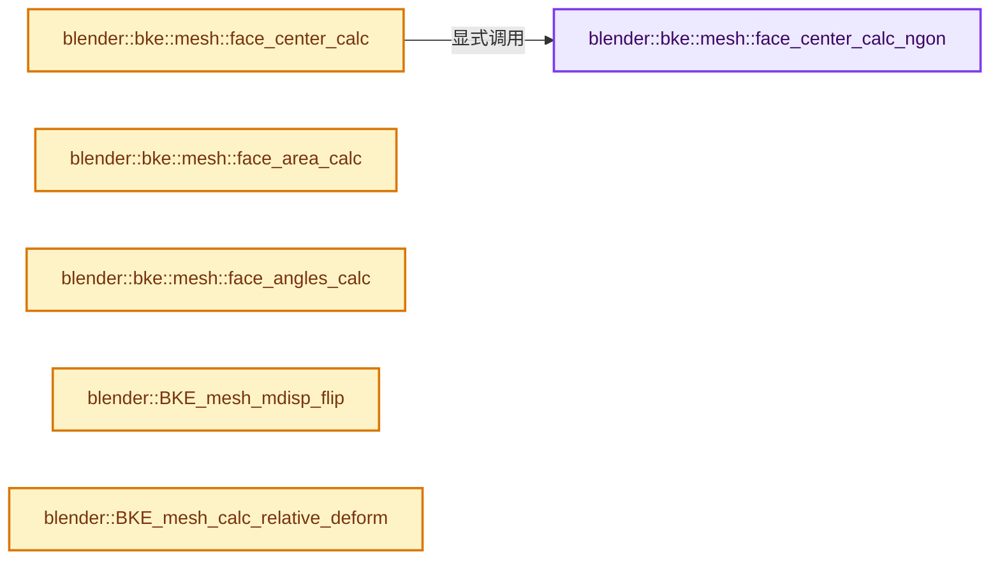

# 实现依赖专题：source/blender/blenkernel/intern/mesh_evaluate.cc

[实现依赖导航](../../README.md) · [符号索引](../../../00-课程指南/02-源码与提交索引/符号依赖与实现索引.md)

本专题从正文实际调用进入，集中保存共享实现。函数有稳定锚点，可从调用处直接跳到对应完整函数；递归与互相调用通过回链组织。

## 本文件的实现关系




## 完整成员与函数实现

<a id="f-3166c3281b2b9bc7"></a>

### `blender::bke::mesh::face_center_calc_ngon`

实现位置：[source/blender/blenkernel/intern/mesh_evaluate.cc](../../../../../../../source/blender/blenkernel/intern/mesh_evaluate.cc) · L34—L43。

接口参数：

- `const Span<float3> vert_positions`
- `const Span<int> face_verts`

**教学注释版**

<!-- annotated:de0ee70f0f9393 -->

```cpp
static float3 face_center_calc_ngon(const Span<float3> vert_positions, const Span<int> face_verts)
{
  // [讲解] face_verts.size：查询视图长度或生成对应有效索引区间。
  const float w = 1.0f / float(face_verts.size());

  float3 center(0);
  // [讲解] face_verts.index_range：查询视图长度或生成对应有效索引区间。
  for (const int i : face_verts.index_range()) {
    center += vert_positions[face_verts[i]] * w;
  }
  return center;
}
```

<details>
<summary>核对原始源码：source/blender/blenkernel/intern/mesh_evaluate.cc · L34—L43</summary>

<!-- original:de0ee70f0f9393:source/blender/blenkernel/intern/mesh_evaluate.cc:34:43 -->

```cpp
static float3 face_center_calc_ngon(const Span<float3> vert_positions, const Span<int> face_verts)
{
  const float w = 1.0f / float(face_verts.size());

  float3 center(0);
  for (const int i : face_verts.index_range()) {
    center += vert_positions[face_verts[i]] * w;
  }
  return center;
}
```

</details>

**沿实际写入检查状态**

- `center += vert_positions[face_verts[i]] * w;`

**结果出口**

- `return center;`

**继续追踪实现**

- `face_verts.size` → [blender::Span::size · L256](../../../01-基础容器与现代CPP/05-Span只读连续视图.md#f-5f80fa006089c998)。
- `face_verts.index_range` → [blender::Span::index_range · L405](../../../01-基础容器与现代CPP/05-Span只读连续视图.md#f-caaa9b06e13e53e0)。

<a id="f-b983d3456bc87786"></a>

### `blender::bke::mesh::face_center_calc`

实现位置：[source/blender/blenkernel/intern/mesh_evaluate.cc](../../../../../../../source/blender/blenkernel/intern/mesh_evaluate.cc) · L45—L65。

接口参数：

- `const Span<float3> vert_positions`
- `const Span<int> face_verts`

**教学注释版**

<!-- annotated:05cba878e3dafd -->

```cpp
float3 face_center_calc(const Span<float3> vert_positions, const Span<int> face_verts)
{
  // [讲解] face_verts.size：查询视图长度或生成对应有效索引区间。
  if (face_verts.size() == 3) {
    float3 center;
    mid_v3_v3v3v3(center,
                  vert_positions[face_verts[0]],
                  vert_positions[face_verts[1]],
                  vert_positions[face_verts[2]]);
    return center;
  }
  if (face_verts.size() == 4) {
    float3 center;
    mid_v3_v3v3v3v3(center,
                    vert_positions[face_verts[0]],
                    vert_positions[face_verts[1]],
                    vert_positions[face_verts[2]],
                    vert_positions[face_verts[3]]);
    return center;
  }
  return face_center_calc_ngon(vert_positions, face_verts);
}
```

<details>
<summary>核对原始源码：source/blender/blenkernel/intern/mesh_evaluate.cc · L45—L65</summary>

<!-- original:05cba878e3dafd:source/blender/blenkernel/intern/mesh_evaluate.cc:45:65 -->

```cpp
float3 face_center_calc(const Span<float3> vert_positions, const Span<int> face_verts)
{
  if (face_verts.size() == 3) {
    float3 center;
    mid_v3_v3v3v3(center,
                  vert_positions[face_verts[0]],
                  vert_positions[face_verts[1]],
                  vert_positions[face_verts[2]]);
    return center;
  }
  if (face_verts.size() == 4) {
    float3 center;
    mid_v3_v3v3v3v3(center,
                    vert_positions[face_verts[0]],
                    vert_positions[face_verts[1]],
                    vert_positions[face_verts[2]],
                    vert_positions[face_verts[3]]);
    return center;
  }
  return face_center_calc_ngon(vert_positions, face_verts);
}
```

</details>

**结果出口**

- `return center;`
- `return face_center_calc_ngon(vert_positions, face_verts);`

**继续追踪实现**

- `face_verts.size` → [blender::Span::size · L256](../../../01-基础容器与现代CPP/05-Span只读连续视图.md#f-5f80fa006089c998)。
- `mid_v3_v3v3v3` → [blender::mid_v3_v3v3v3 · L202](../../01-BLI基础库/intern/math_vector.cc.md#f-f156931a76864a2b)。
- `mid_v3_v3v3v3v3` → [blender::mid_v3_v3v3v3v3 · L209](../../01-BLI基础库/intern/math_vector.cc.md#f-3edaf1436af48ba5)。
- `face_center_calc_ngon` → [blender::bke::mesh::face_center_calc_ngon · L34](mesh_evaluate.cc.md#f-3166c3281b2b9bc7)。

<a id="f-ce18cacfc44bbb37"></a>

### `blender::bke::mesh::face_area_calc`

实现位置：[source/blender/blenkernel/intern/mesh_evaluate.cc](../../../../../../../source/blender/blenkernel/intern/mesh_evaluate.cc) · L67—L79。

接口参数：

- `const Span<float3> vert_positions`
- `const Span<int> face_verts`

**教学注释版**

<!-- annotated:0227e18ad313b5 -->

```cpp
float face_area_calc(const Span<float3> vert_positions, const Span<int> face_verts)
{
  // [讲解] face_verts.size：查询视图长度或生成对应有效索引区间。
  if (face_verts.size() == 3) {
    return area_tri_v3(vert_positions[face_verts[0]],
                       vert_positions[face_verts[1]],
                       vert_positions[face_verts[2]]);
  }
  Array<float3, 32> coords(face_verts.size());
  // [讲解] face_verts.index_range：查询视图长度或生成对应有效索引区间。
  for (const int i : face_verts.index_range()) {
    coords[i] = vert_positions[face_verts[i]];
  }
  // [讲解] coords.data：提供数组的借用访问入口。
  return area_poly_v3(reinterpret_cast<const float (*)[3]>(coords.data()), face_verts.size());
}
```

<details>
<summary>核对原始源码：source/blender/blenkernel/intern/mesh_evaluate.cc · L67—L79</summary>

<!-- original:0227e18ad313b5:source/blender/blenkernel/intern/mesh_evaluate.cc:67:79 -->

```cpp
float face_area_calc(const Span<float3> vert_positions, const Span<int> face_verts)
{
  if (face_verts.size() == 3) {
    return area_tri_v3(vert_positions[face_verts[0]],
                       vert_positions[face_verts[1]],
                       vert_positions[face_verts[2]]);
  }
  Array<float3, 32> coords(face_verts.size());
  for (const int i : face_verts.index_range()) {
    coords[i] = vert_positions[face_verts[i]];
  }
  return area_poly_v3(reinterpret_cast<const float (*)[3]>(coords.data()), face_verts.size());
}
```

</details>

**沿实际写入检查状态**

- `coords[i] = vert_positions[face_verts[i]];`

**结果出口**

- `return area_tri_v3(vert_positions[face_verts[0]],`
- `return area_poly_v3(reinterpret_cast<const float (*)[3]>(coords.data()), face_verts.size());`

**继续追踪实现**

- `face_verts.size` → [blender::Span::size · L256](../../../01-基础容器与现代CPP/05-Span只读连续视图.md#f-5f80fa006089c998)。
- `area_tri_v3` → [blender::area_tri_v3 · L104](../../01-BLI基础库/intern/math_geom.cc.md#f-010c0a7f618cbedf)。
- `face_verts.index_range` → [blender::Span::index_range · L405](../../../01-基础容器与现代CPP/05-Span只读连续视图.md#f-caaa9b06e13e53e0)。
- `area_poly_v3` → [blender::area_poly_v3 · L137](../../01-BLI基础库/intern/math_geom.cc.md#f-d711237c21e18247)。
- `coords.data` → [blender::Array::data · L323](../../../01-基础容器与现代CPP/08-Array复制移动与销毁.md#f-95648c799002f4ba)；[blender::Array::data · L327](../../../01-基础容器与现代CPP/08-Array复制移动与销毁.md#f-50c18301f8c40f9e)。同名重载需按实参类型选择。

<a id="f-817443dc574d41f5"></a>

### `blender::bke::mesh::face_angles_calc`

实现位置：[source/blender/blenkernel/intern/mesh_evaluate.cc](../../../../../../../source/blender/blenkernel/intern/mesh_evaluate.cc) · L201—L225。

接口参数：

- `const Span<float3> vert_positions`
- `const Span<int> face_verts`
- `MutableSpan<float> angles`

**教学注释版**

<!-- annotated:17486392e558cc -->

```cpp
void face_angles_calc(const Span<float3> vert_positions,
                      const Span<int> face_verts,
                      MutableSpan<float> angles)
{
  float nor_prev[3];
  float nor_next[3];

  // [讲解] face_verts.size：查询视图长度或生成对应有效索引区间。
  int i_this = face_verts.size() - 1;
  int i_next = 0;

  sub_v3_v3v3(
      nor_prev, vert_positions[face_verts[i_this - 1]], vert_positions[face_verts[i_this]]);
  normalize_v3(nor_prev);

  while (i_next < face_verts.size()) {
    sub_v3_v3v3(nor_next, vert_positions[face_verts[i_this]], vert_positions[face_verts[i_next]]);
    normalize_v3(nor_next);
    angles[i_this] = angle_normalized_v3v3(nor_prev, nor_next);

    /* step */
    copy_v3_v3(nor_prev, nor_next);
    i_this = i_next;
    i_next++;
  }
}
```

<details>
<summary>核对原始源码：source/blender/blenkernel/intern/mesh_evaluate.cc · L201—L225</summary>

<!-- original:17486392e558cc:source/blender/blenkernel/intern/mesh_evaluate.cc:201:225 -->

```cpp
void face_angles_calc(const Span<float3> vert_positions,
                      const Span<int> face_verts,
                      MutableSpan<float> angles)
{
  float nor_prev[3];
  float nor_next[3];

  int i_this = face_verts.size() - 1;
  int i_next = 0;

  sub_v3_v3v3(
      nor_prev, vert_positions[face_verts[i_this - 1]], vert_positions[face_verts[i_this]]);
  normalize_v3(nor_prev);

  while (i_next < face_verts.size()) {
    sub_v3_v3v3(nor_next, vert_positions[face_verts[i_this]], vert_positions[face_verts[i_next]]);
    normalize_v3(nor_next);
    angles[i_this] = angle_normalized_v3v3(nor_prev, nor_next);

    /* step */
    copy_v3_v3(nor_prev, nor_next);
    i_this = i_next;
    i_next++;
  }
}
```

</details>

**沿实际写入检查状态**

- `angles[i_this] = angle_normalized_v3v3(nor_prev, nor_next);`
- `i_this = i_next;`

**继续追踪实现**

- `face_verts.size` → [blender::Span::size · L256](../../../01-基础容器与现代CPP/05-Span只读连续视图.md#f-5f80fa006089c998)。
- `sub_v3_v3v3` → [blender::sub_v3_v3v3 · L360](../../01-BLI基础库/intern/math_vector_inline.cc.md#f-23781c252db8b30c)。
- `normalize_v3` → [blender::normalize_v3 · L933](../../01-BLI基础库/intern/math_vector_inline.cc.md#f-5f3257e657ef732c)。
- `angle_normalized_v3v3` → [调用协议](../../../00-课程指南/01-路线与规范/模板宏与动态分派协议.md)：函数指针、局部可调用对象或未展开的宏；必须结合调用者环境。调用位置L218。
- `copy_v3_v3` → [调用协议](../../../00-课程指南/01-路线与规范/模板宏与动态分派协议.md)：函数指针、局部可调用对象或未展开的宏；必须结合调用者环境。调用位置L221。

<a id="f-fc2149ab9411e3be"></a>

### `blender::BKE_mesh_mdisp_flip`

实现位置：[source/blender/blenkernel/intern/mesh_evaluate.cc](../../../../../../../source/blender/blenkernel/intern/mesh_evaluate.cc) · L457—L491。

接口参数：

- `MDisps *md`
- `const bool use_loop_mdisp_flip`

**教学注释版**

<!-- annotated:c48f94c63a3c3a -->

```cpp
void BKE_mesh_mdisp_flip(MDisps *md, const bool use_loop_mdisp_flip)
{
  if (!md->totdisp || !md->disps) [[unlikely]] {
    return;
  }

  const int sides = int(sqrt(md->totdisp));
  float (*co)[3] = md->disps;

  for (int x = 0; x < sides; x++) {
    float *co_a, *co_b;

    for (int y = 0; y < x; y++) {
      co_a = co[y * sides + x];
      co_b = co[x * sides + y];

      swap_v3_v3(co_a, co_b);
      std::swap(co_a[0], co_a[1]);
      std::swap(co_b[0], co_b[1]);

      if (use_loop_mdisp_flip) {
        co_a[2] *= -1.0f;
        co_b[2] *= -1.0f;
      }
    }

    co_a = co[x * sides + x];

    std::swap(co_a[0], co_a[1]);

    if (use_loop_mdisp_flip) {
      co_a[2] *= -1.0f;
    }
  }
}
```

<details>
<summary>核对原始源码：source/blender/blenkernel/intern/mesh_evaluate.cc · L457—L491</summary>

<!-- original:c48f94c63a3c3a:source/blender/blenkernel/intern/mesh_evaluate.cc:457:491 -->

```cpp
void BKE_mesh_mdisp_flip(MDisps *md, const bool use_loop_mdisp_flip)
{
  if (!md->totdisp || !md->disps) [[unlikely]] {
    return;
  }

  const int sides = int(sqrt(md->totdisp));
  float (*co)[3] = md->disps;

  for (int x = 0; x < sides; x++) {
    float *co_a, *co_b;

    for (int y = 0; y < x; y++) {
      co_a = co[y * sides + x];
      co_b = co[x * sides + y];

      swap_v3_v3(co_a, co_b);
      std::swap(co_a[0], co_a[1]);
      std::swap(co_b[0], co_b[1]);

      if (use_loop_mdisp_flip) {
        co_a[2] *= -1.0f;
        co_b[2] *= -1.0f;
      }
    }

    co_a = co[x * sides + x];

    std::swap(co_a[0], co_a[1]);

    if (use_loop_mdisp_flip) {
      co_a[2] *= -1.0f;
    }
  }
}
```

</details>

**沿实际写入检查状态**

- `co_a = co[y * sides + x];`
- `co_b = co[x * sides + y];`
- `co_a[2] *= -1.0f;`
- `co_b[2] *= -1.0f;`
- `co_a = co[x * sides + x];`

**继续追踪实现**

- `sqrt` → [外部契约](https://eel.is/c++draft/)：这个边界按实际表达式及所属类型核对参数、返回值、寿命与失败行为。这里提供接口入口，不声称已解释该第三方版本的内部实现。
- `swap_v3_v3` → [blender::swap_v3_v3 · L217](../../01-BLI基础库/intern/math_vector_inline.cc.md#f-5006770fa7cfc2f1)。
- `std::swap` → [外部契约](https://eel.is/c++draft/)：这个边界按实际表达式及所属类型核对参数、返回值、寿命与失败行为。这里提供接口入口，不声称已解释该第三方版本的内部实现。

<a id="f-2ea80233b007ee56"></a>

### `blender::BKE_mesh_calc_relative_deform`

实现位置：[source/blender/blenkernel/intern/mesh_evaluate.cc](../../../../../../../source/blender/blenkernel/intern/mesh_evaluate.cc) · L721—L773。

接口参数：

- `const int *face_offsets`
- `const int faces_num`
- `const int *corner_verts`
- `const int totvert`
- `const float (*vert_cos_src)[3]`
- `const float (*vert_cos_dst)[3]`
- `const float (*vert_cos_org)[3]`
- `float (*vert_cos_new)[3]`

**教学注释版**

<!-- annotated:e7a97ffe8bdbc8 -->

```cpp
void BKE_mesh_calc_relative_deform(const int *face_offsets,
                                   const int faces_num,
                                   const int *corner_verts,
                                   const int totvert,

                                   const float (*vert_cos_src)[3],
                                   const float (*vert_cos_dst)[3],

                                   const float (*vert_cos_org)[3],
                                   float (*vert_cos_new)[3])
{
  const OffsetIndices<int> faces({face_offsets, faces_num + 1});

  int *vert_accum = MEM_new_array_zeroed<int>(totvert, __func__);

  // [讲解] memset：填充字节，不调用T构造函数，也不保证任意类型的全零表示是合法或期望值。
  memset(vert_cos_new, '\0', sizeof(*vert_cos_new) * size_t(totvert));

  for (const int i : faces.index_range()) {
    const IndexRange face = faces[i];
    // [讲解] face.start：读取连续区间或分组的边界信息。
    const int *face_verts = &corner_verts[face.start()];

    // [讲解] face.size：读取连续区间或分组的边界信息。
    for (int j = 0; j < face.size(); j++) {
      const int v_prev = face_verts[(face.size() + (j - 1)) % face.size()];
      const int v_curr = face_verts[j];
      const int v_next = face_verts[(j + 1) % face.size()];

      float tvec[3];

      transform_point_by_tri_v3(tvec,
                                vert_cos_dst[v_curr],
                                vert_cos_org[v_prev],
                                vert_cos_org[v_curr],
                                vert_cos_org[v_next],
                                vert_cos_src[v_prev],
                                vert_cos_src[v_curr],
                                vert_cos_src[v_next]);

      add_v3_v3(vert_cos_new[v_curr], tvec);
      vert_accum[v_curr] += 1;
    }
  }

  for (int i = 0; i < totvert; i++) {
    if (vert_accum[i]) {
      mul_v3_fl(vert_cos_new[i], 1.0f / float(vert_accum[i]));
    }
    else {
      copy_v3_v3(vert_cos_new[i], vert_cos_org[i]);
    }
  }

  MEM_delete(vert_accum);
}
```

<details>
<summary>核对原始源码：source/blender/blenkernel/intern/mesh_evaluate.cc · L721—L773</summary>

<!-- original:e7a97ffe8bdbc8:source/blender/blenkernel/intern/mesh_evaluate.cc:721:773 -->

```cpp
void BKE_mesh_calc_relative_deform(const int *face_offsets,
                                   const int faces_num,
                                   const int *corner_verts,
                                   const int totvert,

                                   const float (*vert_cos_src)[3],
                                   const float (*vert_cos_dst)[3],

                                   const float (*vert_cos_org)[3],
                                   float (*vert_cos_new)[3])
{
  const OffsetIndices<int> faces({face_offsets, faces_num + 1});

  int *vert_accum = MEM_new_array_zeroed<int>(totvert, __func__);

  memset(vert_cos_new, '\0', sizeof(*vert_cos_new) * size_t(totvert));

  for (const int i : faces.index_range()) {
    const IndexRange face = faces[i];
    const int *face_verts = &corner_verts[face.start()];

    for (int j = 0; j < face.size(); j++) {
      const int v_prev = face_verts[(face.size() + (j - 1)) % face.size()];
      const int v_curr = face_verts[j];
      const int v_next = face_verts[(j + 1) % face.size()];

      float tvec[3];

      transform_point_by_tri_v3(tvec,
                                vert_cos_dst[v_curr],
                                vert_cos_org[v_prev],
                                vert_cos_org[v_curr],
                                vert_cos_org[v_next],
                                vert_cos_src[v_prev],
                                vert_cos_src[v_curr],
                                vert_cos_src[v_next]);

      add_v3_v3(vert_cos_new[v_curr], tvec);
      vert_accum[v_curr] += 1;
    }
  }

  for (int i = 0; i < totvert; i++) {
    if (vert_accum[i]) {
      mul_v3_fl(vert_cos_new[i], 1.0f / float(vert_accum[i]));
    }
    else {
      copy_v3_v3(vert_cos_new[i], vert_cos_org[i]);
    }
  }

  MEM_delete(vert_accum);
}
```

</details>

**沿实际写入检查状态**

- `vert_accum[v_curr] += 1;`

**继续追踪实现**

- `MEM_new_array_zeroed<int>` → [MEM_new_array_zeroed · L566](../../07-Intern运行时与平台/guardedalloc/MEM_guardedalloc.h.md#f-3a0cf63fb5216500)；[MEM_new_array_zeroed · L119](../../07-Intern运行时与平台/guardedalloc/intern/mallocn.cc.md#f-6825557da566fdbe)。同名重载需按实参类型选择。
- `memset` → [外部契约](https://eel.is/c++draft/cstring.syn)：填充字节，不调用T构造函数，也不保证任意类型的全零表示是合法或期望值。
- `faces.index_range` → [blender::offset_indices::OffsetIndices::index_range · L77](../../../05-几何存储与拓扑映射/02-OffsetIndices完整接口.md#f-19b5ca1456de007d)。
- `face.start` → [blender::IndexRange::start · L243](../../../01-基础容器与现代CPP/04-IndexRange连续整数区间.md#f-99d2195bd9cfd1f0)。
- `face.size` → [blender::IndexRange::size · L156](../../../01-基础容器与现代CPP/04-IndexRange连续整数区间.md#f-05f66c3ebb2fdfec)。
- `transform_point_by_tri_v3` → [blender::transform_point_by_tri_v3 · L4058](../../01-BLI基础库/intern/math_geom.cc.md#f-75a324949f76baa1)。
- `add_v3_v3` → [blender::add_v3_v3 · L286](../../01-BLI基础库/intern/math_vector_inline.cc.md#f-e7930c6fdefe462c)。
- `mul_v3_fl` → [blender::mul_v3_fl · L414](../../01-BLI基础库/intern/math_vector_inline.cc.md#f-00165156a06d1224)。
- `copy_v3_v3` → [blender::copy_v3_v3 · L47](../../01-BLI基础库/intern/math_vector_inline.cc.md#f-037a0d5fa5060bd6)。
- `MEM_delete` → [MEM_delete · L400](../../07-Intern运行时与平台/guardedalloc/MEM_guardedalloc.h.md#f-9049ffdd1682887c)。
