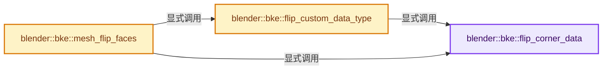

# 实现依赖专题：source/blender/blenkernel/intern/mesh_flip_faces.cc

[实现依赖导航](../../README.md) · [符号索引](../../../00-课程指南/02-源码与提交索引/符号依赖与实现索引.md)

本专题从正文实际调用进入，集中保存共享实现。函数有稳定锚点，可从调用处直接跳到对应完整函数；递归与互相调用通过回链组织。

## 本文件的实现关系




## 完整成员与函数实现

<a id="f-9d231da62c491f01"></a>

### `blender::bke::flip_corner_data`

实现位置：[source/blender/blenkernel/intern/mesh_flip_faces.cc](../../../../../../../source/blender/blenkernel/intern/mesh_flip_faces.cc) · L21—L28。

接口参数：

- `const OffsetIndices<int> faces`
- `const IndexMask &face_selection`
- `MutableSpan<T> data`

**教学注释版**

<!-- annotated:58d242c56af451 -->

```cpp
template<typename T>
static void flip_corner_data(const OffsetIndices<int> faces,
                             const IndexMask &face_selection,
                             MutableSpan<T> data)
{
  // [讲解] data.slice：建立原连续范围的子视图。
  face_selection.foreach_index([&](const int i) { data.slice(faces[i].drop_front(1)).reverse(); },
                               exec_mode::grain_size(1024));
}
```

<details>
<summary>核对原始源码：source/blender/blenkernel/intern/mesh_flip_faces.cc · L21—L28</summary>

<!-- original:58d242c56af451:source/blender/blenkernel/intern/mesh_flip_faces.cc:21:28 -->

```cpp
template<typename T>
static void flip_corner_data(const OffsetIndices<int> faces,
                             const IndexMask &face_selection,
                             MutableSpan<T> data)
{
  face_selection.foreach_index([&](const int i) { data.slice(faces[i].drop_front(1)).reverse(); },
                               exec_mode::grain_size(1024));
}
```

</details>

**继续追踪实现**

- `face_selection.foreach_index` → [blender::index_mask::IndexMask::foreach_index · L855](../../../04-虚拟数组与索引选择/09-分段存储与遍历.md#f-cd6cd317e2e2812c)。
- `data.slice(faces[i].drop_front(1)).reverse` → [调用协议](../../../00-课程指南/01-路线与规范/模板宏与动态分派协议.md)：接收对象类型依赖auto、返回值或模板实例；不按同名猜测目标。调用位置L26。
- `data.slice` → [blender::MutableSpan::slice · L579](../../../01-基础容器与现代CPP/06-MutableSpan可写视图.md#f-6808b4aefbf58808)；[blender::MutableSpan::slice · L587](../../../01-基础容器与现代CPP/06-MutableSpan可写视图.md#f-c05b010821861e4f)。同名重载需按实参类型选择。
- `faces[i].drop_front` → [调用协议](../../../00-课程指南/01-路线与规范/模板宏与动态分派协议.md)：接收对象类型依赖auto、返回值或模板实例；不按同名猜测目标。调用位置L26。
- `exec_mode::grain_size` → [blender::exec_mode::grain_size · L79](../../01-BLI基础库/BLI_execution_mode.hh.md#f-0b4fc2f9fa6e66e7)。

<a id="f-4640b227ad5061b0"></a>

### `blender::bke::flip_custom_data_type`

实现位置：[source/blender/blenkernel/intern/mesh_flip_faces.cc](../../../../../../../source/blender/blenkernel/intern/mesh_flip_faces.cc) · L30—L42。

接口参数：

- `const OffsetIndices<int> faces`
- `CustomData &corner_data`
- `const IndexMask &face_selection`
- `const eCustomDataType data_type`

**教学注释版**

<!-- annotated:7b693a72999647 -->

```cpp
template<typename T>
static void flip_custom_data_type(const OffsetIndices<int> faces,
                                  CustomData &corner_data,
                                  const IndexMask &face_selection,
                                  const eCustomDataType data_type)
{
  BLI_assert(sizeof(T) == CustomData_sizeof(data_type));
  for (const int i : IndexRange(CustomData_number_of_layers(&corner_data, data_type))) {
    T *data = static_cast<T *>(
        CustomData_get_layer_n_for_write(&corner_data, data_type, i, faces.total_size()));
    flip_corner_data(faces, face_selection, MutableSpan(data, faces.total_size()));
  }
}
```

<details>
<summary>核对原始源码：source/blender/blenkernel/intern/mesh_flip_faces.cc · L30—L42</summary>

<!-- original:7b693a72999647:source/blender/blenkernel/intern/mesh_flip_faces.cc:30:42 -->

```cpp
template<typename T>
static void flip_custom_data_type(const OffsetIndices<int> faces,
                                  CustomData &corner_data,
                                  const IndexMask &face_selection,
                                  const eCustomDataType data_type)
{
  BLI_assert(sizeof(T) == CustomData_sizeof(data_type));
  for (const int i : IndexRange(CustomData_number_of_layers(&corner_data, data_type))) {
    T *data = static_cast<T *>(
        CustomData_get_layer_n_for_write(&corner_data, data_type, i, faces.total_size()));
    flip_corner_data(faces, face_selection, MutableSpan(data, faces.total_size()));
  }
}
```

</details>

**继续追踪实现**

- `BLI_assert` → [BLI_assert · L48](../../01-BLI基础库/BLI_assert.hh.md#m-57a88495704d)；[BLI_assert · L63](../../01-BLI基础库/BLI_assert.hh.md#m-d07050020cb5)。宏定义由构建条件选择。
- `CustomData_sizeof` → [blender::CustomData_sizeof · L4001](customdata.cc.md#f-5a32f4bddfe23041)。
- `IndexRange` → [blender::IndexRange](../../01-BLI基础库/BLI_index_range.hh.md#t-caa3466d6776)；[blender::gpu::shader::parser::IndexRange](../../08-其他Blender模块/gpu/shader_tool/utils.hh.md#t-82d2bd4ea71c)；[blender::IndexRange](../../08-其他Blender模块/makesdna/DNA_node_types.h.md#t-0448cc889d39)。
- `CustomData_number_of_layers` → [blender::CustomData_number_of_layers · L3010](customdata.cc.md#f-32d0d8916c76103d)。
- `CustomData_get_layer_n_for_write` → [blender::CustomData_get_layer_n_for_write · L3340](customdata.cc.md#f-5008e6a9e9497c36)。
- `faces.total_size` → [blender::offset_indices::OffsetIndices::total_size · L58](../../../05-几何存储与拓扑映射/02-OffsetIndices完整接口.md#f-c111ffdac7a19248)。
- `flip_corner_data` → [blender::bke::flip_corner_data · L21](mesh_flip_faces.cc.md#f-9d231da62c491f01)。
- `MutableSpan` → [blender::MutableSpan::MutableSpan · L462](../../../01-基础容器与现代CPP/06-MutableSpan可写视图.md#f-0f07034aaffc3384)；[blender::MutableSpan::MutableSpan · L464](../../../01-基础容器与现代CPP/06-MutableSpan可写视图.md#f-39977234ad0ce192)；[blender::MutableSpan::MutableSpan · L466](../../../01-基础容器与现代CPP/06-MutableSpan可写视图.md#f-ee249b5042dd38aa)；[blender::MutableSpan::MutableSpan · L468](../../../01-基础容器与现代CPP/06-MutableSpan可写视图.md#f-479c5f85921e531f)；[blender::MutableSpan::MutableSpan · L477](../../../01-基础容器与现代CPP/06-MutableSpan可写视图.md#f-afcce5325e6f19e0)。同名重载需按实参类型选择。

<a id="f-1927c93904e9c37f"></a>

### `blender::bke::mesh_flip_faces`

实现位置：[source/blender/blenkernel/intern/mesh_flip_faces.cc](../../../../../../../source/blender/blenkernel/intern/mesh_flip_faces.cc) · L44—L104。

接口参数：

- `Mesh &mesh`
- `const IndexMask &selection`

**教学注释版**

<!-- annotated:0d70cf168be13e -->

```cpp
void mesh_flip_faces(Mesh &mesh, const IndexMask &selection)
{
  if (mesh.faces_num == 0 || selection.is_empty()) {
    return;
  }

  const OffsetIndices faces = mesh.faces();
  MutableSpan<int> corner_verts = mesh.corner_verts_for_write();
  MutableSpan<int> corner_edges = mesh.corner_edges_for_write();

  selection.foreach_index(
      [&](const int i) {
        const IndexRange face = faces[i];
        // [讲解] face.size：读取连续区间或分组的边界信息。
        for (const int j : IndexRange(face.size() / 2)) {
          const int a = face[j + 1];
          // [讲解] face.last：读取范围两端的有效索引或值。
          const int b = face.last(j);
          std::swap(corner_verts[a], corner_verts[b]);
          std::swap(corner_edges[a - 1], corner_edges[b]);
        }
      },
      exec_mode::grain_size(1024));

  flip_custom_data_type<float4>(faces, mesh.corner_data, selection, CD_MLOOPTANGENT);
  flip_custom_data_type<GridPaintMask>(faces, mesh.corner_data, selection, CD_GRID_PAINT_MASK);
  flip_custom_data_type<OrigSpaceLoop>(faces, mesh.corner_data, selection, CD_ORIGSPACE_MLOOP);
  flip_custom_data_type<MDisps>(faces, mesh.corner_data, selection, CD_MDISPS);
  if (MDisps *mdisp = static_cast<MDisps *>(
          CustomData_get_layer_for_write(&mesh.corner_data, CD_MDISPS, mesh.corners_num)))
  {
    selection.foreach_index(
        [&](const int i) {
          for (const int corner : faces[i]) {
            BKE_mesh_mdisp_flip(&mdisp[corner], true);
          }
        },
        exec_mode::grain_size(512));
  }

  MutableAttributeAccessor attributes = mesh.attributes_for_write();
  attributes.foreach_attribute([&](const AttributeIter &iter) {
    if (iter.data_type == bke::AttrType::String) {
      return;
    }
    if (iter.domain != AttrDomain::Corner) {
      return;
    }
    if (iter.storage_type == bke::AttrStorageType::Single) {
      return;
    }
    if (ELEM(iter.name, ".corner_vert", ".corner_edge")) {
      return;
    }
    GSpanAttributeWriter attribute = attributes.lookup_for_write_span(iter.name);
    attribute_math::to_static_type(iter.data_type, [&]<typename T>() {
      flip_corner_data(faces, selection, attribute.span.typed<T>());
    });
    attribute.finish();
  });

  mesh.tag_face_winding_changed();
}
```

<details>
<summary>核对原始源码：source/blender/blenkernel/intern/mesh_flip_faces.cc · L44—L104</summary>

<!-- original:0d70cf168be13e:source/blender/blenkernel/intern/mesh_flip_faces.cc:44:104 -->

```cpp
void mesh_flip_faces(Mesh &mesh, const IndexMask &selection)
{
  if (mesh.faces_num == 0 || selection.is_empty()) {
    return;
  }

  const OffsetIndices faces = mesh.faces();
  MutableSpan<int> corner_verts = mesh.corner_verts_for_write();
  MutableSpan<int> corner_edges = mesh.corner_edges_for_write();

  selection.foreach_index(
      [&](const int i) {
        const IndexRange face = faces[i];
        for (const int j : IndexRange(face.size() / 2)) {
          const int a = face[j + 1];
          const int b = face.last(j);
          std::swap(corner_verts[a], corner_verts[b]);
          std::swap(corner_edges[a - 1], corner_edges[b]);
        }
      },
      exec_mode::grain_size(1024));

  flip_custom_data_type<float4>(faces, mesh.corner_data, selection, CD_MLOOPTANGENT);
  flip_custom_data_type<GridPaintMask>(faces, mesh.corner_data, selection, CD_GRID_PAINT_MASK);
  flip_custom_data_type<OrigSpaceLoop>(faces, mesh.corner_data, selection, CD_ORIGSPACE_MLOOP);
  flip_custom_data_type<MDisps>(faces, mesh.corner_data, selection, CD_MDISPS);
  if (MDisps *mdisp = static_cast<MDisps *>(
          CustomData_get_layer_for_write(&mesh.corner_data, CD_MDISPS, mesh.corners_num)))
  {
    selection.foreach_index(
        [&](const int i) {
          for (const int corner : faces[i]) {
            BKE_mesh_mdisp_flip(&mdisp[corner], true);
          }
        },
        exec_mode::grain_size(512));
  }

  MutableAttributeAccessor attributes = mesh.attributes_for_write();
  attributes.foreach_attribute([&](const AttributeIter &iter) {
    if (iter.data_type == bke::AttrType::String) {
      return;
    }
    if (iter.domain != AttrDomain::Corner) {
      return;
    }
    if (iter.storage_type == bke::AttrStorageType::Single) {
      return;
    }
    if (ELEM(iter.name, ".corner_vert", ".corner_edge")) {
      return;
    }
    GSpanAttributeWriter attribute = attributes.lookup_for_write_span(iter.name);
    attribute_math::to_static_type(iter.data_type, [&]<typename T>() {
      flip_corner_data(faces, selection, attribute.span.typed<T>());
    });
    attribute.finish();
  });

  mesh.tag_face_winding_changed();
}
```

</details>

**继续追踪实现**

- `selection.is_empty` → [blender::index_mask::IndexMask::is_empty · L748](../../../04-虚拟数组与索引选择/09-分段存储与遍历.md#f-190ac996386064f4)。
- `mesh.faces` → [Mesh::faces · L1217](../../../05-几何存储与拓扑映射/03-MPoly迁移与兼容.md#f-ea444760154e17b2)。
- `mesh.corner_verts_for_write` → [Mesh::corner_verts_for_write · L1246](../../../05-几何存储与拓扑映射/03-MPoly迁移与兼容.md#f-6dfaf316a81ba215)。
- `mesh.corner_edges_for_write` → [Mesh::corner_edges_for_write · L1260](../../../05-几何存储与拓扑映射/03-MPoly迁移与兼容.md#f-51e939a4353adb83)。
- `selection.foreach_index` → [blender::index_mask::IndexMask::foreach_index · L855](../../../04-虚拟数组与索引选择/09-分段存储与遍历.md#f-cd6cd317e2e2812c)。
- `IndexRange` → [blender::IndexRange](../../01-BLI基础库/BLI_index_range.hh.md#t-caa3466d6776)；[blender::gpu::shader::parser::IndexRange](../../08-其他Blender模块/gpu/shader_tool/utils.hh.md#t-82d2bd4ea71c)；[blender::IndexRange](../../08-其他Blender模块/makesdna/DNA_node_types.h.md#t-0448cc889d39)。
- `face.size` → [blender::IndexRange::size · L156](../../../01-基础容器与现代CPP/04-IndexRange连续整数区间.md#f-05f66c3ebb2fdfec)。
- `face.last` → [blender::IndexRange::last · L214](../../../01-基础容器与现代CPP/04-IndexRange连续整数区间.md#f-66896c6351a40de1)；[blender::gpu::shader::parser::IndexRange::last · L62](../../08-其他Blender模块/gpu/shader_tool/utils.hh.md#f-373501206569c3b3)。同名重载需按实参类型选择。
- `std::swap` → [外部契约](https://eel.is/c++draft/)：这个边界按实际表达式及所属类型核对参数、返回值、寿命与失败行为。这里提供接口入口，不声称已解释该第三方版本的内部实现。
- `exec_mode::grain_size` → [blender::exec_mode::grain_size · L79](../../01-BLI基础库/BLI_execution_mode.hh.md#f-0b4fc2f9fa6e66e7)。
- `flip_custom_data_type<float4>` → [blender::bke::flip_custom_data_type · L30](mesh_flip_faces.cc.md#f-4640b227ad5061b0)。
- `flip_custom_data_type<GridPaintMask>` → [blender::bke::flip_custom_data_type · L30](mesh_flip_faces.cc.md#f-4640b227ad5061b0)。
- `flip_custom_data_type<OrigSpaceLoop>` → [blender::bke::flip_custom_data_type · L30](mesh_flip_faces.cc.md#f-4640b227ad5061b0)。
- `flip_custom_data_type<MDisps>` → [blender::bke::flip_custom_data_type · L30](mesh_flip_faces.cc.md#f-4640b227ad5061b0)。
- `CustomData_get_layer_for_write` → [blender::CustomData_get_layer_for_write · L3318](customdata.cc.md#f-6af158905e2c1274)。
- `BKE_mesh_mdisp_flip` → [blender::BKE_mesh_mdisp_flip · L457](mesh_evaluate.cc.md#f-fc2149ab9411e3be)。
- `mesh.attributes_for_write` → [Mesh::attributes_for_write · L1303](../../../05-几何存储与拓扑映射/03-MPoly迁移与兼容.md#f-ca7af2f1a15f0bc4)。
- `attributes.foreach_attribute` → [调用协议](../../../00-课程指南/01-路线与规范/模板宏与动态分派协议.md)：由接收对象具体类型或运行时策略提供实现。调用位置L83。
- `ELEM` → [ELEM · L88](../../07-Intern运行时与平台/ghost/intern/GHOST_utildefines.hh.md#m-d28724a15928)；[ELEM · L135](../../01-BLI基础库/BLI_utildefines.hh.md#m-d6572de7cae0)。宏定义由构建条件选择。
- `attributes.lookup_for_write_span` → [blender::bke::MutableAttributeAccessor::lookup_for_write_span · L505](attribute_access.cc.md#f-eac5b5d8814ff900)。
- `attribute_math::to_static_type` → [blender::bke::attribute_math::to_static_type · L35](../BKE_attribute_math.hh.md#f-fdfaf0b86a24f278)；[blender::bke::attribute_math::to_static_type · L52](../BKE_attribute_math.hh.md#f-5346ade4e816ebd6)。同名重载需按实参类型选择。
- `flip_corner_data` → [blender::bke::flip_corner_data · L21](mesh_flip_faces.cc.md#f-9d231da62c491f01)。
- `attribute.span.typed<T>` → [调用协议](../../../00-课程指南/01-路线与规范/模板宏与动态分派协议.md)：接收对象类型依赖auto、返回值或模板实例；不按同名猜测目标。调用位置L98。
- `attribute.finish` → [blender::bke::GSpanAttributeWriter::finish · L372](../../../05-几何存储与拓扑映射/08-AttributeAccessor接口.md#f-6e58c9c72c82f592)。
- `mesh.tag_face_winding_changed` → [blender::Mesh::tag_face_winding_changed · L393](../../../06-隐式共享与缓存系统/10-局部更新与失效修复.md#f-4d45ac7efe5d9754)。
