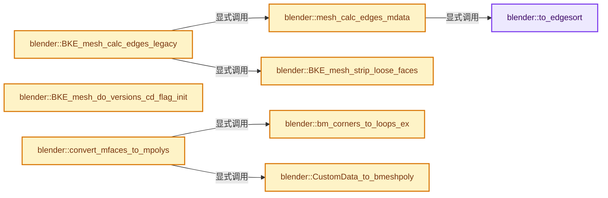
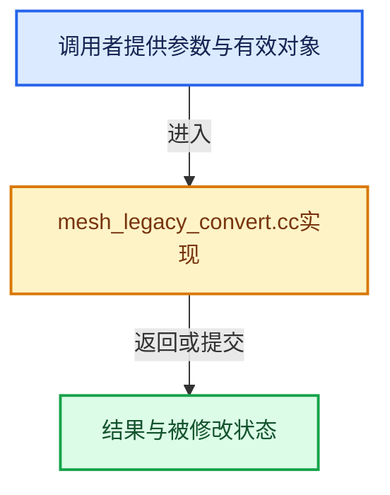

# 实现依赖专题：source/blender/blenkernel/intern/mesh_legacy_convert.cc

[实现依赖导航](../../README.md) · [符号索引](../../../00-课程指南/02-源码与提交索引/符号依赖与实现索引.md)

本专题从正文实际调用进入，集中保存共享实现。函数有稳定锚点，可从调用处直接跳到对应完整函数；递归与互相调用通过回链组织。

## 本文件的实现关系






<a id="m-265d0cac9ca4"></a>

## 宏 `MESH_MLOOPCOL_FROM_MCOL`

<!-- annotated:95e56990974f05 -->

```cpp
#define MESH_MLOOPCOL_FROM_MCOL(_mloopcol, _mcol) \
  { \
    MLoopCol *mloopcol__tmp = _mloopcol; \
    const MCol *mcol__tmp = _mcol; \
    mloopcol__tmp->r = mcol__tmp->b; \
    mloopcol__tmp->g = mcol__tmp->g; \
    mloopcol__tmp->b = mcol__tmp->r; \
    mloopcol__tmp->a = mcol__tmp->a; \
  } \
  (void)0

```

<details>
<summary>核对原始源码：source/blender/blenkernel/intern/mesh_legacy_convert.cc · L330—L340</summary>

<!-- original:95e56990974f05:source/blender/blenkernel/intern/mesh_legacy_convert.cc:330:340 -->

```cpp
#define MESH_MLOOPCOL_FROM_MCOL(_mloopcol, _mcol) \
  { \
    MLoopCol *mloopcol__tmp = _mloopcol; \
    const MCol *mcol__tmp = _mcol; \
    mloopcol__tmp->r = mcol__tmp->b; \
    mloopcol__tmp->g = mcol__tmp->g; \
    mloopcol__tmp->b = mcol__tmp->r; \
    mloopcol__tmp->a = mcol__tmp->a; \
  } \
  (void)0

```

</details>

宏在预处理阶段展开，参数替换、重复求值和条件编译应直接从该定义检查。与普通函数不同，宏不会自动提供参数类型检查；构建配置选择哪个定义需结合外围条件。

## 完整成员与函数实现

<a id="f-bdd821adb3484117"></a>

### `blender::to_edgesort`

实现位置：[source/blender/blenkernel/intern/mesh_legacy_convert.cc](../../../../../../../source/blender/blenkernel/intern/mesh_legacy_convert.cc) · L70—L82。

接口参数：

- `EdgeSort *ed`
- `uint v1`
- `uint v2`
- `char is_loose`
- `short is_draw`

**教学注释版**

<!-- annotated:ac0393912b02e2 -->

```cpp
static void to_edgesort(EdgeSort *ed, uint v1, uint v2, char is_loose, short is_draw)
{
  if (v1 < v2) {
    ed->v1 = v1;
    ed->v2 = v2;
  }
  else {
    ed->v1 = v2;
    ed->v2 = v1;
  }
  ed->is_loose = is_loose;
  ed->is_draw = is_draw;
}
```

<details>
<summary>核对原始源码：source/blender/blenkernel/intern/mesh_legacy_convert.cc · L70—L82</summary>

<!-- original:ac0393912b02e2:source/blender/blenkernel/intern/mesh_legacy_convert.cc:70:82 -->

```cpp
static void to_edgesort(EdgeSort *ed, uint v1, uint v2, char is_loose, short is_draw)
{
  if (v1 < v2) {
    ed->v1 = v1;
    ed->v2 = v2;
  }
  else {
    ed->v1 = v2;
    ed->v2 = v1;
  }
  ed->is_loose = is_loose;
  ed->is_draw = is_draw;
}
```

</details>

**沿实际写入检查状态**

- `ed->v1 = v1;`
- `ed->v2 = v2;`
- `ed->v1 = v2;`
- `ed->v2 = v1;`
- `ed->is_loose = is_loose;`
- `ed->is_draw = is_draw;`

**继续追踪实现**

本实现没有需要继续展开的显式调用；检查返回表达式、对象转换和调用者前置条件。

<a id="f-afeb2a3ce05496d4"></a>

### `blender::mesh_calc_edges_mdata`

实现位置：[source/blender/blenkernel/intern/mesh_legacy_convert.cc](../../../../../../../source/blender/blenkernel/intern/mesh_legacy_convert.cc) · L107—L223。

接口参数：

- `const MVert *`
- `const MFace *allface`
- `MLoop *allloop`
- `const MPoly *allpoly`
- `int`
- `int totface`
- `int`
- `int faces_num`
- `MEdge **r_medge`
- `int *r_totedge`

**教学注释版**

<!-- annotated:b89d5670a7594e -->

```cpp
static void mesh_calc_edges_mdata(const MVert * /*allvert*/,
                                  const MFace *allface,
                                  MLoop *allloop,
                                  const MPoly *allpoly,
                                  int /*totvert*/,
                                  int totface,
                                  int /*totloop*/,
                                  int faces_num,
                                  MEdge **r_medge,
                                  int *r_totedge)
{
  const MPoly *mpoly;
  const MFace *mface;
  MEdge *edges, *edge;
  EdgeSort *edsort, *ed;
  int a, totedge = 0;
  uint totedge_final = 0;
  uint edge_index;

  /* we put all edges in array, sort them, and detect doubles that way */

  for (a = totface, mface = allface; a > 0; a--, mface++) {
    if (mface->v4) {
      totedge += 4;
    }
    else if (mface->v3) {
      totedge += 3;
    }
    else {
      totedge += 1;
    }
  }

  if (totedge == 0) {
    *r_medge = nullptr;
    *r_totedge = 0;
    return;
  }

  ed = edsort = MEM_new_array_uninitialized<EdgeSort>(totedge, "EdgeSort");

  for (a = totface, mface = allface; a > 0; a--, mface++) {
    to_edgesort(ed++, mface->v1, mface->v2, !mface->v3, mface->edcode & ME_V1V2);
    if (mface->v4) {
      to_edgesort(ed++, mface->v2, mface->v3, 0, mface->edcode & ME_V2V3);
      to_edgesort(ed++, mface->v3, mface->v4, 0, mface->edcode & ME_V3V4);
      to_edgesort(ed++, mface->v4, mface->v1, 0, mface->edcode & ME_V4V1);
    }
    else if (mface->v3) {
      to_edgesort(ed++, mface->v2, mface->v3, 0, mface->edcode & ME_V2V3);
      to_edgesort(ed++, mface->v3, mface->v1, 0, mface->edcode & ME_V3V1);
    }
  }

  qsort(edsort, totedge, sizeof(EdgeSort), vergedgesort);

  /* count final amount */
  for (a = totedge, ed = edsort; a > 1; a--, ed++) {
    /* edge is unique when it differs from next edge, or is last */
    if (ed->v1 != (ed + 1)->v1 || ed->v2 != (ed + 1)->v2) {
      totedge_final++;
    }
  }
  totedge_final++;

  edges = MEM_new_array_zeroed<MEdge>(totedge_final, __func__);

  for (a = totedge, edge = edges, ed = edsort; a > 1; a--, ed++) {
    /* edge is unique when it differs from next edge, or is last */
    if (ed->v1 != (ed + 1)->v1 || ed->v2 != (ed + 1)->v2) {
      edge->v1 = ed->v1;
      edge->v2 = ed->v2;

      /* order is swapped so extruding this edge as a surface won't flip face normals
       * with cyclic curves */
      if (ed->v1 + 1 != ed->v2) {
        std::swap(edge->v1, edge->v2);
      }
      edge++;
    }
    else {
      /* Equal edge, merge the draw-flag. */
      (ed + 1)->is_draw |= ed->is_draw;
    }
  }
  /* last edge */
  edge->v1 = ed->v1;
  edge->v2 = ed->v2;

  MEM_delete(edsort);

  /* set edge members of mloops */
  Map<OrderedEdge, int> hash;
  // [讲解] hash.reserve：重新组织槽位或准备容量。
  hash.reserve(totedge_final);
  for (edge_index = 0, edge = edges; edge_index < totedge_final; edge_index++, edge++) {
    // [讲解] hash.add：按哈希与相等关系加入键或键值。
    hash.add({edge->v1, edge->v2}, edge_index);
  }

  mpoly = allpoly;
  for (a = 0; a < faces_num; a++, mpoly++) {
    MLoop *ml, *ml_next;
    int i = mpoly->totloop;

    ml_next = allloop + mpoly->loopstart; /* first loop */
    ml = &ml_next[i - 1];                 /* last loop */

    while (i-- != 0) {
      // [讲解] hash.lookup：按键查找对应项。
      ml->e = hash.lookup({ml->v, ml_next->v});
      ml = ml_next;
      ml_next++;
    }
  }

  BLI_assert(totedge_final > 0);
  *r_medge = edges;
  *r_totedge = totedge_final;
}
```

<details>
<summary>核对原始源码：source/blender/blenkernel/intern/mesh_legacy_convert.cc · L107—L223</summary>

<!-- original:b89d5670a7594e:source/blender/blenkernel/intern/mesh_legacy_convert.cc:107:223 -->

```cpp
static void mesh_calc_edges_mdata(const MVert * /*allvert*/,
                                  const MFace *allface,
                                  MLoop *allloop,
                                  const MPoly *allpoly,
                                  int /*totvert*/,
                                  int totface,
                                  int /*totloop*/,
                                  int faces_num,
                                  MEdge **r_medge,
                                  int *r_totedge)
{
  const MPoly *mpoly;
  const MFace *mface;
  MEdge *edges, *edge;
  EdgeSort *edsort, *ed;
  int a, totedge = 0;
  uint totedge_final = 0;
  uint edge_index;

  /* we put all edges in array, sort them, and detect doubles that way */

  for (a = totface, mface = allface; a > 0; a--, mface++) {
    if (mface->v4) {
      totedge += 4;
    }
    else if (mface->v3) {
      totedge += 3;
    }
    else {
      totedge += 1;
    }
  }

  if (totedge == 0) {
    *r_medge = nullptr;
    *r_totedge = 0;
    return;
  }

  ed = edsort = MEM_new_array_uninitialized<EdgeSort>(totedge, "EdgeSort");

  for (a = totface, mface = allface; a > 0; a--, mface++) {
    to_edgesort(ed++, mface->v1, mface->v2, !mface->v3, mface->edcode & ME_V1V2);
    if (mface->v4) {
      to_edgesort(ed++, mface->v2, mface->v3, 0, mface->edcode & ME_V2V3);
      to_edgesort(ed++, mface->v3, mface->v4, 0, mface->edcode & ME_V3V4);
      to_edgesort(ed++, mface->v4, mface->v1, 0, mface->edcode & ME_V4V1);
    }
    else if (mface->v3) {
      to_edgesort(ed++, mface->v2, mface->v3, 0, mface->edcode & ME_V2V3);
      to_edgesort(ed++, mface->v3, mface->v1, 0, mface->edcode & ME_V3V1);
    }
  }

  qsort(edsort, totedge, sizeof(EdgeSort), vergedgesort);

  /* count final amount */
  for (a = totedge, ed = edsort; a > 1; a--, ed++) {
    /* edge is unique when it differs from next edge, or is last */
    if (ed->v1 != (ed + 1)->v1 || ed->v2 != (ed + 1)->v2) {
      totedge_final++;
    }
  }
  totedge_final++;

  edges = MEM_new_array_zeroed<MEdge>(totedge_final, __func__);

  for (a = totedge, edge = edges, ed = edsort; a > 1; a--, ed++) {
    /* edge is unique when it differs from next edge, or is last */
    if (ed->v1 != (ed + 1)->v1 || ed->v2 != (ed + 1)->v2) {
      edge->v1 = ed->v1;
      edge->v2 = ed->v2;

      /* order is swapped so extruding this edge as a surface won't flip face normals
       * with cyclic curves */
      if (ed->v1 + 1 != ed->v2) {
        std::swap(edge->v1, edge->v2);
      }
      edge++;
    }
    else {
      /* Equal edge, merge the draw-flag. */
      (ed + 1)->is_draw |= ed->is_draw;
    }
  }
  /* last edge */
  edge->v1 = ed->v1;
  edge->v2 = ed->v2;

  MEM_delete(edsort);

  /* set edge members of mloops */
  Map<OrderedEdge, int> hash;
  hash.reserve(totedge_final);
  for (edge_index = 0, edge = edges; edge_index < totedge_final; edge_index++, edge++) {
    hash.add({edge->v1, edge->v2}, edge_index);
  }

  mpoly = allpoly;
  for (a = 0; a < faces_num; a++, mpoly++) {
    MLoop *ml, *ml_next;
    int i = mpoly->totloop;

    ml_next = allloop + mpoly->loopstart; /* first loop */
    ml = &ml_next[i - 1];                 /* last loop */

    while (i-- != 0) {
      ml->e = hash.lookup({ml->v, ml_next->v});
      ml = ml_next;
      ml_next++;
    }
  }

  BLI_assert(totedge_final > 0);
  *r_medge = edges;
  *r_totedge = totedge_final;
}
```

</details>

**沿实际写入检查状态**

- `totedge += 4;`
- `totedge += 3;`
- `totedge += 1;`
- `ed = edsort = MEM_new_array_uninitialized<EdgeSort>(totedge, "EdgeSort");`
- `edges = MEM_new_array_zeroed<MEdge>(totedge_final, __func__);`
- `edge->v1 = ed->v1;`
- `edge->v2 = ed->v2;`
- `mpoly = allpoly;`
- `ml_next = allloop + mpoly->loopstart; /* first loop */`
- `ml = &ml_next[i - 1];                 /* last loop */`
- `ml->e = hash.lookup({ml->v, ml_next->v});`
- `ml = ml_next;`

**继续追踪实现**

- `MEM_new_array_uninitialized<EdgeSort>` → [MEM_new_array_uninitialized · L608](../../07-Intern运行时与平台/guardedalloc/MEM_guardedalloc.h.md#f-b7103eae8eb57b05)；[MEM_new_array_uninitialized · L129](../../07-Intern运行时与平台/guardedalloc/intern/mallocn.cc.md#f-bf6ef4ddcfb6e5df)。同名重载需按实参类型选择。
- `to_edgesort` → [blender::to_edgesort · L70](mesh_legacy_convert.cc.md#f-bdd821adb3484117)。
- `qsort` → [调用协议](../../../00-课程指南/01-路线与规范/模板宏与动态分派协议.md)：函数指针、局部可调用对象或未展开的宏；必须结合调用者环境。调用位置L161。
- `MEM_new_array_zeroed<MEdge>` → [MEM_new_array_zeroed · L566](../../07-Intern运行时与平台/guardedalloc/MEM_guardedalloc.h.md#f-3a0cf63fb5216500)；[MEM_new_array_zeroed · L119](../../07-Intern运行时与平台/guardedalloc/intern/mallocn.cc.md#f-6825557da566fdbe)。同名重载需按实参类型选择。
- `std::swap` → [外部契约](https://eel.is/c++draft/)：这个边界按实际表达式及所属类型核对参数、返回值、寿命与失败行为。这里提供接口入口，不声称已解释该第三方版本的内部实现。
- `MEM_delete` → [MEM_delete · L400](../../07-Intern运行时与平台/guardedalloc/MEM_guardedalloc.h.md#f-9049ffdd1682887c)。
- `hash.reserve` → [blender::Map::reserve · L1028](../../../02-哈希表与关联数据结构/06-删除墓碑与值销毁.md#f-03761191d90c03e9)。
- `hash.add` → [blender::Map::add · L295](../../../02-哈希表与关联数据结构/04-Map查找与键访问.md#f-8d38101abf162f88)；[blender::Map::add · L299](../../../02-哈希表与关联数据结构/04-Map查找与键访问.md#f-1f59510cdfbd9f87)；[blender::Map::add · L303](../../../02-哈希表与关联数据结构/04-Map查找与键访问.md#f-645e0522347aa018)；[blender::Map::add · L307](../../../02-哈希表与关联数据结构/04-Map查找与键访问.md#f-03405db0730cedc0)。同名重载需按实参类型选择。
- `hash.lookup` → [blender::Map::lookup · L545](../../../02-哈希表与关联数据结构/04-Map查找与键访问.md#f-f25ef95f1454656d)；[blender::Map::lookup · L549](../../../02-哈希表与关联数据结构/04-Map查找与键访问.md#f-742f9454fa7ea4b9)。同名重载需按实参类型选择。
- `BLI_assert` → [BLI_assert · L48](../../01-BLI基础库/BLI_assert.hh.md#m-57a88495704d)；[BLI_assert · L63](../../01-BLI基础库/BLI_assert.hh.md#m-d07050020cb5)。宏定义由构建条件选择。

<a id="f-3ab40d4b309599b2"></a>

### `blender::BKE_mesh_calc_edges_legacy`

实现位置：[source/blender/blenkernel/intern/mesh_legacy_convert.cc](../../../../../../../source/blender/blenkernel/intern/mesh_legacy_convert.cc) · L225—L258。

接口参数：

- `Mesh *mesh`

**教学注释版**

<!-- annotated:417726c2f3211d -->

```cpp
void BKE_mesh_calc_edges_legacy(Mesh *mesh)
{
  MEdge *edges;
  int totedge = 0;
  const Span<MVert> verts(
      static_cast<const MVert *>(CustomData_get_layer(&mesh->vert_data, CD_MVERT)),
      mesh->verts_num);

  mesh_calc_edges_mdata(
      // [讲解] verts.data：返回借用范围的地址。
      verts.data(),
      mesh->mface,
      static_cast<MLoop *>(
          CustomData_get_layer_for_write(&mesh->corner_data, CD_MLOOP, mesh->corners_num)),
      static_cast<const MPoly *>(CustomData_get_layer(&mesh->face_data, CD_MPOLY)),
      // [讲解] verts.size：查询视图长度或生成对应有效索引区间。
      verts.size(),
      mesh->totface_legacy,
      mesh->corners_num,
      mesh->faces_num,
      &edges,
      &totedge);

  if (totedge == 0) {
    BLI_assert(edges == nullptr);
    mesh->edges_num = 0;
    return;
  }

  edges = static_cast<MEdge *>(const_cast<void *>(
      CustomData_add_layer_with_data(&mesh->edge_data, CD_MEDGE, edges, totedge, nullptr)));
  mesh->edges_num = totedge;

  mesh->tag_topology_changed();
  BKE_mesh_strip_loose_faces(mesh);
}
```

<details>
<summary>核对原始源码：source/blender/blenkernel/intern/mesh_legacy_convert.cc · L225—L258</summary>

<!-- original:417726c2f3211d:source/blender/blenkernel/intern/mesh_legacy_convert.cc:225:258 -->

```cpp
void BKE_mesh_calc_edges_legacy(Mesh *mesh)
{
  MEdge *edges;
  int totedge = 0;
  const Span<MVert> verts(
      static_cast<const MVert *>(CustomData_get_layer(&mesh->vert_data, CD_MVERT)),
      mesh->verts_num);

  mesh_calc_edges_mdata(
      verts.data(),
      mesh->mface,
      static_cast<MLoop *>(
          CustomData_get_layer_for_write(&mesh->corner_data, CD_MLOOP, mesh->corners_num)),
      static_cast<const MPoly *>(CustomData_get_layer(&mesh->face_data, CD_MPOLY)),
      verts.size(),
      mesh->totface_legacy,
      mesh->corners_num,
      mesh->faces_num,
      &edges,
      &totedge);

  if (totedge == 0) {
    BLI_assert(edges == nullptr);
    mesh->edges_num = 0;
    return;
  }

  edges = static_cast<MEdge *>(const_cast<void *>(
      CustomData_add_layer_with_data(&mesh->edge_data, CD_MEDGE, edges, totedge, nullptr)));
  mesh->edges_num = totedge;

  mesh->tag_topology_changed();
  BKE_mesh_strip_loose_faces(mesh);
}
```

</details>

**沿实际写入检查状态**

- `mesh->edges_num = 0;`
- `edges = static_cast<MEdge *>(const_cast<void *>(`
- `mesh->edges_num = totedge;`

**继续追踪实现**

- `CustomData_get_layer` → [blender::CustomData_get_layer · L3308](customdata.cc.md#f-add1273f3ef3e57b)。
- `mesh_calc_edges_mdata` → [blender::mesh_calc_edges_mdata · L107](mesh_legacy_convert.cc.md#f-afeb2a3ce05496d4)。
- `verts.data` → [blender::Span::data · L219](../../../01-基础容器与现代CPP/05-Span只读连续视图.md#f-10c5889198935800)。
- `CustomData_get_layer_for_write` → [blender::CustomData_get_layer_for_write · L3318](customdata.cc.md#f-6af158905e2c1274)。
- `verts.size` → [blender::Span::size · L256](../../../01-基础容器与现代CPP/05-Span只读连续视图.md#f-5f80fa006089c998)。
- `BLI_assert` → [BLI_assert · L48](../../01-BLI基础库/BLI_assert.hh.md#m-57a88495704d)；[BLI_assert · L63](../../01-BLI基础库/BLI_assert.hh.md#m-d07050020cb5)。宏定义由构建条件选择。
- `CustomData_add_layer_with_data` → [blender::CustomData_add_layer_with_data · L2869](customdata.cc.md#f-86d78a7ca5858ad6)。
- `mesh->tag_topology_changed` → [blender::Mesh::tag_topology_changed · L433](../../../06-隐式共享与缓存系统/10-局部更新与失效修复.md#f-fab19a295d0a1a6b)。
- `BKE_mesh_strip_loose_faces` → [blender::BKE_mesh_strip_loose_faces · L260](mesh_legacy_convert.cc.md#f-8ee9c80012faad98)。

<a id="f-8ee9c80012faad98"></a>

### `blender::BKE_mesh_strip_loose_faces`

实现位置：[source/blender/blenkernel/intern/mesh_legacy_convert.cc](../../../../../../../source/blender/blenkernel/intern/mesh_legacy_convert.cc) · L260—L280。

接口参数：

- `Mesh *mesh`

**教学注释版**

<!-- annotated:f9b95f48a3763b -->

```cpp
void BKE_mesh_strip_loose_faces(Mesh *mesh)
{
  /* NOTE: We need to keep this for edge creation (for now?), and some old `readfile.cc` code. */
  MFace *f;
  int a, b;
  MFace *mfaces = mesh->mface;

  for (a = b = 0, f = mfaces; a < mesh->totface_legacy; a++, f++) {
    if (f->v3) {
      if (a != b) {
        // [讲解] memcpy：复制字节，源与目标不应重叠。类型生命周期、对齐和可复制表示须由调用者证明，不是任意对象的复制构造。
        memcpy(&mfaces[b], f, sizeof(mfaces[b]));
        CustomData_copy_data(&mesh->fdata_legacy, &mesh->fdata_legacy, a, b, 1);
      }
      b++;
    }
  }
  if (a != b) {
    CustomData_free_elem(&mesh->fdata_legacy, b, a - b);
    mesh->totface_legacy = b;
  }
}
```

<details>
<summary>核对原始源码：source/blender/blenkernel/intern/mesh_legacy_convert.cc · L260—L280</summary>

<!-- original:f9b95f48a3763b:source/blender/blenkernel/intern/mesh_legacy_convert.cc:260:280 -->

```cpp
void BKE_mesh_strip_loose_faces(Mesh *mesh)
{
  /* NOTE: We need to keep this for edge creation (for now?), and some old `readfile.cc` code. */
  MFace *f;
  int a, b;
  MFace *mfaces = mesh->mface;

  for (a = b = 0, f = mfaces; a < mesh->totface_legacy; a++, f++) {
    if (f->v3) {
      if (a != b) {
        memcpy(&mfaces[b], f, sizeof(mfaces[b]));
        CustomData_copy_data(&mesh->fdata_legacy, &mesh->fdata_legacy, a, b, 1);
      }
      b++;
    }
  }
  if (a != b) {
    CustomData_free_elem(&mesh->fdata_legacy, b, a - b);
    mesh->totface_legacy = b;
  }
}
```

</details>

**沿实际写入检查状态**

- `mesh->totface_legacy = b;`

**继续追踪实现**

- `memcpy` → [外部契约](https://eel.is/c++draft/cstring.syn)：复制字节，源与目标不应重叠。类型生命周期、对齐和可复制表示须由调用者证明，不是任意对象的复制构造。
- `CustomData_copy_data` → [blender::CustomData_copy_data · L3115](customdata.cc.md#f-02b97940f7d20d25)。
- `CustomData_free_elem` → [blender::CustomData_free_elem · L3174](customdata.cc.md#f-830795f3b3d6f9c4)。

<a id="f-14dc53cad701ab5b"></a>

### `blender::BKE_mesh_do_versions_cd_flag_init`

实现位置：[source/blender/blenkernel/intern/mesh_legacy_convert.cc](../../../../../../../source/blender/blenkernel/intern/mesh_legacy_convert.cc) · L288—L322。

接口参数：

- `Mesh *mesh`

**教学注释版**

<!-- annotated:ab68c8bd327fe0 -->

```cpp
void BKE_mesh_do_versions_cd_flag_init(Mesh *mesh)
{
  if (mesh->cd_flag) [[unlikely]] {
    return;
  }

  const Span<MVert> verts(
      static_cast<const MVert *>(CustomData_get_layer(&mesh->vert_data, CD_MVERT)),
      mesh->verts_num);
  const Span<MEdge> edges(
      static_cast<const MEdge *>(CustomData_get_layer(&mesh->edge_data, CD_MEDGE)),
      mesh->edges_num);

  for (const MVert &vert : verts) {
    if (vert.bweight_legacy != 0) {
      mesh->cd_flag |= ME_CDFLAG_VERT_BWEIGHT;
      break;
    }
  }

  for (const MEdge &edge : edges) {
    if (edge.bweight_legacy != 0) {
      mesh->cd_flag |= ME_CDFLAG_EDGE_BWEIGHT;
      if (mesh->cd_flag & ME_CDFLAG_EDGE_CREASE) {
        break;
      }
    }
    if (edge.crease_legacy != 0) {
      mesh->cd_flag |= ME_CDFLAG_EDGE_CREASE;
      if (mesh->cd_flag & ME_CDFLAG_EDGE_BWEIGHT) {
        break;
      }
    }
  }
}
```

<details>
<summary>核对原始源码：source/blender/blenkernel/intern/mesh_legacy_convert.cc · L288—L322</summary>

<!-- original:ab68c8bd327fe0:source/blender/blenkernel/intern/mesh_legacy_convert.cc:288:322 -->

```cpp
void BKE_mesh_do_versions_cd_flag_init(Mesh *mesh)
{
  if (mesh->cd_flag) [[unlikely]] {
    return;
  }

  const Span<MVert> verts(
      static_cast<const MVert *>(CustomData_get_layer(&mesh->vert_data, CD_MVERT)),
      mesh->verts_num);
  const Span<MEdge> edges(
      static_cast<const MEdge *>(CustomData_get_layer(&mesh->edge_data, CD_MEDGE)),
      mesh->edges_num);

  for (const MVert &vert : verts) {
    if (vert.bweight_legacy != 0) {
      mesh->cd_flag |= ME_CDFLAG_VERT_BWEIGHT;
      break;
    }
  }

  for (const MEdge &edge : edges) {
    if (edge.bweight_legacy != 0) {
      mesh->cd_flag |= ME_CDFLAG_EDGE_BWEIGHT;
      if (mesh->cd_flag & ME_CDFLAG_EDGE_CREASE) {
        break;
      }
    }
    if (edge.crease_legacy != 0) {
      mesh->cd_flag |= ME_CDFLAG_EDGE_CREASE;
      if (mesh->cd_flag & ME_CDFLAG_EDGE_BWEIGHT) {
        break;
      }
    }
  }
}
```

</details>

**沿实际写入检查状态**

- `mesh->cd_flag |= ME_CDFLAG_VERT_BWEIGHT;`
- `mesh->cd_flag |= ME_CDFLAG_EDGE_BWEIGHT;`
- `mesh->cd_flag |= ME_CDFLAG_EDGE_CREASE;`

**继续追踪实现**

- `CustomData_get_layer` → [blender::CustomData_get_layer · L3308](customdata.cc.md#f-add1273f3ef3e57b)。

<a id="f-d4a986d579695478"></a>

### `blender::bm_corners_to_loops_ex`

实现位置：[source/blender/blenkernel/intern/mesh_legacy_convert.cc](../../../../../../../source/blender/blenkernel/intern/mesh_legacy_convert.cc) · L341—L448。

接口参数：

- `ID *id`
- `CustomData *fdata_legacy`
- `const int totface`
- `CustomData *ldata`
- `MFace *mface`
- `int totloop`
- `int findex`
- `int loopstart`
- `int numTex`
- `int numCol`

**教学注释版**

<!-- annotated:8bfcd495c44cbe -->

```cpp
static void bm_corners_to_loops_ex(ID *id,
                                   CustomData *fdata_legacy,
                                   const int totface,
                                   CustomData *ldata,
                                   MFace *mface,
                                   int totloop,
                                   int findex,
                                   int loopstart,
                                   int numTex,
                                   int numCol)
{
  MFace *mf = mface + findex;

  for (int i = 0; i < numTex; i++) {
    const MTFace *texface = static_cast<const MTFace *>(
        CustomData_get_n_for_write(fdata_legacy, CD_MTFACE, findex, i, totface));

    float2 *uv = static_cast<float2 *>(
        CustomData_get_n_for_write(ldata, CD_PROP_FLOAT2, loopstart, i, totloop));
    copy_v2_v2(*uv, texface->uv[0]);
    uv++;
    copy_v2_v2(*uv, texface->uv[1]);
    uv++;
    copy_v2_v2(*uv, texface->uv[2]);
    uv++;

    if (mf->v4) {
      copy_v2_v2(*uv, texface->uv[3]);
      uv++;
    }
  }

  for (int i = 0; i < numCol; i++) {
    MLoopCol *mloopcol = static_cast<MLoopCol *>(
        CustomData_get_n_for_write(ldata, CD_PROP_BYTE_COLOR, loopstart, i, totloop));
    const MCol *mcol = static_cast<const MCol *>(
        CustomData_get_n_for_write(fdata_legacy, CD_MCOL, findex, i, totface));

    MESH_MLOOPCOL_FROM_MCOL(mloopcol, &mcol[0]);
    mloopcol++;
    MESH_MLOOPCOL_FROM_MCOL(mloopcol, &mcol[1]);
    mloopcol++;
    MESH_MLOOPCOL_FROM_MCOL(mloopcol, &mcol[2]);
    mloopcol++;
    if (mf->v4) {
      MESH_MLOOPCOL_FROM_MCOL(mloopcol, &mcol[3]);
      mloopcol++;
    }
  }

  if (CustomData_has_layer(fdata_legacy, CD_TESSLOOPNORMAL)) {
    float (*loop_normals)[3] = static_cast<float (*)[3]>(
        CustomData_get_for_write(ldata, loopstart, CD_NORMAL, totloop));
    const short (*tessloop_normals)[3] = static_cast<short (*)[3]>(
        CustomData_get_for_write(fdata_legacy, findex, CD_TESSLOOPNORMAL, totface));
    const int max = mf->v4 ? 4 : 3;

    for (int i = 0; i < max; i++, loop_normals++, tessloop_normals++) {
      normal_short_to_float_v3(*loop_normals, *tessloop_normals);
    }
  }

  if (CustomData_has_layer(fdata_legacy, CD_MDISPS)) {
    MDisps *ld = static_cast<MDisps *>(
        CustomData_get_for_write(ldata, loopstart, CD_MDISPS, totloop));
    const MDisps *fd = static_cast<const MDisps *>(
        CustomData_get_for_write(fdata_legacy, findex, CD_MDISPS, totface));
    const float (*disps)[3] = fd->disps;
    int tot = mf->v4 ? 4 : 3;
    int corners;

    if (CustomData_external_test(fdata_legacy, CD_MDISPS)) {
      if (id && fdata_legacy->external) {
        CustomData_external_add(ldata, id, CD_MDISPS, totloop, fdata_legacy->external->filepath);
      }
    }

    corners = multires_mdisp_corners(fd);

    if (corners == 0) {
      /* Empty #MDisp layers appear in at least one of the `sintel.blend` files.
       * Not sure why this happens, but it seems fine to just ignore them here.
       * If `corners == 0` for a non-empty layer though, something went wrong. */
      BLI_assert(fd->totdisp == 0);
    }
    else {
      const int side = int(sqrtf(float(fd->totdisp / corners)));
      const int side_sq = side * side;

      for (int i = 0; i < tot; i++, disps += side_sq, ld++) {
        ld->totdisp = side_sq;

        if (ld->disps) {
          MEM_delete(ld->disps);
        }

        ld->disps = MEM_new_array_uninitialized<float[3]>(size_t(side_sq),
                                                          "converted loop mdisps");
        if (fd->disps) {
          // [讲解] memcpy：复制字节，源与目标不应重叠。类型生命周期、对齐和可复制表示须由调用者证明，不是任意对象的复制构造。
          memcpy(ld->disps, disps, size_t(side_sq) * sizeof(float[3]));
        }
        else {
          // [讲解] memset：填充字节，不调用T构造函数，也不保证任意类型的全零表示是合法或期望值。
          memset(ld->disps, 0, size_t(side_sq) * sizeof(float[3]));
        }
      }
    }
  }
}
```

<details>
<summary>核对原始源码：source/blender/blenkernel/intern/mesh_legacy_convert.cc · L341—L448</summary>

<!-- original:8bfcd495c44cbe:source/blender/blenkernel/intern/mesh_legacy_convert.cc:341:448 -->

```cpp
static void bm_corners_to_loops_ex(ID *id,
                                   CustomData *fdata_legacy,
                                   const int totface,
                                   CustomData *ldata,
                                   MFace *mface,
                                   int totloop,
                                   int findex,
                                   int loopstart,
                                   int numTex,
                                   int numCol)
{
  MFace *mf = mface + findex;

  for (int i = 0; i < numTex; i++) {
    const MTFace *texface = static_cast<const MTFace *>(
        CustomData_get_n_for_write(fdata_legacy, CD_MTFACE, findex, i, totface));

    float2 *uv = static_cast<float2 *>(
        CustomData_get_n_for_write(ldata, CD_PROP_FLOAT2, loopstart, i, totloop));
    copy_v2_v2(*uv, texface->uv[0]);
    uv++;
    copy_v2_v2(*uv, texface->uv[1]);
    uv++;
    copy_v2_v2(*uv, texface->uv[2]);
    uv++;

    if (mf->v4) {
      copy_v2_v2(*uv, texface->uv[3]);
      uv++;
    }
  }

  for (int i = 0; i < numCol; i++) {
    MLoopCol *mloopcol = static_cast<MLoopCol *>(
        CustomData_get_n_for_write(ldata, CD_PROP_BYTE_COLOR, loopstart, i, totloop));
    const MCol *mcol = static_cast<const MCol *>(
        CustomData_get_n_for_write(fdata_legacy, CD_MCOL, findex, i, totface));

    MESH_MLOOPCOL_FROM_MCOL(mloopcol, &mcol[0]);
    mloopcol++;
    MESH_MLOOPCOL_FROM_MCOL(mloopcol, &mcol[1]);
    mloopcol++;
    MESH_MLOOPCOL_FROM_MCOL(mloopcol, &mcol[2]);
    mloopcol++;
    if (mf->v4) {
      MESH_MLOOPCOL_FROM_MCOL(mloopcol, &mcol[3]);
      mloopcol++;
    }
  }

  if (CustomData_has_layer(fdata_legacy, CD_TESSLOOPNORMAL)) {
    float (*loop_normals)[3] = static_cast<float (*)[3]>(
        CustomData_get_for_write(ldata, loopstart, CD_NORMAL, totloop));
    const short (*tessloop_normals)[3] = static_cast<short (*)[3]>(
        CustomData_get_for_write(fdata_legacy, findex, CD_TESSLOOPNORMAL, totface));
    const int max = mf->v4 ? 4 : 3;

    for (int i = 0; i < max; i++, loop_normals++, tessloop_normals++) {
      normal_short_to_float_v3(*loop_normals, *tessloop_normals);
    }
  }

  if (CustomData_has_layer(fdata_legacy, CD_MDISPS)) {
    MDisps *ld = static_cast<MDisps *>(
        CustomData_get_for_write(ldata, loopstart, CD_MDISPS, totloop));
    const MDisps *fd = static_cast<const MDisps *>(
        CustomData_get_for_write(fdata_legacy, findex, CD_MDISPS, totface));
    const float (*disps)[3] = fd->disps;
    int tot = mf->v4 ? 4 : 3;
    int corners;

    if (CustomData_external_test(fdata_legacy, CD_MDISPS)) {
      if (id && fdata_legacy->external) {
        CustomData_external_add(ldata, id, CD_MDISPS, totloop, fdata_legacy->external->filepath);
      }
    }

    corners = multires_mdisp_corners(fd);

    if (corners == 0) {
      /* Empty #MDisp layers appear in at least one of the `sintel.blend` files.
       * Not sure why this happens, but it seems fine to just ignore them here.
       * If `corners == 0` for a non-empty layer though, something went wrong. */
      BLI_assert(fd->totdisp == 0);
    }
    else {
      const int side = int(sqrtf(float(fd->totdisp / corners)));
      const int side_sq = side * side;

      for (int i = 0; i < tot; i++, disps += side_sq, ld++) {
        ld->totdisp = side_sq;

        if (ld->disps) {
          MEM_delete(ld->disps);
        }

        ld->disps = MEM_new_array_uninitialized<float[3]>(size_t(side_sq),
                                                          "converted loop mdisps");
        if (fd->disps) {
          memcpy(ld->disps, disps, size_t(side_sq) * sizeof(float[3]));
        }
        else {
          memset(ld->disps, 0, size_t(side_sq) * sizeof(float[3]));
        }
      }
    }
  }
}
```

</details>

**沿实际写入检查状态**

- `corners = multires_mdisp_corners(fd);`
- `ld->totdisp = side_sq;`
- `ld->disps = MEM_new_array_uninitialized<float[3]>(size_t(side_sq),`

**继续追踪实现**

- `CustomData_get_n_for_write` → [blender::CustomData_get_n_for_write · L3296](customdata.cc.md#f-f0c3921244d13f75)。
- `copy_v2_v2` → [blender::copy_v2_v2 · L41](../../01-BLI基础库/intern/math_vector_inline.cc.md#f-e736ee2dd71cd821)。
- `MESH_MLOOPCOL_FROM_MCOL` → [MESH_MLOOPCOL_FROM_MCOL · L330](mesh_legacy_convert.cc.md#m-265d0cac9ca4)。宏定义由构建条件选择。
- `CustomData_has_layer` → [blender::CustomData_has_layer · L3005](customdata.cc.md#f-7333340531d48ea3)。
- `CustomData_get_for_write` → [blender::CustomData_get_for_write · L3283](customdata.cc.md#f-414ddd34f4a44a07)。
- `normal_short_to_float_v3` → [blender::normal_short_to_float_v3 · L938](../../01-BLI基础库/intern/math_vector_inline.cc.md#f-3c6c23a3612051db)。
- `CustomData_external_test` → [blender::CustomData_external_test · L4471](customdata.cc.md#f-fa4fc636dd1438c4)。
- `CustomData_external_add` → [blender::CustomData_external_add · L4415](customdata.cc.md#f-bc9eee4c1c5cbcf3)。
- `multires_mdisp_corners` → [blender::multires_mdisp_corners · L694](multires.cc.md#f-8acad701032e4b14)。
- `BLI_assert` → [BLI_assert · L48](../../01-BLI基础库/BLI_assert.hh.md#m-57a88495704d)；[BLI_assert · L63](../../01-BLI基础库/BLI_assert.hh.md#m-d07050020cb5)。宏定义由构建条件选择。
- `sqrtf` → [外部契约](https://eel.is/c++draft/)：这个边界按实际表达式及所属类型核对参数、返回值、寿命与失败行为。这里提供接口入口，不声称已解释该第三方版本的内部实现。
- `MEM_delete` → [MEM_delete · L400](../../07-Intern运行时与平台/guardedalloc/MEM_guardedalloc.h.md#f-9049ffdd1682887c)。
- `MEM_new_array_uninitialized<float[3]>` → [MEM_new_array_uninitialized · L608](../../07-Intern运行时与平台/guardedalloc/MEM_guardedalloc.h.md#f-b7103eae8eb57b05)；[MEM_new_array_uninitialized · L129](../../07-Intern运行时与平台/guardedalloc/intern/mallocn.cc.md#f-bf6ef4ddcfb6e5df)。同名重载需按实参类型选择。
- `memcpy` → [外部契约](https://eel.is/c++draft/cstring.syn)：复制字节，源与目标不应重叠。类型生命周期、对齐和可复制表示须由调用者证明，不是任意对象的复制构造。
- `memset` → [外部契约](https://eel.is/c++draft/cstring.syn)：填充字节，不调用T构造函数，也不保证任意类型的全零表示是合法或期望值。

<a id="f-969895184fbef09a"></a>

### `blender::CustomData_to_bmeshpoly`

实现位置：[source/blender/blenkernel/intern/mesh_legacy_convert.cc](../../../../../../../source/blender/blenkernel/intern/mesh_legacy_convert.cc) · L450—L470。

接口参数：

- `CustomData *fdata_legacy`
- `CustomData *ldata`
- `int totloop`

**教学注释版**

<!-- annotated:f4cf3ec80cf84b -->

```cpp
static void CustomData_to_bmeshpoly(CustomData *fdata_legacy, CustomData *ldata, int totloop)
{
  for (int i = 0; i < fdata_legacy->totlayer; i++) {
    if (fdata_legacy->layers[i].type == CD_MTFACE) {
      CustomData_add_layer_named(
          ldata, CD_PROP_FLOAT2, CD_SET_DEFAULT, totloop, fdata_legacy->layers[i].name);
    }
    else if (fdata_legacy->layers[i].type == CD_MCOL) {
      CustomData_add_layer_named(
          ldata, CD_PROP_BYTE_COLOR, CD_SET_DEFAULT, totloop, fdata_legacy->layers[i].name);
    }
    else if (fdata_legacy->layers[i].type == CD_MDISPS) {
      CustomData_add_layer_named(
          ldata, CD_MDISPS, CD_SET_DEFAULT, totloop, fdata_legacy->layers[i].name);
    }
    else if (fdata_legacy->layers[i].type == CD_TESSLOOPNORMAL) {
      CustomData_add_layer_named(
          ldata, CD_NORMAL, CD_SET_DEFAULT, totloop, fdata_legacy->layers[i].name);
    }
  }
}
```

<details>
<summary>核对原始源码：source/blender/blenkernel/intern/mesh_legacy_convert.cc · L450—L470</summary>

<!-- original:f4cf3ec80cf84b:source/blender/blenkernel/intern/mesh_legacy_convert.cc:450:470 -->

```cpp
static void CustomData_to_bmeshpoly(CustomData *fdata_legacy, CustomData *ldata, int totloop)
{
  for (int i = 0; i < fdata_legacy->totlayer; i++) {
    if (fdata_legacy->layers[i].type == CD_MTFACE) {
      CustomData_add_layer_named(
          ldata, CD_PROP_FLOAT2, CD_SET_DEFAULT, totloop, fdata_legacy->layers[i].name);
    }
    else if (fdata_legacy->layers[i].type == CD_MCOL) {
      CustomData_add_layer_named(
          ldata, CD_PROP_BYTE_COLOR, CD_SET_DEFAULT, totloop, fdata_legacy->layers[i].name);
    }
    else if (fdata_legacy->layers[i].type == CD_MDISPS) {
      CustomData_add_layer_named(
          ldata, CD_MDISPS, CD_SET_DEFAULT, totloop, fdata_legacy->layers[i].name);
    }
    else if (fdata_legacy->layers[i].type == CD_TESSLOOPNORMAL) {
      CustomData_add_layer_named(
          ldata, CD_NORMAL, CD_SET_DEFAULT, totloop, fdata_legacy->layers[i].name);
    }
  }
}
```

</details>

**继续追踪实现**

- `CustomData_add_layer_named` → [blender::CustomData_add_layer_named · L2888](customdata.cc.md#f-6cd4a60e28dc200e)。

<a id="f-57791412dfdb2593"></a>

### `blender::convert_mfaces_to_mpolys`

实现位置：[source/blender/blenkernel/intern/mesh_legacy_convert.cc](../../../../../../../source/blender/blenkernel/intern/mesh_legacy_convert.cc) · L472—L587。

接口参数：

- `ID *id`
- `CustomData *fdata_legacy`
- `CustomData *ldata`
- `CustomData *pdata`
- `int totedge_i`
- `int totface_i`
- `int`
- `int`
- `int2 *edges`
- `MFace *mface`
- `int *r_totloop`
- `int *r_faces_num`

**教学注释版**

<!-- annotated:61cb243fe5e815 -->

```cpp
static void convert_mfaces_to_mpolys(ID *id,
                                     CustomData *fdata_legacy,
                                     CustomData *ldata,
                                     CustomData *pdata,
                                     int totedge_i,
                                     int totface_i,
                                     int /*totloop_i*/,
                                     int /*faces_num_i*/,
                                     int2 *edges,
                                     MFace *mface,
                                     int *r_totloop,
                                     int *r_faces_num)
{
  MFace *mf;
  MLoop *ml, *mloop;
  MPoly *poly, *mpoly;
  int numTex, numCol;
  int i, j, totloop, faces_num, *polyindex;

  /* just in case some of these layers are filled in (can happen with python created meshes) */
  CustomData_free(ldata);
  CustomData_free(pdata);

  faces_num = totface_i;
  mpoly = static_cast<MPoly *>(CustomData_add_layer(pdata, CD_MPOLY, CD_SET_DEFAULT, faces_num));
  int *material_indices = static_cast<int *>(
      CustomData_get_layer_named_for_write(pdata, CD_PROP_INT32, "material_index", faces_num));
  if (material_indices == nullptr) {
    material_indices = static_cast<int *>(CustomData_add_layer_named(
        pdata, CD_PROP_INT32, CD_SET_DEFAULT, faces_num, "material_index"));
  }
  bool *sharp_faces = static_cast<bool *>(
      CustomData_get_layer_named_for_write(pdata, CD_PROP_BOOL, "sharp_face", faces_num));
  if (!sharp_faces) {
    sharp_faces = static_cast<bool *>(
        CustomData_add_layer_named(pdata, CD_PROP_BOOL, CD_SET_DEFAULT, faces_num, "sharp_face"));
  }

  numTex = CustomData_number_of_layers(fdata_legacy, CD_MTFACE);
  numCol = CustomData_number_of_layers(fdata_legacy, CD_MCOL);

  totloop = 0;
  mf = mface;
  for (i = 0; i < totface_i; i++, mf++) {
    totloop += mf->v4 ? 4 : 3;
  }

  mloop = static_cast<MLoop *>(CustomData_add_layer(ldata, CD_MLOOP, CD_SET_DEFAULT, totloop));

  CustomData_to_bmeshpoly(fdata_legacy, ldata, totloop);

  if (id) {
    /* ensure external data is transferred */
    /* TODO(sergey): Use multiresModifier_ensure_external_read(). */
    CustomData_external_read(fdata_legacy, "", id, CD_MASK_MDISPS, totface_i);
  }

  Map<OrderedEdge, int> eh;
  // [讲解] eh.reserve：重新组织槽位或准备容量。
  eh.reserve(totedge_i);

  /* build edge hash */
  for (i = 0; i < totedge_i; i++) {
    // [讲解] eh.add：按哈希与相等关系加入键或键值。
    eh.add(edges[i], i);
  }

  polyindex = static_cast<int *>(
      const_cast<void *>(CustomData_get_layer(fdata_legacy, CD_ORIGINDEX)));

  j = 0; /* current loop index */
  ml = mloop;
  mf = mface;
  poly = mpoly;
  for (i = 0; i < totface_i; i++, mf++, poly++) {
    poly->loopstart = j;

    poly->totloop = mf->v4 ? 4 : 3;

    material_indices[i] = mf->mat_nr;
    sharp_faces[i] = (mf->flag & ME_SMOOTH) == 0;

#define ML(v1, v2) \
  { \
    ml->v = mf->v1; \
    ml->e = eh.lookup({mf->v1, mf->v2}); \
    ml++; \
    j++; \
  } \
  (void)0

    ML(v1, v2);
    ML(v2, v3);
    if (mf->v4) {
      ML(v3, v4);
      ML(v4, v1);
    }
    else {
      ML(v3, v1);
    }

#undef ML

    bm_corners_to_loops_ex(
        id, fdata_legacy, totface_i, ldata, mface, totloop, i, poly->loopstart, numTex, numCol);

    if (polyindex) {
      *polyindex = i;
      polyindex++;
    }
  }

  /* NOTE: we don't convert NGons at all, these are not even real ngons,
   * they have their own UVs, colors etc - it's more an editing feature. */

  *r_faces_num = faces_num;
  *r_totloop = totloop;
}
```

<details>
<summary>核对原始源码：source/blender/blenkernel/intern/mesh_legacy_convert.cc · L472—L587</summary>

<!-- original:61cb243fe5e815:source/blender/blenkernel/intern/mesh_legacy_convert.cc:472:587 -->

```cpp
static void convert_mfaces_to_mpolys(ID *id,
                                     CustomData *fdata_legacy,
                                     CustomData *ldata,
                                     CustomData *pdata,
                                     int totedge_i,
                                     int totface_i,
                                     int /*totloop_i*/,
                                     int /*faces_num_i*/,
                                     int2 *edges,
                                     MFace *mface,
                                     int *r_totloop,
                                     int *r_faces_num)
{
  MFace *mf;
  MLoop *ml, *mloop;
  MPoly *poly, *mpoly;
  int numTex, numCol;
  int i, j, totloop, faces_num, *polyindex;

  /* just in case some of these layers are filled in (can happen with python created meshes) */
  CustomData_free(ldata);
  CustomData_free(pdata);

  faces_num = totface_i;
  mpoly = static_cast<MPoly *>(CustomData_add_layer(pdata, CD_MPOLY, CD_SET_DEFAULT, faces_num));
  int *material_indices = static_cast<int *>(
      CustomData_get_layer_named_for_write(pdata, CD_PROP_INT32, "material_index", faces_num));
  if (material_indices == nullptr) {
    material_indices = static_cast<int *>(CustomData_add_layer_named(
        pdata, CD_PROP_INT32, CD_SET_DEFAULT, faces_num, "material_index"));
  }
  bool *sharp_faces = static_cast<bool *>(
      CustomData_get_layer_named_for_write(pdata, CD_PROP_BOOL, "sharp_face", faces_num));
  if (!sharp_faces) {
    sharp_faces = static_cast<bool *>(
        CustomData_add_layer_named(pdata, CD_PROP_BOOL, CD_SET_DEFAULT, faces_num, "sharp_face"));
  }

  numTex = CustomData_number_of_layers(fdata_legacy, CD_MTFACE);
  numCol = CustomData_number_of_layers(fdata_legacy, CD_MCOL);

  totloop = 0;
  mf = mface;
  for (i = 0; i < totface_i; i++, mf++) {
    totloop += mf->v4 ? 4 : 3;
  }

  mloop = static_cast<MLoop *>(CustomData_add_layer(ldata, CD_MLOOP, CD_SET_DEFAULT, totloop));

  CustomData_to_bmeshpoly(fdata_legacy, ldata, totloop);

  if (id) {
    /* ensure external data is transferred */
    /* TODO(sergey): Use multiresModifier_ensure_external_read(). */
    CustomData_external_read(fdata_legacy, "", id, CD_MASK_MDISPS, totface_i);
  }

  Map<OrderedEdge, int> eh;
  eh.reserve(totedge_i);

  /* build edge hash */
  for (i = 0; i < totedge_i; i++) {
    eh.add(edges[i], i);
  }

  polyindex = static_cast<int *>(
      const_cast<void *>(CustomData_get_layer(fdata_legacy, CD_ORIGINDEX)));

  j = 0; /* current loop index */
  ml = mloop;
  mf = mface;
  poly = mpoly;
  for (i = 0; i < totface_i; i++, mf++, poly++) {
    poly->loopstart = j;

    poly->totloop = mf->v4 ? 4 : 3;

    material_indices[i] = mf->mat_nr;
    sharp_faces[i] = (mf->flag & ME_SMOOTH) == 0;

#define ML(v1, v2) \
  { \
    ml->v = mf->v1; \
    ml->e = eh.lookup({mf->v1, mf->v2}); \
    ml++; \
    j++; \
  } \
  (void)0

    ML(v1, v2);
    ML(v2, v3);
    if (mf->v4) {
      ML(v3, v4);
      ML(v4, v1);
    }
    else {
      ML(v3, v1);
    }

#undef ML

    bm_corners_to_loops_ex(
        id, fdata_legacy, totface_i, ldata, mface, totloop, i, poly->loopstart, numTex, numCol);

    if (polyindex) {
      *polyindex = i;
      polyindex++;
    }
  }

  /* NOTE: we don't convert NGons at all, these are not even real ngons,
   * they have their own UVs, colors etc - it's more an editing feature. */

  *r_faces_num = faces_num;
  *r_totloop = totloop;
}
```

</details>

**沿实际写入检查状态**

- `faces_num = totface_i;`
- `mpoly = static_cast<MPoly *>(CustomData_add_layer(pdata, CD_MPOLY, CD_SET_DEFAULT, faces_num));`
- `material_indices = static_cast<int *>(CustomData_add_layer_named(`
- `sharp_faces = static_cast<bool *>(`
- `numTex = CustomData_number_of_layers(fdata_legacy, CD_MTFACE);`
- `numCol = CustomData_number_of_layers(fdata_legacy, CD_MCOL);`
- `totloop = 0;`
- `mf = mface;`
- `totloop += mf->v4 ? 4 : 3;`
- `mloop = static_cast<MLoop *>(CustomData_add_layer(ldata, CD_MLOOP, CD_SET_DEFAULT, totloop));`
- `polyindex = static_cast<int *>(`
- `j = 0; /* current loop index */`
- `ml = mloop;`
- `poly = mpoly;`
- `poly->loopstart = j;`
- `poly->totloop = mf->v4 ? 4 : 3;`
- `material_indices[i] = mf->mat_nr;`
- `sharp_faces[i] = (mf->flag & ME_SMOOTH) == 0;`
- `ml->v = mf->v1; \`
- `ml->e = eh.lookup({mf->v1, mf->v2}); \`

**继续追踪实现**

- `CustomData_free` → [blender::CustomData_free · L2501](customdata.cc.md#f-af45329c2d7b60ae)。
- `CustomData_add_layer` → [blender::CustomData_add_layer · L2851](customdata.cc.md#f-4c7988e825541059)。
- `CustomData_get_layer_named_for_write` → [blender::CustomData_get_layer_named_for_write · L3365](customdata.cc.md#f-705c2eebfa5f1f86)。
- `CustomData_add_layer_named` → [blender::CustomData_add_layer_named · L2888](customdata.cc.md#f-6cd4a60e28dc200e)。
- `CustomData_number_of_layers` → [blender::CustomData_number_of_layers · L3010](customdata.cc.md#f-32d0d8916c76103d)。
- `CustomData_to_bmeshpoly` → [blender::CustomData_to_bmeshpoly · L450](mesh_legacy_convert.cc.md#f-969895184fbef09a)。
- `CustomData_external_read` → [blender::CustomData_external_read · L4231](customdata.cc.md#f-543e54648df24374)。
- `eh.reserve` → [blender::Map::reserve · L1028](../../../02-哈希表与关联数据结构/06-删除墓碑与值销毁.md#f-03761191d90c03e9)。
- `eh.add` → [blender::Map::add · L295](../../../02-哈希表与关联数据结构/04-Map查找与键访问.md#f-8d38101abf162f88)；[blender::Map::add · L299](../../../02-哈希表与关联数据结构/04-Map查找与键访问.md#f-1f59510cdfbd9f87)；[blender::Map::add · L303](../../../02-哈希表与关联数据结构/04-Map查找与键访问.md#f-645e0522347aa018)；[blender::Map::add · L307](../../../02-哈希表与关联数据结构/04-Map查找与键访问.md#f-03405db0730cedc0)。同名重载需按实参类型选择。
- `CustomData_get_layer` → [blender::CustomData_get_layer · L3308](customdata.cc.md#f-add1273f3ef3e57b)。
- `ML` → [调用协议](../../../00-课程指南/01-路线与规范/模板宏与动态分派协议.md)：函数指针、局部可调用对象或未展开的宏；必须结合调用者环境。调用位置L561。
- `bm_corners_to_loops_ex` → [blender::bm_corners_to_loops_ex · L341](mesh_legacy_convert.cc.md#f-d4a986d579695478)。

<a id="f-837a791f4cae43df"></a>

### `blender::update_active_fdata_layers`

实现位置：[source/blender/blenkernel/intern/mesh_legacy_convert.cc](../../../../../../../source/blender/blenkernel/intern/mesh_legacy_convert.cc) · L589—L623。

接口参数：

- `Mesh &mesh`
- `CustomData *fdata_legacy`
- `CustomData *ldata`

**教学注释版**

<!-- annotated:9c7bee1fc3e9da -->

```cpp
static void update_active_fdata_layers(Mesh &mesh, CustomData *fdata_legacy, CustomData *ldata)
{
  int act;

  /* Active/default UV map status is stored by name on Mesh, not in CustomData. */
  if (CustomData_has_layer(fdata_legacy, CD_MTFACE)) {
    act = CustomData_get_named_layer(fdata_legacy, CD_MTFACE, mesh.active_uv_map_name());
    if (act != -1) {
      CustomData_set_layer_active(fdata_legacy, CD_MTFACE, act);
    }

    act = CustomData_get_named_layer(fdata_legacy, CD_MTFACE, mesh.default_uv_map_name());
    if (act != -1) {
      CustomData_set_layer_render(fdata_legacy, CD_MTFACE, act);
    }
  }

  if (CustomData_has_layer(ldata, CD_PROP_BYTE_COLOR)) {
    if (mesh.active_color_attribute != nullptr) {
      act = CustomData_get_named_layer(ldata, CD_PROP_BYTE_COLOR, mesh.active_color_attribute);
      /* The active color layer may be of #CD_PROP_COLOR type. */
      if (act != -1) {
        CustomData_set_layer_active(fdata_legacy, CD_MCOL, act);
      }
    }

    if (mesh.default_color_attribute != nullptr) {
      act = CustomData_get_named_layer(ldata, CD_PROP_BYTE_COLOR, mesh.default_color_attribute);
      /* The active color layer may be of #CD_PROP_COLOR type. */
      if (act != -1) {
        CustomData_set_layer_render(fdata_legacy, CD_MCOL, act);
      }
    }
  }
}
```

<details>
<summary>核对原始源码：source/blender/blenkernel/intern/mesh_legacy_convert.cc · L589—L623</summary>

<!-- original:9c7bee1fc3e9da:source/blender/blenkernel/intern/mesh_legacy_convert.cc:589:623 -->

```cpp
static void update_active_fdata_layers(Mesh &mesh, CustomData *fdata_legacy, CustomData *ldata)
{
  int act;

  /* Active/default UV map status is stored by name on Mesh, not in CustomData. */
  if (CustomData_has_layer(fdata_legacy, CD_MTFACE)) {
    act = CustomData_get_named_layer(fdata_legacy, CD_MTFACE, mesh.active_uv_map_name());
    if (act != -1) {
      CustomData_set_layer_active(fdata_legacy, CD_MTFACE, act);
    }

    act = CustomData_get_named_layer(fdata_legacy, CD_MTFACE, mesh.default_uv_map_name());
    if (act != -1) {
      CustomData_set_layer_render(fdata_legacy, CD_MTFACE, act);
    }
  }

  if (CustomData_has_layer(ldata, CD_PROP_BYTE_COLOR)) {
    if (mesh.active_color_attribute != nullptr) {
      act = CustomData_get_named_layer(ldata, CD_PROP_BYTE_COLOR, mesh.active_color_attribute);
      /* The active color layer may be of #CD_PROP_COLOR type. */
      if (act != -1) {
        CustomData_set_layer_active(fdata_legacy, CD_MCOL, act);
      }
    }

    if (mesh.default_color_attribute != nullptr) {
      act = CustomData_get_named_layer(ldata, CD_PROP_BYTE_COLOR, mesh.default_color_attribute);
      /* The active color layer may be of #CD_PROP_COLOR type. */
      if (act != -1) {
        CustomData_set_layer_render(fdata_legacy, CD_MCOL, act);
      }
    }
  }
}
```

</details>

**沿实际写入检查状态**

- `act = CustomData_get_named_layer(fdata_legacy, CD_MTFACE, mesh.active_uv_map_name());`
- `act = CustomData_get_named_layer(fdata_legacy, CD_MTFACE, mesh.default_uv_map_name());`
- `act = CustomData_get_named_layer(ldata, CD_PROP_BYTE_COLOR, mesh.active_color_attribute);`
- `act = CustomData_get_named_layer(ldata, CD_PROP_BYTE_COLOR, mesh.default_color_attribute);`

**继续追踪实现**

- `CustomData_has_layer` → [blender::CustomData_has_layer · L3005](customdata.cc.md#f-7333340531d48ea3)。
- `CustomData_get_named_layer` → [blender::CustomData_get_named_layer · L2618](customdata.cc.md#f-bc658244208de203)。
- `mesh.active_uv_map_name` → [Mesh::active_uv_map_name · L1319](../../../05-几何存储与拓扑映射/03-MPoly迁移与兼容.md#f-9b4762e851836e79)。
- `CustomData_set_layer_active` → [blender::CustomData_set_layer_active · L2655](customdata.cc.md#f-7a64c9afa5283dde)。
- `mesh.default_uv_map_name` → [Mesh::default_uv_map_name · L1328](../../../05-几何存储与拓扑映射/03-MPoly迁移与兼容.md#f-69e95ac159da434a)。
- `CustomData_set_layer_render` → [blender::CustomData_set_layer_render · L2668](customdata.cc.md#f-0ea1616af75edc3a)。

<a id="f-0a00069c3aae0a90"></a>

### `blender::check_matching_legacy_layer_counts`

实现位置：[source/blender/blenkernel/intern/mesh_legacy_convert.cc](../../../../../../../source/blender/blenkernel/intern/mesh_legacy_convert.cc) · L632—L659。

接口参数：

- `CustomData *fdata_legacy`
- `CustomData *ldata`
- `bool fallback`

**教学注释版**

<!-- annotated:abbe3a44563b53 -->

```cpp
static bool check_matching_legacy_layer_counts(CustomData *fdata_legacy,
                                               CustomData *ldata,
                                               bool fallback)
{
  int a_num = 0, b_num = 0;
#  define LAYER_CMP(l_a, t_a, l_b, t_b) \
    ((a_num += CustomData_number_of_layers(l_a, t_a)) == \
     (b_num += CustomData_number_of_layers(l_b, t_b)))

  if (!LAYER_CMP(ldata, CD_PROP_FLOAT2, fdata_legacy, CD_MTFACE)) {
    return false;
  }
  if (!LAYER_CMP(ldata, CD_PROP_BYTE_COLOR, fdata_legacy, CD_MCOL)) {
    return false;
  }
  if (!LAYER_CMP(ldata, CD_ORIGSPACE_MLOOP, fdata_legacy, CD_ORIGSPACE)) {
    return false;
  }
  if (!LAYER_CMP(ldata, CD_NORMAL, fdata_legacy, CD_TESSLOOPNORMAL)) {
    return false;
  }

#  undef LAYER_CMP

  /* if no layers are on either CustomData's,
   * then there was nothing to do... */
  return a_num ? true : fallback;
}
```

<details>
<summary>核对原始源码：source/blender/blenkernel/intern/mesh_legacy_convert.cc · L632—L659</summary>

<!-- original:abbe3a44563b53:source/blender/blenkernel/intern/mesh_legacy_convert.cc:632:659 -->

```cpp
static bool check_matching_legacy_layer_counts(CustomData *fdata_legacy,
                                               CustomData *ldata,
                                               bool fallback)
{
  int a_num = 0, b_num = 0;
#  define LAYER_CMP(l_a, t_a, l_b, t_b) \
    ((a_num += CustomData_number_of_layers(l_a, t_a)) == \
     (b_num += CustomData_number_of_layers(l_b, t_b)))

  if (!LAYER_CMP(ldata, CD_PROP_FLOAT2, fdata_legacy, CD_MTFACE)) {
    return false;
  }
  if (!LAYER_CMP(ldata, CD_PROP_BYTE_COLOR, fdata_legacy, CD_MCOL)) {
    return false;
  }
  if (!LAYER_CMP(ldata, CD_ORIGSPACE_MLOOP, fdata_legacy, CD_ORIGSPACE)) {
    return false;
  }
  if (!LAYER_CMP(ldata, CD_NORMAL, fdata_legacy, CD_TESSLOOPNORMAL)) {
    return false;
  }

#  undef LAYER_CMP

  /* if no layers are on either CustomData's,
   * then there was nothing to do... */
  return a_num ? true : fallback;
}
```

</details>

**结果出口**

- `return false;`
- `return a_num ? true : fallback;`

**继续追踪实现**

- `LAYER_CMP` → [调用协议](../../../00-课程指南/01-路线与规范/模板宏与动态分派协议.md)：函数指针、局部可调用对象或未展开的宏；必须结合调用者环境。调用位置L641。

<a id="f-c2753e0c8dc52b84"></a>

### `blender::get_mloopcol_names`

实现位置：[source/blender/blenkernel/intern/mesh_legacy_convert.cc](../../../../../../../source/blender/blenkernel/intern/mesh_legacy_convert.cc) · L662—L671。

接口参数：

- `const Mesh &mesh`

**教学注释版**

<!-- annotated:0ddec00335f6d4 -->

```cpp
static VectorSet<StringRefNull> get_mloopcol_names(const Mesh &mesh)
{
  VectorSet<StringRefNull> names;
  mesh.attributes().foreach_attribute([&](const bke::AttributeIter &iter) {
    if (iter.data_type == bke::AttrType::ColorByte && iter.domain == bke::AttrDomain::Corner) {
      // [讲解] names.add_new：按哈希与相等关系加入键或键值。
      names.add_new(iter.name);
    }
  });
  return names;
}
```

<details>
<summary>核对原始源码：source/blender/blenkernel/intern/mesh_legacy_convert.cc · L662—L671</summary>

<!-- original:0ddec00335f6d4:source/blender/blenkernel/intern/mesh_legacy_convert.cc:662:671 -->

```cpp
static VectorSet<StringRefNull> get_mloopcol_names(const Mesh &mesh)
{
  VectorSet<StringRefNull> names;
  mesh.attributes().foreach_attribute([&](const bke::AttributeIter &iter) {
    if (iter.data_type == bke::AttrType::ColorByte && iter.domain == bke::AttrDomain::Corner) {
      names.add_new(iter.name);
    }
  });
  return names;
}
```

</details>

**结果出口**

- `return names;`

**继续追踪实现**

- `mesh.attributes().foreach_attribute` → [调用协议](../../../00-课程指南/01-路线与规范/模板宏与动态分派协议.md)：接收对象类型依赖auto、返回值或模板实例；不按同名猜测目标。调用位置L665。
- `mesh.attributes` → [Mesh::attributes · L1298](../../../05-几何存储与拓扑映射/03-MPoly迁移与兼容.md#f-607bbfe3e57cfc7f)。
- `names.add_new` → [blender::VectorSet::add_new · L336](../../../01-基础容器与现代CPP/14-VectorSet稳定索引与去重.md#f-03989f7359a8636d)；[blender::VectorSet::add_new · L340](../../../01-基础容器与现代CPP/14-VectorSet稳定索引与去重.md#f-ef9174f041011a6b)。同名重载需按实参类型选择。

<a id="f-e138205c2a318511"></a>

### `blender::add_mface_layers`

实现位置：[source/blender/blenkernel/intern/mesh_legacy_convert.cc](../../../../../../../source/blender/blenkernel/intern/mesh_legacy_convert.cc) · L673—L698。

接口参数：

- `Mesh &mesh`
- `CustomData *fdata_legacy`
- `CustomData *ldata`
- `int total`

**教学注释版**

<!-- annotated:7f1969e4905294 -->

```cpp
static void add_mface_layers(Mesh &mesh, CustomData *fdata_legacy, CustomData *ldata, int total)
{
  /* avoid accumulating extra layers */
  BLI_assert(!check_matching_legacy_layer_counts(fdata_legacy, ldata, false));

  for (const StringRef name : mesh.uv_map_names()) {
    CustomData_add_layer_named(fdata_legacy, CD_MTFACE, CD_SET_DEFAULT, total, name);
  }

  for (const StringRef name : get_mloopcol_names(mesh)) {
    CustomData_add_layer_named(fdata_legacy, CD_MCOL, CD_SET_DEFAULT, total, name);
  }

  for (int i = 0; i < ldata->totlayer; i++) {
    if (ldata->layers[i].type == CD_ORIGSPACE_MLOOP) {
      CustomData_add_layer_named(
          fdata_legacy, CD_ORIGSPACE, CD_SET_DEFAULT, total, ldata->layers[i].name);
    }
    else if (ldata->layers[i].type == CD_NORMAL) {
      CustomData_add_layer_named(
          fdata_legacy, CD_TESSLOOPNORMAL, CD_SET_DEFAULT, total, ldata->layers[i].name);
    }
  }

  update_active_fdata_layers(mesh, fdata_legacy, ldata);
}
```

<details>
<summary>核对原始源码：source/blender/blenkernel/intern/mesh_legacy_convert.cc · L673—L698</summary>

<!-- original:7f1969e4905294:source/blender/blenkernel/intern/mesh_legacy_convert.cc:673:698 -->

```cpp
static void add_mface_layers(Mesh &mesh, CustomData *fdata_legacy, CustomData *ldata, int total)
{
  /* avoid accumulating extra layers */
  BLI_assert(!check_matching_legacy_layer_counts(fdata_legacy, ldata, false));

  for (const StringRef name : mesh.uv_map_names()) {
    CustomData_add_layer_named(fdata_legacy, CD_MTFACE, CD_SET_DEFAULT, total, name);
  }

  for (const StringRef name : get_mloopcol_names(mesh)) {
    CustomData_add_layer_named(fdata_legacy, CD_MCOL, CD_SET_DEFAULT, total, name);
  }

  for (int i = 0; i < ldata->totlayer; i++) {
    if (ldata->layers[i].type == CD_ORIGSPACE_MLOOP) {
      CustomData_add_layer_named(
          fdata_legacy, CD_ORIGSPACE, CD_SET_DEFAULT, total, ldata->layers[i].name);
    }
    else if (ldata->layers[i].type == CD_NORMAL) {
      CustomData_add_layer_named(
          fdata_legacy, CD_TESSLOOPNORMAL, CD_SET_DEFAULT, total, ldata->layers[i].name);
    }
  }

  update_active_fdata_layers(mesh, fdata_legacy, ldata);
}
```

</details>

**继续追踪实现**

- `BLI_assert` → [BLI_assert · L48](../../01-BLI基础库/BLI_assert.hh.md#m-57a88495704d)；[BLI_assert · L63](../../01-BLI基础库/BLI_assert.hh.md#m-d07050020cb5)。宏定义由构建条件选择。
- `check_matching_legacy_layer_counts` → [blender::check_matching_legacy_layer_counts · L632](mesh_legacy_convert.cc.md#f-0a00069c3aae0a90)。
- `mesh.uv_map_names` → [Mesh::uv_map_names · L1308](../../../05-几何存储与拓扑映射/03-MPoly迁移与兼容.md#f-6f71b15466566fad)。
- `CustomData_add_layer_named` → [blender::CustomData_add_layer_named · L2888](customdata.cc.md#f-6cd4a60e28dc200e)。
- `get_mloopcol_names` → [blender::get_mloopcol_names · L662](mesh_legacy_convert.cc.md#f-c2753e0c8dc52b84)。
- `update_active_fdata_layers` → [blender::update_active_fdata_layers · L589](mesh_legacy_convert.cc.md#f-837a791f4cae43df)。

<a id="f-3fda08f93849bee3"></a>

### `blender::mesh_ensure_tessellation_customdata`

实现位置：[source/blender/blenkernel/intern/mesh_legacy_convert.cc](../../../../../../../source/blender/blenkernel/intern/mesh_legacy_convert.cc) · L700—L739。

接口参数：

- `Mesh *mesh`

**教学注释版**

<!-- annotated:9792d6d3d490c1 -->

```cpp
static void mesh_ensure_tessellation_customdata(Mesh *mesh)
{
  if ((mesh->totface_legacy != 0) && (mesh->faces_num == 0)) [[unlikely]] {
    /* Pass, otherwise this function clears 'mface' before
     * versioning 'mface -> mpoly' code kicks in #30583.
     *
     * Callers could also check but safer to do here - campbell */
  }
  else {
    const int tottex_original = mesh->uv_map_names().size();
    const int totcol_original = get_mloopcol_names(*mesh).size();

    const int tottex_tessface = CustomData_number_of_layers(&mesh->fdata_legacy, CD_MTFACE);
    const int totcol_tessface = CustomData_number_of_layers(&mesh->fdata_legacy, CD_MCOL);

    if (tottex_tessface != tottex_original || totcol_tessface != totcol_original) {
      BKE_mesh_tessface_clear(mesh);

      add_mface_layers(*mesh, &mesh->fdata_legacy, &mesh->corner_data, mesh->totface_legacy);

      /* TODO: add some `--debug-mesh` option. */
      if (G.debug & G_DEBUG) {
        /* NOTE(campbell): this warning may be un-called for if we are initializing the mesh for
         * the first time from #BMesh, rather than giving a warning about this we could be smarter
         * and check if there was any data to begin with, for now just print the warning with
         * some info to help troubleshoot what's going on. */
        printf(
            "%s: warning! Tessellation uvs or vcol data got out of sync, "
            "had to reset!\n    CD_MTFACE: %d != CD_PROP_FLOAT2: %d || CD_MCOL: %d != "
            "CD_PROP_BYTE_COLOR: "
            "%d\n",
            __func__,
            tottex_tessface,
            tottex_original,
            totcol_tessface,
            totcol_original);
      }
    }
  }
}
```

<details>
<summary>核对原始源码：source/blender/blenkernel/intern/mesh_legacy_convert.cc · L700—L739</summary>

<!-- original:9792d6d3d490c1:source/blender/blenkernel/intern/mesh_legacy_convert.cc:700:739 -->

```cpp
static void mesh_ensure_tessellation_customdata(Mesh *mesh)
{
  if ((mesh->totface_legacy != 0) && (mesh->faces_num == 0)) [[unlikely]] {
    /* Pass, otherwise this function clears 'mface' before
     * versioning 'mface -> mpoly' code kicks in #30583.
     *
     * Callers could also check but safer to do here - campbell */
  }
  else {
    const int tottex_original = mesh->uv_map_names().size();
    const int totcol_original = get_mloopcol_names(*mesh).size();

    const int tottex_tessface = CustomData_number_of_layers(&mesh->fdata_legacy, CD_MTFACE);
    const int totcol_tessface = CustomData_number_of_layers(&mesh->fdata_legacy, CD_MCOL);

    if (tottex_tessface != tottex_original || totcol_tessface != totcol_original) {
      BKE_mesh_tessface_clear(mesh);

      add_mface_layers(*mesh, &mesh->fdata_legacy, &mesh->corner_data, mesh->totface_legacy);

      /* TODO: add some `--debug-mesh` option. */
      if (G.debug & G_DEBUG) {
        /* NOTE(campbell): this warning may be un-called for if we are initializing the mesh for
         * the first time from #BMesh, rather than giving a warning about this we could be smarter
         * and check if there was any data to begin with, for now just print the warning with
         * some info to help troubleshoot what's going on. */
        printf(
            "%s: warning! Tessellation uvs or vcol data got out of sync, "
            "had to reset!\n    CD_MTFACE: %d != CD_PROP_FLOAT2: %d || CD_MCOL: %d != "
            "CD_PROP_BYTE_COLOR: "
            "%d\n",
            __func__,
            tottex_tessface,
            tottex_original,
            totcol_tessface,
            totcol_original);
      }
    }
  }
}
```

</details>

**继续追踪实现**

- `mesh->uv_map_names().size` → [调用协议](../../../00-课程指南/01-路线与规范/模板宏与动态分派协议.md)：接收对象类型依赖auto、返回值或模板实例；不按同名猜测目标。调用位置L709。
- `mesh->uv_map_names` → [Mesh::uv_map_names · L1308](../../../05-几何存储与拓扑映射/03-MPoly迁移与兼容.md#f-6f71b15466566fad)。
- `get_mloopcol_names(*mesh).size` → [调用协议](../../../00-课程指南/01-路线与规范/模板宏与动态分派协议.md)：接收对象类型依赖auto、返回值或模板实例；不按同名猜测目标。调用位置L710。
- `get_mloopcol_names` → [blender::get_mloopcol_names · L662](mesh_legacy_convert.cc.md#f-c2753e0c8dc52b84)。
- `CustomData_number_of_layers` → [blender::CustomData_number_of_layers · L3010](customdata.cc.md#f-32d0d8916c76103d)。
- `BKE_mesh_tessface_clear` → [BKE_mesh_tessface_clear · L2108](../../../05-几何存储与拓扑映射/03-MPoly迁移与兼容.md#f-6e1c9d5c6f446c2d)。
- `add_mface_layers` → [blender::add_mface_layers · L673](mesh_legacy_convert.cc.md#f-e138205c2a318511)。
- `printf` → [外部契约](https://eel.is/c++draft/)：这个边界按实际表达式及所属类型核对参数、返回值、寿命与失败行为。这里提供接口入口，不声称已解释该第三方版本的内部实现。

<a id="f-148d6aabab0e02e2"></a>

### `blender::BKE_mesh_convert_mfaces_to_mpolys`

实现位置：[source/blender/blenkernel/intern/mesh_legacy_convert.cc](../../../../../../../source/blender/blenkernel/intern/mesh_legacy_convert.cc) · L741—L767。

接口参数：

- `Mesh *mesh`

**教学注释版**

<!-- annotated:12af91405d6e9b -->

```cpp
void BKE_mesh_convert_mfaces_to_mpolys(Mesh *mesh)
{
  convert_mfaces_to_mpolys(&mesh->id,
                           &mesh->fdata_legacy,
                           &mesh->corner_data,
                           &mesh->face_data,
                           mesh->edges_num,
                           mesh->totface_legacy,
                           mesh->corners_num,
                           mesh->faces_num,
                           mesh->edges_for_write().data(),
                           static_cast<MFace *>(const_cast<void *>(
                               CustomData_get_layer(&mesh->fdata_legacy, CD_MFACE))),
                           &mesh->corners_num,
                           &mesh->faces_num);
  BKE_mesh_legacy_convert_loops_to_corners(mesh);
  BKE_mesh_legacy_convert_polys_to_offsets(mesh);
  mesh->attribute_storage.wrap().remove(".corner_vert");
  mesh->attribute_storage.wrap().remove(".corner_edge");
  /* The face and corner domains may have changed size during the conversion above,
   * ensure attribute storage is in sync, see: #159680. */
  mesh->attribute_storage.wrap().resize(bke::AttrDomain::Face, mesh->faces_num);
  mesh->attribute_storage.wrap().resize(bke::AttrDomain::Corner, mesh->corners_num);
  bke::mesh_convert_customdata_to_storage(*mesh);

  mesh_ensure_tessellation_customdata(mesh);
}
```

<details>
<summary>核对原始源码：source/blender/blenkernel/intern/mesh_legacy_convert.cc · L741—L767</summary>

<!-- original:12af91405d6e9b:source/blender/blenkernel/intern/mesh_legacy_convert.cc:741:767 -->

```cpp
void BKE_mesh_convert_mfaces_to_mpolys(Mesh *mesh)
{
  convert_mfaces_to_mpolys(&mesh->id,
                           &mesh->fdata_legacy,
                           &mesh->corner_data,
                           &mesh->face_data,
                           mesh->edges_num,
                           mesh->totface_legacy,
                           mesh->corners_num,
                           mesh->faces_num,
                           mesh->edges_for_write().data(),
                           static_cast<MFace *>(const_cast<void *>(
                               CustomData_get_layer(&mesh->fdata_legacy, CD_MFACE))),
                           &mesh->corners_num,
                           &mesh->faces_num);
  BKE_mesh_legacy_convert_loops_to_corners(mesh);
  BKE_mesh_legacy_convert_polys_to_offsets(mesh);
  mesh->attribute_storage.wrap().remove(".corner_vert");
  mesh->attribute_storage.wrap().remove(".corner_edge");
  /* The face and corner domains may have changed size during the conversion above,
   * ensure attribute storage is in sync, see: #159680. */
  mesh->attribute_storage.wrap().resize(bke::AttrDomain::Face, mesh->faces_num);
  mesh->attribute_storage.wrap().resize(bke::AttrDomain::Corner, mesh->corners_num);
  bke::mesh_convert_customdata_to_storage(*mesh);

  mesh_ensure_tessellation_customdata(mesh);
}
```

</details>

**继续追踪实现**

- `convert_mfaces_to_mpolys` → [blender::convert_mfaces_to_mpolys · L472](mesh_legacy_convert.cc.md#f-57791412dfdb2593)。
- `mesh->edges_for_write().data` → [调用协议](../../../00-课程指南/01-路线与规范/模板宏与动态分派协议.md)：接收对象类型依赖auto、返回值或模板实例；不按同名猜测目标。调用位置L751。
- `mesh->edges_for_write` → [Mesh::edges_for_write · L1211](../../../05-几何存储与拓扑映射/03-MPoly迁移与兼容.md#f-a4c919c44eeede7c)。
- `CustomData_get_layer` → [blender::CustomData_get_layer · L3308](customdata.cc.md#f-add1273f3ef3e57b)。
- `BKE_mesh_legacy_convert_loops_to_corners` → [BKE_mesh_legacy_convert_loops_to_corners · L1960](mesh_legacy_convert.cc.md#f-59b580aded4dd4d0)。
- `BKE_mesh_legacy_convert_polys_to_offsets` → [BKE_mesh_legacy_convert_polys_to_offsets · L2004](mesh_legacy_convert.cc.md#f-f34a08ce820c7e6d)。
- `mesh->attribute_storage.wrap().remove` → [调用协议](../../../00-课程指南/01-路线与规范/模板宏与动态分派协议.md)：接收对象类型依赖auto、返回值或模板实例；不按同名猜测目标。调用位置L758。
- `mesh->attribute_storage.wrap` → [调用协议](../../../00-课程指南/01-路线与规范/模板宏与动态分派协议.md)：接收对象类型依赖auto、返回值或模板实例；不按同名猜测目标。调用位置L758。
- `mesh->attribute_storage.wrap().resize` → [调用协议](../../../00-课程指南/01-路线与规范/模板宏与动态分派协议.md)：接收对象类型依赖auto、返回值或模板实例；不按同名猜测目标。调用位置L762。
- `bke::mesh_convert_customdata_to_storage` → [blender::bke::mesh_convert_customdata_to_storage · L228](attribute_legacy_convert.cc.md#f-72a0d56a18af837a)。
- `mesh_ensure_tessellation_customdata` → [blender::mesh_ensure_tessellation_customdata · L700](mesh_legacy_convert.cc.md#f-3fda08f93849bee3)。

<a id="f-f904be8ebfd8e3f9"></a>

### `blender::CustomData_bmesh_do_versions_update_active_layers`

实现位置：[source/blender/blenkernel/intern/mesh_legacy_convert.cc](../../../../../../../source/blender/blenkernel/intern/mesh_legacy_convert.cc) · L775—L795。

接口参数：

- `CustomData *fdata_legacy`
- `CustomData *corner_data`

**教学注释版**

<!-- annotated:dc5b182cedae7e -->

```cpp
static void CustomData_bmesh_do_versions_update_active_layers(CustomData *fdata_legacy,
                                                              CustomData *corner_data)
{
  int act;

  if (CustomData_has_layer(fdata_legacy, CD_MTFACE)) {
    act = CustomData_get_active_layer(fdata_legacy, CD_MTFACE);
    CustomData_set_layer_active(corner_data, CD_PROP_FLOAT2, act);

    act = CustomData_get_render_layer(fdata_legacy, CD_MTFACE);
    CustomData_set_layer_render(corner_data, CD_PROP_FLOAT2, act);
  }

  if (CustomData_has_layer(fdata_legacy, CD_MCOL)) {
    act = CustomData_get_active_layer(fdata_legacy, CD_MCOL);
    CustomData_set_layer_active(corner_data, CD_PROP_BYTE_COLOR, act);

    act = CustomData_get_render_layer(fdata_legacy, CD_MCOL);
    CustomData_set_layer_render(corner_data, CD_PROP_BYTE_COLOR, act);
  }
}
```

<details>
<summary>核对原始源码：source/blender/blenkernel/intern/mesh_legacy_convert.cc · L775—L795</summary>

<!-- original:dc5b182cedae7e:source/blender/blenkernel/intern/mesh_legacy_convert.cc:775:795 -->

```cpp
static void CustomData_bmesh_do_versions_update_active_layers(CustomData *fdata_legacy,
                                                              CustomData *corner_data)
{
  int act;

  if (CustomData_has_layer(fdata_legacy, CD_MTFACE)) {
    act = CustomData_get_active_layer(fdata_legacy, CD_MTFACE);
    CustomData_set_layer_active(corner_data, CD_PROP_FLOAT2, act);

    act = CustomData_get_render_layer(fdata_legacy, CD_MTFACE);
    CustomData_set_layer_render(corner_data, CD_PROP_FLOAT2, act);
  }

  if (CustomData_has_layer(fdata_legacy, CD_MCOL)) {
    act = CustomData_get_active_layer(fdata_legacy, CD_MCOL);
    CustomData_set_layer_active(corner_data, CD_PROP_BYTE_COLOR, act);

    act = CustomData_get_render_layer(fdata_legacy, CD_MCOL);
    CustomData_set_layer_render(corner_data, CD_PROP_BYTE_COLOR, act);
  }
}
```

</details>

**沿实际写入检查状态**

- `act = CustomData_get_active_layer(fdata_legacy, CD_MTFACE);`
- `act = CustomData_get_render_layer(fdata_legacy, CD_MTFACE);`
- `act = CustomData_get_active_layer(fdata_legacy, CD_MCOL);`
- `act = CustomData_get_render_layer(fdata_legacy, CD_MCOL);`

**继续追踪实现**

- `CustomData_has_layer` → [blender::CustomData_has_layer · L3005](customdata.cc.md#f-7333340531d48ea3)。
- `CustomData_get_active_layer` → [blender::CustomData_get_active_layer · L2628](customdata.cc.md#f-65322aa9bb4f07e1)。
- `CustomData_set_layer_active` → [blender::CustomData_set_layer_active · L2655](customdata.cc.md#f-7a64c9afa5283dde)。
- `CustomData_get_render_layer` → [blender::CustomData_get_render_layer · L2635](customdata.cc.md#f-f6e85375f8fb10a7)。
- `CustomData_set_layer_render` → [blender::CustomData_set_layer_render · L2668](customdata.cc.md#f-0ea1616af75edc3a)。

<a id="f-c73d65c589207c24"></a>

### `blender::BKE_mesh_do_versions_convert_mfaces_to_mpolys`

实现位置：[source/blender/blenkernel/intern/mesh_legacy_convert.cc](../../../../../../../source/blender/blenkernel/intern/mesh_legacy_convert.cc) · L797—L819。

接口参数：

- `Mesh *mesh`

**教学注释版**

<!-- annotated:b7c0509ee194a3 -->

```cpp
void BKE_mesh_do_versions_convert_mfaces_to_mpolys(Mesh *mesh)
{
  convert_mfaces_to_mpolys(&mesh->id,
                           &mesh->fdata_legacy,
                           &mesh->corner_data,
                           &mesh->face_data,
                           mesh->edges_num,
                           mesh->totface_legacy,
                           mesh->corners_num,
                           mesh->faces_num,
                           mesh->edges_for_write().data(),
                           static_cast<MFace *>(const_cast<void *>(
                               CustomData_get_layer(&mesh->fdata_legacy, CD_MFACE))),
                           &mesh->corners_num,
                           &mesh->faces_num);
  BKE_mesh_legacy_convert_loops_to_corners(mesh);
  BKE_mesh_legacy_convert_polys_to_offsets(mesh);
  bke::mesh_convert_customdata_to_storage(*mesh);

  CustomData_bmesh_do_versions_update_active_layers(&mesh->fdata_legacy, &mesh->corner_data);

  mesh_ensure_tessellation_customdata(mesh);
}
```

<details>
<summary>核对原始源码：source/blender/blenkernel/intern/mesh_legacy_convert.cc · L797—L819</summary>

<!-- original:b7c0509ee194a3:source/blender/blenkernel/intern/mesh_legacy_convert.cc:797:819 -->

```cpp
void BKE_mesh_do_versions_convert_mfaces_to_mpolys(Mesh *mesh)
{
  convert_mfaces_to_mpolys(&mesh->id,
                           &mesh->fdata_legacy,
                           &mesh->corner_data,
                           &mesh->face_data,
                           mesh->edges_num,
                           mesh->totface_legacy,
                           mesh->corners_num,
                           mesh->faces_num,
                           mesh->edges_for_write().data(),
                           static_cast<MFace *>(const_cast<void *>(
                               CustomData_get_layer(&mesh->fdata_legacy, CD_MFACE))),
                           &mesh->corners_num,
                           &mesh->faces_num);
  BKE_mesh_legacy_convert_loops_to_corners(mesh);
  BKE_mesh_legacy_convert_polys_to_offsets(mesh);
  bke::mesh_convert_customdata_to_storage(*mesh);

  CustomData_bmesh_do_versions_update_active_layers(&mesh->fdata_legacy, &mesh->corner_data);

  mesh_ensure_tessellation_customdata(mesh);
}
```

</details>

**继续追踪实现**

- `convert_mfaces_to_mpolys` → [blender::convert_mfaces_to_mpolys · L472](mesh_legacy_convert.cc.md#f-57791412dfdb2593)。
- `mesh->edges_for_write().data` → [调用协议](../../../00-课程指南/01-路线与规范/模板宏与动态分派协议.md)：接收对象类型依赖auto、返回值或模板实例；不按同名猜测目标。调用位置L807。
- `mesh->edges_for_write` → [Mesh::edges_for_write · L1211](../../../05-几何存储与拓扑映射/03-MPoly迁移与兼容.md#f-a4c919c44eeede7c)。
- `CustomData_get_layer` → [blender::CustomData_get_layer · L3308](customdata.cc.md#f-add1273f3ef3e57b)。
- `BKE_mesh_legacy_convert_loops_to_corners` → [BKE_mesh_legacy_convert_loops_to_corners · L1960](mesh_legacy_convert.cc.md#f-59b580aded4dd4d0)。
- `BKE_mesh_legacy_convert_polys_to_offsets` → [BKE_mesh_legacy_convert_polys_to_offsets · L2004](mesh_legacy_convert.cc.md#f-f34a08ce820c7e6d)。
- `bke::mesh_convert_customdata_to_storage` → [blender::bke::mesh_convert_customdata_to_storage · L228](attribute_legacy_convert.cc.md#f-72a0d56a18af837a)。
- `CustomData_bmesh_do_versions_update_active_layers` → [blender::CustomData_bmesh_do_versions_update_active_layers · L775](mesh_legacy_convert.cc.md#f-f904be8ebfd8e3f9)。
- `mesh_ensure_tessellation_customdata` → [blender::mesh_ensure_tessellation_customdata · L700](mesh_legacy_convert.cc.md#f-3fda08f93849bee3)。

<a id="f-1d279eb614077d16"></a>

### `blender::BKE_mesh_mface_index_validate`

实现位置：[source/blender/blenkernel/intern/mesh_legacy_convert.cc](../../../../../../../source/blender/blenkernel/intern/mesh_legacy_convert.cc) · L924—L992。

接口参数：

- `MFace *mface`
- `CustomData *fdata_legacy`
- `int mfindex`
- `int nr`

**教学注释版**

<!-- annotated:707ee0cbeca498 -->

```cpp
int BKE_mesh_mface_index_validate(MFace *mface, CustomData *fdata_legacy, int mfindex, int nr)
{
  /* first test if the face is legal */
  if ((mface->v3 || nr == 4) && mface->v3 == mface->v4) {
    mface->v4 = 0;
    nr--;
  }
  if ((mface->v2 || mface->v4) && mface->v2 == mface->v3) {
    mface->v3 = mface->v4;
    mface->v4 = 0;
    nr--;
  }
  if (mface->v1 == mface->v2) {
    mface->v2 = mface->v3;
    mface->v3 = mface->v4;
    mface->v4 = 0;
    nr--;
  }

  /* Check corrupt cases, bow-tie geometry,
   * can't handle these because edge data won't exist so just return 0. */
  if (nr == 3) {
    if (
        /* real edges */
        mface->v1 == mface->v2 || mface->v2 == mface->v3 || mface->v3 == mface->v1)
    {
      return 0;
    }
  }
  else if (nr == 4) {
    if (
        /* real edges */
        mface->v1 == mface->v2 || mface->v2 == mface->v3 || mface->v3 == mface->v4 ||
        mface->v4 == mface->v1 ||
        /* across the face */
        mface->v1 == mface->v3 || mface->v2 == mface->v4)
    {
      return 0;
    }
  }

  /* prevent a zero at wrong index location */
  if (nr == 3) {
    if (mface->v3 == 0) {
      static int corner_indices[4] = {1, 2, 0, 3};

      std::swap(mface->v1, mface->v2);
      std::swap(mface->v2, mface->v3);

      if (fdata_legacy) {
        CustomData_swap_corners(fdata_legacy, mfindex, corner_indices);
      }
    }
  }
  else if (nr == 4) {
    if (mface->v3 == 0 || mface->v4 == 0) {
      static int corner_indices[4] = {2, 3, 0, 1};

      std::swap(mface->v1, mface->v3);
      std::swap(mface->v2, mface->v4);

      if (fdata_legacy) {
        CustomData_swap_corners(fdata_legacy, mfindex, corner_indices);
      }
    }
  }

  return nr;
}
```

<details>
<summary>核对原始源码：source/blender/blenkernel/intern/mesh_legacy_convert.cc · L924—L992</summary>

<!-- original:707ee0cbeca498:source/blender/blenkernel/intern/mesh_legacy_convert.cc:924:992 -->

```cpp
int BKE_mesh_mface_index_validate(MFace *mface, CustomData *fdata_legacy, int mfindex, int nr)
{
  /* first test if the face is legal */
  if ((mface->v3 || nr == 4) && mface->v3 == mface->v4) {
    mface->v4 = 0;
    nr--;
  }
  if ((mface->v2 || mface->v4) && mface->v2 == mface->v3) {
    mface->v3 = mface->v4;
    mface->v4 = 0;
    nr--;
  }
  if (mface->v1 == mface->v2) {
    mface->v2 = mface->v3;
    mface->v3 = mface->v4;
    mface->v4 = 0;
    nr--;
  }

  /* Check corrupt cases, bow-tie geometry,
   * can't handle these because edge data won't exist so just return 0. */
  if (nr == 3) {
    if (
        /* real edges */
        mface->v1 == mface->v2 || mface->v2 == mface->v3 || mface->v3 == mface->v1)
    {
      return 0;
    }
  }
  else if (nr == 4) {
    if (
        /* real edges */
        mface->v1 == mface->v2 || mface->v2 == mface->v3 || mface->v3 == mface->v4 ||
        mface->v4 == mface->v1 ||
        /* across the face */
        mface->v1 == mface->v3 || mface->v2 == mface->v4)
    {
      return 0;
    }
  }

  /* prevent a zero at wrong index location */
  if (nr == 3) {
    if (mface->v3 == 0) {
      static int corner_indices[4] = {1, 2, 0, 3};

      std::swap(mface->v1, mface->v2);
      std::swap(mface->v2, mface->v3);

      if (fdata_legacy) {
        CustomData_swap_corners(fdata_legacy, mfindex, corner_indices);
      }
    }
  }
  else if (nr == 4) {
    if (mface->v3 == 0 || mface->v4 == 0) {
      static int corner_indices[4] = {2, 3, 0, 1};

      std::swap(mface->v1, mface->v3);
      std::swap(mface->v2, mface->v4);

      if (fdata_legacy) {
        CustomData_swap_corners(fdata_legacy, mfindex, corner_indices);
      }
    }
  }

  return nr;
}
```

</details>

**沿实际写入检查状态**

- `mface->v4 = 0;`
- `mface->v3 = mface->v4;`
- `mface->v2 = mface->v3;`

**结果出口**

- `return 0;`
- `return nr;`

**继续追踪实现**

- `std::swap` → [外部契约](https://eel.is/c++draft/)：这个边界按实际表达式及所属类型核对参数、返回值、寿命与失败行为。这里提供接口入口，不声称已解释该第三方版本的内部实现。
- `CustomData_swap_corners` → [blender::CustomData_swap_corners · L3270](customdata.cc.md#f-9bd581dc92652a3a)。

<a id="f-33d2479b25420cb4"></a>

### `blender::mesh_tessface_calc`

实现位置：[source/blender/blenkernel/intern/mesh_legacy_convert.cc](../../../../../../../source/blender/blenkernel/intern/mesh_legacy_convert.cc) · L994—L1178。

接口参数：

- `Mesh &mesh`

**教学注释版**

<!-- annotated:065a15831b58ec -->

```cpp
static void mesh_tessface_calc(Mesh &mesh)
{
  CustomData *fdata_legacy = &mesh.fdata_legacy;
  const Span<float3> positions = mesh.vert_positions();
  const int totloop = mesh.corners_num;
  const int faces_num = mesh.faces_num;

#define USE_TESSFACE_SPEEDUP
#define USE_TESSFACE_QUADS

/* We abuse #MFace.edcode to tag quad faces. See below for details. */
#define TESSFACE_IS_QUAD 1

  const int corner_tris_num = poly_to_tri_count(faces_num, totloop);

  MFace *mface, *mf;
  MemArena *arena = nullptr;
  int *mface_to_poly_map;
  uint(*lindices)[4];
  int poly_index, mface_index;
  uint j;

  const OffsetIndices faces = mesh.faces();
  const Span<int> corner_verts = mesh.corner_verts();
  const bke::AttributeAccessor attributes = mesh.attributes();
  const VArray material_indices = *attributes.lookup_or_default<int>(
      "material_index", bke::AttrDomain::Face, 0);
  const VArray sharp_faces = *attributes.lookup_or_default<bool>(
      "sharp_face", bke::AttrDomain::Face, false);

  /* Allocate the length of `totfaces`, avoid many small reallocations,
   * if all faces are triangles it will be correct, `quads == 2x` allocations. */
  /* Take care since memory is _not_ zeroed so be sure to initialize each field. */
  mface_to_poly_map = MEM_new_array_uninitialized<int>(size_t(corner_tris_num), __func__);
  mface = MEM_new_array_uninitialized<MFace>(size_t(corner_tris_num), __func__);
  lindices = MEM_new_array_uninitialized<uint[4]>(size_t(corner_tris_num), __func__);

  mface_index = 0;
  for (poly_index = 0; poly_index < faces_num; poly_index++) {
    const uint mp_loopstart = uint(faces[poly_index].start());
    const uint mp_totloop = uint(faces[poly_index].size());
    uint l1, l2, l3, l4;
    uint *lidx;
    if (mp_totloop < 3) {
      /* Do nothing. */
    }

#ifdef USE_TESSFACE_SPEEDUP

#  define ML_TO_MF(i1, i2, i3) \
    mface_to_poly_map[mface_index] = poly_index; \
    mf = &mface[mface_index]; \
    lidx = lindices[mface_index]; \
    /* Set loop indices, transformed to vert indices later. */ \
    l1 = mp_loopstart + i1; \
    l2 = mp_loopstart + i2; \
    l3 = mp_loopstart + i3; \
    mf->v1 = corner_verts[l1]; \
    mf->v2 = corner_verts[l2]; \
    mf->v3 = corner_verts[l3]; \
    mf->v4 = 0; \
    lidx[0] = l1; \
    lidx[1] = l2; \
    lidx[2] = l3; \
    lidx[3] = 0; \
    mf->mat_nr = material_indices[poly_index]; \
    mf->flag = sharp_faces[poly_index] ? 0 : ME_SMOOTH; \
    mf->edcode = eMFace_EdgeCode{}; \
    (void)0

/* ALMOST IDENTICAL TO DEFINE ABOVE (see EXCEPTION) */
#  define ML_TO_MF_QUAD() \
    mface_to_poly_map[mface_index] = poly_index; \
    mf = &mface[mface_index]; \
    lidx = lindices[mface_index]; \
    /* Set loop indices, transformed to vert indices later. */ \
    l1 = mp_loopstart + 0; /* EXCEPTION */ \
    l2 = mp_loopstart + 1; /* EXCEPTION */ \
    l3 = mp_loopstart + 2; /* EXCEPTION */ \
    l4 = mp_loopstart + 3; /* EXCEPTION */ \
    mf->v1 = corner_verts[l1]; \
    mf->v2 = corner_verts[l2]; \
    mf->v3 = corner_verts[l3]; \
    mf->v4 = corner_verts[l4]; \
    lidx[0] = l1; \
    lidx[1] = l2; \
    lidx[2] = l3; \
    lidx[3] = l4; \
    mf->mat_nr = material_indices[poly_index]; \
    mf->flag = sharp_faces[poly_index] ? 0 : ME_SMOOTH; \
    mf->edcode = eMFace_EdgeCode(TESSFACE_IS_QUAD); \
    (void)0

    else if (mp_totloop == 3) {
      ML_TO_MF(0, 1, 2);
      mface_index++;
    }
    else if (mp_totloop == 4) {
#  ifdef USE_TESSFACE_QUADS
      ML_TO_MF_QUAD();
      mface_index++;
#  else
      ML_TO_MF(0, 1, 2);
      mface_index++;
      ML_TO_MF(0, 2, 3);
      mface_index++;
#  endif
    }
#endif /* USE_TESSFACE_SPEEDUP */
    else {
      const float *co_curr, *co_prev;

      float normal[3];

      float axis_mat[3][3];
      float (*projverts)[2];
      uint(*tris)[3];

      const uint totfilltri = mp_totloop - 2;

      if (arena == nullptr) [[unlikely]] {
        arena = BLI_memarena_new(BLI_MEMARENA_STD_BUFSIZE, __func__);
      }

      tris = static_cast<uint(*)[3]>(
          BLI_memarena_alloc(arena, sizeof(*tris) * size_t(totfilltri)));
      projverts = static_cast<float (*)[2]>(
          BLI_memarena_alloc(arena, sizeof(*projverts) * size_t(mp_totloop)));

      zero_v3(normal);

      /* Calculate the normal, flipped: to get a positive 2D cross product. */
      co_prev = positions[corner_verts[mp_loopstart + mp_totloop - 1]];
      for (j = 0; j < mp_totloop; j++) {
        const int vert = corner_verts[mp_loopstart + j];
        co_curr = positions[vert];
        add_newell_cross_v3_v3v3(normal, co_prev, co_curr);
        co_prev = co_curr;
      }
      if (normalize_v3(normal) == 0.0f) [[unlikely]] {
        normal[2] = 1.0f;
      }

      /* Project verts to 2D. */
      axis_dominant_v3_to_m3_negate(axis_mat, normal);

      for (j = 0; j < mp_totloop; j++) {
        const int vert = corner_verts[mp_loopstart + j];
        mul_v2_m3v3(projverts[j], axis_mat, positions[vert]);
      }

      BLI_polyfill_calc_arena(projverts, mp_totloop, 1, tris, arena);

      /* Apply fill. */
      for (j = 0; j < totfilltri; j++) {
        uint *tri = tris[j];
        lidx = lindices[mface_index];

        mface_to_poly_map[mface_index] = poly_index;
        mf = &mface[mface_index];

        /* Set loop indices, transformed to vert indices later. */
        l1 = mp_loopstart + tri[0];
        l2 = mp_loopstart + tri[1];
        l3 = mp_loopstart + tri[2];

        mf->v1 = corner_verts[l1];
        mf->v2 = corner_verts[l2];
        mf->v3 = corner_verts[l3];
        mf->v4 = 0;

        lidx[0] = l1;
        lidx[1] = l2;
        lidx[2] = l3;
        lidx[3] = 0;

        mf->mat_nr = material_indices ? material_indices[poly_index] : 0;
        mf->edcode = eMFace_EdgeCode{};

        mface_index++;
      }

      BLI_memarena_clear(arena);
    }
  }
```

<details>
<summary>核对原始源码：source/blender/blenkernel/intern/mesh_legacy_convert.cc · L994—L1178</summary>

<!-- original:065a15831b58ec:source/blender/blenkernel/intern/mesh_legacy_convert.cc:994:1178 -->

```cpp
static void mesh_tessface_calc(Mesh &mesh)
{
  CustomData *fdata_legacy = &mesh.fdata_legacy;
  const Span<float3> positions = mesh.vert_positions();
  const int totloop = mesh.corners_num;
  const int faces_num = mesh.faces_num;

#define USE_TESSFACE_SPEEDUP
#define USE_TESSFACE_QUADS

/* We abuse #MFace.edcode to tag quad faces. See below for details. */
#define TESSFACE_IS_QUAD 1

  const int corner_tris_num = poly_to_tri_count(faces_num, totloop);

  MFace *mface, *mf;
  MemArena *arena = nullptr;
  int *mface_to_poly_map;
  uint(*lindices)[4];
  int poly_index, mface_index;
  uint j;

  const OffsetIndices faces = mesh.faces();
  const Span<int> corner_verts = mesh.corner_verts();
  const bke::AttributeAccessor attributes = mesh.attributes();
  const VArray material_indices = *attributes.lookup_or_default<int>(
      "material_index", bke::AttrDomain::Face, 0);
  const VArray sharp_faces = *attributes.lookup_or_default<bool>(
      "sharp_face", bke::AttrDomain::Face, false);

  /* Allocate the length of `totfaces`, avoid many small reallocations,
   * if all faces are triangles it will be correct, `quads == 2x` allocations. */
  /* Take care since memory is _not_ zeroed so be sure to initialize each field. */
  mface_to_poly_map = MEM_new_array_uninitialized<int>(size_t(corner_tris_num), __func__);
  mface = MEM_new_array_uninitialized<MFace>(size_t(corner_tris_num), __func__);
  lindices = MEM_new_array_uninitialized<uint[4]>(size_t(corner_tris_num), __func__);

  mface_index = 0;
  for (poly_index = 0; poly_index < faces_num; poly_index++) {
    const uint mp_loopstart = uint(faces[poly_index].start());
    const uint mp_totloop = uint(faces[poly_index].size());
    uint l1, l2, l3, l4;
    uint *lidx;
    if (mp_totloop < 3) {
      /* Do nothing. */
    }

#ifdef USE_TESSFACE_SPEEDUP

#  define ML_TO_MF(i1, i2, i3) \
    mface_to_poly_map[mface_index] = poly_index; \
    mf = &mface[mface_index]; \
    lidx = lindices[mface_index]; \
    /* Set loop indices, transformed to vert indices later. */ \
    l1 = mp_loopstart + i1; \
    l2 = mp_loopstart + i2; \
    l3 = mp_loopstart + i3; \
    mf->v1 = corner_verts[l1]; \
    mf->v2 = corner_verts[l2]; \
    mf->v3 = corner_verts[l3]; \
    mf->v4 = 0; \
    lidx[0] = l1; \
    lidx[1] = l2; \
    lidx[2] = l3; \
    lidx[3] = 0; \
    mf->mat_nr = material_indices[poly_index]; \
    mf->flag = sharp_faces[poly_index] ? 0 : ME_SMOOTH; \
    mf->edcode = eMFace_EdgeCode{}; \
    (void)0

/* ALMOST IDENTICAL TO DEFINE ABOVE (see EXCEPTION) */
#  define ML_TO_MF_QUAD() \
    mface_to_poly_map[mface_index] = poly_index; \
    mf = &mface[mface_index]; \
    lidx = lindices[mface_index]; \
    /* Set loop indices, transformed to vert indices later. */ \
    l1 = mp_loopstart + 0; /* EXCEPTION */ \
    l2 = mp_loopstart + 1; /* EXCEPTION */ \
    l3 = mp_loopstart + 2; /* EXCEPTION */ \
    l4 = mp_loopstart + 3; /* EXCEPTION */ \
    mf->v1 = corner_verts[l1]; \
    mf->v2 = corner_verts[l2]; \
    mf->v3 = corner_verts[l3]; \
    mf->v4 = corner_verts[l4]; \
    lidx[0] = l1; \
    lidx[1] = l2; \
    lidx[2] = l3; \
    lidx[3] = l4; \
    mf->mat_nr = material_indices[poly_index]; \
    mf->flag = sharp_faces[poly_index] ? 0 : ME_SMOOTH; \
    mf->edcode = eMFace_EdgeCode(TESSFACE_IS_QUAD); \
    (void)0

    else if (mp_totloop == 3) {
      ML_TO_MF(0, 1, 2);
      mface_index++;
    }
    else if (mp_totloop == 4) {
#  ifdef USE_TESSFACE_QUADS
      ML_TO_MF_QUAD();
      mface_index++;
#  else
      ML_TO_MF(0, 1, 2);
      mface_index++;
      ML_TO_MF(0, 2, 3);
      mface_index++;
#  endif
    }
#endif /* USE_TESSFACE_SPEEDUP */
    else {
      const float *co_curr, *co_prev;

      float normal[3];

      float axis_mat[3][3];
      float (*projverts)[2];
      uint(*tris)[3];

      const uint totfilltri = mp_totloop - 2;

      if (arena == nullptr) [[unlikely]] {
        arena = BLI_memarena_new(BLI_MEMARENA_STD_BUFSIZE, __func__);
      }

      tris = static_cast<uint(*)[3]>(
          BLI_memarena_alloc(arena, sizeof(*tris) * size_t(totfilltri)));
      projverts = static_cast<float (*)[2]>(
          BLI_memarena_alloc(arena, sizeof(*projverts) * size_t(mp_totloop)));

      zero_v3(normal);

      /* Calculate the normal, flipped: to get a positive 2D cross product. */
      co_prev = positions[corner_verts[mp_loopstart + mp_totloop - 1]];
      for (j = 0; j < mp_totloop; j++) {
        const int vert = corner_verts[mp_loopstart + j];
        co_curr = positions[vert];
        add_newell_cross_v3_v3v3(normal, co_prev, co_curr);
        co_prev = co_curr;
      }
      if (normalize_v3(normal) == 0.0f) [[unlikely]] {
        normal[2] = 1.0f;
      }

      /* Project verts to 2D. */
      axis_dominant_v3_to_m3_negate(axis_mat, normal);

      for (j = 0; j < mp_totloop; j++) {
        const int vert = corner_verts[mp_loopstart + j];
        mul_v2_m3v3(projverts[j], axis_mat, positions[vert]);
      }

      BLI_polyfill_calc_arena(projverts, mp_totloop, 1, tris, arena);

      /* Apply fill. */
      for (j = 0; j < totfilltri; j++) {
        uint *tri = tris[j];
        lidx = lindices[mface_index];

        mface_to_poly_map[mface_index] = poly_index;
        mf = &mface[mface_index];

        /* Set loop indices, transformed to vert indices later. */
        l1 = mp_loopstart + tri[0];
        l2 = mp_loopstart + tri[1];
        l3 = mp_loopstart + tri[2];

        mf->v1 = corner_verts[l1];
        mf->v2 = corner_verts[l2];
        mf->v3 = corner_verts[l3];
        mf->v4 = 0;

        lidx[0] = l1;
        lidx[1] = l2;
        lidx[2] = l3;
        lidx[3] = 0;

        mf->mat_nr = material_indices ? material_indices[poly_index] : 0;
        mf->edcode = eMFace_EdgeCode{};

        mface_index++;
      }

      BLI_memarena_clear(arena);
    }
  }
```

</details>

**沿实际写入检查状态**

- `mface_to_poly_map = MEM_new_array_uninitialized<int>(size_t(corner_tris_num), __func__);`
- `mface = MEM_new_array_uninitialized<MFace>(size_t(corner_tris_num), __func__);`
- `lindices = MEM_new_array_uninitialized<uint[4]>(size_t(corner_tris_num), __func__);`
- `mface_index = 0;`
- `mface_to_poly_map[mface_index] = poly_index; \`
- `mf = &mface[mface_index]; \`
- `lidx = lindices[mface_index]; \`
- `l1 = mp_loopstart + i1; \`
- `l2 = mp_loopstart + i2; \`
- `l3 = mp_loopstart + i3; \`
- `mf->v1 = corner_verts[l1]; \`
- `mf->v2 = corner_verts[l2]; \`
- `mf->v3 = corner_verts[l3]; \`
- `mf->v4 = 0; \`
- `lidx[0] = l1; \`
- `lidx[1] = l2; \`
- `lidx[2] = l3; \`
- `lidx[3] = 0; \`
- `mf->mat_nr = material_indices[poly_index]; \`
- `mf->flag = sharp_faces[poly_index] ? 0 : ME_SMOOTH; \`
- `mf->edcode = eMFace_EdgeCode{}; \`
- `l1 = mp_loopstart + 0; /* EXCEPTION */ \`
- `l2 = mp_loopstart + 1; /* EXCEPTION */ \`
- `l3 = mp_loopstart + 2; /* EXCEPTION */ \`
- `l4 = mp_loopstart + 3; /* EXCEPTION */ \`
- `mf->v4 = corner_verts[l4]; \`
- `lidx[3] = l4; \`
- `mf->edcode = eMFace_EdgeCode(TESSFACE_IS_QUAD); \`
- `arena = BLI_memarena_new(BLI_MEMARENA_STD_BUFSIZE, __func__);`
- `tris = static_cast<uint(*)[3]>(`
- `projverts = static_cast<float (*)[2]>(`
- `co_prev = positions[corner_verts[mp_loopstart + mp_totloop - 1]];`
- `co_curr = positions[vert];`
- `co_prev = co_curr;`
- `normal[2] = 1.0f;`
- `lidx = lindices[mface_index];`
- `mface_to_poly_map[mface_index] = poly_index;`
- `mf = &mface[mface_index];`
- `l1 = mp_loopstart + tri[0];`
- `l2 = mp_loopstart + tri[1];`
- `l3 = mp_loopstart + tri[2];`
- `mf->v1 = corner_verts[l1];`
- `mf->v2 = corner_verts[l2];`
- `mf->v3 = corner_verts[l3];`
- `mf->v4 = 0;`
- `lidx[0] = l1;`
- `lidx[1] = l2;`
- `lidx[2] = l3;`
- `lidx[3] = 0;`
- `mf->mat_nr = material_indices ? material_indices[poly_index] : 0;`
- `mf->edcode = eMFace_EdgeCode{};`

**继续追踪实现**

- `mesh.vert_positions` → [Mesh::vert_positions · L1193](../../../05-几何存储与拓扑映射/03-MPoly迁移与兼容.md#f-ae4177e5c5f2b371)。
- `poly_to_tri_count` → [blender::poly_to_tri_count · L118](../../01-BLI基础库/intern/math_geom_inline.cc.md#f-fd5a0e76d62e3b0b)。
- `mesh.faces` → [Mesh::faces · L1217](../../../05-几何存储与拓扑映射/03-MPoly迁移与兼容.md#f-ea444760154e17b2)。
- `mesh.corner_verts` → [Mesh::corner_verts · L1238](../../../05-几何存储与拓扑映射/03-MPoly迁移与兼容.md#f-a59c61f583b64bc4)。
- `mesh.attributes` → [Mesh::attributes · L1298](../../../05-几何存储与拓扑映射/03-MPoly迁移与兼容.md#f-607bbfe3e57cfc7f)。
- `attributes.lookup_or_default<int>` → [blender::bke::AttributeAccessor::lookup_or_default · L415](attribute_access.cc.md#f-a0cc3e316f1da4bd)。
- `attributes.lookup_or_default<bool>` → [blender::bke::AttributeAccessor::lookup_or_default · L415](attribute_access.cc.md#f-a0cc3e316f1da4bd)。
- `MEM_new_array_uninitialized<int>` → [MEM_new_array_uninitialized · L608](../../07-Intern运行时与平台/guardedalloc/MEM_guardedalloc.h.md#f-b7103eae8eb57b05)；[MEM_new_array_uninitialized · L129](../../07-Intern运行时与平台/guardedalloc/intern/mallocn.cc.md#f-bf6ef4ddcfb6e5df)。同名重载需按实参类型选择。
- `MEM_new_array_uninitialized<MFace>` → [MEM_new_array_uninitialized · L608](../../07-Intern运行时与平台/guardedalloc/MEM_guardedalloc.h.md#f-b7103eae8eb57b05)；[MEM_new_array_uninitialized · L129](../../07-Intern运行时与平台/guardedalloc/intern/mallocn.cc.md#f-bf6ef4ddcfb6e5df)。同名重载需按实参类型选择。
- `MEM_new_array_uninitialized<uint[4]>` → [MEM_new_array_uninitialized · L608](../../07-Intern运行时与平台/guardedalloc/MEM_guardedalloc.h.md#f-b7103eae8eb57b05)；[MEM_new_array_uninitialized · L129](../../07-Intern运行时与平台/guardedalloc/intern/mallocn.cc.md#f-bf6ef4ddcfb6e5df)。同名重载需按实参类型选择。
- `faces[poly_index].start` → [调用协议](../../../00-课程指南/01-路线与规范/模板宏与动态分派协议.md)：接收对象类型依赖auto、返回值或模板实例；不按同名猜测目标。调用位置L1033。
- `faces[poly_index].size` → [调用协议](../../../00-课程指南/01-路线与规范/模板宏与动态分派协议.md)：接收对象类型依赖auto、返回值或模板实例；不按同名猜测目标。调用位置L1034。
- `eMFace_EdgeCode` → [blender::eMFace_EdgeCode](../../08-其他Blender模块/makesdna/DNA_meshdata_types.h.md#t-39b233294baa)。
- `ML_TO_MF` → [调用协议](../../../00-课程指南/01-路线与规范/模板宏与动态分派协议.md)：函数指针、局部可调用对象或未展开的宏；必须结合调用者环境。调用位置L1088。
- `ML_TO_MF_QUAD` → [调用协议](../../../00-课程指南/01-路线与规范/模板宏与动态分派协议.md)：函数指针、局部可调用对象或未展开的宏；必须结合调用者环境。调用位置L1093。
- `BLI_memarena_new` → [blender::BLI_memarena_new · L73](../../01-BLI基础库/intern/BLI_memarena.cc.md#f-590ef4f6ab548c98)。
- `BLI_memarena_alloc` → [blender::BLI_memarena_alloc · L125](../../01-BLI基础库/intern/BLI_memarena.cc.md#f-ae79828c3629e134)；[blender::BLI_memarena_alloc · L43](../../01-BLI基础库/BLI_memarena.hh.md#f-3c7ccf0d8384021b)。同名重载需按实参类型选择。
- `zero_v3` → [blender::zero_v3 · L26](../../01-BLI基础库/intern/math_vector_inline.cc.md#f-13235b08fdecb098)。
- `add_newell_cross_v3_v3v3` → [blender::add_newell_cross_v3_v3v3 · L706](../../01-BLI基础库/intern/math_vector_inline.cc.md#f-71334c1ecc57f554)。
- `normalize_v3` → [blender::normalize_v3 · L933](../../01-BLI基础库/intern/math_vector_inline.cc.md#f-5f3257e657ef732c)。
- `axis_dominant_v3_to_m3_negate` → [blender::axis_dominant_v3_to_m3_negate · L3719](../../01-BLI基础库/intern/math_geom.cc.md#f-a179811fe7db7a80)。
- `mul_v2_m3v3` → [blender::mul_v2_m3v3 · L844](../../01-BLI基础库/intern/math_matrix_c.cc.md#f-2550a487d003ca6b)。
- `BLI_polyfill_calc_arena` → [blender::BLI_polyfill_calc_arena · L1065](../../01-BLI基础库/intern/polyfill_2d.cc.md#f-85769b09e7961330)。
- `BLI_memarena_clear` → [blender::BLI_memarena_clear · L225](../../01-BLI基础库/intern/BLI_memarena.cc.md#f-58102a3c4f840caa)。

<a id="f-406047c6deb8b14d"></a>

### `BKE_mesh_tessface_calc`

实现位置：[source/blender/blenkernel/intern/mesh_legacy_convert.cc](../../../../../../../source/blender/blenkernel/intern/mesh_legacy_convert.cc) · L1239—L1244。

接口参数：

- `Mesh *mesh`

**教学注释版**

<!-- annotated:6e4a8d57dbe542 -->

```cpp
void BKE_mesh_tessface_calc(Mesh *mesh)
{
  mesh_tessface_calc(*mesh);

  mesh_ensure_tessellation_customdata(mesh);
}
```

<details>
<summary>核对原始源码：source/blender/blenkernel/intern/mesh_legacy_convert.cc · L1239—L1244</summary>

<!-- original:6e4a8d57dbe542:source/blender/blenkernel/intern/mesh_legacy_convert.cc:1239:1244 -->

```cpp
void BKE_mesh_tessface_calc(Mesh *mesh)
{
  mesh_tessface_calc(*mesh);

  mesh_ensure_tessellation_customdata(mesh);
}
```

</details>

**继续追踪实现**

- `mesh_tessface_calc` → [blender::mesh_tessface_calc · L994](mesh_legacy_convert.cc.md#f-33d2479b25420cb4)。
- `mesh_ensure_tessellation_customdata` → [blender::mesh_ensure_tessellation_customdata · L700](mesh_legacy_convert.cc.md#f-3fda08f93849bee3)。

<a id="f-75cbf0000e6885fb"></a>

### `BKE_mesh_tessface_ensure`

实现位置：[source/blender/blenkernel/intern/mesh_legacy_convert.cc](../../../../../../../source/blender/blenkernel/intern/mesh_legacy_convert.cc) · L1246—L1251。

接口参数：

- `Mesh *mesh`

**教学注释版**

<!-- annotated:c09ca3abc9421a -->

```cpp
void BKE_mesh_tessface_ensure(Mesh *mesh)
{
  if (mesh->faces_num && mesh->totface_legacy == 0) {
    BKE_mesh_tessface_calc(mesh);
  }
}
```

<details>
<summary>核对原始源码：source/blender/blenkernel/intern/mesh_legacy_convert.cc · L1246—L1251</summary>

<!-- original:c09ca3abc9421a:source/blender/blenkernel/intern/mesh_legacy_convert.cc:1246:1251 -->

```cpp
void BKE_mesh_tessface_ensure(Mesh *mesh)
{
  if (mesh->faces_num && mesh->totface_legacy == 0) {
    BKE_mesh_tessface_calc(mesh);
  }
}
```

</details>

**继续追踪实现**

- `BKE_mesh_tessface_calc` → [BKE_mesh_tessface_calc · L1239](mesh_legacy_convert.cc.md#f-406047c6deb8b14d)。

<a id="f-3e2b68e56154b50d"></a>

### `BKE_mesh_legacy_sharp_faces_from_flags`

实现位置：[source/blender/blenkernel/intern/mesh_legacy_convert.cc](../../../../../../../source/blender/blenkernel/intern/mesh_legacy_convert.cc) · L1259—L1285。

接口参数：

- `Mesh *mesh`

**教学注释版**

<!-- annotated:d8a7780248f7bc -->

```cpp
void BKE_mesh_legacy_sharp_faces_from_flags(Mesh *mesh)
{
  using namespace bke;
  MutableAttributeAccessor attributes = mesh->attributes_for_write();
  if (attributes.contains("sharp_face") || !CustomData_get_layer(&mesh->face_data, CD_MPOLY)) {
    return;
  }
  const Span<MPoly> polys(
      static_cast<const MPoly *>(CustomData_get_layer(&mesh->face_data, CD_MPOLY)),
      mesh->faces_num);
  // [讲解] polys.begin：返回借用范围的地址。
  if (std::any_of(polys.begin(),
                  // [讲解] polys.end：返回借用范围的地址。
                  polys.end(),
                  [](const MPoly &poly) { return !(poly.flag_legacy & ME_SMOOTH); }))
  {
    SpanAttributeWriter<bool> sharp_faces = attributes.lookup_or_add_for_write_only_span<bool>(
        "sharp_face", AttrDomain::Face);
    // [讲解] polys.index_range：查询视图长度或生成对应有效索引区间。
    threading::parallel_for(polys.index_range(), 4096, [&](const IndexRange range) {
      for (const int i : range) {
        sharp_faces.span[i] = !(polys[i].flag_legacy & ME_SMOOTH);
      }
    });
    sharp_faces.finish();
  }
  else {
    attributes.remove("sharp_face");
  }
}
```

<details>
<summary>核对原始源码：source/blender/blenkernel/intern/mesh_legacy_convert.cc · L1259—L1285</summary>

<!-- original:d8a7780248f7bc:source/blender/blenkernel/intern/mesh_legacy_convert.cc:1259:1285 -->

```cpp
void BKE_mesh_legacy_sharp_faces_from_flags(Mesh *mesh)
{
  using namespace bke;
  MutableAttributeAccessor attributes = mesh->attributes_for_write();
  if (attributes.contains("sharp_face") || !CustomData_get_layer(&mesh->face_data, CD_MPOLY)) {
    return;
  }
  const Span<MPoly> polys(
      static_cast<const MPoly *>(CustomData_get_layer(&mesh->face_data, CD_MPOLY)),
      mesh->faces_num);
  if (std::any_of(polys.begin(),
                  polys.end(),
                  [](const MPoly &poly) { return !(poly.flag_legacy & ME_SMOOTH); }))
  {
    SpanAttributeWriter<bool> sharp_faces = attributes.lookup_or_add_for_write_only_span<bool>(
        "sharp_face", AttrDomain::Face);
    threading::parallel_for(polys.index_range(), 4096, [&](const IndexRange range) {
      for (const int i : range) {
        sharp_faces.span[i] = !(polys[i].flag_legacy & ME_SMOOTH);
      }
    });
    sharp_faces.finish();
  }
  else {
    attributes.remove("sharp_face");
  }
}
```

</details>

**沿实际写入检查状态**

- `sharp_faces.span[i] = !(polys[i].flag_legacy & ME_SMOOTH);`

**继续追踪实现**

- `mesh->attributes_for_write` → [Mesh::attributes_for_write · L1303](../../../05-几何存储与拓扑映射/03-MPoly迁移与兼容.md#f-ca7af2f1a15f0bc4)。
- `attributes.contains` → [Pass::contains · L404](../../07-Intern运行时与平台/cycles/scene/pass.cpp.md#f-b14b6e695646a066)。
- `CustomData_get_layer` → [blender::CustomData_get_layer · L3308](customdata.cc.md#f-add1273f3ef3e57b)。
- `std::any_of` → [外部契约](https://eel.is/c++draft/)：这个边界按实际表达式及所属类型核对参数、返回值、寿命与失败行为。这里提供接口入口，不声称已解释该第三方版本的内部实现。
- `polys.begin` → [blender::Span::begin · L224](../../../01-基础容器与现代CPP/05-Span只读连续视图.md#f-415883b512284f46)。
- `polys.end` → [blender::Span::end · L228](../../../01-基础容器与现代CPP/05-Span只读连续视图.md#f-a7d8b9e494c291a7)。
- `attributes.lookup_or_add_for_write_only_span<bool>` → [blender::bke::MutableAttributeAccessor::lookup_or_add_for_write_only_span · L546](attribute_access.cc.md#f-97af899f7983a038)。
- `threading::parallel_for` → [blender::threading::parallel_for · L68](../../../11-Depsgraph与并行任务系统/07-任务池与TBB接入.md#f-838294754c24426c)。
- `polys.index_range` → [blender::Span::index_range · L405](../../../01-基础容器与现代CPP/05-Span只读连续视图.md#f-caaa9b06e13e53e0)。
- `sharp_faces.finish` → [blender::bke::SpanAttributeWriter::finish · L279](../../../05-几何存储与拓扑映射/08-AttributeAccessor接口.md#f-585970a3b1bd4da4)。
- `attributes.remove` → [blender::bke::MutableAttributeAccessor::remove · L1007](../../../05-几何存储与拓扑映射/08-AttributeAccessor接口.md#f-70cc562b046f24be)。

<a id="f-c5e03e5a69ab9b20"></a>

### `BKE_mesh_legacy_face_set_to_generic`

实现位置：[source/blender/blenkernel/intern/mesh_legacy_convert.cc](../../../../../../../source/blender/blenkernel/intern/mesh_legacy_convert.cc) · L1293—L1322。

接口参数：

- `Mesh *mesh`

**教学注释版**

<!-- annotated:6a331c05f320ee -->

```cpp
void BKE_mesh_legacy_face_set_to_generic(Mesh *mesh)
{
  if (mesh->attributes().contains(".sculpt_face_set")) {
    return;
  }
  void *faceset_data = nullptr;
  const ImplicitSharingInfo *faceset_sharing_info = nullptr;
  for (const int i : IndexRange(mesh->face_data.totlayer)) {
    CustomDataLayer &layer = mesh->face_data.layers[i];
    if (layer.type == CD_SCULPT_FACE_SETS) {
      faceset_data = layer.data;
      faceset_sharing_info = layer.sharing_info;
      layer.data = nullptr;
      layer.sharing_info = nullptr;
      CustomData_free_layer(&mesh->face_data, CD_SCULPT_FACE_SETS, i);
      break;
    }
  }
  if (faceset_data != nullptr) {
    CustomData_add_layer_named_with_data(&mesh->face_data,
                                         CD_PROP_INT32,
                                         faceset_data,
                                         mesh->faces_num,
                                         ".sculpt_face_set",
                                         faceset_sharing_info);
  }
  if (faceset_sharing_info != nullptr) {
    faceset_sharing_info->remove_user_and_delete_if_last();
  }
}
```

<details>
<summary>核对原始源码：source/blender/blenkernel/intern/mesh_legacy_convert.cc · L1293—L1322</summary>

<!-- original:6a331c05f320ee:source/blender/blenkernel/intern/mesh_legacy_convert.cc:1293:1322 -->

```cpp
void BKE_mesh_legacy_face_set_to_generic(Mesh *mesh)
{
  if (mesh->attributes().contains(".sculpt_face_set")) {
    return;
  }
  void *faceset_data = nullptr;
  const ImplicitSharingInfo *faceset_sharing_info = nullptr;
  for (const int i : IndexRange(mesh->face_data.totlayer)) {
    CustomDataLayer &layer = mesh->face_data.layers[i];
    if (layer.type == CD_SCULPT_FACE_SETS) {
      faceset_data = layer.data;
      faceset_sharing_info = layer.sharing_info;
      layer.data = nullptr;
      layer.sharing_info = nullptr;
      CustomData_free_layer(&mesh->face_data, CD_SCULPT_FACE_SETS, i);
      break;
    }
  }
  if (faceset_data != nullptr) {
    CustomData_add_layer_named_with_data(&mesh->face_data,
                                         CD_PROP_INT32,
                                         faceset_data,
                                         mesh->faces_num,
                                         ".sculpt_face_set",
                                         faceset_sharing_info);
  }
  if (faceset_sharing_info != nullptr) {
    faceset_sharing_info->remove_user_and_delete_if_last();
  }
}
```

</details>

**沿实际写入检查状态**

- `faceset_data = layer.data;`
- `faceset_sharing_info = layer.sharing_info;`
- `layer.data = nullptr;`
- `layer.sharing_info = nullptr;`

**继续追踪实现**

- `mesh->attributes().contains` → [调用协议](../../../00-课程指南/01-路线与规范/模板宏与动态分派协议.md)：接收对象类型依赖auto、返回值或模板实例；不按同名猜测目标。调用位置L1295。
- `mesh->attributes` → [Mesh::attributes · L1298](../../../05-几何存储与拓扑映射/03-MPoly迁移与兼容.md#f-607bbfe3e57cfc7f)。
- `IndexRange` → [blender::IndexRange](../../01-BLI基础库/BLI_index_range.hh.md#t-caa3466d6776)；[blender::gpu::shader::parser::IndexRange](../../08-其他Blender模块/gpu/shader_tool/utils.hh.md#t-82d2bd4ea71c)；[blender::IndexRange](../../08-其他Blender模块/makesdna/DNA_node_types.h.md#t-0448cc889d39)。
- `CustomData_free_layer` → [blender::CustomData_free_layer · L2921](customdata.cc.md#f-77b56960fe480952)。
- `CustomData_add_layer_named_with_data` → [blender::CustomData_add_layer_named_with_data · L2904](customdata.cc.md#f-e122ef89f247a13f)。
- `faceset_sharing_info->remove_user_and_delete_if_last` → [blender::ImplicitSharingInfo::remove_user_and_delete_if_last · L142](../../../06-隐式共享与缓存系统/01-所有权与写时复制.md#f-b3e7edf61d0e96f5)。

<a id="f-c5ee54497617ddf1"></a>

### `move_face_map_data_to_attributes`

实现位置：[source/blender/blenkernel/intern/mesh_legacy_convert.cc](../../../../../../../source/blender/blenkernel/intern/mesh_legacy_convert.cc) · L1330—L1376。

接口参数：

- `Mesh *mesh`

**教学注释版**

<!-- annotated:7f43c1718854ad -->

```cpp
static void move_face_map_data_to_attributes(Mesh *mesh)
{
  if (mesh->attributes().contains("face_maps")) {
    return;
  }
  int *data = nullptr;
  const ImplicitSharingInfo *sharing_info = nullptr;
  for (const int i : IndexRange(mesh->face_data.totlayer)) {
    CustomDataLayer &layer = mesh->face_data.layers[i];
    if (layer.type == CD_FACEMAP) {
      data = static_cast<int *>(layer.data);
      sharing_info = layer.sharing_info;
      layer.data = nullptr;
      layer.sharing_info = nullptr;
      CustomData_free_layer(&mesh->face_data, CD_FACEMAP, i);
      break;
    }
  }
  if (!data) {
    return;
  }

  CustomData_add_layer_named_with_data(
      &mesh->face_data, CD_PROP_INT32, data, mesh->faces_num, "face_maps", sharing_info);
  if (sharing_info != nullptr) {
    sharing_info->remove_user_and_delete_if_last();
  }

  MultiValueMap<int, int> groups;
  for (const int i : IndexRange(mesh->faces_num)) {
    if (data[i] == -1) {
      /* -1 values "didn't have" a face map. */
      continue;
    }
    groups.add(data[i], i);
  }

  bke::MutableAttributeAccessor attributes = mesh->attributes_for_write();
  for (const auto item : groups.items()) {
    bke::SpanAttributeWriter<bool> attribute = attributes.lookup_or_add_for_write_span<bool>(
        ".temp_face_map_" + std::to_string(item.key), bke::AttrDomain::Face);
    if (attribute) {
      attribute.span.fill_indices(item.value.as_span(), true);
      attribute.finish();
    }
  }
}
```

<details>
<summary>核对原始源码：source/blender/blenkernel/intern/mesh_legacy_convert.cc · L1330—L1376</summary>

<!-- original:7f43c1718854ad:source/blender/blenkernel/intern/mesh_legacy_convert.cc:1330:1376 -->

```cpp
static void move_face_map_data_to_attributes(Mesh *mesh)
{
  if (mesh->attributes().contains("face_maps")) {
    return;
  }
  int *data = nullptr;
  const ImplicitSharingInfo *sharing_info = nullptr;
  for (const int i : IndexRange(mesh->face_data.totlayer)) {
    CustomDataLayer &layer = mesh->face_data.layers[i];
    if (layer.type == CD_FACEMAP) {
      data = static_cast<int *>(layer.data);
      sharing_info = layer.sharing_info;
      layer.data = nullptr;
      layer.sharing_info = nullptr;
      CustomData_free_layer(&mesh->face_data, CD_FACEMAP, i);
      break;
    }
  }
  if (!data) {
    return;
  }

  CustomData_add_layer_named_with_data(
      &mesh->face_data, CD_PROP_INT32, data, mesh->faces_num, "face_maps", sharing_info);
  if (sharing_info != nullptr) {
    sharing_info->remove_user_and_delete_if_last();
  }

  MultiValueMap<int, int> groups;
  for (const int i : IndexRange(mesh->faces_num)) {
    if (data[i] == -1) {
      /* -1 values "didn't have" a face map. */
      continue;
    }
    groups.add(data[i], i);
  }

  bke::MutableAttributeAccessor attributes = mesh->attributes_for_write();
  for (const auto item : groups.items()) {
    bke::SpanAttributeWriter<bool> attribute = attributes.lookup_or_add_for_write_span<bool>(
        ".temp_face_map_" + std::to_string(item.key), bke::AttrDomain::Face);
    if (attribute) {
      attribute.span.fill_indices(item.value.as_span(), true);
      attribute.finish();
    }
  }
}
```

</details>

**沿实际写入检查状态**

- `data = static_cast<int *>(layer.data);`
- `sharing_info = layer.sharing_info;`
- `layer.data = nullptr;`
- `layer.sharing_info = nullptr;`

**继续追踪实现**

- `mesh->attributes().contains` → [调用协议](../../../00-课程指南/01-路线与规范/模板宏与动态分派协议.md)：接收对象类型依赖auto、返回值或模板实例；不按同名猜测目标。调用位置L1332。
- `mesh->attributes` → [Mesh::attributes · L1298](../../../05-几何存储与拓扑映射/03-MPoly迁移与兼容.md#f-607bbfe3e57cfc7f)。
- `IndexRange` → [blender::IndexRange](../../01-BLI基础库/BLI_index_range.hh.md#t-caa3466d6776)；[blender::gpu::shader::parser::IndexRange](../../08-其他Blender模块/gpu/shader_tool/utils.hh.md#t-82d2bd4ea71c)；[blender::IndexRange](../../08-其他Blender模块/makesdna/DNA_node_types.h.md#t-0448cc889d39)。
- `CustomData_free_layer` → [blender::CustomData_free_layer · L2921](customdata.cc.md#f-77b56960fe480952)。
- `CustomData_add_layer_named_with_data` → [blender::CustomData_add_layer_named_with_data · L2904](customdata.cc.md#f-e122ef89f247a13f)。
- `sharing_info->remove_user_and_delete_if_last` → [blender::ImplicitSharingInfo::remove_user_and_delete_if_last · L142](../../../06-隐式共享与缓存系统/01-所有权与写时复制.md#f-b3e7edf61d0e96f5)。
- `groups.add` → [blender::MultiValueMap::add · L41](../../../02-哈希表与关联数据结构/09-MultiValueMap一键多值.md#f-63372b49311db5a5)；[blender::MultiValueMap::add · L45](../../../02-哈希表与关联数据结构/09-MultiValueMap一键多值.md#f-05dd4addb1fcb0b0)；[blender::MultiValueMap::add · L49](../../../02-哈希表与关联数据结构/09-MultiValueMap一键多值.md#f-c897543def377b93)；[blender::MultiValueMap::add · L53](../../../02-哈希表与关联数据结构/09-MultiValueMap一键多值.md#f-3cf2c275172b7900)。同名重载需按实参类型选择。
- `mesh->attributes_for_write` → [Mesh::attributes_for_write · L1303](../../../05-几何存储与拓扑映射/03-MPoly迁移与兼容.md#f-ca7af2f1a15f0bc4)。
- `groups.items` → [blender::MultiValueMap::items · L139](../../../02-哈希表与关联数据结构/09-MultiValueMap一键多值.md#f-f01c75c50f161aa6)；[blender::MultiValueMap::items · L147](../../../02-哈希表与关联数据结构/09-MultiValueMap一键多值.md#f-9c4f2e06dc72246a)。同名重载需按实参类型选择。
- `attributes.lookup_or_add_for_write_span<bool>` → [blender::bke::MutableAttributeAccessor::lookup_or_add_for_write_span · L533](attribute_access.cc.md#f-c533eff1b9a4973e)。
- `std::to_string` → [外部契约](https://eel.is/c++draft/)：这个边界按实际表达式及所属类型核对参数、返回值、寿命与失败行为。这里提供接口入口，不声称已解释该第三方版本的内部实现。
- `attribute.span.fill_indices` → [调用协议](../../../00-课程指南/01-路线与规范/模板宏与动态分派协议.md)：接收对象类型依赖auto、返回值或模板实例；不按同名猜测目标。调用位置L1372。
- `item.value.as_span` → [调用协议](../../../00-课程指南/01-路线与规范/模板宏与动态分派协议.md)：接收对象类型依赖auto、返回值或模板实例；不按同名猜测目标。调用位置L1372。
- `attribute.finish` → [blender::bke::SpanAttributeWriter::finish · L279](../../../05-几何存储与拓扑映射/08-AttributeAccessor接口.md#f-585970a3b1bd4da4)。

<a id="f-ba69af8ec1f592b9"></a>

### `BKE_mesh_legacy_face_map_to_generic`

实现位置：[source/blender/blenkernel/intern/mesh_legacy_convert.cc](../../../../../../../source/blender/blenkernel/intern/mesh_legacy_convert.cc) · L1378—L1395。

接口参数：

- `Main *bmain`

**教学注释版**

<!-- annotated:874dc530f3c9bb -->

```cpp
void BKE_mesh_legacy_face_map_to_generic(Main *bmain)
{
  for (Mesh &mesh : bmain->meshes) {
    move_face_map_data_to_attributes(&mesh);
  }

  for (Object &object : bmain->objects) {
    if (object.type != OB_MESH) {
      continue;
    }
    Mesh *mesh = id_cast<Mesh *>(object.data);

    for (const auto [i, face_map] : object.fmaps.enumerate()) {
      mesh->attributes_for_write().rename(".temp_face_map_" + std::to_string(i), face_map.name);
    }
    object.fmaps.free_no_destruct();
  }
}
```

<details>
<summary>核对原始源码：source/blender/blenkernel/intern/mesh_legacy_convert.cc · L1378—L1395</summary>

<!-- original:874dc530f3c9bb:source/blender/blenkernel/intern/mesh_legacy_convert.cc:1378:1395 -->

```cpp
void BKE_mesh_legacy_face_map_to_generic(Main *bmain)
{
  for (Mesh &mesh : bmain->meshes) {
    move_face_map_data_to_attributes(&mesh);
  }

  for (Object &object : bmain->objects) {
    if (object.type != OB_MESH) {
      continue;
    }
    Mesh *mesh = id_cast<Mesh *>(object.data);

    for (const auto [i, face_map] : object.fmaps.enumerate()) {
      mesh->attributes_for_write().rename(".temp_face_map_" + std::to_string(i), face_map.name);
    }
    object.fmaps.free_no_destruct();
  }
}
```

</details>

**继续追踪实现**

- `move_face_map_data_to_attributes` → [move_face_map_data_to_attributes · L1330](mesh_legacy_convert.cc.md#f-c5ee54497617ddf1)。
- `id_cast<Mesh *>` → [blender::id_cast · L1417](../../08-其他Blender模块/makesdna/DNA_ID.h.md#f-6c8ac6412850ac5a)。
- `object.fmaps.enumerate` → [调用协议](../../../00-课程指南/01-路线与规范/模板宏与动态分派协议.md)：接收对象类型依赖auto、返回值或模板实例；不按同名猜测目标。调用位置L1390。
- `mesh->attributes_for_write().rename` → [调用协议](../../../00-课程指南/01-路线与规范/模板宏与动态分派协议.md)：接收对象类型依赖auto、返回值或模板实例；不按同名猜测目标。调用位置L1391。
- `mesh->attributes_for_write` → [Mesh::attributes_for_write · L1303](../../../05-几何存储与拓扑映射/03-MPoly迁移与兼容.md#f-ca7af2f1a15f0bc4)。
- `std::to_string` → [外部契约](https://eel.is/c++draft/)：这个边界按实际表达式及所属类型核对参数、返回值、寿命与失败行为。这里提供接口入口，不声称已解释该第三方版本的内部实现。
- `object.fmaps.free_no_destruct` → [调用协议](../../../00-课程指南/01-路线与规范/模板宏与动态分派协议.md)：接收对象类型依赖auto、返回值或模板实例；不按同名猜测目标。调用位置L1393。

<a id="f-7ca0d8fa988eef10"></a>

### `BKE_mesh_legacy_bevel_weight_to_layers`

实现位置：[source/blender/blenkernel/intern/mesh_legacy_convert.cc](../../../../../../../source/blender/blenkernel/intern/mesh_legacy_convert.cc) · L1403—L1426。

接口参数：

- `Mesh *mesh`

**教学注释版**

<!-- annotated:60b6ffeff3ab6a -->

```cpp
void BKE_mesh_legacy_bevel_weight_to_layers(Mesh *mesh)
{
  if (mesh->mvert && !CustomData_has_layer(&mesh->vert_data, CD_BWEIGHT)) {
    const Span<MVert> verts(mesh->mvert, mesh->verts_num);
    if (mesh->cd_flag & ME_CDFLAG_VERT_BWEIGHT) {
      float *weights = static_cast<float *>(
          // [讲解] verts.size：查询视图长度或生成对应有效索引区间。
          CustomData_add_layer(&mesh->vert_data, CD_BWEIGHT, CD_CONSTRUCT, verts.size()));
      // [讲解] verts.index_range：查询视图长度或生成对应有效索引区间。
      for (const int i : verts.index_range()) {
        weights[i] = verts[i].bweight_legacy / 255.0f;
      }
    }
  }

  if (mesh->medge && !CustomData_has_layer(&mesh->edge_data, CD_BWEIGHT)) {
    const Span<MEdge> edges(mesh->medge, mesh->edges_num);
    if (mesh->cd_flag & ME_CDFLAG_EDGE_BWEIGHT) {
      float *weights = static_cast<float *>(
          CustomData_add_layer(&mesh->edge_data, CD_BWEIGHT, CD_CONSTRUCT, edges.size()));
      for (const int i : edges.index_range()) {
        weights[i] = edges[i].bweight_legacy / 255.0f;
      }
    }
  }
}
```

<details>
<summary>核对原始源码：source/blender/blenkernel/intern/mesh_legacy_convert.cc · L1403—L1426</summary>

<!-- original:60b6ffeff3ab6a:source/blender/blenkernel/intern/mesh_legacy_convert.cc:1403:1426 -->

```cpp
void BKE_mesh_legacy_bevel_weight_to_layers(Mesh *mesh)
{
  if (mesh->mvert && !CustomData_has_layer(&mesh->vert_data, CD_BWEIGHT)) {
    const Span<MVert> verts(mesh->mvert, mesh->verts_num);
    if (mesh->cd_flag & ME_CDFLAG_VERT_BWEIGHT) {
      float *weights = static_cast<float *>(
          CustomData_add_layer(&mesh->vert_data, CD_BWEIGHT, CD_CONSTRUCT, verts.size()));
      for (const int i : verts.index_range()) {
        weights[i] = verts[i].bweight_legacy / 255.0f;
      }
    }
  }

  if (mesh->medge && !CustomData_has_layer(&mesh->edge_data, CD_BWEIGHT)) {
    const Span<MEdge> edges(mesh->medge, mesh->edges_num);
    if (mesh->cd_flag & ME_CDFLAG_EDGE_BWEIGHT) {
      float *weights = static_cast<float *>(
          CustomData_add_layer(&mesh->edge_data, CD_BWEIGHT, CD_CONSTRUCT, edges.size()));
      for (const int i : edges.index_range()) {
        weights[i] = edges[i].bweight_legacy / 255.0f;
      }
    }
  }
}
```

</details>

**沿实际写入检查状态**

- `weights[i] = verts[i].bweight_legacy / 255.0f;`
- `weights[i] = edges[i].bweight_legacy / 255.0f;`

**继续追踪实现**

- `CustomData_has_layer` → [blender::CustomData_has_layer · L3005](customdata.cc.md#f-7333340531d48ea3)。
- `CustomData_add_layer` → [blender::CustomData_add_layer · L2851](customdata.cc.md#f-4c7988e825541059)。
- `verts.size` → [blender::Span::size · L256](../../../01-基础容器与现代CPP/05-Span只读连续视图.md#f-5f80fa006089c998)。
- `verts.index_range` → [blender::Span::index_range · L405](../../../01-基础容器与现代CPP/05-Span只读连续视图.md#f-caaa9b06e13e53e0)。
- `edges.size` → [blender::Span::size · L256](../../../01-基础容器与现代CPP/05-Span只读连续视图.md#f-5f80fa006089c998)。
- `edges.index_range` → [blender::Span::index_range · L405](../../../01-基础容器与现代CPP/05-Span只读连续视图.md#f-caaa9b06e13e53e0)。

<a id="f-abc715090223515b"></a>

### `replace_custom_data_layer_with_named`

实现位置：[source/blender/blenkernel/intern/mesh_legacy_convert.cc](../../../../../../../source/blender/blenkernel/intern/mesh_legacy_convert.cc) · L1428—L1454。

接口参数：

- `CustomData &custom_data`
- `const eCustomDataType old_type`
- `const eCustomDataType new_type`
- `const int elems_num`
- `const char *new_name`

**教学注释版**

<!-- annotated:29e9a5dd319a06 -->

```cpp
static void replace_custom_data_layer_with_named(CustomData &custom_data,
                                                 const eCustomDataType old_type,
                                                 const eCustomDataType new_type,
                                                 const int elems_num,
                                                 const char *new_name)
{
  void *data = nullptr;
  const ImplicitSharingInfo *sharing_info = nullptr;
  for (const int i : IndexRange(custom_data.totlayer)) {
    CustomDataLayer &layer = custom_data.layers[i];
    if (layer.type == old_type) {
      data = layer.data;
      sharing_info = layer.sharing_info;
      layer.data = nullptr;
      layer.sharing_info = nullptr;
      CustomData_free_layer(&custom_data, old_type, i);
      break;
    }
  }
  if (data != nullptr) {
    CustomData_add_layer_named_with_data(
        &custom_data, new_type, data, elems_num, new_name, sharing_info);
  }
  if (sharing_info != nullptr) {
    sharing_info->remove_user_and_delete_if_last();
  }
}
```

<details>
<summary>核对原始源码：source/blender/blenkernel/intern/mesh_legacy_convert.cc · L1428—L1454</summary>

<!-- original:29e9a5dd319a06:source/blender/blenkernel/intern/mesh_legacy_convert.cc:1428:1454 -->

```cpp
static void replace_custom_data_layer_with_named(CustomData &custom_data,
                                                 const eCustomDataType old_type,
                                                 const eCustomDataType new_type,
                                                 const int elems_num,
                                                 const char *new_name)
{
  void *data = nullptr;
  const ImplicitSharingInfo *sharing_info = nullptr;
  for (const int i : IndexRange(custom_data.totlayer)) {
    CustomDataLayer &layer = custom_data.layers[i];
    if (layer.type == old_type) {
      data = layer.data;
      sharing_info = layer.sharing_info;
      layer.data = nullptr;
      layer.sharing_info = nullptr;
      CustomData_free_layer(&custom_data, old_type, i);
      break;
    }
  }
  if (data != nullptr) {
    CustomData_add_layer_named_with_data(
        &custom_data, new_type, data, elems_num, new_name, sharing_info);
  }
  if (sharing_info != nullptr) {
    sharing_info->remove_user_and_delete_if_last();
  }
}
```

</details>

**沿实际写入检查状态**

- `data = layer.data;`
- `sharing_info = layer.sharing_info;`
- `layer.data = nullptr;`
- `layer.sharing_info = nullptr;`

**继续追踪实现**

- `IndexRange` → [blender::IndexRange](../../01-BLI基础库/BLI_index_range.hh.md#t-caa3466d6776)；[blender::gpu::shader::parser::IndexRange](../../08-其他Blender模块/gpu/shader_tool/utils.hh.md#t-82d2bd4ea71c)；[blender::IndexRange](../../08-其他Blender模块/makesdna/DNA_node_types.h.md#t-0448cc889d39)。
- `CustomData_free_layer` → [blender::CustomData_free_layer · L2921](customdata.cc.md#f-77b56960fe480952)。
- `CustomData_add_layer_named_with_data` → [blender::CustomData_add_layer_named_with_data · L2904](customdata.cc.md#f-e122ef89f247a13f)。
- `sharing_info->remove_user_and_delete_if_last` → [blender::ImplicitSharingInfo::remove_user_and_delete_if_last · L142](../../../06-隐式共享与缓存系统/01-所有权与写时复制.md#f-b3e7edf61d0e96f5)。

<a id="f-ec3eb25c3c9cc64e"></a>

### `BKE_mesh_legacy_bevel_weight_to_generic`

实现位置：[source/blender/blenkernel/intern/mesh_legacy_convert.cc](../../../../../../../source/blender/blenkernel/intern/mesh_legacy_convert.cc) · L1456—L1466。

接口参数：

- `Mesh *mesh`

**教学注释版**

<!-- annotated:d025a42df50aa2 -->

```cpp
void BKE_mesh_legacy_bevel_weight_to_generic(Mesh *mesh)
{
  if (!mesh->attributes().contains("bevel_weight_vert")) {
    replace_custom_data_layer_with_named(
        mesh->vert_data, CD_BWEIGHT, CD_PROP_FLOAT, mesh->verts_num, "bevel_weight_vert");
  }
  if (!mesh->attributes().contains("bevel_weight_edge")) {
    replace_custom_data_layer_with_named(
        mesh->edge_data, CD_BWEIGHT, CD_PROP_FLOAT, mesh->edges_num, "bevel_weight_edge");
  }
}
```

<details>
<summary>核对原始源码：source/blender/blenkernel/intern/mesh_legacy_convert.cc · L1456—L1466</summary>

<!-- original:d025a42df50aa2:source/blender/blenkernel/intern/mesh_legacy_convert.cc:1456:1466 -->

```cpp
void BKE_mesh_legacy_bevel_weight_to_generic(Mesh *mesh)
{
  if (!mesh->attributes().contains("bevel_weight_vert")) {
    replace_custom_data_layer_with_named(
        mesh->vert_data, CD_BWEIGHT, CD_PROP_FLOAT, mesh->verts_num, "bevel_weight_vert");
  }
  if (!mesh->attributes().contains("bevel_weight_edge")) {
    replace_custom_data_layer_with_named(
        mesh->edge_data, CD_BWEIGHT, CD_PROP_FLOAT, mesh->edges_num, "bevel_weight_edge");
  }
}
```

</details>

**继续追踪实现**

- `mesh->attributes().contains` → [调用协议](../../../00-课程指南/01-路线与规范/模板宏与动态分派协议.md)：接收对象类型依赖auto、返回值或模板实例；不按同名猜测目标。调用位置L1458。
- `mesh->attributes` → [Mesh::attributes · L1298](../../../05-几何存储与拓扑映射/03-MPoly迁移与兼容.md#f-607bbfe3e57cfc7f)。
- `replace_custom_data_layer_with_named` → [replace_custom_data_layer_with_named · L1428](mesh_legacy_convert.cc.md#f-abc715090223515b)。

<a id="f-1919097ff3c7e461"></a>

### `BKE_mesh_legacy_edge_crease_to_layers`

实现位置：[source/blender/blenkernel/intern/mesh_legacy_convert.cc](../../../../../../../source/blender/blenkernel/intern/mesh_legacy_convert.cc) · L1474—L1490。

接口参数：

- `Mesh *mesh`

**教学注释版**

<!-- annotated:457429cd0d73f8 -->

```cpp
void BKE_mesh_legacy_edge_crease_to_layers(Mesh *mesh)
{
  if (!mesh->medge) {
    return;
  }
  if (CustomData_has_layer(&mesh->edge_data, CD_CREASE)) {
    return;
  }
  const Span<MEdge> edges(mesh->medge, mesh->edges_num);
  if (mesh->cd_flag & ME_CDFLAG_EDGE_CREASE) {
    float *creases = static_cast<float *>(
        // [讲解] edges.size：查询视图长度或生成对应有效索引区间。
        CustomData_add_layer(&mesh->edge_data, CD_CREASE, CD_CONSTRUCT, edges.size()));
    // [讲解] edges.index_range：查询视图长度或生成对应有效索引区间。
    for (const int i : edges.index_range()) {
      creases[i] = edges[i].crease_legacy / 255.0f;
    }
  }
}
```

<details>
<summary>核对原始源码：source/blender/blenkernel/intern/mesh_legacy_convert.cc · L1474—L1490</summary>

<!-- original:457429cd0d73f8:source/blender/blenkernel/intern/mesh_legacy_convert.cc:1474:1490 -->

```cpp
void BKE_mesh_legacy_edge_crease_to_layers(Mesh *mesh)
{
  if (!mesh->medge) {
    return;
  }
  if (CustomData_has_layer(&mesh->edge_data, CD_CREASE)) {
    return;
  }
  const Span<MEdge> edges(mesh->medge, mesh->edges_num);
  if (mesh->cd_flag & ME_CDFLAG_EDGE_CREASE) {
    float *creases = static_cast<float *>(
        CustomData_add_layer(&mesh->edge_data, CD_CREASE, CD_CONSTRUCT, edges.size()));
    for (const int i : edges.index_range()) {
      creases[i] = edges[i].crease_legacy / 255.0f;
    }
  }
}
```

</details>

**沿实际写入检查状态**

- `creases[i] = edges[i].crease_legacy / 255.0f;`

**继续追踪实现**

- `CustomData_has_layer` → [blender::CustomData_has_layer · L3005](customdata.cc.md#f-7333340531d48ea3)。
- `CustomData_add_layer` → [blender::CustomData_add_layer · L2851](customdata.cc.md#f-4c7988e825541059)。
- `edges.size` → [blender::Span::size · L256](../../../01-基础容器与现代CPP/05-Span只读连续视图.md#f-5f80fa006089c998)。
- `edges.index_range` → [blender::Span::index_range · L405](../../../01-基础容器与现代CPP/05-Span只读连续视图.md#f-caaa9b06e13e53e0)。

<a id="f-ec04192f80c2f557"></a>

### `BKE_mesh_legacy_crease_to_generic`

实现位置：[source/blender/blenkernel/intern/mesh_legacy_convert.cc](../../../../../../../source/blender/blenkernel/intern/mesh_legacy_convert.cc) · L1492—L1502。

接口参数：

- `Mesh *mesh`

**教学注释版**

<!-- annotated:1e47e0ca12b730 -->

```cpp
void BKE_mesh_legacy_crease_to_generic(Mesh *mesh)
{
  if (!mesh->attributes().contains("crease_vert")) {
    replace_custom_data_layer_with_named(
        mesh->vert_data, CD_CREASE, CD_PROP_FLOAT, mesh->verts_num, "crease_vert");
  }
  if (!mesh->attributes().contains("crease_edge")) {
    replace_custom_data_layer_with_named(
        mesh->edge_data, CD_CREASE, CD_PROP_FLOAT, mesh->edges_num, "crease_edge");
  }
}
```

<details>
<summary>核对原始源码：source/blender/blenkernel/intern/mesh_legacy_convert.cc · L1492—L1502</summary>

<!-- original:1e47e0ca12b730:source/blender/blenkernel/intern/mesh_legacy_convert.cc:1492:1502 -->

```cpp
void BKE_mesh_legacy_crease_to_generic(Mesh *mesh)
{
  if (!mesh->attributes().contains("crease_vert")) {
    replace_custom_data_layer_with_named(
        mesh->vert_data, CD_CREASE, CD_PROP_FLOAT, mesh->verts_num, "crease_vert");
  }
  if (!mesh->attributes().contains("crease_edge")) {
    replace_custom_data_layer_with_named(
        mesh->edge_data, CD_CREASE, CD_PROP_FLOAT, mesh->edges_num, "crease_edge");
  }
}
```

</details>

**继续追踪实现**

- `mesh->attributes().contains` → [调用协议](../../../00-课程指南/01-路线与规范/模板宏与动态分派协议.md)：接收对象类型依赖auto、返回值或模板实例；不按同名猜测目标。调用位置L1494。
- `mesh->attributes` → [Mesh::attributes · L1298](../../../05-几何存储与拓扑映射/03-MPoly迁移与兼容.md#f-607bbfe3e57cfc7f)。
- `replace_custom_data_layer_with_named` → [replace_custom_data_layer_with_named · L1428](mesh_legacy_convert.cc.md#f-abc715090223515b)。

<a id="f-f66b32c7d697f9f8"></a>

### `BKE_mesh_legacy_sharp_edges_from_flags`

实现位置：[source/blender/blenkernel/intern/mesh_legacy_convert.cc](../../../../../../../source/blender/blenkernel/intern/mesh_legacy_convert.cc) · L1510—L1534。

接口参数：

- `Mesh *mesh`

**教学注释版**

<!-- annotated:32ab6a81a4a033 -->

```cpp
void BKE_mesh_legacy_sharp_edges_from_flags(Mesh *mesh)
{
  using namespace bke;
  if (!mesh->medge) {
    return;
  }
  const Span<MEdge> edges(mesh->medge, mesh->edges_num);
  MutableAttributeAccessor attributes = mesh->attributes_for_write();
  if (attributes.contains("sharp_edge")) {
    return;
  }
  // [讲解] edges.begin：返回借用范围的地址。
  if (std::any_of(edges.begin(),
                  // [讲解] edges.end：返回借用范围的地址。
                  edges.end(),
                  [](const MEdge &edge) { return edge.flag_legacy & ME_SHARP; }))
  {
    SpanAttributeWriter<bool> sharp_edges = attributes.lookup_or_add_for_write_only_span<bool>(
        "sharp_edge", AttrDomain::Edge);
    // [讲解] edges.index_range：查询视图长度或生成对应有效索引区间。
    threading::parallel_for(edges.index_range(), 4096, [&](const IndexRange range) {
      for (const int i : range) {
        sharp_edges.span[i] = edges[i].flag_legacy & ME_SHARP;
      }
    });
    sharp_edges.finish();
  }
}
```

<details>
<summary>核对原始源码：source/blender/blenkernel/intern/mesh_legacy_convert.cc · L1510—L1534</summary>

<!-- original:32ab6a81a4a033:source/blender/blenkernel/intern/mesh_legacy_convert.cc:1510:1534 -->

```cpp
void BKE_mesh_legacy_sharp_edges_from_flags(Mesh *mesh)
{
  using namespace bke;
  if (!mesh->medge) {
    return;
  }
  const Span<MEdge> edges(mesh->medge, mesh->edges_num);
  MutableAttributeAccessor attributes = mesh->attributes_for_write();
  if (attributes.contains("sharp_edge")) {
    return;
  }
  if (std::any_of(edges.begin(),
                  edges.end(),
                  [](const MEdge &edge) { return edge.flag_legacy & ME_SHARP; }))
  {
    SpanAttributeWriter<bool> sharp_edges = attributes.lookup_or_add_for_write_only_span<bool>(
        "sharp_edge", AttrDomain::Edge);
    threading::parallel_for(edges.index_range(), 4096, [&](const IndexRange range) {
      for (const int i : range) {
        sharp_edges.span[i] = edges[i].flag_legacy & ME_SHARP;
      }
    });
    sharp_edges.finish();
  }
}
```

</details>

**沿实际写入检查状态**

- `sharp_edges.span[i] = edges[i].flag_legacy & ME_SHARP;`

**继续追踪实现**

- `mesh->attributes_for_write` → [Mesh::attributes_for_write · L1303](../../../05-几何存储与拓扑映射/03-MPoly迁移与兼容.md#f-ca7af2f1a15f0bc4)。
- `attributes.contains` → [Pass::contains · L404](../../07-Intern运行时与平台/cycles/scene/pass.cpp.md#f-b14b6e695646a066)。
- `std::any_of` → [外部契约](https://eel.is/c++draft/)：这个边界按实际表达式及所属类型核对参数、返回值、寿命与失败行为。这里提供接口入口，不声称已解释该第三方版本的内部实现。
- `edges.begin` → [blender::Span::begin · L224](../../../01-基础容器与现代CPP/05-Span只读连续视图.md#f-415883b512284f46)。
- `edges.end` → [blender::Span::end · L228](../../../01-基础容器与现代CPP/05-Span只读连续视图.md#f-a7d8b9e494c291a7)。
- `attributes.lookup_or_add_for_write_only_span<bool>` → [blender::bke::MutableAttributeAccessor::lookup_or_add_for_write_only_span · L546](attribute_access.cc.md#f-97af899f7983a038)。
- `threading::parallel_for` → [blender::threading::parallel_for · L68](../../../11-Depsgraph与并行任务系统/07-任务池与TBB接入.md#f-838294754c24426c)。
- `edges.index_range` → [blender::Span::index_range · L405](../../../01-基础容器与现代CPP/05-Span只读连续视图.md#f-caaa9b06e13e53e0)。
- `sharp_edges.finish` → [blender::bke::SpanAttributeWriter::finish · L279](../../../05-几何存储与拓扑映射/08-AttributeAccessor接口.md#f-585970a3b1bd4da4)。

<a id="f-d8ef63e8afa71f0c"></a>

### `BKE_mesh_legacy_uv_seam_from_flags`

实现位置：[source/blender/blenkernel/intern/mesh_legacy_convert.cc](../../../../../../../source/blender/blenkernel/intern/mesh_legacy_convert.cc) · L1542—L1566。

接口参数：

- `Mesh *mesh`

**教学注释版**

<!-- annotated:3d80add2c91240 -->

```cpp
void BKE_mesh_legacy_uv_seam_from_flags(Mesh *mesh)
{
  using namespace bke;
  if (!mesh->medge) {
    return;
  }
  MutableSpan<MEdge> edges(mesh->medge, mesh->edges_num);
  MutableAttributeAccessor attributes = mesh->attributes_for_write();
  if (attributes.contains(".uv_seam")) {
    return;
  }
  // [讲解] edges.begin：返回借用范围的地址。
  if (std::any_of(edges.begin(),
                  // [讲解] edges.end：返回借用范围的地址。
                  edges.end(),
                  [](const MEdge &edge) { return edge.flag_legacy & ME_SEAM; }))
  {
    SpanAttributeWriter<bool> uv_seams = attributes.lookup_or_add_for_write_only_span<bool>(
        ".uv_seam", AttrDomain::Edge);
    // [讲解] edges.index_range：查询视图长度或生成对应有效索引区间。
    threading::parallel_for(edges.index_range(), 4096, [&](const IndexRange range) {
      for (const int i : range) {
        uv_seams.span[i] = edges[i].flag_legacy & ME_SEAM;
      }
    });
    uv_seams.finish();
  }
}
```

<details>
<summary>核对原始源码：source/blender/blenkernel/intern/mesh_legacy_convert.cc · L1542—L1566</summary>

<!-- original:3d80add2c91240:source/blender/blenkernel/intern/mesh_legacy_convert.cc:1542:1566 -->

```cpp
void BKE_mesh_legacy_uv_seam_from_flags(Mesh *mesh)
{
  using namespace bke;
  if (!mesh->medge) {
    return;
  }
  MutableSpan<MEdge> edges(mesh->medge, mesh->edges_num);
  MutableAttributeAccessor attributes = mesh->attributes_for_write();
  if (attributes.contains(".uv_seam")) {
    return;
  }
  if (std::any_of(edges.begin(),
                  edges.end(),
                  [](const MEdge &edge) { return edge.flag_legacy & ME_SEAM; }))
  {
    SpanAttributeWriter<bool> uv_seams = attributes.lookup_or_add_for_write_only_span<bool>(
        ".uv_seam", AttrDomain::Edge);
    threading::parallel_for(edges.index_range(), 4096, [&](const IndexRange range) {
      for (const int i : range) {
        uv_seams.span[i] = edges[i].flag_legacy & ME_SEAM;
      }
    });
    uv_seams.finish();
  }
}
```

</details>

**沿实际写入检查状态**

- `uv_seams.span[i] = edges[i].flag_legacy & ME_SEAM;`

**继续追踪实现**

- `mesh->attributes_for_write` → [Mesh::attributes_for_write · L1303](../../../05-几何存储与拓扑映射/03-MPoly迁移与兼容.md#f-ca7af2f1a15f0bc4)。
- `attributes.contains` → [Pass::contains · L404](../../07-Intern运行时与平台/cycles/scene/pass.cpp.md#f-b14b6e695646a066)。
- `std::any_of` → [外部契约](https://eel.is/c++draft/)：这个边界按实际表达式及所属类型核对参数、返回值、寿命与失败行为。这里提供接口入口，不声称已解释该第三方版本的内部实现。
- `edges.begin` → [blender::MutableSpan::begin · L550](../../../01-基础容器与现代CPP/06-MutableSpan可写视图.md#f-02a6b28889d59da1)；[blender::gpu::shader::parser::MutableSpan::begin · L97](../../08-其他Blender模块/gpu/shader_tool/utils.hh.md#f-707ab8fcbd90899b)；[blender::gpu::shader::parser::MutableSpan::begin · L106](../../08-其他Blender模块/gpu/shader_tool/utils.hh.md#f-24291c7b5f37860b)。同名重载需按实参类型选择。
- `edges.end` → [blender::MutableSpan::end · L554](../../../01-基础容器与现代CPP/06-MutableSpan可写视图.md#f-4bf60034b9ddbc44)；[blender::gpu::shader::parser::MutableSpan::end · L101](../../08-其他Blender模块/gpu/shader_tool/utils.hh.md#f-21cd00bb95944779)；[blender::gpu::shader::parser::MutableSpan::end · L110](../../08-其他Blender模块/gpu/shader_tool/utils.hh.md#f-b75205cae5a07f2c)。同名重载需按实参类型选择。
- `attributes.lookup_or_add_for_write_only_span<bool>` → [blender::bke::MutableAttributeAccessor::lookup_or_add_for_write_only_span · L546](attribute_access.cc.md#f-97af899f7983a038)。
- `threading::parallel_for` → [blender::threading::parallel_for · L68](../../../11-Depsgraph与并行任务系统/07-任务池与TBB接入.md#f-838294754c24426c)。
- `edges.index_range` → [blender::MutableSpan::index_range · L676](../../../01-基础容器与现代CPP/06-MutableSpan可写视图.md#f-f9a9d59a69ca64b5)。
- `uv_seams.finish` → [blender::bke::SpanAttributeWriter::finish · L279](../../../05-几何存储与拓扑映射/08-AttributeAccessor接口.md#f-585970a3b1bd4da4)。

<a id="f-31cbd01e0b88e04c"></a>

### `BKE_mesh_legacy_convert_flags_to_hide_layers`

实现位置：[source/blender/blenkernel/intern/mesh_legacy_convert.cc](../../../../../../../source/blender/blenkernel/intern/mesh_legacy_convert.cc) · L1574—L1631。

接口参数：

- `Mesh *mesh`

**教学注释版**

<!-- annotated:a8f8f62d0200f4 -->

```cpp
void BKE_mesh_legacy_convert_flags_to_hide_layers(Mesh *mesh)
{
  using namespace bke;
  MutableAttributeAccessor attributes = mesh->attributes_for_write();
  if (!mesh->mvert || attributes.contains(".hide_vert") || attributes.contains(".hide_edge") ||
      attributes.contains(".hide_poly"))
  {
    return;
  }
  const Span<MVert> verts(mesh->mvert, mesh->verts_num);
  // [讲解] verts.begin：返回借用范围的地址。
  if (std::any_of(verts.begin(),
                  // [讲解] verts.end：返回借用范围的地址。
                  verts.end(),
                  [](const MVert &vert) { return vert.flag_legacy & ME_HIDE; }))
  {
    SpanAttributeWriter<bool> hide_vert = attributes.lookup_or_add_for_write_only_span<bool>(
        ".hide_vert", AttrDomain::Point);
    // [讲解] verts.index_range：查询视图长度或生成对应有效索引区间。
    threading::parallel_for(verts.index_range(), 4096, [&](IndexRange range) {
      for (const int i : range) {
        hide_vert.span[i] = verts[i].flag_legacy & ME_HIDE;
      }
    });
    hide_vert.finish();
  }

  if (mesh->medge) {
    const Span<MEdge> edges(mesh->medge, mesh->edges_num);
    if (std::any_of(edges.begin(),
                    edges.end(),
                    [](const MEdge &edge) { return int(edge.flag_legacy) & ME_HIDE; }))
    {
      SpanAttributeWriter<bool> hide_edge = attributes.lookup_or_add_for_write_only_span<bool>(
          ".hide_edge", AttrDomain::Edge);
      threading::parallel_for(edges.index_range(), 4096, [&](IndexRange range) {
        for (const int i : range) {
          hide_edge.span[i] = int(edges[i].flag_legacy) & ME_HIDE;
        }
      });
      hide_edge.finish();
    }
  }

  const Span<MPoly> polys(
      static_cast<const MPoly *>(CustomData_get_layer(&mesh->face_data, CD_MPOLY)),
      mesh->faces_num);
  if (std::any_of(polys.begin(),
                  polys.end(),
                  [](const MPoly &poly) { return int(poly.flag_legacy) & ME_HIDE; }))
  {
    SpanAttributeWriter<bool> hide_poly = attributes.lookup_or_add_for_write_only_span<bool>(
        ".hide_poly", AttrDomain::Face);
    threading::parallel_for(polys.index_range(), 4096, [&](IndexRange range) {
      for (const int i : range) {
        hide_poly.span[i] = int(polys[i].flag_legacy) & ME_HIDE;
      }
    });
    hide_poly.finish();
  }
}
```

<details>
<summary>核对原始源码：source/blender/blenkernel/intern/mesh_legacy_convert.cc · L1574—L1631</summary>

<!-- original:a8f8f62d0200f4:source/blender/blenkernel/intern/mesh_legacy_convert.cc:1574:1631 -->

```cpp
void BKE_mesh_legacy_convert_flags_to_hide_layers(Mesh *mesh)
{
  using namespace bke;
  MutableAttributeAccessor attributes = mesh->attributes_for_write();
  if (!mesh->mvert || attributes.contains(".hide_vert") || attributes.contains(".hide_edge") ||
      attributes.contains(".hide_poly"))
  {
    return;
  }
  const Span<MVert> verts(mesh->mvert, mesh->verts_num);
  if (std::any_of(verts.begin(),
                  verts.end(),
                  [](const MVert &vert) { return vert.flag_legacy & ME_HIDE; }))
  {
    SpanAttributeWriter<bool> hide_vert = attributes.lookup_or_add_for_write_only_span<bool>(
        ".hide_vert", AttrDomain::Point);
    threading::parallel_for(verts.index_range(), 4096, [&](IndexRange range) {
      for (const int i : range) {
        hide_vert.span[i] = verts[i].flag_legacy & ME_HIDE;
      }
    });
    hide_vert.finish();
  }

  if (mesh->medge) {
    const Span<MEdge> edges(mesh->medge, mesh->edges_num);
    if (std::any_of(edges.begin(),
                    edges.end(),
                    [](const MEdge &edge) { return int(edge.flag_legacy) & ME_HIDE; }))
    {
      SpanAttributeWriter<bool> hide_edge = attributes.lookup_or_add_for_write_only_span<bool>(
          ".hide_edge", AttrDomain::Edge);
      threading::parallel_for(edges.index_range(), 4096, [&](IndexRange range) {
        for (const int i : range) {
          hide_edge.span[i] = int(edges[i].flag_legacy) & ME_HIDE;
        }
      });
      hide_edge.finish();
    }
  }

  const Span<MPoly> polys(
      static_cast<const MPoly *>(CustomData_get_layer(&mesh->face_data, CD_MPOLY)),
      mesh->faces_num);
  if (std::any_of(polys.begin(),
                  polys.end(),
                  [](const MPoly &poly) { return int(poly.flag_legacy) & ME_HIDE; }))
  {
    SpanAttributeWriter<bool> hide_poly = attributes.lookup_or_add_for_write_only_span<bool>(
        ".hide_poly", AttrDomain::Face);
    threading::parallel_for(polys.index_range(), 4096, [&](IndexRange range) {
      for (const int i : range) {
        hide_poly.span[i] = int(polys[i].flag_legacy) & ME_HIDE;
      }
    });
    hide_poly.finish();
  }
}
```

</details>

**沿实际写入检查状态**

- `hide_vert.span[i] = verts[i].flag_legacy & ME_HIDE;`
- `hide_edge.span[i] = int(edges[i].flag_legacy) & ME_HIDE;`
- `hide_poly.span[i] = int(polys[i].flag_legacy) & ME_HIDE;`

**继续追踪实现**

- `mesh->attributes_for_write` → [Mesh::attributes_for_write · L1303](../../../05-几何存储与拓扑映射/03-MPoly迁移与兼容.md#f-ca7af2f1a15f0bc4)。
- `attributes.contains` → [Pass::contains · L404](../../07-Intern运行时与平台/cycles/scene/pass.cpp.md#f-b14b6e695646a066)。
- `std::any_of` → [外部契约](https://eel.is/c++draft/)：这个边界按实际表达式及所属类型核对参数、返回值、寿命与失败行为。这里提供接口入口，不声称已解释该第三方版本的内部实现。
- `verts.begin` → [blender::Span::begin · L224](../../../01-基础容器与现代CPP/05-Span只读连续视图.md#f-415883b512284f46)。
- `verts.end` → [blender::Span::end · L228](../../../01-基础容器与现代CPP/05-Span只读连续视图.md#f-a7d8b9e494c291a7)。
- `attributes.lookup_or_add_for_write_only_span<bool>` → [blender::bke::MutableAttributeAccessor::lookup_or_add_for_write_only_span · L546](attribute_access.cc.md#f-97af899f7983a038)。
- `threading::parallel_for` → [blender::threading::parallel_for · L68](../../../11-Depsgraph与并行任务系统/07-任务池与TBB接入.md#f-838294754c24426c)。
- `verts.index_range` → [blender::Span::index_range · L405](../../../01-基础容器与现代CPP/05-Span只读连续视图.md#f-caaa9b06e13e53e0)。
- `hide_vert.finish` → [blender::bke::SpanAttributeWriter::finish · L279](../../../05-几何存储与拓扑映射/08-AttributeAccessor接口.md#f-585970a3b1bd4da4)。
- `edges.begin` → [blender::Span::begin · L224](../../../01-基础容器与现代CPP/05-Span只读连续视图.md#f-415883b512284f46)。
- `edges.end` → [blender::Span::end · L228](../../../01-基础容器与现代CPP/05-Span只读连续视图.md#f-a7d8b9e494c291a7)。
- `edges.index_range` → [blender::Span::index_range · L405](../../../01-基础容器与现代CPP/05-Span只读连续视图.md#f-caaa9b06e13e53e0)。
- `hide_edge.finish` → [blender::bke::SpanAttributeWriter::finish · L279](../../../05-几何存储与拓扑映射/08-AttributeAccessor接口.md#f-585970a3b1bd4da4)。
- `CustomData_get_layer` → [blender::CustomData_get_layer · L3308](customdata.cc.md#f-add1273f3ef3e57b)。
- `polys.begin` → [blender::Span::begin · L224](../../../01-基础容器与现代CPP/05-Span只读连续视图.md#f-415883b512284f46)。
- `polys.end` → [blender::Span::end · L228](../../../01-基础容器与现代CPP/05-Span只读连续视图.md#f-a7d8b9e494c291a7)。
- `polys.index_range` → [blender::Span::index_range · L405](../../../01-基础容器与现代CPP/05-Span只读连续视图.md#f-caaa9b06e13e53e0)。
- `hide_poly.finish` → [blender::bke::SpanAttributeWriter::finish · L279](../../../05-几何存储与拓扑映射/08-AttributeAccessor接口.md#f-585970a3b1bd4da4)。

<a id="f-5104c71f92f31b16"></a>

### `BKE_mesh_legacy_convert_mpoly_to_material_indices`

实现位置：[source/blender/blenkernel/intern/mesh_legacy_convert.cc](../../../../../../../source/blender/blenkernel/intern/mesh_legacy_convert.cc) · L1639—L1661。

接口参数：

- `Mesh *mesh`

**教学注释版**

<!-- annotated:b241a7c3e408df -->

```cpp
void BKE_mesh_legacy_convert_mpoly_to_material_indices(Mesh *mesh)
{
  using namespace bke;
  MutableAttributeAccessor attributes = mesh->attributes_for_write();
  if (!CustomData_has_layer(&mesh->face_data, CD_MPOLY) || attributes.contains("material_index")) {
    return;
  }
  const Span<MPoly> polys(
      static_cast<const MPoly *>(CustomData_get_layer(&mesh->face_data, CD_MPOLY)),
      mesh->faces_num);
  if (std::any_of(
          // [讲解] polys.begin：返回借用范围的地址。
          polys.begin(), polys.end(), [](const MPoly &poly) { return poly.mat_nr_legacy != 0; }))
  {
    SpanAttributeWriter<int> material_indices = attributes.lookup_or_add_for_write_only_span<int>(
        "material_index", AttrDomain::Face);
    // [讲解] polys.index_range：查询视图长度或生成对应有效索引区间。
    threading::parallel_for(polys.index_range(), 4096, [&](IndexRange range) {
      for (const int i : range) {
        material_indices.span[i] = polys[i].mat_nr_legacy;
      }
    });
    material_indices.finish();
  }
}
```

<details>
<summary>核对原始源码：source/blender/blenkernel/intern/mesh_legacy_convert.cc · L1639—L1661</summary>

<!-- original:b241a7c3e408df:source/blender/blenkernel/intern/mesh_legacy_convert.cc:1639:1661 -->

```cpp
void BKE_mesh_legacy_convert_mpoly_to_material_indices(Mesh *mesh)
{
  using namespace bke;
  MutableAttributeAccessor attributes = mesh->attributes_for_write();
  if (!CustomData_has_layer(&mesh->face_data, CD_MPOLY) || attributes.contains("material_index")) {
    return;
  }
  const Span<MPoly> polys(
      static_cast<const MPoly *>(CustomData_get_layer(&mesh->face_data, CD_MPOLY)),
      mesh->faces_num);
  if (std::any_of(
          polys.begin(), polys.end(), [](const MPoly &poly) { return poly.mat_nr_legacy != 0; }))
  {
    SpanAttributeWriter<int> material_indices = attributes.lookup_or_add_for_write_only_span<int>(
        "material_index", AttrDomain::Face);
    threading::parallel_for(polys.index_range(), 4096, [&](IndexRange range) {
      for (const int i : range) {
        material_indices.span[i] = polys[i].mat_nr_legacy;
      }
    });
    material_indices.finish();
  }
}
```

</details>

**沿实际写入检查状态**

- `material_indices.span[i] = polys[i].mat_nr_legacy;`

**继续追踪实现**

- `mesh->attributes_for_write` → [Mesh::attributes_for_write · L1303](../../../05-几何存储与拓扑映射/03-MPoly迁移与兼容.md#f-ca7af2f1a15f0bc4)。
- `CustomData_has_layer` → [blender::CustomData_has_layer · L3005](customdata.cc.md#f-7333340531d48ea3)。
- `attributes.contains` → [Pass::contains · L404](../../07-Intern运行时与平台/cycles/scene/pass.cpp.md#f-b14b6e695646a066)。
- `CustomData_get_layer` → [blender::CustomData_get_layer · L3308](customdata.cc.md#f-add1273f3ef3e57b)。
- `std::any_of` → [外部契约](https://eel.is/c++draft/)：这个边界按实际表达式及所属类型核对参数、返回值、寿命与失败行为。这里提供接口入口，不声称已解释该第三方版本的内部实现。
- `polys.begin` → [blender::Span::begin · L224](../../../01-基础容器与现代CPP/05-Span只读连续视图.md#f-415883b512284f46)。
- `polys.end` → [blender::Span::end · L228](../../../01-基础容器与现代CPP/05-Span只读连续视图.md#f-a7d8b9e494c291a7)。
- `attributes.lookup_or_add_for_write_only_span<int>` → [blender::bke::MutableAttributeAccessor::lookup_or_add_for_write_only_span · L546](attribute_access.cc.md#f-97af899f7983a038)。
- `threading::parallel_for` → [blender::threading::parallel_for · L68](../../../11-Depsgraph与并行任务系统/07-任务池与TBB接入.md#f-838294754c24426c)。
- `polys.index_range` → [blender::Span::index_range · L405](../../../01-基础容器与现代CPP/05-Span只读连续视图.md#f-caaa9b06e13e53e0)。
- `material_indices.finish` → [blender::bke::SpanAttributeWriter::finish · L279](../../../05-几何存储与拓扑映射/08-AttributeAccessor接口.md#f-585970a3b1bd4da4)。

<a id="f-8611097b87b2ef0f"></a>

### `BKE_mesh_legacy_convert_uvs_to_generic`

实现位置：[source/blender/blenkernel/intern/mesh_legacy_convert.cc](../../../../../../../source/blender/blenkernel/intern/mesh_legacy_convert.cc) · L1669—L1758。

接口参数：

- `Mesh *mesh`

**教学注释版**

<!-- annotated:d7e54c292f9d41 -->

```cpp
void BKE_mesh_legacy_convert_uvs_to_generic(Mesh *mesh)
{
  using namespace bke;
  if (!CustomData_has_layer(&mesh->corner_data, CD_MLOOPUV)) {
    return;
  }

  /* Store layer names since they will be removed, used to set the active status of new layers.
   * Use intermediate #StringRef because the names can be null. */

  Array<std::string> uv_names(CustomData_number_of_layers(&mesh->corner_data, CD_MLOOPUV));
  // [讲解] uv_names.index_range：查询固定有效长度及其索引范围。
  for (const int i : uv_names.index_range()) {
    uv_names[i] = CustomData_get_layer_name(&mesh->corner_data, CD_MLOOPUV, i);
  }
  // [讲解] uv_names.as_span：提供数组的借用访问入口。
  const int active_name_i = uv_names.as_span().first_index_try(
      StringRef(CustomData_get_active_layer_name(&mesh->corner_data, CD_MLOOPUV)));
  const int default_name_i = uv_names.as_span().first_index_try(
      StringRef(CustomData_get_render_layer_name(&mesh->corner_data, CD_MLOOPUV)));

  for (const int i : uv_names.index_range()) {
    const MLoopUV *mloopuv = static_cast<const MLoopUV *>(
        CustomData_get_layer_named(&mesh->corner_data, CD_MLOOPUV, uv_names[i]));
    const uint32_t needed_boolean_attributes = threading::parallel_reduce(
        IndexRange(mesh->corners_num),
        4096,
        0,
        [&](const IndexRange range, uint32_t init) {
          for (const int i : range) {
            init |= mloopuv[i].flag;
          }
          return init;
        },
        [](const uint32_t a, const uint32_t b) { return a | b; });

    float2 *coords = MEM_new_array_uninitialized<float2>(size_t(mesh->corners_num), __func__);
    bool *pin = nullptr;
    if (needed_boolean_attributes & MLOOPUV_PINNED) {
      pin = MEM_new_array_uninitialized<bool>(size_t(mesh->corners_num), __func__);
    }

    threading::parallel_for(IndexRange(mesh->corners_num), 4096, [&](IndexRange range) {
      for (const int i : range) {
        coords[i] = mloopuv[i].uv;
      }
      if (pin) {
        for (const int i : range) {
          pin[i] = mloopuv[i].flag & MLOOPUV_PINNED;
        }
      }
    });

    CustomData_free_layer_named(&mesh->corner_data, uv_names[i]);

    /* #CustomData_add_layer_named_with_data will make the name unique, and then we
     * find the last added UV layer to get that name. Can't use the newer API like
     * #BKE_attribute_calc_unique_name because it uses new attribute storage. */
    CustomData_add_layer_named_with_data(
        &mesh->corner_data, CD_PROP_FLOAT2, coords, mesh->corners_num, uv_names[i], nullptr);
    const int new_layer_i = CustomData_get_layer_index_n(
        &mesh->corner_data,
        CD_PROP_FLOAT2,
        CustomData_number_of_layers(&mesh->corner_data, CD_PROP_FLOAT2) - 1);
    uv_names[i] = mesh->corner_data.layers[new_layer_i].name;

    char buffer[MAX_CUSTOMDATA_LAYER_NAME];
    if (pin) {
      CustomData_add_layer_named_with_data(&mesh->corner_data,
                                           CD_PROP_BOOL,
                                           pin,
                                           mesh->corners_num,
                                           BKE_uv_map_pin_name_get(uv_names[i], buffer),
                                           nullptr);
    }
  }

  if (active_name_i != -1) {
    CustomData_set_layer_active_index(&mesh->corner_data,
                                      CD_PROP_FLOAT2,
                                      CustomData_get_named_layer_index(&mesh->corner_data,
                                                                       CD_PROP_FLOAT2,
                                                                       uv_names[active_name_i]));
  }
  if (default_name_i != -1) {
    CustomData_set_layer_render_index(&mesh->corner_data,
                                      CD_PROP_FLOAT2,
                                      CustomData_get_named_layer_index(&mesh->corner_data,
                                                                       CD_PROP_FLOAT2,
                                                                       uv_names[default_name_i]));
  }
}
```

<details>
<summary>核对原始源码：source/blender/blenkernel/intern/mesh_legacy_convert.cc · L1669—L1758</summary>

<!-- original:d7e54c292f9d41:source/blender/blenkernel/intern/mesh_legacy_convert.cc:1669:1758 -->

```cpp
void BKE_mesh_legacy_convert_uvs_to_generic(Mesh *mesh)
{
  using namespace bke;
  if (!CustomData_has_layer(&mesh->corner_data, CD_MLOOPUV)) {
    return;
  }

  /* Store layer names since they will be removed, used to set the active status of new layers.
   * Use intermediate #StringRef because the names can be null. */

  Array<std::string> uv_names(CustomData_number_of_layers(&mesh->corner_data, CD_MLOOPUV));
  for (const int i : uv_names.index_range()) {
    uv_names[i] = CustomData_get_layer_name(&mesh->corner_data, CD_MLOOPUV, i);
  }
  const int active_name_i = uv_names.as_span().first_index_try(
      StringRef(CustomData_get_active_layer_name(&mesh->corner_data, CD_MLOOPUV)));
  const int default_name_i = uv_names.as_span().first_index_try(
      StringRef(CustomData_get_render_layer_name(&mesh->corner_data, CD_MLOOPUV)));

  for (const int i : uv_names.index_range()) {
    const MLoopUV *mloopuv = static_cast<const MLoopUV *>(
        CustomData_get_layer_named(&mesh->corner_data, CD_MLOOPUV, uv_names[i]));
    const uint32_t needed_boolean_attributes = threading::parallel_reduce(
        IndexRange(mesh->corners_num),
        4096,
        0,
        [&](const IndexRange range, uint32_t init) {
          for (const int i : range) {
            init |= mloopuv[i].flag;
          }
          return init;
        },
        [](const uint32_t a, const uint32_t b) { return a | b; });

    float2 *coords = MEM_new_array_uninitialized<float2>(size_t(mesh->corners_num), __func__);
    bool *pin = nullptr;
    if (needed_boolean_attributes & MLOOPUV_PINNED) {
      pin = MEM_new_array_uninitialized<bool>(size_t(mesh->corners_num), __func__);
    }

    threading::parallel_for(IndexRange(mesh->corners_num), 4096, [&](IndexRange range) {
      for (const int i : range) {
        coords[i] = mloopuv[i].uv;
      }
      if (pin) {
        for (const int i : range) {
          pin[i] = mloopuv[i].flag & MLOOPUV_PINNED;
        }
      }
    });

    CustomData_free_layer_named(&mesh->corner_data, uv_names[i]);

    /* #CustomData_add_layer_named_with_data will make the name unique, and then we
     * find the last added UV layer to get that name. Can't use the newer API like
     * #BKE_attribute_calc_unique_name because it uses new attribute storage. */
    CustomData_add_layer_named_with_data(
        &mesh->corner_data, CD_PROP_FLOAT2, coords, mesh->corners_num, uv_names[i], nullptr);
    const int new_layer_i = CustomData_get_layer_index_n(
        &mesh->corner_data,
        CD_PROP_FLOAT2,
        CustomData_number_of_layers(&mesh->corner_data, CD_PROP_FLOAT2) - 1);
    uv_names[i] = mesh->corner_data.layers[new_layer_i].name;

    char buffer[MAX_CUSTOMDATA_LAYER_NAME];
    if (pin) {
      CustomData_add_layer_named_with_data(&mesh->corner_data,
                                           CD_PROP_BOOL,
                                           pin,
                                           mesh->corners_num,
                                           BKE_uv_map_pin_name_get(uv_names[i], buffer),
                                           nullptr);
    }
  }

  if (active_name_i != -1) {
    CustomData_set_layer_active_index(&mesh->corner_data,
                                      CD_PROP_FLOAT2,
                                      CustomData_get_named_layer_index(&mesh->corner_data,
                                                                       CD_PROP_FLOAT2,
                                                                       uv_names[active_name_i]));
  }
  if (default_name_i != -1) {
    CustomData_set_layer_render_index(&mesh->corner_data,
                                      CD_PROP_FLOAT2,
                                      CustomData_get_named_layer_index(&mesh->corner_data,
                                                                       CD_PROP_FLOAT2,
                                                                       uv_names[default_name_i]));
  }
}
```

</details>

**沿实际写入检查状态**

- `uv_names[i] = CustomData_get_layer_name(&mesh->corner_data, CD_MLOOPUV, i);`
- `init |= mloopuv[i].flag;`
- `pin = MEM_new_array_uninitialized<bool>(size_t(mesh->corners_num), __func__);`
- `coords[i] = mloopuv[i].uv;`
- `pin[i] = mloopuv[i].flag & MLOOPUV_PINNED;`
- `uv_names[i] = mesh->corner_data.layers[new_layer_i].name;`

**结果出口**

- `return init;`

**继续追踪实现**

- `CustomData_has_layer` → [blender::CustomData_has_layer · L3005](customdata.cc.md#f-7333340531d48ea3)。
- `CustomData_number_of_layers` → [blender::CustomData_number_of_layers · L3010](customdata.cc.md#f-32d0d8916c76103d)。
- `uv_names.index_range` → [blender::Array::index_range · L371](../../../01-基础容器与现代CPP/08-Array复制移动与销毁.md#f-50a09e14742887a0)。
- `CustomData_get_layer_name` → [blender::CustomData_get_layer_name · L3425](customdata.cc.md#f-e8c5ba73e472d8e2)。
- `uv_names.as_span().first_index_try` → [调用协议](../../../00-课程指南/01-路线与规范/模板宏与动态分派协议.md)：接收对象类型依赖auto、返回值或模板实例；不按同名猜测目标。调用位置L1683。
- `uv_names.as_span` → [blender::Array::as_span · L254](../../../01-基础容器与现代CPP/08-Array复制移动与销毁.md#f-05fc77056a242032)。
- `StringRef` → [blender::StringRef::StringRef · L555](../../../01-基础容器与现代CPP/15-StringRef字符串视图.md#f-f6aca324a36faa7e)；[blender::StringRef::StringRef · L560](../../../01-基础容器与现代CPP/15-StringRef字符串视图.md#f-ab9714781ca51bac)；[blender::StringRef::StringRef · L565](../../../01-基础容器与现代CPP/15-StringRef字符串视图.md#f-95f0b483bbdd7739)；[blender::StringRef::StringRef · L570](../../../01-基础容器与现代CPP/15-StringRef字符串视图.md#f-808d05699cb33334)；[blender::StringRef::StringRef · L631](../../../01-基础容器与现代CPP/15-StringRef字符串视图.md#f-37788e5f3fa3b736)；[blender::StringRef::StringRef · L641](../../../01-基础容器与现代CPP/15-StringRef字符串视图.md#f-11abd0510fb6b926)；[blender::StringRef::StringRef · L646](../../../01-基础容器与现代CPP/15-StringRef字符串视图.md#f-8437dbd8a582eefd)；[blender::StringRef::StringRef · L651](../../../01-基础容器与现代CPP/15-StringRef字符串视图.md#f-70bcb338de0db978)。同名重载需按实参类型选择。
- `CustomData_get_active_layer_name` → [blender::CustomData_get_active_layer_name · L2642](customdata.cc.md#f-7270960aab2e3699)。
- `CustomData_get_render_layer_name` → [blender::CustomData_get_render_layer_name · L2649](customdata.cc.md#f-46837f7f30739924)。
- `CustomData_get_layer_named` → [blender::CustomData_get_layer_named · L3354](customdata.cc.md#f-f519d69d5f872718)。
- `threading::parallel_reduce` → [blender::threading::parallel_reduce · L126](../../../11-Depsgraph与并行任务系统/07-任务池与TBB接入.md#f-9225ddb5efb97fcc)。
- `IndexRange` → [blender::IndexRange](../../01-BLI基础库/BLI_index_range.hh.md#t-caa3466d6776)；[blender::gpu::shader::parser::IndexRange](../../08-其他Blender模块/gpu/shader_tool/utils.hh.md#t-82d2bd4ea71c)；[blender::IndexRange](../../08-其他Blender模块/makesdna/DNA_node_types.h.md#t-0448cc889d39)。
- `MEM_new_array_uninitialized<float2>` → [MEM_new_array_uninitialized · L608](../../07-Intern运行时与平台/guardedalloc/MEM_guardedalloc.h.md#f-b7103eae8eb57b05)；[MEM_new_array_uninitialized · L129](../../07-Intern运行时与平台/guardedalloc/intern/mallocn.cc.md#f-bf6ef4ddcfb6e5df)。同名重载需按实参类型选择。
- `MEM_new_array_uninitialized<bool>` → [MEM_new_array_uninitialized · L608](../../07-Intern运行时与平台/guardedalloc/MEM_guardedalloc.h.md#f-b7103eae8eb57b05)；[MEM_new_array_uninitialized · L129](../../07-Intern运行时与平台/guardedalloc/intern/mallocn.cc.md#f-bf6ef4ddcfb6e5df)。同名重载需按实参类型选择。
- `threading::parallel_for` → [blender::threading::parallel_for · L68](../../../11-Depsgraph与并行任务系统/07-任务池与TBB接入.md#f-838294754c24426c)。
- `CustomData_free_layer_named` → [blender::CustomData_free_layer_named · L2967](customdata.cc.md#f-640da6a9fadc5bf4)。
- `CustomData_add_layer_named_with_data` → [blender::CustomData_add_layer_named_with_data · L2904](customdata.cc.md#f-e122ef89f247a13f)。
- `CustomData_get_layer_index_n` → [blender::CustomData_get_layer_index_n · L2562](customdata.cc.md#f-a5c18b99111c4b5f)。
- `BKE_uv_map_pin_name_get` → [blender::BKE_uv_map_pin_name_get · L1001](attribute.cc.md#f-d992dfa0848838f1)。
- `CustomData_set_layer_active_index` → [blender::CustomData_set_layer_active_index · L2681](customdata.cc.md#f-5889c81d2e3c8c55)。
- `CustomData_get_named_layer_index` → [blender::CustomData_get_named_layer_index · L2575](customdata.cc.md#f-73565438765aba60)。
- `CustomData_set_layer_render_index` → [blender::CustomData_set_layer_render_index · L2697](customdata.cc.md#f-d31aca701132e82e)。

<a id="f-5963b2efb5e61094"></a>

### `BKE_mesh_legacy_convert_flags_to_selection_layers`

实现位置：[source/blender/blenkernel/intern/mesh_legacy_convert.cc](../../../../../../../source/blender/blenkernel/intern/mesh_legacy_convert.cc) · L1766—L1823。

接口参数：

- `Mesh *mesh`

**教学注释版**

<!-- annotated:5dfbbf1f6728ee -->

```cpp
void BKE_mesh_legacy_convert_flags_to_selection_layers(Mesh *mesh)
{
  using namespace bke;
  MutableAttributeAccessor attributes = mesh->attributes_for_write();
  if (!mesh->mvert || attributes.contains(".select_vert") || attributes.contains(".select_edge") ||
      attributes.contains(".select_poly"))
  {
    return;
  }

  const Span<MVert> verts(mesh->mvert, mesh->verts_num);
  if (std::any_of(
          // [讲解] verts.begin：返回借用范围的地址。
          verts.begin(), verts.end(), [](const MVert &vert) { return vert.flag_legacy & SELECT; }))
  {
    SpanAttributeWriter<bool> select_vert = attributes.lookup_or_add_for_write_only_span<bool>(
        ".select_vert", AttrDomain::Point);
    // [讲解] verts.index_range：查询视图长度或生成对应有效索引区间。
    threading::parallel_for(verts.index_range(), 4096, [&](IndexRange range) {
      for (const int i : range) {
        select_vert.span[i] = verts[i].flag_legacy & SELECT;
      }
    });
    select_vert.finish();
  }

  if (mesh->medge) {
    const Span<MEdge> edges(mesh->medge, mesh->edges_num);
    if (std::any_of(edges.begin(),
                    // [讲解] edges.end：返回借用范围的地址。
                    edges.end(),
                    [](const MEdge &edge) { return edge.flag_legacy & SELECT; }))
    {
      SpanAttributeWriter<bool> select_edge = attributes.lookup_or_add_for_write_only_span<bool>(
          ".select_edge", AttrDomain::Edge);
      threading::parallel_for(edges.index_range(), 4096, [&](IndexRange range) {
        for (const int i : range) {
          select_edge.span[i] = edges[i].flag_legacy & SELECT;
        }
      });
      select_edge.finish();
    }
  }

  const Span<MPoly> polys(
      static_cast<const MPoly *>(CustomData_get_layer(&mesh->face_data, CD_MPOLY)),
      mesh->faces_num);
  if (std::any_of(polys.begin(),
                  polys.end(),
                  [](const MPoly &poly) { return poly.flag_legacy & ME_FACE_SEL; }))
  {
    SpanAttributeWriter<bool> select_poly = attributes.lookup_or_add_for_write_only_span<bool>(
        ".select_poly", AttrDomain::Face);
    threading::parallel_for(polys.index_range(), 4096, [&](IndexRange range) {
      for (const int i : range) {
        select_poly.span[i] = polys[i].flag_legacy & ME_FACE_SEL;
      }
    });
    select_poly.finish();
  }
}
```

<details>
<summary>核对原始源码：source/blender/blenkernel/intern/mesh_legacy_convert.cc · L1766—L1823</summary>

<!-- original:5dfbbf1f6728ee:source/blender/blenkernel/intern/mesh_legacy_convert.cc:1766:1823 -->

```cpp
void BKE_mesh_legacy_convert_flags_to_selection_layers(Mesh *mesh)
{
  using namespace bke;
  MutableAttributeAccessor attributes = mesh->attributes_for_write();
  if (!mesh->mvert || attributes.contains(".select_vert") || attributes.contains(".select_edge") ||
      attributes.contains(".select_poly"))
  {
    return;
  }

  const Span<MVert> verts(mesh->mvert, mesh->verts_num);
  if (std::any_of(
          verts.begin(), verts.end(), [](const MVert &vert) { return vert.flag_legacy & SELECT; }))
  {
    SpanAttributeWriter<bool> select_vert = attributes.lookup_or_add_for_write_only_span<bool>(
        ".select_vert", AttrDomain::Point);
    threading::parallel_for(verts.index_range(), 4096, [&](IndexRange range) {
      for (const int i : range) {
        select_vert.span[i] = verts[i].flag_legacy & SELECT;
      }
    });
    select_vert.finish();
  }

  if (mesh->medge) {
    const Span<MEdge> edges(mesh->medge, mesh->edges_num);
    if (std::any_of(edges.begin(),
                    edges.end(),
                    [](const MEdge &edge) { return edge.flag_legacy & SELECT; }))
    {
      SpanAttributeWriter<bool> select_edge = attributes.lookup_or_add_for_write_only_span<bool>(
          ".select_edge", AttrDomain::Edge);
      threading::parallel_for(edges.index_range(), 4096, [&](IndexRange range) {
        for (const int i : range) {
          select_edge.span[i] = edges[i].flag_legacy & SELECT;
        }
      });
      select_edge.finish();
    }
  }

  const Span<MPoly> polys(
      static_cast<const MPoly *>(CustomData_get_layer(&mesh->face_data, CD_MPOLY)),
      mesh->faces_num);
  if (std::any_of(polys.begin(),
                  polys.end(),
                  [](const MPoly &poly) { return poly.flag_legacy & ME_FACE_SEL; }))
  {
    SpanAttributeWriter<bool> select_poly = attributes.lookup_or_add_for_write_only_span<bool>(
        ".select_poly", AttrDomain::Face);
    threading::parallel_for(polys.index_range(), 4096, [&](IndexRange range) {
      for (const int i : range) {
        select_poly.span[i] = polys[i].flag_legacy & ME_FACE_SEL;
      }
    });
    select_poly.finish();
  }
}
```

</details>

**沿实际写入检查状态**

- `select_vert.span[i] = verts[i].flag_legacy & SELECT;`
- `select_edge.span[i] = edges[i].flag_legacy & SELECT;`
- `select_poly.span[i] = polys[i].flag_legacy & ME_FACE_SEL;`

**继续追踪实现**

- `mesh->attributes_for_write` → [Mesh::attributes_for_write · L1303](../../../05-几何存储与拓扑映射/03-MPoly迁移与兼容.md#f-ca7af2f1a15f0bc4)。
- `attributes.contains` → [Pass::contains · L404](../../07-Intern运行时与平台/cycles/scene/pass.cpp.md#f-b14b6e695646a066)。
- `std::any_of` → [外部契约](https://eel.is/c++draft/)：这个边界按实际表达式及所属类型核对参数、返回值、寿命与失败行为。这里提供接口入口，不声称已解释该第三方版本的内部实现。
- `verts.begin` → [blender::Span::begin · L224](../../../01-基础容器与现代CPP/05-Span只读连续视图.md#f-415883b512284f46)。
- `verts.end` → [blender::Span::end · L228](../../../01-基础容器与现代CPP/05-Span只读连续视图.md#f-a7d8b9e494c291a7)。
- `attributes.lookup_or_add_for_write_only_span<bool>` → [blender::bke::MutableAttributeAccessor::lookup_or_add_for_write_only_span · L546](attribute_access.cc.md#f-97af899f7983a038)。
- `threading::parallel_for` → [blender::threading::parallel_for · L68](../../../11-Depsgraph与并行任务系统/07-任务池与TBB接入.md#f-838294754c24426c)。
- `verts.index_range` → [blender::Span::index_range · L405](../../../01-基础容器与现代CPP/05-Span只读连续视图.md#f-caaa9b06e13e53e0)。
- `select_vert.finish` → [blender::bke::SpanAttributeWriter::finish · L279](../../../05-几何存储与拓扑映射/08-AttributeAccessor接口.md#f-585970a3b1bd4da4)。
- `edges.begin` → [blender::Span::begin · L224](../../../01-基础容器与现代CPP/05-Span只读连续视图.md#f-415883b512284f46)。
- `edges.end` → [blender::Span::end · L228](../../../01-基础容器与现代CPP/05-Span只读连续视图.md#f-a7d8b9e494c291a7)。
- `edges.index_range` → [blender::Span::index_range · L405](../../../01-基础容器与现代CPP/05-Span只读连续视图.md#f-caaa9b06e13e53e0)。
- `select_edge.finish` → [blender::bke::SpanAttributeWriter::finish · L279](../../../05-几何存储与拓扑映射/08-AttributeAccessor接口.md#f-585970a3b1bd4da4)。
- `CustomData_get_layer` → [blender::CustomData_get_layer · L3308](customdata.cc.md#f-add1273f3ef3e57b)。
- `polys.begin` → [blender::Span::begin · L224](../../../01-基础容器与现代CPP/05-Span只读连续视图.md#f-415883b512284f46)。
- `polys.end` → [blender::Span::end · L228](../../../01-基础容器与现代CPP/05-Span只读连续视图.md#f-a7d8b9e494c291a7)。
- `polys.index_range` → [blender::Span::index_range · L405](../../../01-基础容器与现代CPP/05-Span只读连续视图.md#f-caaa9b06e13e53e0)。
- `select_poly.finish` → [blender::bke::SpanAttributeWriter::finish · L279](../../../05-几何存储与拓扑映射/08-AttributeAccessor接口.md#f-585970a3b1bd4da4)。

<a id="f-077c5041f291ba01"></a>

### `BKE_mesh_legacy_convert_verts_to_positions`

实现位置：[source/blender/blenkernel/intern/mesh_legacy_convert.cc](../../../../../../../source/blender/blenkernel/intern/mesh_legacy_convert.cc) · L1831—L1853。

接口参数：

- `Mesh *mesh`

**教学注释版**

<!-- annotated:310bc5feb90daf -->

```cpp
void BKE_mesh_legacy_convert_verts_to_positions(Mesh *mesh)
{
  using namespace bke;
  const MVert *mvert = static_cast<const MVert *>(
      CustomData_get_layer(&mesh->vert_data, CD_MVERT));
  if (!mvert || CustomData_has_layer_named(&mesh->vert_data, CD_PROP_FLOAT3, "position")) {
    return;
  }

  const Span<MVert> verts(mvert, mesh->verts_num);
  MutableSpan<float3> positions(
      static_cast<float3 *>(CustomData_add_layer_named(
          &mesh->vert_data, CD_PROP_FLOAT3, CD_CONSTRUCT, mesh->verts_num, "position")),
      mesh->verts_num);
  // [讲解] verts.index_range：查询视图长度或生成对应有效索引区间。
  threading::parallel_for(verts.index_range(), 2048, [&](IndexRange range) {
    for (const int i : range) {
      positions[i] = verts[i].co_legacy;
    }
  });

  CustomData_free_layers(&mesh->vert_data, CD_MVERT);
  mesh->mvert = nullptr;
}
```

<details>
<summary>核对原始源码：source/blender/blenkernel/intern/mesh_legacy_convert.cc · L1831—L1853</summary>

<!-- original:310bc5feb90daf:source/blender/blenkernel/intern/mesh_legacy_convert.cc:1831:1853 -->

```cpp
void BKE_mesh_legacy_convert_verts_to_positions(Mesh *mesh)
{
  using namespace bke;
  const MVert *mvert = static_cast<const MVert *>(
      CustomData_get_layer(&mesh->vert_data, CD_MVERT));
  if (!mvert || CustomData_has_layer_named(&mesh->vert_data, CD_PROP_FLOAT3, "position")) {
    return;
  }

  const Span<MVert> verts(mvert, mesh->verts_num);
  MutableSpan<float3> positions(
      static_cast<float3 *>(CustomData_add_layer_named(
          &mesh->vert_data, CD_PROP_FLOAT3, CD_CONSTRUCT, mesh->verts_num, "position")),
      mesh->verts_num);
  threading::parallel_for(verts.index_range(), 2048, [&](IndexRange range) {
    for (const int i : range) {
      positions[i] = verts[i].co_legacy;
    }
  });

  CustomData_free_layers(&mesh->vert_data, CD_MVERT);
  mesh->mvert = nullptr;
}
```

</details>

**沿实际写入检查状态**

- `positions[i] = verts[i].co_legacy;`
- `mesh->mvert = nullptr;`

**继续追踪实现**

- `CustomData_get_layer` → [blender::CustomData_get_layer · L3308](customdata.cc.md#f-add1273f3ef3e57b)。
- `CustomData_has_layer_named` → [blender::CustomData_has_layer_named · L2998](customdata.cc.md#f-5faa0eea3d0b58c5)。
- `CustomData_add_layer_named` → [blender::CustomData_add_layer_named · L2888](customdata.cc.md#f-6cd4a60e28dc200e)。
- `threading::parallel_for` → [blender::threading::parallel_for · L68](../../../11-Depsgraph与并行任务系统/07-任务池与TBB接入.md#f-838294754c24426c)。
- `verts.index_range` → [blender::Span::index_range · L405](../../../01-基础容器与现代CPP/05-Span只读连续视图.md#f-caaa9b06e13e53e0)。
- `CustomData_free_layers` → [blender::CustomData_free_layers · L2988](customdata.cc.md#f-13fed7d5cd3b8b69)。

<a id="f-9d9a537f3db97bfa"></a>

### `BKE_mesh_legacy_convert_edges_to_generic`

实现位置：[source/blender/blenkernel/intern/mesh_legacy_convert.cc](../../../../../../../source/blender/blenkernel/intern/mesh_legacy_convert.cc) · L1861—L1883。

接口参数：

- `Mesh *mesh`

**教学注释版**

<!-- annotated:d8e52ffd7a9089 -->

```cpp
void BKE_mesh_legacy_convert_edges_to_generic(Mesh *mesh)
{
  using namespace bke;
  const MEdge *medge = static_cast<const MEdge *>(
      CustomData_get_layer(&mesh->edge_data, CD_MEDGE));
  if (!medge || CustomData_has_layer_named(&mesh->edge_data, CD_PROP_INT32_2D, ".edge_verts")) {
    return;
  }

  const Span<MEdge> legacy_edges(medge, mesh->edges_num);
  MutableSpan<int2> edges(
      static_cast<int2 *>(CustomData_add_layer_named(
          &mesh->edge_data, CD_PROP_INT32_2D, CD_CONSTRUCT, mesh->edges_num, ".edge_verts")),
      mesh->edges_num);
  // [讲解] legacy_edges.index_range：查询视图长度或生成对应有效索引区间。
  threading::parallel_for(legacy_edges.index_range(), 2048, [&](IndexRange range) {
    for (const int i : range) {
      edges[i] = int2(legacy_edges[i].v1, legacy_edges[i].v2);
    }
  });

  CustomData_free_layers(&mesh->edge_data, CD_MEDGE);
  mesh->medge = nullptr;
}
```

<details>
<summary>核对原始源码：source/blender/blenkernel/intern/mesh_legacy_convert.cc · L1861—L1883</summary>

<!-- original:d8e52ffd7a9089:source/blender/blenkernel/intern/mesh_legacy_convert.cc:1861:1883 -->

```cpp
void BKE_mesh_legacy_convert_edges_to_generic(Mesh *mesh)
{
  using namespace bke;
  const MEdge *medge = static_cast<const MEdge *>(
      CustomData_get_layer(&mesh->edge_data, CD_MEDGE));
  if (!medge || CustomData_has_layer_named(&mesh->edge_data, CD_PROP_INT32_2D, ".edge_verts")) {
    return;
  }

  const Span<MEdge> legacy_edges(medge, mesh->edges_num);
  MutableSpan<int2> edges(
      static_cast<int2 *>(CustomData_add_layer_named(
          &mesh->edge_data, CD_PROP_INT32_2D, CD_CONSTRUCT, mesh->edges_num, ".edge_verts")),
      mesh->edges_num);
  threading::parallel_for(legacy_edges.index_range(), 2048, [&](IndexRange range) {
    for (const int i : range) {
      edges[i] = int2(legacy_edges[i].v1, legacy_edges[i].v2);
    }
  });

  CustomData_free_layers(&mesh->edge_data, CD_MEDGE);
  mesh->medge = nullptr;
}
```

</details>

**沿实际写入检查状态**

- `edges[i] = int2(legacy_edges[i].v1, legacy_edges[i].v2);`
- `mesh->medge = nullptr;`

**继续追踪实现**

- `CustomData_get_layer` → [blender::CustomData_get_layer · L3308](customdata.cc.md#f-add1273f3ef3e57b)。
- `CustomData_has_layer_named` → [blender::CustomData_has_layer_named · L2998](customdata.cc.md#f-5faa0eea3d0b58c5)。
- `CustomData_add_layer_named` → [blender::CustomData_add_layer_named · L2888](customdata.cc.md#f-6cd4a60e28dc200e)。
- `threading::parallel_for` → [blender::threading::parallel_for · L68](../../../11-Depsgraph与并行任务系统/07-任务池与TBB接入.md#f-838294754c24426c)。
- `legacy_edges.index_range` → [blender::Span::index_range · L405](../../../01-基础容器与现代CPP/05-Span只读连续视图.md#f-caaa9b06e13e53e0)。
- `int2` → [int2 · L643](../../08-其他Blender模块/compositor/algorithms/intern/smaa.cc.md#m-8960c8e6139d)。宏定义由构建条件选择。
- `CustomData_free_layers` → [blender::CustomData_free_layers · L2988](customdata.cc.md#f-13fed7d5cd3b8b69)。

<a id="f-6ea6021d8b6e44fa"></a>

### `BKE_mesh_legacy_attribute_flags_to_strings`

实现位置：[source/blender/blenkernel/intern/mesh_legacy_convert.cc](../../../../../../../source/blender/blenkernel/intern/mesh_legacy_convert.cc) · L1891—L1952。

接口参数：

- `Mesh *mesh`

**教学注释版**

<!-- annotated:37292eb54f87d7 -->

```cpp
void BKE_mesh_legacy_attribute_flags_to_strings(Mesh *mesh)
{
  /* It's not clear whether the active/render status was stored in the dedicated flags or in the
   * generic CustomData layer indices, so convert from both, preferring the explicit flags. */

  auto active_from_flags = [&](const CustomData &data) {
    if (!mesh->active_color_attribute) {
      for (const int i : IndexRange(data.totlayer)) {
        if (data.layers[i].flag & CD_FLAG_COLOR_ACTIVE) {
          mesh->active_color_attribute = BLI_strdup(data.layers[i].name);
        }
      }
    }
  };
  auto active_from_indices = [&](const CustomData &data) {
    if (!mesh->active_color_attribute) {
      const int i = CustomData_get_active_layer_index(&data, CD_PROP_COLOR);
      if (i != -1) {
        mesh->active_color_attribute = BLI_strdup(data.layers[i].name);
      }
    }
    if (!mesh->active_color_attribute) {
      const int i = CustomData_get_active_layer_index(&data, CD_PROP_BYTE_COLOR);
      if (i != -1) {
        mesh->active_color_attribute = BLI_strdup(data.layers[i].name);
      }
    }
  };
  auto default_from_flags = [&](const CustomData &data) {
    if (!mesh->default_color_attribute) {
      for (const int i : IndexRange(data.totlayer)) {
        if (data.layers[i].flag & CD_FLAG_COLOR_RENDER) {
          mesh->default_color_attribute = BLI_strdup(data.layers[i].name);
        }
      }
    }
  };
  auto default_from_indices = [&](const CustomData &data) {
    if (!mesh->default_color_attribute) {
      const int i = CustomData_get_render_layer_index(&data, CD_PROP_COLOR);
      if (i != -1) {
        mesh->default_color_attribute = BLI_strdup(data.layers[i].name);
      }
    }
    if (!mesh->default_color_attribute) {
      const int i = CustomData_get_render_layer_index(&data, CD_PROP_BYTE_COLOR);
      if (i != -1) {
        mesh->default_color_attribute = BLI_strdup(data.layers[i].name);
      }
    }
  };

  active_from_flags(mesh->vert_data);
  active_from_flags(mesh->corner_data);
  active_from_indices(mesh->vert_data);
  active_from_indices(mesh->corner_data);

  default_from_flags(mesh->vert_data);
  default_from_flags(mesh->corner_data);
  default_from_indices(mesh->vert_data);
  default_from_indices(mesh->corner_data);
}
```

<details>
<summary>核对原始源码：source/blender/blenkernel/intern/mesh_legacy_convert.cc · L1891—L1952</summary>

<!-- original:37292eb54f87d7:source/blender/blenkernel/intern/mesh_legacy_convert.cc:1891:1952 -->

```cpp
void BKE_mesh_legacy_attribute_flags_to_strings(Mesh *mesh)
{
  /* It's not clear whether the active/render status was stored in the dedicated flags or in the
   * generic CustomData layer indices, so convert from both, preferring the explicit flags. */

  auto active_from_flags = [&](const CustomData &data) {
    if (!mesh->active_color_attribute) {
      for (const int i : IndexRange(data.totlayer)) {
        if (data.layers[i].flag & CD_FLAG_COLOR_ACTIVE) {
          mesh->active_color_attribute = BLI_strdup(data.layers[i].name);
        }
      }
    }
  };
  auto active_from_indices = [&](const CustomData &data) {
    if (!mesh->active_color_attribute) {
      const int i = CustomData_get_active_layer_index(&data, CD_PROP_COLOR);
      if (i != -1) {
        mesh->active_color_attribute = BLI_strdup(data.layers[i].name);
      }
    }
    if (!mesh->active_color_attribute) {
      const int i = CustomData_get_active_layer_index(&data, CD_PROP_BYTE_COLOR);
      if (i != -1) {
        mesh->active_color_attribute = BLI_strdup(data.layers[i].name);
      }
    }
  };
  auto default_from_flags = [&](const CustomData &data) {
    if (!mesh->default_color_attribute) {
      for (const int i : IndexRange(data.totlayer)) {
        if (data.layers[i].flag & CD_FLAG_COLOR_RENDER) {
          mesh->default_color_attribute = BLI_strdup(data.layers[i].name);
        }
      }
    }
  };
  auto default_from_indices = [&](const CustomData &data) {
    if (!mesh->default_color_attribute) {
      const int i = CustomData_get_render_layer_index(&data, CD_PROP_COLOR);
      if (i != -1) {
        mesh->default_color_attribute = BLI_strdup(data.layers[i].name);
      }
    }
    if (!mesh->default_color_attribute) {
      const int i = CustomData_get_render_layer_index(&data, CD_PROP_BYTE_COLOR);
      if (i != -1) {
        mesh->default_color_attribute = BLI_strdup(data.layers[i].name);
      }
    }
  };

  active_from_flags(mesh->vert_data);
  active_from_flags(mesh->corner_data);
  active_from_indices(mesh->vert_data);
  active_from_indices(mesh->corner_data);

  default_from_flags(mesh->vert_data);
  default_from_flags(mesh->corner_data);
  default_from_indices(mesh->vert_data);
  default_from_indices(mesh->corner_data);
}
```

</details>

**沿实际写入检查状态**

- `mesh->active_color_attribute = BLI_strdup(data.layers[i].name);`
- `mesh->default_color_attribute = BLI_strdup(data.layers[i].name);`

**继续追踪实现**

- `IndexRange` → [blender::IndexRange](../../01-BLI基础库/BLI_index_range.hh.md#t-caa3466d6776)；[blender::gpu::shader::parser::IndexRange](../../08-其他Blender模块/gpu/shader_tool/utils.hh.md#t-82d2bd4ea71c)；[blender::IndexRange](../../08-其他Blender模块/makesdna/DNA_node_types.h.md#t-0448cc889d39)。
- `BLI_strdup` → [blender::BLI_strdup · L43](../../01-BLI基础库/intern/string.cc.md#f-7e6d5c696c20c0e1)。
- `CustomData_get_active_layer_index` → [blender::CustomData_get_active_layer_index · L2601](customdata.cc.md#f-43892ac7d0450607)。
- `CustomData_get_render_layer_index` → [blender::CustomData_get_render_layer_index · L2608](customdata.cc.md#f-f6a7d625036fe683)。
- `active_from_flags` → [调用协议](../../../00-课程指南/01-路线与规范/模板宏与动态分派协议.md)：局部可调用对象，须结合其初始化与捕获环境。调用位置L1943。
- `active_from_indices` → [调用协议](../../../00-课程指南/01-路线与规范/模板宏与动态分派协议.md)：局部可调用对象，须结合其初始化与捕获环境。调用位置L1945。
- `default_from_flags` → [调用协议](../../../00-课程指南/01-路线与规范/模板宏与动态分派协议.md)：局部可调用对象，须结合其初始化与捕获环境。调用位置L1948。
- `default_from_indices` → [调用协议](../../../00-课程指南/01-路线与规范/模板宏与动态分派协议.md)：局部可调用对象，须结合其初始化与捕获环境。调用位置L1950。

<a id="f-59b580aded4dd4d0"></a>

### `BKE_mesh_legacy_convert_loops_to_corners`

实现位置：[source/blender/blenkernel/intern/mesh_legacy_convert.cc](../../../../../../../source/blender/blenkernel/intern/mesh_legacy_convert.cc) · L1960—L1986。

接口参数：

- `Mesh *mesh`

**教学注释版**

<!-- annotated:360c7a788994e1 -->

```cpp
void BKE_mesh_legacy_convert_loops_to_corners(Mesh *mesh)
{
  if (CustomData_has_layer_named(&mesh->corner_data, CD_PROP_INT32, ".corner_vert") &&
      CustomData_has_layer_named(&mesh->corner_data, CD_PROP_INT32, ".corner_edge"))
  {
    return;
  }
  const Span<MLoop> loops(
      static_cast<const MLoop *>(CustomData_get_layer(&mesh->corner_data, CD_MLOOP)),
      mesh->corners_num);
  MutableSpan<int> corner_verts(
      static_cast<int *>(CustomData_add_layer_named(
          &mesh->corner_data, CD_PROP_INT32, CD_CONSTRUCT, mesh->corners_num, ".corner_vert")),
      mesh->corners_num);
  MutableSpan<int> corner_edges(
      static_cast<int *>(CustomData_add_layer_named(
          &mesh->corner_data, CD_PROP_INT32, CD_CONSTRUCT, mesh->corners_num, ".corner_edge")),
      mesh->corners_num);
  // [讲解] loops.index_range：查询视图长度或生成对应有效索引区间。
  threading::parallel_for(loops.index_range(), 2048, [&](IndexRange range) {
    for (const int i : range) {
      corner_verts[i] = loops[i].v;
      corner_edges[i] = loops[i].e;
    }
  });

  CustomData_free_layers(&mesh->corner_data, CD_MLOOP);
}
```

<details>
<summary>核对原始源码：source/blender/blenkernel/intern/mesh_legacy_convert.cc · L1960—L1986</summary>

<!-- original:360c7a788994e1:source/blender/blenkernel/intern/mesh_legacy_convert.cc:1960:1986 -->

```cpp
void BKE_mesh_legacy_convert_loops_to_corners(Mesh *mesh)
{
  if (CustomData_has_layer_named(&mesh->corner_data, CD_PROP_INT32, ".corner_vert") &&
      CustomData_has_layer_named(&mesh->corner_data, CD_PROP_INT32, ".corner_edge"))
  {
    return;
  }
  const Span<MLoop> loops(
      static_cast<const MLoop *>(CustomData_get_layer(&mesh->corner_data, CD_MLOOP)),
      mesh->corners_num);
  MutableSpan<int> corner_verts(
      static_cast<int *>(CustomData_add_layer_named(
          &mesh->corner_data, CD_PROP_INT32, CD_CONSTRUCT, mesh->corners_num, ".corner_vert")),
      mesh->corners_num);
  MutableSpan<int> corner_edges(
      static_cast<int *>(CustomData_add_layer_named(
          &mesh->corner_data, CD_PROP_INT32, CD_CONSTRUCT, mesh->corners_num, ".corner_edge")),
      mesh->corners_num);
  threading::parallel_for(loops.index_range(), 2048, [&](IndexRange range) {
    for (const int i : range) {
      corner_verts[i] = loops[i].v;
      corner_edges[i] = loops[i].e;
    }
  });

  CustomData_free_layers(&mesh->corner_data, CD_MLOOP);
}
```

</details>

**沿实际写入检查状态**

- `corner_verts[i] = loops[i].v;`
- `corner_edges[i] = loops[i].e;`

**继续追踪实现**

- `CustomData_has_layer_named` → [blender::CustomData_has_layer_named · L2998](customdata.cc.md#f-5faa0eea3d0b58c5)。
- `CustomData_get_layer` → [blender::CustomData_get_layer · L3308](customdata.cc.md#f-add1273f3ef3e57b)。
- `CustomData_add_layer_named` → [blender::CustomData_add_layer_named · L2888](customdata.cc.md#f-6cd4a60e28dc200e)。
- `threading::parallel_for` → [blender::threading::parallel_for · L68](../../../11-Depsgraph与并行任务系统/07-任务池与TBB接入.md#f-838294754c24426c)。
- `loops.index_range` → [blender::Span::index_range · L405](../../../01-基础容器与现代CPP/05-Span只读连续视图.md#f-caaa9b06e13e53e0)。
- `CustomData_free_layers` → [blender::CustomData_free_layers · L2988](customdata.cc.md#f-13fed7d5cd3b8b69)。

<a id="f-d7e01a78ad87232b"></a>

### `poly_loops_orders_match`

实现位置：[source/blender/blenkernel/intern/mesh_legacy_convert.cc](../../../../../../../source/blender/blenkernel/intern/mesh_legacy_convert.cc) · L1994—L2002。

接口参数：

- `const Span<MPoly> polys`

**教学注释版**

<!-- annotated:5167f8470cf26b -->

```cpp
static bool poly_loops_orders_match(const Span<MPoly> polys)
{
  // [讲解] polys.index_range：查询视图长度或生成对应有效索引区间。
  for (const int i : polys.index_range().drop_back(1)) {
    if (polys[i].loopstart > polys[i + 1].loopstart) {
      return false;
    }
  }
  return true;
}
```

<details>
<summary>核对原始源码：source/blender/blenkernel/intern/mesh_legacy_convert.cc · L1994—L2002</summary>

<!-- original:5167f8470cf26b:source/blender/blenkernel/intern/mesh_legacy_convert.cc:1994:2002 -->

```cpp
static bool poly_loops_orders_match(const Span<MPoly> polys)
{
  for (const int i : polys.index_range().drop_back(1)) {
    if (polys[i].loopstart > polys[i + 1].loopstart) {
      return false;
    }
  }
  return true;
}
```

</details>

**结果出口**

- `return false;`
- `return true;`

**继续追踪实现**

- `polys.index_range().drop_back` → [调用协议](../../../00-课程指南/01-路线与规范/模板宏与动态分派协议.md)：接收对象类型依赖auto、返回值或模板实例；不按同名猜测目标。调用位置L1996。
- `polys.index_range` → [blender::Span::index_range · L405](../../../01-基础容器与现代CPP/05-Span只读连续视图.md#f-caaa9b06e13e53e0)。

<a id="f-f34a08ce820c7e6d"></a>

### `BKE_mesh_legacy_convert_polys_to_offsets`

实现位置：[source/blender/blenkernel/intern/mesh_legacy_convert.cc](../../../../../../../source/blender/blenkernel/intern/mesh_legacy_convert.cc) · L2004—L2049。

接口参数：

- `Mesh *mesh`

**教学注释版**

<!-- annotated:761fe0e1f0fcf7 -->

```cpp
void BKE_mesh_legacy_convert_polys_to_offsets(Mesh *mesh)
{
  if (mesh->face_offset_indices) {
    return;
  }
  const Span<MPoly> polys(
      static_cast<const MPoly *>(CustomData_get_layer(&mesh->face_data, CD_MPOLY)),
      mesh->faces_num);

  BKE_mesh_face_offsets_ensure_alloc(mesh);
  MutableSpan<int> offsets = mesh->face_offsets_for_write();

  if (poly_loops_orders_match(polys)) {
    // [讲解] polys.index_range：查询视图长度或生成对应有效索引区间。
    for (const int i : polys.index_range()) {
      offsets[i] = polys[i].loopstart;
    }
  }
  else {
    /* Reorder mesh polygons to match the order of their loops. */
    // [讲解] polys.size：查询视图长度或生成对应有效索引区间。
    Array<int> orig_indices(polys.size());
    array_utils::fill_index_range<int>(orig_indices);
    // [讲解] orig_indices.begin：提供数组的借用访问入口。
    std::stable_sort(orig_indices.begin(), orig_indices.end(), [polys](const int a, const int b) {
      return polys[a].loopstart < polys[b].loopstart;
    });
    CustomData old_poly_data = mesh->face_data;
    CustomData_reset(&mesh->face_data);
    CustomData_init_layout_from(
        &old_poly_data, &mesh->face_data, CD_MASK_MESH.pmask, CD_CONSTRUCT, mesh->faces_num);

    int offset = 0;
    for (const int i : orig_indices.index_range()) {
      offsets[i] = offset;
      offset += polys[orig_indices[i]].totloop;
    }

    threading::parallel_for(orig_indices.index_range(), 1024, [&](const IndexRange range) {
      for (const int i : range) {
        CustomData_copy_data(&old_poly_data, &mesh->face_data, orig_indices[i], i, 1);
      }
    });

    CustomData_free(&old_poly_data);
  }

  CustomData_free_layers(&mesh->face_data, CD_MPOLY);
}
```

<details>
<summary>核对原始源码：source/blender/blenkernel/intern/mesh_legacy_convert.cc · L2004—L2049</summary>

<!-- original:761fe0e1f0fcf7:source/blender/blenkernel/intern/mesh_legacy_convert.cc:2004:2049 -->

```cpp
void BKE_mesh_legacy_convert_polys_to_offsets(Mesh *mesh)
{
  if (mesh->face_offset_indices) {
    return;
  }
  const Span<MPoly> polys(
      static_cast<const MPoly *>(CustomData_get_layer(&mesh->face_data, CD_MPOLY)),
      mesh->faces_num);

  BKE_mesh_face_offsets_ensure_alloc(mesh);
  MutableSpan<int> offsets = mesh->face_offsets_for_write();

  if (poly_loops_orders_match(polys)) {
    for (const int i : polys.index_range()) {
      offsets[i] = polys[i].loopstart;
    }
  }
  else {
    /* Reorder mesh polygons to match the order of their loops. */
    Array<int> orig_indices(polys.size());
    array_utils::fill_index_range<int>(orig_indices);
    std::stable_sort(orig_indices.begin(), orig_indices.end(), [polys](const int a, const int b) {
      return polys[a].loopstart < polys[b].loopstart;
    });
    CustomData old_poly_data = mesh->face_data;
    CustomData_reset(&mesh->face_data);
    CustomData_init_layout_from(
        &old_poly_data, &mesh->face_data, CD_MASK_MESH.pmask, CD_CONSTRUCT, mesh->faces_num);

    int offset = 0;
    for (const int i : orig_indices.index_range()) {
      offsets[i] = offset;
      offset += polys[orig_indices[i]].totloop;
    }

    threading::parallel_for(orig_indices.index_range(), 1024, [&](const IndexRange range) {
      for (const int i : range) {
        CustomData_copy_data(&old_poly_data, &mesh->face_data, orig_indices[i], i, 1);
      }
    });

    CustomData_free(&old_poly_data);
  }

  CustomData_free_layers(&mesh->face_data, CD_MPOLY);
}
```

</details>

**沿实际写入检查状态**

- `offsets[i] = polys[i].loopstart;`
- `offsets[i] = offset;`
- `offset += polys[orig_indices[i]].totloop;`

**结果出口**

- `return polys[a].loopstart < polys[b].loopstart;`

**继续追踪实现**

- `CustomData_get_layer` → [blender::CustomData_get_layer · L3308](customdata.cc.md#f-add1273f3ef3e57b)。
- `BKE_mesh_face_offsets_ensure_alloc` → [BKE_mesh_face_offsets_ensure_alloc · L1172](../../../05-几何存储与拓扑映射/03-MPoly迁移与兼容.md#f-84769033a40a5901)。
- `mesh->face_offsets_for_write` → [Mesh::face_offsets_for_write · L1228](../../../05-几何存储与拓扑映射/03-MPoly迁移与兼容.md#f-483f42747ab436a2)。
- `poly_loops_orders_match` → [poly_loops_orders_match · L1994](mesh_legacy_convert.cc.md#f-d7e01a78ad87232b)。
- `polys.index_range` → [blender::Span::index_range · L405](../../../01-基础容器与现代CPP/05-Span只读连续视图.md#f-caaa9b06e13e53e0)。
- `polys.size` → [blender::Span::size · L256](../../../01-基础容器与现代CPP/05-Span只读连续视图.md#f-5f80fa006089c998)。
- `array_utils::fill_index_range<int>` → [blender::array_utils::fill_index_range · L434](../../../05-几何存储与拓扑映射/07-分组访问与反向索引.md#f-f8128b104d76df0f)；[blender::array_utils::fill_index_range · L439](../../../05-几何存储与拓扑映射/07-分组访问与反向索引.md#f-95ca84458bfc7e7e)；[blender::array_utils::fill_index_range · L445](../../../05-几何存储与拓扑映射/07-分组访问与反向索引.md#f-c11b114c213cd61a)。同名重载需按实参类型选择。
- `std::stable_sort` → [外部契约](https://eel.is/c++draft/)：这个边界按实际表达式及所属类型核对参数、返回值、寿命与失败行为。这里提供接口入口，不声称已解释该第三方版本的内部实现。
- `orig_indices.begin` → [blender::Array::begin · L332](../../../01-基础容器与现代CPP/08-Array复制移动与销毁.md#f-c8883b490929edac)；[blender::Array::begin · L341](../../../01-基础容器与现代CPP/08-Array复制移动与销毁.md#f-62d7e9ae6a7826e8)。同名重载需按实参类型选择。
- `orig_indices.end` → [blender::Array::end · L336](../../../01-基础容器与现代CPP/08-Array复制移动与销毁.md#f-3b7a7433862ab426)；[blender::Array::end · L345](../../../01-基础容器与现代CPP/08-Array复制移动与销毁.md#f-c97b06b19f45e8ec)。同名重载需按实参类型选择。
- `CustomData_reset` → [blender::CustomData_reset · L2495](customdata.cc.md#f-b5d2fd143bcd64b1)。
- `CustomData_init_layout_from` → [blender::CustomData_init_layout_from · L2462](customdata.cc.md#f-eca3e47bb8d9590e)。
- `orig_indices.index_range` → [blender::Array::index_range · L371](../../../01-基础容器与现代CPP/08-Array复制移动与销毁.md#f-50a09e14742887a0)。
- `threading::parallel_for` → [blender::threading::parallel_for · L68](../../../11-Depsgraph与并行任务系统/07-任务池与TBB接入.md#f-838294754c24426c)。
- `CustomData_copy_data` → [blender::CustomData_copy_data · L3115](customdata.cc.md#f-02b97940f7d20d25)。
- `CustomData_free` → [blender::CustomData_free · L2501](customdata.cc.md#f-af45329c2d7b60ae)。
- `CustomData_free_layers` → [blender::CustomData_free_layers · L2988](customdata.cc.md#f-13fed7d5cd3b8b69)。

<a id="f-6a130cbd21808258"></a>

### `bke::add_auto_smooth_node_tree`

实现位置：[source/blender/blenkernel/intern/mesh_legacy_convert.cc](../../../../../../../source/blender/blenkernel/intern/mesh_legacy_convert.cc) · L2059—L2178。

接口参数：

- `Main &bmain`
- `Library *owner_library`

**教学注释版**

<!-- annotated:0cf533fcb1bbfb -->

```cpp
static bNodeTree *add_auto_smooth_node_tree(Main &bmain, Library *owner_library)
{
  bNodeTree *group = node_tree_add_in_lib(
      &bmain, owner_library, DATA_("Auto Smooth"), "GeometryNodeTree");
  if (!group->geometry_node_asset_traits) {
    group->geometry_node_asset_traits = MEM_new<GeometryNodeAssetTraits>(__func__);
  }
  group->geometry_node_asset_traits->flag |= GEO_NODE_ASSET_MODIFIER;

  group->tree_interface.add_socket(
      DATA_("Geometry"), "", "NodeSocketGeometry", NODE_INTERFACE_SOCKET_OUTPUT, nullptr);
  group->tree_interface.add_socket(
      DATA_("Geometry"), "", "NodeSocketGeometry", NODE_INTERFACE_SOCKET_INPUT, nullptr);
  bNodeTreeInterfaceSocket *angle_io_socket = group->tree_interface.add_socket(
      DATA_("Angle"), "", "NodeSocketFloat", NODE_INTERFACE_SOCKET_INPUT, nullptr);
  auto &angle_data = *static_cast<bNodeSocketValueFloat *>(angle_io_socket->socket_data);
  angle_data.min = 0.0f;
  angle_data.max = DEG2RADF(180.0f);
  angle_data.subtype = PROP_ANGLE;

  bNode *group_output = node_add_node(nullptr, *group, "NodeGroupOutput"_ustr);
  group_output->location[0] = 480.0f;
  group_output->location[1] = -100.0f;
  bNode *group_input_angle = node_add_node(nullptr, *group, "NodeGroupInput"_ustr);
  group_input_angle->location[0] = -420.0f;
  group_input_angle->location[1] = -300.0f;
  for (bNodeSocket &socket : group_input_angle->outputs) {
    if (!STREQ(socket.identifier, "Socket_2")) {
      socket.flag |= SOCK_HIDDEN;
    }
  }
  bNode *group_input_mesh = node_add_node(nullptr, *group, "NodeGroupInput"_ustr);
  group_input_mesh->location[0] = -60.0f;
  group_input_mesh->location[1] = -100.0f;
  for (bNodeSocket &socket : group_input_mesh->outputs) {
    if (!STREQ(socket.identifier, "Socket_1")) {
      socket.flag |= SOCK_HIDDEN;
    }
  }
  bNode *shade_smooth_edge = node_add_node(nullptr, *group, "GeometryNodeSetShadeSmooth"_ustr);
  shade_smooth_edge->custom1 = int16_t(bke::AttrDomain::Edge);
  shade_smooth_edge->location[0] = 120.0f;
  shade_smooth_edge->location[1] = -100.0f;
  bNode *shade_smooth_face = node_add_node(nullptr, *group, "GeometryNodeSetShadeSmooth"_ustr);
  shade_smooth_face->custom1 = int16_t(bke::AttrDomain::Face);
  shade_smooth_face->location[0] = 300.0f;
  shade_smooth_face->location[1] = -100.0f;
  bNode *edge_angle = node_add_node(nullptr, *group, "GeometryNodeInputMeshEdgeAngle"_ustr);
  edge_angle->location[0] = -420.0f;
  edge_angle->location[1] = -220.0f;
  bNode *edge_smooth = node_add_node(nullptr, *group, "GeometryNodeInputEdgeSmooth"_ustr);
  edge_smooth->location[0] = -60.0f;
  edge_smooth->location[1] = -160.0f;
  bNode *face_smooth = node_add_node(nullptr, *group, "GeometryNodeInputShadeSmooth"_ustr);
  face_smooth->location[0] = -240.0f;
  face_smooth->location[1] = -340.0f;
  bNode *boolean_and = node_add_node(nullptr, *group, "FunctionNodeBooleanMath"_ustr);
  boolean_and->custom1 = NODE_BOOLEAN_MATH_AND;
  boolean_and->location[0] = -60.0f;
  boolean_and->location[1] = -220.0f;
  bNode *less_than_or_equal = node_add_node(nullptr, *group, "FunctionNodeCompare"_ustr);
  static_cast<NodeFunctionCompare *>(less_than_or_equal->storage)->operation =
      NODE_COMPARE_LESS_EQUAL;
  less_than_or_equal->location[0] = -240.0f;
  less_than_or_equal->location[1] = -180.0f;

  node_add_link(*group,
                *edge_angle,
                *node_find_socket(*edge_angle, SOCK_OUT, "Unsigned Angle"_ustr),
                *less_than_or_equal,
                *node_find_socket(*less_than_or_equal, SOCK_IN, "A"_ustr));
  node_add_link(*group,
                *shade_smooth_face,
                *node_find_socket(*shade_smooth_face, SOCK_OUT, "Geometry"_ustr),
                *group_output,
                *node_find_socket(*group_output, SOCK_IN, "Socket_0"_ustr));
  node_add_link(*group,
                *group_input_angle,
                *node_find_socket(*group_input_angle, SOCK_OUT, "Socket_2"_ustr),
                *less_than_or_equal,
                *node_find_socket(*less_than_or_equal, SOCK_IN, "B"_ustr));
  node_add_link(*group,
                *less_than_or_equal,
                *node_find_socket(*less_than_or_equal, SOCK_OUT, "Result"_ustr),
                *boolean_and,
                *node_find_socket(*boolean_and, SOCK_IN, "Boolean"_ustr));
  node_add_link(*group,
                *face_smooth,
                *node_find_socket(*face_smooth, SOCK_OUT, "Smooth"_ustr),
                *boolean_and,
                *node_find_socket(*boolean_and, SOCK_IN, "Boolean_001"_ustr));
  node_add_link(*group,
                *group_input_mesh,
                *node_find_socket(*group_input_mesh, SOCK_OUT, "Socket_1"_ustr),
                *shade_smooth_edge,
                *node_find_socket(*shade_smooth_edge, SOCK_IN, "Geometry"_ustr));
  node_add_link(*group,
                *edge_smooth,
                *node_find_socket(*edge_smooth, SOCK_OUT, "Smooth"_ustr),
                *shade_smooth_edge,
                *node_find_socket(*shade_smooth_edge, SOCK_IN, "Selection"_ustr));
  node_add_link(*group,
                *shade_smooth_edge,
                *node_find_socket(*shade_smooth_edge, SOCK_OUT, "Geometry"_ustr),
                *shade_smooth_face,
                *node_find_socket(*shade_smooth_face, SOCK_IN, "Geometry"_ustr));
  node_add_link(*group,
                *boolean_and,
                *node_find_socket(*boolean_and, SOCK_OUT, "Boolean"_ustr),
                *shade_smooth_edge,
                *node_find_socket(*shade_smooth_edge, SOCK_IN, "Shade Smooth"_ustr));

  for (bNode &node : group->nodes) {
    node_set_selected(node, false);
  }

  BKE_ntree_update_after_single_tree_change(bmain, *group);

  return group;
}
```

<details>
<summary>核对原始源码：source/blender/blenkernel/intern/mesh_legacy_convert.cc · L2059—L2178</summary>

<!-- original:0cf533fcb1bbfb:source/blender/blenkernel/intern/mesh_legacy_convert.cc:2059:2178 -->

```cpp
static bNodeTree *add_auto_smooth_node_tree(Main &bmain, Library *owner_library)
{
  bNodeTree *group = node_tree_add_in_lib(
      &bmain, owner_library, DATA_("Auto Smooth"), "GeometryNodeTree");
  if (!group->geometry_node_asset_traits) {
    group->geometry_node_asset_traits = MEM_new<GeometryNodeAssetTraits>(__func__);
  }
  group->geometry_node_asset_traits->flag |= GEO_NODE_ASSET_MODIFIER;

  group->tree_interface.add_socket(
      DATA_("Geometry"), "", "NodeSocketGeometry", NODE_INTERFACE_SOCKET_OUTPUT, nullptr);
  group->tree_interface.add_socket(
      DATA_("Geometry"), "", "NodeSocketGeometry", NODE_INTERFACE_SOCKET_INPUT, nullptr);
  bNodeTreeInterfaceSocket *angle_io_socket = group->tree_interface.add_socket(
      DATA_("Angle"), "", "NodeSocketFloat", NODE_INTERFACE_SOCKET_INPUT, nullptr);
  auto &angle_data = *static_cast<bNodeSocketValueFloat *>(angle_io_socket->socket_data);
  angle_data.min = 0.0f;
  angle_data.max = DEG2RADF(180.0f);
  angle_data.subtype = PROP_ANGLE;

  bNode *group_output = node_add_node(nullptr, *group, "NodeGroupOutput"_ustr);
  group_output->location[0] = 480.0f;
  group_output->location[1] = -100.0f;
  bNode *group_input_angle = node_add_node(nullptr, *group, "NodeGroupInput"_ustr);
  group_input_angle->location[0] = -420.0f;
  group_input_angle->location[1] = -300.0f;
  for (bNodeSocket &socket : group_input_angle->outputs) {
    if (!STREQ(socket.identifier, "Socket_2")) {
      socket.flag |= SOCK_HIDDEN;
    }
  }
  bNode *group_input_mesh = node_add_node(nullptr, *group, "NodeGroupInput"_ustr);
  group_input_mesh->location[0] = -60.0f;
  group_input_mesh->location[1] = -100.0f;
  for (bNodeSocket &socket : group_input_mesh->outputs) {
    if (!STREQ(socket.identifier, "Socket_1")) {
      socket.flag |= SOCK_HIDDEN;
    }
  }
  bNode *shade_smooth_edge = node_add_node(nullptr, *group, "GeometryNodeSetShadeSmooth"_ustr);
  shade_smooth_edge->custom1 = int16_t(bke::AttrDomain::Edge);
  shade_smooth_edge->location[0] = 120.0f;
  shade_smooth_edge->location[1] = -100.0f;
  bNode *shade_smooth_face = node_add_node(nullptr, *group, "GeometryNodeSetShadeSmooth"_ustr);
  shade_smooth_face->custom1 = int16_t(bke::AttrDomain::Face);
  shade_smooth_face->location[0] = 300.0f;
  shade_smooth_face->location[1] = -100.0f;
  bNode *edge_angle = node_add_node(nullptr, *group, "GeometryNodeInputMeshEdgeAngle"_ustr);
  edge_angle->location[0] = -420.0f;
  edge_angle->location[1] = -220.0f;
  bNode *edge_smooth = node_add_node(nullptr, *group, "GeometryNodeInputEdgeSmooth"_ustr);
  edge_smooth->location[0] = -60.0f;
  edge_smooth->location[1] = -160.0f;
  bNode *face_smooth = node_add_node(nullptr, *group, "GeometryNodeInputShadeSmooth"_ustr);
  face_smooth->location[0] = -240.0f;
  face_smooth->location[1] = -340.0f;
  bNode *boolean_and = node_add_node(nullptr, *group, "FunctionNodeBooleanMath"_ustr);
  boolean_and->custom1 = NODE_BOOLEAN_MATH_AND;
  boolean_and->location[0] = -60.0f;
  boolean_and->location[1] = -220.0f;
  bNode *less_than_or_equal = node_add_node(nullptr, *group, "FunctionNodeCompare"_ustr);
  static_cast<NodeFunctionCompare *>(less_than_or_equal->storage)->operation =
      NODE_COMPARE_LESS_EQUAL;
  less_than_or_equal->location[0] = -240.0f;
  less_than_or_equal->location[1] = -180.0f;

  node_add_link(*group,
                *edge_angle,
                *node_find_socket(*edge_angle, SOCK_OUT, "Unsigned Angle"_ustr),
                *less_than_or_equal,
                *node_find_socket(*less_than_or_equal, SOCK_IN, "A"_ustr));
  node_add_link(*group,
                *shade_smooth_face,
                *node_find_socket(*shade_smooth_face, SOCK_OUT, "Geometry"_ustr),
                *group_output,
                *node_find_socket(*group_output, SOCK_IN, "Socket_0"_ustr));
  node_add_link(*group,
                *group_input_angle,
                *node_find_socket(*group_input_angle, SOCK_OUT, "Socket_2"_ustr),
                *less_than_or_equal,
                *node_find_socket(*less_than_or_equal, SOCK_IN, "B"_ustr));
  node_add_link(*group,
                *less_than_or_equal,
                *node_find_socket(*less_than_or_equal, SOCK_OUT, "Result"_ustr),
                *boolean_and,
                *node_find_socket(*boolean_and, SOCK_IN, "Boolean"_ustr));
  node_add_link(*group,
                *face_smooth,
                *node_find_socket(*face_smooth, SOCK_OUT, "Smooth"_ustr),
                *boolean_and,
                *node_find_socket(*boolean_and, SOCK_IN, "Boolean_001"_ustr));
  node_add_link(*group,
                *group_input_mesh,
                *node_find_socket(*group_input_mesh, SOCK_OUT, "Socket_1"_ustr),
                *shade_smooth_edge,
                *node_find_socket(*shade_smooth_edge, SOCK_IN, "Geometry"_ustr));
  node_add_link(*group,
                *edge_smooth,
                *node_find_socket(*edge_smooth, SOCK_OUT, "Smooth"_ustr),
                *shade_smooth_edge,
                *node_find_socket(*shade_smooth_edge, SOCK_IN, "Selection"_ustr));
  node_add_link(*group,
                *shade_smooth_edge,
                *node_find_socket(*shade_smooth_edge, SOCK_OUT, "Geometry"_ustr),
                *shade_smooth_face,
                *node_find_socket(*shade_smooth_face, SOCK_IN, "Geometry"_ustr));
  node_add_link(*group,
                *boolean_and,
                *node_find_socket(*boolean_and, SOCK_OUT, "Boolean"_ustr),
                *shade_smooth_edge,
                *node_find_socket(*shade_smooth_edge, SOCK_IN, "Shade Smooth"_ustr));

  for (bNode &node : group->nodes) {
    node_set_selected(node, false);
  }

  BKE_ntree_update_after_single_tree_change(bmain, *group);

  return group;
}
```

</details>

**沿实际写入检查状态**

- `group->geometry_node_asset_traits = MEM_new<GeometryNodeAssetTraits>(__func__);`
- `group->geometry_node_asset_traits->flag |= GEO_NODE_ASSET_MODIFIER;`
- `angle_data.min = 0.0f;`
- `angle_data.max = DEG2RADF(180.0f);`
- `angle_data.subtype = PROP_ANGLE;`
- `group_output->location[0] = 480.0f;`
- `group_output->location[1] = -100.0f;`
- `group_input_angle->location[0] = -420.0f;`
- `group_input_angle->location[1] = -300.0f;`
- `socket.flag |= SOCK_HIDDEN;`
- `group_input_mesh->location[0] = -60.0f;`
- `group_input_mesh->location[1] = -100.0f;`
- `shade_smooth_edge->custom1 = int16_t(bke::AttrDomain::Edge);`
- `shade_smooth_edge->location[0] = 120.0f;`
- `shade_smooth_edge->location[1] = -100.0f;`
- `shade_smooth_face->custom1 = int16_t(bke::AttrDomain::Face);`
- `shade_smooth_face->location[0] = 300.0f;`
- `shade_smooth_face->location[1] = -100.0f;`
- `edge_angle->location[0] = -420.0f;`
- `edge_angle->location[1] = -220.0f;`
- `edge_smooth->location[0] = -60.0f;`
- `edge_smooth->location[1] = -160.0f;`
- `face_smooth->location[0] = -240.0f;`
- `face_smooth->location[1] = -340.0f;`
- `boolean_and->custom1 = NODE_BOOLEAN_MATH_AND;`
- `boolean_and->location[0] = -60.0f;`
- `boolean_and->location[1] = -220.0f;`
- `less_than_or_equal->location[0] = -240.0f;`
- `less_than_or_equal->location[1] = -180.0f;`

**结果出口**

- `return group;`

**继续追踪实现**

- `node_tree_add_in_lib` → [blender::bke::node_tree_add_in_lib · L4997](node.cc.md#f-d108d3ac3477400f)。
- `DATA_` → [DATA_ · L52](../../08-其他Blender模块/blentranslation/BLT_translation.hh.md#m-178736083f83)。宏定义由构建条件选择。
- `MEM_new<GeometryNodeAssetTraits>` → [MEM_new · L351](../../07-Intern运行时与平台/guardedalloc/MEM_guardedalloc.h.md#f-115f9b6784f89912)。
- `group->tree_interface.add_socket` → [调用协议](../../../00-课程指南/01-路线与规范/模板宏与动态分派协议.md)：接收对象类型依赖auto、返回值或模板实例；不按同名猜测目标。调用位置L2068。
- `DEG2RADF` → [DEG2RADF · L75](../../01-BLI基础库/BLI_math_constants.hh.md#m-b7feaa4acbdb)；[DEG2RADF · L17](../../07-Intern运行时与平台/cycles/app/cycles_xml.h.md#m-de839cbb85d5)。宏定义由构建条件选择。
- `node_add_node` → [blender::bke::node_add_node · L4260](node.cc.md#f-3ffbb7b6b6d5b74c)。
- `STREQ` → [STREQ · L112](../../07-Intern运行时与平台/ghost/intern/GHOST_utildefines.hh.md#m-9549fb6aafd2)；[STREQ · L451](../../01-BLI基础库/BLI_utildefines.hh.md#m-c7b745bcfad2)；[STREQ · L55](../../07-Intern运行时与平台/clog/clog.cc.md#m-96e78f386894)。宏定义由构建条件选择。
- `node_add_link` → [blender::bke::node_add_link · L4638](node.cc.md#f-e4b0f883348f0d24)。
- `node_find_socket` → [blender::bke::node_find_socket · L3036](node.cc.md#f-cbf9dec71aff5b59)；[blender::bke::node_find_socket · L3047](node.cc.md#f-4a7a677634b7fbd1)。同名重载需按实参类型选择。
- `node_set_selected` → [blender::bke::node_set_selected · L5455](node.cc.md#f-cfbe7202b8559527)。
- `BKE_ntree_update_after_single_tree_change` → [blender::BKE_ntree_update_after_single_tree_change · L2421](node_tree_update.cc.md#f-60cd3f41995f06e2)。

<a id="f-a9fd21953642ac67"></a>

### `bke::build_socket_indices`

实现位置：[source/blender/blenkernel/intern/mesh_legacy_convert.cc](../../../../../../../source/blender/blenkernel/intern/mesh_legacy_convert.cc) · L2180—L2192。

接口参数：

- `const Span<const bNode *> nodes`

**教学注释版**

<!-- annotated:568d829d76d0f6 -->

```cpp
static VectorSet<const bNodeSocket *> build_socket_indices(const Span<const bNode *> nodes)
{
  VectorSet<const bNodeSocket *> result;
  for (const bNode *node : nodes) {
    for (const bNodeSocket &socket : node->inputs) {
      // [讲解] result.add_new：按哈希与相等关系加入键或键值。
      result.add_new(&socket);
    }
    for (const bNodeSocket &socket : node->outputs) {
      result.add_new(&socket);
    }
  }
  return result;
}
```

<details>
<summary>核对原始源码：source/blender/blenkernel/intern/mesh_legacy_convert.cc · L2180—L2192</summary>

<!-- original:568d829d76d0f6:source/blender/blenkernel/intern/mesh_legacy_convert.cc:2180:2192 -->

```cpp
static VectorSet<const bNodeSocket *> build_socket_indices(const Span<const bNode *> nodes)
{
  VectorSet<const bNodeSocket *> result;
  for (const bNode *node : nodes) {
    for (const bNodeSocket &socket : node->inputs) {
      result.add_new(&socket);
    }
    for (const bNodeSocket &socket : node->outputs) {
      result.add_new(&socket);
    }
  }
  return result;
}
```

</details>

**结果出口**

- `return result;`

**继续追踪实现**

- `result.add_new` → [blender::VectorSet::add_new · L336](../../../01-基础容器与现代CPP/14-VectorSet稳定索引与去重.md#f-03989f7359a8636d)；[blender::VectorSet::add_new · L340](../../../01-基础容器与现代CPP/14-VectorSet稳定索引与去重.md#f-ef9174f041011a6b)。同名重载需按实参类型选择。

<a id="f-88f14d05096f99fb"></a>

### `bke::is_auto_smooth_node_tree`

实现位置：[source/blender/blenkernel/intern/mesh_legacy_convert.cc](../../../../../../../source/blender/blenkernel/intern/mesh_legacy_convert.cc) · L2195—L2259。

接口参数：

- `const bNodeTree &group`

**教学注释版**

<!-- annotated:63a979f4ff76a6 -->

```cpp
static bool is_auto_smooth_node_tree(const bNodeTree &group)
{
  if (group.type != NTREE_GEOMETRY) {
    return false;
  }
  const Span<const bNode *> nodes = group.all_nodes();
  // [讲解] nodes.size：查询视图长度或生成对应有效索引区间。
  if (nodes.size() != 10) {
    return false;
  }
  if (!group.geometry_node_asset_traits) {
    return false;
  }
  if (group.geometry_node_asset_traits->flag != GEO_NODE_ASSET_MODIFIER) {
    return false;
  }
  const std::array<StringRef, 10> idnames({"NodeGroupOutput",
                                           "NodeGroupInput",
                                           "NodeGroupInput",
                                           "GeometryNodeSetShadeSmooth",
                                           "GeometryNodeSetShadeSmooth",
                                           "GeometryNodeInputMeshEdgeAngle",
                                           "GeometryNodeInputEdgeSmooth",
                                           "GeometryNodeInputShadeSmooth",
                                           "FunctionNodeBooleanMath",
                                           "FunctionNodeCompare"});
  // [讲解] nodes.index_range：查询视图长度或生成对应有效索引区间。
  for (const int i : nodes.index_range()) {
    if (nodes[i]->idname != idnames[i]) {
      return false;
    }
  }
  if (nodes[3]->custom1 != int16_t(bke::AttrDomain::Edge)) {
    return false;
  }
  if (nodes[4]->inputs.last()->default_value_typed<bNodeSocketValueBoolean>()->value != 1) {
    return false;
  }
  if (nodes[4]->custom1 != int16_t(bke::AttrDomain::Face)) {
    return false;
  }
  if (nodes[8]->custom1 != NODE_BOOLEAN_MATH_AND) {
    return false;
  }
  if (static_cast<NodeFunctionCompare *>(nodes[9]->storage)->operation != NODE_COMPARE_LESS_EQUAL)
  {
    return false;
  }
  if (group.links.count() != 9) {
    return false;
  }

  const std::array<int, 9> link_from_socket_indices({16, 15, 3, 36, 19, 5, 18, 11, 22});
  const std::array<int, 9> link_to_socket_indices({23, 0, 24, 20, 21, 8, 9, 12, 10});
  const VectorSet<const bNodeSocket *> socket_indices = build_socket_indices(nodes);

  for (const auto [i, link] : group.links.enumerate()) {
    if (socket_indices.index_of(link.fromsock) != link_from_socket_indices[i]) {
      return false;
    }
    if (socket_indices.index_of(link.tosock) != link_to_socket_indices[i]) {
      return false;
    }
  }

  return true;
}
```

<details>
<summary>核对原始源码：source/blender/blenkernel/intern/mesh_legacy_convert.cc · L2195—L2259</summary>

<!-- original:63a979f4ff76a6:source/blender/blenkernel/intern/mesh_legacy_convert.cc:2195:2259 -->

```cpp
static bool is_auto_smooth_node_tree(const bNodeTree &group)
{
  if (group.type != NTREE_GEOMETRY) {
    return false;
  }
  const Span<const bNode *> nodes = group.all_nodes();
  if (nodes.size() != 10) {
    return false;
  }
  if (!group.geometry_node_asset_traits) {
    return false;
  }
  if (group.geometry_node_asset_traits->flag != GEO_NODE_ASSET_MODIFIER) {
    return false;
  }
  const std::array<StringRef, 10> idnames({"NodeGroupOutput",
                                           "NodeGroupInput",
                                           "NodeGroupInput",
                                           "GeometryNodeSetShadeSmooth",
                                           "GeometryNodeSetShadeSmooth",
                                           "GeometryNodeInputMeshEdgeAngle",
                                           "GeometryNodeInputEdgeSmooth",
                                           "GeometryNodeInputShadeSmooth",
                                           "FunctionNodeBooleanMath",
                                           "FunctionNodeCompare"});
  for (const int i : nodes.index_range()) {
    if (nodes[i]->idname != idnames[i]) {
      return false;
    }
  }
  if (nodes[3]->custom1 != int16_t(bke::AttrDomain::Edge)) {
    return false;
  }
  if (nodes[4]->inputs.last()->default_value_typed<bNodeSocketValueBoolean>()->value != 1) {
    return false;
  }
  if (nodes[4]->custom1 != int16_t(bke::AttrDomain::Face)) {
    return false;
  }
  if (nodes[8]->custom1 != NODE_BOOLEAN_MATH_AND) {
    return false;
  }
  if (static_cast<NodeFunctionCompare *>(nodes[9]->storage)->operation != NODE_COMPARE_LESS_EQUAL)
  {
    return false;
  }
  if (group.links.count() != 9) {
    return false;
  }

  const std::array<int, 9> link_from_socket_indices({16, 15, 3, 36, 19, 5, 18, 11, 22});
  const std::array<int, 9> link_to_socket_indices({23, 0, 24, 20, 21, 8, 9, 12, 10});
  const VectorSet<const bNodeSocket *> socket_indices = build_socket_indices(nodes);

  for (const auto [i, link] : group.links.enumerate()) {
    if (socket_indices.index_of(link.fromsock) != link_from_socket_indices[i]) {
      return false;
    }
    if (socket_indices.index_of(link.tosock) != link_to_socket_indices[i]) {
      return false;
    }
  }

  return true;
}
```

</details>

**结果出口**

- `return false;`
- `return true;`

**继续追踪实现**

- `group.all_nodes` → [blender::bNodeTree::all_nodes · L500](../BKE_node_runtime.hh.md#f-cda455cbcc6c7f36)；[blender::bNodeTree::all_nodes · L505](../BKE_node_runtime.hh.md#f-358b65e5678f8a32)。同名重载需按实参类型选择。
- `nodes.size` → [blender::Span::size · L256](../../../01-基础容器与现代CPP/05-Span只读连续视图.md#f-5f80fa006089c998)。
- `nodes.index_range` → [blender::Span::index_range · L405](../../../01-基础容器与现代CPP/05-Span只读连续视图.md#f-caaa9b06e13e53e0)。
- `nodes[4]->inputs.last()->default_value_typed<bNodeSocketValueBoolean>` → [调用协议](../../../00-课程指南/01-路线与规范/模板宏与动态分派协议.md)：接收对象类型依赖auto、返回值或模板实例；不按同名猜测目标。调用位置L2228。
- `nodes[4]->inputs.last` → [调用协议](../../../00-课程指南/01-路线与规范/模板宏与动态分派协议.md)：接收对象类型依赖auto、返回值或模板实例；不按同名猜测目标。调用位置L2228。
- `group.links.count` → [调用协议](../../../00-课程指南/01-路线与规范/模板宏与动态分派协议.md)：接收对象类型依赖auto、返回值或模板实例；不按同名猜测目标。调用位置L2241。
- `build_socket_indices` → [bke::build_socket_indices · L2180](mesh_legacy_convert.cc.md#f-a9fd21953642ac67)。
- `group.links.enumerate` → [调用协议](../../../00-课程指南/01-路线与规范/模板宏与动态分派协议.md)：接收对象类型依赖auto、返回值或模板实例；不按同名猜测目标。调用位置L2249。
- `socket_indices.index_of` → [blender::VectorSet::index_of · L479](../../../01-基础容器与现代CPP/14-VectorSet稳定索引与去重.md#f-cdcdb1260c0182b5)。

<a id="f-97b4aee7d8113579"></a>

### `bke::create_auto_smooth_modifier`

实现位置：[source/blender/blenkernel/intern/mesh_legacy_convert.cc](../../../../../../../source/blender/blenkernel/intern/mesh_legacy_convert.cc) · L2261—L2291。

接口参数：

- `Object &object`
- `const FunctionRef<bNodeTree *(Library *owner_library)> get_node_group`
- `Library *owner_library`
- `const float angle`

**教学注释版**

<!-- annotated:3acec829a63688 -->

```cpp
static ModifierData *create_auto_smooth_modifier(
    Object &object,
    const FunctionRef<bNodeTree *(Library *owner_library)> get_node_group,
    const float angle)
{
  auto *md = reinterpret_cast<NodesModifierData *>(BKE_modifier_new(eModifierType_Nodes));
  STRNCPY_UTF8(md->modifier.name, DATA_("Auto Smooth"));
  BKE_modifier_unique_name(&object.modifiers, &md->modifier);
  md->node_group = get_node_group(object.id.lib);
  id_us_plus(&md->node_group->id);

  IDProperty *system_props = bke::idprop::create_group("NodesModifierProperties").release();

  IDProperty *inputs = bke::idprop::create_group("inputs").release();
  IDP_AddToGroup(system_props, inputs);

  IDProperty *angle_prop_group = bke::idprop::create_group("Socket_2").release();
  IDP_AddToGroup(inputs, angle_prop_group);

  IDProperty *type_prop =
      idprop::create("type", int(nodes::GeometryNodesInputType::Value)).release();
  IDP_AddToGroup(angle_prop_group, type_prop);

  IDProperty *angle_prop = idprop::create("value", angle).release();
  IDP_AddToGroup(angle_prop_group, angle_prop);

  md->modifier.system_properties = system_props;

  BKE_modifiers_persistent_uid_init(object, md->modifier);
  return &md->modifier;
}
```

<details>
<summary>核对原始源码：source/blender/blenkernel/intern/mesh_legacy_convert.cc · L2261—L2291</summary>

<!-- original:3acec829a63688:source/blender/blenkernel/intern/mesh_legacy_convert.cc:2261:2291 -->

```cpp
static ModifierData *create_auto_smooth_modifier(
    Object &object,
    const FunctionRef<bNodeTree *(Library *owner_library)> get_node_group,
    const float angle)
{
  auto *md = reinterpret_cast<NodesModifierData *>(BKE_modifier_new(eModifierType_Nodes));
  STRNCPY_UTF8(md->modifier.name, DATA_("Auto Smooth"));
  BKE_modifier_unique_name(&object.modifiers, &md->modifier);
  md->node_group = get_node_group(object.id.lib);
  id_us_plus(&md->node_group->id);

  IDProperty *system_props = bke::idprop::create_group("NodesModifierProperties").release();

  IDProperty *inputs = bke::idprop::create_group("inputs").release();
  IDP_AddToGroup(system_props, inputs);

  IDProperty *angle_prop_group = bke::idprop::create_group("Socket_2").release();
  IDP_AddToGroup(inputs, angle_prop_group);

  IDProperty *type_prop =
      idprop::create("type", int(nodes::GeometryNodesInputType::Value)).release();
  IDP_AddToGroup(angle_prop_group, type_prop);

  IDProperty *angle_prop = idprop::create("value", angle).release();
  IDP_AddToGroup(angle_prop_group, angle_prop);

  md->modifier.system_properties = system_props;

  BKE_modifiers_persistent_uid_init(object, md->modifier);
  return &md->modifier;
}
```

</details>

**沿实际写入检查状态**

- `md->node_group = get_node_group(object.id.lib);`
- `md->modifier.system_properties = system_props;`

**结果出口**

- `return &md->modifier;`

**继续追踪实现**

- `BKE_modifier_new` → [blender::BKE_modifier_new · L169](modifier.cc.md#f-2cf62e2f18a9b71f)。
- `STRNCPY_UTF8` → [STRNCPY_UTF8 · L335](../../01-BLI基础库/BLI_string_utf8.hh.md#m-222967f0ab6a)。宏定义由构建条件选择。
- `DATA_` → [DATA_ · L52](../../08-其他Blender模块/blentranslation/BLT_translation.hh.md#m-178736083f83)。宏定义由构建条件选择。
- `BKE_modifier_unique_name` → [blender::BKE_modifier_unique_name · L231](modifier.cc.md#f-bbd0fc56e175304e)。
- `get_node_group` → [调用协议](../../../00-课程指南/01-路线与规范/模板宏与动态分派协议.md)：局部可调用对象，须结合其初始化与捕获环境。调用位置L2269。
- `id_us_plus` → [blender::id_us_plus · L433](lib_id.cc.md#f-1b90ef7608c4f32e)。
- `bke::idprop::create_group("NodesModifierProperties").release` → [调用协议](../../../00-课程指南/01-路线与规范/模板宏与动态分派协议.md)：接收对象类型依赖auto、返回值或模板实例；不按同名猜测目标。调用位置L2272。
- `bke::idprop::create_group` → [blender::bke::idprop::create_group · L155](idprop_create.cc.md#f-b1e2d8bfd5654bc2)。
- `bke::idprop::create_group("inputs").release` → [调用协议](../../../00-课程指南/01-路线与规范/模板宏与动态分派协议.md)：接收对象类型依赖auto、返回值或模板实例；不按同名猜测目标。调用位置L2274。
- `IDP_AddToGroup` → [blender::IDP_AddToGroup · L788](idprop.cc.md#f-35f2075430483def)。
- `bke::idprop::create_group("Socket_2").release` → [调用协议](../../../00-课程指南/01-路线与规范/模板宏与动态分派协议.md)：接收对象类型依赖auto、返回值或模板实例；不按同名猜测目标。调用位置L2277。
- `idprop::create("type", int(nodes::GeometryNodesInputType::Value)).release` → [调用协议](../../../00-课程指南/01-路线与规范/模板宏与动态分派协议.md)：接收对象类型依赖auto、返回值或模板实例；不按同名猜测目标。调用位置L2281。
- `idprop::create` → [blender::bke::idprop::create · L21](idprop_create.cc.md#f-9f46f3367aea5850)；[blender::bke::idprop::create · L41](idprop_create.cc.md#f-fb8f0fd79ae0a7b2)；[blender::bke::idprop::create · L51](idprop_create.cc.md#f-3c724b83c1b70000)；[blender::bke::idprop::create · L61](idprop_create.cc.md#f-3e8bfbe29fbc5b06)；[blender::bke::idprop::create · L69](idprop_create.cc.md#f-da73ef629d404b53)；[blender::bke::idprop::create · L134](idprop_create.cc.md#f-db9e605ad4939d5d)；[blender::bke::idprop::create · L141](idprop_create.cc.md#f-1198c99845e5eb1f)；[blender::bke::idprop::create · L148](idprop_create.cc.md#f-d9cb1affee65ed50)。同名重载需按实参类型选择。
- `idprop::create("value", angle).release` → [调用协议](../../../00-课程指南/01-路线与规范/模板宏与动态分派协议.md)：接收对象类型依赖auto、返回值或模板实例；不按同名猜测目标。调用位置L2284。
- `BKE_modifiers_persistent_uid_init` → [blender::BKE_modifiers_persistent_uid_init · L1082](modifier.cc.md#f-2563e955d9b071aa)。

<a id="f-84b0f3275114ca6e"></a>

### `BKE_main_mesh_legacy_convert_auto_smooth`

实现位置：[source/blender/blenkernel/intern/mesh_legacy_convert.cc](../../../../../../../source/blender/blenkernel/intern/mesh_legacy_convert.cc) · L2295—L2400。

接口参数：

- `Main &bmain`

**教学注释版**

<!-- annotated:3e40e3dd032603 -->

```cpp
void BKE_main_mesh_legacy_convert_auto_smooth(Main &bmain)
{
  using namespace bke;

  /* Add the node group lazily and share it among all objects in the same library. */
  Map<Library *, bNodeTree *> group_by_library;
  const auto add_node_group = [&](Library *owner_library) {
    // [讲解] group_by_library.lookup_ptr：按键查找对应项。
    if (bNodeTree **group = group_by_library.lookup_ptr(owner_library)) {
      /* Node tree has already been found/created for this versioning call. */
      return *group;
    }
    /* Try to find an existing group added by previous versioning to avoid adding duplicates. */
    for (bNodeTree &existing_group : bmain.nodetrees) {
      if (existing_group.id.lib != owner_library) {
        continue;
      }
      if (is_auto_smooth_node_tree(existing_group)) {
        // [讲解] group_by_library.add_new：按哈希与相等关系加入键或键值。
        group_by_library.add_new(owner_library, &existing_group);
        return &existing_group;
      }
    }
    bNodeTree *new_group = add_auto_smooth_node_tree(bmain, owner_library);
    /* Remove the default user. The count is tracked manually when assigning to modifiers. */
    id_us_min(&new_group->id);
    group_by_library.add_new(owner_library, new_group);
    return new_group;
  };

  for (Object &object : bmain.objects) {
    if (object.type != OB_MESH) {
      continue;
    }
    Mesh *mesh = id_cast<Mesh *>(object.data);
    const float angle = mesh->smoothresh_legacy;
    if (!(mesh->flag & ME_AUTOSMOOTH_LEGACY)) {
      continue;
    }

    /* Auto-smooth disabled sharp edge tagging when the evaluated mesh had custom normals.
     * When the original mesh has custom normals, that's a good sign the evaluated mesh will
     * have custom normals as well. */
    bool has_custom_normals = mesh->attribute_storage.wrap().lookup("custom_normal");
    if (has_custom_normals) {
      continue;
    }

    /* The "Weighted Normal" modifier has a "Keep Sharp" option that used to recalculate the sharp
     * edge tags based on the mesh's smoothing angle. To keep the same behavior, a new modifier has
     * to be added before that modifier when the option is on. */
    for (ModifierData &md : object.modifiers) {
      if (ELEM(md.type, eModifierType_WeightedNormal, eModifierType_NormalEdit)) {
        has_custom_normals = true;
      }
      if (md.type == eModifierType_Bevel) {
        BevelModifierData *bmd = reinterpret_cast<BevelModifierData *>(&md);
        if (bmd->flags & MOD_BEVEL_HARDEN_NORMALS) {
          has_custom_normals = true;
        }
      }
      if (md.type == eModifierType_WeightedNormal) {
        WeightedNormalModifierData *nmd = reinterpret_cast<WeightedNormalModifierData *>(&md);
        if ((nmd->flag & MOD_WEIGHTEDNORMAL_KEEP_SHARP) != 0) {
          ModifierData *new_md = create_auto_smooth_modifier(object, add_node_group, angle);
          BLI_insertlinkbefore(&object.modifiers, object.modifiers.last(), new_md);
        }
      }
      if (md.type == eModifierType_Nodes) {
        NodesModifierData *nmd = reinterpret_cast<NodesModifierData *>(&md);
        if (nmd->node_group && !ID_MISSING(nmd->node_group) &&
            is_auto_smooth_node_tree(*nmd->node_group))
        {
          /* This object has already been processed by versioning. If the mesh is linked from
           * another file its auto-smooth flag may not be cleared, so this check is necessary to
           * avoid adding a duplicate modifier. */
          has_custom_normals = true;
          break;
        }
      }
    }

    /* Some modifiers always generate custom normals which disabled sharp edge tagging, making
     * adding a modifier at the end unnecessary. Conceptually this is similar to checking if the
     * evaluated mesh had custom normals. */
    if (has_custom_normals) {
      continue;
    }

    ModifierData *last_md = object.modifiers.last();
    ModifierData *new_md = create_auto_smooth_modifier(object, add_node_group, angle);
    if (last_md && last_md->type == eModifierType_Subsurf && has_custom_normals &&
        (reinterpret_cast<SubsurfModifierData *>(last_md)->flags &
         eSubsurfModifierFlag_UseCustomNormals) != 0)
    {
      /* Add the auto smooth node group before the last subdivision surface modifier if possible.
       * Subdivision surface modifiers have special handling for interpolating custom normals. */
      BLI_insertlinkbefore(&object.modifiers, object.modifiers.last(), new_md);
    }
    else {
      BLI_addtail(&object.modifiers, new_md);
    }
  }

  for (Mesh &mesh : bmain.meshes) {
    mesh.flag &= ~ME_AUTOSMOOTH_LEGACY;
  }
}
```

<details>
<summary>核对原始源码：source/blender/blenkernel/intern/mesh_legacy_convert.cc · L2295—L2400</summary>

<!-- original:3e40e3dd032603:source/blender/blenkernel/intern/mesh_legacy_convert.cc:2295:2400 -->

```cpp
void BKE_main_mesh_legacy_convert_auto_smooth(Main &bmain)
{
  using namespace bke;

  /* Add the node group lazily and share it among all objects in the same library. */
  Map<Library *, bNodeTree *> group_by_library;
  const auto add_node_group = [&](Library *owner_library) {
    if (bNodeTree **group = group_by_library.lookup_ptr(owner_library)) {
      /* Node tree has already been found/created for this versioning call. */
      return *group;
    }
    /* Try to find an existing group added by previous versioning to avoid adding duplicates. */
    for (bNodeTree &existing_group : bmain.nodetrees) {
      if (existing_group.id.lib != owner_library) {
        continue;
      }
      if (is_auto_smooth_node_tree(existing_group)) {
        group_by_library.add_new(owner_library, &existing_group);
        return &existing_group;
      }
    }
    bNodeTree *new_group = add_auto_smooth_node_tree(bmain, owner_library);
    /* Remove the default user. The count is tracked manually when assigning to modifiers. */
    id_us_min(&new_group->id);
    group_by_library.add_new(owner_library, new_group);
    return new_group;
  };

  for (Object &object : bmain.objects) {
    if (object.type != OB_MESH) {
      continue;
    }
    Mesh *mesh = id_cast<Mesh *>(object.data);
    const float angle = mesh->smoothresh_legacy;
    if (!(mesh->flag & ME_AUTOSMOOTH_LEGACY)) {
      continue;
    }

    /* Auto-smooth disabled sharp edge tagging when the evaluated mesh had custom normals.
     * When the original mesh has custom normals, that's a good sign the evaluated mesh will
     * have custom normals as well. */
    bool has_custom_normals = mesh->attribute_storage.wrap().lookup("custom_normal");
    if (has_custom_normals) {
      continue;
    }

    /* The "Weighted Normal" modifier has a "Keep Sharp" option that used to recalculate the sharp
     * edge tags based on the mesh's smoothing angle. To keep the same behavior, a new modifier has
     * to be added before that modifier when the option is on. */
    for (ModifierData &md : object.modifiers) {
      if (ELEM(md.type, eModifierType_WeightedNormal, eModifierType_NormalEdit)) {
        has_custom_normals = true;
      }
      if (md.type == eModifierType_Bevel) {
        BevelModifierData *bmd = reinterpret_cast<BevelModifierData *>(&md);
        if (bmd->flags & MOD_BEVEL_HARDEN_NORMALS) {
          has_custom_normals = true;
        }
      }
      if (md.type == eModifierType_WeightedNormal) {
        WeightedNormalModifierData *nmd = reinterpret_cast<WeightedNormalModifierData *>(&md);
        if ((nmd->flag & MOD_WEIGHTEDNORMAL_KEEP_SHARP) != 0) {
          ModifierData *new_md = create_auto_smooth_modifier(object, add_node_group, angle);
          BLI_insertlinkbefore(&object.modifiers, object.modifiers.last(), new_md);
        }
      }
      if (md.type == eModifierType_Nodes) {
        NodesModifierData *nmd = reinterpret_cast<NodesModifierData *>(&md);
        if (nmd->node_group && !ID_MISSING(nmd->node_group) &&
            is_auto_smooth_node_tree(*nmd->node_group))
        {
          /* This object has already been processed by versioning. If the mesh is linked from
           * another file its auto-smooth flag may not be cleared, so this check is necessary to
           * avoid adding a duplicate modifier. */
          has_custom_normals = true;
          break;
        }
      }
    }

    /* Some modifiers always generate custom normals which disabled sharp edge tagging, making
     * adding a modifier at the end unnecessary. Conceptually this is similar to checking if the
     * evaluated mesh had custom normals. */
    if (has_custom_normals) {
      continue;
    }

    ModifierData *last_md = object.modifiers.last();
    ModifierData *new_md = create_auto_smooth_modifier(object, add_node_group, angle);
    if (last_md && last_md->type == eModifierType_Subsurf && has_custom_normals &&
        (reinterpret_cast<SubsurfModifierData *>(last_md)->flags &
         eSubsurfModifierFlag_UseCustomNormals) != 0)
    {
      /* Add the auto smooth node group before the last subdivision surface modifier if possible.
       * Subdivision surface modifiers have special handling for interpolating custom normals. */
      BLI_insertlinkbefore(&object.modifiers, object.modifiers.last(), new_md);
    }
    else {
      BLI_addtail(&object.modifiers, new_md);
    }
  }

  for (Mesh &mesh : bmain.meshes) {
    mesh.flag &= ~ME_AUTOSMOOTH_LEGACY;
  }
}
```

</details>

**沿实际写入检查状态**

- `has_custom_normals = true;`
- `mesh.flag &= ~ME_AUTOSMOOTH_LEGACY;`

**结果出口**

- `return *group;`
- `return &existing_group;`
- `return new_group;`

**继续追踪实现**

- `group_by_library.lookup_ptr` → [blender::Map::lookup_ptr · L508](../../../02-哈希表与关联数据结构/04-Map查找与键访问.md#f-90844510a761dcb2)；[blender::Map::lookup_ptr · L512](../../../02-哈希表与关联数据结构/04-Map查找与键访问.md#f-ce017485b88f4b2c)。同名重载需按实参类型选择。
- `is_auto_smooth_node_tree` → [bke::is_auto_smooth_node_tree · L2195](mesh_legacy_convert.cc.md#f-88f14d05096f99fb)。
- `group_by_library.add_new` → [blender::Map::add_new · L265](../../../02-哈希表与关联数据结构/02-Map总体布局.md#f-521ff0865e8229d0)；[blender::Map::add_new · L269](../../../02-哈希表与关联数据结构/02-Map总体布局.md#f-d89cee0e3d2848a0)；[blender::Map::add_new · L273](../../../02-哈希表与关联数据结构/02-Map总体布局.md#f-c13142c32e703ebd)；[blender::Map::add_new · L277](../../../02-哈希表与关联数据结构/04-Map查找与键访问.md#f-da1e537f229db040)。同名重载需按实参类型选择。
- `add_auto_smooth_node_tree` → [bke::add_auto_smooth_node_tree · L2059](mesh_legacy_convert.cc.md#f-6a130cbd21808258)。
- `id_us_min` → [blender::id_us_min · L441](lib_id.cc.md#f-c5e5246a79962257)。
- `id_cast<Mesh *>` → [blender::id_cast · L1417](../../08-其他Blender模块/makesdna/DNA_ID.h.md#f-6c8ac6412850ac5a)。
- `mesh->attribute_storage.wrap().lookup` → [调用协议](../../../00-课程指南/01-路线与规范/模板宏与动态分派协议.md)：接收对象类型依赖auto、返回值或模板实例；不按同名猜测目标。调用位置L2336。
- `mesh->attribute_storage.wrap` → [调用协议](../../../00-课程指南/01-路线与规范/模板宏与动态分派协议.md)：接收对象类型依赖auto、返回值或模板实例；不按同名猜测目标。调用位置L2336。
- `ELEM` → [ELEM · L88](../../07-Intern运行时与平台/ghost/intern/GHOST_utildefines.hh.md#m-d28724a15928)；[ELEM · L135](../../01-BLI基础库/BLI_utildefines.hh.md#m-d6572de7cae0)。宏定义由构建条件选择。
- `create_auto_smooth_modifier` → [bke::create_auto_smooth_modifier · L2261](mesh_legacy_convert.cc.md#f-97b4aee7d8113579)。
- `BLI_insertlinkbefore` → [blender::BLI_insertlinkbefore · L378](../../01-BLI基础库/intern/listbase.cc.md#f-b9a49151feaf9c08)。
- `object.modifiers.last` → [调用协议](../../../00-课程指南/01-路线与规范/模板宏与动态分派协议.md)：接收对象类型依赖auto、返回值或模板实例；不按同名猜测目标。调用位置L2358。
- `ID_MISSING` → [ID_MISSING · L695](../../08-其他Blender模块/makesdna/DNA_ID.h.md#m-ab9a2a270fb3)。宏定义由构建条件选择。
- `BLI_addtail` → [blender::BLI_addtail · L118](../../01-BLI基础库/intern/listbase.cc.md#f-4fb027713fa3115b)。

<a id="f-4e6b21e44ae0a15a"></a>

### `bke::mesh_sculpt_mask_to_generic`

实现位置：[source/blender/blenkernel/intern/mesh_legacy_convert.cc](../../../../../../../source/blender/blenkernel/intern/mesh_legacy_convert.cc) · L2404—L2429。

接口参数：

- `Mesh &mesh`

**教学注释版**

<!-- annotated:54e5190dc0bfcb -->

```cpp
void mesh_sculpt_mask_to_generic(Mesh &mesh)
{
  if (mesh.attributes().contains(".sculpt_mask")) {
    return;
  }
  void *data = nullptr;
  const ImplicitSharingInfo *sharing_info = nullptr;
  for (const int i : IndexRange(mesh.vert_data.totlayer)) {
    CustomDataLayer &layer = mesh.vert_data.layers[i];
    if (layer.type == CD_PAINT_MASK) {
      data = layer.data;
      sharing_info = layer.sharing_info;
      layer.data = nullptr;
      layer.sharing_info = nullptr;
      CustomData_free_layer(&mesh.vert_data, CD_PAINT_MASK, i);
      break;
    }
  }
  if (data != nullptr) {
    CustomData_add_layer_named_with_data(
        &mesh.vert_data, CD_PROP_FLOAT, data, mesh.verts_num, ".sculpt_mask", sharing_info);
  }
  if (sharing_info != nullptr) {
    sharing_info->remove_user_and_delete_if_last();
  }
}
```

<details>
<summary>核对原始源码：source/blender/blenkernel/intern/mesh_legacy_convert.cc · L2404—L2429</summary>

<!-- original:54e5190dc0bfcb:source/blender/blenkernel/intern/mesh_legacy_convert.cc:2404:2429 -->

```cpp
void mesh_sculpt_mask_to_generic(Mesh &mesh)
{
  if (mesh.attributes().contains(".sculpt_mask")) {
    return;
  }
  void *data = nullptr;
  const ImplicitSharingInfo *sharing_info = nullptr;
  for (const int i : IndexRange(mesh.vert_data.totlayer)) {
    CustomDataLayer &layer = mesh.vert_data.layers[i];
    if (layer.type == CD_PAINT_MASK) {
      data = layer.data;
      sharing_info = layer.sharing_info;
      layer.data = nullptr;
      layer.sharing_info = nullptr;
      CustomData_free_layer(&mesh.vert_data, CD_PAINT_MASK, i);
      break;
    }
  }
  if (data != nullptr) {
    CustomData_add_layer_named_with_data(
        &mesh.vert_data, CD_PROP_FLOAT, data, mesh.verts_num, ".sculpt_mask", sharing_info);
  }
  if (sharing_info != nullptr) {
    sharing_info->remove_user_and_delete_if_last();
  }
}
```

</details>

**沿实际写入检查状态**

- `data = layer.data;`
- `sharing_info = layer.sharing_info;`
- `layer.data = nullptr;`
- `layer.sharing_info = nullptr;`

**继续追踪实现**

- `mesh.attributes().contains` → [调用协议](../../../00-课程指南/01-路线与规范/模板宏与动态分派协议.md)：接收对象类型依赖auto、返回值或模板实例；不按同名猜测目标。调用位置L2406。
- `mesh.attributes` → [Mesh::attributes · L1298](../../../05-几何存储与拓扑映射/03-MPoly迁移与兼容.md#f-607bbfe3e57cfc7f)。
- `IndexRange` → [blender::IndexRange](../../01-BLI基础库/BLI_index_range.hh.md#t-caa3466d6776)；[blender::gpu::shader::parser::IndexRange](../../08-其他Blender模块/gpu/shader_tool/utils.hh.md#t-82d2bd4ea71c)；[blender::IndexRange](../../08-其他Blender模块/makesdna/DNA_node_types.h.md#t-0448cc889d39)。
- `CustomData_free_layer` → [blender::CustomData_free_layer · L2921](customdata.cc.md#f-77b56960fe480952)。
- `CustomData_add_layer_named_with_data` → [blender::CustomData_add_layer_named_with_data · L2904](customdata.cc.md#f-e122ef89f247a13f)。
- `sharing_info->remove_user_and_delete_if_last` → [blender::ImplicitSharingInfo::remove_user_and_delete_if_last · L142](../../../06-隐式共享与缓存系统/01-所有权与写时复制.md#f-b3e7edf61d0e96f5)。

<a id="f-c80dce8f3c41e7ad"></a>

### `bke::mesh_freestyle_marks_to_generic`

实现位置：[source/blender/blenkernel/intern/mesh_legacy_convert.cc](../../../../../../../source/blender/blenkernel/intern/mesh_legacy_convert.cc) · L2431—L2491。

接口参数：

- `Mesh &mesh`

**教学注释版**

<!-- annotated:98eccf220978d8 -->

```cpp
void mesh_freestyle_marks_to_generic(Mesh &mesh)
{
  {
    void *data = nullptr;
    const ImplicitSharingInfo *sharing_info = nullptr;
    for (const int i : IndexRange(mesh.edge_data.totlayer)) {
      CustomDataLayer &layer = mesh.edge_data.layers[i];
      if (layer.type == CD_FREESTYLE_EDGE) {
        data = layer.data;
        sharing_info = layer.sharing_info;
        layer.data = nullptr;
        layer.sharing_info = nullptr;
        CustomData_free_layer(&mesh.edge_data, CD_FREESTYLE_EDGE, i);
        break;
      }
    }
    if (data != nullptr) {
      static_assert(sizeof(FreestyleEdge) == sizeof(bool));
      static_assert(char(FREESTYLE_EDGE_MARK) == char(true));
      Attribute::ArrayData array_data{};
      array_data.data = data;
      array_data.size = mesh.edges_num;
      // [讲解] sharing_info->add_user：维护强拥有者数量。
      sharing_info->add_user();
      array_data.sharing_info = ImplicitSharingPtr<>(sharing_info);
      mesh.attribute_storage.wrap().add(
          // [讲解] std::move：把表达式转换成可供移动重载选择的值类别；不保证真的移动，不结束源对象寿命，对const值可能选择复制。
          "freestyle_edge", bke::AttrDomain::Edge, bke::AttrType::Bool, std::move(array_data));
    }
    if (sharing_info != nullptr) {
      sharing_info->remove_user_and_delete_if_last();
    }
  }
  {
    void *data = nullptr;
    const ImplicitSharingInfo *sharing_info = nullptr;
    for (const int i : IndexRange(mesh.face_data.totlayer)) {
      CustomDataLayer &layer = mesh.face_data.layers[i];
      if (layer.type == CD_FREESTYLE_FACE) {
        data = layer.data;
        sharing_info = layer.sharing_info;
        layer.data = nullptr;
        layer.sharing_info = nullptr;
        CustomData_free_layer(&mesh.face_data, CD_FREESTYLE_FACE, i);
        break;
      }
    }
    if (data != nullptr) {
      static_assert(sizeof(FreestyleFace) == sizeof(bool));
      static_assert(char(FREESTYLE_FACE_MARK) == char(true));
      Attribute::ArrayData array_data{};
      array_data.data = data;
      array_data.size = mesh.faces_num;
      sharing_info->add_user();
      array_data.sharing_info = ImplicitSharingPtr<>(sharing_info);
      mesh.attribute_storage.wrap().add(
          "freestyle_face", bke::AttrDomain::Face, bke::AttrType::Bool, std::move(array_data));
    }
    if (sharing_info != nullptr) {
      sharing_info->remove_user_and_delete_if_last();
    }
  }
}
```

<details>
<summary>核对原始源码：source/blender/blenkernel/intern/mesh_legacy_convert.cc · L2431—L2491</summary>

<!-- original:98eccf220978d8:source/blender/blenkernel/intern/mesh_legacy_convert.cc:2431:2491 -->

```cpp
void mesh_freestyle_marks_to_generic(Mesh &mesh)
{
  {
    void *data = nullptr;
    const ImplicitSharingInfo *sharing_info = nullptr;
    for (const int i : IndexRange(mesh.edge_data.totlayer)) {
      CustomDataLayer &layer = mesh.edge_data.layers[i];
      if (layer.type == CD_FREESTYLE_EDGE) {
        data = layer.data;
        sharing_info = layer.sharing_info;
        layer.data = nullptr;
        layer.sharing_info = nullptr;
        CustomData_free_layer(&mesh.edge_data, CD_FREESTYLE_EDGE, i);
        break;
      }
    }
    if (data != nullptr) {
      static_assert(sizeof(FreestyleEdge) == sizeof(bool));
      static_assert(char(FREESTYLE_EDGE_MARK) == char(true));
      Attribute::ArrayData array_data{};
      array_data.data = data;
      array_data.size = mesh.edges_num;
      sharing_info->add_user();
      array_data.sharing_info = ImplicitSharingPtr<>(sharing_info);
      mesh.attribute_storage.wrap().add(
          "freestyle_edge", bke::AttrDomain::Edge, bke::AttrType::Bool, std::move(array_data));
    }
    if (sharing_info != nullptr) {
      sharing_info->remove_user_and_delete_if_last();
    }
  }
  {
    void *data = nullptr;
    const ImplicitSharingInfo *sharing_info = nullptr;
    for (const int i : IndexRange(mesh.face_data.totlayer)) {
      CustomDataLayer &layer = mesh.face_data.layers[i];
      if (layer.type == CD_FREESTYLE_FACE) {
        data = layer.data;
        sharing_info = layer.sharing_info;
        layer.data = nullptr;
        layer.sharing_info = nullptr;
        CustomData_free_layer(&mesh.face_data, CD_FREESTYLE_FACE, i);
        break;
      }
    }
    if (data != nullptr) {
      static_assert(sizeof(FreestyleFace) == sizeof(bool));
      static_assert(char(FREESTYLE_FACE_MARK) == char(true));
      Attribute::ArrayData array_data{};
      array_data.data = data;
      array_data.size = mesh.faces_num;
      sharing_info->add_user();
      array_data.sharing_info = ImplicitSharingPtr<>(sharing_info);
      mesh.attribute_storage.wrap().add(
          "freestyle_face", bke::AttrDomain::Face, bke::AttrType::Bool, std::move(array_data));
    }
    if (sharing_info != nullptr) {
      sharing_info->remove_user_and_delete_if_last();
    }
  }
}
```

</details>

**沿实际写入检查状态**

- `data = layer.data;`
- `sharing_info = layer.sharing_info;`
- `layer.data = nullptr;`
- `layer.sharing_info = nullptr;`
- `array_data.data = data;`
- `array_data.size = mesh.edges_num;`
- `array_data.sharing_info = ImplicitSharingPtr<>(sharing_info);`
- `array_data.size = mesh.faces_num;`

**继续追踪实现**

- `IndexRange` → [blender::IndexRange](../../01-BLI基础库/BLI_index_range.hh.md#t-caa3466d6776)；[blender::gpu::shader::parser::IndexRange](../../08-其他Blender模块/gpu/shader_tool/utils.hh.md#t-82d2bd4ea71c)；[blender::IndexRange](../../08-其他Blender模块/makesdna/DNA_node_types.h.md#t-0448cc889d39)。
- `CustomData_free_layer` → [blender::CustomData_free_layer · L2921](customdata.cc.md#f-77b56960fe480952)。
- `sharing_info->add_user` → [blender::ImplicitSharingInfo::add_user · L91](../../../06-隐式共享与缓存系统/01-所有权与写时复制.md#f-741a32230373564f)。
- `ImplicitSharingPtr<>` → [blender::ImplicitSharingPtr::ImplicitSharingPtr · L32](../../../06-隐式共享与缓存系统/03-Mixin与共享指针封装.md#f-d28a43dbb5ed8c05)；[blender::ImplicitSharingPtr::ImplicitSharingPtr · L34](../../../06-隐式共享与缓存系统/03-Mixin与共享指针封装.md#f-d27d5ebf676e244a)；[blender::ImplicitSharingPtr::ImplicitSharingPtr · L37](../../../06-隐式共享与缓存系统/03-Mixin与共享指针封装.md#f-17d0c5fe2b03a664)；[blender::ImplicitSharingPtr::ImplicitSharingPtr · L39](../../../06-隐式共享与缓存系统/03-Mixin与共享指针封装.md#f-1c8729ae57532370)；[blender::ImplicitSharingPtr::ImplicitSharingPtr · L44](../../../06-隐式共享与缓存系统/03-Mixin与共享指针封装.md#f-0b6be0142b98009e)；[blender::ImplicitSharingPtr::ImplicitSharingPtr · L49](../../../06-隐式共享与缓存系统/03-Mixin与共享指针封装.md#f-90c601ed9ed99045)；[blender::ImplicitSharingPtr::ImplicitSharingPtr · L57](../../../06-隐式共享与缓存系统/03-Mixin与共享指针封装.md#f-1625179ceae7a66d)。同名重载需按实参类型选择。
- `mesh.attribute_storage.wrap().add` → [调用协议](../../../00-课程指南/01-路线与规范/模板宏与动态分派协议.md)：接收对象类型依赖auto、返回值或模板实例；不按同名猜测目标。调用位置L2455。
- `mesh.attribute_storage.wrap` → [调用协议](../../../00-课程指南/01-路线与规范/模板宏与动态分派协议.md)：接收对象类型依赖auto、返回值或模板实例；不按同名猜测目标。调用位置L2455。
- `std::move` → [外部契约](https://eel.is/c++draft/utility.forward)：把表达式转换成可供移动重载选择的值类别；不保证真的移动，不结束源对象寿命，对const值可能选择复制。
- `sharing_info->remove_user_and_delete_if_last` → [blender::ImplicitSharingInfo::remove_user_and_delete_if_last · L142](../../../06-隐式共享与缓存系统/01-所有权与写时复制.md#f-b3e7edf61d0e96f5)。

<a id="f-947ae5189e543eef"></a>

### `bke::mesh_skin_to_generic`

实现位置：[source/blender/blenkernel/intern/mesh_legacy_convert.cc](../../../../../../../source/blender/blenkernel/intern/mesh_legacy_convert.cc) · L2493—L2535。

接口参数：

- `Mesh &mesh`

**教学注释版**

<!-- annotated:d77251ffed89ca -->

```cpp
void mesh_skin_to_generic(Mesh &mesh)
{
  if (mesh.attributes().contains("skin_modifier_radius")) {
    return;
  }
  const void *data = nullptr;
  for (const int i : IndexRange(mesh.vert_data.totlayer)) {
    const CustomDataLayer &layer = mesh.vert_data.layers[i];
    if (layer.type == CD_MVERT_SKIN) {
      data = layer.data;
      break;
    }
  }
  if (data == nullptr) {
    return;
  }
  const Span src(static_cast<const MVertSkin *>(data), mesh.verts_num);

  float2 *radius_data = MEM_new_array_uninitialized<float2>(mesh.verts_num, __func__);
  bool *root_data = MEM_new_array_uninitialized<bool>(mesh.verts_num, __func__);
  bool *loose_data = MEM_new_array_uninitialized<bool>(mesh.verts_num, __func__);
  // [讲解] src.index_range：查询视图长度或生成对应有效索引区间。
  threading::parallel_for(src.index_range(), 4096, [&](const IndexRange range) {
    for (const int i : range) {
      radius_data[i] = float2(src[i].radius[0], src[i].radius[1]);
      root_data[i] = (src[i].flag & MVERT_SKIN_ROOT) != 0;
      loose_data[i] = (src[i].flag & MVERT_SKIN_LOOSE) != 0;
    }
  });

  CustomData_free_layers(&mesh.vert_data, CD_MVERT_SKIN);

  AttributeStorage &storage = mesh.attribute_storage.wrap();
  auto add_array = [&]<typename T>(const StringRef name, const AttrType type, T *array_data) {
    Attribute::ArrayData array{};
    array.data = array_data;
    array.size = mesh.verts_num;
    array.sharing_info = ImplicitSharingPtr<>(implicit_sharing::info_for_mem_free(array_data));
    // [讲解] std::move：把表达式转换成可供移动重载选择的值类别；不保证真的移动，不结束源对象寿命，对const值可能选择复制。
    storage.add(name, AttrDomain::Point, type, std::move(array));
  };
  add_array("skin_modifier_radius", AttrType::Float2, radius_data);
  add_array("skin_modifier_root", AttrType::Bool, root_data);
  add_array("skin_modifier_loose", AttrType::Bool, loose_data);
}
```

<details>
<summary>核对原始源码：source/blender/blenkernel/intern/mesh_legacy_convert.cc · L2493—L2535</summary>

<!-- original:d77251ffed89ca:source/blender/blenkernel/intern/mesh_legacy_convert.cc:2493:2535 -->

```cpp
void mesh_skin_to_generic(Mesh &mesh)
{
  if (mesh.attributes().contains("skin_modifier_radius")) {
    return;
  }
  const void *data = nullptr;
  for (const int i : IndexRange(mesh.vert_data.totlayer)) {
    const CustomDataLayer &layer = mesh.vert_data.layers[i];
    if (layer.type == CD_MVERT_SKIN) {
      data = layer.data;
      break;
    }
  }
  if (data == nullptr) {
    return;
  }
  const Span src(static_cast<const MVertSkin *>(data), mesh.verts_num);

  float2 *radius_data = MEM_new_array_uninitialized<float2>(mesh.verts_num, __func__);
  bool *root_data = MEM_new_array_uninitialized<bool>(mesh.verts_num, __func__);
  bool *loose_data = MEM_new_array_uninitialized<bool>(mesh.verts_num, __func__);
  threading::parallel_for(src.index_range(), 4096, [&](const IndexRange range) {
    for (const int i : range) {
      radius_data[i] = float2(src[i].radius[0], src[i].radius[1]);
      root_data[i] = (src[i].flag & MVERT_SKIN_ROOT) != 0;
      loose_data[i] = (src[i].flag & MVERT_SKIN_LOOSE) != 0;
    }
  });

  CustomData_free_layers(&mesh.vert_data, CD_MVERT_SKIN);

  AttributeStorage &storage = mesh.attribute_storage.wrap();
  auto add_array = [&]<typename T>(const StringRef name, const AttrType type, T *array_data) {
    Attribute::ArrayData array{};
    array.data = array_data;
    array.size = mesh.verts_num;
    array.sharing_info = ImplicitSharingPtr<>(implicit_sharing::info_for_mem_free(array_data));
    storage.add(name, AttrDomain::Point, type, std::move(array));
  };
  add_array("skin_modifier_radius", AttrType::Float2, radius_data);
  add_array("skin_modifier_root", AttrType::Bool, root_data);
  add_array("skin_modifier_loose", AttrType::Bool, loose_data);
}
```

</details>

**沿实际写入检查状态**

- `data = layer.data;`
- `radius_data[i] = float2(src[i].radius[0], src[i].radius[1]);`
- `root_data[i] = (src[i].flag & MVERT_SKIN_ROOT) != 0;`
- `loose_data[i] = (src[i].flag & MVERT_SKIN_LOOSE) != 0;`
- `array.data = array_data;`
- `array.size = mesh.verts_num;`
- `array.sharing_info = ImplicitSharingPtr<>(implicit_sharing::info_for_mem_free(array_data));`

**继续追踪实现**

- `mesh.attributes().contains` → [调用协议](../../../00-课程指南/01-路线与规范/模板宏与动态分派协议.md)：接收对象类型依赖auto、返回值或模板实例；不按同名猜测目标。调用位置L2495。
- `mesh.attributes` → [Mesh::attributes · L1298](../../../05-几何存储与拓扑映射/03-MPoly迁移与兼容.md#f-607bbfe3e57cfc7f)。
- `IndexRange` → [blender::IndexRange](../../01-BLI基础库/BLI_index_range.hh.md#t-caa3466d6776)；[blender::gpu::shader::parser::IndexRange](../../08-其他Blender模块/gpu/shader_tool/utils.hh.md#t-82d2bd4ea71c)；[blender::IndexRange](../../08-其他Blender模块/makesdna/DNA_node_types.h.md#t-0448cc889d39)。
- `MEM_new_array_uninitialized<float2>` → [MEM_new_array_uninitialized · L608](../../07-Intern运行时与平台/guardedalloc/MEM_guardedalloc.h.md#f-b7103eae8eb57b05)；[MEM_new_array_uninitialized · L129](../../07-Intern运行时与平台/guardedalloc/intern/mallocn.cc.md#f-bf6ef4ddcfb6e5df)。同名重载需按实参类型选择。
- `MEM_new_array_uninitialized<bool>` → [MEM_new_array_uninitialized · L608](../../07-Intern运行时与平台/guardedalloc/MEM_guardedalloc.h.md#f-b7103eae8eb57b05)；[MEM_new_array_uninitialized · L129](../../07-Intern运行时与平台/guardedalloc/intern/mallocn.cc.md#f-bf6ef4ddcfb6e5df)。同名重载需按实参类型选择。
- `threading::parallel_for` → [blender::threading::parallel_for · L68](../../../11-Depsgraph与并行任务系统/07-任务池与TBB接入.md#f-838294754c24426c)。
- `src.index_range` → [blender::Span::index_range · L405](../../../01-基础容器与现代CPP/05-Span只读连续视图.md#f-caaa9b06e13e53e0)。
- `float2` → [float2::float2 · L45](../../07-Intern运行时与平台/sky/source/sky_math.h.md#f-04c2783f21f996aa)；[float2::float2 · L47](../../07-Intern运行时与平台/sky/source/sky_math.h.md#f-dba79c4c10e5ea46)；[float2::float2 · L49](../../07-Intern运行时与平台/sky/source/sky_math.h.md#f-920ca90efa37bf0b)；[float2::float2 · L51](../../07-Intern运行时与平台/sky/source/sky_math.h.md#f-4b3fbf848d719a63)；[float2::float2 · L53](../../07-Intern运行时与平台/sky/source/sky_math.h.md#f-9b2acd8475cc2843)；[float2::float2 · L55](../../07-Intern运行时与平台/sky/source/sky_math.h.md#f-1e9233a9a231be51)。同名重载需按实参类型选择。
- `CustomData_free_layers` → [blender::CustomData_free_layers · L2988](customdata.cc.md#f-13fed7d5cd3b8b69)。
- `mesh.attribute_storage.wrap` → [调用协议](../../../00-课程指南/01-路线与规范/模板宏与动态分派协议.md)：接收对象类型依赖auto、返回值或模板实例；不按同名猜测目标。调用位置L2524。
- `ImplicitSharingPtr<>` → [blender::ImplicitSharingPtr::ImplicitSharingPtr · L32](../../../06-隐式共享与缓存系统/03-Mixin与共享指针封装.md#f-d28a43dbb5ed8c05)；[blender::ImplicitSharingPtr::ImplicitSharingPtr · L34](../../../06-隐式共享与缓存系统/03-Mixin与共享指针封装.md#f-d27d5ebf676e244a)；[blender::ImplicitSharingPtr::ImplicitSharingPtr · L37](../../../06-隐式共享与缓存系统/03-Mixin与共享指针封装.md#f-17d0c5fe2b03a664)；[blender::ImplicitSharingPtr::ImplicitSharingPtr · L39](../../../06-隐式共享与缓存系统/03-Mixin与共享指针封装.md#f-1c8729ae57532370)；[blender::ImplicitSharingPtr::ImplicitSharingPtr · L44](../../../06-隐式共享与缓存系统/03-Mixin与共享指针封装.md#f-0b6be0142b98009e)；[blender::ImplicitSharingPtr::ImplicitSharingPtr · L49](../../../06-隐式共享与缓存系统/03-Mixin与共享指针封装.md#f-90c601ed9ed99045)；[blender::ImplicitSharingPtr::ImplicitSharingPtr · L57](../../../06-隐式共享与缓存系统/03-Mixin与共享指针封装.md#f-1625179ceae7a66d)。同名重载需按实参类型选择。
- `implicit_sharing::info_for_mem_free` → [blender::implicit_sharing::info_for_mem_free · L301](../../../06-隐式共享与缓存系统/02-ImplicitSharingInfo计数.md#f-7ad95caa930eb54d)。
- `storage.add` → [blender::bke::AttributeStorage::add · L238](attribute_storage.cc.md#f-b78aa43de4dafd5f)。
- `std::move` → [外部契约](https://eel.is/c++draft/utility.forward)：把表达式转换成可供移动重载选择的值类别；不保证真的移动，不结束源对象寿命，对const值可能选择复制。
- `add_array` → [调用协议](../../../00-课程指南/01-路线与规范/模板宏与动态分派协议.md)：局部可调用对象，须结合其初始化与捕获环境。调用位置L2532。

<a id="f-767c084009227caa"></a>

### `bke::mesh_skin_to_legacy`

实现位置：[source/blender/blenkernel/intern/mesh_legacy_convert.cc](../../../../../../../source/blender/blenkernel/intern/mesh_legacy_convert.cc) · L2537—L2654。

接口参数：

- `AttributeStorage::BlendWriteData &attr_write_data`
- `CustomData &vert_data`
- `Vector<CustomDataLayer, 16> &vert_layers`
- `const int verts_num`

**教学注释版**

<!-- annotated:8ad677818f097b -->

```cpp
void mesh_skin_to_legacy(AttributeStorage::BlendWriteData &attr_write_data,
                         CustomData &vert_data,
                         Vector<CustomDataLayer, 16> &vert_layers,
                         const int verts_num)
{
  const AttributeArray *radius_array = nullptr;
  const AttributeArray *root_array = nullptr;
  const AttributeArray *loose_array = nullptr;
  const AttributeSingle *radius_single = nullptr;
  const AttributeSingle *root_single = nullptr;
  const AttributeSingle *loose_single = nullptr;
  Set<StringRef> attrs_to_remove;
  for (const int i : attr_write_data.attributes.index_range()) {
    const blender::Attribute &dna_attr = attr_write_data.attributes[i];
    if (dna_attr.domain != int8_t(AttrDomain::Point)) {
      continue;
    }
    if (dna_attr.data_type == int8_t(AttrType::Float2) &&
        STREQ(dna_attr.name, "skin_modifier_radius"))
    {
      if (dna_attr.storage_type == int8_t(AttrStorageType::Array)) {
        radius_array = static_cast<const AttributeArray *>(dna_attr.data);
      }
      else if (dna_attr.storage_type == int8_t(AttrStorageType::Single)) {
        radius_single = static_cast<const AttributeSingle *>(dna_attr.data);
      }
      // [讲解] attrs_to_remove.add：按哈希与相等关系加入键或键值。
      attrs_to_remove.add("skin_modifier_radius");
    }
    else if (dna_attr.data_type == int8_t(AttrType::Bool) &&
             STREQ(dna_attr.name, "skin_modifier_root"))
    {
      if (dna_attr.storage_type == int8_t(AttrStorageType::Array)) {
        root_array = static_cast<const AttributeArray *>(dna_attr.data);
      }
      else if (dna_attr.storage_type == int8_t(AttrStorageType::Single)) {
        root_single = static_cast<const AttributeSingle *>(dna_attr.data);
      }
      attrs_to_remove.add("skin_modifier_root");
    }
    else if (dna_attr.data_type == int8_t(AttrType::Bool) &&
             STREQ(dna_attr.name, "skin_modifier_loose"))
    {
      if (dna_attr.storage_type == int8_t(AttrStorageType::Array)) {
        loose_array = static_cast<const AttributeArray *>(dna_attr.data);
      }
      else if (dna_attr.storage_type == int8_t(AttrStorageType::Single)) {
        loose_single = static_cast<const AttributeSingle *>(dna_attr.data);
      }
      attrs_to_remove.add("skin_modifier_loose");
    }
  }
  if (radius_array == nullptr) {
    return;
  }

  const VArray<float2> radius = [&]() {
    if (radius_single) {
      return VArray<float2>::from_single(*static_cast<const float2 *>(radius_single->data),
                                         verts_num);
    }
    return VArray<float2>::from_span(
        Span(static_cast<const float2 *>(radius_array->data), verts_num));
  }();
  const VArray<bool> root = [&]() {
    if (root_single) {
      return VArray<bool>::from_single(*static_cast<const bool *>(root_single->data), verts_num);
    }
    if (root_array) {
      return VArray<bool>::from_span(Span(static_cast<const bool *>(root_array->data), verts_num));
    }
    return VArray<bool>::from_single(false, verts_num);
  }();
  const VArray<bool> loose = [&]() {
    if (loose_single) {
      return VArray<bool>::from_single(*static_cast<const bool *>(loose_single->data), verts_num);
    }
    if (loose_array) {
      return VArray<bool>::from_span(
          Span(static_cast<const bool *>(loose_array->data), verts_num));
    }
    return VArray<bool>::from_single(false, verts_num);
  }();

  MutableSpan legacy_data = attr_write_data.scope.allocator().construct_array<MVertSkin>(
      verts_num);
  threading::parallel_for(IndexRange(verts_num), 4096, [&](const IndexRange range) {
    for (const int i : range) {
      legacy_data[i].radius[0] = radius[i][0];
      legacy_data[i].radius[1] = radius[i][1];
      legacy_data[i].radius[2] = 0.0f;
      legacy_data[i].flag = eMVertSkinFlag(0);
      if (root[i]) {
        legacy_data[i].flag |= MVERT_SKIN_ROOT;
      }
      if (loose[i]) {
        legacy_data[i].flag |= MVERT_SKIN_LOOSE;
      }
    }
  });

  CustomDataLayer layer{};
  layer.type = CD_MVERT_SKIN;
  // [讲解] legacy_data.data：返回借用范围的地址。
  layer.data = legacy_data.data();
  // [讲解] vert_layers.append：在尾部建立新元素，必要时先扩大存储。
  vert_layers.append(layer);
  std::ranges::stable_sort(vert_layers, [](const CustomDataLayer &a, const CustomDataLayer &b) {
    return a.type < b.type;
  });
  // [讲解] vert_layers.size：用end_减begin_得到活元素数量。
  vert_data.totlayer = vert_layers.size();
  vert_data.maxlayer = vert_data.totlayer;
  if (!vert_data.layers) {
    /* #CustomData_blend_write_prepare cleared this because there were no other layers to write.
     * We just need a unique address as a signal to write layers like that function does. */
    vert_data.layers = reinterpret_cast<CustomDataLayer *>(&vert_data.layers);
  }

  attr_write_data.attributes.remove_if(
      // [讲解] attrs_to_remove.contains_as：查询活项数量或键是否存在。
      [&](const blender::Attribute &attr) { return attrs_to_remove.contains_as(attr.name); });
}
```

<details>
<summary>核对原始源码：source/blender/blenkernel/intern/mesh_legacy_convert.cc · L2537—L2654</summary>

<!-- original:8ad677818f097b:source/blender/blenkernel/intern/mesh_legacy_convert.cc:2537:2654 -->

```cpp
void mesh_skin_to_legacy(AttributeStorage::BlendWriteData &attr_write_data,
                         CustomData &vert_data,
                         Vector<CustomDataLayer, 16> &vert_layers,
                         const int verts_num)
{
  const AttributeArray *radius_array = nullptr;
  const AttributeArray *root_array = nullptr;
  const AttributeArray *loose_array = nullptr;
  const AttributeSingle *radius_single = nullptr;
  const AttributeSingle *root_single = nullptr;
  const AttributeSingle *loose_single = nullptr;
  Set<StringRef> attrs_to_remove;
  for (const int i : attr_write_data.attributes.index_range()) {
    const blender::Attribute &dna_attr = attr_write_data.attributes[i];
    if (dna_attr.domain != int8_t(AttrDomain::Point)) {
      continue;
    }
    if (dna_attr.data_type == int8_t(AttrType::Float2) &&
        STREQ(dna_attr.name, "skin_modifier_radius"))
    {
      if (dna_attr.storage_type == int8_t(AttrStorageType::Array)) {
        radius_array = static_cast<const AttributeArray *>(dna_attr.data);
      }
      else if (dna_attr.storage_type == int8_t(AttrStorageType::Single)) {
        radius_single = static_cast<const AttributeSingle *>(dna_attr.data);
      }
      attrs_to_remove.add("skin_modifier_radius");
    }
    else if (dna_attr.data_type == int8_t(AttrType::Bool) &&
             STREQ(dna_attr.name, "skin_modifier_root"))
    {
      if (dna_attr.storage_type == int8_t(AttrStorageType::Array)) {
        root_array = static_cast<const AttributeArray *>(dna_attr.data);
      }
      else if (dna_attr.storage_type == int8_t(AttrStorageType::Single)) {
        root_single = static_cast<const AttributeSingle *>(dna_attr.data);
      }
      attrs_to_remove.add("skin_modifier_root");
    }
    else if (dna_attr.data_type == int8_t(AttrType::Bool) &&
             STREQ(dna_attr.name, "skin_modifier_loose"))
    {
      if (dna_attr.storage_type == int8_t(AttrStorageType::Array)) {
        loose_array = static_cast<const AttributeArray *>(dna_attr.data);
      }
      else if (dna_attr.storage_type == int8_t(AttrStorageType::Single)) {
        loose_single = static_cast<const AttributeSingle *>(dna_attr.data);
      }
      attrs_to_remove.add("skin_modifier_loose");
    }
  }
  if (radius_array == nullptr) {
    return;
  }

  const VArray<float2> radius = [&]() {
    if (radius_single) {
      return VArray<float2>::from_single(*static_cast<const float2 *>(radius_single->data),
                                         verts_num);
    }
    return VArray<float2>::from_span(
        Span(static_cast<const float2 *>(radius_array->data), verts_num));
  }();
  const VArray<bool> root = [&]() {
    if (root_single) {
      return VArray<bool>::from_single(*static_cast<const bool *>(root_single->data), verts_num);
    }
    if (root_array) {
      return VArray<bool>::from_span(Span(static_cast<const bool *>(root_array->data), verts_num));
    }
    return VArray<bool>::from_single(false, verts_num);
  }();
  const VArray<bool> loose = [&]() {
    if (loose_single) {
      return VArray<bool>::from_single(*static_cast<const bool *>(loose_single->data), verts_num);
    }
    if (loose_array) {
      return VArray<bool>::from_span(
          Span(static_cast<const bool *>(loose_array->data), verts_num));
    }
    return VArray<bool>::from_single(false, verts_num);
  }();

  MutableSpan legacy_data = attr_write_data.scope.allocator().construct_array<MVertSkin>(
      verts_num);
  threading::parallel_for(IndexRange(verts_num), 4096, [&](const IndexRange range) {
    for (const int i : range) {
      legacy_data[i].radius[0] = radius[i][0];
      legacy_data[i].radius[1] = radius[i][1];
      legacy_data[i].radius[2] = 0.0f;
      legacy_data[i].flag = eMVertSkinFlag(0);
      if (root[i]) {
        legacy_data[i].flag |= MVERT_SKIN_ROOT;
      }
      if (loose[i]) {
        legacy_data[i].flag |= MVERT_SKIN_LOOSE;
      }
    }
  });

  CustomDataLayer layer{};
  layer.type = CD_MVERT_SKIN;
  layer.data = legacy_data.data();
  vert_layers.append(layer);
  std::ranges::stable_sort(vert_layers, [](const CustomDataLayer &a, const CustomDataLayer &b) {
    return a.type < b.type;
  });
  vert_data.totlayer = vert_layers.size();
  vert_data.maxlayer = vert_data.totlayer;
  if (!vert_data.layers) {
    /* #CustomData_blend_write_prepare cleared this because there were no other layers to write.
     * We just need a unique address as a signal to write layers like that function does. */
    vert_data.layers = reinterpret_cast<CustomDataLayer *>(&vert_data.layers);
  }

  attr_write_data.attributes.remove_if(
      [&](const blender::Attribute &attr) { return attrs_to_remove.contains_as(attr.name); });
}
```

</details>

**沿实际写入检查状态**

- `radius_array = static_cast<const AttributeArray *>(dna_attr.data);`
- `radius_single = static_cast<const AttributeSingle *>(dna_attr.data);`
- `root_array = static_cast<const AttributeArray *>(dna_attr.data);`
- `root_single = static_cast<const AttributeSingle *>(dna_attr.data);`
- `loose_array = static_cast<const AttributeArray *>(dna_attr.data);`
- `loose_single = static_cast<const AttributeSingle *>(dna_attr.data);`
- `legacy_data[i].radius[0] = radius[i][0];`
- `legacy_data[i].radius[1] = radius[i][1];`
- `legacy_data[i].radius[2] = 0.0f;`
- `legacy_data[i].flag = eMVertSkinFlag(0);`
- `legacy_data[i].flag |= MVERT_SKIN_ROOT;`
- `legacy_data[i].flag |= MVERT_SKIN_LOOSE;`
- `layer.type = CD_MVERT_SKIN;`
- `layer.data = legacy_data.data();`
- `vert_data.totlayer = vert_layers.size();`
- `vert_data.maxlayer = vert_data.totlayer;`
- `vert_data.layers = reinterpret_cast<CustomDataLayer *>(&vert_data.layers);`

**结果出口**

- `return VArray<float2>::from_single(*static_cast<const float2 *>(radius_single->data),`
- `return VArray<float2>::from_span(`
- `return VArray<bool>::from_single(*static_cast<const bool *>(root_single->data), verts_num);`
- `return VArray<bool>::from_span(Span(static_cast<const bool *>(root_array->data), verts_num));`
- `return VArray<bool>::from_single(false, verts_num);`
- `return VArray<bool>::from_single(*static_cast<const bool *>(loose_single->data), verts_num);`
- `return VArray<bool>::from_span(`
- `return a.type < b.type;`

**继续追踪实现**

- `attr_write_data.attributes.index_range` → [调用协议](../../../00-课程指南/01-路线与规范/模板宏与动态分派协议.md)：接收对象类型依赖auto、返回值或模板实例；不按同名猜测目标。调用位置L2549。
- `STREQ` → [STREQ · L112](../../07-Intern运行时与平台/ghost/intern/GHOST_utildefines.hh.md#m-9549fb6aafd2)；[STREQ · L451](../../01-BLI基础库/BLI_utildefines.hh.md#m-c7b745bcfad2)；[STREQ · L55](../../07-Intern运行时与平台/clog/clog.cc.md#m-96e78f386894)。宏定义由构建条件选择。
- `attrs_to_remove.add` → [blender::Set::add · L248](../../../02-哈希表与关联数据结构/08-Set与集合语义.md#f-c7498809c2327fba)；[blender::Set::add · L252](../../../02-哈希表与关联数据结构/08-Set与集合语义.md#f-e3ac8d1c52c03c2b)。同名重载需按实参类型选择。
- `[&]() { if (radius_single) { return VArray<float2>::from_single(*static_cast<const float2 *>(radius_single->data), verts_num); } return VArray<float2>::from_span( Span(static_cast<const float2 *>(radius_array->data), verts_num)); }` → [调用协议](../../../00-课程指南/01-路线与规范/模板宏与动态分派协议.md)：函数指针、局部可调用对象或未展开的宏；必须结合调用者环境。调用位置L2592。
- `VArray<float2>::from_single` → [blender::GVArray::from_single · L880](../../../04-虚拟数组与索引选择/05-GVArray运行时类型.md#f-1c85e09520e47c5a)；[blender::VArray::from_single · L759](../../../04-虚拟数组与索引选择/03-单值与Span表示.md#f-ea0b7b864c7f4785)。同名重载需按实参类型选择。
- `VArray<float2>::from_span` → [blender::GVArray::from_span · L895](../../../04-虚拟数组与索引选择/05-GVArray运行时类型.md#f-e8b978ca15febb67)；[blender::VArray::from_span · L768](../../../04-虚拟数组与索引选择/03-单值与Span表示.md#f-d9cf90c7ec1493b6)。同名重载需按实参类型选择。
- `Span` → [blender::Span](../../01-BLI基础库/BLI_span.hh.md#t-8765a8e0c1d5)；[blender::Span](../../01-BLI基础库/BLI_index_range.hh.md#t-86091874a1c0)；[blender::Span](../../08-其他Blender模块/makesdna/DNA_pointcloud_types.h.md#t-112aa6ed842c)；[blender::Span](../../08-其他Blender模块/makesdna/DNA_node_types.h.md#t-49ec6fbb9b69)；[blender::Span](../../08-其他Blender模块/makesdna/DNA_mesh_types.h.md#t-184fd48fb638)；[blender::Span](../../08-其他Blender模块/makesdna/DNA_anim_types.h.md#t-d841071994c2)；[blender::Span](../../08-其他Blender模块/makesrna/RNA_path_fwd.hh.md#t-4dbb08969e41)。
- `[&]() { if (root_single) { return VArray<bool>::from_single(*static_cast<const bool *>(root_single->data), verts_num); } if (root_array) { return VArray<bool>::from_span(Span(stati …（完整表达式见本函数源码）` → [调用协议](../../../00-课程指南/01-路线与规范/模板宏与动态分派协议.md)：函数指针、局部可调用对象或未展开的宏；必须结合调用者环境。调用位置L2600。
- `VArray<bool>::from_single` → [blender::GVArray::from_single · L880](../../../04-虚拟数组与索引选择/05-GVArray运行时类型.md#f-1c85e09520e47c5a)；[blender::VArray::from_single · L759](../../../04-虚拟数组与索引选择/03-单值与Span表示.md#f-ea0b7b864c7f4785)。同名重载需按实参类型选择。
- `VArray<bool>::from_span` → [blender::GVArray::from_span · L895](../../../04-虚拟数组与索引选择/05-GVArray运行时类型.md#f-e8b978ca15febb67)；[blender::VArray::from_span · L768](../../../04-虚拟数组与索引选择/03-单值与Span表示.md#f-d9cf90c7ec1493b6)。同名重载需按实参类型选择。
- `[&]() { if (loose_single) { return VArray<bool>::from_single(*static_cast<const bool *>(loose_single->data), verts_num); } if (loose_array) { return VArray<bool>::from_span( Span(s …（完整表达式见本函数源码）` → [调用协议](../../../00-课程指南/01-路线与规范/模板宏与动态分派协议.md)：函数指针、局部可调用对象或未展开的宏；必须结合调用者环境。调用位置L2609。
- `attr_write_data.scope.allocator().construct_array<MVertSkin>` → [调用协议](../../../00-课程指南/01-路线与规范/模板宏与动态分派协议.md)：接收对象类型依赖auto、返回值或模板实例；不按同名猜测目标。调用位置L2620。
- `attr_write_data.scope.allocator` → [调用协议](../../../00-课程指南/01-路线与规范/模板宏与动态分派协议.md)：接收对象类型依赖auto、返回值或模板实例；不按同名猜测目标。调用位置L2620。
- `threading::parallel_for` → [blender::threading::parallel_for · L68](../../../11-Depsgraph与并行任务系统/07-任务池与TBB接入.md#f-838294754c24426c)。
- `IndexRange` → [blender::IndexRange](../../01-BLI基础库/BLI_index_range.hh.md#t-caa3466d6776)；[blender::gpu::shader::parser::IndexRange](../../08-其他Blender模块/gpu/shader_tool/utils.hh.md#t-82d2bd4ea71c)；[blender::IndexRange](../../08-其他Blender模块/makesdna/DNA_node_types.h.md#t-0448cc889d39)。
- `eMVertSkinFlag` → [blender::eMVertSkinFlag](../../08-其他Blender模块/makesdna/DNA_meshdata_types.h.md#t-a07cfe7ed9fd)。
- `legacy_data.data` → [blender::MutableSpan::data · L545](../../../01-基础容器与现代CPP/06-MutableSpan可写视图.md#f-eb45a6e4d8211efd)；[blender::gpu::shader::parser::MutableSpan::data · L82](../../08-其他Blender模块/gpu/shader_tool/utils.hh.md#f-ad0a09cec9741c65)。同名重载需按实参类型选择。
- `vert_layers.append` → [blender::Vector::append · L498](../../../01-基础容器与现代CPP/11-Vector插入删除与重排.md#f-5bde268a69e443ec)；[blender::Vector::append · L502](../../../01-基础容器与现代CPP/11-Vector插入删除与重排.md#f-591e0b15e6308532)。同名重载需按实参类型选择。
- `std::ranges::stable_sort` → [外部契约](https://eel.is/c++draft/)：这个边界按实际表达式及所属类型核对参数、返回值、寿命与失败行为。这里提供接口入口，不声称已解释该第三方版本的内部实现。
- `vert_layers.size` → [blender::Vector::size · L780](../../../01-基础容器与现代CPP/11-Vector插入删除与重排.md#f-714773731767349c)。
- `attr_write_data.attributes.remove_if` → [调用协议](../../../00-课程指南/01-路线与规范/模板宏与动态分派协议.md)：接收对象类型依赖auto、返回值或模板实例；不按同名猜测目标。调用位置L2652。
- `attrs_to_remove.contains_as` → [blender::Set::contains_as · L314](../../../02-哈希表与关联数据结构/08-Set与集合语义.md#f-cfb34e01adf42d3a)。

<a id="f-38768d38d8e037a8"></a>

### `bke::mesh_custom_normals_to_generic`

实现位置：[source/blender/blenkernel/intern/mesh_legacy_convert.cc](../../../../../../../source/blender/blenkernel/intern/mesh_legacy_convert.cc) · L2656—L2685。

接口参数：

- `Mesh &mesh`

**教学注释版**

<!-- annotated:4ecd3f6a9e5607 -->

```cpp
void mesh_custom_normals_to_generic(Mesh &mesh)
{
  if (mesh.attributes().contains("custom_normal")) {
    return;
  }
  void *data = nullptr;
  const ImplicitSharingInfo *sharing_info = nullptr;
  for (const int i : IndexRange(mesh.corner_data.totlayer)) {
    CustomDataLayer &layer = mesh.corner_data.layers[i];
    if (layer.type == CD_CUSTOMLOOPNORMAL) {
      data = layer.data;
      sharing_info = layer.sharing_info;
      layer.data = nullptr;
      layer.sharing_info = nullptr;
      CustomData_free_layer(&mesh.corner_data, CD_CUSTOMLOOPNORMAL, i);
      break;
    }
  }
  if (data != nullptr) {
    CustomData_add_layer_named_with_data(&mesh.corner_data,
                                         CD_PROP_INT16_2D,
                                         data,
                                         mesh.corners_num,
                                         "custom_normal",
                                         sharing_info);
  }
  if (sharing_info != nullptr) {
    sharing_info->remove_user_and_delete_if_last();
  }
}
```

<details>
<summary>核对原始源码：source/blender/blenkernel/intern/mesh_legacy_convert.cc · L2656—L2685</summary>

<!-- original:4ecd3f6a9e5607:source/blender/blenkernel/intern/mesh_legacy_convert.cc:2656:2685 -->

```cpp
void mesh_custom_normals_to_generic(Mesh &mesh)
{
  if (mesh.attributes().contains("custom_normal")) {
    return;
  }
  void *data = nullptr;
  const ImplicitSharingInfo *sharing_info = nullptr;
  for (const int i : IndexRange(mesh.corner_data.totlayer)) {
    CustomDataLayer &layer = mesh.corner_data.layers[i];
    if (layer.type == CD_CUSTOMLOOPNORMAL) {
      data = layer.data;
      sharing_info = layer.sharing_info;
      layer.data = nullptr;
      layer.sharing_info = nullptr;
      CustomData_free_layer(&mesh.corner_data, CD_CUSTOMLOOPNORMAL, i);
      break;
    }
  }
  if (data != nullptr) {
    CustomData_add_layer_named_with_data(&mesh.corner_data,
                                         CD_PROP_INT16_2D,
                                         data,
                                         mesh.corners_num,
                                         "custom_normal",
                                         sharing_info);
  }
  if (sharing_info != nullptr) {
    sharing_info->remove_user_and_delete_if_last();
  }
}
```

</details>

**沿实际写入检查状态**

- `data = layer.data;`
- `sharing_info = layer.sharing_info;`
- `layer.data = nullptr;`
- `layer.sharing_info = nullptr;`

**继续追踪实现**

- `mesh.attributes().contains` → [调用协议](../../../00-课程指南/01-路线与规范/模板宏与动态分派协议.md)：接收对象类型依赖auto、返回值或模板实例；不按同名猜测目标。调用位置L2658。
- `mesh.attributes` → [Mesh::attributes · L1298](../../../05-几何存储与拓扑映射/03-MPoly迁移与兼容.md#f-607bbfe3e57cfc7f)。
- `IndexRange` → [blender::IndexRange](../../01-BLI基础库/BLI_index_range.hh.md#t-caa3466d6776)；[blender::gpu::shader::parser::IndexRange](../../08-其他Blender模块/gpu/shader_tool/utils.hh.md#t-82d2bd4ea71c)；[blender::IndexRange](../../08-其他Blender模块/makesdna/DNA_node_types.h.md#t-0448cc889d39)。
- `CustomData_free_layer` → [blender::CustomData_free_layer · L2921](customdata.cc.md#f-77b56960fe480952)。
- `CustomData_add_layer_named_with_data` → [blender::CustomData_add_layer_named_with_data · L2904](customdata.cc.md#f-e122ef89f247a13f)。
- `sharing_info->remove_user_and_delete_if_last` → [blender::ImplicitSharingInfo::remove_user_and_delete_if_last · L142](../../../06-隐式共享与缓存系统/01-所有权与写时复制.md#f-b3e7edf61d0e96f5)。

<a id="f-0c3fc078ffd891f3"></a>

### `bke::mesh_uv_select_to_single_attribute`

实现位置：[source/blender/blenkernel/intern/mesh_legacy_convert.cc](../../../../../../../source/blender/blenkernel/intern/mesh_legacy_convert.cc) · L2687—L2757。

接口参数：

- `Mesh &mesh`

**教学注释版**

<!-- annotated:4c49c40467c719 -->

```cpp
void mesh_uv_select_to_single_attribute(Mesh &mesh)
{
  const char *name = CustomData_get_active_layer_name(&mesh.corner_data, CD_PROP_FLOAT2);
  if (!name) {
    return;
  }
  const std::string uv_select_vert_name_shared = ".uv_select_vert";
  const std::string uv_select_edge_name_shared = ".uv_select_edge";
  const std::string uv_select_face_name_shared = ".uv_select_face";

  const std::string uv_select_vert_prefix = ".vs.";
  const std::string uv_select_edge_prefix = ".es.";

  const std::string uv_select_vert_name = uv_select_vert_prefix + name;
  const std::string uv_select_edge_name = uv_select_edge_prefix + name;

  const int uv_select_vert = CustomData_get_named_layer_index(
      &mesh.corner_data, CD_PROP_BOOL, uv_select_vert_name);
  const int uv_select_edge = CustomData_get_named_layer_index(
      &mesh.corner_data, CD_PROP_BOOL, uv_select_edge_name);

  if (uv_select_vert != -1 && uv_select_edge != -1) {
    /* Unlikely either exist but ensure there are no duplicate names. */
    CustomData_free_layer_named(&mesh.corner_data, uv_select_vert_name_shared);
    CustomData_free_layer_named(&mesh.corner_data, uv_select_edge_name_shared);
    CustomData_free_layer_named(&mesh.face_data, uv_select_face_name_shared);

    STRNCPY_UTF8(mesh.corner_data.layers[uv_select_vert].name, uv_select_vert_name_shared.c_str());
    STRNCPY_UTF8(mesh.corner_data.layers[uv_select_edge].name, uv_select_edge_name_shared.c_str());

    bool *uv_select_face = MEM_new_array_uninitialized<bool>(mesh.faces_num, __func__);
    CustomData_add_layer_named_with_data(&mesh.face_data,
                                         CD_PROP_BOOL,
                                         uv_select_face,
                                         mesh.faces_num,
                                         uv_select_face_name_shared,
                                         nullptr);

    /* Create a face selection layer (flush from edges). */
    if (mesh.faces_num > 0) {
      const OffsetIndices<int> faces = mesh.faces();
      const Span<bool> uv_select_edge_data(
          static_cast<bool *>(mesh.corner_data.layers[uv_select_edge].data), mesh.corners_num);
      threading::parallel_for(faces.index_range(), 1024, [&](const IndexRange range) {
        for (const int face : range) {
          // [讲解] uv_select_edge_data.slice：建立原连续范围的子视图。
          uv_select_face[face] = !uv_select_edge_data.slice(faces[face]).contains(false);
        }
      });
    }
  }

  /* Logically a set as names are expected to be unique.
   * If there are duplicates, this will remove those too. */
  Vector<std::string> attributes_to_remove;
  for (const int i : IndexRange(mesh.corner_data.totlayer)) {
    const CustomDataLayer &layer = mesh.corner_data.layers[i];
    if (layer.type != CD_PROP_BOOL) {
      continue;
    }
    StringRef layer_name = StringRef(layer.name);
    if (layer_name.startswith(uv_select_vert_prefix) ||
        layer_name.startswith(uv_select_edge_prefix))
    {
      // [讲解] attributes_to_remove.append：在尾部建立新元素，必要时先扩大存储。
      attributes_to_remove.append(layer.name);
    }
  }

  for (const StringRef name_to_remove : attributes_to_remove) {
    CustomData_free_layer_named(&mesh.corner_data, name_to_remove);
  }
}
```

<details>
<summary>核对原始源码：source/blender/blenkernel/intern/mesh_legacy_convert.cc · L2687—L2757</summary>

<!-- original:4c49c40467c719:source/blender/blenkernel/intern/mesh_legacy_convert.cc:2687:2757 -->

```cpp
void mesh_uv_select_to_single_attribute(Mesh &mesh)
{
  const char *name = CustomData_get_active_layer_name(&mesh.corner_data, CD_PROP_FLOAT2);
  if (!name) {
    return;
  }
  const std::string uv_select_vert_name_shared = ".uv_select_vert";
  const std::string uv_select_edge_name_shared = ".uv_select_edge";
  const std::string uv_select_face_name_shared = ".uv_select_face";

  const std::string uv_select_vert_prefix = ".vs.";
  const std::string uv_select_edge_prefix = ".es.";

  const std::string uv_select_vert_name = uv_select_vert_prefix + name;
  const std::string uv_select_edge_name = uv_select_edge_prefix + name;

  const int uv_select_vert = CustomData_get_named_layer_index(
      &mesh.corner_data, CD_PROP_BOOL, uv_select_vert_name);
  const int uv_select_edge = CustomData_get_named_layer_index(
      &mesh.corner_data, CD_PROP_BOOL, uv_select_edge_name);

  if (uv_select_vert != -1 && uv_select_edge != -1) {
    /* Unlikely either exist but ensure there are no duplicate names. */
    CustomData_free_layer_named(&mesh.corner_data, uv_select_vert_name_shared);
    CustomData_free_layer_named(&mesh.corner_data, uv_select_edge_name_shared);
    CustomData_free_layer_named(&mesh.face_data, uv_select_face_name_shared);

    STRNCPY_UTF8(mesh.corner_data.layers[uv_select_vert].name, uv_select_vert_name_shared.c_str());
    STRNCPY_UTF8(mesh.corner_data.layers[uv_select_edge].name, uv_select_edge_name_shared.c_str());

    bool *uv_select_face = MEM_new_array_uninitialized<bool>(mesh.faces_num, __func__);
    CustomData_add_layer_named_with_data(&mesh.face_data,
                                         CD_PROP_BOOL,
                                         uv_select_face,
                                         mesh.faces_num,
                                         uv_select_face_name_shared,
                                         nullptr);

    /* Create a face selection layer (flush from edges). */
    if (mesh.faces_num > 0) {
      const OffsetIndices<int> faces = mesh.faces();
      const Span<bool> uv_select_edge_data(
          static_cast<bool *>(mesh.corner_data.layers[uv_select_edge].data), mesh.corners_num);
      threading::parallel_for(faces.index_range(), 1024, [&](const IndexRange range) {
        for (const int face : range) {
          uv_select_face[face] = !uv_select_edge_data.slice(faces[face]).contains(false);
        }
      });
    }
  }

  /* Logically a set as names are expected to be unique.
   * If there are duplicates, this will remove those too. */
  Vector<std::string> attributes_to_remove;
  for (const int i : IndexRange(mesh.corner_data.totlayer)) {
    const CustomDataLayer &layer = mesh.corner_data.layers[i];
    if (layer.type != CD_PROP_BOOL) {
      continue;
    }
    StringRef layer_name = StringRef(layer.name);
    if (layer_name.startswith(uv_select_vert_prefix) ||
        layer_name.startswith(uv_select_edge_prefix))
    {
      attributes_to_remove.append(layer.name);
    }
  }

  for (const StringRef name_to_remove : attributes_to_remove) {
    CustomData_free_layer_named(&mesh.corner_data, name_to_remove);
  }
}
```

</details>

**沿实际写入检查状态**

- `uv_select_face[face] = !uv_select_edge_data.slice(faces[face]).contains(false);`

**继续追踪实现**

- `CustomData_get_active_layer_name` → [blender::CustomData_get_active_layer_name · L2642](customdata.cc.md#f-7270960aab2e3699)。
- `CustomData_get_named_layer_index` → [blender::CustomData_get_named_layer_index · L2575](customdata.cc.md#f-73565438765aba60)。
- `CustomData_free_layer_named` → [blender::CustomData_free_layer_named · L2967](customdata.cc.md#f-640da6a9fadc5bf4)。
- `STRNCPY_UTF8` → [STRNCPY_UTF8 · L335](../../01-BLI基础库/BLI_string_utf8.hh.md#m-222967f0ab6a)。宏定义由构建条件选择。
- `uv_select_vert_name_shared.c_str` → [外部契约](https://eel.is/c++draft/)：这个边界按实际表达式及所属类型核对参数、返回值、寿命与失败行为。这里提供接口入口，不声称已解释该第三方版本的内部实现。
- `uv_select_edge_name_shared.c_str` → [外部契约](https://eel.is/c++draft/)：这个边界按实际表达式及所属类型核对参数、返回值、寿命与失败行为。这里提供接口入口，不声称已解释该第三方版本的内部实现。
- `MEM_new_array_uninitialized<bool>` → [MEM_new_array_uninitialized · L608](../../07-Intern运行时与平台/guardedalloc/MEM_guardedalloc.h.md#f-b7103eae8eb57b05)；[MEM_new_array_uninitialized · L129](../../07-Intern运行时与平台/guardedalloc/intern/mallocn.cc.md#f-bf6ef4ddcfb6e5df)。同名重载需按实参类型选择。
- `CustomData_add_layer_named_with_data` → [blender::CustomData_add_layer_named_with_data · L2904](customdata.cc.md#f-e122ef89f247a13f)。
- `mesh.faces` → [Mesh::faces · L1217](../../../05-几何存储与拓扑映射/03-MPoly迁移与兼容.md#f-ea444760154e17b2)。
- `threading::parallel_for` → [blender::threading::parallel_for · L68](../../../11-Depsgraph与并行任务系统/07-任务池与TBB接入.md#f-838294754c24426c)。
- `faces.index_range` → [blender::offset_indices::OffsetIndices::index_range · L77](../../../05-几何存储与拓扑映射/02-OffsetIndices完整接口.md#f-19b5ca1456de007d)。
- `uv_select_edge_data.slice(faces[face]).contains` → [调用协议](../../../00-课程指南/01-路线与规范/模板宏与动态分派协议.md)：接收对象类型依赖auto、返回值或模板实例；不按同名猜测目标。调用位置L2732。
- `uv_select_edge_data.slice` → [blender::Span::slice · L141](../../../01-基础容器与现代CPP/05-Span只读连续视图.md#f-380a0e8fdcbd53cc)；[blender::Span::slice · L149](../../../01-基础容器与现代CPP/05-Span只读连续视图.md#f-9b9c15e78dd54eec)。同名重载需按实参类型选择。
- `IndexRange` → [blender::IndexRange](../../01-BLI基础库/BLI_index_range.hh.md#t-caa3466d6776)；[blender::gpu::shader::parser::IndexRange](../../08-其他Blender模块/gpu/shader_tool/utils.hh.md#t-82d2bd4ea71c)；[blender::IndexRange](../../08-其他Blender模块/makesdna/DNA_node_types.h.md#t-0448cc889d39)。
- `StringRef` → [blender::StringRef::StringRef · L555](../../../01-基础容器与现代CPP/15-StringRef字符串视图.md#f-f6aca324a36faa7e)；[blender::StringRef::StringRef · L560](../../../01-基础容器与现代CPP/15-StringRef字符串视图.md#f-ab9714781ca51bac)；[blender::StringRef::StringRef · L565](../../../01-基础容器与现代CPP/15-StringRef字符串视图.md#f-95f0b483bbdd7739)；[blender::StringRef::StringRef · L570](../../../01-基础容器与现代CPP/15-StringRef字符串视图.md#f-808d05699cb33334)；[blender::StringRef::StringRef · L631](../../../01-基础容器与现代CPP/15-StringRef字符串视图.md#f-37788e5f3fa3b736)；[blender::StringRef::StringRef · L641](../../../01-基础容器与现代CPP/15-StringRef字符串视图.md#f-11abd0510fb6b926)；[blender::StringRef::StringRef · L646](../../../01-基础容器与现代CPP/15-StringRef字符串视图.md#f-8437dbd8a582eefd)；[blender::StringRef::StringRef · L651](../../../01-基础容器与现代CPP/15-StringRef字符串视图.md#f-70bcb338de0db978)。同名重载需按实参类型选择。
- `layer_name.startswith` → [blender::StringRefBase::startswith · L269](../../../01-基础容器与现代CPP/15-StringRef字符串视图.md#f-78237ccfe249bfa5)。
- `attributes_to_remove.append` → [blender::Vector::append · L498](../../../01-基础容器与现代CPP/11-Vector插入删除与重排.md#f-5bde268a69e443ec)；[blender::Vector::append · L502](../../../01-基础容器与现代CPP/11-Vector插入删除与重排.md#f-591e0b15e6308532)。同名重载需按实参类型选择。

<a id="f-b95475be144c91ce"></a>

### `BKE_mesh_calc_edges_tessface`

实现位置：[source/blender/blenkernel/intern/mesh_legacy_convert.cc](../../../../../../../source/blender/blenkernel/intern/mesh_legacy_convert.cc) · L2763—L2816。

接口参数：

- `Mesh *mesh`

**教学注释版**

<!-- annotated:701200802c054d -->

```cpp
void BKE_mesh_calc_edges_tessface(Mesh *mesh)
{
  const int nulegacy_faces = mesh->totface_legacy;
  VectorSet<OrderedEdge> eh;
  // [讲解] eh.reserve：重新组织槽位或准备容量。
  eh.reserve(nulegacy_faces);
  MFace *legacy_faces = static_cast<MFace *>(
      CustomData_get_layer_for_write(&mesh->fdata_legacy, CD_MFACE, mesh->totface_legacy));

  MFace *mf = legacy_faces;
  for (int i = 0; i < nulegacy_faces; i++, mf++) {
    // [讲解] eh.add：按哈希与相等关系加入键或键值。
    eh.add({mf->v1, mf->v2});
    eh.add({mf->v2, mf->v3});

    if (mf->v4) {
      eh.add({mf->v3, mf->v4});
      eh.add({mf->v4, mf->v1});
    }
    else {
      eh.add({mf->v3, mf->v1});
    }
  }

  // [讲解] eh.size：查询活项数量或键是否存在。
  const int numEdges = eh.size();

  /* write new edges into a temporary CustomData */
  CustomData edgeData;
  CustomData_reset(&edgeData);
  CustomData_add_layer(&edgeData, CD_ORIGINDEX, CD_SET_DEFAULT, numEdges);

  int *index = (int *)CustomData_get_layer_for_write(&edgeData, CD_ORIGINDEX, mesh->edges_num);

  // [讲解] memset：填充字节，不调用T构造函数，也不保证任意类型的全零表示是合法或期望值。
  memset(index, ORIGINDEX_NONE, sizeof(int) * numEdges);

  /* free old CustomData and assign new one */
  CustomData_free(&mesh->edge_data);
  Set<StringRef> edge_attributes;
  for (const bke::Attribute &attr : mesh->attribute_storage.wrap()) {
    if (attr.domain() == bke::AttrDomain::Edge) {
      edge_attributes.add(attr.name());
    }
  }
  for (const StringRef name : edge_attributes) {
    mesh->attribute_storage.wrap().remove(name);
  }
  OrderedEdge *vector_data = eh.extract_vector().release().data;
  bke::Attribute::ArrayData data{};
  data.size = numEdges;
  data.data = reinterpret_cast<int2 *>(vector_data);
  data.sharing_info = ImplicitSharingPtr<>(implicit_sharing::info_for_mem_free(vector_data));
  mesh->attribute_storage.wrap().add(
      // [讲解] std::move：把表达式转换成可供移动重载选择的值类别；不保证真的移动，不结束源对象寿命，对const值可能选择复制。
      ".edge_verts", bke::AttrDomain::Edge, bke::AttrType::Int32_2D, std::move(data));
  mesh->edge_data = edgeData;
  mesh->edges_num = numEdges;
}
```

<details>
<summary>核对原始源码：source/blender/blenkernel/intern/mesh_legacy_convert.cc · L2763—L2816</summary>

<!-- original:701200802c054d:source/blender/blenkernel/intern/mesh_legacy_convert.cc:2763:2816 -->

```cpp
void BKE_mesh_calc_edges_tessface(Mesh *mesh)
{
  const int nulegacy_faces = mesh->totface_legacy;
  VectorSet<OrderedEdge> eh;
  eh.reserve(nulegacy_faces);
  MFace *legacy_faces = static_cast<MFace *>(
      CustomData_get_layer_for_write(&mesh->fdata_legacy, CD_MFACE, mesh->totface_legacy));

  MFace *mf = legacy_faces;
  for (int i = 0; i < nulegacy_faces; i++, mf++) {
    eh.add({mf->v1, mf->v2});
    eh.add({mf->v2, mf->v3});

    if (mf->v4) {
      eh.add({mf->v3, mf->v4});
      eh.add({mf->v4, mf->v1});
    }
    else {
      eh.add({mf->v3, mf->v1});
    }
  }

  const int numEdges = eh.size();

  /* write new edges into a temporary CustomData */
  CustomData edgeData;
  CustomData_reset(&edgeData);
  CustomData_add_layer(&edgeData, CD_ORIGINDEX, CD_SET_DEFAULT, numEdges);

  int *index = (int *)CustomData_get_layer_for_write(&edgeData, CD_ORIGINDEX, mesh->edges_num);

  memset(index, ORIGINDEX_NONE, sizeof(int) * numEdges);

  /* free old CustomData and assign new one */
  CustomData_free(&mesh->edge_data);
  Set<StringRef> edge_attributes;
  for (const bke::Attribute &attr : mesh->attribute_storage.wrap()) {
    if (attr.domain() == bke::AttrDomain::Edge) {
      edge_attributes.add(attr.name());
    }
  }
  for (const StringRef name : edge_attributes) {
    mesh->attribute_storage.wrap().remove(name);
  }
  OrderedEdge *vector_data = eh.extract_vector().release().data;
  bke::Attribute::ArrayData data{};
  data.size = numEdges;
  data.data = reinterpret_cast<int2 *>(vector_data);
  data.sharing_info = ImplicitSharingPtr<>(implicit_sharing::info_for_mem_free(vector_data));
  mesh->attribute_storage.wrap().add(
      ".edge_verts", bke::AttrDomain::Edge, bke::AttrType::Int32_2D, std::move(data));
  mesh->edge_data = edgeData;
  mesh->edges_num = numEdges;
}
```

</details>

**沿实际写入检查状态**

- `data.size = numEdges;`
- `data.data = reinterpret_cast<int2 *>(vector_data);`
- `data.sharing_info = ImplicitSharingPtr<>(implicit_sharing::info_for_mem_free(vector_data));`
- `mesh->edge_data = edgeData;`
- `mesh->edges_num = numEdges;`

**继续追踪实现**

- `eh.reserve` → [blender::VectorSet::reserve · L660](../../../01-基础容器与现代CPP/14-VectorSet稳定索引与去重.md#f-2315ad23ca588c20)。
- `CustomData_get_layer_for_write` → [blender::CustomData_get_layer_for_write · L3318](customdata.cc.md#f-6af158905e2c1274)。
- `eh.add` → [blender::VectorSet::add · L351](../../../01-基础容器与现代CPP/14-VectorSet稳定索引与去重.md#f-96bfe2bf376d6298)；[blender::VectorSet::add · L355](../../../01-基础容器与现代CPP/14-VectorSet稳定索引与去重.md#f-c0474f6a0568033b)。同名重载需按实参类型选择。
- `eh.size` → [blender::VectorSet::size · L611](../../../01-基础容器与现代CPP/14-VectorSet稳定索引与去重.md#f-f42667f4f31e3349)。
- `CustomData_reset` → [blender::CustomData_reset · L2495](customdata.cc.md#f-b5d2fd143bcd64b1)。
- `CustomData_add_layer` → [blender::CustomData_add_layer · L2851](customdata.cc.md#f-4c7988e825541059)。
- `memset` → [外部契约](https://eel.is/c++draft/cstring.syn)：填充字节，不调用T构造函数，也不保证任意类型的全零表示是合法或期望值。
- `CustomData_free` → [blender::CustomData_free · L2501](customdata.cc.md#f-af45329c2d7b60ae)。
- `mesh->attribute_storage.wrap` → [调用协议](../../../00-课程指南/01-路线与规范/模板宏与动态分派协议.md)：接收对象类型依赖auto、返回值或模板实例；不按同名猜测目标。调用位置L2799。
- `attr.domain` → [调用协议](../../../00-课程指南/01-路线与规范/模板宏与动态分派协议.md)：接收对象类型依赖auto、返回值或模板实例；不按同名猜测目标。调用位置L2800。
- `edge_attributes.add` → [blender::Set::add · L248](../../../02-哈希表与关联数据结构/08-Set与集合语义.md#f-c7498809c2327fba)；[blender::Set::add · L252](../../../02-哈希表与关联数据结构/08-Set与集合语义.md#f-e3ac8d1c52c03c2b)。同名重载需按实参类型选择。
- `attr.name` → [调用协议](../../../00-课程指南/01-路线与规范/模板宏与动态分派协议.md)：接收对象类型依赖auto、返回值或模板实例；不按同名猜测目标。调用位置L2801。
- `mesh->attribute_storage.wrap().remove` → [调用协议](../../../00-课程指南/01-路线与规范/模板宏与动态分派协议.md)：接收对象类型依赖auto、返回值或模板实例；不按同名猜测目标。调用位置L2805。
- `eh.extract_vector().release` → [调用协议](../../../00-课程指南/01-路线与规范/模板宏与动态分派协议.md)：接收对象类型依赖auto、返回值或模板实例；不按同名猜测目标。调用位置L2807。
- `eh.extract_vector` → [blender::VectorSet::extract_vector · L715](../../../01-基础容器与现代CPP/14-VectorSet稳定索引与去重.md#f-26ac9184814b0784)。
- `ImplicitSharingPtr<>` → [blender::ImplicitSharingPtr::ImplicitSharingPtr · L32](../../../06-隐式共享与缓存系统/03-Mixin与共享指针封装.md#f-d28a43dbb5ed8c05)；[blender::ImplicitSharingPtr::ImplicitSharingPtr · L34](../../../06-隐式共享与缓存系统/03-Mixin与共享指针封装.md#f-d27d5ebf676e244a)；[blender::ImplicitSharingPtr::ImplicitSharingPtr · L37](../../../06-隐式共享与缓存系统/03-Mixin与共享指针封装.md#f-17d0c5fe2b03a664)；[blender::ImplicitSharingPtr::ImplicitSharingPtr · L39](../../../06-隐式共享与缓存系统/03-Mixin与共享指针封装.md#f-1c8729ae57532370)；[blender::ImplicitSharingPtr::ImplicitSharingPtr · L44](../../../06-隐式共享与缓存系统/03-Mixin与共享指针封装.md#f-0b6be0142b98009e)；[blender::ImplicitSharingPtr::ImplicitSharingPtr · L49](../../../06-隐式共享与缓存系统/03-Mixin与共享指针封装.md#f-90c601ed9ed99045)；[blender::ImplicitSharingPtr::ImplicitSharingPtr · L57](../../../06-隐式共享与缓存系统/03-Mixin与共享指针封装.md#f-1625179ceae7a66d)。同名重载需按实参类型选择。
- `implicit_sharing::info_for_mem_free` → [blender::implicit_sharing::info_for_mem_free · L301](../../../06-隐式共享与缓存系统/02-ImplicitSharingInfo计数.md#f-7ad95caa930eb54d)。
- `mesh->attribute_storage.wrap().add` → [调用协议](../../../00-课程指南/01-路线与规范/模板宏与动态分派协议.md)：接收对象类型依赖auto、返回值或模板实例；不按同名猜测目标。调用位置L2812。
- `std::move` → [外部契约](https://eel.is/c++draft/utility.forward)：把表达式转换成可供移动重载选择的值类别；不保证真的移动，不结束源对象寿命，对const值可能选择复制。
