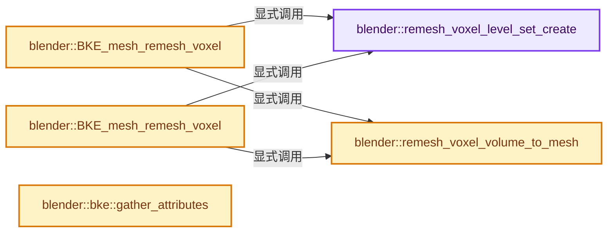
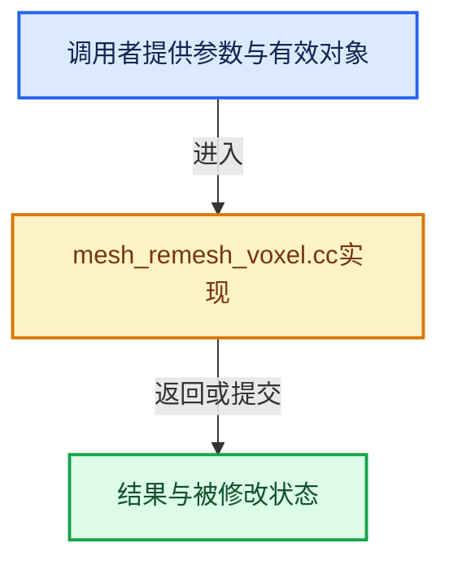

# 实现依赖专题：source/blender/blenkernel/intern/mesh_remesh_voxel.cc

[实现依赖导航](../../README.md) · [符号索引](../../../00-课程指南/02-源码与提交索引/符号依赖与实现索引.md)

本专题从正文实际调用进入，集中保存共享实现。函数有稳定锚点，可从调用处直接跳到对应完整函数；递归与互相调用通过回链组织。

## 本文件的实现关系






## 完整成员与函数实现

<a id="f-794672eaeaf77921"></a>

### `blender::remesh_voxel_level_set_create`

实现位置：[source/blender/blenkernel/intern/mesh_remesh_voxel.cc](../../../../../../../source/blender/blenkernel/intern/mesh_remesh_voxel.cc) · L165—L190。

接口参数：

- `const Mesh *mesh`
- `openvdb::math::Transform::Ptr transform`

**教学注释版**

<!-- annotated:c79966df23cbd7 -->

```cpp
static openvdb::FloatGrid::Ptr remesh_voxel_level_set_create(
    const Mesh *mesh, openvdb::math::Transform::Ptr transform)
{
  const Span<float3> positions = mesh->vert_positions();
  const Span<int> corner_verts = mesh->corner_verts();
  const Span<int3> corner_tris = mesh->corner_tris();

  std::vector<openvdb::Vec3s> points(mesh->verts_num);
  // [讲解] corner_tris.size：查询视图长度或生成对应有效索引区间。
  std::vector<openvdb::Vec3I> triangles(corner_tris.size());

  for (const int i : IndexRange(mesh->verts_num)) {
    const float3 &co = positions[i];
    points[i] = openvdb::Vec3s(co.x, co.y, co.z);
  }

  for (const int i : IndexRange(corner_tris.size())) {
    const int3 &tri = corner_tris[i];
    triangles[i] = openvdb::Vec3I(
        corner_verts[tri[0]], corner_verts[tri[1]], corner_verts[tri[2]]);
  }

  openvdb::FloatGrid::Ptr grid = openvdb::tools::meshToLevelSet<openvdb::FloatGrid>(
      *transform, points, triangles, 1.0f);

  return grid;
}
```

<details>
<summary>核对原始源码：source/blender/blenkernel/intern/mesh_remesh_voxel.cc · L165—L190</summary>

<!-- original:c79966df23cbd7:source/blender/blenkernel/intern/mesh_remesh_voxel.cc:165:190 -->

```cpp
static openvdb::FloatGrid::Ptr remesh_voxel_level_set_create(
    const Mesh *mesh, openvdb::math::Transform::Ptr transform)
{
  const Span<float3> positions = mesh->vert_positions();
  const Span<int> corner_verts = mesh->corner_verts();
  const Span<int3> corner_tris = mesh->corner_tris();

  std::vector<openvdb::Vec3s> points(mesh->verts_num);
  std::vector<openvdb::Vec3I> triangles(corner_tris.size());

  for (const int i : IndexRange(mesh->verts_num)) {
    const float3 &co = positions[i];
    points[i] = openvdb::Vec3s(co.x, co.y, co.z);
  }

  for (const int i : IndexRange(corner_tris.size())) {
    const int3 &tri = corner_tris[i];
    triangles[i] = openvdb::Vec3I(
        corner_verts[tri[0]], corner_verts[tri[1]], corner_verts[tri[2]]);
  }

  openvdb::FloatGrid::Ptr grid = openvdb::tools::meshToLevelSet<openvdb::FloatGrid>(
      *transform, points, triangles, 1.0f);

  return grid;
}
```

</details>

**沿实际写入检查状态**

- `points[i] = openvdb::Vec3s(co.x, co.y, co.z);`
- `triangles[i] = openvdb::Vec3I(`

**结果出口**

- `return grid;`

**继续追踪实现**

- `mesh->vert_positions` → [Mesh::vert_positions · L1193](../../../05-几何存储与拓扑映射/03-MPoly迁移与兼容.md#f-ae4177e5c5f2b371)。
- `mesh->corner_verts` → [Mesh::corner_verts · L1238](../../../05-几何存储与拓扑映射/03-MPoly迁移与兼容.md#f-a59c61f583b64bc4)。
- `mesh->corner_tris` → [blender::Mesh::corner_tris · L264](../../../06-隐式共享与缓存系统/10-局部更新与失效修复.md#f-9bb421790000fc20)。
- `corner_tris.size` → [blender::Span::size · L256](../../../01-基础容器与现代CPP/05-Span只读连续视图.md#f-5f80fa006089c998)。
- `IndexRange` → [blender::IndexRange](../../01-BLI基础库/BLI_index_range.hh.md#t-caa3466d6776)；[blender::gpu::shader::parser::IndexRange](../../08-其他Blender模块/gpu/shader_tool/utils.hh.md#t-82d2bd4ea71c)；[blender::IndexRange](../../08-其他Blender模块/makesdna/DNA_node_types.h.md#t-0448cc889d39)。
- `openvdb::Vec3s` → [外部契约](https://eel.is/c++draft/)：这个边界按实际表达式及所属类型核对参数、返回值、寿命与失败行为。这里提供接口入口，不声称已解释该第三方版本的内部实现。
- `openvdb::Vec3I` → [外部契约](https://eel.is/c++draft/)：这个边界按实际表达式及所属类型核对参数、返回值、寿命与失败行为。这里提供接口入口，不声称已解释该第三方版本的内部实现。
- `openvdb::tools::meshToLevelSet<openvdb::FloatGrid>` → [外部契约](https://eel.is/c++draft/)：这个边界按实际表达式及所属类型核对参数、返回值、寿命与失败行为。这里提供接口入口，不声称已解释该第三方版本的内部实现。

<a id="f-eb043132fcbf4829"></a>

### `blender::remesh_voxel_volume_to_mesh`

实现位置：[source/blender/blenkernel/intern/mesh_remesh_voxel.cc](../../../../../../../source/blender/blenkernel/intern/mesh_remesh_voxel.cc) · L192—L243。

接口参数：

- `const openvdb::FloatGrid::Ptr level_set_grid`
- `const float isovalue`
- `const float adaptivity`
- `const bool relax_disoriented_triangles`

**教学注释版**

<!-- annotated:0a5c8b3d6712e4 -->

```cpp
static Mesh *remesh_voxel_volume_to_mesh(const openvdb::FloatGrid::Ptr level_set_grid,
                                         const float isovalue,
                                         const float adaptivity,
                                         const bool relax_disoriented_triangles)
{
  using namespace blender::bke;
  std::vector<openvdb::Vec3s> vertices;
  std::vector<openvdb::Vec4I> quads;
  std::vector<openvdb::Vec3I> tris;
  openvdb::tools::volumeToMesh<openvdb::FloatGrid>(
      *level_set_grid, vertices, tris, quads, isovalue, adaptivity, relax_disoriented_triangles);

  if (vertices.empty() || quads.size() + tris.size() == 0) {
    return nullptr;
  }

  Mesh *mesh = BKE_mesh_new_nomain(
      vertices.size(), 0, quads.size() + tris.size(), quads.size() * 4 + tris.size() * 3);
  MutableSpan<float3> vert_positions = mesh->vert_positions_for_write();
  MutableSpan<int> face_offsets = mesh->face_offsets_for_write();
  MutableSpan<int> mesh_corner_verts = mesh->corner_verts_for_write();

  const int triangle_loop_start = quads.size() * 4;
  // [讲解] face_offsets.is_empty：查询视图长度或生成对应有效索引区间。
  if (!face_offsets.is_empty()) {
    // [讲解] face_offsets.take_front：从两端裁去或选取一定数量元素形成新视图。
    offset_indices::fill_constant_group_size(4, 0, face_offsets.take_front(quads.size()));
    offset_indices::fill_constant_group_size(
        // [讲解] face_offsets.drop_front：从两端裁去或选取一定数量元素形成新视图。
        3, triangle_loop_start, face_offsets.drop_front(quads.size()));
  }

  // [讲解] vert_positions.index_range：查询视图长度或生成对应有效索引区间。
  for (const int i : vert_positions.index_range()) {
    vert_positions[i] = float3(vertices[i].x(), vertices[i].y(), vertices[i].z());
  }

  for (const int i : IndexRange(quads.size())) {
    const int loopstart = i * 4;
    mesh_corner_verts[loopstart] = quads[i][0];
    mesh_corner_verts[loopstart + 1] = quads[i][3];
    mesh_corner_verts[loopstart + 2] = quads[i][2];
    mesh_corner_verts[loopstart + 3] = quads[i][1];
  }

  for (const int i : IndexRange(tris.size())) {
    const int loopstart = triangle_loop_start + i * 3;
    mesh_corner_verts[loopstart] = tris[i][2];
    mesh_corner_verts[loopstart + 1] = tris[i][1];
    mesh_corner_verts[loopstart + 2] = tris[i][0];
  }

  mesh_calc_edges(*mesh, false, false);

  return mesh;
}
```

<details>
<summary>核对原始源码：source/blender/blenkernel/intern/mesh_remesh_voxel.cc · L192—L243</summary>

<!-- original:0a5c8b3d6712e4:source/blender/blenkernel/intern/mesh_remesh_voxel.cc:192:243 -->

```cpp
static Mesh *remesh_voxel_volume_to_mesh(const openvdb::FloatGrid::Ptr level_set_grid,
                                         const float isovalue,
                                         const float adaptivity,
                                         const bool relax_disoriented_triangles)
{
  using namespace blender::bke;
  std::vector<openvdb::Vec3s> vertices;
  std::vector<openvdb::Vec4I> quads;
  std::vector<openvdb::Vec3I> tris;
  openvdb::tools::volumeToMesh<openvdb::FloatGrid>(
      *level_set_grid, vertices, tris, quads, isovalue, adaptivity, relax_disoriented_triangles);

  if (vertices.empty() || quads.size() + tris.size() == 0) {
    return nullptr;
  }

  Mesh *mesh = BKE_mesh_new_nomain(
      vertices.size(), 0, quads.size() + tris.size(), quads.size() * 4 + tris.size() * 3);
  MutableSpan<float3> vert_positions = mesh->vert_positions_for_write();
  MutableSpan<int> face_offsets = mesh->face_offsets_for_write();
  MutableSpan<int> mesh_corner_verts = mesh->corner_verts_for_write();

  const int triangle_loop_start = quads.size() * 4;
  if (!face_offsets.is_empty()) {
    offset_indices::fill_constant_group_size(4, 0, face_offsets.take_front(quads.size()));
    offset_indices::fill_constant_group_size(
        3, triangle_loop_start, face_offsets.drop_front(quads.size()));
  }

  for (const int i : vert_positions.index_range()) {
    vert_positions[i] = float3(vertices[i].x(), vertices[i].y(), vertices[i].z());
  }

  for (const int i : IndexRange(quads.size())) {
    const int loopstart = i * 4;
    mesh_corner_verts[loopstart] = quads[i][0];
    mesh_corner_verts[loopstart + 1] = quads[i][3];
    mesh_corner_verts[loopstart + 2] = quads[i][2];
    mesh_corner_verts[loopstart + 3] = quads[i][1];
  }

  for (const int i : IndexRange(tris.size())) {
    const int loopstart = triangle_loop_start + i * 3;
    mesh_corner_verts[loopstart] = tris[i][2];
    mesh_corner_verts[loopstart + 1] = tris[i][1];
    mesh_corner_verts[loopstart + 2] = tris[i][0];
  }

  mesh_calc_edges(*mesh, false, false);

  return mesh;
}
```

</details>

**沿实际写入检查状态**

- `vert_positions[i] = float3(vertices[i].x(), vertices[i].y(), vertices[i].z());`
- `mesh_corner_verts[loopstart] = quads[i][0];`
- `mesh_corner_verts[loopstart] = tris[i][2];`

**结果出口**

- `return nullptr;`
- `return mesh;`

**继续追踪实现**

- `openvdb::tools::volumeToMesh<openvdb::FloatGrid>` → [外部契约](https://eel.is/c++draft/)：这个边界按实际表达式及所属类型核对参数、返回值、寿命与失败行为。这里提供接口入口，不声称已解释该第三方版本的内部实现。
- `vertices.empty` → [外部契约](https://eel.is/c++draft/)：这个边界按实际表达式及所属类型核对参数、返回值、寿命与失败行为。这里提供接口入口，不声称已解释该第三方版本的内部实现。
- `quads.size` → [外部契约](https://eel.is/c++draft/)：这个边界按实际表达式及所属类型核对参数、返回值、寿命与失败行为。这里提供接口入口，不声称已解释该第三方版本的内部实现。
- `tris.size` → [外部契约](https://eel.is/c++draft/)：这个边界按实际表达式及所属类型核对参数、返回值、寿命与失败行为。这里提供接口入口，不声称已解释该第三方版本的内部实现。
- `BKE_mesh_new_nomain` → [BKE_mesh_new_nomain · L1376](../../../05-几何存储与拓扑映射/03-MPoly迁移与兼容.md#f-d63806a6e34190f2)。
- `vertices.size` → [外部契约](https://eel.is/c++draft/)：这个边界按实际表达式及所属类型核对参数、返回值、寿命与失败行为。这里提供接口入口，不声称已解释该第三方版本的内部实现。
- `mesh->vert_positions_for_write` → [Mesh::vert_positions_for_write · L1199](../../../05-几何存储与拓扑映射/03-MPoly迁移与兼容.md#f-ae8d77205112d843)。
- `mesh->face_offsets_for_write` → [Mesh::face_offsets_for_write · L1228](../../../05-几何存储与拓扑映射/03-MPoly迁移与兼容.md#f-483f42747ab436a2)。
- `mesh->corner_verts_for_write` → [Mesh::corner_verts_for_write · L1246](../../../05-几何存储与拓扑映射/03-MPoly迁移与兼容.md#f-6dfaf316a81ba215)。
- `face_offsets.is_empty` → [blender::MutableSpan::is_empty · L515](../../../01-基础容器与现代CPP/06-MutableSpan可写视图.md#f-be88df1422757437)。
- `offset_indices::fill_constant_group_size` → [blender::offset_indices::fill_constant_group_size · L68](../../../05-几何存储与拓扑映射/05-邻接关系与前缀和.md#f-9957fe9b72898d83)。
- `face_offsets.take_front` → [blender::MutableSpan::take_front · L635](../../../01-基础容器与现代CPP/06-MutableSpan可写视图.md#f-0a0235d84ddc265d)。
- `face_offsets.drop_front` → [blender::MutableSpan::drop_front · L613](../../../01-基础容器与现代CPP/06-MutableSpan可写视图.md#f-3ed1464d2e0d1608)。
- `vert_positions.index_range` → [blender::MutableSpan::index_range · L676](../../../01-基础容器与现代CPP/06-MutableSpan可写视图.md#f-f9a9d59a69ca64b5)。
- `float3` → [float3 · L641](../../08-其他Blender模块/compositor/algorithms/intern/smaa.cc.md#m-0ea8254cfdb4)。宏定义由构建条件选择。
- `vertices[i].x` → [调用协议](../../../00-课程指南/01-路线与规范/模板宏与动态分派协议.md)：接收对象类型依赖auto、返回值或模板实例；不按同名猜测目标。调用位置L222。
- `vertices[i].y` → [调用协议](../../../00-课程指南/01-路线与规范/模板宏与动态分派协议.md)：接收对象类型依赖auto、返回值或模板实例；不按同名猜测目标。调用位置L222。
- `vertices[i].z` → [调用协议](../../../00-课程指南/01-路线与规范/模板宏与动态分派协议.md)：接收对象类型依赖auto、返回值或模板实例；不按同名猜测目标。调用位置L222。
- `IndexRange` → [blender::IndexRange](../../01-BLI基础库/BLI_index_range.hh.md#t-caa3466d6776)；[blender::gpu::shader::parser::IndexRange](../../08-其他Blender模块/gpu/shader_tool/utils.hh.md#t-82d2bd4ea71c)；[blender::IndexRange](../../08-其他Blender模块/makesdna/DNA_node_types.h.md#t-0448cc889d39)。
- `mesh_calc_edges` → [blender::bke::mesh_calc_edges · L234](mesh_calc_edges.cc.md#f-8dc1463382ec6743)；[blender::bke::mesh_calc_edges · L578](mesh_calc_edges.cc.md#f-1312012cc732ca47)。同名重载需按实参类型选择。

<a id="f-51c8ee82383c0742"></a>

### `blender::BKE_mesh_remesh_voxel`

实现位置：[source/blender/blenkernel/intern/mesh_remesh_voxel.cc](../../../../../../../source/blender/blenkernel/intern/mesh_remesh_voxel.cc) · L246—L276。

接口参数：

- `const Mesh *mesh`
- `const float voxel_size`
- `const float adaptivity`
- `const float isovalue`
- `const Object *object`
- `ModifierData *modifier_data`

**教学注释版**

<!-- annotated:93812b7b1c2802 -->

```cpp
Mesh *BKE_mesh_remesh_voxel(const Mesh *mesh,
                            const float voxel_size,
                            const float adaptivity,
                            const float isovalue,
                            const Object *object,
                            ModifierData *modifier_data)
{
#ifdef WITH_OPENVDB
  openvdb::math::Transform::Ptr transform;
  try {
    transform = openvdb::math::Transform::createLinearTransform(voxel_size);
  }
  catch (const openvdb::ArithmeticError & /*e*/) {
    /* OpenVDB internally has a limit of 3e-15 for the matrix's determinant and throws
     * ArithmeticError if the provided value is too low.
     * See #136637 for more details. */
    BKE_modifier_set_error(
        object, modifier_data, "Voxel size of %f too small to be solved", voxel_size);
    return nullptr;
  }
  openvdb::FloatGrid::Ptr level_set = remesh_voxel_level_set_create(mesh, transform);
  Mesh *result = remesh_voxel_volume_to_mesh(level_set, isovalue, adaptivity, false);
  if (result != nullptr) {
    BKE_mesh_copy_parameters(result, mesh);
  }
  return result;
#else
  UNUSED_VARS(mesh, voxel_size, adaptivity, isovalue, object, modifier_data);
  return nullptr;
#endif
}
```

<details>
<summary>核对原始源码：source/blender/blenkernel/intern/mesh_remesh_voxel.cc · L246—L276</summary>

<!-- original:93812b7b1c2802:source/blender/blenkernel/intern/mesh_remesh_voxel.cc:246:276 -->

```cpp
Mesh *BKE_mesh_remesh_voxel(const Mesh *mesh,
                            const float voxel_size,
                            const float adaptivity,
                            const float isovalue,
                            const Object *object,
                            ModifierData *modifier_data)
{
#ifdef WITH_OPENVDB
  openvdb::math::Transform::Ptr transform;
  try {
    transform = openvdb::math::Transform::createLinearTransform(voxel_size);
  }
  catch (const openvdb::ArithmeticError & /*e*/) {
    /* OpenVDB internally has a limit of 3e-15 for the matrix's determinant and throws
     * ArithmeticError if the provided value is too low.
     * See #136637 for more details. */
    BKE_modifier_set_error(
        object, modifier_data, "Voxel size of %f too small to be solved", voxel_size);
    return nullptr;
  }
  openvdb::FloatGrid::Ptr level_set = remesh_voxel_level_set_create(mesh, transform);
  Mesh *result = remesh_voxel_volume_to_mesh(level_set, isovalue, adaptivity, false);
  if (result != nullptr) {
    BKE_mesh_copy_parameters(result, mesh);
  }
  return result;
#else
  UNUSED_VARS(mesh, voxel_size, adaptivity, isovalue, object, modifier_data);
  return nullptr;
#endif
}
```

</details>

**沿实际写入检查状态**

- `transform = openvdb::math::Transform::createLinearTransform(voxel_size);`

**结果出口**

- `return nullptr;`
- `return result;`

**继续追踪实现**

- `openvdb::math::Transform::createLinearTransform` → [外部契约](https://eel.is/c++draft/)：这个边界按实际表达式及所属类型核对参数、返回值、寿命与失败行为。这里提供接口入口，不声称已解释该第三方版本的内部实现。
- `BKE_modifier_set_error` → [blender::BKE_modifier_set_error · L416](modifier.cc.md#f-6241829f21c08456)。
- `remesh_voxel_level_set_create` → [blender::remesh_voxel_level_set_create · L165](mesh_remesh_voxel.cc.md#f-794672eaeaf77921)。
- `remesh_voxel_volume_to_mesh` → [blender::remesh_voxel_volume_to_mesh · L192](mesh_remesh_voxel.cc.md#f-eb043132fcbf4829)。
- `BKE_mesh_copy_parameters` → [BKE_mesh_copy_parameters · L1462](../../../05-几何存储与拓扑映射/03-MPoly迁移与兼容.md#f-ef5676005d694d8d)。
- `UNUSED_VARS` → [UNUSED_VARS · L522](../../01-BLI基础库/BLI_utildefines.hh.md#m-013582537634)；[UNUSED_VARS · L41](../../08-其他Blender模块/gpu/GPU_shader_shared_utils.hh.md#m-05d9d7a33da0)；[UNUSED_VARS · L62](../../08-其他Blender模块/gpu/GPU_shader_shared_utils.hh.md#m-e12c683a4aca)。宏定义由构建条件选择。

<a id="f-4df1343a8a5372a0"></a>

### `blender::BKE_mesh_remesh_voxel`

实现位置：[source/blender/blenkernel/intern/mesh_remesh_voxel.cc](../../../../../../../source/blender/blenkernel/intern/mesh_remesh_voxel.cc) · L278—L306。

接口参数：

- `const Mesh *mesh`
- `const float voxel_size`
- `const float adaptivity`
- `const float isovalue`
- `ReportList *reports`

**教学注释版**

<!-- annotated:5e70b046a4147e -->

```cpp
Mesh *BKE_mesh_remesh_voxel(const Mesh *mesh,
                            const float voxel_size,
                            const float adaptivity,
                            const float isovalue,
                            ReportList *reports)
{
#ifdef WITH_OPENVDB
  openvdb::math::Transform::Ptr transform;
  try {
    transform = openvdb::math::Transform::createLinearTransform(voxel_size);
  }
  catch (const openvdb::ArithmeticError & /*e*/) {
    /* OpenVDB internally has a limit of 3e-15 for the matrix's determinant and throws
     * ArithmeticError if the provided value is too low.
     * See #136637 for more details. */
    BKE_reportf(reports, RPT_ERROR, "Voxel size of %f too small to be solved", voxel_size);
    return nullptr;
  }
  openvdb::FloatGrid::Ptr level_set = remesh_voxel_level_set_create(mesh, transform);
  Mesh *result = remesh_voxel_volume_to_mesh(level_set, isovalue, adaptivity, false);
  if (result != nullptr) {
    BKE_mesh_copy_parameters(result, mesh);
  }
  return result;
#else
  UNUSED_VARS(mesh, voxel_size, adaptivity, isovalue, reports);
  return nullptr;
#endif
}
```

<details>
<summary>核对原始源码：source/blender/blenkernel/intern/mesh_remesh_voxel.cc · L278—L306</summary>

<!-- original:5e70b046a4147e:source/blender/blenkernel/intern/mesh_remesh_voxel.cc:278:306 -->

```cpp
Mesh *BKE_mesh_remesh_voxel(const Mesh *mesh,
                            const float voxel_size,
                            const float adaptivity,
                            const float isovalue,
                            ReportList *reports)
{
#ifdef WITH_OPENVDB
  openvdb::math::Transform::Ptr transform;
  try {
    transform = openvdb::math::Transform::createLinearTransform(voxel_size);
  }
  catch (const openvdb::ArithmeticError & /*e*/) {
    /* OpenVDB internally has a limit of 3e-15 for the matrix's determinant and throws
     * ArithmeticError if the provided value is too low.
     * See #136637 for more details. */
    BKE_reportf(reports, RPT_ERROR, "Voxel size of %f too small to be solved", voxel_size);
    return nullptr;
  }
  openvdb::FloatGrid::Ptr level_set = remesh_voxel_level_set_create(mesh, transform);
  Mesh *result = remesh_voxel_volume_to_mesh(level_set, isovalue, adaptivity, false);
  if (result != nullptr) {
    BKE_mesh_copy_parameters(result, mesh);
  }
  return result;
#else
  UNUSED_VARS(mesh, voxel_size, adaptivity, isovalue, reports);
  return nullptr;
#endif
}
```

</details>

**沿实际写入检查状态**

- `transform = openvdb::math::Transform::createLinearTransform(voxel_size);`

**结果出口**

- `return nullptr;`
- `return result;`

**继续追踪实现**

- `openvdb::math::Transform::createLinearTransform` → [外部契约](https://eel.is/c++draft/)：这个边界按实际表达式及所属类型核对参数、返回值、寿命与失败行为。这里提供接口入口，不声称已解释该第三方版本的内部实现。
- `BKE_reportf` → [blender::BKE_reportf · L191](report.cc.md#f-e776fc632ffb42b3)。
- `remesh_voxel_level_set_create` → [blender::remesh_voxel_level_set_create · L165](mesh_remesh_voxel.cc.md#f-794672eaeaf77921)。
- `remesh_voxel_volume_to_mesh` → [blender::remesh_voxel_volume_to_mesh · L192](mesh_remesh_voxel.cc.md#f-eb043132fcbf4829)。
- `BKE_mesh_copy_parameters` → [BKE_mesh_copy_parameters · L1462](../../../05-几何存储与拓扑映射/03-MPoly迁移与兼容.md#f-ef5676005d694d8d)。
- `UNUSED_VARS` → [UNUSED_VARS · L522](../../01-BLI基础库/BLI_utildefines.hh.md#m-013582537634)；[UNUSED_VARS · L41](../../08-其他Blender模块/gpu/GPU_shader_shared_utils.hh.md#m-05d9d7a33da0)；[UNUSED_VARS · L62](../../08-其他Blender模块/gpu/GPU_shader_shared_utils.hh.md#m-e12c683a4aca)。宏定义由构建条件选择。

<a id="f-eccc321412f0e74a"></a>

### `blender::bke::gather_attributes`

实现位置：[source/blender/blenkernel/intern/mesh_remesh_voxel.cc](../../../../../../../source/blender/blenkernel/intern/mesh_remesh_voxel.cc) · L443—L457。

接口参数：

- `const Span<StringRef> names`
- `const AttributeAccessor src_attributes`
- `const AttrDomain domain`
- `const Span<int> index_map`
- `MutableAttributeAccessor dst_attributes`

**教学注释版**

<!-- annotated:fbe7310c3dcd14 -->

```cpp
static void gather_attributes(const Span<StringRef> names,
                              const AttributeAccessor src_attributes,
                              const AttrDomain domain,
                              const Span<int> index_map,
                              MutableAttributeAccessor dst_attributes)
{
  for (const StringRef name : names) {
    const GVArraySpan src = *src_attributes.lookup(name, domain);
    const AttrType type = cpp_type_to_attribute_type(src.type());
    GSpanAttributeWriter dst = dst_attributes.lookup_or_add_for_write_only_span(
        name, domain, type);
    attribute_math::gather(src, index_map, dst.span);
    dst.finish();
  }
}
```

<details>
<summary>核对原始源码：source/blender/blenkernel/intern/mesh_remesh_voxel.cc · L443—L457</summary>

<!-- original:fbe7310c3dcd14:source/blender/blenkernel/intern/mesh_remesh_voxel.cc:443:457 -->

```cpp
static void gather_attributes(const Span<StringRef> names,
                              const AttributeAccessor src_attributes,
                              const AttrDomain domain,
                              const Span<int> index_map,
                              MutableAttributeAccessor dst_attributes)
{
  for (const StringRef name : names) {
    const GVArraySpan src = *src_attributes.lookup(name, domain);
    const AttrType type = cpp_type_to_attribute_type(src.type());
    GSpanAttributeWriter dst = dst_attributes.lookup_or_add_for_write_only_span(
        name, domain, type);
    attribute_math::gather(src, index_map, dst.span);
    dst.finish();
  }
}
```

</details>

**继续追踪实现**

- `src_attributes.lookup` → [blender::bke::AttributeAccessor::lookup · L401](attribute_access.cc.md#f-4673351b7bb3b651)。
- `cpp_type_to_attribute_type` → [blender::bke::cpp_type_to_attribute_type · L80](attribute_access.cc.md#f-6ce44c9d2f385cb5)。
- `src.type` → [blender::bke::GeometryComponent::type · L86](../../../06-隐式共享与缓存系统/05-GeometrySet读写与复制.md#f-f73336c224943890)。
- `dst_attributes.lookup_or_add_for_write_only_span` → [blender::bke::MutableAttributeAccessor::lookup_or_add_for_write_only_span · L546](attribute_access.cc.md#f-97af899f7983a038)。
- `attribute_math::gather` → [blender::bke::attribute_math::gather · L423](attribute_math.cc.md#f-b6baceb74af92359)；[blender::bke::attribute_math::gather · L428](attribute_math.cc.md#f-2516f95595549791)；[blender::bke::attribute_math::gather · L433](attribute_math.cc.md#f-a5162715f16ef3e5)；[blender::bke::attribute_math::gather · L438](attribute_math.cc.md#f-dda898f8cb8735c3)。同名重载需按实参类型选择。
- `dst.finish` → [blender::bke::GSpanAttributeWriter::finish · L372](../../../05-几何存储与拓扑映射/08-AttributeAccessor接口.md#f-6e58c9c72c82f592)。
