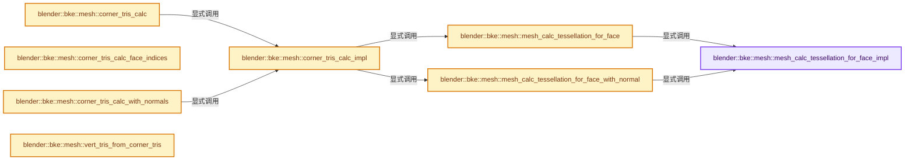

# 实现依赖专题：source/blender/blenkernel/intern/mesh_tessellate.cc

[实现依赖导航](../../README.md) · [符号索引](../../../00-课程指南/02-源码与提交索引/符号依赖与实现索引.md)

本专题从正文实际调用进入，集中保存共享实现。函数有稳定锚点，可从调用处直接跳到对应完整函数；递归与互相调用通过回链组织。

## 本文件的实现关系




## 完整成员与函数实现

<a id="f-685d8983a46f9639"></a>

### `blender::bke::mesh::mesh_calc_tessellation_for_face_impl`

实现位置：[source/blender/blenkernel/intern/mesh_tessellate.cc](../../../../../../../source/blender/blenkernel/intern/mesh_tessellate.cc) · L38—L128。

接口参数：

- `const Span<int> corner_verts`
- `const Span<float3> positions`
- `const int face_start`
- `const int face_size`
- `int3 *tri`
- `MemArena **pf_arena_p`
- `const bool face_normal`
- `const float normal_precalc[3]`

**教学注释版**

<!-- annotated:69c17ab610f3ff -->

```cpp
BLI_INLINE void mesh_calc_tessellation_for_face_impl(const Span<int> corner_verts,
                                                     const Span<float3> positions,
                                                     const int face_start,
                                                     const int face_size,
                                                     int3 *tri,
                                                     MemArena **pf_arena_p,
                                                     const bool face_normal,
                                                     const float normal_precalc[3])
{
  auto create_tri = [&](int i1, int i2, int i3) {
    (*tri)[0] = face_start + i1;
    (*tri)[1] = face_start + i2;
    (*tri)[2] = face_start + i3;
  };

  switch (face_size) {
    case 3: {
      create_tri(0, 1, 2);
      break;
    }
    case 4: {
      create_tri(0, 1, 2);
      int3 *tri_a = tri++;
      create_tri(0, 2, 3);
      int3 *tri_b = tri;
      if (is_quad_flip_v3_first_third_fast(positions[corner_verts[(*tri_a)[0]]],
                                           positions[corner_verts[(*tri_a)[1]]],
                                           positions[corner_verts[(*tri_a)[2]]],
                                           positions[corner_verts[(*tri_b)[2]]])) [[unlikely]]
      {
        /* Flip out of degenerate 0-2 state. */
        (*tri_a)[2] = (*tri_b)[2];
        (*tri_b)[0] = (*tri_a)[1];
      }
      break;
    }
    default: {
      float axis_mat[3][3];

      /* Calculate `axis_mat` to project verts to 2D. */
      if (face_normal == false) {
        float normal[3];
        const float *co_curr, *co_prev;

        zero_v3(normal);

        /* Calc normal, flipped: to get a positive 2D cross product. */
        co_prev = positions[corner_verts[face_start + face_size - 1]];
        for (int j = 0; j < face_size; j++) {
          co_curr = positions[corner_verts[face_start + j]];
          add_newell_cross_v3_v3v3(normal, co_prev, co_curr);
          co_prev = co_curr;
        }
        if (normalize_v3(normal) == 0.0f) [[unlikely]] {
          normal[2] = 1.0f;
        }
        axis_dominant_v3_to_m3_negate(axis_mat, normal);
      }
      else {
        axis_dominant_v3_to_m3_negate(axis_mat, normal_precalc);
      }

      const int totfilltri = face_size - 2;

      MemArena *pf_arena = *pf_arena_p;
      if (pf_arena == nullptr) [[unlikely]] {
        pf_arena = *pf_arena_p = BLI_memarena_new(BLI_MEMARENA_STD_BUFSIZE, __func__);
      }

      uint(*tris)[3] = static_cast<uint(*)[3]>(
          BLI_memarena_alloc(pf_arena, sizeof(*tris) * size_t(totfilltri)));
      float (*projverts)[2] = static_cast<float (*)[2]>(
          BLI_memarena_alloc(pf_arena, sizeof(*projverts) * size_t(face_size)));

      for (int j = 0; j < face_size; j++) {
        mul_v2_m3v3(projverts[j], axis_mat, positions[corner_verts[face_start + j]]);
      }

      BLI_polyfill_calc_arena(projverts, uint(face_size), 1, tris, pf_arena);

      /* Apply fill. */
      for (int j = 0; j < totfilltri; j++, tri++) {
        create_tri(int(tris[j][0]), int(tris[j][1]), int(tris[j][2]));
      }

      BLI_memarena_clear(pf_arena);

      break;
    }
  }
}
```

<details>
<summary>核对原始源码：source/blender/blenkernel/intern/mesh_tessellate.cc · L38—L128</summary>

<!-- original:69c17ab610f3ff:source/blender/blenkernel/intern/mesh_tessellate.cc:38:128 -->

```cpp
BLI_INLINE void mesh_calc_tessellation_for_face_impl(const Span<int> corner_verts,
                                                     const Span<float3> positions,
                                                     const int face_start,
                                                     const int face_size,
                                                     int3 *tri,
                                                     MemArena **pf_arena_p,
                                                     const bool face_normal,
                                                     const float normal_precalc[3])
{
  auto create_tri = [&](int i1, int i2, int i3) {
    (*tri)[0] = face_start + i1;
    (*tri)[1] = face_start + i2;
    (*tri)[2] = face_start + i3;
  };

  switch (face_size) {
    case 3: {
      create_tri(0, 1, 2);
      break;
    }
    case 4: {
      create_tri(0, 1, 2);
      int3 *tri_a = tri++;
      create_tri(0, 2, 3);
      int3 *tri_b = tri;
      if (is_quad_flip_v3_first_third_fast(positions[corner_verts[(*tri_a)[0]]],
                                           positions[corner_verts[(*tri_a)[1]]],
                                           positions[corner_verts[(*tri_a)[2]]],
                                           positions[corner_verts[(*tri_b)[2]]])) [[unlikely]]
      {
        /* Flip out of degenerate 0-2 state. */
        (*tri_a)[2] = (*tri_b)[2];
        (*tri_b)[0] = (*tri_a)[1];
      }
      break;
    }
    default: {
      float axis_mat[3][3];

      /* Calculate `axis_mat` to project verts to 2D. */
      if (face_normal == false) {
        float normal[3];
        const float *co_curr, *co_prev;

        zero_v3(normal);

        /* Calc normal, flipped: to get a positive 2D cross product. */
        co_prev = positions[corner_verts[face_start + face_size - 1]];
        for (int j = 0; j < face_size; j++) {
          co_curr = positions[corner_verts[face_start + j]];
          add_newell_cross_v3_v3v3(normal, co_prev, co_curr);
          co_prev = co_curr;
        }
        if (normalize_v3(normal) == 0.0f) [[unlikely]] {
          normal[2] = 1.0f;
        }
        axis_dominant_v3_to_m3_negate(axis_mat, normal);
      }
      else {
        axis_dominant_v3_to_m3_negate(axis_mat, normal_precalc);
      }

      const int totfilltri = face_size - 2;

      MemArena *pf_arena = *pf_arena_p;
      if (pf_arena == nullptr) [[unlikely]] {
        pf_arena = *pf_arena_p = BLI_memarena_new(BLI_MEMARENA_STD_BUFSIZE, __func__);
      }

      uint(*tris)[3] = static_cast<uint(*)[3]>(
          BLI_memarena_alloc(pf_arena, sizeof(*tris) * size_t(totfilltri)));
      float (*projverts)[2] = static_cast<float (*)[2]>(
          BLI_memarena_alloc(pf_arena, sizeof(*projverts) * size_t(face_size)));

      for (int j = 0; j < face_size; j++) {
        mul_v2_m3v3(projverts[j], axis_mat, positions[corner_verts[face_start + j]]);
      }

      BLI_polyfill_calc_arena(projverts, uint(face_size), 1, tris, pf_arena);

      /* Apply fill. */
      for (int j = 0; j < totfilltri; j++, tri++) {
        create_tri(int(tris[j][0]), int(tris[j][1]), int(tris[j][2]));
      }

      BLI_memarena_clear(pf_arena);

      break;
    }
  }
}
```

</details>

**沿实际写入检查状态**

- `co_prev = positions[corner_verts[face_start + face_size - 1]];`
- `co_curr = positions[corner_verts[face_start + j]];`
- `co_prev = co_curr;`
- `normal[2] = 1.0f;`
- `pf_arena = *pf_arena_p = BLI_memarena_new(BLI_MEMARENA_STD_BUFSIZE, __func__);`

**继续追踪实现**

- `create_tri` → [调用协议](../../../00-课程指南/01-路线与规范/模板宏与动态分派协议.md)：局部可调用对象，须结合其初始化与捕获环境。调用位置L55。
- `is_quad_flip_v3_first_third_fast` → [blender::is_quad_flip_v3_first_third_fast · L5665](../../01-BLI基础库/intern/math_geom.cc.md#f-67647d6abb2c1d00)。
- `zero_v3` → [blender::zero_v3 · L26](../../01-BLI基础库/intern/math_vector_inline.cc.md#f-13235b08fdecb098)。
- `add_newell_cross_v3_v3v3` → [调用协议](../../../00-课程指南/01-路线与规范/模板宏与动态分派协议.md)：函数指针、局部可调用对象或未展开的宏；必须结合调用者环境。调用位置L88。
- `normalize_v3` → [blender::normalize_v3 · L933](../../01-BLI基础库/intern/math_vector_inline.cc.md#f-5f3257e657ef732c)。
- `axis_dominant_v3_to_m3_negate` → [blender::axis_dominant_v3_to_m3_negate · L3719](../../01-BLI基础库/intern/math_geom.cc.md#f-a179811fe7db7a80)。
- `BLI_memarena_new` → [blender::BLI_memarena_new · L73](../../01-BLI基础库/intern/BLI_memarena.cc.md#f-590ef4f6ab548c98)。
- `BLI_memarena_alloc` → [blender::BLI_memarena_alloc · L125](../../01-BLI基础库/intern/BLI_memarena.cc.md#f-ae79828c3629e134)；[blender::BLI_memarena_alloc · L43](../../01-BLI基础库/BLI_memarena.hh.md#f-3c7ccf0d8384021b)。同名重载需按实参类型选择。
- `mul_v2_m3v3` → [blender::mul_v2_m3v3 · L844](../../01-BLI基础库/intern/math_matrix_c.cc.md#f-2550a487d003ca6b)。
- `BLI_polyfill_calc_arena` → [blender::BLI_polyfill_calc_arena · L1065](../../01-BLI基础库/intern/polyfill_2d.cc.md#f-85769b09e7961330)。
- `BLI_memarena_clear` → [blender::BLI_memarena_clear · L225](../../01-BLI基础库/intern/BLI_memarena.cc.md#f-58102a3c4f840caa)。

<a id="f-51a0826ccbdc3401"></a>

### `blender::bke::mesh::mesh_calc_tessellation_for_face`

实现位置：[source/blender/blenkernel/intern/mesh_tessellate.cc](../../../../../../../source/blender/blenkernel/intern/mesh_tessellate.cc) · L130—L139。

接口参数：

- `const Span<int> corner_verts`
- `const Span<float3> positions`
- `const int face_start`
- `const int face_size`
- `int3 *tri`
- `MemArena **pf_arena_p`

**教学注释版**

<!-- annotated:d4f6f1b229d892 -->

```cpp
static void mesh_calc_tessellation_for_face(const Span<int> corner_verts,
                                            const Span<float3> positions,
                                            const int face_start,
                                            const int face_size,
                                            int3 *tri,
                                            MemArena **pf_arena_p)
{
  mesh_calc_tessellation_for_face_impl(
      corner_verts, positions, face_start, face_size, tri, pf_arena_p, false, nullptr);
}
```

<details>
<summary>核对原始源码：source/blender/blenkernel/intern/mesh_tessellate.cc · L130—L139</summary>

<!-- original:d4f6f1b229d892:source/blender/blenkernel/intern/mesh_tessellate.cc:130:139 -->

```cpp
static void mesh_calc_tessellation_for_face(const Span<int> corner_verts,
                                            const Span<float3> positions,
                                            const int face_start,
                                            const int face_size,
                                            int3 *tri,
                                            MemArena **pf_arena_p)
{
  mesh_calc_tessellation_for_face_impl(
      corner_verts, positions, face_start, face_size, tri, pf_arena_p, false, nullptr);
}
```

</details>

**继续追踪实现**

- `mesh_calc_tessellation_for_face_impl` → [blender::bke::mesh::mesh_calc_tessellation_for_face_impl · L38](mesh_tessellate.cc.md#f-685d8983a46f9639)。

<a id="f-7907a0bb4264569e"></a>

### `blender::bke::mesh::mesh_calc_tessellation_for_face_with_normal`

实现位置：[source/blender/blenkernel/intern/mesh_tessellate.cc](../../../../../../../source/blender/blenkernel/intern/mesh_tessellate.cc) · L141—L151。

接口参数：

- `const Span<int> corner_verts`
- `const Span<float3> positions`
- `const int face_start`
- `const int face_size`
- `int3 *tri`
- `MemArena **pf_arena_p`
- `const float normal_precalc[3]`

**教学注释版**

<!-- annotated:d8f89999e60010 -->

```cpp
static void mesh_calc_tessellation_for_face_with_normal(const Span<int> corner_verts,
                                                        const Span<float3> positions,
                                                        const int face_start,
                                                        const int face_size,
                                                        int3 *tri,
                                                        MemArena **pf_arena_p,
                                                        const float normal_precalc[3])
{
  mesh_calc_tessellation_for_face_impl(
      corner_verts, positions, face_start, face_size, tri, pf_arena_p, true, normal_precalc);
}
```

<details>
<summary>核对原始源码：source/blender/blenkernel/intern/mesh_tessellate.cc · L141—L151</summary>

<!-- original:d8f89999e60010:source/blender/blenkernel/intern/mesh_tessellate.cc:141:151 -->

```cpp
static void mesh_calc_tessellation_for_face_with_normal(const Span<int> corner_verts,
                                                        const Span<float3> positions,
                                                        const int face_start,
                                                        const int face_size,
                                                        int3 *tri,
                                                        MemArena **pf_arena_p,
                                                        const float normal_precalc[3])
{
  mesh_calc_tessellation_for_face_impl(
      corner_verts, positions, face_start, face_size, tri, pf_arena_p, true, normal_precalc);
}
```

</details>

**继续追踪实现**

- `mesh_calc_tessellation_for_face_impl` → [blender::bke::mesh::mesh_calc_tessellation_for_face_impl · L38](mesh_tessellate.cc.md#f-685d8983a46f9639)。

<a id="f-bb18ee1d2d83c335"></a>

### `blender::bke::mesh::corner_tris_calc_impl`

实现位置：[source/blender/blenkernel/intern/mesh_tessellate.cc](../../../../../../../source/blender/blenkernel/intern/mesh_tessellate.cc) · L164—L204。

接口参数：

- `const Span<float3> positions`
- `const OffsetIndices<int> faces`
- `const Span<int> corner_verts`
- `const Span<float3> face_normals`
- `MutableSpan<int3> corner_tris`

**教学注释版**

<!-- annotated:071d1674a43c82 -->

```cpp
static void corner_tris_calc_impl(const Span<float3> positions,
                                  const OffsetIndices<int> faces,
                                  const Span<int> corner_verts,
                                  const Span<float3> face_normals,
                                  MutableSpan<int3> corner_tris)
{
  threading::EnumerableThreadSpecific<LocalData> all_local_data;
  // [讲解] face_normals.is_empty：查询视图长度或生成对应有效索引区间。
  if (face_normals.is_empty()) {
    threading::parallel_for(faces.index_range(), 1024, [&](const IndexRange range) {
      LocalData &local_data = all_local_data.local();
      for (const int64_t i : range) {
        const int face_start = int(faces[i].start());
        const int face_size = int(faces[i].size());
        const int tris_start = poly_to_tri_count(int(i), face_start);
        mesh_calc_tessellation_for_face(corner_verts,
                                        positions,
                                        face_start,
                                        face_size,
                                        &corner_tris[tris_start],
                                        &local_data.pf_arena);
      }
    });
  }
  else {
    threading::parallel_for(faces.index_range(), 1024, [&](const IndexRange range) {
      LocalData &local_data = all_local_data.local();
      for (const int64_t i : range) {
        const int face_start = int(faces[i].start());
        const int face_size = int(faces[i].size());
        const int tris_start = poly_to_tri_count(int(i), face_start);
        mesh_calc_tessellation_for_face_with_normal(corner_verts,
                                                    positions,
                                                    face_start,
                                                    face_size,
                                                    &corner_tris[tris_start],
                                                    &local_data.pf_arena,
                                                    face_normals[i]);
      }
    });
  }
}
```

<details>
<summary>核对原始源码：source/blender/blenkernel/intern/mesh_tessellate.cc · L164—L204</summary>

<!-- original:071d1674a43c82:source/blender/blenkernel/intern/mesh_tessellate.cc:164:204 -->

```cpp
static void corner_tris_calc_impl(const Span<float3> positions,
                                  const OffsetIndices<int> faces,
                                  const Span<int> corner_verts,
                                  const Span<float3> face_normals,
                                  MutableSpan<int3> corner_tris)
{
  threading::EnumerableThreadSpecific<LocalData> all_local_data;
  if (face_normals.is_empty()) {
    threading::parallel_for(faces.index_range(), 1024, [&](const IndexRange range) {
      LocalData &local_data = all_local_data.local();
      for (const int64_t i : range) {
        const int face_start = int(faces[i].start());
        const int face_size = int(faces[i].size());
        const int tris_start = poly_to_tri_count(int(i), face_start);
        mesh_calc_tessellation_for_face(corner_verts,
                                        positions,
                                        face_start,
                                        face_size,
                                        &corner_tris[tris_start],
                                        &local_data.pf_arena);
      }
    });
  }
  else {
    threading::parallel_for(faces.index_range(), 1024, [&](const IndexRange range) {
      LocalData &local_data = all_local_data.local();
      for (const int64_t i : range) {
        const int face_start = int(faces[i].start());
        const int face_size = int(faces[i].size());
        const int tris_start = poly_to_tri_count(int(i), face_start);
        mesh_calc_tessellation_for_face_with_normal(corner_verts,
                                                    positions,
                                                    face_start,
                                                    face_size,
                                                    &corner_tris[tris_start],
                                                    &local_data.pf_arena,
                                                    face_normals[i]);
      }
    });
  }
}
```

</details>

**继续追踪实现**

- `face_normals.is_empty` → [blender::Span::is_empty · L264](../../../01-基础容器与现代CPP/05-Span只读连续视图.md#f-8cc1d7ba8feb50e6)。
- `threading::parallel_for` → [blender::threading::parallel_for · L68](../../../11-Depsgraph与并行任务系统/07-任务池与TBB接入.md#f-838294754c24426c)。
- `faces.index_range` → [blender::offset_indices::OffsetIndices::index_range · L77](../../../05-几何存储与拓扑映射/02-OffsetIndices完整接口.md#f-19b5ca1456de007d)。
- `all_local_data.local` → [blender::threading::EnumerableThreadSpecific::local · L51](../../01-BLI基础库/BLI_enumerable_thread_specific.hh.md#f-38c6c32570e94c93)；[blender::threading::EnumerableThreadSpecific::local · L87](../../01-BLI基础库/BLI_enumerable_thread_specific.hh.md#f-3c8975467b7a35ba)。同名重载需按实参类型选择。
- `faces[i].start` → [调用协议](../../../00-课程指南/01-路线与规范/模板宏与动态分派协议.md)：接收对象类型依赖auto、返回值或模板实例；不按同名猜测目标。调用位置L175。
- `faces[i].size` → [调用协议](../../../00-课程指南/01-路线与规范/模板宏与动态分派协议.md)：接收对象类型依赖auto、返回值或模板实例；不按同名猜测目标。调用位置L176。
- `poly_to_tri_count` → [调用协议](../../../00-课程指南/01-路线与规范/模板宏与动态分派协议.md)：函数指针、局部可调用对象或未展开的宏；必须结合调用者环境。调用位置L177。
- `mesh_calc_tessellation_for_face` → [blender::bke::mesh::mesh_calc_tessellation_for_face · L130](mesh_tessellate.cc.md#f-51a0826ccbdc3401)。
- `mesh_calc_tessellation_for_face_with_normal` → [blender::bke::mesh::mesh_calc_tessellation_for_face_with_normal · L141](mesh_tessellate.cc.md#f-7907a0bb4264569e)。

<a id="f-69edfcb57d8c02dd"></a>

### `blender::bke::mesh::corner_tris_calc`

实现位置：[source/blender/blenkernel/intern/mesh_tessellate.cc](../../../../../../../source/blender/blenkernel/intern/mesh_tessellate.cc) · L206—L212。

接口参数：

- `const Span<float3> vert_positions`
- `const OffsetIndices<int> faces`
- `const Span<int> corner_verts`
- `MutableSpan<int3> corner_tris`

**教学注释版**

<!-- annotated:8457ae6b2c3c1f -->

```cpp
void corner_tris_calc(const Span<float3> vert_positions,
                      const OffsetIndices<int> faces,
                      const Span<int> corner_verts,
                      MutableSpan<int3> corner_tris)
{
  corner_tris_calc_impl(vert_positions, faces, corner_verts, {}, corner_tris);
}
```

<details>
<summary>核对原始源码：source/blender/blenkernel/intern/mesh_tessellate.cc · L206—L212</summary>

<!-- original:8457ae6b2c3c1f:source/blender/blenkernel/intern/mesh_tessellate.cc:206:212 -->

```cpp
void corner_tris_calc(const Span<float3> vert_positions,
                      const OffsetIndices<int> faces,
                      const Span<int> corner_verts,
                      MutableSpan<int3> corner_tris)
{
  corner_tris_calc_impl(vert_positions, faces, corner_verts, {}, corner_tris);
}
```

</details>

**继续追踪实现**

- `corner_tris_calc_impl` → [blender::bke::mesh::corner_tris_calc_impl · L164](mesh_tessellate.cc.md#f-bb18ee1d2d83c335)。

<a id="f-1f44987ba09b0207"></a>

### `blender::bke::mesh::corner_tris_calc_face_indices`

实现位置：[source/blender/blenkernel/intern/mesh_tessellate.cc](../../../../../../../source/blender/blenkernel/intern/mesh_tessellate.cc) · L214—L224。

接口参数：

- `const OffsetIndices<int> faces`
- `MutableSpan<int> tri_faces`

**教学注释版**

<!-- annotated:b926c7f370325d -->

```cpp
void corner_tris_calc_face_indices(const OffsetIndices<int> faces, MutableSpan<int> tri_faces)
{
  threading::parallel_for(faces.index_range(), 1024, [&](const IndexRange range) {
    for (const int64_t i : range) {
      const IndexRange face = faces[i];
      // [讲解] face.start：读取连续区间或分组的边界信息。
      const int start = poly_to_tri_count(int(i), int(face.start()));
      // [讲解] face.size：读取连续区间或分组的边界信息。
      const int num = face_triangles_num(int(face.size()));
      // [讲解] tri_faces.slice：建立原连续范围的子视图。
      tri_faces.slice(start, num).fill(int(i));
    }
  });
}
```

<details>
<summary>核对原始源码：source/blender/blenkernel/intern/mesh_tessellate.cc · L214—L224</summary>

<!-- original:b926c7f370325d:source/blender/blenkernel/intern/mesh_tessellate.cc:214:224 -->

```cpp
void corner_tris_calc_face_indices(const OffsetIndices<int> faces, MutableSpan<int> tri_faces)
{
  threading::parallel_for(faces.index_range(), 1024, [&](const IndexRange range) {
    for (const int64_t i : range) {
      const IndexRange face = faces[i];
      const int start = poly_to_tri_count(int(i), int(face.start()));
      const int num = face_triangles_num(int(face.size()));
      tri_faces.slice(start, num).fill(int(i));
    }
  });
}
```

</details>

**继续追踪实现**

- `threading::parallel_for` → [blender::threading::parallel_for · L68](../../../11-Depsgraph与并行任务系统/07-任务池与TBB接入.md#f-838294754c24426c)。
- `faces.index_range` → [blender::offset_indices::OffsetIndices::index_range · L77](../../../05-几何存储与拓扑映射/02-OffsetIndices完整接口.md#f-19b5ca1456de007d)。
- `poly_to_tri_count` → [调用协议](../../../00-课程指南/01-路线与规范/模板宏与动态分派协议.md)：函数指针、局部可调用对象或未展开的宏；必须结合调用者环境。调用位置L219。
- `face.start` → [blender::IndexRange::start · L243](../../../01-基础容器与现代CPP/04-IndexRange连续整数区间.md#f-99d2195bd9cfd1f0)。
- `face_triangles_num` → [blender::bke::mesh::face_triangles_num · L350](../../../05-几何存储与拓扑映射/01-Mesh顶点边面角点.md#f-720b4d927730b800)。
- `face.size` → [blender::IndexRange::size · L156](../../../01-基础容器与现代CPP/04-IndexRange连续整数区间.md#f-05f66c3ebb2fdfec)。
- `tri_faces.slice(start, num).fill` → [调用协议](../../../00-课程指南/01-路线与规范/模板宏与动态分派协议.md)：接收对象类型依赖auto、返回值或模板实例；不按同名猜测目标。调用位置L221。
- `tri_faces.slice` → [blender::MutableSpan::slice · L579](../../../01-基础容器与现代CPP/06-MutableSpan可写视图.md#f-6808b4aefbf58808)；[blender::MutableSpan::slice · L587](../../../01-基础容器与现代CPP/06-MutableSpan可写视图.md#f-c05b010821861e4f)。同名重载需按实参类型选择。

<a id="f-089ddc0055000e6a"></a>

### `blender::bke::mesh::corner_tris_calc_with_normals`

实现位置：[source/blender/blenkernel/intern/mesh_tessellate.cc](../../../../../../../source/blender/blenkernel/intern/mesh_tessellate.cc) · L226—L234。

接口参数：

- `const Span<float3> vert_positions`
- `const OffsetIndices<int> faces`
- `const Span<int> corner_verts`
- `const Span<float3> face_normals`
- `MutableSpan<int3> corner_tris`

**教学注释版**

<!-- annotated:533aab010c6675 -->

```cpp
void corner_tris_calc_with_normals(const Span<float3> vert_positions,
                                   const OffsetIndices<int> faces,
                                   const Span<int> corner_verts,
                                   const Span<float3> face_normals,
                                   MutableSpan<int3> corner_tris)
{
  // [讲解] face_normals.is_empty：查询视图长度或生成对应有效索引区间。
  BLI_assert(!face_normals.is_empty() || faces.is_empty());
  corner_tris_calc_impl(vert_positions, faces, corner_verts, face_normals, corner_tris);
}
```

<details>
<summary>核对原始源码：source/blender/blenkernel/intern/mesh_tessellate.cc · L226—L234</summary>

<!-- original:533aab010c6675:source/blender/blenkernel/intern/mesh_tessellate.cc:226:234 -->

```cpp
void corner_tris_calc_with_normals(const Span<float3> vert_positions,
                                   const OffsetIndices<int> faces,
                                   const Span<int> corner_verts,
                                   const Span<float3> face_normals,
                                   MutableSpan<int3> corner_tris)
{
  BLI_assert(!face_normals.is_empty() || faces.is_empty());
  corner_tris_calc_impl(vert_positions, faces, corner_verts, face_normals, corner_tris);
}
```

</details>

**继续追踪实现**

- `BLI_assert` → [BLI_assert · L48](../../01-BLI基础库/BLI_assert.hh.md#m-57a88495704d)；[BLI_assert · L63](../../01-BLI基础库/BLI_assert.hh.md#m-d07050020cb5)。宏定义由构建条件选择。
- `face_normals.is_empty` → [blender::Span::is_empty · L264](../../../01-基础容器与现代CPP/05-Span只读连续视图.md#f-8cc1d7ba8feb50e6)。
- `faces.is_empty` → [blender::offset_indices::OffsetIndices::is_empty · L72](../../../05-几何存储与拓扑映射/02-OffsetIndices完整接口.md#f-e348e19b62d50b3e)。
- `corner_tris_calc_impl` → [blender::bke::mesh::corner_tris_calc_impl · L164](mesh_tessellate.cc.md#f-bb18ee1d2d83c335)。

<a id="f-148011c2040a8b1e"></a>

### `blender::bke::mesh::vert_tris_from_corner_tris`

实现位置：[source/blender/blenkernel/intern/mesh_tessellate.cc](../../../../../../../source/blender/blenkernel/intern/mesh_tessellate.cc) · L238—L243。

接口参数：

- `const Span<int> corner_verts`
- `const Span<int3> corner_tris`
- `MutableSpan<int3> vert_tris`

**教学注释版**

<!-- annotated:b9a2d1f3fbd45f -->

```cpp
void vert_tris_from_corner_tris(const Span<int> corner_verts,
                                const Span<int3> corner_tris,
                                MutableSpan<int3> vert_tris)
{
  // [讲解] corner_tris.cast<int>：按类型与布局约束重新解释视图。
  array_utils::gather(corner_verts, corner_tris.cast<int>(), vert_tris.cast<int>());
}
```

<details>
<summary>核对原始源码：source/blender/blenkernel/intern/mesh_tessellate.cc · L238—L243</summary>

<!-- original:b9a2d1f3fbd45f:source/blender/blenkernel/intern/mesh_tessellate.cc:238:243 -->

```cpp
void vert_tris_from_corner_tris(const Span<int> corner_verts,
                                const Span<int3> corner_tris,
                                MutableSpan<int3> vert_tris)
{
  array_utils::gather(corner_verts, corner_tris.cast<int>(), vert_tris.cast<int>());
}
```

</details>

**继续追踪实现**

- `array_utils::gather` → [blender::array_utils::gather · L187](../../../01-基础容器与现代CPP/20-容器选择与独立实现.md#f-1760adec5858a42f)；[blender::array_utils::gather · L209](../../../01-基础容器与现代CPP/20-容器选择与独立实现.md#f-a9f65820788454bf)；[blender::array_utils::gather · L225](../../../01-基础容器与现代CPP/20-容器选择与独立实现.md#f-279764b4196f0b63)；[blender::array_utils::gather · L237](../../../01-基础容器与现代CPP/20-容器选择与独立实现.md#f-e310fd489b49341b)；[blender::array_utils::gather · L268](../../../01-基础容器与现代CPP/20-容器选择与独立实现.md#f-7b21c29791903615)；[blender::array_utils::gather · L63](../../01-BLI基础库/intern/array_utils.cc.md#f-5c2b501b03ddbb1f)；[blender::array_utils::gather · L82](../../01-BLI基础库/intern/array_utils.cc.md#f-ea4dd9e673fe81e4)。同名重载需按实参类型选择。
- `corner_tris.cast<int>` → [blender::Span::cast · L422](../../../01-基础容器与现代CPP/05-Span只读连续视图.md#f-e082d823028af8f6)。
- `vert_tris.cast<int>` → [blender::MutableSpan::cast · L755](../../../01-基础容器与现代CPP/06-MutableSpan可写视图.md#f-360354e608371779)。

<a id="f-38dcd8f4169fd324"></a>

### `blender::bke::mesh::corner_tri_get_real_edges`

实现位置：[source/blender/blenkernel/intern/mesh_tessellate.cc](../../../../../../../source/blender/blenkernel/intern/mesh_tessellate.cc) · L245—L265。

接口参数：

- `const Span<int2> edges`
- `const Span<int> corner_verts`
- `const Span<int> corner_edges`
- `const int3 &corner_tri`

**教学注释版**

<!-- annotated:74d958ee28cb80 -->

```cpp
int3 corner_tri_get_real_edges(const Span<int2> edges,
                               const Span<int> corner_verts,
                               const Span<int> corner_edges,
                               const int3 &corner_tri)
{
  int3 real_edges;
  for (int i = 2, i_next = 0; i_next < 3; i = i_next++) {
    const int corner_1 = int(corner_tri[i]);
    const int corner_2 = int(corner_tri[i_next]);
    const int vert_1 = corner_verts[corner_1];
    const int vert_2 = corner_verts[corner_2];
    const int edge_i = corner_edges[corner_1];
    const int2 edge = edges[edge_i];

    const bool is_real = (vert_1 == edge[0] && vert_2 == edge[1]) ||
                         (vert_1 == edge[1] && vert_2 == edge[0]);

    real_edges[i] = is_real ? edge_i : -1;
  }
  return real_edges;
}
```

<details>
<summary>核对原始源码：source/blender/blenkernel/intern/mesh_tessellate.cc · L245—L265</summary>

<!-- original:74d958ee28cb80:source/blender/blenkernel/intern/mesh_tessellate.cc:245:265 -->

```cpp
int3 corner_tri_get_real_edges(const Span<int2> edges,
                               const Span<int> corner_verts,
                               const Span<int> corner_edges,
                               const int3 &corner_tri)
{
  int3 real_edges;
  for (int i = 2, i_next = 0; i_next < 3; i = i_next++) {
    const int corner_1 = int(corner_tri[i]);
    const int corner_2 = int(corner_tri[i_next]);
    const int vert_1 = corner_verts[corner_1];
    const int vert_2 = corner_verts[corner_2];
    const int edge_i = corner_edges[corner_1];
    const int2 edge = edges[edge_i];

    const bool is_real = (vert_1 == edge[0] && vert_2 == edge[1]) ||
                         (vert_1 == edge[1] && vert_2 == edge[0]);

    real_edges[i] = is_real ? edge_i : -1;
  }
  return real_edges;
}
```

</details>

**沿实际写入检查状态**

- `real_edges[i] = is_real ? edge_i : -1;`

**结果出口**

- `return real_edges;`

**继续追踪实现**

本实现没有需要继续展开的显式调用；检查返回表达式、对象转换和调用者前置条件。
