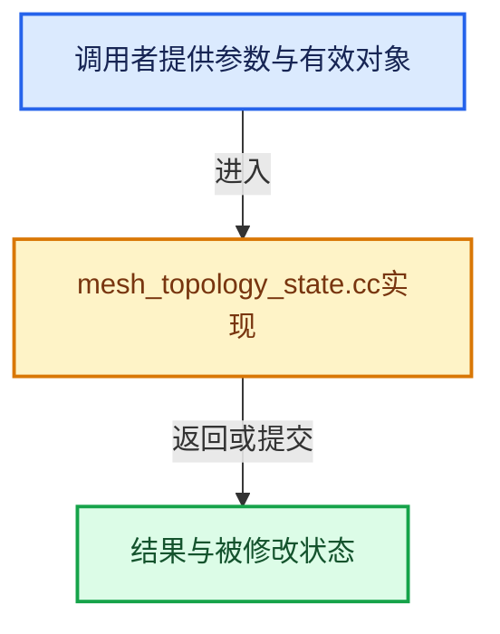

# 实现依赖专题：source/blender/blenkernel/intern/mesh_topology_state.cc

[实现依赖导航](../../README.md) · [符号索引](../../../00-课程指南/02-源码与提交索引/符号依赖与实现索引.md)

本专题从正文实际调用进入，集中保存共享实现。函数有稳定锚点，可从调用处直接跳到对应完整函数；递归与互相调用通过回链组织。

## 本文件的实现关系





## 完整成员与函数实现

<a id="f-b38ea2cbca221c60"></a>

### `blender::bke::attribute_reader_matches_array_state`

实现位置：[source/blender/blenkernel/intern/mesh_topology_state.cc](../../../../../../../source/blender/blenkernel/intern/mesh_topology_state.cc) · L25—L33。

接口参数：

- `const ArrayState<T> &array_state`
- `const AttributeReader<T> &attr`

**教学注释版**

<!-- annotated:c5a53377c5cafa -->

```cpp
template<typename T>
bool attribute_reader_matches_array_state(const ArrayState<T> &array_state,
                                          const AttributeReader<T> &attr)
{
  if (!attr) {
    return array_state.is_empty();
  }
  return array_state.same_as(attr.varray, attr.sharing_info);
}
```

<details>
<summary>核对原始源码：source/blender/blenkernel/intern/mesh_topology_state.cc · L25—L33</summary>

<!-- original:c5a53377c5cafa:source/blender/blenkernel/intern/mesh_topology_state.cc:25:33 -->

```cpp
template<typename T>
bool attribute_reader_matches_array_state(const ArrayState<T> &array_state,
                                          const AttributeReader<T> &attr)
{
  if (!attr) {
    return array_state.is_empty();
  }
  return array_state.same_as(attr.varray, attr.sharing_info);
}
```

</details>

**结果出口**

- `return array_state.is_empty();`
- `return array_state.same_as(attr.varray, attr.sharing_info);`

**继续追踪实现**

- `array_state.is_empty` → [blender::ArrayState::is_empty · L60](../../01-BLI基础库/BLI_array_state.hh.md#f-77e30107b9c21728)。
- `array_state.same_as` → [blender::ArrayState::same_as · L71](../../01-BLI基础库/BLI_array_state.hh.md#f-78602f992129ba54)。

<a id="f-1cba3c4bc8613e09"></a>

### `blender::bke::MeshTopologyState::same_topology_as`

实现位置：[source/blender/blenkernel/intern/mesh_topology_state.cc](../../../../../../../source/blender/blenkernel/intern/mesh_topology_state.cc) · L45—L65。

接口参数：

- `const Mesh &mesh`

**教学注释版**

<!-- annotated:67925aa3485a35 -->

```cpp
bool MeshTopologyState::same_topology_as(const Mesh &mesh) const
{
  const AttributeAccessor attributes = mesh.attributes();
  if (!attribute_reader_matches_array_state(edge_verts_, attributes.lookup<int2>(".edge_verts"))) {
    return false;
  }
  if (!attribute_reader_matches_array_state(corner_verts_, attributes.lookup<int>(".corner_vert")))
  {
    return false;
  }
  if (!attribute_reader_matches_array_state(corner_edges_, attributes.lookup<int>(".corner_edge")))
  {
    return false;
  }
  if (!face_offset_indices_.same_as(VArray<int>::from_span(mesh.face_offsets()),
                                    mesh.runtime->face_offsets_sharing_info))
  {
    return false;
  }
  return true;
}
```

<details>
<summary>核对原始源码：source/blender/blenkernel/intern/mesh_topology_state.cc · L45—L65</summary>

<!-- original:67925aa3485a35:source/blender/blenkernel/intern/mesh_topology_state.cc:45:65 -->

```cpp
bool MeshTopologyState::same_topology_as(const Mesh &mesh) const
{
  const AttributeAccessor attributes = mesh.attributes();
  if (!attribute_reader_matches_array_state(edge_verts_, attributes.lookup<int2>(".edge_verts"))) {
    return false;
  }
  if (!attribute_reader_matches_array_state(corner_verts_, attributes.lookup<int>(".corner_vert")))
  {
    return false;
  }
  if (!attribute_reader_matches_array_state(corner_edges_, attributes.lookup<int>(".corner_edge")))
  {
    return false;
  }
  if (!face_offset_indices_.same_as(VArray<int>::from_span(mesh.face_offsets()),
                                    mesh.runtime->face_offsets_sharing_info))
  {
    return false;
  }
  return true;
}
```

</details>

**结果出口**

- `return false;`
- `return true;`

**继续追踪实现**

- `mesh.attributes` → [Mesh::attributes · L1298](../../../05-几何存储与拓扑映射/03-MPoly迁移与兼容.md#f-607bbfe3e57cfc7f)。
- `attribute_reader_matches_array_state` → [blender::bke::attribute_reader_matches_array_state · L25](mesh_topology_state.cc.md#f-b38ea2cbca221c60)。
- `attributes.lookup<int2>` → [blender::bke::AttributeAccessor::lookup · L401](attribute_access.cc.md#f-4673351b7bb3b651)。
- `attributes.lookup<int>` → [blender::bke::AttributeAccessor::lookup · L401](attribute_access.cc.md#f-4673351b7bb3b651)。
- `face_offset_indices_.same_as` → [调用协议](../../../00-课程指南/01-路线与规范/模板宏与动态分派协议.md)：接收对象类型依赖auto、返回值或模板实例；不按同名猜测目标。调用位置L59。
- `VArray<int>::from_span` → [blender::GVArray::from_span · L895](../../../04-虚拟数组与索引选择/05-GVArray运行时类型.md#f-e8b978ca15febb67)；[blender::VArray::from_span · L768](../../../04-虚拟数组与索引选择/03-单值与Span表示.md#f-d9cf90c7ec1493b6)。同名重载需按实参类型选择。
- `mesh.face_offsets` → [Mesh::face_offsets · L1221](../../../05-几何存储与拓扑映射/03-MPoly迁移与兼容.md#f-49a5e24b1b5e8989)。
