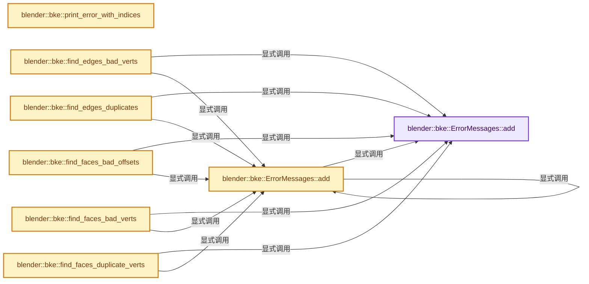

# 实现依赖专题：source/blender/blenkernel/intern/mesh_validate.cc

[实现依赖导航](../../README.md) · [符号索引](../../../00-课程指南/02-源码与提交索引/符号依赖与实现索引.md)

本专题从正文实际调用进入，集中保存共享实现。函数有稳定锚点，可从调用处直接跳到对应完整函数；递归与互相调用通过回链组织。

## 本文件的实现关系




## 完整成员与函数实现

<a id="f-9574fc69499c25ad"></a>

### `blender::bke::ErrorMessages::add`

实现位置：[source/blender/blenkernel/intern/mesh_validate.cc](../../../../../../../source/blender/blenkernel/intern/mesh_validate.cc) · L53—L60。

接口参数：

- `std::string message`

**教学注释版**

<!-- annotated:4ee095e48fb2c3 -->

```cpp
  void add(std::string message)
  {
    if (!verbose_) {
      return;
    }
    std::lock_guard lock(mutex_);
    // [讲解] std::move：把表达式转换成可供移动重载选择的值类别；不保证真的移动，不结束源对象寿命，对const值可能选择复制。
    this->messages.append(std::move(message));
  }
```

<details>
<summary>核对原始源码：source/blender/blenkernel/intern/mesh_validate.cc · L53—L60</summary>

<!-- original:4ee095e48fb2c3:source/blender/blenkernel/intern/mesh_validate.cc:53:60 -->

```cpp
  void add(std::string message)
  {
    if (!verbose_) {
      return;
    }
    std::lock_guard lock(mutex_);
    this->messages.append(std::move(message));
  }
```

</details>

**继续追踪实现**

- `this->messages.append` → [调用协议](../../../00-课程指南/01-路线与规范/模板宏与动态分派协议.md)：接收对象类型依赖auto、返回值或模板实例；不按同名猜测目标。调用位置L59。
- `std::move` → [外部契约](https://eel.is/c++draft/utility.forward)：把表达式转换成可供移动重载选择的值类别；不保证真的移动，不结束源对象寿命，对const值可能选择复制。

<a id="f-6f8c76ffe6525437"></a>

### `blender::bke::ErrorMessages::add`

实现位置：[source/blender/blenkernel/intern/mesh_validate.cc](../../../../../../../source/blender/blenkernel/intern/mesh_validate.cc) · L62—L68。

接口参数：

- `fmt::format_string<T...> fmt`

**教学注释版**

<!-- annotated:99381720ba801b -->

```cpp
  template<typename... T> void add(fmt::format_string<T...> fmt, T &&...args)
  {
    if (!verbose_) {
      return;
    }
    // [讲解] std::forward<T>：在转发引用中恢复调用者传入的值类别；依赖推导类型，不能与无条件move互换。
    this->add(fmt::format(fmt, std::forward<T>(args)...));
  }
```

<details>
<summary>核对原始源码：source/blender/blenkernel/intern/mesh_validate.cc · L62—L68</summary>

<!-- original:99381720ba801b:source/blender/blenkernel/intern/mesh_validate.cc:62:68 -->

```cpp
  template<typename... T> void add(fmt::format_string<T...> fmt, T &&...args)
  {
    if (!verbose_) {
      return;
    }
    this->add(fmt::format(fmt, std::forward<T>(args)...));
  }
```

</details>

**继续追踪实现**

- `this->add` → [blender::bke::ErrorMessages::add · L53](mesh_validate.cc.md#f-9574fc69499c25ad)；[blender::bke::ErrorMessages::add · L62](mesh_validate.cc.md#f-6f8c76ffe6525437)。同名重载需按实参类型选择。
- `fmt::format` → [外部契约](https://fmt.dev/latest/api/)：按fmt接口的格式字符串与参数类型契约使用，格式化不改变被格式化对象的拥有关系。
- `std::forward<T>` → [外部契约](https://eel.is/c++draft/utility.forward)：在转发引用中恢复调用者传入的值类别；依赖推导类型，不能与无条件move互换。

<a id="f-37d624e6bc872a76"></a>

### `blender::bke::print_error_with_indices`

实现位置：[source/blender/blenkernel/intern/mesh_validate.cc](../../../../../../../source/blender/blenkernel/intern/mesh_validate.cc) · L71—L87。

接口参数：

- `const IndexMask &mask`
- `fmt::format_string<T...> fmt`

**教学注释版**

<!-- annotated:56bc92cb1fc412 -->

```cpp
template<typename... T>
static void print_error_with_indices(const IndexMask &mask,
                                     fmt::format_string<T...> fmt,
                                     T &&...args)
{
  fmt::memory_buffer buffer;
  fmt::appender dst(buffer);
  // [讲解] std::forward<T>：在转发引用中恢复调用者传入的值类别；依赖推导类型，不能与无条件move互换。
  fmt::format_to(dst, fmt, std::forward<T>(args)...);
  fmt::format_to(dst, " at indices: ");
  mask.foreach_index([&](const int index, const int pos) {
    if (pos != 0) {
      fmt::format_to(dst, ", ");
    }
    fmt::format_to(dst, "{}", index);
  });
  CLOG_ERROR(&LOG, "%s", fmt::to_string(buffer).c_str());
}
```

<details>
<summary>核对原始源码：source/blender/blenkernel/intern/mesh_validate.cc · L71—L87</summary>

<!-- original:56bc92cb1fc412:source/blender/blenkernel/intern/mesh_validate.cc:71:87 -->

```cpp
template<typename... T>
static void print_error_with_indices(const IndexMask &mask,
                                     fmt::format_string<T...> fmt,
                                     T &&...args)
{
  fmt::memory_buffer buffer;
  fmt::appender dst(buffer);
  fmt::format_to(dst, fmt, std::forward<T>(args)...);
  fmt::format_to(dst, " at indices: ");
  mask.foreach_index([&](const int index, const int pos) {
    if (pos != 0) {
      fmt::format_to(dst, ", ");
    }
    fmt::format_to(dst, "{}", index);
  });
  CLOG_ERROR(&LOG, "%s", fmt::to_string(buffer).c_str());
}
```

</details>

**继续追踪实现**

- `fmt::format_to` → [外部契约](https://fmt.dev/latest/api/)：按fmt接口的格式字符串与参数类型契约使用，格式化不改变被格式化对象的拥有关系。
- `std::forward<T>` → [外部契约](https://eel.is/c++draft/utility.forward)：在转发引用中恢复调用者传入的值类别；依赖推导类型，不能与无条件move互换。
- `mask.foreach_index` → [blender::index_mask::IndexMask::foreach_index · L855](../../../04-虚拟数组与索引选择/09-分段存储与遍历.md#f-cd6cd317e2e2812c)。
- `CLOG_ERROR` → [CLOG_ERROR · L188](../../07-Intern运行时与平台/clog/CLG_log.h.md#m-081575cdc8d0)。宏定义由构建条件选择。
- `fmt::to_string(buffer).c_str` → [外部契约](https://fmt.dev/latest/api/)：按fmt接口的格式字符串与参数类型契约使用，格式化不改变被格式化对象的拥有关系。
- `fmt::to_string` → [外部契约](https://fmt.dev/latest/api/)：按fmt接口的格式字符串与参数类型契约使用，格式化不改变被格式化对象的拥有关系。

<a id="f-5d3db87abaa59e00"></a>

### `blender::bke::find_edges_bad_verts`

实现位置：[source/blender/blenkernel/intern/mesh_validate.cc](../../../../../../../source/blender/blenkernel/intern/mesh_validate.cc) · L89—L109。

接口参数：

- `const Mesh &mesh`
- `IndexMaskMemory &memory`
- `const bool verbose`

**教学注释版**

<!-- annotated:88c375b02b85b8 -->

```cpp
static IndexMask find_edges_bad_verts(const Mesh &mesh,
                                      IndexMaskMemory &memory,
                                      const bool verbose)
{
  const IndexRange verts_range(mesh.verts_num);
  const Span<int2> edges = mesh.edges();

  ErrorMessages errors(verbose);
  // [讲解] edges.index_range：查询视图长度或生成对应有效索引区间。
  return IndexMask::from_predicate(edges.index_range(), memory, [&](const int edge_i) {
    const int2 edge = edges[edge_i];
    if (edge[0] == edge[1]) {
      errors.add("Edge {} has equal vertex indices {}", edge_i, edge[0]);
      return true;
    }
    if (!verts_range.contains(edge[0]) || !verts_range.contains(edge[1])) {
      errors.add("Edge {} has out of range vertex ({}, {})", edge_i, edge[0], edge[1]);
      return true;
    }
    return false;
  });
}
```

<details>
<summary>核对原始源码：source/blender/blenkernel/intern/mesh_validate.cc · L89—L109</summary>

<!-- original:88c375b02b85b8:source/blender/blenkernel/intern/mesh_validate.cc:89:109 -->

```cpp
static IndexMask find_edges_bad_verts(const Mesh &mesh,
                                      IndexMaskMemory &memory,
                                      const bool verbose)
{
  const IndexRange verts_range(mesh.verts_num);
  const Span<int2> edges = mesh.edges();

  ErrorMessages errors(verbose);
  return IndexMask::from_predicate(edges.index_range(), memory, [&](const int edge_i) {
    const int2 edge = edges[edge_i];
    if (edge[0] == edge[1]) {
      errors.add("Edge {} has equal vertex indices {}", edge_i, edge[0]);
      return true;
    }
    if (!verts_range.contains(edge[0]) || !verts_range.contains(edge[1])) {
      errors.add("Edge {} has out of range vertex ({}, {})", edge_i, edge[0], edge[1]);
      return true;
    }
    return false;
  });
}
```

</details>

**结果出口**

- `return IndexMask::from_predicate(edges.index_range(), memory, [&](const int edge_i) {`
- `return true;`
- `return false;`

**继续追踪实现**

- `mesh.edges` → [Mesh::edges · L1205](../../../05-几何存储与拓扑映射/03-MPoly迁移与兼容.md#f-7232f6756b674d12)。
- `IndexMask::from_predicate` → [blender::index_mask::IndexMask::from_predicate · L1073](../../../04-虚拟数组与索引选择/12-重构历史与基准练习.md#f-3864daa059098df8)。
- `edges.index_range` → [blender::Span::index_range · L405](../../../01-基础容器与现代CPP/05-Span只读连续视图.md#f-caaa9b06e13e53e0)。
- `errors.add` → [blender::bke::ErrorMessages::add · L53](mesh_validate.cc.md#f-9574fc69499c25ad)；[blender::bke::ErrorMessages::add · L62](mesh_validate.cc.md#f-6f8c76ffe6525437)。同名重载需按实参类型选择。
- `verts_range.contains` → [blender::IndexRange::contains · L251](../../../01-基础容器与现代CPP/04-IndexRange连续整数区间.md#f-1a01eaa28eaecd5c)；[blender::IndexRange::contains · L259](../../../01-基础容器与现代CPP/04-IndexRange连续整数区间.md#f-8eb195a52f17a51f)。同名重载需按实参类型选择。

<a id="f-5d648e86c6abdd62"></a>

### `blender::bke::find_edges_duplicates`

实现位置：[source/blender/blenkernel/intern/mesh_validate.cc](../../../../../../../source/blender/blenkernel/intern/mesh_validate.cc) · L119—L138。

接口参数：

- `const Mesh &mesh`
- `const IndexMask &mask`
- `IndexMaskMemory &memory`
- `const bool verbose`
- `EdgeMap &unique_edges`

**教学注释版**

<!-- annotated:8b7ca069ec3499 -->

```cpp
static IndexMask find_edges_duplicates(const Mesh &mesh,
                                       const IndexMask &mask,
                                       IndexMaskMemory &memory,
                                       const bool verbose,
                                       EdgeMap &unique_edges)
{
  const Span<int2> edges = mesh.edges();
  // [讲解] edges.size：查询视图长度或生成对应有效索引区间。
  BitVector<> duplicate_edges(edges.size());
  ErrorMessages errors(verbose);
  mask.foreach_index([&](const int edge_i) {
    const int2 edge = edges[edge_i];
    if (!unique_edges.add(edge)) {
      errors.add(fmt::runtime("Edge {} is a duplicate of {}"),
                 edge_i,
                 int(mask[unique_edges.index_of(edge)]));
      duplicate_edges[edge_i].set();
    }
  });
  return IndexMask::from_bits(mask, duplicate_edges, memory);
}
```

<details>
<summary>核对原始源码：source/blender/blenkernel/intern/mesh_validate.cc · L119—L138</summary>

<!-- original:8b7ca069ec3499:source/blender/blenkernel/intern/mesh_validate.cc:119:138 -->

```cpp
static IndexMask find_edges_duplicates(const Mesh &mesh,
                                       const IndexMask &mask,
                                       IndexMaskMemory &memory,
                                       const bool verbose,
                                       EdgeMap &unique_edges)
{
  const Span<int2> edges = mesh.edges();
  BitVector<> duplicate_edges(edges.size());
  ErrorMessages errors(verbose);
  mask.foreach_index([&](const int edge_i) {
    const int2 edge = edges[edge_i];
    if (!unique_edges.add(edge)) {
      errors.add(fmt::runtime("Edge {} is a duplicate of {}"),
                 edge_i,
                 int(mask[unique_edges.index_of(edge)]));
      duplicate_edges[edge_i].set();
    }
  });
  return IndexMask::from_bits(mask, duplicate_edges, memory);
}
```

</details>

**结果出口**

- `return IndexMask::from_bits(mask, duplicate_edges, memory);`

**继续追踪实现**

- `mesh.edges` → [Mesh::edges · L1205](../../../05-几何存储与拓扑映射/03-MPoly迁移与兼容.md#f-7232f6756b674d12)。
- `edges.size` → [blender::Span::size · L256](../../../01-基础容器与现代CPP/05-Span只读连续视图.md#f-5f80fa006089c998)。
- `mask.foreach_index` → [blender::index_mask::IndexMask::foreach_index · L855](../../../04-虚拟数组与索引选择/09-分段存储与遍历.md#f-cd6cd317e2e2812c)。
- `unique_edges.add` → [blender::bke::ErrorMessages::add · L53](mesh_validate.cc.md#f-9574fc69499c25ad)；[blender::bke::ErrorMessages::add · L62](mesh_validate.cc.md#f-6f8c76ffe6525437)。同名重载需按实参类型选择。
- `errors.add` → [blender::bke::ErrorMessages::add · L53](mesh_validate.cc.md#f-9574fc69499c25ad)；[blender::bke::ErrorMessages::add · L62](mesh_validate.cc.md#f-6f8c76ffe6525437)。同名重载需按实参类型选择。
- `fmt::runtime` → [外部契约](https://fmt.dev/latest/api/)：按fmt接口的格式字符串与参数类型契约使用，格式化不改变被格式化对象的拥有关系。
- `unique_edges.index_of` → [blender::bke::AttributeStorage::index_of · L213](attribute_storage.cc.md#f-fa3e64941d37bbe2)。
- `duplicate_edges[edge_i].set` → [调用协议](../../../00-课程指南/01-路线与规范/模板宏与动态分派协议.md)：接收对象类型依赖auto、返回值或模板实例；不按同名猜测目标。调用位置L134。
- `IndexMask::from_bits` → [blender::index_mask::IndexMask::from_bits · L452](../../../04-虚拟数组与索引选择/10-IndexMask构建与并行.md#f-793d0ba2aa866e11)；[blender::index_mask::IndexMask::from_bits · L485](../../../04-虚拟数组与索引选择/10-IndexMask构建与并行.md#f-c64648e6798fe52e)。同名重载需按实参类型选择。

<a id="f-1569ed5db4a8a59f"></a>

### `blender::bke::find_faces_bad_offsets`

实现位置：[source/blender/blenkernel/intern/mesh_validate.cc](../../../../../../../source/blender/blenkernel/intern/mesh_validate.cc) · L140—L184。

接口参数：

- `const Mesh &mesh`
- `IndexMaskMemory &memory`
- `const bool verbose`

**教学注释版**

<!-- annotated:3c4b365a93fc4a -->

```cpp
static IndexMask find_faces_bad_offsets(const Mesh &mesh,
                                        IndexMaskMemory &memory,
                                        const bool verbose)
{
  if (mesh.faces_num == 0) {
    return {};
  }
  const Span<int> face_offsets = mesh.face_offsets();
  ErrorMessages errors(verbose);
  // [讲解] face_offsets.last：按视图边界访问元素。
  if (face_offsets.last() != mesh.corners_num) {
    errors.add("Face offsets last value is {}, expected {}. Considering all faces invalid",
               face_offsets.last(),
               mesh.corners_num);
    return IndexMask(mesh.faces_num);
  }
  // [讲解] face_offsets.first：按视图边界访问元素。
  if (face_offsets.first() != 0) {
    errors.add("Faces offsets do not start at 0. Considering all faces invalid");
    return IndexMask(mesh.faces_num);
  }
  std::atomic<bool> non_monotonic = false;
  const IndexMask mask = IndexMask::from_batch_predicate(
      IndexRange(mesh.faces_num),
      memory,
      [&](const IndexMaskSegment universe_segment, IndexRangesBuilder<int16_t> &builder) {
        for (const int16_t i : universe_segment.base_span()) {
          const int face_i = int(universe_segment.offset() + i);
          const int face_start = face_offsets[face_i];
          const int face_end = face_offsets[face_i + 1];
          if (face_end < face_start) {
            non_monotonic.store(true, std::memory_order_relaxed);
            continue;
          }
          if (face_end - face_start < 3) {
            errors.add("Face {} has invalid size {}", face_i, face_end - face_start);
            builder.add(i);
          }
        }
        return universe_segment.offset();
      });
  if (non_monotonic.load(std::memory_order_relaxed)) {
    errors.add("Face offsets must be monotonically increasing. Considering all faces invalid");
    return IndexMask(mesh.faces_num);
  }
  return mask;
}
```

<details>
<summary>核对原始源码：source/blender/blenkernel/intern/mesh_validate.cc · L140—L184</summary>

<!-- original:3c4b365a93fc4a:source/blender/blenkernel/intern/mesh_validate.cc:140:184 -->

```cpp
static IndexMask find_faces_bad_offsets(const Mesh &mesh,
                                        IndexMaskMemory &memory,
                                        const bool verbose)
{
  if (mesh.faces_num == 0) {
    return {};
  }
  const Span<int> face_offsets = mesh.face_offsets();
  ErrorMessages errors(verbose);
  if (face_offsets.last() != mesh.corners_num) {
    errors.add("Face offsets last value is {}, expected {}. Considering all faces invalid",
               face_offsets.last(),
               mesh.corners_num);
    return IndexMask(mesh.faces_num);
  }
  if (face_offsets.first() != 0) {
    errors.add("Faces offsets do not start at 0. Considering all faces invalid");
    return IndexMask(mesh.faces_num);
  }
  std::atomic<bool> non_monotonic = false;
  const IndexMask mask = IndexMask::from_batch_predicate(
      IndexRange(mesh.faces_num),
      memory,
      [&](const IndexMaskSegment universe_segment, IndexRangesBuilder<int16_t> &builder) {
        for (const int16_t i : universe_segment.base_span()) {
          const int face_i = int(universe_segment.offset() + i);
          const int face_start = face_offsets[face_i];
          const int face_end = face_offsets[face_i + 1];
          if (face_end < face_start) {
            non_monotonic.store(true, std::memory_order_relaxed);
            continue;
          }
          if (face_end - face_start < 3) {
            errors.add("Face {} has invalid size {}", face_i, face_end - face_start);
            builder.add(i);
          }
        }
        return universe_segment.offset();
      });
  if (non_monotonic.load(std::memory_order_relaxed)) {
    errors.add("Face offsets must be monotonically increasing. Considering all faces invalid");
    return IndexMask(mesh.faces_num);
  }
  return mask;
}
```

</details>

**结果出口**

- `return {};`
- `return IndexMask(mesh.faces_num);`
- `return universe_segment.offset();`
- `return mask;`

**继续追踪实现**

- `mesh.face_offsets` → [Mesh::face_offsets · L1221](../../../05-几何存储与拓扑映射/03-MPoly迁移与兼容.md#f-49a5e24b1b5e8989)。
- `face_offsets.last` → [blender::Span::last · L329](../../../01-基础容器与现代CPP/05-Span只读连续视图.md#f-a92146c285596891)。
- `errors.add` → [blender::bke::ErrorMessages::add · L53](mesh_validate.cc.md#f-9574fc69499c25ad)；[blender::bke::ErrorMessages::add · L62](mesh_validate.cc.md#f-6f8c76ffe6525437)。同名重载需按实参类型选择。
- `IndexMask` → [blender::index_mask::IndexMask::IndexMask · L704](../../../04-虚拟数组与索引选择/09-分段存储与遍历.md#f-8c95440e4c5fec78)；[blender::index_mask::IndexMask::IndexMask · L709](../../../04-虚拟数组与索引选择/09-分段存储与遍历.md#f-fdd9dc18868bc0cd)；[blender::index_mask::IndexMask::IndexMask · L722](../../../04-虚拟数组与索引选择/09-分段存储与遍历.md#f-4b32f3ba3de66d05)。同名重载需按实参类型选择。
- `face_offsets.first` → [blender::Span::first · L319](../../../01-基础容器与现代CPP/05-Span只读连续视图.md#f-d8c9bcc3e9757248)。
- `IndexMask::from_batch_predicate` → [blender::index_mask::IndexMask::from_batch_predicate · L556](../../../04-虚拟数组与索引选择/10-IndexMask构建与并行.md#f-b146123222440730)。
- `IndexRange` → [blender::IndexRange](../../01-BLI基础库/BLI_index_range.hh.md#t-caa3466d6776)；[blender::gpu::shader::parser::IndexRange](../../08-其他Blender模块/gpu/shader_tool/utils.hh.md#t-82d2bd4ea71c)；[blender::IndexRange](../../08-其他Blender模块/makesdna/DNA_node_types.h.md#t-0448cc889d39)。
- `universe_segment.base_span` → [blender::OffsetSpan::base_span · L33](../../01-BLI基础库/BLI_offset_span.hh.md#f-e962d3f4adef8faf)。
- `universe_segment.offset` → [调用协议](../../../00-课程指南/01-路线与规范/模板宏与动态分派协议.md)：由接收对象具体类型或运行时策略提供实现。调用位置L165。
- `non_monotonic.store` → [外部契约](https://eel.is/c++draft/)：这个边界按实际表达式及所属类型核对参数、返回值、寿命与失败行为。这里提供接口入口，不声称已解释该第三方版本的内部实现。
- `builder.add` → [blender::IndexRangesBuilder::add · L47](../../01-BLI基础库/BLI_index_ranges_builder.hh.md#f-592cace702a5a9c3)。
- `non_monotonic.load` → [外部契约](https://eel.is/c++draft/)：这个边界按实际表达式及所属类型核对参数、返回值、寿命与失败行为。这里提供接口入口，不声称已解释该第三方版本的内部实现。

<a id="f-06bc527783b86e62"></a>

### `blender::bke::find_faces_bad_verts`

实现位置：[source/blender/blenkernel/intern/mesh_validate.cc](../../../../../../../source/blender/blenkernel/intern/mesh_validate.cc) · L186—L209。

接口参数：

- `const Mesh &mesh`
- `const IndexMask &mask`
- `IndexMaskMemory &memory`
- `const bool verbose`

**教学注释版**

<!-- annotated:10ec5793b7308b -->

```cpp
static IndexMask find_faces_bad_verts(const Mesh &mesh,
                                      const IndexMask &mask,
                                      IndexMaskMemory &memory,
                                      const bool verbose)
{
  const IndexRange verts_range(mesh.verts_num);
  const OffsetIndices<int> faces(mesh.face_offsets(), offset_indices::NoSortCheck());
  const Span<int> corner_verts = mesh.corner_verts();
  ErrorMessages errors(verbose);
  return IndexMask::from_predicate(
      mask,
      memory,
      [&](const int face_i) {
        const IndexRange face = faces[face_i];
        // [讲解] corner_verts.slice：建立原连续范围的子视图。
        for (const int vert : corner_verts.slice(face)) {
          if (!verts_range.contains(vert)) {
            errors.add("Face {} has invalid vertex {}", face_i, vert);
            return true;
          }
        }
        return false;
      },
      exec_mode::grain_size(512));
}
```

<details>
<summary>核对原始源码：source/blender/blenkernel/intern/mesh_validate.cc · L186—L209</summary>

<!-- original:10ec5793b7308b:source/blender/blenkernel/intern/mesh_validate.cc:186:209 -->

```cpp
static IndexMask find_faces_bad_verts(const Mesh &mesh,
                                      const IndexMask &mask,
                                      IndexMaskMemory &memory,
                                      const bool verbose)
{
  const IndexRange verts_range(mesh.verts_num);
  const OffsetIndices<int> faces(mesh.face_offsets(), offset_indices::NoSortCheck());
  const Span<int> corner_verts = mesh.corner_verts();
  ErrorMessages errors(verbose);
  return IndexMask::from_predicate(
      mask,
      memory,
      [&](const int face_i) {
        const IndexRange face = faces[face_i];
        for (const int vert : corner_verts.slice(face)) {
          if (!verts_range.contains(vert)) {
            errors.add("Face {} has invalid vertex {}", face_i, vert);
            return true;
          }
        }
        return false;
      },
      exec_mode::grain_size(512));
}
```

</details>

**结果出口**

- `return IndexMask::from_predicate(`
- `return true;`
- `return false;`

**继续追踪实现**

- `mesh.face_offsets` → [Mesh::face_offsets · L1221](../../../05-几何存储与拓扑映射/03-MPoly迁移与兼容.md#f-49a5e24b1b5e8989)。
- `offset_indices::NoSortCheck` → [blender::offset_indices::NoSortCheck](../../01-BLI基础库/BLI_offset_indices.hh.md#t-4158d6354ada)。
- `mesh.corner_verts` → [Mesh::corner_verts · L1238](../../../05-几何存储与拓扑映射/03-MPoly迁移与兼容.md#f-a59c61f583b64bc4)。
- `IndexMask::from_predicate` → [blender::index_mask::IndexMask::from_predicate · L1073](../../../04-虚拟数组与索引选择/12-重构历史与基准练习.md#f-3864daa059098df8)。
- `corner_verts.slice` → [blender::Span::slice · L141](../../../01-基础容器与现代CPP/05-Span只读连续视图.md#f-380a0e8fdcbd53cc)；[blender::Span::slice · L149](../../../01-基础容器与现代CPP/05-Span只读连续视图.md#f-9b9c15e78dd54eec)。同名重载需按实参类型选择。
- `verts_range.contains` → [blender::IndexRange::contains · L251](../../../01-基础容器与现代CPP/04-IndexRange连续整数区间.md#f-1a01eaa28eaecd5c)；[blender::IndexRange::contains · L259](../../../01-基础容器与现代CPP/04-IndexRange连续整数区间.md#f-8eb195a52f17a51f)。同名重载需按实参类型选择。
- `errors.add` → [blender::bke::ErrorMessages::add · L53](mesh_validate.cc.md#f-9574fc69499c25ad)；[blender::bke::ErrorMessages::add · L62](mesh_validate.cc.md#f-6f8c76ffe6525437)。同名重载需按实参类型选择。
- `exec_mode::grain_size` → [blender::exec_mode::grain_size · L79](../../01-BLI基础库/BLI_execution_mode.hh.md#f-0b4fc2f9fa6e66e7)。

<a id="f-191e8bec50377d17"></a>

### `blender::bke::find_faces_duplicate_verts`

实现位置：[source/blender/blenkernel/intern/mesh_validate.cc](../../../../../../../source/blender/blenkernel/intern/mesh_validate.cc) · L211—L235。

接口参数：

- `const Mesh &mesh`
- `const IndexMask &mask`
- `IndexMaskMemory &memory`
- `const bool verbose`

**教学注释版**

<!-- annotated:32e324325f7acd -->

```cpp
static IndexMask find_faces_duplicate_verts(const Mesh &mesh,
                                            const IndexMask &mask,
                                            IndexMaskMemory &memory,
                                            const bool verbose)
{
  const IndexRange verts_range(mesh.verts_num);
  const OffsetIndices<int> faces(mesh.face_offsets(), offset_indices::NoSortCheck());
  const Span<int> corner_verts = mesh.corner_verts();
  ErrorMessages errors(verbose);
  return IndexMask::from_predicate(
      mask,
      memory,
      [&](const int face_i) {
        Set<int, 16> set;
        const IndexRange face = faces[face_i];
        // [讲解] corner_verts.slice：建立原连续范围的子视图。
        for (const int vert : corner_verts.slice(face)) {
          // [讲解] set.add：按哈希与相等关系加入键或键值。
          if (!set.add(vert)) {
            errors.add("Face {} has duplicate vertex {}", face_i, vert);
            return true;
          }
        }
        return false;
      },
      exec_mode::grain_size(512));
}
```

<details>
<summary>核对原始源码：source/blender/blenkernel/intern/mesh_validate.cc · L211—L235</summary>

<!-- original:32e324325f7acd:source/blender/blenkernel/intern/mesh_validate.cc:211:235 -->

```cpp
static IndexMask find_faces_duplicate_verts(const Mesh &mesh,
                                            const IndexMask &mask,
                                            IndexMaskMemory &memory,
                                            const bool verbose)
{
  const IndexRange verts_range(mesh.verts_num);
  const OffsetIndices<int> faces(mesh.face_offsets(), offset_indices::NoSortCheck());
  const Span<int> corner_verts = mesh.corner_verts();
  ErrorMessages errors(verbose);
  return IndexMask::from_predicate(
      mask,
      memory,
      [&](const int face_i) {
        Set<int, 16> set;
        const IndexRange face = faces[face_i];
        for (const int vert : corner_verts.slice(face)) {
          if (!set.add(vert)) {
            errors.add("Face {} has duplicate vertex {}", face_i, vert);
            return true;
          }
        }
        return false;
      },
      exec_mode::grain_size(512));
}
```

</details>

**结果出口**

- `return IndexMask::from_predicate(`
- `return true;`
- `return false;`

**继续追踪实现**

- `mesh.face_offsets` → [Mesh::face_offsets · L1221](../../../05-几何存储与拓扑映射/03-MPoly迁移与兼容.md#f-49a5e24b1b5e8989)。
- `offset_indices::NoSortCheck` → [blender::offset_indices::NoSortCheck](../../01-BLI基础库/BLI_offset_indices.hh.md#t-4158d6354ada)。
- `mesh.corner_verts` → [Mesh::corner_verts · L1238](../../../05-几何存储与拓扑映射/03-MPoly迁移与兼容.md#f-a59c61f583b64bc4)。
- `IndexMask::from_predicate` → [blender::index_mask::IndexMask::from_predicate · L1073](../../../04-虚拟数组与索引选择/12-重构历史与基准练习.md#f-3864daa059098df8)。
- `corner_verts.slice` → [blender::Span::slice · L141](../../../01-基础容器与现代CPP/05-Span只读连续视图.md#f-380a0e8fdcbd53cc)；[blender::Span::slice · L149](../../../01-基础容器与现代CPP/05-Span只读连续视图.md#f-9b9c15e78dd54eec)。同名重载需按实参类型选择。
- `set.add` → [blender::Set::add · L248](../../../02-哈希表与关联数据结构/08-Set与集合语义.md#f-c7498809c2327fba)；[blender::Set::add · L252](../../../02-哈希表与关联数据结构/08-Set与集合语义.md#f-e3ac8d1c52c03c2b)。同名重载需按实参类型选择。
- `errors.add` → [blender::bke::ErrorMessages::add · L53](mesh_validate.cc.md#f-9574fc69499c25ad)；[blender::bke::ErrorMessages::add · L62](mesh_validate.cc.md#f-6f8c76ffe6525437)。同名重载需按实参类型选择。
- `exec_mode::grain_size` → [blender::exec_mode::grain_size · L79](../../01-BLI基础库/BLI_execution_mode.hh.md#f-0b4fc2f9fa6e66e7)。

<a id="f-1a5079443d3fb8f4"></a>

### `blender::bke::find_faces_missing_edges`

实现位置：[source/blender/blenkernel/intern/mesh_validate.cc](../../../../../../../source/blender/blenkernel/intern/mesh_validate.cc) · L237—L267。

接口参数：

- `const Mesh &mesh`
- `const IndexMask &mask`
- `const EdgeMap &unique_edges`
- `IndexMaskMemory &memory`
- `const bool verbose`

**教学注释版**

<!-- annotated:786ea03753d1dd -->

```cpp
static IndexMask find_faces_missing_edges(const Mesh &mesh,
                                          const IndexMask &mask,
                                          const EdgeMap &unique_edges,
                                          IndexMaskMemory &memory,
                                          const bool verbose)
{
  const IndexRange edges_range(mesh.edges_num);
  const OffsetIndices<int> faces(mesh.face_offsets(), offset_indices::NoSortCheck());
  const Span<int> corner_verts = mesh.corner_verts();

  ErrorMessages errors(verbose);
  return IndexMask::from_predicate(
      mask,
      memory,
      [&](const int face_i) {
        const IndexRange face = faces[face_i];
        for (const int corner : face) {
          const int corner_next = mesh::face_corner_next(face, corner);
          const OrderedEdge actual_edge(corner_verts[corner], corner_verts[corner_next]);
          if (!unique_edges.contains(actual_edge)) {
            errors.add("Face {} has missing edge ({}, {})",
                       face_i,
                       actual_edge.v_low,
                       actual_edge.v_high);
            return true;
          }
        }
        return false;
      },
      exec_mode::grain_size(1024));
}
```

<details>
<summary>核对原始源码：source/blender/blenkernel/intern/mesh_validate.cc · L237—L267</summary>

<!-- original:786ea03753d1dd:source/blender/blenkernel/intern/mesh_validate.cc:237:267 -->

```cpp
static IndexMask find_faces_missing_edges(const Mesh &mesh,
                                          const IndexMask &mask,
                                          const EdgeMap &unique_edges,
                                          IndexMaskMemory &memory,
                                          const bool verbose)
{
  const IndexRange edges_range(mesh.edges_num);
  const OffsetIndices<int> faces(mesh.face_offsets(), offset_indices::NoSortCheck());
  const Span<int> corner_verts = mesh.corner_verts();

  ErrorMessages errors(verbose);
  return IndexMask::from_predicate(
      mask,
      memory,
      [&](const int face_i) {
        const IndexRange face = faces[face_i];
        for (const int corner : face) {
          const int corner_next = mesh::face_corner_next(face, corner);
          const OrderedEdge actual_edge(corner_verts[corner], corner_verts[corner_next]);
          if (!unique_edges.contains(actual_edge)) {
            errors.add("Face {} has missing edge ({}, {})",
                       face_i,
                       actual_edge.v_low,
                       actual_edge.v_high);
            return true;
          }
        }
        return false;
      },
      exec_mode::grain_size(1024));
}
```

</details>

**结果出口**

- `return IndexMask::from_predicate(`
- `return true;`
- `return false;`

**继续追踪实现**

- `mesh.face_offsets` → [Mesh::face_offsets · L1221](../../../05-几何存储与拓扑映射/03-MPoly迁移与兼容.md#f-49a5e24b1b5e8989)。
- `offset_indices::NoSortCheck` → [blender::offset_indices::NoSortCheck](../../01-BLI基础库/BLI_offset_indices.hh.md#t-4158d6354ada)。
- `mesh.corner_verts` → [Mesh::corner_verts · L1238](../../../05-几何存储与拓扑映射/03-MPoly迁移与兼容.md#f-a59c61f583b64bc4)。
- `IndexMask::from_predicate` → [blender::index_mask::IndexMask::from_predicate · L1073](../../../04-虚拟数组与索引选择/12-重构历史与基准练习.md#f-3864daa059098df8)。
- `mesh::face_corner_next` → [blender::bke::mesh::face_corner_next · L315](../../../05-几何存储与拓扑映射/01-Mesh顶点边面角点.md#f-bf639df87b51fe48)。
- `unique_edges.contains` → [调用协议](../../../00-课程指南/01-路线与规范/模板宏与动态分派协议.md)：由接收对象具体类型或运行时策略提供实现。调用位置L256。
- `errors.add` → [blender::bke::ErrorMessages::add · L53](mesh_validate.cc.md#f-9574fc69499c25ad)；[blender::bke::ErrorMessages::add · L62](mesh_validate.cc.md#f-6f8c76ffe6525437)。同名重载需按实参类型选择。
- `exec_mode::grain_size` → [blender::exec_mode::grain_size · L79](../../01-BLI基础库/BLI_execution_mode.hh.md#f-0b4fc2f9fa6e66e7)。

<a id="f-6fc0b505e8995998"></a>

### `blender::bke::find_faces_bad_edges`

实现位置：[source/blender/blenkernel/intern/mesh_validate.cc](../../../../../../../source/blender/blenkernel/intern/mesh_validate.cc) · L269—L303。

接口参数：

- `const Mesh &mesh`
- `const IndexMask &mask`
- `IndexMaskMemory &memory`
- `const bool verbose`

**教学注释版**

<!-- annotated:058033c1920346 -->

```cpp
static bool find_faces_bad_edges(const Mesh &mesh,
                                 const IndexMask &mask,
                                 IndexMaskMemory &memory,
                                 const bool verbose)
{
  const IndexRange edges_range(mesh.edges_num);
  const Span<int2> edges = mesh.edges();
  const OffsetIndices<int> faces(mesh.face_offsets(), offset_indices::NoSortCheck());
  const Span<int> corner_verts = mesh.corner_verts();
  const Span<int> corner_edges = mesh.corner_edges();

  ErrorMessages errors(verbose);
  const IndexMask bad_faces = IndexMask::from_predicate(
      mask,
      memory,
      [&](const int face_i) {
        const IndexRange face = faces[face_i];
        for (const int corner : face) {
          const int edge_index = corner_edges[corner];
          if (!edges_range.contains(edge_index)) {
            errors.add("Corner {} has out of range edge index {}", corner, edge_index);
            return true;
          }
          const int corner_next = mesh::face_corner_next(face, corner);
          const OrderedEdge actual_edge(corner_verts[corner], corner_verts[corner_next]);
          if (OrderedEdge(edges[edge_index]) != actual_edge) {
            errors.add("Corner {} has incorrect edge index {}", corner, edge_index);
            return true;
          }
        }
        return false;
      },
      exec_mode::grain_size(1024));
  return !bad_faces.is_empty();
}
```

<details>
<summary>核对原始源码：source/blender/blenkernel/intern/mesh_validate.cc · L269—L303</summary>

<!-- original:058033c1920346:source/blender/blenkernel/intern/mesh_validate.cc:269:303 -->

```cpp
static bool find_faces_bad_edges(const Mesh &mesh,
                                 const IndexMask &mask,
                                 IndexMaskMemory &memory,
                                 const bool verbose)
{
  const IndexRange edges_range(mesh.edges_num);
  const Span<int2> edges = mesh.edges();
  const OffsetIndices<int> faces(mesh.face_offsets(), offset_indices::NoSortCheck());
  const Span<int> corner_verts = mesh.corner_verts();
  const Span<int> corner_edges = mesh.corner_edges();

  ErrorMessages errors(verbose);
  const IndexMask bad_faces = IndexMask::from_predicate(
      mask,
      memory,
      [&](const int face_i) {
        const IndexRange face = faces[face_i];
        for (const int corner : face) {
          const int edge_index = corner_edges[corner];
          if (!edges_range.contains(edge_index)) {
            errors.add("Corner {} has out of range edge index {}", corner, edge_index);
            return true;
          }
          const int corner_next = mesh::face_corner_next(face, corner);
          const OrderedEdge actual_edge(corner_verts[corner], corner_verts[corner_next]);
          if (OrderedEdge(edges[edge_index]) != actual_edge) {
            errors.add("Corner {} has incorrect edge index {}", corner, edge_index);
            return true;
          }
        }
        return false;
      },
      exec_mode::grain_size(1024));
  return !bad_faces.is_empty();
}
```

</details>

**结果出口**

- `return true;`
- `return false;`
- `return !bad_faces.is_empty();`

**继续追踪实现**

- `mesh.edges` → [Mesh::edges · L1205](../../../05-几何存储与拓扑映射/03-MPoly迁移与兼容.md#f-7232f6756b674d12)。
- `mesh.face_offsets` → [Mesh::face_offsets · L1221](../../../05-几何存储与拓扑映射/03-MPoly迁移与兼容.md#f-49a5e24b1b5e8989)。
- `offset_indices::NoSortCheck` → [blender::offset_indices::NoSortCheck](../../01-BLI基础库/BLI_offset_indices.hh.md#t-4158d6354ada)。
- `mesh.corner_verts` → [Mesh::corner_verts · L1238](../../../05-几何存储与拓扑映射/03-MPoly迁移与兼容.md#f-a59c61f583b64bc4)。
- `mesh.corner_edges` → [Mesh::corner_edges · L1252](../../../05-几何存储与拓扑映射/03-MPoly迁移与兼容.md#f-687b790868e7f257)。
- `IndexMask::from_predicate` → [blender::index_mask::IndexMask::from_predicate · L1073](../../../04-虚拟数组与索引选择/12-重构历史与基准练习.md#f-3864daa059098df8)。
- `edges_range.contains` → [blender::IndexRange::contains · L251](../../../01-基础容器与现代CPP/04-IndexRange连续整数区间.md#f-1a01eaa28eaecd5c)；[blender::IndexRange::contains · L259](../../../01-基础容器与现代CPP/04-IndexRange连续整数区间.md#f-8eb195a52f17a51f)。同名重载需按实参类型选择。
- `errors.add` → [blender::bke::ErrorMessages::add · L53](mesh_validate.cc.md#f-9574fc69499c25ad)；[blender::bke::ErrorMessages::add · L62](mesh_validate.cc.md#f-6f8c76ffe6525437)。同名重载需按实参类型选择。
- `mesh::face_corner_next` → [blender::bke::mesh::face_corner_next · L315](../../../05-几何存储与拓扑映射/01-Mesh顶点边面角点.md#f-bf639df87b51fe48)。
- `OrderedEdge` → [blender::OrderedEdge::OrderedEdge · L23](../../01-BLI基础库/BLI_ordered_edge.hh.md#f-a3124963ff5ebc95)；[blender::OrderedEdge::OrderedEdge · L34](../../01-BLI基础库/BLI_ordered_edge.hh.md#f-d84344bfffb12a82)；[blender::OrderedEdge::OrderedEdge · L35](../../01-BLI基础库/BLI_ordered_edge.hh.md#f-03a4b58de7ddef2c)。同名重载需按实参类型选择。
- `exec_mode::grain_size` → [blender::exec_mode::grain_size · L79](../../01-BLI基础库/BLI_execution_mode.hh.md#f-0b4fc2f9fa6e66e7)。
- `bad_faces.is_empty` → [blender::index_mask::IndexMask::is_empty · L748](../../../04-虚拟数组与索引选择/09-分段存储与遍历.md#f-190ac996386064f4)。

<a id="f-19c2533a0bfdad5f"></a>

### `blender::bke::find_duplicate_faces`

实现位置：[source/blender/blenkernel/intern/mesh_validate.cc](../../../../../../../source/blender/blenkernel/intern/mesh_validate.cc) · L305—L393。

接口参数：

- `const OffsetIndices<int> faces`
- `const Span<int> corner_verts`
- `const IndexMask &mask`
- `IndexMaskMemory &memory`
- `MutableSpan<int> r_originals`

**教学注释版**

<!-- annotated:64ee0ead0f3e7a -->

```cpp
IndexMask find_duplicate_faces(const OffsetIndices<int> faces,
                               const Span<int> corner_verts,
                               const IndexMask &mask,
                               IndexMaskMemory &memory,
                               MutableSpan<int> r_originals)
{
  // [讲解] corner_verts.size：查询视图长度或生成对应有效索引区间。
  Array<int> ordered_corner_verts(corner_verts.size());
  mask.foreach_index(
      [&](const int face_i) {
        const IndexRange face = faces[face_i];
        // [讲解] ordered_corner_verts.as_mutable_span：提供数组的借用访问入口。
        MutableSpan<int> ordered_face_verts = ordered_corner_verts.as_mutable_span().slice(face);
        /* Order by the smallest index, then the smallest adjacent index this ensures:
         * - Faces are only considered duplicates when they share vertices & edges.
         * - Faces winding in opposite directions are considered duplicates.
         * See: #150842. */
        // [讲解] corner_verts.slice：建立原连续范围的子视图。
        Span<int> face_verts = corner_verts.slice(face);
        const int face_verts_num = face_verts.size();
        int i_min = 0;
        for (int i = 1; i < face_verts_num; i += 1) {
          if (face_verts[i] < face_verts[i_min]) {
            i_min = i;
          }
        }
        /* Allow modulo after subtraction within the `face_verts_num` range. */
        const int i_min_for_modulo = i_min + face_verts_num;
        const int i_min_prev = (i_min_for_modulo - 1) % face_verts_num;
        const int i_min_next = (i_min_for_modulo + 1) % face_verts_num;
        const int sign = face_verts[i_min_next] < face_verts[i_min_prev] ? 1 : -1;
        for (int i = 0; i < face_verts_num; i += 1) {
          ordered_face_verts[i] = face_verts[(i_min_for_modulo + (i * sign)) % face_verts_num];
        }
      },
      exec_mode::grain_size(1024));

  /* Group faces by their first vertex in the order established above. */
  Array<int> first_verts(mask.size());
  mask.foreach_index(
      [&](const int face_i, const int pos) {
        first_verts[pos] = ordered_corner_verts[faces[face_i].first()];
      },
      exec_mode::grain_size(4096));
  /* Compress indices of vertices to avoid empty groups for vertices not used by masked faces. */
  Array<int> group_indices(mask.size());
  const int groups_num = array_utils::group_ids_to_indices(
      // [讲解] first_verts.index_range：查询固定有效长度及其索引范围。
      first_verts, first_verts.index_range(), group_indices);
  Array<int> offset_data;
  Array<int> index_data;
  const OffsetIndices faces_by_first_vert =
      offset_indices::build_groups_from_indices(
          group_indices, groups_num, offset_data, index_data, mask)
          .offsets;

  Array<bool> duplicate_faces(faces.size(), false);
  threading::parallel_for(faces_by_first_vert.index_range(), 1024, [&](const IndexRange range) {
    for (const int group_index : range) {
      MutableSpan<int> group = index_data.as_mutable_span().slice(
          faces_by_first_vert[group_index]);
      if (group.size() < 2) {
        continue;
      }
      /* After sorting by the ordered vertices, duplicates are contiguous and the first
       * of each group of duplicates has the lowest index. */
      const auto face_verts = [&](const int face_i) {
        // [讲解] ordered_corner_verts.as_span：提供数组的借用访问入口。
        return ordered_corner_verts.as_span().slice(faces[face_i]);
      };
      std::ranges::sort(group, [&](const int a, const int b) {
        const Span<int> verts_a = face_verts(a);
        const Span<int> verts_b = face_verts(b);
        if (verts_a == verts_b) {
          return a < b;
        }
        return std::ranges::lexicographical_compare(verts_a, verts_b);
      });
      int original = group[0];
      // [讲解] group.drop_front：从两端裁去或选取一定数量元素形成新视图。
      for (const int face_i : group.drop_front(1)) {
        if (face_verts(face_i) != face_verts(original)) {
          original = face_i;
          continue;
        }
        // [讲解] r_originals.is_empty：查询视图长度或生成对应有效索引区间。
        if (!r_originals.is_empty()) {
          r_originals[face_i] = original;
        }
        duplicate_faces[face_i] = true;
      }
    }
  });

  return IndexMask::from_bools(mask, duplicate_faces, memory);
}
```

<details>
<summary>核对原始源码：source/blender/blenkernel/intern/mesh_validate.cc · L305—L393</summary>

<!-- original:64ee0ead0f3e7a:source/blender/blenkernel/intern/mesh_validate.cc:305:393 -->

```cpp
IndexMask find_duplicate_faces(const OffsetIndices<int> faces,
                               const Span<int> corner_verts,
                               const IndexMask &mask,
                               IndexMaskMemory &memory,
                               MutableSpan<int> r_originals)
{
  Array<int> ordered_corner_verts(corner_verts.size());
  mask.foreach_index(
      [&](const int face_i) {
        const IndexRange face = faces[face_i];
        MutableSpan<int> ordered_face_verts = ordered_corner_verts.as_mutable_span().slice(face);
        /* Order by the smallest index, then the smallest adjacent index this ensures:
         * - Faces are only considered duplicates when they share vertices & edges.
         * - Faces winding in opposite directions are considered duplicates.
         * See: #150842. */
        Span<int> face_verts = corner_verts.slice(face);
        const int face_verts_num = face_verts.size();
        int i_min = 0;
        for (int i = 1; i < face_verts_num; i += 1) {
          if (face_verts[i] < face_verts[i_min]) {
            i_min = i;
          }
        }
        /* Allow modulo after subtraction within the `face_verts_num` range. */
        const int i_min_for_modulo = i_min + face_verts_num;
        const int i_min_prev = (i_min_for_modulo - 1) % face_verts_num;
        const int i_min_next = (i_min_for_modulo + 1) % face_verts_num;
        const int sign = face_verts[i_min_next] < face_verts[i_min_prev] ? 1 : -1;
        for (int i = 0; i < face_verts_num; i += 1) {
          ordered_face_verts[i] = face_verts[(i_min_for_modulo + (i * sign)) % face_verts_num];
        }
      },
      exec_mode::grain_size(1024));

  /* Group faces by their first vertex in the order established above. */
  Array<int> first_verts(mask.size());
  mask.foreach_index(
      [&](const int face_i, const int pos) {
        first_verts[pos] = ordered_corner_verts[faces[face_i].first()];
      },
      exec_mode::grain_size(4096));
  /* Compress indices of vertices to avoid empty groups for vertices not used by masked faces. */
  Array<int> group_indices(mask.size());
  const int groups_num = array_utils::group_ids_to_indices(
      first_verts, first_verts.index_range(), group_indices);
  Array<int> offset_data;
  Array<int> index_data;
  const OffsetIndices faces_by_first_vert =
      offset_indices::build_groups_from_indices(
          group_indices, groups_num, offset_data, index_data, mask)
          .offsets;

  Array<bool> duplicate_faces(faces.size(), false);
  threading::parallel_for(faces_by_first_vert.index_range(), 1024, [&](const IndexRange range) {
    for (const int group_index : range) {
      MutableSpan<int> group = index_data.as_mutable_span().slice(
          faces_by_first_vert[group_index]);
      if (group.size() < 2) {
        continue;
      }
      /* After sorting by the ordered vertices, duplicates are contiguous and the first
       * of each group of duplicates has the lowest index. */
      const auto face_verts = [&](const int face_i) {
        return ordered_corner_verts.as_span().slice(faces[face_i]);
      };
      std::ranges::sort(group, [&](const int a, const int b) {
        const Span<int> verts_a = face_verts(a);
        const Span<int> verts_b = face_verts(b);
        if (verts_a == verts_b) {
          return a < b;
        }
        return std::ranges::lexicographical_compare(verts_a, verts_b);
      });
      int original = group[0];
      for (const int face_i : group.drop_front(1)) {
        if (face_verts(face_i) != face_verts(original)) {
          original = face_i;
          continue;
        }
        if (!r_originals.is_empty()) {
          r_originals[face_i] = original;
        }
        duplicate_faces[face_i] = true;
      }
    }
  });

  return IndexMask::from_bools(mask, duplicate_faces, memory);
}
```

</details>

**沿实际写入检查状态**

- `i_min = i;`
- `ordered_face_verts[i] = face_verts[(i_min_for_modulo + (i * sign)) % face_verts_num];`
- `first_verts[pos] = ordered_corner_verts[faces[face_i].first()];`
- `original = face_i;`
- `r_originals[face_i] = original;`
- `duplicate_faces[face_i] = true;`

**结果出口**

- `return ordered_corner_verts.as_span().slice(faces[face_i]);`
- `return a < b;`
- `return std::ranges::lexicographical_compare(verts_a, verts_b);`
- `return IndexMask::from_bools(mask, duplicate_faces, memory);`

**继续追踪实现**

- `corner_verts.size` → [blender::Span::size · L256](../../../01-基础容器与现代CPP/05-Span只读连续视图.md#f-5f80fa006089c998)。
- `mask.foreach_index` → [blender::index_mask::IndexMask::foreach_index · L855](../../../04-虚拟数组与索引选择/09-分段存储与遍历.md#f-cd6cd317e2e2812c)。
- `ordered_corner_verts.as_mutable_span().slice` → [调用协议](../../../00-课程指南/01-路线与规范/模板宏与动态分派协议.md)：接收对象类型依赖auto、返回值或模板实例；不按同名猜测目标。调用位置L315。
- `ordered_corner_verts.as_mutable_span` → [blender::Array::as_mutable_span · L259](../../../01-基础容器与现代CPP/08-Array复制移动与销毁.md#f-4e91de9f1337c144)。
- `corner_verts.slice` → [blender::Span::slice · L141](../../../01-基础容器与现代CPP/05-Span只读连续视图.md#f-380a0e8fdcbd53cc)；[blender::Span::slice · L149](../../../01-基础容器与现代CPP/05-Span只读连续视图.md#f-9b9c15e78dd54eec)。同名重载需按实参类型选择。
- `face_verts.size` → [调用协议](../../../00-课程指南/01-路线与规范/模板宏与动态分派协议.md)：接收对象类型依赖auto、返回值或模板实例；不按同名猜测目标。调用位置L321。
- `exec_mode::grain_size` → [blender::exec_mode::grain_size · L79](../../01-BLI基础库/BLI_execution_mode.hh.md#f-0b4fc2f9fa6e66e7)。
- `mask.size` → [blender::index_mask::IndexMask::size · L743](../../../04-虚拟数组与索引选择/09-分段存储与遍历.md#f-0163b32abc9a0d9c)。
- `faces[face_i].first` → [调用协议](../../../00-课程指南/01-路线与规范/模板宏与动态分派协议.md)：接收对象类型依赖auto、返回值或模板实例；不按同名猜测目标。调用位置L343。
- `array_utils::group_ids_to_indices` → [blender::array_utils::group_ids_to_indices · L236](../../01-BLI基础库/intern/array_utils.cc.md#f-b6d528bdee588f38)。
- `first_verts.index_range` → [blender::Array::index_range · L371](../../../01-基础容器与现代CPP/08-Array复制移动与销毁.md#f-50a09e14742887a0)。
- `offset_indices::build_groups_from_indices` → [blender::offset_indices::build_groups_from_indices · L418](../../../05-几何存储与拓扑映射/05-邻接关系与前缀和.md#f-4c5bda776ec6ec9d)；[blender::offset_indices::build_groups_from_indices · L430](../../../05-几何存储与拓扑映射/05-邻接关系与前缀和.md#f-6b34988c9f051249)。同名重载需按实参类型选择。
- `faces.size` → [blender::offset_indices::OffsetIndices::size · L67](../../../05-几何存储与拓扑映射/02-OffsetIndices完整接口.md#f-e238abc62ed42abd)。
- `threading::parallel_for` → [blender::threading::parallel_for · L68](../../../11-Depsgraph与并行任务系统/07-任务池与TBB接入.md#f-838294754c24426c)。
- `faces_by_first_vert.index_range` → [blender::offset_indices::OffsetIndices::index_range · L77](../../../05-几何存储与拓扑映射/02-OffsetIndices完整接口.md#f-19b5ca1456de007d)。
- `index_data.as_mutable_span().slice` → [调用协议](../../../00-课程指南/01-路线与规范/模板宏与动态分派协议.md)：接收对象类型依赖auto、返回值或模板实例；不按同名猜测目标。调用位置L360。
- `index_data.as_mutable_span` → [blender::Array::as_mutable_span · L259](../../../01-基础容器与现代CPP/08-Array复制移动与销毁.md#f-4e91de9f1337c144)。
- `group.size` → [blender::MutableSpan::size · L499](../../../01-基础容器与现代CPP/06-MutableSpan可写视图.md#f-1de6a66839c304a8)；[blender::gpu::shader::parser::MutableSpan::size · L87](../../08-其他Blender模块/gpu/shader_tool/utils.hh.md#f-5e684af6ee7990e9)。同名重载需按实参类型选择。
- `ordered_corner_verts.as_span().slice` → [调用协议](../../../00-课程指南/01-路线与规范/模板宏与动态分派协议.md)：接收对象类型依赖auto、返回值或模板实例；不按同名猜测目标。调用位置L368。
- `ordered_corner_verts.as_span` → [blender::Array::as_span · L254](../../../01-基础容器与现代CPP/08-Array复制移动与销毁.md#f-05fc77056a242032)。
- `std::ranges::sort` → [外部契约](https://eel.is/c++draft/)：这个边界按实际表达式及所属类型核对参数、返回值、寿命与失败行为。这里提供接口入口，不声称已解释该第三方版本的内部实现。
- `face_verts` → [调用协议](../../../00-课程指南/01-路线与规范/模板宏与动态分派协议.md)：局部可调用对象，须结合其初始化与捕获环境。调用位置L371。
- `std::ranges::lexicographical_compare` → [外部契约](https://eel.is/c++draft/)：这个边界按实际表达式及所属类型核对参数、返回值、寿命与失败行为。这里提供接口入口，不声称已解释该第三方版本的内部实现。
- `group.drop_front` → [blender::MutableSpan::drop_front · L613](../../../01-基础容器与现代CPP/06-MutableSpan可写视图.md#f-3ed1464d2e0d1608)。
- `r_originals.is_empty` → [blender::MutableSpan::is_empty · L515](../../../01-基础容器与现代CPP/06-MutableSpan可写视图.md#f-be88df1422757437)。
- `IndexMask::from_bools` → [blender::index_mask::IndexMask::from_bools · L593](../../../04-虚拟数组与索引选择/10-IndexMask构建与并行.md#f-1eccbfd39b11c6bc)；[blender::index_mask::IndexMask::from_bools · L598](../../../04-虚拟数组与索引选择/10-IndexMask构建与并行.md#f-3962fd5fd5aee616)；[blender::index_mask::IndexMask::from_bools · L613](../../../04-虚拟数组与索引选择/10-IndexMask构建与并行.md#f-5f32581e6bbdca9e)；[blender::index_mask::IndexMask::from_bools · L649](../../../04-虚拟数组与索引选择/10-IndexMask构建与并行.md#f-89ee3d007144c267)。同名重载需按实参类型选择。

<a id="f-b7045cf39796c2b0"></a>

### `blender::bke::find_duplicate_faces`

实现位置：[source/blender/blenkernel/intern/mesh_validate.cc](../../../../../../../source/blender/blenkernel/intern/mesh_validate.cc) · L395—L411。

接口参数：

- `const Mesh &mesh`
- `const IndexMask &mask`
- `IndexMaskMemory &memory`
- `const bool verbose`

**教学注释版**

<!-- annotated:a89df2d355ae65 -->

```cpp
static IndexMask find_duplicate_faces(const Mesh &mesh,
                                      const IndexMask &mask,
                                      IndexMaskMemory &memory,
                                      const bool verbose)
{
  const OffsetIndices<int> faces(mesh.face_offsets(), offset_indices::NoSortCheck());
  if (!verbose) {
    return find_duplicate_faces(faces, mesh.corner_verts(), mask, memory);
  }
  // [讲解] faces.size：读取连续区间或分组的边界信息。
  Array<int> originals(faces.size());
  const IndexMask duplicate_faces = find_duplicate_faces(
      faces, mesh.corner_verts(), mask, memory, originals);
  ErrorMessages errors(verbose);
  duplicate_faces.foreach_index(
      [&](const int face) { errors.add("Face {} is a duplicate of {}", face, originals[face]); });
  return duplicate_faces;
}
```

<details>
<summary>核对原始源码：source/blender/blenkernel/intern/mesh_validate.cc · L395—L411</summary>

<!-- original:a89df2d355ae65:source/blender/blenkernel/intern/mesh_validate.cc:395:411 -->

```cpp
static IndexMask find_duplicate_faces(const Mesh &mesh,
                                      const IndexMask &mask,
                                      IndexMaskMemory &memory,
                                      const bool verbose)
{
  const OffsetIndices<int> faces(mesh.face_offsets(), offset_indices::NoSortCheck());
  if (!verbose) {
    return find_duplicate_faces(faces, mesh.corner_verts(), mask, memory);
  }
  Array<int> originals(faces.size());
  const IndexMask duplicate_faces = find_duplicate_faces(
      faces, mesh.corner_verts(), mask, memory, originals);
  ErrorMessages errors(verbose);
  duplicate_faces.foreach_index(
      [&](const int face) { errors.add("Face {} is a duplicate of {}", face, originals[face]); });
  return duplicate_faces;
}
```

</details>

**结果出口**

- `return find_duplicate_faces(faces, mesh.corner_verts(), mask, memory);`
- `return duplicate_faces;`

**继续追踪实现**

- `mesh.face_offsets` → [Mesh::face_offsets · L1221](../../../05-几何存储与拓扑映射/03-MPoly迁移与兼容.md#f-49a5e24b1b5e8989)。
- `offset_indices::NoSortCheck` → [blender::offset_indices::NoSortCheck](../../01-BLI基础库/BLI_offset_indices.hh.md#t-4158d6354ada)。
- `find_duplicate_faces` → [blender::bke::find_duplicate_faces · L305](mesh_validate.cc.md#f-19c2533a0bfdad5f)；[blender::bke::find_duplicate_faces · L395](mesh_validate.cc.md#f-b7045cf39796c2b0)。同名重载需按实参类型选择。
- `mesh.corner_verts` → [Mesh::corner_verts · L1238](../../../05-几何存储与拓扑映射/03-MPoly迁移与兼容.md#f-a59c61f583b64bc4)。
- `faces.size` → [blender::offset_indices::OffsetIndices::size · L67](../../../05-几何存储与拓扑映射/02-OffsetIndices完整接口.md#f-e238abc62ed42abd)。
- `duplicate_faces.foreach_index` → [blender::index_mask::IndexMask::foreach_index · L855](../../../04-虚拟数组与索引选择/09-分段存储与遍历.md#f-cd6cd317e2e2812c)。
- `errors.add` → [blender::bke::ErrorMessages::add · L53](mesh_validate.cc.md#f-9574fc69499c25ad)；[blender::bke::ErrorMessages::add · L62](mesh_validate.cc.md#f-6f8c76ffe6525437)。同名重载需按实参类型选择。

<a id="f-c74ddef1b311507d"></a>

### `blender::bke::remove_invalid_faces`

实现位置：[source/blender/blenkernel/intern/mesh_validate.cc](../../../../../../../source/blender/blenkernel/intern/mesh_validate.cc) · L413—L518。

接口参数：

- `Mesh &mesh`
- `const IndexMask &valid_faces`

**教学注释版**

<!-- annotated:bbb2cc9d0765c2 -->

```cpp
static void remove_invalid_faces(Mesh &mesh, const IndexMask &valid_faces)
{
  const int valid_faces_num = valid_faces.size();
  const OffsetIndices<int> old_faces(mesh.face_offsets(), offset_indices::NoSortCheck());

  Vector<int> new_face_offsets(valid_faces_num + 1);
  const OffsetIndices new_faces = offset_indices::gather_selected_offsets(
      old_faces, valid_faces, new_face_offsets);

  for (bke::Attribute &attr : mesh.attribute_storage.wrap()) {
    const CPPType &type = attribute_type_to_cpp_type(attr.data_type());
    switch (attr.domain()) {
      case AttrDomain::Face: {
        switch (attr.storage_type()) {
          case AttrStorageType::Array: {
            const auto &src_data = std::get<Attribute::ArrayData>(attr.data());
            auto dst_data = Attribute::ArrayData::from_uninitialized(type, valid_faces_num);
            array_utils::gather(GSpan(type, src_data.data, mesh.faces_num),
                                valid_faces,
                                GMutableSpan(type, dst_data.data, valid_faces_num));
            // [讲解] std::move：把表达式转换成可供移动重载选择的值类别；不保证真的移动，不结束源对象寿命，对const值可能选择复制。
            attr.assign_data(std::move(dst_data));
            break;
          }
          case AttrStorageType::Single:
            break;
        }
        break;
      }
      case AttrDomain::Corner: {
        switch (attr.storage_type()) {
          case AttrStorageType::Array: {
            const auto &src_data = std::get<Attribute::ArrayData>(attr.data());
            auto dst_data = Attribute::ArrayData::from_uninitialized(type, new_faces.total_size());
            bke::attribute_math::gather_group_to_group(
                old_faces,
                new_faces,
                valid_faces,
                GSpan(type, src_data.data, mesh.corners_num),
                GMutableSpan(type, dst_data.data, new_faces.total_size()));
            attr.assign_data(std::move(dst_data));
            break;
          }
          case AttrStorageType::Single:
            break;
        }
        break;
      }
      default:
        break;
    }
  }

  for (CustomDataLayer &layer : MutableSpan(mesh.face_data.layers, mesh.face_data.totlayer)) {
    if (layer.type == CD_ORIGINDEX) {
      const Span src(static_cast<const int *>(layer.data), mesh.faces_num);

      int *dst_data = MEM_new_array_uninitialized<int>(valid_faces_num, __func__);
      MutableSpan dst(dst_data, valid_faces_num);

      array_utils::gather(src, valid_faces, dst);

      layer.sharing_info->remove_user_and_delete_if_last();
      layer.data = dst_data;
      layer.sharing_info = implicit_sharing::info_for_mem_free(dst_data);
    }
  }

  for (CustomDataLayer &layer : MutableSpan(mesh.corner_data.layers, mesh.corner_data.totlayer)) {
    const eCustomDataType cd_type = eCustomDataType(layer.type);
    if (ELEM(layer.type,
             CD_NORMAL,
             CD_ORIGINDEX,
             CD_MDISPS,
             CD_GRID_PAINT_MASK,
             CD_ORIGSPACE_MLOOP))
    {
      const size_t elem_size = CustomData_sizeof(cd_type);
      const void *src = layer.data;

      void *dst = MEM_new_array_uninitialized(new_faces.total_size(), elem_size, __func__);

      valid_faces.foreach_index(
          [&](const int64_t src_i, const int64_t dst_i) {
            CustomData_copy_elements(cd_type,
                                     POINTER_OFFSET(src, elem_size * old_faces[src_i].start()),
                                     POINTER_OFFSET(dst, elem_size * new_faces[dst_i].start()),
                                     new_faces[dst_i].size());
          },
          exec_mode::grain_size(512));

      layer.sharing_info->remove_user_and_delete_if_last();
      layer.data = dst;
      layer.sharing_info = CustomData_make_layer_sharing_info(
          cd_type, dst, new_faces.total_size());
    }
  }

  // [讲解] new_faces.size：读取连续区间或分组的边界信息。
  mesh.faces_num = new_faces.size();
  mesh.corners_num = new_faces.total_size();
  // [讲解] new_face_offsets.release：把底层数据及管理信息交出给调用者。
  mesh.face_offset_indices = new_face_offsets.release().data;
  mesh.runtime->face_offsets_sharing_info->remove_user_and_delete_if_last();
  mesh.runtime->face_offsets_sharing_info = implicit_sharing::info_for_mem_free(
      mesh.face_offset_indices);

  mesh.tag_topology_changed();
}
```

<details>
<summary>核对原始源码：source/blender/blenkernel/intern/mesh_validate.cc · L413—L518</summary>

<!-- original:bbb2cc9d0765c2:source/blender/blenkernel/intern/mesh_validate.cc:413:518 -->

```cpp
static void remove_invalid_faces(Mesh &mesh, const IndexMask &valid_faces)
{
  const int valid_faces_num = valid_faces.size();
  const OffsetIndices<int> old_faces(mesh.face_offsets(), offset_indices::NoSortCheck());

  Vector<int> new_face_offsets(valid_faces_num + 1);
  const OffsetIndices new_faces = offset_indices::gather_selected_offsets(
      old_faces, valid_faces, new_face_offsets);

  for (bke::Attribute &attr : mesh.attribute_storage.wrap()) {
    const CPPType &type = attribute_type_to_cpp_type(attr.data_type());
    switch (attr.domain()) {
      case AttrDomain::Face: {
        switch (attr.storage_type()) {
          case AttrStorageType::Array: {
            const auto &src_data = std::get<Attribute::ArrayData>(attr.data());
            auto dst_data = Attribute::ArrayData::from_uninitialized(type, valid_faces_num);
            array_utils::gather(GSpan(type, src_data.data, mesh.faces_num),
                                valid_faces,
                                GMutableSpan(type, dst_data.data, valid_faces_num));
            attr.assign_data(std::move(dst_data));
            break;
          }
          case AttrStorageType::Single:
            break;
        }
        break;
      }
      case AttrDomain::Corner: {
        switch (attr.storage_type()) {
          case AttrStorageType::Array: {
            const auto &src_data = std::get<Attribute::ArrayData>(attr.data());
            auto dst_data = Attribute::ArrayData::from_uninitialized(type, new_faces.total_size());
            bke::attribute_math::gather_group_to_group(
                old_faces,
                new_faces,
                valid_faces,
                GSpan(type, src_data.data, mesh.corners_num),
                GMutableSpan(type, dst_data.data, new_faces.total_size()));
            attr.assign_data(std::move(dst_data));
            break;
          }
          case AttrStorageType::Single:
            break;
        }
        break;
      }
      default:
        break;
    }
  }

  for (CustomDataLayer &layer : MutableSpan(mesh.face_data.layers, mesh.face_data.totlayer)) {
    if (layer.type == CD_ORIGINDEX) {
      const Span src(static_cast<const int *>(layer.data), mesh.faces_num);

      int *dst_data = MEM_new_array_uninitialized<int>(valid_faces_num, __func__);
      MutableSpan dst(dst_data, valid_faces_num);

      array_utils::gather(src, valid_faces, dst);

      layer.sharing_info->remove_user_and_delete_if_last();
      layer.data = dst_data;
      layer.sharing_info = implicit_sharing::info_for_mem_free(dst_data);
    }
  }

  for (CustomDataLayer &layer : MutableSpan(mesh.corner_data.layers, mesh.corner_data.totlayer)) {
    const eCustomDataType cd_type = eCustomDataType(layer.type);
    if (ELEM(layer.type,
             CD_NORMAL,
             CD_ORIGINDEX,
             CD_MDISPS,
             CD_GRID_PAINT_MASK,
             CD_ORIGSPACE_MLOOP))
    {
      const size_t elem_size = CustomData_sizeof(cd_type);
      const void *src = layer.data;

      void *dst = MEM_new_array_uninitialized(new_faces.total_size(), elem_size, __func__);

      valid_faces.foreach_index(
          [&](const int64_t src_i, const int64_t dst_i) {
            CustomData_copy_elements(cd_type,
                                     POINTER_OFFSET(src, elem_size * old_faces[src_i].start()),
                                     POINTER_OFFSET(dst, elem_size * new_faces[dst_i].start()),
                                     new_faces[dst_i].size());
          },
          exec_mode::grain_size(512));

      layer.sharing_info->remove_user_and_delete_if_last();
      layer.data = dst;
      layer.sharing_info = CustomData_make_layer_sharing_info(
          cd_type, dst, new_faces.total_size());
    }
  }

  mesh.faces_num = new_faces.size();
  mesh.corners_num = new_faces.total_size();
  mesh.face_offset_indices = new_face_offsets.release().data;
  mesh.runtime->face_offsets_sharing_info->remove_user_and_delete_if_last();
  mesh.runtime->face_offsets_sharing_info = implicit_sharing::info_for_mem_free(
      mesh.face_offset_indices);

  mesh.tag_topology_changed();
}
```

</details>

**沿实际写入检查状态**

- `layer.data = dst_data;`
- `layer.sharing_info = implicit_sharing::info_for_mem_free(dst_data);`
- `layer.data = dst;`
- `layer.sharing_info = CustomData_make_layer_sharing_info(`
- `mesh.faces_num = new_faces.size();`
- `mesh.corners_num = new_faces.total_size();`
- `mesh.face_offset_indices = new_face_offsets.release().data;`
- `mesh.runtime->face_offsets_sharing_info = implicit_sharing::info_for_mem_free(`

**继续追踪实现**

- `valid_faces.size` → [blender::index_mask::IndexMask::size · L743](../../../04-虚拟数组与索引选择/09-分段存储与遍历.md#f-0163b32abc9a0d9c)。
- `mesh.face_offsets` → [Mesh::face_offsets · L1221](../../../05-几何存储与拓扑映射/03-MPoly迁移与兼容.md#f-49a5e24b1b5e8989)。
- `offset_indices::NoSortCheck` → [blender::offset_indices::NoSortCheck](../../01-BLI基础库/BLI_offset_indices.hh.md#t-4158d6354ada)。
- `offset_indices::gather_selected_offsets` → [blender::offset_indices::gather_selected_offsets · L135](../../../05-几何存储与拓扑映射/05-邻接关系与前缀和.md#f-db58dc5f33a70276)；[blender::offset_indices::gather_selected_offsets · L152](../../../05-几何存储与拓扑映射/05-邻接关系与前缀和.md#f-81774b7fe5ae69aa)；[blender::offset_indices::gather_selected_offsets · L182](../../../05-几何存储与拓扑映射/02-OffsetIndices完整接口.md#f-7114c46ef264d80b)；[blender::offset_indices::gather_selected_offsets · L192](../../../05-几何存储与拓扑映射/02-OffsetIndices完整接口.md#f-25cd4510af788ad9)。同名重载需按实参类型选择。
- `mesh.attribute_storage.wrap` → [调用协议](../../../00-课程指南/01-路线与规范/模板宏与动态分派协议.md)：接收对象类型依赖auto、返回值或模板实例；不按同名猜测目标。调用位置L422。
- `attribute_type_to_cpp_type` → [blender::bke::attribute_type_to_cpp_type · L44](attribute_access.cc.md#f-69deacfd0fca6244)。
- `attr.data_type` → [调用协议](../../../00-课程指南/01-路线与规范/模板宏与动态分派协议.md)：接收对象类型依赖auto、返回值或模板实例；不按同名猜测目标。调用位置L423。
- `attr.domain` → [调用协议](../../../00-课程指南/01-路线与规范/模板宏与动态分派协议.md)：接收对象类型依赖auto、返回值或模板实例；不按同名猜测目标。调用位置L424。
- `attr.storage_type` → [调用协议](../../../00-课程指南/01-路线与规范/模板宏与动态分派协议.md)：接收对象类型依赖auto、返回值或模板实例；不按同名猜测目标。调用位置L426。
- `std::get<Attribute::ArrayData>` → [外部契约](https://eel.is/c++draft/)：这个边界按实际表达式及所属类型核对参数、返回值、寿命与失败行为。这里提供接口入口，不声称已解释该第三方版本的内部实现。
- `attr.data` → [调用协议](../../../00-课程指南/01-路线与规范/模板宏与动态分派协议.md)：接收对象类型依赖auto、返回值或模板实例；不按同名猜测目标。调用位置L428。
- `Attribute::ArrayData::from_uninitialized` → [blender::bke::Attribute::ArrayData::from_uninitialized · L91](attribute_storage.cc.md#f-303c463a30d7d1ff)。
- `array_utils::gather` → [blender::array_utils::gather · L187](../../../01-基础容器与现代CPP/20-容器选择与独立实现.md#f-1760adec5858a42f)；[blender::array_utils::gather · L209](../../../01-基础容器与现代CPP/20-容器选择与独立实现.md#f-a9f65820788454bf)；[blender::array_utils::gather · L225](../../../01-基础容器与现代CPP/20-容器选择与独立实现.md#f-279764b4196f0b63)；[blender::array_utils::gather · L237](../../../01-基础容器与现代CPP/20-容器选择与独立实现.md#f-e310fd489b49341b)；[blender::array_utils::gather · L268](../../../01-基础容器与现代CPP/20-容器选择与独立实现.md#f-7b21c29791903615)；[blender::array_utils::gather · L63](../../01-BLI基础库/intern/array_utils.cc.md#f-5c2b501b03ddbb1f)；[blender::array_utils::gather · L82](../../01-BLI基础库/intern/array_utils.cc.md#f-ea4dd9e673fe81e4)。同名重载需按实参类型选择。
- `GSpan` → [blender::GSpan::GSpan · L26](../../../03-内存分配与运行时类型/11-GSpan与GArray.md#f-9d0c95702007eea6)；[blender::GSpan::GSpan · L28](../../../03-内存分配与运行时类型/11-GSpan与GArray.md#f-6650bd08c7eecc66)；[blender::GSpan::GSpan · L37](../../../03-内存分配与运行时类型/11-GSpan与GArray.md#f-bf180950832673fb)；[blender::GSpan::GSpan · L39](../../../03-内存分配与运行时类型/11-GSpan与GArray.md#f-cf949d5590ea9ab6)；[blender::GSpan::GSpan · L41](../../../03-内存分配与运行时类型/11-GSpan与GArray.md#f-a66ab52ee0842aee)；[blender::GSpan::GSpan · L43](../../../03-内存分配与运行时类型/11-GSpan与GArray.md#f-d9084fa10964390f)；[blender::GSpan::GSpan · L49](../../../03-内存分配与运行时类型/11-GSpan与GArray.md#f-76e3de3cc3d65761)。同名重载需按实参类型选择。
- `GMutableSpan` → [blender::GMutableSpan::GMutableSpan · L152](../../../03-内存分配与运行时类型/11-GSpan与GArray.md#f-b4ef5399177eeedd)；[blender::GMutableSpan::GMutableSpan · L154](../../../03-内存分配与运行时类型/11-GSpan与GArray.md#f-6439a40f33c7a2e5)；[blender::GMutableSpan::GMutableSpan · L163](../../../03-内存分配与运行时类型/11-GSpan与GArray.md#f-6054339faadc1405)；[blender::GMutableSpan::GMutableSpan · L167](../../../03-内存分配与运行时类型/11-GSpan与GArray.md#f-d1333b42c7982310)；[blender::GMutableSpan::GMutableSpan · L169](../../../03-内存分配与运行时类型/11-GSpan与GArray.md#f-3584f997d0fe9a96)；[blender::GMutableSpan::GMutableSpan · L171](../../../03-内存分配与运行时类型/11-GSpan与GArray.md#f-3074afdbe5232417)。同名重载需按实参类型选择。
- `attr.assign_data` → [调用协议](../../../00-课程指南/01-路线与规范/模板宏与动态分派协议.md)：接收对象类型依赖auto、返回值或模板实例；不按同名猜测目标。调用位置L433。
- `std::move` → [外部契约](https://eel.is/c++draft/utility.forward)：把表达式转换成可供移动重载选择的值类别；不保证真的移动，不结束源对象寿命，对const值可能选择复制。
- `new_faces.total_size` → [blender::offset_indices::OffsetIndices::total_size · L58](../../../05-几何存储与拓扑映射/02-OffsetIndices完整接口.md#f-c111ffdac7a19248)。
- `bke::attribute_math::gather_group_to_group` → [blender::bke::attribute_math::gather_group_to_group · L445](attribute_math.cc.md#f-9beedc1f88433da1)。
- `MutableSpan` → [blender::MutableSpan::MutableSpan · L462](../../../01-基础容器与现代CPP/06-MutableSpan可写视图.md#f-0f07034aaffc3384)；[blender::MutableSpan::MutableSpan · L464](../../../01-基础容器与现代CPP/06-MutableSpan可写视图.md#f-39977234ad0ce192)；[blender::MutableSpan::MutableSpan · L466](../../../01-基础容器与现代CPP/06-MutableSpan可写视图.md#f-ee249b5042dd38aa)；[blender::MutableSpan::MutableSpan · L468](../../../01-基础容器与现代CPP/06-MutableSpan可写视图.md#f-479c5f85921e531f)；[blender::MutableSpan::MutableSpan · L477](../../../01-基础容器与现代CPP/06-MutableSpan可写视图.md#f-afcce5325e6f19e0)。同名重载需按实参类型选择。
- `MEM_new_array_uninitialized<int>` → [MEM_new_array_uninitialized · L608](../../07-Intern运行时与平台/guardedalloc/MEM_guardedalloc.h.md#f-b7103eae8eb57b05)；[MEM_new_array_uninitialized · L129](../../07-Intern运行时与平台/guardedalloc/intern/mallocn.cc.md#f-bf6ef4ddcfb6e5df)。同名重载需按实参类型选择。
- `layer.sharing_info->remove_user_and_delete_if_last` → [调用协议](../../../00-课程指南/01-路线与规范/模板宏与动态分派协议.md)：接收对象类型依赖auto、返回值或模板实例；不按同名猜测目标。调用位置L474。
- `implicit_sharing::info_for_mem_free` → [blender::implicit_sharing::info_for_mem_free · L301](../../../06-隐式共享与缓存系统/02-ImplicitSharingInfo计数.md#f-7ad95caa930eb54d)。
- `eCustomDataType` → [blender::eCustomDataType](../../08-其他Blender模块/makesdna/DNA_customdata_types.h.md#t-dfbf4a4ce0e1)。
- `ELEM` → [ELEM · L88](../../07-Intern运行时与平台/ghost/intern/GHOST_utildefines.hh.md#m-d28724a15928)；[ELEM · L135](../../01-BLI基础库/BLI_utildefines.hh.md#m-d6572de7cae0)。宏定义由构建条件选择。
- `CustomData_sizeof` → [blender::CustomData_sizeof · L4001](customdata.cc.md#f-5a32f4bddfe23041)。
- `MEM_new_array_uninitialized` → [MEM_new_array_uninitialized · L608](../../07-Intern运行时与平台/guardedalloc/MEM_guardedalloc.h.md#f-b7103eae8eb57b05)；[MEM_new_array_uninitialized · L129](../../07-Intern运行时与平台/guardedalloc/intern/mallocn.cc.md#f-bf6ef4ddcfb6e5df)。同名重载需按实参类型选择。
- `valid_faces.foreach_index` → [blender::index_mask::IndexMask::foreach_index · L855](../../../04-虚拟数组与索引选择/09-分段存储与遍历.md#f-cd6cd317e2e2812c)。
- `CustomData_copy_elements` → [blender::CustomData_copy_elements · L3058](customdata.cc.md#f-d9a6ac88907e9c52)。
- `POINTER_OFFSET` → [POINTER_OFFSET · L316](../../01-BLI基础库/BLI_utildefines.hh.md#m-c812e199f26c)。宏定义由构建条件选择。
- `old_faces[src_i].start` → [调用协议](../../../00-课程指南/01-路线与规范/模板宏与动态分派协议.md)：接收对象类型依赖auto、返回值或模板实例；不按同名猜测目标。调用位置L497。
- `new_faces[dst_i].start` → [调用协议](../../../00-课程指南/01-路线与规范/模板宏与动态分派协议.md)：接收对象类型依赖auto、返回值或模板实例；不按同名猜测目标。调用位置L498。
- `new_faces[dst_i].size` → [调用协议](../../../00-课程指南/01-路线与规范/模板宏与动态分派协议.md)：接收对象类型依赖auto、返回值或模板实例；不按同名猜测目标。调用位置L499。
- `exec_mode::grain_size` → [blender::exec_mode::grain_size · L79](../../01-BLI基础库/BLI_execution_mode.hh.md#f-0b4fc2f9fa6e66e7)。
- `CustomData_make_layer_sharing_info` → [blender::CustomData_make_layer_sharing_info · L2335](customdata.cc.md#f-6ebd0e952f4fe603)。
- `new_faces.size` → [blender::offset_indices::OffsetIndices::size · L67](../../../05-几何存储与拓扑映射/02-OffsetIndices完整接口.md#f-e238abc62ed42abd)。
- `new_face_offsets.release` → [blender::Vector::release · L1060](../../../01-基础容器与现代CPP/12-Vector异常安全与边界.md#f-beccf028a70f67dd)。
- `mesh.runtime->face_offsets_sharing_info->remove_user_and_delete_if_last` → [调用协议](../../../00-课程指南/01-路线与规范/模板宏与动态分派协议.md)：接收对象类型依赖auto、返回值或模板实例；不按同名猜测目标。调用位置L513。
- `mesh.tag_topology_changed` → [blender::Mesh::tag_topology_changed · L433](../../../06-隐式共享与缓存系统/10-局部更新与失效修复.md#f-fab19a295d0a1a6b)。

<a id="f-2565d97ebae4b877"></a>

### `blender::bke::remove_invalid_edges`

实现位置：[source/blender/blenkernel/intern/mesh_validate.cc](../../../../../../../source/blender/blenkernel/intern/mesh_validate.cc) · L520—L562。

接口参数：

- `Mesh &mesh`
- `const IndexMask &valid_edges`

**教学注释版**

<!-- annotated:573125a3d1c246 -->

```cpp
static void remove_invalid_edges(Mesh &mesh, const IndexMask &valid_edges)
{
  const int valid_edges_num = valid_edges.size();

  for (bke::Attribute &attr : mesh.attribute_storage.wrap()) {
    if (attr.domain() != AttrDomain::Edge) {
      continue;
    }
    const CPPType &type = attribute_type_to_cpp_type(attr.data_type());
    switch (attr.storage_type()) {
      case AttrStorageType::Array: {
        const auto &src_data = std::get<Attribute::ArrayData>(attr.data());
        auto dst_data = Attribute::ArrayData::from_uninitialized(type, valid_edges_num);
        array_utils::gather(GSpan(type, src_data.data, mesh.edges_num),
                            valid_edges,
                            GMutableSpan(type, dst_data.data, valid_edges_num));
        // [讲解] std::move：把表达式转换成可供移动重载选择的值类别；不保证真的移动，不结束源对象寿命，对const值可能选择复制。
        attr.assign_data(std::move(dst_data));
        break;
      }
      case AttrStorageType::Single:
        break;
    }
  }

  for (CustomDataLayer &layer : MutableSpan(mesh.edge_data.layers, mesh.edge_data.totlayer)) {
    if (layer.type == CD_ORIGINDEX) {
      const Span src(static_cast<const int *>(layer.data), mesh.edges_num);

      int *dst_data = MEM_new_array_uninitialized<int>(valid_edges_num, __func__);
      MutableSpan dst(dst_data, valid_edges_num);

      array_utils::gather(src, valid_edges, dst);

      layer.sharing_info->remove_user_and_delete_if_last();
      layer.data = dst_data;
      layer.sharing_info = implicit_sharing::info_for_mem_free(dst_data);
    }
  }

  mesh.edges_num = valid_edges.size();

  mesh.tag_topology_changed();
}
```

<details>
<summary>核对原始源码：source/blender/blenkernel/intern/mesh_validate.cc · L520—L562</summary>

<!-- original:573125a3d1c246:source/blender/blenkernel/intern/mesh_validate.cc:520:562 -->

```cpp
static void remove_invalid_edges(Mesh &mesh, const IndexMask &valid_edges)
{
  const int valid_edges_num = valid_edges.size();

  for (bke::Attribute &attr : mesh.attribute_storage.wrap()) {
    if (attr.domain() != AttrDomain::Edge) {
      continue;
    }
    const CPPType &type = attribute_type_to_cpp_type(attr.data_type());
    switch (attr.storage_type()) {
      case AttrStorageType::Array: {
        const auto &src_data = std::get<Attribute::ArrayData>(attr.data());
        auto dst_data = Attribute::ArrayData::from_uninitialized(type, valid_edges_num);
        array_utils::gather(GSpan(type, src_data.data, mesh.edges_num),
                            valid_edges,
                            GMutableSpan(type, dst_data.data, valid_edges_num));
        attr.assign_data(std::move(dst_data));
        break;
      }
      case AttrStorageType::Single:
        break;
    }
  }

  for (CustomDataLayer &layer : MutableSpan(mesh.edge_data.layers, mesh.edge_data.totlayer)) {
    if (layer.type == CD_ORIGINDEX) {
      const Span src(static_cast<const int *>(layer.data), mesh.edges_num);

      int *dst_data = MEM_new_array_uninitialized<int>(valid_edges_num, __func__);
      MutableSpan dst(dst_data, valid_edges_num);

      array_utils::gather(src, valid_edges, dst);

      layer.sharing_info->remove_user_and_delete_if_last();
      layer.data = dst_data;
      layer.sharing_info = implicit_sharing::info_for_mem_free(dst_data);
    }
  }

  mesh.edges_num = valid_edges.size();

  mesh.tag_topology_changed();
}
```

</details>

**沿实际写入检查状态**

- `layer.data = dst_data;`
- `layer.sharing_info = implicit_sharing::info_for_mem_free(dst_data);`
- `mesh.edges_num = valid_edges.size();`

**继续追踪实现**

- `valid_edges.size` → [blender::index_mask::IndexMask::size · L743](../../../04-虚拟数组与索引选择/09-分段存储与遍历.md#f-0163b32abc9a0d9c)。
- `mesh.attribute_storage.wrap` → [调用协议](../../../00-课程指南/01-路线与规范/模板宏与动态分派协议.md)：接收对象类型依赖auto、返回值或模板实例；不按同名猜测目标。调用位置L524。
- `attr.domain` → [调用协议](../../../00-课程指南/01-路线与规范/模板宏与动态分派协议.md)：接收对象类型依赖auto、返回值或模板实例；不按同名猜测目标。调用位置L525。
- `attribute_type_to_cpp_type` → [blender::bke::attribute_type_to_cpp_type · L44](attribute_access.cc.md#f-69deacfd0fca6244)。
- `attr.data_type` → [调用协议](../../../00-课程指南/01-路线与规范/模板宏与动态分派协议.md)：接收对象类型依赖auto、返回值或模板实例；不按同名猜测目标。调用位置L528。
- `attr.storage_type` → [调用协议](../../../00-课程指南/01-路线与规范/模板宏与动态分派协议.md)：接收对象类型依赖auto、返回值或模板实例；不按同名猜测目标。调用位置L529。
- `std::get<Attribute::ArrayData>` → [外部契约](https://eel.is/c++draft/)：这个边界按实际表达式及所属类型核对参数、返回值、寿命与失败行为。这里提供接口入口，不声称已解释该第三方版本的内部实现。
- `attr.data` → [调用协议](../../../00-课程指南/01-路线与规范/模板宏与动态分派协议.md)：接收对象类型依赖auto、返回值或模板实例；不按同名猜测目标。调用位置L531。
- `Attribute::ArrayData::from_uninitialized` → [blender::bke::Attribute::ArrayData::from_uninitialized · L91](attribute_storage.cc.md#f-303c463a30d7d1ff)。
- `array_utils::gather` → [blender::array_utils::gather · L187](../../../01-基础容器与现代CPP/20-容器选择与独立实现.md#f-1760adec5858a42f)；[blender::array_utils::gather · L209](../../../01-基础容器与现代CPP/20-容器选择与独立实现.md#f-a9f65820788454bf)；[blender::array_utils::gather · L225](../../../01-基础容器与现代CPP/20-容器选择与独立实现.md#f-279764b4196f0b63)；[blender::array_utils::gather · L237](../../../01-基础容器与现代CPP/20-容器选择与独立实现.md#f-e310fd489b49341b)；[blender::array_utils::gather · L268](../../../01-基础容器与现代CPP/20-容器选择与独立实现.md#f-7b21c29791903615)；[blender::array_utils::gather · L63](../../01-BLI基础库/intern/array_utils.cc.md#f-5c2b501b03ddbb1f)；[blender::array_utils::gather · L82](../../01-BLI基础库/intern/array_utils.cc.md#f-ea4dd9e673fe81e4)。同名重载需按实参类型选择。
- `GSpan` → [blender::GSpan::GSpan · L26](../../../03-内存分配与运行时类型/11-GSpan与GArray.md#f-9d0c95702007eea6)；[blender::GSpan::GSpan · L28](../../../03-内存分配与运行时类型/11-GSpan与GArray.md#f-6650bd08c7eecc66)；[blender::GSpan::GSpan · L37](../../../03-内存分配与运行时类型/11-GSpan与GArray.md#f-bf180950832673fb)；[blender::GSpan::GSpan · L39](../../../03-内存分配与运行时类型/11-GSpan与GArray.md#f-cf949d5590ea9ab6)；[blender::GSpan::GSpan · L41](../../../03-内存分配与运行时类型/11-GSpan与GArray.md#f-a66ab52ee0842aee)；[blender::GSpan::GSpan · L43](../../../03-内存分配与运行时类型/11-GSpan与GArray.md#f-d9084fa10964390f)；[blender::GSpan::GSpan · L49](../../../03-内存分配与运行时类型/11-GSpan与GArray.md#f-76e3de3cc3d65761)。同名重载需按实参类型选择。
- `GMutableSpan` → [blender::GMutableSpan::GMutableSpan · L152](../../../03-内存分配与运行时类型/11-GSpan与GArray.md#f-b4ef5399177eeedd)；[blender::GMutableSpan::GMutableSpan · L154](../../../03-内存分配与运行时类型/11-GSpan与GArray.md#f-6439a40f33c7a2e5)；[blender::GMutableSpan::GMutableSpan · L163](../../../03-内存分配与运行时类型/11-GSpan与GArray.md#f-6054339faadc1405)；[blender::GMutableSpan::GMutableSpan · L167](../../../03-内存分配与运行时类型/11-GSpan与GArray.md#f-d1333b42c7982310)；[blender::GMutableSpan::GMutableSpan · L169](../../../03-内存分配与运行时类型/11-GSpan与GArray.md#f-3584f997d0fe9a96)；[blender::GMutableSpan::GMutableSpan · L171](../../../03-内存分配与运行时类型/11-GSpan与GArray.md#f-3074afdbe5232417)。同名重载需按实参类型选择。
- `attr.assign_data` → [调用协议](../../../00-课程指南/01-路线与规范/模板宏与动态分派协议.md)：接收对象类型依赖auto、返回值或模板实例；不按同名猜测目标。调用位置L536。
- `std::move` → [外部契约](https://eel.is/c++draft/utility.forward)：把表达式转换成可供移动重载选择的值类别；不保证真的移动，不结束源对象寿命，对const值可能选择复制。
- `MutableSpan` → [blender::MutableSpan::MutableSpan · L462](../../../01-基础容器与现代CPP/06-MutableSpan可写视图.md#f-0f07034aaffc3384)；[blender::MutableSpan::MutableSpan · L464](../../../01-基础容器与现代CPP/06-MutableSpan可写视图.md#f-39977234ad0ce192)；[blender::MutableSpan::MutableSpan · L466](../../../01-基础容器与现代CPP/06-MutableSpan可写视图.md#f-ee249b5042dd38aa)；[blender::MutableSpan::MutableSpan · L468](../../../01-基础容器与现代CPP/06-MutableSpan可写视图.md#f-479c5f85921e531f)；[blender::MutableSpan::MutableSpan · L477](../../../01-基础容器与现代CPP/06-MutableSpan可写视图.md#f-afcce5325e6f19e0)。同名重载需按实参类型选择。
- `MEM_new_array_uninitialized<int>` → [MEM_new_array_uninitialized · L608](../../07-Intern运行时与平台/guardedalloc/MEM_guardedalloc.h.md#f-b7103eae8eb57b05)；[MEM_new_array_uninitialized · L129](../../07-Intern运行时与平台/guardedalloc/intern/mallocn.cc.md#f-bf6ef4ddcfb6e5df)。同名重载需按实参类型选择。
- `layer.sharing_info->remove_user_and_delete_if_last` → [调用协议](../../../00-课程指南/01-路线与规范/模板宏与动态分派协议.md)：接收对象类型依赖auto、返回值或模板实例；不按同名猜测目标。调用位置L553。
- `implicit_sharing::info_for_mem_free` → [blender::implicit_sharing::info_for_mem_free · L301](../../../06-隐式共享与缓存系统/02-ImplicitSharingInfo计数.md#f-7ad95caa930eb54d)。
- `mesh.tag_topology_changed` → [blender::Mesh::tag_topology_changed · L433](../../../06-隐式共享与缓存系统/10-局部更新与失效修复.md#f-fab19a295d0a1a6b)。

<a id="f-a895a7c2ec5855be"></a>

### `blender::bke::validate_vertex_groups`

实现位置：[source/blender/blenkernel/intern/mesh_validate.cc](../../../../../../../source/blender/blenkernel/intern/mesh_validate.cc) · L564—L646。

接口参数：

- `const Mesh &mesh`
- `const bool verbose`
- `Mesh *mesh_mut`

**教学注释版**

<!-- annotated:a1a4d7f774d4ba -->

```cpp
static bool validate_vertex_groups(const Mesh &mesh, const bool verbose, Mesh *mesh_mut)
{
  const Span<MDeformVert> dverts = mesh.deform_verts();
  // [讲解] dverts.is_empty：查询视图长度或生成对应有效索引区间。
  if (dverts.is_empty()) {
    return true;
  }
  const int vertex_groups_num = mesh.vertex_group_names.count();
  Mutex mutex;
  Vector<std::pair<int, Vector<std::string, 0>>> all_errors;
  Vector<std::pair<int, Vector<MDeformWeight, 0>>> replacements;
  // [讲解] dverts.index_range：查询视图长度或生成对应有效索引区间。
  threading::parallel_for(dverts.index_range(), 2048, [&](const IndexRange range) {
    for (const int vert : range) {
      const MDeformVert &dvert = dverts[vert];

      Vector<std::string> errors;
      bool invalid = false;
      Vector<MDeformWeight, 64> fixed_weights;
      for (const MDeformWeight &dw : Span(dvert.dw, dvert.totweight)) {
        const uint def_nr = dw.def_nr;
        if (dw.def_nr >= vertex_groups_num) {
          invalid = true;
          if (verbose) {
            std::lock_guard lock(mutex);
            // [讲解] errors.append：在尾部建立新元素，必要时先扩大存储。
            errors.append(fmt::format("Vertex {} has invalid deform group {}", vert, def_nr));
          }
          continue;
        }
        if (!std::isfinite(dw.weight)) {
          invalid = true;
          if (verbose) {
            std::lock_guard lock(mutex);
            errors.append(fmt::format(
                "Vertex {} deform group {} has invalid weight {}", vert, def_nr, dw.weight));
          }
          if (mesh_mut) {
            fixed_weights.append({def_nr, 0.0f});
          }
          continue;
        }
        if (dw.weight < 0.0f || dw.weight > 1.0f) {
          invalid = true;
          if (verbose) {
            std::lock_guard lock(mutex);
            errors.append(fmt::format(
                "Vertex {} deform group {} has invalid weight {}", vert, def_nr, dw.weight));
          }
          if (mesh_mut) {
            fixed_weights.append({def_nr, std::clamp(dw.weight, 0.0f, 1.0f)});
          }
          continue;
        }
        if (mesh_mut) {
          fixed_weights.append(dw);
        }
      }

      if (invalid) {
        std::lock_guard lock(mutex);
        // [讲解] std::move：把表达式转换成可供移动重载选择的值类别；不保证真的移动，不结束源对象寿命，对const值可能选择复制。
        all_errors.append({vert, std::move(errors)});
        replacements.append({vert, std::move(fixed_weights)});
      }
    }
  });
  if (replacements.is_empty()) {
    return true;
  }
  if (verbose) {
    for (const auto &[vert, errors] : all_errors) {
      for (const std::string &error : errors) {
        CLOG_ERROR(&LOG, "%s", error.c_str());
      }
    }
  }
  if (mesh_mut) {
    MutableSpan<MDeformVert> dverts = mesh_mut->deform_verts_for_write();
    for (auto &[vert, weights] : replacements) {
      MEM_delete(dverts[vert].dw);
      dverts[vert].totweight = weights.size();
      dverts[vert].dw = weights.release().data;
    }
  }
  return false;
}
```

<details>
<summary>核对原始源码：source/blender/blenkernel/intern/mesh_validate.cc · L564—L646</summary>

<!-- original:a1a4d7f774d4ba:source/blender/blenkernel/intern/mesh_validate.cc:564:646 -->

```cpp
static bool validate_vertex_groups(const Mesh &mesh, const bool verbose, Mesh *mesh_mut)
{
  const Span<MDeformVert> dverts = mesh.deform_verts();
  if (dverts.is_empty()) {
    return true;
  }
  const int vertex_groups_num = mesh.vertex_group_names.count();
  Mutex mutex;
  Vector<std::pair<int, Vector<std::string, 0>>> all_errors;
  Vector<std::pair<int, Vector<MDeformWeight, 0>>> replacements;
  threading::parallel_for(dverts.index_range(), 2048, [&](const IndexRange range) {
    for (const int vert : range) {
      const MDeformVert &dvert = dverts[vert];

      Vector<std::string> errors;
      bool invalid = false;
      Vector<MDeformWeight, 64> fixed_weights;
      for (const MDeformWeight &dw : Span(dvert.dw, dvert.totweight)) {
        const uint def_nr = dw.def_nr;
        if (dw.def_nr >= vertex_groups_num) {
          invalid = true;
          if (verbose) {
            std::lock_guard lock(mutex);
            errors.append(fmt::format("Vertex {} has invalid deform group {}", vert, def_nr));
          }
          continue;
        }
        if (!std::isfinite(dw.weight)) {
          invalid = true;
          if (verbose) {
            std::lock_guard lock(mutex);
            errors.append(fmt::format(
                "Vertex {} deform group {} has invalid weight {}", vert, def_nr, dw.weight));
          }
          if (mesh_mut) {
            fixed_weights.append({def_nr, 0.0f});
          }
          continue;
        }
        if (dw.weight < 0.0f || dw.weight > 1.0f) {
          invalid = true;
          if (verbose) {
            std::lock_guard lock(mutex);
            errors.append(fmt::format(
                "Vertex {} deform group {} has invalid weight {}", vert, def_nr, dw.weight));
          }
          if (mesh_mut) {
            fixed_weights.append({def_nr, std::clamp(dw.weight, 0.0f, 1.0f)});
          }
          continue;
        }
        if (mesh_mut) {
          fixed_weights.append(dw);
        }
      }

      if (invalid) {
        std::lock_guard lock(mutex);
        all_errors.append({vert, std::move(errors)});
        replacements.append({vert, std::move(fixed_weights)});
      }
    }
  });
  if (replacements.is_empty()) {
    return true;
  }
  if (verbose) {
    for (const auto &[vert, errors] : all_errors) {
      for (const std::string &error : errors) {
        CLOG_ERROR(&LOG, "%s", error.c_str());
      }
    }
  }
  if (mesh_mut) {
    MutableSpan<MDeformVert> dverts = mesh_mut->deform_verts_for_write();
    for (auto &[vert, weights] : replacements) {
      MEM_delete(dverts[vert].dw);
      dverts[vert].totweight = weights.size();
      dverts[vert].dw = weights.release().data;
    }
  }
  return false;
}
```

</details>

**沿实际写入检查状态**

- `invalid = true;`
- `dverts[vert].totweight = weights.size();`
- `dverts[vert].dw = weights.release().data;`

**结果出口**

- `return true;`
- `return false;`

**继续追踪实现**

- `mesh.deform_verts` → [Mesh::deform_verts · L1266](../../../05-几何存储与拓扑映射/03-MPoly迁移与兼容.md#f-4c0433aad24aa301)。
- `dverts.is_empty` → [blender::MutableSpan::is_empty · L515](../../../01-基础容器与现代CPP/06-MutableSpan可写视图.md#f-be88df1422757437)。
- `mesh.vertex_group_names.count` → [调用协议](../../../00-课程指南/01-路线与规范/模板宏与动态分派协议.md)：接收对象类型依赖auto、返回值或模板实例；不按同名猜测目标。调用位置L570。
- `threading::parallel_for` → [blender::threading::parallel_for · L68](../../../11-Depsgraph与并行任务系统/07-任务池与TBB接入.md#f-838294754c24426c)。
- `dverts.index_range` → [blender::MutableSpan::index_range · L676](../../../01-基础容器与现代CPP/06-MutableSpan可写视图.md#f-f9a9d59a69ca64b5)。
- `Span` → [blender::Span](../../01-BLI基础库/BLI_span.hh.md#t-8765a8e0c1d5)；[blender::Span](../../01-BLI基础库/BLI_index_range.hh.md#t-86091874a1c0)；[blender::Span](../../08-其他Blender模块/makesdna/DNA_pointcloud_types.h.md#t-112aa6ed842c)；[blender::Span](../../08-其他Blender模块/makesdna/DNA_node_types.h.md#t-49ec6fbb9b69)；[blender::Span](../../08-其他Blender模块/makesdna/DNA_mesh_types.h.md#t-184fd48fb638)；[blender::Span](../../08-其他Blender模块/makesdna/DNA_anim_types.h.md#t-d841071994c2)；[blender::Span](../../08-其他Blender模块/makesrna/RNA_path_fwd.hh.md#t-4dbb08969e41)。
- `errors.append` → [blender::Vector::append · L498](../../../01-基础容器与现代CPP/11-Vector插入删除与重排.md#f-5bde268a69e443ec)；[blender::Vector::append · L502](../../../01-基础容器与现代CPP/11-Vector插入删除与重排.md#f-591e0b15e6308532)。同名重载需按实参类型选择。
- `fmt::format` → [外部契约](https://fmt.dev/latest/api/)：按fmt接口的格式字符串与参数类型契约使用，格式化不改变被格式化对象的拥有关系。
- `std::isfinite` → [外部契约](https://eel.is/c++draft/)：这个边界按实际表达式及所属类型核对参数、返回值、寿命与失败行为。这里提供接口入口，不声称已解释该第三方版本的内部实现。
- `fixed_weights.append` → [blender::Vector::append · L498](../../../01-基础容器与现代CPP/11-Vector插入删除与重排.md#f-5bde268a69e443ec)；[blender::Vector::append · L502](../../../01-基础容器与现代CPP/11-Vector插入删除与重排.md#f-591e0b15e6308532)。同名重载需按实参类型选择。
- `std::clamp` → [外部契约](https://eel.is/c++draft/)：这个边界按实际表达式及所属类型核对参数、返回值、寿命与失败行为。这里提供接口入口，不声称已解释该第三方版本的内部实现。
- `all_errors.append` → [blender::Vector::append · L498](../../../01-基础容器与现代CPP/11-Vector插入删除与重排.md#f-5bde268a69e443ec)；[blender::Vector::append · L502](../../../01-基础容器与现代CPP/11-Vector插入删除与重排.md#f-591e0b15e6308532)。同名重载需按实参类型选择。
- `std::move` → [外部契约](https://eel.is/c++draft/utility.forward)：把表达式转换成可供移动重载选择的值类别；不保证真的移动，不结束源对象寿命，对const值可能选择复制。
- `replacements.append` → [blender::Vector::append · L498](../../../01-基础容器与现代CPP/11-Vector插入删除与重排.md#f-5bde268a69e443ec)；[blender::Vector::append · L502](../../../01-基础容器与现代CPP/11-Vector插入删除与重排.md#f-591e0b15e6308532)。同名重载需按实参类型选择。
- `replacements.is_empty` → [blender::Vector::is_empty · L792](../../../01-基础容器与现代CPP/11-Vector插入删除与重排.md#f-937bbd9cb80bdcc8)。
- `CLOG_ERROR` → [CLOG_ERROR · L188](../../07-Intern运行时与平台/clog/CLG_log.h.md#m-081575cdc8d0)。宏定义由构建条件选择。
- `error.c_str` → [调用协议](../../../00-课程指南/01-路线与规范/模板宏与动态分派协议.md)：接收对象类型依赖auto、返回值或模板实例；不按同名猜测目标。调用位置L633。
- `mesh_mut->deform_verts_for_write` → [Mesh::deform_verts_for_write · L1275](../../../05-几何存储与拓扑映射/03-MPoly迁移与兼容.md#f-7f671db4897482dc)。
- `MEM_delete` → [MEM_delete · L400](../../07-Intern运行时与平台/guardedalloc/MEM_guardedalloc.h.md#f-9049ffdd1682887c)。
- `weights.size` → [调用协议](../../../00-课程指南/01-路线与规范/模板宏与动态分派协议.md)：接收对象类型依赖auto、返回值或模板实例；不按同名猜测目标。调用位置L641。
- `weights.release` → [调用协议](../../../00-课程指南/01-路线与规范/模板宏与动态分派协议.md)：接收对象类型依赖auto、返回值或模板实例；不按同名猜测目标。调用位置L642。

<a id="f-df3fa0939a160b18"></a>

### `blender::bke::validate_material_indices`

实现位置：[source/blender/blenkernel/intern/mesh_validate.cc](../../../../../../../source/blender/blenkernel/intern/mesh_validate.cc) · L648—L692。

接口参数：

- `const Mesh &mesh`
- `const bool only_check_negative`
- `const bool verbose`
- `Mesh *mesh_mut`

**教学注释版**

<!-- annotated:3dc2ed135b9803 -->

```cpp
static bool validate_material_indices(const Mesh &mesh,
                                      const bool only_check_negative,
                                      const bool verbose,
                                      Mesh *mesh_mut)
{
  // [讲解] std::numeric_limits<int>::max：按比较关系选取较大值。本讲解中的增长公式同时满足最低请求和几何增长；若保存返回引用，还需注意实参寿命。
  const IndexRange materials_range(only_check_negative ? std::numeric_limits<int>::max() :
                                                         std::max(int(mesh.totcol), 1));
  const bke::AttributeAccessor attributes = mesh.attributes();
  const VArray material_indices = *attributes.lookup<int>("material_index", bke::AttrDomain::Face);
  if (!material_indices) {
    return true;
  }
  if (const std::optional<int> index = material_indices.get_if_single()) {
    if (!materials_range.contains(*index)) {
      if (mesh_mut) {
        mesh_mut->attributes_for_write().remove("material_index");
      }
      return false;
    }
    return true;
  }
  const VArraySpan<int> material_indices_span(material_indices);
  IndexMaskMemory memory;
  const IndexMask invalid_indices = IndexMask::from_predicate(
      material_indices.index_range(), memory, [&](const int face) {
        return !materials_range.contains(material_indices_span[face]);
      });
  if (invalid_indices.is_empty()) {
    return true;
  }
  if (verbose) {
    invalid_indices.foreach_index([&](const int face) {
      CLOG_ERROR(&LOG, "Face %d has invalid material index %d", face, material_indices_span[face]);
    });
  }
  if (mesh_mut) {
    bke::MutableAttributeAccessor attributes = mesh_mut->attributes_for_write();
    bke::SpanAttributeWriter material_indices = attributes.lookup_for_write_span<int>(
        "material_index");
    index_mask::masked_fill(material_indices.span, 0, invalid_indices);
    material_indices.finish();
    DEG_id_tag_update(&mesh_mut->id, ID_RECALC_GEOMETRY_ALL_MODES);
  }
  return false;
}
```

<details>
<summary>核对原始源码：source/blender/blenkernel/intern/mesh_validate.cc · L648—L692</summary>

<!-- original:3dc2ed135b9803:source/blender/blenkernel/intern/mesh_validate.cc:648:692 -->

```cpp
static bool validate_material_indices(const Mesh &mesh,
                                      const bool only_check_negative,
                                      const bool verbose,
                                      Mesh *mesh_mut)
{
  const IndexRange materials_range(only_check_negative ? std::numeric_limits<int>::max() :
                                                         std::max(int(mesh.totcol), 1));
  const bke::AttributeAccessor attributes = mesh.attributes();
  const VArray material_indices = *attributes.lookup<int>("material_index", bke::AttrDomain::Face);
  if (!material_indices) {
    return true;
  }
  if (const std::optional<int> index = material_indices.get_if_single()) {
    if (!materials_range.contains(*index)) {
      if (mesh_mut) {
        mesh_mut->attributes_for_write().remove("material_index");
      }
      return false;
    }
    return true;
  }
  const VArraySpan<int> material_indices_span(material_indices);
  IndexMaskMemory memory;
  const IndexMask invalid_indices = IndexMask::from_predicate(
      material_indices.index_range(), memory, [&](const int face) {
        return !materials_range.contains(material_indices_span[face]);
      });
  if (invalid_indices.is_empty()) {
    return true;
  }
  if (verbose) {
    invalid_indices.foreach_index([&](const int face) {
      CLOG_ERROR(&LOG, "Face %d has invalid material index %d", face, material_indices_span[face]);
    });
  }
  if (mesh_mut) {
    bke::MutableAttributeAccessor attributes = mesh_mut->attributes_for_write();
    bke::SpanAttributeWriter material_indices = attributes.lookup_for_write_span<int>(
        "material_index");
    index_mask::masked_fill(material_indices.span, 0, invalid_indices);
    material_indices.finish();
    DEG_id_tag_update(&mesh_mut->id, ID_RECALC_GEOMETRY_ALL_MODES);
  }
  return false;
}
```

</details>

**结果出口**

- `return true;`
- `return false;`
- `return !materials_range.contains(material_indices_span[face]);`

**继续追踪实现**

- `std::numeric_limits<int>::max` → [外部契约](https://eel.is/c++draft/alg.min.max)：按比较关系选取较大值。本讲解中的增长公式同时满足最低请求和几何增长；若保存返回引用，还需注意实参寿命。
- `std::max` → [外部契约](https://eel.is/c++draft/alg.min.max)：按比较关系选取较大值。本讲解中的增长公式同时满足最低请求和几何增长；若保存返回引用，还需注意实参寿命。
- `mesh.attributes` → [Mesh::attributes · L1298](../../../05-几何存储与拓扑映射/03-MPoly迁移与兼容.md#f-607bbfe3e57cfc7f)。
- `attributes.lookup<int>` → [blender::bke::AttributeStorage::lookup · L218](attribute_storage.cc.md#f-7fdc83fb77004833)；[blender::bke::AttributeStorage::lookup · L228](attribute_storage.cc.md#f-4c9ec35a31afcd06)；[blender::bke::AttributeAccessor::lookup · L401](attribute_access.cc.md#f-4673351b7bb3b651)。同名重载需按实参类型选择。
- `material_indices.get_if_single` → [blender::VArrayCommon::get_if_single · L649](../../../04-虚拟数组与索引选择/03-单值与Span表示.md#f-779c11c4fd8e6ac3)。
- `materials_range.contains` → [blender::IndexRange::contains · L251](../../../01-基础容器与现代CPP/04-IndexRange连续整数区间.md#f-1a01eaa28eaecd5c)；[blender::IndexRange::contains · L259](../../../01-基础容器与现代CPP/04-IndexRange连续整数区间.md#f-8eb195a52f17a51f)。同名重载需按实参类型选择。
- `mesh_mut->attributes_for_write().remove` → [调用协议](../../../00-课程指南/01-路线与规范/模板宏与动态分派协议.md)：接收对象类型依赖auto、返回值或模板实例；不按同名猜测目标。调用位置L663。
- `mesh_mut->attributes_for_write` → [Mesh::attributes_for_write · L1303](../../../05-几何存储与拓扑映射/03-MPoly迁移与兼容.md#f-ca7af2f1a15f0bc4)。
- `IndexMask::from_predicate` → [blender::index_mask::IndexMask::from_predicate · L1073](../../../04-虚拟数组与索引选择/12-重构历史与基准练习.md#f-3864daa059098df8)。
- `material_indices.index_range` → [调用协议](../../../00-课程指南/01-路线与规范/模板宏与动态分派协议.md)：由接收对象具体类型或运行时策略提供实现。调用位置L672。
- `invalid_indices.is_empty` → [blender::index_mask::IndexMask::is_empty · L748](../../../04-虚拟数组与索引选择/09-分段存储与遍历.md#f-190ac996386064f4)。
- `invalid_indices.foreach_index` → [blender::index_mask::IndexMask::foreach_index · L855](../../../04-虚拟数组与索引选择/09-分段存储与遍历.md#f-cd6cd317e2e2812c)。
- `CLOG_ERROR` → [CLOG_ERROR · L188](../../07-Intern运行时与平台/clog/CLG_log.h.md#m-081575cdc8d0)。宏定义由构建条件选择。
- `attributes.lookup_for_write_span<int>` → [blender::bke::MutableAttributeAccessor::lookup_for_write_span · L505](attribute_access.cc.md#f-eac5b5d8814ff900)。
- `index_mask::masked_fill` → [blender::index_mask::masked_fill · L1261](../../../04-虚拟数组与索引选择/12-重构历史与基准练习.md#f-00f1f611c7000f05)。
- `material_indices.finish` → [blender::bke::SpanAttributeWriter::finish · L279](../../../05-几何存储与拓扑映射/08-AttributeAccessor接口.md#f-585970a3b1bd4da4)。
- `DEG_id_tag_update` → [blender::DEG_id_tag_update · L844](../../06-Depsgraph依赖图/intern/depsgraph_tag.cc.md#f-62d2949dd168bb81)。

<a id="f-15d8116864a44118"></a>

### `blender::bke::validate_selection_history`

实现位置：[source/blender/blenkernel/intern/mesh_validate.cc](../../../../../../../source/blender/blenkernel/intern/mesh_validate.cc) · L694—L739。

接口参数：

- `const Mesh &mesh`
- `const bool verbose`
- `Mesh *mesh_mut`

**教学注释版**

<!-- annotated:a0e0cf7212bb3b -->

```cpp
static bool validate_selection_history(const Mesh &mesh, const bool verbose, Mesh *mesh_mut)
{
  if (!mesh.mselect) {
    return true;
  }
  const Span<MSelect> mselect(mesh.mselect, mesh.totselect);
  IndexMaskMemory memory;
  const IndexMask invalid = IndexMask::from_predicate(
      // [讲解] mselect.index_range：查询视图长度或生成对应有效索引区间。
      mselect.index_range(), memory, [&](const int i) {
        if (mselect[i].index < 0) {
          return true;
        }
        const int domain_size = [&]() {
          switch (mselect[i].type) {
            case ME_VSEL:
              return mesh.verts_num;
            case ME_ESEL:
              return mesh.edges_num;
            case ME_FSEL:
              return mesh.faces_num;
          }
          return 0;
        }();
        if (mselect[i].index >= domain_size) {
          return true;
        }
        return false;
      });
  if (invalid.is_empty()) {
    return true;
  }

  if (verbose) {
    invalid.foreach_index([&](const int i) {
      CLOG_ERROR(&LOG,
                 "Selection element (%d, %d) has invalid index, must not be negative",
                 mselect[i].type,
                 mselect[i].index);
    });
  }
  if (mesh_mut) {
    MEM_SAFE_DELETE(mesh_mut->mselect);
  }

  return false;
}
```

<details>
<summary>核对原始源码：source/blender/blenkernel/intern/mesh_validate.cc · L694—L739</summary>

<!-- original:a0e0cf7212bb3b:source/blender/blenkernel/intern/mesh_validate.cc:694:739 -->

```cpp
static bool validate_selection_history(const Mesh &mesh, const bool verbose, Mesh *mesh_mut)
{
  if (!mesh.mselect) {
    return true;
  }
  const Span<MSelect> mselect(mesh.mselect, mesh.totselect);
  IndexMaskMemory memory;
  const IndexMask invalid = IndexMask::from_predicate(
      mselect.index_range(), memory, [&](const int i) {
        if (mselect[i].index < 0) {
          return true;
        }
        const int domain_size = [&]() {
          switch (mselect[i].type) {
            case ME_VSEL:
              return mesh.verts_num;
            case ME_ESEL:
              return mesh.edges_num;
            case ME_FSEL:
              return mesh.faces_num;
          }
          return 0;
        }();
        if (mselect[i].index >= domain_size) {
          return true;
        }
        return false;
      });
  if (invalid.is_empty()) {
    return true;
  }

  if (verbose) {
    invalid.foreach_index([&](const int i) {
      CLOG_ERROR(&LOG,
                 "Selection element (%d, %d) has invalid index, must not be negative",
                 mselect[i].type,
                 mselect[i].index);
    });
  }
  if (mesh_mut) {
    MEM_SAFE_DELETE(mesh_mut->mselect);
  }

  return false;
}
```

</details>

**结果出口**

- `return true;`
- `return mesh.verts_num;`
- `return mesh.edges_num;`
- `return mesh.faces_num;`
- `return 0;`
- `return false;`

**继续追踪实现**

- `IndexMask::from_predicate` → [blender::index_mask::IndexMask::from_predicate · L1073](../../../04-虚拟数组与索引选择/12-重构历史与基准练习.md#f-3864daa059098df8)。
- `mselect.index_range` → [blender::Span::index_range · L405](../../../01-基础容器与现代CPP/05-Span只读连续视图.md#f-caaa9b06e13e53e0)。
- `[&]() { switch (mselect[i].type) { case ME_VSEL: return mesh.verts_num; case ME_ESEL: return mesh.edges_num; case ME_FSEL: return mesh.faces_num; } return 0; }` → [调用协议](../../../00-课程指南/01-路线与规范/模板宏与动态分派协议.md)：函数指针、局部可调用对象或未展开的宏；必须结合调用者环境。调用位置L706。
- `invalid.is_empty` → [blender::index_mask::IndexMask::is_empty · L748](../../../04-虚拟数组与索引选择/09-分段存储与遍历.md#f-190ac996386064f4)。
- `invalid.foreach_index` → [blender::index_mask::IndexMask::foreach_index · L855](../../../04-虚拟数组与索引选择/09-分段存储与遍历.md#f-cd6cd317e2e2812c)。
- `CLOG_ERROR` → [CLOG_ERROR · L188](../../07-Intern运行时与平台/clog/CLG_log.h.md#m-081575cdc8d0)。宏定义由构建条件选择。
- `MEM_SAFE_DELETE` → [MEM_SAFE_DELETE · L436](../../07-Intern运行时与平台/guardedalloc/MEM_guardedalloc.h.md#m-eadb3bc5b902)。宏定义由构建条件选择。

<a id="f-e74bf47467a8c9b2"></a>

### `blender::bke::get_invalid_float_mask`

实现位置：[source/blender/blenkernel/intern/mesh_validate.cc](../../../../../../../source/blender/blenkernel/intern/mesh_validate.cc) · L741—L756。

接口参数：

- `const Span<float> values`
- `const int floats_per_item`
- `IndexMaskMemory &memory`

**教学注释版**

<!-- annotated:4815e8340294a6 -->

```cpp
static IndexMask get_invalid_float_mask(const Span<float> values,
                                        const int floats_per_item,
                                        IndexMaskMemory &memory)
{
  if (floats_per_item == 0) {
    return {};
  }
  // [讲解] values.size：查询视图长度或生成对应有效索引区间。
  const int num_items = values.size() / floats_per_item;

  return IndexMask::from_predicate(IndexRange(num_items), memory, [&](const int64_t index) {
    // [讲解] values.slice：建立原连续范围的子视图。
    const Span<float> item_floats = values.slice(index * floats_per_item, floats_per_item);
    // [讲解] item_floats.begin：返回借用范围的地址。
    return std::any_of(item_floats.begin(), item_floats.end(), [](const float value) {
      return !std::isfinite(value);
    });
  });
}
```

<details>
<summary>核对原始源码：source/blender/blenkernel/intern/mesh_validate.cc · L741—L756</summary>

<!-- original:4815e8340294a6:source/blender/blenkernel/intern/mesh_validate.cc:741:756 -->

```cpp
static IndexMask get_invalid_float_mask(const Span<float> values,
                                        const int floats_per_item,
                                        IndexMaskMemory &memory)
{
  if (floats_per_item == 0) {
    return {};
  }
  const int num_items = values.size() / floats_per_item;

  return IndexMask::from_predicate(IndexRange(num_items), memory, [&](const int64_t index) {
    const Span<float> item_floats = values.slice(index * floats_per_item, floats_per_item);
    return std::any_of(item_floats.begin(), item_floats.end(), [](const float value) {
      return !std::isfinite(value);
    });
  });
}
```

</details>

**结果出口**

- `return {};`
- `return IndexMask::from_predicate(IndexRange(num_items), memory, [&](const int64_t index) {`
- `return std::any_of(item_floats.begin(), item_floats.end(), [](const float value) {`
- `return !std::isfinite(value);`

**继续追踪实现**

- `values.size` → [blender::Span::size · L256](../../../01-基础容器与现代CPP/05-Span只读连续视图.md#f-5f80fa006089c998)。
- `IndexMask::from_predicate` → [blender::index_mask::IndexMask::from_predicate · L1073](../../../04-虚拟数组与索引选择/12-重构历史与基准练习.md#f-3864daa059098df8)。
- `IndexRange` → [blender::IndexRange](../../01-BLI基础库/BLI_index_range.hh.md#t-caa3466d6776)；[blender::gpu::shader::parser::IndexRange](../../08-其他Blender模块/gpu/shader_tool/utils.hh.md#t-82d2bd4ea71c)；[blender::IndexRange](../../08-其他Blender模块/makesdna/DNA_node_types.h.md#t-0448cc889d39)。
- `values.slice` → [blender::Span::slice · L141](../../../01-基础容器与现代CPP/05-Span只读连续视图.md#f-380a0e8fdcbd53cc)；[blender::Span::slice · L149](../../../01-基础容器与现代CPP/05-Span只读连续视图.md#f-9b9c15e78dd54eec)。同名重载需按实参类型选择。
- `std::any_of` → [外部契约](https://eel.is/c++draft/)：这个边界按实际表达式及所属类型核对参数、返回值、寿命与失败行为。这里提供接口入口，不声称已解释该第三方版本的内部实现。
- `item_floats.begin` → [blender::Span::begin · L224](../../../01-基础容器与现代CPP/05-Span只读连续视图.md#f-415883b512284f46)。
- `item_floats.end` → [blender::Span::end · L228](../../../01-基础容器与现代CPP/05-Span只读连续视图.md#f-a7d8b9e494c291a7)。
- `std::isfinite` → [外部契约](https://eel.is/c++draft/)：这个边界按实际表达式及所属类型核对参数、返回值、寿命与失败行为。这里提供接口入口，不声称已解释该第三方版本的内部实现。

<a id="f-841fdf3a3d507105"></a>

### `blender::bke::validate_float_attribute`

实现位置：[source/blender/blenkernel/intern/mesh_validate.cc](../../../../../../../source/blender/blenkernel/intern/mesh_validate.cc) · L758—L783。

接口参数：

- `const bke::AttributeIter &iter`
- `const int floats_per_item`
- `const bool verbose`
- `bool &all_attributes_valid`
- `Mesh *mesh_mut`

**教学注释版**

<!-- annotated:4b07e25e225ce0 -->

```cpp
static void validate_float_attribute(const bke::AttributeIter &iter,
                                     const int floats_per_item,
                                     const bool verbose,
                                     bool &all_attributes_valid,
                                     Mesh *mesh_mut)
{
  const GVArraySpan span = *iter.get();
  const Span<float> float_span(static_cast<const float *>(span.data()),
                               span.size_in_bytes() / sizeof(float));
  IndexMaskMemory memory;
  const IndexMask invalid = get_invalid_float_mask(float_span, floats_per_item, memory);
  if (invalid.is_empty()) {
    return;
  }
  if (verbose) {
    print_error_with_indices(invalid, "Attribute {} has invalid values", iter.name);
  }
  all_attributes_valid = false;
  if (mesh_mut) {
    bke::MutableAttributeAccessor attributes = mesh_mut->attributes_for_write();
    bke::GSpanAttributeWriter attr = attributes.lookup_for_write_span(iter.name);
    const CPPType &type = attr.span.type();
    type.fill_assign_indices(type.default_value(), attr.span.data(), invalid);
    attr.finish();
  }
}
```

<details>
<summary>核对原始源码：source/blender/blenkernel/intern/mesh_validate.cc · L758—L783</summary>

<!-- original:4b07e25e225ce0:source/blender/blenkernel/intern/mesh_validate.cc:758:783 -->

```cpp
static void validate_float_attribute(const bke::AttributeIter &iter,
                                     const int floats_per_item,
                                     const bool verbose,
                                     bool &all_attributes_valid,
                                     Mesh *mesh_mut)
{
  const GVArraySpan span = *iter.get();
  const Span<float> float_span(static_cast<const float *>(span.data()),
                               span.size_in_bytes() / sizeof(float));
  IndexMaskMemory memory;
  const IndexMask invalid = get_invalid_float_mask(float_span, floats_per_item, memory);
  if (invalid.is_empty()) {
    return;
  }
  if (verbose) {
    print_error_with_indices(invalid, "Attribute {} has invalid values", iter.name);
  }
  all_attributes_valid = false;
  if (mesh_mut) {
    bke::MutableAttributeAccessor attributes = mesh_mut->attributes_for_write();
    bke::GSpanAttributeWriter attr = attributes.lookup_for_write_span(iter.name);
    const CPPType &type = attr.span.type();
    type.fill_assign_indices(type.default_value(), attr.span.data(), invalid);
    attr.finish();
  }
}
```

</details>

**沿实际写入检查状态**

- `all_attributes_valid = false;`

**继续追踪实现**

- `iter.get` → [blender::bke::AttributeIter::get · L408](attribute_access.cc.md#f-2c1e25e65fcbed9b)。
- `span.data` → [blender::bke::Attribute::data · L296](../../../05-几何存储与拓扑映射/10-布局兼容与几何实战.md#f-1d913000744fef94)。
- `span.size_in_bytes` → [调用协议](../../../00-课程指南/01-路线与规范/模板宏与动态分派协议.md)：由接收对象具体类型或运行时策略提供实现。调用位置L766。
- `get_invalid_float_mask` → [blender::bke::get_invalid_float_mask · L741](mesh_validate.cc.md#f-e74bf47467a8c9b2)。
- `invalid.is_empty` → [blender::index_mask::IndexMask::is_empty · L748](../../../04-虚拟数组与索引选择/09-分段存储与遍历.md#f-190ac996386064f4)。
- `print_error_with_indices` → [blender::bke::print_error_with_indices · L71](mesh_validate.cc.md#f-37d624e6bc872a76)。
- `mesh_mut->attributes_for_write` → [Mesh::attributes_for_write · L1303](../../../05-几何存储与拓扑映射/03-MPoly迁移与兼容.md#f-ca7af2f1a15f0bc4)。
- `attributes.lookup_for_write_span` → [blender::bke::MutableAttributeAccessor::lookup_for_write_span · L505](attribute_access.cc.md#f-eac5b5d8814ff900)。
- `attr.span.type` → [调用协议](../../../00-课程指南/01-路线与规范/模板宏与动态分派协议.md)：接收对象类型依赖auto、返回值或模板实例；不按同名猜测目标。调用位置L779。
- `type.fill_assign_indices` → [blender::CPPType::fill_assign_indices · L683](../../../03-内存分配与运行时类型/09-CPPType复制移动重定位.md#f-284e9603995c9aa1)。
- `type.default_value` → [blender::CPPType::default_value · L743](../../../03-内存分配与运行时类型/09-CPPType复制移动重定位.md#f-95e76cbe74b383e8)。
- `attr.span.data` → [调用协议](../../../00-课程指南/01-路线与规范/模板宏与动态分派协议.md)：接收对象类型依赖auto、返回值或模板实例；不按同名猜测目标。调用位置L780。
- `attr.finish` → [blender::bke::GSpanAttributeWriter::finish · L372](../../../05-几何存储与拓扑映射/08-AttributeAccessor接口.md#f-6e58c9c72c82f592)。

<a id="f-719a1845d77dea76"></a>

### `blender::bke::validate_bool_attribute`

实现位置：[source/blender/blenkernel/intern/mesh_validate.cc](../../../../../../../source/blender/blenkernel/intern/mesh_validate.cc) · L785—L808。

接口参数：

- `const bke::AttributeIter &iter`
- `const bool verbose`
- `bool &all_attributes_valid`
- `Mesh *mesh_mut`

**教学注释版**

<!-- annotated:cbe61b68271aed -->

```cpp
static void validate_bool_attribute(const bke::AttributeIter &iter,
                                    const bool verbose,
                                    bool &all_attributes_valid,
                                    Mesh *mesh_mut)
{
  const VArraySpan<bool> span = *iter.get<bool>();
  const Span<int8_t> int_span = span.cast<int8_t>();
  IndexMaskMemory memory;
  const IndexMask invalid = IndexMask::from_predicate(
      // [讲解] int_span.index_range：查询视图长度或生成对应有效索引区间。
      int_span.index_range(), memory, [&](const int i) { return !ELEM(int_span[i], 0, 1); });
  if (invalid.is_empty()) {
    return;
  }
  if (verbose) {
    print_error_with_indices(invalid, "Attribute {} has invalid values", iter.name);
  }
  all_attributes_valid = false;
  if (mesh_mut) {
    bke::MutableAttributeAccessor attributes = mesh_mut->attributes_for_write();
    bke::SpanAttributeWriter<bool> attr = attributes.lookup_for_write_span<bool>(iter.name);
    index_mask::masked_fill(attr.span, true, invalid);
    attr.finish();
  }
}
```

<details>
<summary>核对原始源码：source/blender/blenkernel/intern/mesh_validate.cc · L785—L808</summary>

<!-- original:cbe61b68271aed:source/blender/blenkernel/intern/mesh_validate.cc:785:808 -->

```cpp
static void validate_bool_attribute(const bke::AttributeIter &iter,
                                    const bool verbose,
                                    bool &all_attributes_valid,
                                    Mesh *mesh_mut)
{
  const VArraySpan<bool> span = *iter.get<bool>();
  const Span<int8_t> int_span = span.cast<int8_t>();
  IndexMaskMemory memory;
  const IndexMask invalid = IndexMask::from_predicate(
      int_span.index_range(), memory, [&](const int i) { return !ELEM(int_span[i], 0, 1); });
  if (invalid.is_empty()) {
    return;
  }
  if (verbose) {
    print_error_with_indices(invalid, "Attribute {} has invalid values", iter.name);
  }
  all_attributes_valid = false;
  if (mesh_mut) {
    bke::MutableAttributeAccessor attributes = mesh_mut->attributes_for_write();
    bke::SpanAttributeWriter<bool> attr = attributes.lookup_for_write_span<bool>(iter.name);
    index_mask::masked_fill(attr.span, true, invalid);
    attr.finish();
  }
}
```

</details>

**沿实际写入检查状态**

- `all_attributes_valid = false;`

**继续追踪实现**

- `iter.get<bool>` → [blender::bke::AttributeIter::get · L408](attribute_access.cc.md#f-2c1e25e65fcbed9b)。
- `span.cast<int8_t>` → [调用协议](../../../00-课程指南/01-路线与规范/模板宏与动态分派协议.md)：由接收对象具体类型或运行时策略提供实现。调用位置L791。
- `IndexMask::from_predicate` → [blender::index_mask::IndexMask::from_predicate · L1073](../../../04-虚拟数组与索引选择/12-重构历史与基准练习.md#f-3864daa059098df8)。
- `int_span.index_range` → [blender::Span::index_range · L405](../../../01-基础容器与现代CPP/05-Span只读连续视图.md#f-caaa9b06e13e53e0)。
- `ELEM` → [ELEM · L88](../../07-Intern运行时与平台/ghost/intern/GHOST_utildefines.hh.md#m-d28724a15928)；[ELEM · L135](../../01-BLI基础库/BLI_utildefines.hh.md#m-d6572de7cae0)。宏定义由构建条件选择。
- `invalid.is_empty` → [blender::index_mask::IndexMask::is_empty · L748](../../../04-虚拟数组与索引选择/09-分段存储与遍历.md#f-190ac996386064f4)。
- `print_error_with_indices` → [blender::bke::print_error_with_indices · L71](mesh_validate.cc.md#f-37d624e6bc872a76)。
- `mesh_mut->attributes_for_write` → [Mesh::attributes_for_write · L1303](../../../05-几何存储与拓扑映射/03-MPoly迁移与兼容.md#f-ca7af2f1a15f0bc4)。
- `attributes.lookup_for_write_span<bool>` → [blender::bke::MutableAttributeAccessor::lookup_for_write_span · L505](attribute_access.cc.md#f-eac5b5d8814ff900)。
- `index_mask::masked_fill` → [blender::index_mask::masked_fill · L1261](../../../04-虚拟数组与索引选择/12-重构历史与基准练习.md#f-00f1f611c7000f05)。
- `attr.finish` → [blender::bke::SpanAttributeWriter::finish · L279](../../../05-几何存储与拓扑映射/08-AttributeAccessor接口.md#f-585970a3b1bd4da4)。

<a id="f-b36c96dcfc619e85"></a>

### `blender::bke::validate_generic_attributes`

实现位置：[source/blender/blenkernel/intern/mesh_validate.cc](../../../../../../../source/blender/blenkernel/intern/mesh_validate.cc) · L810—L854。

接口参数：

- `const Mesh &mesh`
- `const bool verbose`
- `Mesh *mesh_mut`

**教学注释版**

<!-- annotated:290617e0e98674 -->

```cpp
static bool validate_generic_attributes(const Mesh &mesh, const bool verbose, Mesh *mesh_mut)
{
  bool all_attributes_valid = true;
  mesh.attributes().foreach_attribute([&](const bke::AttributeIter &iter) {
    switch (iter.data_type) {
      case AttrType::Bool:
        validate_bool_attribute(iter, verbose, all_attributes_valid, mesh_mut);
        break;
      case AttrType::Int8:
        break;
      case AttrType::Int16_2D:
        break;
      case AttrType::Int32:
        break;
      case AttrType::Int32_2D:
        break;
      case AttrType::Float:
        validate_float_attribute(iter, 1, verbose, all_attributes_valid, mesh_mut);
        break;
      case AttrType::Float2:
        validate_float_attribute(iter, 2, verbose, all_attributes_valid, mesh_mut);
        break;
      case AttrType::Float3:
        validate_float_attribute(iter, 3, verbose, all_attributes_valid, mesh_mut);
        break;
      case AttrType::ColorFloat:
        validate_float_attribute(iter, 4, verbose, all_attributes_valid, mesh_mut);
        break;
      case AttrType::Quaternion:
        validate_float_attribute(iter, 4, verbose, all_attributes_valid, mesh_mut);
        break;
      case AttrType::Float4x4:
        validate_float_attribute(iter, 16, verbose, all_attributes_valid, mesh_mut);
        break;
      case AttrType::ColorByte:
        break;
      case AttrType::String:
        break;
      case AttrType::Float4:
        validate_float_attribute(iter, 4, verbose, all_attributes_valid, mesh_mut);
        break;
    }
  });
  return all_attributes_valid;
}
```

<details>
<summary>核对原始源码：source/blender/blenkernel/intern/mesh_validate.cc · L810—L854</summary>

<!-- original:290617e0e98674:source/blender/blenkernel/intern/mesh_validate.cc:810:854 -->

```cpp
static bool validate_generic_attributes(const Mesh &mesh, const bool verbose, Mesh *mesh_mut)
{
  bool all_attributes_valid = true;
  mesh.attributes().foreach_attribute([&](const bke::AttributeIter &iter) {
    switch (iter.data_type) {
      case AttrType::Bool:
        validate_bool_attribute(iter, verbose, all_attributes_valid, mesh_mut);
        break;
      case AttrType::Int8:
        break;
      case AttrType::Int16_2D:
        break;
      case AttrType::Int32:
        break;
      case AttrType::Int32_2D:
        break;
      case AttrType::Float:
        validate_float_attribute(iter, 1, verbose, all_attributes_valid, mesh_mut);
        break;
      case AttrType::Float2:
        validate_float_attribute(iter, 2, verbose, all_attributes_valid, mesh_mut);
        break;
      case AttrType::Float3:
        validate_float_attribute(iter, 3, verbose, all_attributes_valid, mesh_mut);
        break;
      case AttrType::ColorFloat:
        validate_float_attribute(iter, 4, verbose, all_attributes_valid, mesh_mut);
        break;
      case AttrType::Quaternion:
        validate_float_attribute(iter, 4, verbose, all_attributes_valid, mesh_mut);
        break;
      case AttrType::Float4x4:
        validate_float_attribute(iter, 16, verbose, all_attributes_valid, mesh_mut);
        break;
      case AttrType::ColorByte:
        break;
      case AttrType::String:
        break;
      case AttrType::Float4:
        validate_float_attribute(iter, 4, verbose, all_attributes_valid, mesh_mut);
        break;
    }
  });
  return all_attributes_valid;
}
```

</details>

**结果出口**

- `return all_attributes_valid;`

**继续追踪实现**

- `mesh.attributes().foreach_attribute` → [调用协议](../../../00-课程指南/01-路线与规范/模板宏与动态分派协议.md)：接收对象类型依赖auto、返回值或模板实例；不按同名猜测目标。调用位置L813。
- `mesh.attributes` → [Mesh::attributes · L1298](../../../05-几何存储与拓扑映射/03-MPoly迁移与兼容.md#f-607bbfe3e57cfc7f)。
- `validate_bool_attribute` → [blender::bke::validate_bool_attribute · L785](mesh_validate.cc.md#f-719a1845d77dea76)。
- `validate_float_attribute` → [blender::bke::validate_float_attribute · L758](mesh_validate.cc.md#f-841fdf3a3d507105)。

<a id="f-9914741c8a0a6d24"></a>

### `blender::bke::validate_mdisps`

实现位置：[source/blender/blenkernel/intern/mesh_validate.cc](../../../../../../../source/blender/blenkernel/intern/mesh_validate.cc) · L856—L899。

接口参数：

- `const Mesh &mesh`
- `const bool verbose`
- `Mesh *mesh_mut`

**教学注释版**

<!-- annotated:fcf3144869d03a -->

```cpp
static bool validate_mdisps(const Mesh &mesh, const bool verbose, Mesh *mesh_mut)
{
  const MDisps *mdisps = static_cast<const MDisps *>(
      CustomData_get_layer(&mesh.corner_data, CD_MDISPS));
  if (!mdisps) {
    return true;
  }

  IndexMaskMemory memory;
  const IndexMask invalid = IndexMask::from_predicate(
      IndexRange(mesh.corners_num), memory, [&](const int i) {
        const Span<float> disps = Span(reinterpret_cast<const float3 *>(mdisps[i].disps),
                                       mdisps[i].totdisp)
                                      .cast<float>();
        return std::any_of(
            // [讲解] disps.begin：返回借用范围的地址。
            disps.begin(), disps.end(), [&](const float &v) { return !std::isfinite(v); });
      });

  if (invalid.is_empty()) {
    return true;
  }

  if (verbose) {
    print_error_with_indices(invalid, "Multires displacement has invalid values");
  }

  if (mesh_mut) {
    if (MDisps *mdisp_mut = static_cast<MDisps *>(
            CustomData_get_layer_for_write(&mesh_mut->corner_data, CD_MDISPS, mesh.corners_num)))
    {
      invalid.foreach_index(
          [&](const int i) {
            MutableSpan<float> disps = MutableSpan(reinterpret_cast<float3 *>(mdisp_mut[i].disps),
                                                   mdisp_mut[i].totdisp)
                                           .cast<float>();
            for (float &disp_component : disps) {
              disp_component = std::isfinite(disp_component) ? disp_component : 0.0f;
            }
          },
          exec_mode::grain_size(512));
    }
  }
  return false;
}
```

<details>
<summary>核对原始源码：source/blender/blenkernel/intern/mesh_validate.cc · L856—L899</summary>

<!-- original:fcf3144869d03a:source/blender/blenkernel/intern/mesh_validate.cc:856:899 -->

```cpp
static bool validate_mdisps(const Mesh &mesh, const bool verbose, Mesh *mesh_mut)
{
  const MDisps *mdisps = static_cast<const MDisps *>(
      CustomData_get_layer(&mesh.corner_data, CD_MDISPS));
  if (!mdisps) {
    return true;
  }

  IndexMaskMemory memory;
  const IndexMask invalid = IndexMask::from_predicate(
      IndexRange(mesh.corners_num), memory, [&](const int i) {
        const Span<float> disps = Span(reinterpret_cast<const float3 *>(mdisps[i].disps),
                                       mdisps[i].totdisp)
                                      .cast<float>();
        return std::any_of(
            disps.begin(), disps.end(), [&](const float &v) { return !std::isfinite(v); });
      });

  if (invalid.is_empty()) {
    return true;
  }

  if (verbose) {
    print_error_with_indices(invalid, "Multires displacement has invalid values");
  }

  if (mesh_mut) {
    if (MDisps *mdisp_mut = static_cast<MDisps *>(
            CustomData_get_layer_for_write(&mesh_mut->corner_data, CD_MDISPS, mesh.corners_num)))
    {
      invalid.foreach_index(
          [&](const int i) {
            MutableSpan<float> disps = MutableSpan(reinterpret_cast<float3 *>(mdisp_mut[i].disps),
                                                   mdisp_mut[i].totdisp)
                                           .cast<float>();
            for (float &disp_component : disps) {
              disp_component = std::isfinite(disp_component) ? disp_component : 0.0f;
            }
          },
          exec_mode::grain_size(512));
    }
  }
  return false;
}
```

</details>

**沿实际写入检查状态**

- `disp_component = std::isfinite(disp_component) ? disp_component : 0.0f;`

**结果出口**

- `return true;`
- `return std::any_of(`
- `return false;`

**继续追踪实现**

- `CustomData_get_layer` → [blender::CustomData_get_layer · L3308](customdata.cc.md#f-add1273f3ef3e57b)。
- `IndexMask::from_predicate` → [blender::index_mask::IndexMask::from_predicate · L1073](../../../04-虚拟数组与索引选择/12-重构历史与基准练习.md#f-3864daa059098df8)。
- `IndexRange` → [blender::IndexRange](../../01-BLI基础库/BLI_index_range.hh.md#t-caa3466d6776)；[blender::gpu::shader::parser::IndexRange](../../08-其他Blender模块/gpu/shader_tool/utils.hh.md#t-82d2bd4ea71c)；[blender::IndexRange](../../08-其他Blender模块/makesdna/DNA_node_types.h.md#t-0448cc889d39)。
- `Span(reinterpret_cast<const float3 *>(mdisps[i].disps), mdisps[i].totdisp) .cast<float>` → [调用协议](../../../00-课程指南/01-路线与规范/模板宏与动态分派协议.md)：接收对象类型依赖auto、返回值或模板实例；不按同名猜测目标。调用位置L867。
- `Span` → [blender::Span](../../01-BLI基础库/BLI_span.hh.md#t-8765a8e0c1d5)；[blender::Span](../../01-BLI基础库/BLI_index_range.hh.md#t-86091874a1c0)；[blender::Span](../../08-其他Blender模块/makesdna/DNA_pointcloud_types.h.md#t-112aa6ed842c)；[blender::Span](../../08-其他Blender模块/makesdna/DNA_node_types.h.md#t-49ec6fbb9b69)；[blender::Span](../../08-其他Blender模块/makesdna/DNA_mesh_types.h.md#t-184fd48fb638)；[blender::Span](../../08-其他Blender模块/makesdna/DNA_anim_types.h.md#t-d841071994c2)；[blender::Span](../../08-其他Blender模块/makesrna/RNA_path_fwd.hh.md#t-4dbb08969e41)。
- `std::any_of` → [外部契约](https://eel.is/c++draft/)：这个边界按实际表达式及所属类型核对参数、返回值、寿命与失败行为。这里提供接口入口，不声称已解释该第三方版本的内部实现。
- `disps.begin` → [blender::MutableSpan::begin · L550](../../../01-基础容器与现代CPP/06-MutableSpan可写视图.md#f-02a6b28889d59da1)；[blender::gpu::shader::parser::MutableSpan::begin · L97](../../08-其他Blender模块/gpu/shader_tool/utils.hh.md#f-707ab8fcbd90899b)；[blender::gpu::shader::parser::MutableSpan::begin · L106](../../08-其他Blender模块/gpu/shader_tool/utils.hh.md#f-24291c7b5f37860b)。同名重载需按实参类型选择。
- `disps.end` → [blender::MutableSpan::end · L554](../../../01-基础容器与现代CPP/06-MutableSpan可写视图.md#f-4bf60034b9ddbc44)；[blender::gpu::shader::parser::MutableSpan::end · L101](../../08-其他Blender模块/gpu/shader_tool/utils.hh.md#f-21cd00bb95944779)；[blender::gpu::shader::parser::MutableSpan::end · L110](../../08-其他Blender模块/gpu/shader_tool/utils.hh.md#f-b75205cae5a07f2c)。同名重载需按实参类型选择。
- `std::isfinite` → [外部契约](https://eel.is/c++draft/)：这个边界按实际表达式及所属类型核对参数、返回值、寿命与失败行为。这里提供接口入口，不声称已解释该第三方版本的内部实现。
- `invalid.is_empty` → [blender::index_mask::IndexMask::is_empty · L748](../../../04-虚拟数组与索引选择/09-分段存储与遍历.md#f-190ac996386064f4)。
- `print_error_with_indices` → [blender::bke::print_error_with_indices · L71](mesh_validate.cc.md#f-37d624e6bc872a76)。
- `CustomData_get_layer_for_write` → [blender::CustomData_get_layer_for_write · L3318](customdata.cc.md#f-6af158905e2c1274)。
- `invalid.foreach_index` → [blender::index_mask::IndexMask::foreach_index · L855](../../../04-虚拟数组与索引选择/09-分段存储与遍历.md#f-cd6cd317e2e2812c)。
- `MutableSpan(reinterpret_cast<float3 *>(mdisp_mut[i].disps), mdisp_mut[i].totdisp) .cast<float>` → [调用协议](../../../00-课程指南/01-路线与规范/模板宏与动态分派协议.md)：接收对象类型依赖auto、返回值或模板实例；不按同名猜测目标。调用位置L888。
- `MutableSpan` → [blender::MutableSpan::MutableSpan · L462](../../../01-基础容器与现代CPP/06-MutableSpan可写视图.md#f-0f07034aaffc3384)；[blender::MutableSpan::MutableSpan · L464](../../../01-基础容器与现代CPP/06-MutableSpan可写视图.md#f-39977234ad0ce192)；[blender::MutableSpan::MutableSpan · L466](../../../01-基础容器与现代CPP/06-MutableSpan可写视图.md#f-ee249b5042dd38aa)；[blender::MutableSpan::MutableSpan · L468](../../../01-基础容器与现代CPP/06-MutableSpan可写视图.md#f-479c5f85921e531f)；[blender::MutableSpan::MutableSpan · L477](../../../01-基础容器与现代CPP/06-MutableSpan可写视图.md#f-afcce5325e6f19e0)。同名重载需按实参类型选择。
- `exec_mode::grain_size` → [blender::exec_mode::grain_size · L79](../../01-BLI基础库/BLI_execution_mode.hh.md#f-0b4fc2f9fa6e66e7)。

<a id="f-20aa53b391152c11"></a>

### `blender::bke::mesh_validate_impl`

实现位置：[source/blender/blenkernel/intern/mesh_validate.cc](../../../../../../../source/blender/blenkernel/intern/mesh_validate.cc) · L901—L977。

接口参数：

- `const Mesh &mesh`
- `const bool verbose`
- `const bool allow_missing_edges`
- `Mesh *mesh_mut`

**教学注释版**

<!-- annotated:7711ccd8119e8c -->

```cpp
static bool mesh_validate_impl(const Mesh &mesh,
                               const bool verbose,
                               const bool allow_missing_edges,
                               Mesh *mesh_mut)
{
  IndexMaskMemory memory;

  IndexMask valid_edges(mesh.edges_num);

  const IndexMask edges_bad_verts = find_edges_bad_verts(mesh, memory, verbose);
  valid_edges = IndexMask::from_difference(valid_edges, edges_bad_verts, memory);

  EdgeMap unique_edges;
  const IndexMask edges_duplicate = find_edges_duplicates(
      mesh, valid_edges, memory, verbose, unique_edges);
  valid_edges = IndexMask::from_difference(valid_edges, edges_duplicate, memory);

  IndexMask valid_faces(mesh.faces_num);

  const IndexMask faces_bad_offsets = find_faces_bad_offsets(mesh, memory, verbose);
  valid_faces = IndexMask::from_difference(valid_faces, faces_bad_offsets, memory);

  const IndexMask faces_bad_verts = find_faces_bad_verts(mesh, valid_faces, memory, verbose);
  valid_faces = IndexMask::from_difference(valid_faces, faces_bad_verts, memory);

  const IndexMask faces_duplicate_verts = find_faces_duplicate_verts(
      mesh, valid_faces, memory, verbose);
  valid_faces = IndexMask::from_difference(valid_faces, faces_duplicate_verts, memory);

  const IndexMask duplicate_faces = find_duplicate_faces(mesh, valid_faces, memory, verbose);
  valid_faces = IndexMask::from_difference(valid_faces, duplicate_faces, memory);

  const IndexMask faces_missing_edges = find_faces_missing_edges(
      mesh, valid_faces, unique_edges, memory, verbose && !allow_missing_edges);
  const IndexMask valid_and_missing_edge_faces = valid_faces;
  valid_faces = IndexMask::from_difference(valid_faces, faces_missing_edges, memory);

  const bool any_corner_edges_bad = find_faces_bad_edges(mesh, valid_faces, memory, verbose);

  const int64_t valid_faces_count = allow_missing_edges ? valid_and_missing_edge_faces.size() :
                                                          valid_faces.size();
  bool valid = valid_edges.size() == mesh.edges_num && valid_faces_count == mesh.faces_num &&
               !any_corner_edges_bad;

  if (mesh_mut) {
    Mesh &mesh = *mesh_mut;
    if (valid_and_missing_edge_faces.size() < mesh.faces_num) {
      remove_invalid_faces(mesh, valid_and_missing_edge_faces);
    }

    const bool any_edges_removed = valid_edges.size() < mesh.edges_num;
    if (any_edges_removed) {
      remove_invalid_edges(mesh, valid_edges);
    }

    /* Regenerate edges if edges are missing or corner edges are bad. */
    if (any_corner_edges_bad || any_edges_removed || !faces_missing_edges.is_empty()) {
      mesh_calc_edges(mesh, true, false);
    }
  }

  valid &= validate_vertex_groups(mesh, verbose, mesh_mut);
  valid &= validate_material_indices(mesh, true, verbose, mesh_mut);
  valid &= validate_selection_history(mesh, verbose, mesh_mut);
  valid &= validate_generic_attributes(mesh, verbose, mesh_mut);
  valid &= validate_mdisps(mesh, verbose, mesh_mut);

  if (valid) {
    return true;
  }

  if (mesh_mut) {
    DEG_id_tag_update(&mesh_mut->id, ID_RECALC_GEOMETRY_ALL_MODES);
  }

  return false;
}
```

<details>
<summary>核对原始源码：source/blender/blenkernel/intern/mesh_validate.cc · L901—L977</summary>

<!-- original:7711ccd8119e8c:source/blender/blenkernel/intern/mesh_validate.cc:901:977 -->

```cpp
static bool mesh_validate_impl(const Mesh &mesh,
                               const bool verbose,
                               const bool allow_missing_edges,
                               Mesh *mesh_mut)
{
  IndexMaskMemory memory;

  IndexMask valid_edges(mesh.edges_num);

  const IndexMask edges_bad_verts = find_edges_bad_verts(mesh, memory, verbose);
  valid_edges = IndexMask::from_difference(valid_edges, edges_bad_verts, memory);

  EdgeMap unique_edges;
  const IndexMask edges_duplicate = find_edges_duplicates(
      mesh, valid_edges, memory, verbose, unique_edges);
  valid_edges = IndexMask::from_difference(valid_edges, edges_duplicate, memory);

  IndexMask valid_faces(mesh.faces_num);

  const IndexMask faces_bad_offsets = find_faces_bad_offsets(mesh, memory, verbose);
  valid_faces = IndexMask::from_difference(valid_faces, faces_bad_offsets, memory);

  const IndexMask faces_bad_verts = find_faces_bad_verts(mesh, valid_faces, memory, verbose);
  valid_faces = IndexMask::from_difference(valid_faces, faces_bad_verts, memory);

  const IndexMask faces_duplicate_verts = find_faces_duplicate_verts(
      mesh, valid_faces, memory, verbose);
  valid_faces = IndexMask::from_difference(valid_faces, faces_duplicate_verts, memory);

  const IndexMask duplicate_faces = find_duplicate_faces(mesh, valid_faces, memory, verbose);
  valid_faces = IndexMask::from_difference(valid_faces, duplicate_faces, memory);

  const IndexMask faces_missing_edges = find_faces_missing_edges(
      mesh, valid_faces, unique_edges, memory, verbose && !allow_missing_edges);
  const IndexMask valid_and_missing_edge_faces = valid_faces;
  valid_faces = IndexMask::from_difference(valid_faces, faces_missing_edges, memory);

  const bool any_corner_edges_bad = find_faces_bad_edges(mesh, valid_faces, memory, verbose);

  const int64_t valid_faces_count = allow_missing_edges ? valid_and_missing_edge_faces.size() :
                                                          valid_faces.size();
  bool valid = valid_edges.size() == mesh.edges_num && valid_faces_count == mesh.faces_num &&
               !any_corner_edges_bad;

  if (mesh_mut) {
    Mesh &mesh = *mesh_mut;
    if (valid_and_missing_edge_faces.size() < mesh.faces_num) {
      remove_invalid_faces(mesh, valid_and_missing_edge_faces);
    }

    const bool any_edges_removed = valid_edges.size() < mesh.edges_num;
    if (any_edges_removed) {
      remove_invalid_edges(mesh, valid_edges);
    }

    /* Regenerate edges if edges are missing or corner edges are bad. */
    if (any_corner_edges_bad || any_edges_removed || !faces_missing_edges.is_empty()) {
      mesh_calc_edges(mesh, true, false);
    }
  }

  valid &= validate_vertex_groups(mesh, verbose, mesh_mut);
  valid &= validate_material_indices(mesh, true, verbose, mesh_mut);
  valid &= validate_selection_history(mesh, verbose, mesh_mut);
  valid &= validate_generic_attributes(mesh, verbose, mesh_mut);
  valid &= validate_mdisps(mesh, verbose, mesh_mut);

  if (valid) {
    return true;
  }

  if (mesh_mut) {
    DEG_id_tag_update(&mesh_mut->id, ID_RECALC_GEOMETRY_ALL_MODES);
  }

  return false;
}
```

</details>

**沿实际写入检查状态**

- `valid_edges = IndexMask::from_difference(valid_edges, edges_bad_verts, memory);`
- `valid_edges = IndexMask::from_difference(valid_edges, edges_duplicate, memory);`
- `valid_faces = IndexMask::from_difference(valid_faces, faces_bad_offsets, memory);`
- `valid_faces = IndexMask::from_difference(valid_faces, faces_bad_verts, memory);`
- `valid_faces = IndexMask::from_difference(valid_faces, faces_duplicate_verts, memory);`
- `valid_faces = IndexMask::from_difference(valid_faces, duplicate_faces, memory);`
- `valid_faces = IndexMask::from_difference(valid_faces, faces_missing_edges, memory);`
- `valid &= validate_vertex_groups(mesh, verbose, mesh_mut);`
- `valid &= validate_material_indices(mesh, true, verbose, mesh_mut);`
- `valid &= validate_selection_history(mesh, verbose, mesh_mut);`
- `valid &= validate_generic_attributes(mesh, verbose, mesh_mut);`
- `valid &= validate_mdisps(mesh, verbose, mesh_mut);`

**结果出口**

- `return true;`
- `return false;`

**继续追踪实现**

- `find_edges_bad_verts` → [blender::bke::find_edges_bad_verts · L89](mesh_validate.cc.md#f-5d3db87abaa59e00)。
- `IndexMask::from_difference` → [blender::index_mask::IndexMask::from_difference · L718](../../../04-虚拟数组与索引选择/10-IndexMask构建与并行.md#f-2cf6879a7399cc50)。
- `find_edges_duplicates` → [blender::bke::find_edges_duplicates · L119](mesh_validate.cc.md#f-5d648e86c6abdd62)。
- `find_faces_bad_offsets` → [blender::bke::find_faces_bad_offsets · L140](mesh_validate.cc.md#f-1569ed5db4a8a59f)。
- `find_faces_bad_verts` → [blender::bke::find_faces_bad_verts · L186](mesh_validate.cc.md#f-06bc527783b86e62)。
- `find_faces_duplicate_verts` → [blender::bke::find_faces_duplicate_verts · L211](mesh_validate.cc.md#f-191e8bec50377d17)。
- `find_duplicate_faces` → [blender::bke::find_duplicate_faces · L305](mesh_validate.cc.md#f-19c2533a0bfdad5f)；[blender::bke::find_duplicate_faces · L395](mesh_validate.cc.md#f-b7045cf39796c2b0)。同名重载需按实参类型选择。
- `find_faces_missing_edges` → [blender::bke::find_faces_missing_edges · L237](mesh_validate.cc.md#f-1a5079443d3fb8f4)。
- `find_faces_bad_edges` → [blender::bke::find_faces_bad_edges · L269](mesh_validate.cc.md#f-6fc0b505e8995998)。
- `valid_and_missing_edge_faces.size` → [blender::index_mask::IndexMask::size · L743](../../../04-虚拟数组与索引选择/09-分段存储与遍历.md#f-0163b32abc9a0d9c)。
- `valid_faces.size` → [blender::index_mask::IndexMask::size · L743](../../../04-虚拟数组与索引选择/09-分段存储与遍历.md#f-0163b32abc9a0d9c)。
- `valid_edges.size` → [blender::index_mask::IndexMask::size · L743](../../../04-虚拟数组与索引选择/09-分段存储与遍历.md#f-0163b32abc9a0d9c)。
- `remove_invalid_faces` → [blender::bke::remove_invalid_faces · L413](mesh_validate.cc.md#f-c74ddef1b311507d)。
- `remove_invalid_edges` → [blender::bke::remove_invalid_edges · L520](mesh_validate.cc.md#f-2565d97ebae4b877)。
- `faces_missing_edges.is_empty` → [blender::index_mask::IndexMask::is_empty · L748](../../../04-虚拟数组与索引选择/09-分段存储与遍历.md#f-190ac996386064f4)。
- `mesh_calc_edges` → [blender::bke::mesh_calc_edges · L234](mesh_calc_edges.cc.md#f-8dc1463382ec6743)；[blender::bke::mesh_calc_edges · L578](mesh_calc_edges.cc.md#f-1312012cc732ca47)。同名重载需按实参类型选择。
- `validate_vertex_groups` → [blender::bke::validate_vertex_groups · L564](mesh_validate.cc.md#f-a895a7c2ec5855be)。
- `validate_material_indices` → [blender::bke::validate_material_indices · L648](mesh_validate.cc.md#f-df3fa0939a160b18)。
- `validate_selection_history` → [blender::bke::validate_selection_history · L694](mesh_validate.cc.md#f-15d8116864a44118)。
- `validate_generic_attributes` → [blender::bke::validate_generic_attributes · L810](mesh_validate.cc.md#f-b36c96dcfc619e85)。
- `validate_mdisps` → [blender::bke::validate_mdisps · L856](mesh_validate.cc.md#f-9914741c8a0a6d24)。
- `DEG_id_tag_update` → [blender::DEG_id_tag_update · L844](../../06-Depsgraph依赖图/intern/depsgraph_tag.cc.md#f-62d2949dd168bb81)。

<a id="f-7ef5ef79b703e44f"></a>

### `blender::bke::mesh_validate`

实现位置：[source/blender/blenkernel/intern/mesh_validate.cc](../../../../../../../source/blender/blenkernel/intern/mesh_validate.cc) · L979—L985。

接口参数：

- `Mesh &mesh`
- `const bool verbose`
- `const bool allow_missing_edges`

**教学注释版**

<!-- annotated:e3e568448b0bac -->

```cpp
bool mesh_validate(Mesh &mesh, const bool verbose, const bool allow_missing_edges)
{
  if (verbose) {
    CLOG_INFO(&LOG, "Validating Mesh: %s", mesh.id.name + 2);
  }
  return mesh_validate_impl(mesh, verbose, allow_missing_edges, &mesh);
}
```

<details>
<summary>核对原始源码：source/blender/blenkernel/intern/mesh_validate.cc · L979—L985</summary>

<!-- original:e3e568448b0bac:source/blender/blenkernel/intern/mesh_validate.cc:979:985 -->

```cpp
bool mesh_validate(Mesh &mesh, const bool verbose, const bool allow_missing_edges)
{
  if (verbose) {
    CLOG_INFO(&LOG, "Validating Mesh: %s", mesh.id.name + 2);
  }
  return mesh_validate_impl(mesh, verbose, allow_missing_edges, &mesh);
}
```

</details>

**结果出口**

- `return mesh_validate_impl(mesh, verbose, allow_missing_edges, &mesh);`

**继续追踪实现**

- `CLOG_INFO` → [CLOG_INFO · L190](../../07-Intern运行时与平台/clog/CLG_log.h.md#m-f8b5efdfcc0f)。宏定义由构建条件选择。
- `mesh_validate_impl` → [blender::bke::mesh_validate_impl · L901](mesh_validate.cc.md#f-20aa53b391152c11)。

<a id="f-28e31f7aa8bc7c9e"></a>

### `blender::bke::mesh_is_valid`

实现位置：[source/blender/blenkernel/intern/mesh_validate.cc](../../../../../../../source/blender/blenkernel/intern/mesh_validate.cc) · L987—L990。

接口参数：

- `const Mesh &mesh`
- `const bool verbose`

**教学注释版**

<!-- annotated:7ee904263db57b -->

```cpp
bool mesh_is_valid(const Mesh &mesh, const bool verbose)
{
  return mesh_validate_impl(mesh, verbose, false, nullptr);
}
```

<details>
<summary>核对原始源码：source/blender/blenkernel/intern/mesh_validate.cc · L987—L990</summary>

<!-- original:7ee904263db57b:source/blender/blenkernel/intern/mesh_validate.cc:987:990 -->

```cpp
bool mesh_is_valid(const Mesh &mesh, const bool verbose)
{
  return mesh_validate_impl(mesh, verbose, false, nullptr);
}
```

</details>

**结果出口**

- `return mesh_validate_impl(mesh, verbose, false, nullptr);`

**继续追踪实现**

- `mesh_validate_impl` → [blender::bke::mesh_validate_impl · L901](mesh_validate.cc.md#f-20aa53b391152c11)。

<a id="f-ab474437ff2edb2a"></a>

### `blender::bke::mesh_find_faces_duplicate_verts`

实现位置：[source/blender/blenkernel/intern/mesh_validate.cc](../../../../../../../source/blender/blenkernel/intern/mesh_validate.cc) · L997—L1001。

接口参数：

- `const Mesh &mesh`
- `IndexMaskMemory &memory`

**教学注释版**

<!-- annotated:1c4ea69280ecd5 -->

```cpp
IndexMask mesh_find_faces_duplicate_verts(const Mesh &mesh, IndexMaskMemory &memory)
{
  const IndexMask valid_faces(mesh.faces().size());
  return find_faces_duplicate_verts(mesh, valid_faces, memory, false);
}
```

<details>
<summary>核对原始源码：source/blender/blenkernel/intern/mesh_validate.cc · L997—L1001</summary>

<!-- original:1c4ea69280ecd5:source/blender/blenkernel/intern/mesh_validate.cc:997:1001 -->

```cpp
IndexMask mesh_find_faces_duplicate_verts(const Mesh &mesh, IndexMaskMemory &memory)
{
  const IndexMask valid_faces(mesh.faces().size());
  return find_faces_duplicate_verts(mesh, valid_faces, memory, false);
}
```

</details>

**结果出口**

- `return find_faces_duplicate_verts(mesh, valid_faces, memory, false);`

**继续追踪实现**

- `mesh.faces().size` → [调用协议](../../../00-课程指南/01-路线与规范/模板宏与动态分派协议.md)：接收对象类型依赖auto、返回值或模板实例；不按同名猜测目标。调用位置L999。
- `mesh.faces` → [Mesh::faces · L1217](../../../05-几何存储与拓扑映射/03-MPoly迁移与兼容.md#f-ea444760154e17b2)。
- `find_faces_duplicate_verts` → [blender::bke::find_faces_duplicate_verts · L211](mesh_validate.cc.md#f-191e8bec50377d17)。
