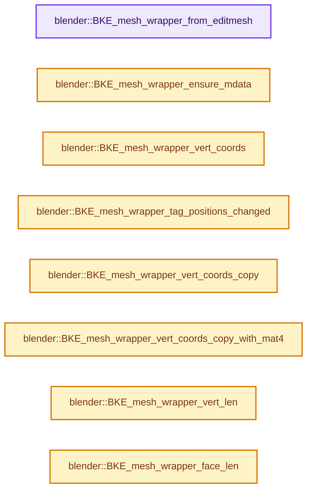

# 实现依赖专题：source/blender/blenkernel/intern/mesh_wrapper.cc

[实现依赖导航](../../README.md) · [符号索引](../../../00-课程指南/02-源码与提交索引/符号依赖与实现索引.md)

本专题从正文实际调用进入，集中保存共享实现。函数有稳定锚点，可从调用处直接跳到对应完整函数；递归与互相调用通过回链组织。

## 本文件的实现关系




## 完整成员与函数实现

<a id="f-6a09574dbf4fe457"></a>

### `blender::BKE_mesh_wrapper_from_editmesh`

实现位置：[source/blender/blenkernel/intern/mesh_wrapper.cc](../../../../../../../source/blender/blenkernel/intern/mesh_wrapper.cc) · L42—L77。

接口参数：

- `std::shared_ptr<BMEditMesh> em`
- `const CustomData_MeshMasks *cd_mask_extra`
- `const Mesh *me_settings`

**教学注释版**

<!-- annotated:045d9dc4b96a6b -->

```cpp
Mesh *BKE_mesh_wrapper_from_editmesh(std::shared_ptr<BMEditMesh> em,
                                     const CustomData_MeshMasks *cd_mask_extra,
                                     const Mesh *me_settings)
{
  Mesh *mesh = BKE_id_new_nomain<Mesh>(nullptr);
  BKE_mesh_copy_parameters_for_eval(mesh, me_settings);
  BKE_mesh_runtime_ensure_edit_data(mesh);

  mesh->runtime->wrapper_type = ME_WRAPPER_TYPE_BMESH;
  if (cd_mask_extra) {
    mesh->runtime->cd_mask_extra = *cd_mask_extra;
  }

  /* Use edit-mesh directly where possible. */
  mesh->runtime->is_original_bmesh = true;

  /* Until the mesh is modified destructively it can be considered "deformed". */
  mesh->runtime->deformed_only = true;

  // [讲解] std::move：把表达式转换成可供移动重载选择的值类别；不保证真的移动，不结束源对象寿命，对const值可能选择复制。
  mesh->runtime->edit_mesh = std::move(em);

  /* Make sure we crash if these are ever used. */
#ifndef NDEBUG
  mesh->verts_num = INT_MAX;
  mesh->edges_num = INT_MAX;
  mesh->faces_num = INT_MAX;
  mesh->corners_num = INT_MAX;
#else
  mesh->verts_num = 0;
  mesh->edges_num = 0;
  mesh->faces_num = 0;
  mesh->corners_num = 0;
#endif

  return mesh;
}
```

<details>
<summary>核对原始源码：source/blender/blenkernel/intern/mesh_wrapper.cc · L42—L77</summary>

<!-- original:045d9dc4b96a6b:source/blender/blenkernel/intern/mesh_wrapper.cc:42:77 -->

```cpp
Mesh *BKE_mesh_wrapper_from_editmesh(std::shared_ptr<BMEditMesh> em,
                                     const CustomData_MeshMasks *cd_mask_extra,
                                     const Mesh *me_settings)
{
  Mesh *mesh = BKE_id_new_nomain<Mesh>(nullptr);
  BKE_mesh_copy_parameters_for_eval(mesh, me_settings);
  BKE_mesh_runtime_ensure_edit_data(mesh);

  mesh->runtime->wrapper_type = ME_WRAPPER_TYPE_BMESH;
  if (cd_mask_extra) {
    mesh->runtime->cd_mask_extra = *cd_mask_extra;
  }

  /* Use edit-mesh directly where possible. */
  mesh->runtime->is_original_bmesh = true;

  /* Until the mesh is modified destructively it can be considered "deformed". */
  mesh->runtime->deformed_only = true;

  mesh->runtime->edit_mesh = std::move(em);

  /* Make sure we crash if these are ever used. */
#ifndef NDEBUG
  mesh->verts_num = INT_MAX;
  mesh->edges_num = INT_MAX;
  mesh->faces_num = INT_MAX;
  mesh->corners_num = INT_MAX;
#else
  mesh->verts_num = 0;
  mesh->edges_num = 0;
  mesh->faces_num = 0;
  mesh->corners_num = 0;
#endif

  return mesh;
}
```

</details>

**沿实际写入检查状态**

- `mesh->runtime->wrapper_type = ME_WRAPPER_TYPE_BMESH;`
- `mesh->runtime->cd_mask_extra = *cd_mask_extra;`
- `mesh->runtime->is_original_bmesh = true;`
- `mesh->runtime->deformed_only = true;`
- `mesh->runtime->edit_mesh = std::move(em);`
- `mesh->verts_num = INT_MAX;`
- `mesh->edges_num = INT_MAX;`
- `mesh->faces_num = INT_MAX;`
- `mesh->corners_num = INT_MAX;`
- `mesh->verts_num = 0;`
- `mesh->edges_num = 0;`
- `mesh->faces_num = 0;`
- `mesh->corners_num = 0;`

**结果出口**

- `return mesh;`

**继续追踪实现**

- `BKE_id_new_nomain<Mesh>` → [blender::BKE_id_new_nomain · L1617](lib_id.cc.md#f-b72d7abbfd8aeae3)。
- `BKE_mesh_copy_parameters_for_eval` → [BKE_mesh_copy_parameters_for_eval · L1484](../../../05-几何存储与拓扑映射/03-MPoly迁移与兼容.md#f-71bebe4e73fe4c13)。
- `BKE_mesh_runtime_ensure_edit_data` → [blender::BKE_mesh_runtime_ensure_edit_data · L301](../../../06-隐式共享与缓存系统/10-局部更新与失效修复.md#f-bd697561fb664105)。
- `std::move` → [外部契约](https://eel.is/c++draft/utility.forward)：把表达式转换成可供移动重载选择的值类别；不保证真的移动，不结束源对象寿命，对const值可能选择复制。

<a id="f-391cdba59bba6a12"></a>

### `blender::BKE_mesh_wrapper_ensure_mdata`

实现位置：[source/blender/blenkernel/intern/mesh_wrapper.cc](../../../../../../../source/blender/blenkernel/intern/mesh_wrapper.cc) · L79—L131。

接口参数：

- `Mesh *mesh`

**教学注释版**

<!-- annotated:91c54e5cf77f33 -->

```cpp
void BKE_mesh_wrapper_ensure_mdata(Mesh *mesh)
{
  if (mesh->runtime->wrapper_type == ME_WRAPPER_TYPE_MDATA) {
    return;
  }

  /* Double checked lock. */
  std::lock_guard lock{mesh->runtime->eval_mutex};
  if (mesh->runtime->wrapper_type == ME_WRAPPER_TYPE_MDATA) {
    return;
  }

  /* Must isolate multithreaded tasks while holding a mutex lock. */
  threading::isolate_task([&]() {
    if (mesh->runtime->wrapper_type == ME_WRAPPER_TYPE_BMESH) {
      mesh->verts_num = 0;
      mesh->edges_num = 0;
      mesh->faces_num = 0;
      mesh->corners_num = 0;

      BLI_assert(mesh->runtime->edit_mesh != nullptr);
      BLI_assert(mesh->runtime->edit_data != nullptr);

      BMesh *bm = BKE_editmesh_bmesh_get_for_write(mesh);
      BM_mesh_bm_to_me_for_eval(*bm, *mesh, &mesh->runtime->cd_mask_extra);

      /* Adding original index layers here assumes that all BMesh Mesh wrappers are created from
       * original edit mode meshes (the only case where adding original indices makes sense).
       * If that assumption is broken, the layers might be incorrect because they might not
       * actually be "original".
       *
       * There is also a performance aspect, where this also assumes that original indices are
       * always needed when converting a BMesh to a mesh with the mesh wrapper system. That might
       * be wrong, but it's not harmful. */
      BKE_mesh_ensure_default_orig_index_customdata_no_check(mesh);

      bke::EditMeshData &edit_data = *mesh->runtime->edit_data;
      if (!edit_data.vert_positions.is_empty()) {
        mesh->vert_positions_for_write().copy_from(edit_data.vert_positions);
        mesh->runtime->is_original_bmesh = false;
      }

      mesh->runtime->edit_data.reset();
    }
    else if (mesh->runtime->wrapper_type == ME_WRAPPER_TYPE_SUBD) {
      BLI_assert(!"Should not be converting subd wrapper to mdata wrapper");
    }

    /* Keep type assignment last, so that read-only access only uses the mdata code paths after all
     * the underlying data has been initialized. */
    mesh->runtime->wrapper_type = ME_WRAPPER_TYPE_MDATA;
  });
}
```

<details>
<summary>核对原始源码：source/blender/blenkernel/intern/mesh_wrapper.cc · L79—L131</summary>

<!-- original:91c54e5cf77f33:source/blender/blenkernel/intern/mesh_wrapper.cc:79:131 -->

```cpp
void BKE_mesh_wrapper_ensure_mdata(Mesh *mesh)
{
  if (mesh->runtime->wrapper_type == ME_WRAPPER_TYPE_MDATA) {
    return;
  }

  /* Double checked lock. */
  std::lock_guard lock{mesh->runtime->eval_mutex};
  if (mesh->runtime->wrapper_type == ME_WRAPPER_TYPE_MDATA) {
    return;
  }

  /* Must isolate multithreaded tasks while holding a mutex lock. */
  threading::isolate_task([&]() {
    if (mesh->runtime->wrapper_type == ME_WRAPPER_TYPE_BMESH) {
      mesh->verts_num = 0;
      mesh->edges_num = 0;
      mesh->faces_num = 0;
      mesh->corners_num = 0;

      BLI_assert(mesh->runtime->edit_mesh != nullptr);
      BLI_assert(mesh->runtime->edit_data != nullptr);

      BMesh *bm = BKE_editmesh_bmesh_get_for_write(mesh);
      BM_mesh_bm_to_me_for_eval(*bm, *mesh, &mesh->runtime->cd_mask_extra);

      /* Adding original index layers here assumes that all BMesh Mesh wrappers are created from
       * original edit mode meshes (the only case where adding original indices makes sense).
       * If that assumption is broken, the layers might be incorrect because they might not
       * actually be "original".
       *
       * There is also a performance aspect, where this also assumes that original indices are
       * always needed when converting a BMesh to a mesh with the mesh wrapper system. That might
       * be wrong, but it's not harmful. */
      BKE_mesh_ensure_default_orig_index_customdata_no_check(mesh);

      bke::EditMeshData &edit_data = *mesh->runtime->edit_data;
      if (!edit_data.vert_positions.is_empty()) {
        mesh->vert_positions_for_write().copy_from(edit_data.vert_positions);
        mesh->runtime->is_original_bmesh = false;
      }

      mesh->runtime->edit_data.reset();
    }
    else if (mesh->runtime->wrapper_type == ME_WRAPPER_TYPE_SUBD) {
      BLI_assert(!"Should not be converting subd wrapper to mdata wrapper");
    }

    /* Keep type assignment last, so that read-only access only uses the mdata code paths after all
     * the underlying data has been initialized. */
    mesh->runtime->wrapper_type = ME_WRAPPER_TYPE_MDATA;
  });
}
```

</details>

**沿实际写入检查状态**

- `mesh->verts_num = 0;`
- `mesh->edges_num = 0;`
- `mesh->faces_num = 0;`
- `mesh->corners_num = 0;`
- `mesh->runtime->is_original_bmesh = false;`
- `mesh->runtime->wrapper_type = ME_WRAPPER_TYPE_MDATA;`

**继续追踪实现**

- `threading::isolate_task` → [blender::threading::isolate_task · L224](../../../11-Depsgraph与并行任务系统/07-任务池与TBB接入.md#f-c13dd3df595aa4f8)。
- `BLI_assert` → [BLI_assert · L48](../../01-BLI基础库/BLI_assert.hh.md#m-57a88495704d)；[BLI_assert · L63](../../01-BLI基础库/BLI_assert.hh.md#m-d07050020cb5)。宏定义由构建条件选择。
- `BKE_editmesh_bmesh_get_for_write` → [blender::BKE_editmesh_bmesh_get_for_write · L79](editmesh.cc.md#f-fa556ba8fafc4b41)；[blender::BKE_editmesh_bmesh_get_for_write · L87](editmesh.cc.md#f-6137590869c86e48)。同名重载需按实参类型选择。
- `BM_mesh_bm_to_me_for_eval` → [blender::BM_mesh_bm_to_me_for_eval · L2226](../../08-其他Blender模块/bmesh/intern/bmesh_mesh_convert.cc.md#f-d52b5f348bb9a67d)。
- `BKE_mesh_ensure_default_orig_index_customdata_no_check` → [BKE_mesh_ensure_default_orig_index_customdata_no_check · L1646](../../../05-几何存储与拓扑映射/03-MPoly迁移与兼容.md#f-dc77a46e5a456b24)。
- `edit_data.vert_positions.is_empty` → [调用协议](../../../00-课程指南/01-路线与规范/模板宏与动态分派协议.md)：接收对象类型依赖auto、返回值或模板实例；不按同名猜测目标。调用位置L116。
- `mesh->vert_positions_for_write().copy_from` → [调用协议](../../../00-课程指南/01-路线与规范/模板宏与动态分派协议.md)：接收对象类型依赖auto、返回值或模板实例；不按同名猜测目标。调用位置L117。
- `mesh->vert_positions_for_write` → [Mesh::vert_positions_for_write · L1199](../../../05-几何存储与拓扑映射/03-MPoly迁移与兼容.md#f-ae8d77205112d843)。
- `mesh->runtime->edit_data.reset` → [调用协议](../../../00-课程指南/01-路线与规范/模板宏与动态分派协议.md)：接收对象类型依赖auto、返回值或模板实例；不按同名猜测目标。调用位置L121。

<a id="f-59c95b6d5cdafdfc"></a>

### `blender::BKE_mesh_wrapper_vert_coords`

实现位置：[source/blender/blenkernel/intern/mesh_wrapper.cc](../../../../../../../source/blender/blenkernel/intern/mesh_wrapper.cc) · L137—L148。

接口参数：

- `const Mesh *mesh`

**教学注释版**

<!-- annotated:096d21b36f50a5 -->

```cpp
Span<float3> BKE_mesh_wrapper_vert_coords(const Mesh *mesh)
{
  switch (mesh->runtime->wrapper_type) {
    case ME_WRAPPER_TYPE_BMESH:
      return mesh->runtime->edit_data->vert_positions;
    case ME_WRAPPER_TYPE_MDATA:
    case ME_WRAPPER_TYPE_SUBD:
      return mesh->vert_positions();
  }
  BLI_assert_unreachable();
  return {};
}
```

<details>
<summary>核对原始源码：source/blender/blenkernel/intern/mesh_wrapper.cc · L137—L148</summary>

<!-- original:096d21b36f50a5:source/blender/blenkernel/intern/mesh_wrapper.cc:137:148 -->

```cpp
Span<float3> BKE_mesh_wrapper_vert_coords(const Mesh *mesh)
{
  switch (mesh->runtime->wrapper_type) {
    case ME_WRAPPER_TYPE_BMESH:
      return mesh->runtime->edit_data->vert_positions;
    case ME_WRAPPER_TYPE_MDATA:
    case ME_WRAPPER_TYPE_SUBD:
      return mesh->vert_positions();
  }
  BLI_assert_unreachable();
  return {};
}
```

</details>

**结果出口**

- `return mesh->runtime->edit_data->vert_positions;`
- `return mesh->vert_positions();`
- `return {};`

**继续追踪实现**

- `mesh->vert_positions` → [Mesh::vert_positions · L1193](../../../05-几何存储与拓扑映射/03-MPoly迁移与兼容.md#f-ae4177e5c5f2b371)。
- `BLI_assert_unreachable` → [BLI_assert_unreachable · L77](../../01-BLI基础库/BLI_assert.hh.md#m-7a2d91a67d8e)。宏定义由构建条件选择。

<a id="f-32518f6b8e55035f"></a>

### `blender::BKE_mesh_wrapper_tag_positions_changed`

实现位置：[source/blender/blenkernel/intern/mesh_wrapper.cc](../../../../../../../source/blender/blenkernel/intern/mesh_wrapper.cc) · L164—L179。

接口参数：

- `Mesh *mesh`

**教学注释版**

<!-- annotated:9301c1cfadf137 -->

```cpp
void BKE_mesh_wrapper_tag_positions_changed(Mesh *mesh)
{
  switch (mesh->runtime->wrapper_type) {
    case ME_WRAPPER_TYPE_BMESH:
      if (bke::EditMeshData *edit_data = mesh->runtime->edit_data.get()) {
        edit_data->vert_normals = {};
        edit_data->face_centers = {};
        edit_data->face_normals = {};
      }
      break;
    case ME_WRAPPER_TYPE_MDATA:
    case ME_WRAPPER_TYPE_SUBD:
      mesh->tag_positions_changed();
      break;
  }
}
```

<details>
<summary>核对原始源码：source/blender/blenkernel/intern/mesh_wrapper.cc · L164—L179</summary>

<!-- original:9301c1cfadf137:source/blender/blenkernel/intern/mesh_wrapper.cc:164:179 -->

```cpp
void BKE_mesh_wrapper_tag_positions_changed(Mesh *mesh)
{
  switch (mesh->runtime->wrapper_type) {
    case ME_WRAPPER_TYPE_BMESH:
      if (bke::EditMeshData *edit_data = mesh->runtime->edit_data.get()) {
        edit_data->vert_normals = {};
        edit_data->face_centers = {};
        edit_data->face_normals = {};
      }
      break;
    case ME_WRAPPER_TYPE_MDATA:
    case ME_WRAPPER_TYPE_SUBD:
      mesh->tag_positions_changed();
      break;
  }
}
```

</details>

**沿实际写入检查状态**

- `edit_data->vert_normals = {};`
- `edit_data->face_centers = {};`
- `edit_data->face_normals = {};`

**继续追踪实现**

- `mesh->runtime->edit_data.get` → [调用协议](../../../00-课程指南/01-路线与规范/模板宏与动态分派协议.md)：接收对象类型依赖auto、返回值或模板实例；不按同名猜测目标。调用位置L168。
- `mesh->tag_positions_changed` → [blender::Mesh::tag_positions_changed · L407](../../../06-隐式共享与缓存系统/10-局部更新与失效修复.md#f-90e852663d44ad53)。

<a id="f-551b2f3a2de3a58f"></a>

### `blender::BKE_mesh_wrapper_vert_coords_copy`

实现位置：[source/blender/blenkernel/intern/mesh_wrapper.cc](../../../../../../../source/blender/blenkernel/intern/mesh_wrapper.cc) · L181—L207。

接口参数：

- `const Mesh *mesh`
- `MutableSpan<float3> positions`

**教学注释版**

<!-- annotated:e911778f9726ab -->

```cpp
void BKE_mesh_wrapper_vert_coords_copy(const Mesh *mesh, MutableSpan<float3> positions)
{
  switch (mesh->runtime->wrapper_type) {
    case ME_WRAPPER_TYPE_BMESH: {
      BMesh *bm = const_cast<BMesh *>(BKE_editmesh_bmesh_get(mesh));
      const bke::EditMeshData &edit_data = *mesh->runtime->edit_data;
      if (!edit_data.vert_positions.is_empty()) {
        // [讲解] positions.copy_from：修改已有目标元素，不改变底层容器长度。
        positions.copy_from(edit_data.vert_positions);
      }
      else {
        BMIter iter;
        BMVert *v;
        int i;
        BM_ITER_MESH_INDEX (v, &iter, bm, BM_VERTS_OF_MESH, i) {
          copy_v3_v3(positions[i], v->co);
        }
      }
      return;
    }
    case ME_WRAPPER_TYPE_MDATA:
    case ME_WRAPPER_TYPE_SUBD: {
      positions.copy_from(mesh->vert_positions());
      return;
    }
  }
  BLI_assert_unreachable();
}
```

<details>
<summary>核对原始源码：source/blender/blenkernel/intern/mesh_wrapper.cc · L181—L207</summary>

<!-- original:e911778f9726ab:source/blender/blenkernel/intern/mesh_wrapper.cc:181:207 -->

```cpp
void BKE_mesh_wrapper_vert_coords_copy(const Mesh *mesh, MutableSpan<float3> positions)
{
  switch (mesh->runtime->wrapper_type) {
    case ME_WRAPPER_TYPE_BMESH: {
      BMesh *bm = const_cast<BMesh *>(BKE_editmesh_bmesh_get(mesh));
      const bke::EditMeshData &edit_data = *mesh->runtime->edit_data;
      if (!edit_data.vert_positions.is_empty()) {
        positions.copy_from(edit_data.vert_positions);
      }
      else {
        BMIter iter;
        BMVert *v;
        int i;
        BM_ITER_MESH_INDEX (v, &iter, bm, BM_VERTS_OF_MESH, i) {
          copy_v3_v3(positions[i], v->co);
        }
      }
      return;
    }
    case ME_WRAPPER_TYPE_MDATA:
    case ME_WRAPPER_TYPE_SUBD: {
      positions.copy_from(mesh->vert_positions());
      return;
    }
  }
  BLI_assert_unreachable();
}
```

</details>

**继续追踪实现**

- `BKE_editmesh_bmesh_get` → [blender::BKE_editmesh_bmesh_get · L65](editmesh.cc.md#f-2afdd2773d3f0d88)；[blender::BKE_editmesh_bmesh_get · L71](editmesh.cc.md#f-80631d704a7e9947)。同名重载需按实参类型选择。
- `edit_data.vert_positions.is_empty` → [调用协议](../../../00-课程指南/01-路线与规范/模板宏与动态分派协议.md)：接收对象类型依赖auto、返回值或模板实例；不按同名猜测目标。调用位置L187。
- `positions.copy_from` → [blender::MutableSpan::copy_from · L745](../../../01-基础容器与现代CPP/06-MutableSpan可写视图.md#f-e4f099b1497adddb)。
- `BM_ITER_MESH_INDEX` → [BM_ITER_MESH_INDEX · L76](../../08-其他Blender模块/bmesh/intern/bmesh_iterators.hh.md#m-6a0cac4538f9)。宏定义由构建条件选择。
- `copy_v3_v3` → [blender::copy_v3_v3 · L47](../../01-BLI基础库/intern/math_vector_inline.cc.md#f-037a0d5fa5060bd6)。
- `mesh->vert_positions` → [Mesh::vert_positions · L1193](../../../05-几何存储与拓扑映射/03-MPoly迁移与兼容.md#f-ae4177e5c5f2b371)。
- `BLI_assert_unreachable` → [BLI_assert_unreachable · L77](../../01-BLI基础库/BLI_assert.hh.md#m-7a2d91a67d8e)。宏定义由构建条件选择。

<a id="f-cb8fe0014516ca85"></a>

### `blender::BKE_mesh_wrapper_vert_coords_copy_with_mat4`

实现位置：[source/blender/blenkernel/intern/mesh_wrapper.cc](../../../../../../../source/blender/blenkernel/intern/mesh_wrapper.cc) · L209—L245。

接口参数：

- `const Mesh *mesh`
- `float (*vert_coords)[3]`
- `int vert_coords_len`
- `const float mat[4][4]`

**教学注释版**

<!-- annotated:fb5abe9187fc62 -->

```cpp
void BKE_mesh_wrapper_vert_coords_copy_with_mat4(const Mesh *mesh,
                                                 float (*vert_coords)[3],
                                                 int vert_coords_len,
                                                 const float mat[4][4])
{
  switch (mesh->runtime->wrapper_type) {
    case ME_WRAPPER_TYPE_BMESH: {
      BMesh *bm = const_cast<BMesh *>(BKE_editmesh_bmesh_get(mesh));
      BLI_assert(vert_coords_len == bm->totvert);
      const bke::EditMeshData &edit_data = *mesh->runtime->edit_data;
      if (!edit_data.vert_positions.is_empty()) {
        for (int i = 0; i < vert_coords_len; i++) {
          mul_v3_m4v3(vert_coords[i], mat, edit_data.vert_positions[i]);
        }
      }
      else {
        BMIter iter;
        BMVert *v;
        int i;
        BM_ITER_MESH_INDEX (v, &iter, bm, BM_VERTS_OF_MESH, i) {
          mul_v3_m4v3(vert_coords[i], mat, v->co);
        }
      }
      return;
    }
    case ME_WRAPPER_TYPE_MDATA:
    case ME_WRAPPER_TYPE_SUBD: {
      BLI_assert(vert_coords_len == mesh->verts_num);
      const Span<float3> positions = mesh->vert_positions();
      for (int i = 0; i < vert_coords_len; i++) {
        mul_v3_m4v3(vert_coords[i], mat, positions[i]);
      }
      return;
    }
  }
  BLI_assert_unreachable();
}
```

<details>
<summary>核对原始源码：source/blender/blenkernel/intern/mesh_wrapper.cc · L209—L245</summary>

<!-- original:fb5abe9187fc62:source/blender/blenkernel/intern/mesh_wrapper.cc:209:245 -->

```cpp
void BKE_mesh_wrapper_vert_coords_copy_with_mat4(const Mesh *mesh,
                                                 float (*vert_coords)[3],
                                                 int vert_coords_len,
                                                 const float mat[4][4])
{
  switch (mesh->runtime->wrapper_type) {
    case ME_WRAPPER_TYPE_BMESH: {
      BMesh *bm = const_cast<BMesh *>(BKE_editmesh_bmesh_get(mesh));
      BLI_assert(vert_coords_len == bm->totvert);
      const bke::EditMeshData &edit_data = *mesh->runtime->edit_data;
      if (!edit_data.vert_positions.is_empty()) {
        for (int i = 0; i < vert_coords_len; i++) {
          mul_v3_m4v3(vert_coords[i], mat, edit_data.vert_positions[i]);
        }
      }
      else {
        BMIter iter;
        BMVert *v;
        int i;
        BM_ITER_MESH_INDEX (v, &iter, bm, BM_VERTS_OF_MESH, i) {
          mul_v3_m4v3(vert_coords[i], mat, v->co);
        }
      }
      return;
    }
    case ME_WRAPPER_TYPE_MDATA:
    case ME_WRAPPER_TYPE_SUBD: {
      BLI_assert(vert_coords_len == mesh->verts_num);
      const Span<float3> positions = mesh->vert_positions();
      for (int i = 0; i < vert_coords_len; i++) {
        mul_v3_m4v3(vert_coords[i], mat, positions[i]);
      }
      return;
    }
  }
  BLI_assert_unreachable();
}
```

</details>

**继续追踪实现**

- `BKE_editmesh_bmesh_get` → [blender::BKE_editmesh_bmesh_get · L65](editmesh.cc.md#f-2afdd2773d3f0d88)；[blender::BKE_editmesh_bmesh_get · L71](editmesh.cc.md#f-80631d704a7e9947)。同名重载需按实参类型选择。
- `BLI_assert` → [BLI_assert · L48](../../01-BLI基础库/BLI_assert.hh.md#m-57a88495704d)；[BLI_assert · L63](../../01-BLI基础库/BLI_assert.hh.md#m-d07050020cb5)。宏定义由构建条件选择。
- `edit_data.vert_positions.is_empty` → [调用协议](../../../00-课程指南/01-路线与规范/模板宏与动态分派协议.md)：接收对象类型依赖auto、返回值或模板实例；不按同名猜测目标。调用位置L219。
- `mul_v3_m4v3` → [blender::mul_v3_m4v3 · L687](../../01-BLI基础库/intern/math_matrix_c.cc.md#f-31076c71c40783a8)。
- `BM_ITER_MESH_INDEX` → [BM_ITER_MESH_INDEX · L76](../../08-其他Blender模块/bmesh/intern/bmesh_iterators.hh.md#m-6a0cac4538f9)。宏定义由构建条件选择。
- `mesh->vert_positions` → [Mesh::vert_positions · L1193](../../../05-几何存储与拓扑映射/03-MPoly迁移与兼容.md#f-ae4177e5c5f2b371)。
- `BLI_assert_unreachable` → [BLI_assert_unreachable · L77](../../01-BLI基础库/BLI_assert.hh.md#m-7a2d91a67d8e)。宏定义由构建条件选择。

<a id="f-386380c15d2cf0cb"></a>

### `blender::BKE_mesh_wrapper_vert_len`

实现位置：[source/blender/blenkernel/intern/mesh_wrapper.cc](../../../../../../../source/blender/blenkernel/intern/mesh_wrapper.cc) · L253—L264。

接口参数：

- `const Mesh *mesh`

**教学注释版**

<!-- annotated:091b6e43890a35 -->

```cpp
int BKE_mesh_wrapper_vert_len(const Mesh *mesh)
{
  switch (mesh->runtime->wrapper_type) {
    case ME_WRAPPER_TYPE_BMESH:
      return BKE_editmesh_bmesh_get(mesh)->totvert;
    case ME_WRAPPER_TYPE_MDATA:
    case ME_WRAPPER_TYPE_SUBD:
      return mesh->verts_num;
  }
  BLI_assert_unreachable();
  return -1;
}
```

<details>
<summary>核对原始源码：source/blender/blenkernel/intern/mesh_wrapper.cc · L253—L264</summary>

<!-- original:091b6e43890a35:source/blender/blenkernel/intern/mesh_wrapper.cc:253:264 -->

```cpp
int BKE_mesh_wrapper_vert_len(const Mesh *mesh)
{
  switch (mesh->runtime->wrapper_type) {
    case ME_WRAPPER_TYPE_BMESH:
      return BKE_editmesh_bmesh_get(mesh)->totvert;
    case ME_WRAPPER_TYPE_MDATA:
    case ME_WRAPPER_TYPE_SUBD:
      return mesh->verts_num;
  }
  BLI_assert_unreachable();
  return -1;
}
```

</details>

**结果出口**

- `return BKE_editmesh_bmesh_get(mesh)->totvert;`
- `return mesh->verts_num;`
- `return -1;`

**继续追踪实现**

- `BKE_editmesh_bmesh_get` → [blender::BKE_editmesh_bmesh_get · L65](editmesh.cc.md#f-2afdd2773d3f0d88)；[blender::BKE_editmesh_bmesh_get · L71](editmesh.cc.md#f-80631d704a7e9947)。同名重载需按实参类型选择。
- `BLI_assert_unreachable` → [BLI_assert_unreachable · L77](../../01-BLI基础库/BLI_assert.hh.md#m-7a2d91a67d8e)。宏定义由构建条件选择。

<a id="f-0af38d22aa58cf23"></a>

### `blender::BKE_mesh_wrapper_face_len`

实现位置：[source/blender/blenkernel/intern/mesh_wrapper.cc](../../../../../../../source/blender/blenkernel/intern/mesh_wrapper.cc) · L292—L303。

接口参数：

- `const Mesh *mesh`

**教学注释版**

<!-- annotated:6df599065fd728 -->

```cpp
int BKE_mesh_wrapper_face_len(const Mesh *mesh)
{
  switch (mesh->runtime->wrapper_type) {
    case ME_WRAPPER_TYPE_BMESH:
      return BKE_editmesh_bmesh_get(mesh)->totface;
    case ME_WRAPPER_TYPE_MDATA:
    case ME_WRAPPER_TYPE_SUBD:
      return mesh->faces_num;
  }
  BLI_assert_unreachable();
  return -1;
}
```

<details>
<summary>核对原始源码：source/blender/blenkernel/intern/mesh_wrapper.cc · L292—L303</summary>

<!-- original:6df599065fd728:source/blender/blenkernel/intern/mesh_wrapper.cc:292:303 -->

```cpp
int BKE_mesh_wrapper_face_len(const Mesh *mesh)
{
  switch (mesh->runtime->wrapper_type) {
    case ME_WRAPPER_TYPE_BMESH:
      return BKE_editmesh_bmesh_get(mesh)->totface;
    case ME_WRAPPER_TYPE_MDATA:
    case ME_WRAPPER_TYPE_SUBD:
      return mesh->faces_num;
  }
  BLI_assert_unreachable();
  return -1;
}
```

</details>

**结果出口**

- `return BKE_editmesh_bmesh_get(mesh)->totface;`
- `return mesh->faces_num;`
- `return -1;`

**继续追踪实现**

- `BKE_editmesh_bmesh_get` → [blender::BKE_editmesh_bmesh_get · L65](editmesh.cc.md#f-2afdd2773d3f0d88)；[blender::BKE_editmesh_bmesh_get · L71](editmesh.cc.md#f-80631d704a7e9947)。同名重载需按实参类型选择。
- `BLI_assert_unreachable` → [BLI_assert_unreachable · L77](../../01-BLI基础库/BLI_assert.hh.md#m-7a2d91a67d8e)。宏定义由构建条件选择。

<a id="f-e22ea080fd81001c"></a>

### `blender::mesh_wrapper_ensure_subdivision`

实现位置：[source/blender/blenkernel/intern/mesh_wrapper.cc](../../../../../../../source/blender/blenkernel/intern/mesh_wrapper.cc) · L311—L378。

接口参数：

- `Mesh *mesh`

**教学注释版**

<!-- annotated:8716575a75ef00 -->

```cpp
static Mesh *mesh_wrapper_ensure_subdivision(Mesh *mesh)
{
  using namespace blender::bke;
  SubsurfRuntimeData *runtime_data = mesh->runtime->subsurf_runtime_data;
  if (runtime_data->settings.level == 0) {
    mesh->runtime->wrapper_type = ME_WRAPPER_TYPE_SUBD;
    return mesh;
  }

  /* Initialize the settings before ensuring the descriptor as this is checked to decide whether
   * subdivision is needed at all, and checking the descriptor status might involve checking if the
   * data is out-of-date, which is a very expensive operation. */
  subdiv::ToMeshSettings mesh_settings;
  mesh_settings.resolution = runtime_data->resolution;
  mesh_settings.use_optimal_display = runtime_data->use_optimal_display;

  if (mesh_settings.resolution < 3) {
    mesh->runtime->wrapper_type = ME_WRAPPER_TYPE_SUBD;
    return mesh;
  }

  subdiv::Subdiv *subdiv = BKE_subsurf_modifier_subdiv_descriptor_ensure(
      runtime_data, mesh, false);
  if (subdiv == nullptr) {
    /* Happens on bad topology, but also on empty input mesh. */
    mesh->runtime->wrapper_type = ME_WRAPPER_TYPE_SUBD;
    return mesh;
  }
  const bool use_clnors = runtime_data->use_loop_normals;
  if (use_clnors) {
    /* If custom normals are present and the option is turned on calculate the split
     * normals and clear flag so the normals get interpolated to the result mesh. */
    void *data = CustomData_add_layer(
        &mesh->corner_data, CD_NORMAL, CD_CONSTRUCT, mesh->corners_num);
    // [讲解] memcpy：复制字节，源与目标不应重叠。类型生命周期、对齐和可复制表示须由调用者证明，不是任意对象的复制构造。
    memcpy(data, mesh->corner_normals().data(), mesh->corner_normals().size_in_bytes());
  }

  Mesh *subdiv_mesh = subdiv::subdiv_to_mesh(subdiv, &mesh_settings, mesh);

  if (use_clnors) {
    mesh_set_custom_normals_normalized(
        *subdiv_mesh,
        {static_cast<float3 *>(CustomData_get_layer_for_write(
             &subdiv_mesh->corner_data, CD_NORMAL, subdiv_mesh->corners_num)),
         subdiv_mesh->corners_num});
    CustomData_free_layers(&subdiv_mesh->corner_data, CD_NORMAL);
  }

  if (!ELEM(subdiv, runtime_data->subdiv_cpu, runtime_data->subdiv_gpu)) {
    // [讲解] subdiv::free：归还相匹配的C分配存储，不自动执行C++析构；不可用于Windows的_aligned_malloc结果。
    subdiv::free(subdiv);
  }

  if (subdiv_mesh != mesh) {
    STRNCPY(subdiv_mesh->id.name, mesh->id.name);

    /* Make sure that drivers can target shapekey properties. See #mesh_build_data for details. */
    subdiv_mesh->key = mesh->key;

    if (mesh->runtime->mesh_eval != nullptr) {
      BKE_id_free(nullptr, mesh->runtime->mesh_eval);
    }
    mesh->runtime->mesh_eval = subdiv_mesh;
    mesh->runtime->wrapper_type = ME_WRAPPER_TYPE_SUBD;
    BLI_assert(mesh->runtime->mesh_eval != nullptr);
  }

  return mesh->runtime->mesh_eval;
}
```

<details>
<summary>核对原始源码：source/blender/blenkernel/intern/mesh_wrapper.cc · L311—L378</summary>

<!-- original:8716575a75ef00:source/blender/blenkernel/intern/mesh_wrapper.cc:311:378 -->

```cpp
static Mesh *mesh_wrapper_ensure_subdivision(Mesh *mesh)
{
  using namespace blender::bke;
  SubsurfRuntimeData *runtime_data = mesh->runtime->subsurf_runtime_data;
  if (runtime_data->settings.level == 0) {
    mesh->runtime->wrapper_type = ME_WRAPPER_TYPE_SUBD;
    return mesh;
  }

  /* Initialize the settings before ensuring the descriptor as this is checked to decide whether
   * subdivision is needed at all, and checking the descriptor status might involve checking if the
   * data is out-of-date, which is a very expensive operation. */
  subdiv::ToMeshSettings mesh_settings;
  mesh_settings.resolution = runtime_data->resolution;
  mesh_settings.use_optimal_display = runtime_data->use_optimal_display;

  if (mesh_settings.resolution < 3) {
    mesh->runtime->wrapper_type = ME_WRAPPER_TYPE_SUBD;
    return mesh;
  }

  subdiv::Subdiv *subdiv = BKE_subsurf_modifier_subdiv_descriptor_ensure(
      runtime_data, mesh, false);
  if (subdiv == nullptr) {
    /* Happens on bad topology, but also on empty input mesh. */
    mesh->runtime->wrapper_type = ME_WRAPPER_TYPE_SUBD;
    return mesh;
  }
  const bool use_clnors = runtime_data->use_loop_normals;
  if (use_clnors) {
    /* If custom normals are present and the option is turned on calculate the split
     * normals and clear flag so the normals get interpolated to the result mesh. */
    void *data = CustomData_add_layer(
        &mesh->corner_data, CD_NORMAL, CD_CONSTRUCT, mesh->corners_num);
    memcpy(data, mesh->corner_normals().data(), mesh->corner_normals().size_in_bytes());
  }

  Mesh *subdiv_mesh = subdiv::subdiv_to_mesh(subdiv, &mesh_settings, mesh);

  if (use_clnors) {
    mesh_set_custom_normals_normalized(
        *subdiv_mesh,
        {static_cast<float3 *>(CustomData_get_layer_for_write(
             &subdiv_mesh->corner_data, CD_NORMAL, subdiv_mesh->corners_num)),
         subdiv_mesh->corners_num});
    CustomData_free_layers(&subdiv_mesh->corner_data, CD_NORMAL);
  }

  if (!ELEM(subdiv, runtime_data->subdiv_cpu, runtime_data->subdiv_gpu)) {
    subdiv::free(subdiv);
  }

  if (subdiv_mesh != mesh) {
    STRNCPY(subdiv_mesh->id.name, mesh->id.name);

    /* Make sure that drivers can target shapekey properties. See #mesh_build_data for details. */
    subdiv_mesh->key = mesh->key;

    if (mesh->runtime->mesh_eval != nullptr) {
      BKE_id_free(nullptr, mesh->runtime->mesh_eval);
    }
    mesh->runtime->mesh_eval = subdiv_mesh;
    mesh->runtime->wrapper_type = ME_WRAPPER_TYPE_SUBD;
    BLI_assert(mesh->runtime->mesh_eval != nullptr);
  }

  return mesh->runtime->mesh_eval;
}
```

</details>

**沿实际写入检查状态**

- `mesh->runtime->wrapper_type = ME_WRAPPER_TYPE_SUBD;`
- `mesh_settings.resolution = runtime_data->resolution;`
- `mesh_settings.use_optimal_display = runtime_data->use_optimal_display;`
- `subdiv_mesh->key = mesh->key;`
- `mesh->runtime->mesh_eval = subdiv_mesh;`

**结果出口**

- `return mesh;`
- `return mesh->runtime->mesh_eval;`

**继续追踪实现**

- `BKE_subsurf_modifier_subdiv_descriptor_ensure` → [blender::BKE_subsurf_modifier_subdiv_descriptor_ensure · L131](subdiv_modifier.cc.md#f-634f64edee888a48)。
- `CustomData_add_layer` → [blender::CustomData_add_layer · L2851](customdata.cc.md#f-4c7988e825541059)。
- `memcpy` → [外部契约](https://eel.is/c++draft/cstring.syn)：复制字节，源与目标不应重叠。类型生命周期、对齐和可复制表示须由调用者证明，不是任意对象的复制构造。
- `mesh->corner_normals().data` → [调用协议](../../../00-课程指南/01-路线与规范/模板宏与动态分派协议.md)：接收对象类型依赖auto、返回值或模板实例；不按同名猜测目标。调用位置L345。
- `mesh->corner_normals` → [blender::Mesh::corner_normals · L468](../../../06-隐式共享与缓存系统/08-法线缓存的真实依赖.md#f-91d46c2a581e44bc)。
- `mesh->corner_normals().size_in_bytes` → [调用协议](../../../00-课程指南/01-路线与规范/模板宏与动态分派协议.md)：接收对象类型依赖auto、返回值或模板实例；不按同名猜测目标。调用位置L345。
- `subdiv::subdiv_to_mesh` → [blender::bke::subdiv::subdiv_to_mesh · L1458](subdiv_mesh.cc.md#f-fb2d00a1de7732e7)。
- `mesh_set_custom_normals_normalized` → [blender::bke::mesh_set_custom_normals_normalized · L1700](../../../06-隐式共享与缓存系统/08-法线缓存的真实依赖.md#f-96e05ccd6d9a9c03)。
- `CustomData_get_layer_for_write` → [blender::CustomData_get_layer_for_write · L3318](customdata.cc.md#f-6af158905e2c1274)。
- `CustomData_free_layers` → [blender::CustomData_free_layers · L2988](customdata.cc.md#f-13fed7d5cd3b8b69)。
- `ELEM` → [ELEM · L88](../../07-Intern运行时与平台/ghost/intern/GHOST_utildefines.hh.md#m-d28724a15928)；[ELEM · L135](../../01-BLI基础库/BLI_utildefines.hh.md#m-d6572de7cae0)。宏定义由构建条件选择。
- `subdiv::free` → [外部契约](https://eel.is/c++draft/c.malloc)：归还相匹配的C分配存储，不自动执行C++析构；不可用于Windows的_aligned_malloc结果。
- `STRNCPY` → [blender::STRNCPY · L690](../../01-BLI基础库/BLI_string.hh.md#f-6b2d861724026be6)。
- `BKE_id_free` → [blender::BKE_id_free · L224](lib_id_delete.cc.md#f-28ed02c41d0f2d5b)。
- `BLI_assert` → [BLI_assert · L48](../../01-BLI基础库/BLI_assert.hh.md#m-57a88495704d)；[BLI_assert · L63](../../01-BLI基础库/BLI_assert.hh.md#m-d07050020cb5)。宏定义由构建条件选择。

<a id="f-a140cbf2ffa716c8"></a>

### `blender::BKE_mesh_wrapper_ensure_subdivision`

实现位置：[source/blender/blenkernel/intern/mesh_wrapper.cc](../../../../../../../source/blender/blenkernel/intern/mesh_wrapper.cc) · L380—L401。

接口参数：

- `Mesh *mesh`

**教学注释版**

<!-- annotated:394c425320ed5b -->

```cpp
Mesh *BKE_mesh_wrapper_ensure_subdivision(Mesh *mesh)
{
  if (mesh->runtime->subsurf_runtime_data == nullptr) {
    return mesh;
  }

  if (mesh->runtime->wrapper_type == ME_WRAPPER_TYPE_SUBD) {
    /* Subdiv evaluation might have been skipped, in which case the original mesh is ok. */
    return (mesh->runtime->mesh_eval) ? mesh->runtime->mesh_eval : mesh;
  }

  /* Double checked lock. */
  std::lock_guard lock{mesh->runtime->eval_mutex};
  if (mesh->runtime->wrapper_type == ME_WRAPPER_TYPE_SUBD) {
    return (mesh->runtime->mesh_eval) ? mesh->runtime->mesh_eval : mesh;
  }

  /* Must isolate multithreaded tasks while holding a mutex lock. */
  Mesh *result;
  threading::isolate_task([&]() { result = mesh_wrapper_ensure_subdivision(mesh); });
  return result;
}
```

<details>
<summary>核对原始源码：source/blender/blenkernel/intern/mesh_wrapper.cc · L380—L401</summary>

<!-- original:394c425320ed5b:source/blender/blenkernel/intern/mesh_wrapper.cc:380:401 -->

```cpp
Mesh *BKE_mesh_wrapper_ensure_subdivision(Mesh *mesh)
{
  if (mesh->runtime->subsurf_runtime_data == nullptr) {
    return mesh;
  }

  if (mesh->runtime->wrapper_type == ME_WRAPPER_TYPE_SUBD) {
    /* Subdiv evaluation might have been skipped, in which case the original mesh is ok. */
    return (mesh->runtime->mesh_eval) ? mesh->runtime->mesh_eval : mesh;
  }

  /* Double checked lock. */
  std::lock_guard lock{mesh->runtime->eval_mutex};
  if (mesh->runtime->wrapper_type == ME_WRAPPER_TYPE_SUBD) {
    return (mesh->runtime->mesh_eval) ? mesh->runtime->mesh_eval : mesh;
  }

  /* Must isolate multithreaded tasks while holding a mutex lock. */
  Mesh *result;
  threading::isolate_task([&]() { result = mesh_wrapper_ensure_subdivision(mesh); });
  return result;
}
```

</details>

**结果出口**

- `return mesh;`
- `return (mesh->runtime->mesh_eval) ? mesh->runtime->mesh_eval : mesh;`
- `return result;`

**继续追踪实现**

- `threading::isolate_task` → [blender::threading::isolate_task · L224](../../../11-Depsgraph与并行任务系统/07-任务池与TBB接入.md#f-c13dd3df595aa4f8)。
- `mesh_wrapper_ensure_subdivision` → [blender::mesh_wrapper_ensure_subdivision · L311](mesh_wrapper.cc.md#f-e22ea080fd81001c)。

<a id="f-3f4bc2c278da5751"></a>

### `blender::BKE_mesh_wrapper_ensure_subdivision`

实现位置：[source/blender/blenkernel/intern/mesh_wrapper.cc](../../../../../../../source/blender/blenkernel/intern/mesh_wrapper.cc) · L403—L408。

接口参数：

- `const Mesh *mesh`

**教学注释版**

<!-- annotated:1783f93c912500 -->

```cpp
const Mesh *BKE_mesh_wrapper_ensure_subdivision(const Mesh *mesh)
{
  /* This modifies the mesh, but it's lazy initialization protected by mutex lock
   * so still read-only access in a sense. */
  return BKE_mesh_wrapper_ensure_subdivision(const_cast<Mesh *>(mesh));
}
```

<details>
<summary>核对原始源码：source/blender/blenkernel/intern/mesh_wrapper.cc · L403—L408</summary>

<!-- original:1783f93c912500:source/blender/blenkernel/intern/mesh_wrapper.cc:403:408 -->

```cpp
const Mesh *BKE_mesh_wrapper_ensure_subdivision(const Mesh *mesh)
{
  /* This modifies the mesh, but it's lazy initialization protected by mutex lock
   * so still read-only access in a sense. */
  return BKE_mesh_wrapper_ensure_subdivision(const_cast<Mesh *>(mesh));
}
```

</details>

**结果出口**

- `return BKE_mesh_wrapper_ensure_subdivision(const_cast<Mesh *>(mesh));`

**继续追踪实现**

- `BKE_mesh_wrapper_ensure_subdivision` → [blender::BKE_mesh_wrapper_ensure_subdivision · L380](mesh_wrapper.cc.md#f-a140cbf2ffa716c8)；[blender::BKE_mesh_wrapper_ensure_subdivision · L403](mesh_wrapper.cc.md#f-3f4bc2c278da5751)。同名重载需按实参类型选择。
