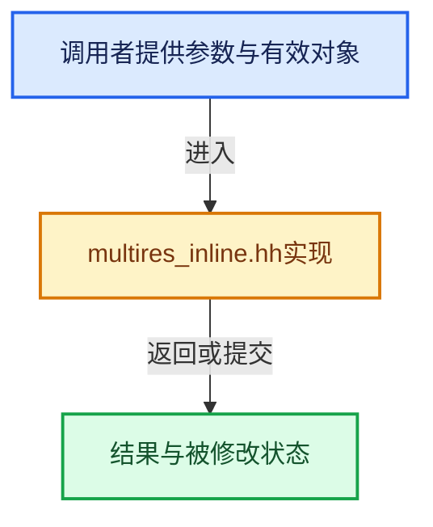

# 实现依赖专题：source/blender/blenkernel/intern/multires_inline.hh

[实现依赖导航](../../README.md) · [符号索引](../../../00-课程指南/02-源码与提交索引/符号依赖与实现索引.md)

本专题从正文实际调用进入，集中保存共享实现。函数有稳定锚点，可从调用处直接跳到对应完整函数；递归与互相调用通过回链组织。

## 本文件的实现关系





## 完整成员与函数实现

<a id="f-67bd35ce61e3f45d"></a>

### `blender::BKE_multires_construct_tangent_matrix`

实现位置：[source/blender/blenkernel/intern/multires_inline.hh](../../../../../../../source/blender/blenkernel/intern/multires_inline.hh) · L18—L47。

接口参数：

- `float3x3 &tangent_matrix`
- `const float3 &dPdu`
- `const float3 &dPdv`
- `const int corner`

**教学注释版**

<!-- annotated:cf279c2854b843 -->

```cpp
BLI_INLINE void BKE_multires_construct_tangent_matrix(float3x3 &tangent_matrix,
                                                      const float3 &dPdu,
                                                      const float3 &dPdv,
                                                      const int corner)
{
  if (corner == 0) {
    tangent_matrix.x_axis() = dPdv * -1.0f;
    tangent_matrix.y_axis() = dPdu * -1.0f;
  }
  else if (corner == 1) {
    tangent_matrix.x_axis() = dPdu;
    tangent_matrix.y_axis() = dPdv * -1.0f;
  }
  else if (corner == 2) {
    tangent_matrix.x_axis() = dPdv;
    tangent_matrix.y_axis() = dPdu;
  }
  else if (corner == 3) {
    tangent_matrix.x_axis() = dPdu * -1.0f;
    tangent_matrix.y_axis() = dPdv;
  }
  else {
    BLI_assert_msg(0, "Unhandled corner index");
  }
  tangent_matrix.z_axis() = math::cross(dPdu, dPdv);

  tangent_matrix.x_axis() = math::normalize(tangent_matrix.x_axis());
  tangent_matrix.y_axis() = math::normalize(tangent_matrix.y_axis());
  tangent_matrix.z_axis() = math::normalize(tangent_matrix.z_axis());
}
```

<details>
<summary>核对原始源码：source/blender/blenkernel/intern/multires_inline.hh · L18—L47</summary>

<!-- original:cf279c2854b843:source/blender/blenkernel/intern/multires_inline.hh:18:47 -->

```cpp
BLI_INLINE void BKE_multires_construct_tangent_matrix(float3x3 &tangent_matrix,
                                                      const float3 &dPdu,
                                                      const float3 &dPdv,
                                                      const int corner)
{
  if (corner == 0) {
    tangent_matrix.x_axis() = dPdv * -1.0f;
    tangent_matrix.y_axis() = dPdu * -1.0f;
  }
  else if (corner == 1) {
    tangent_matrix.x_axis() = dPdu;
    tangent_matrix.y_axis() = dPdv * -1.0f;
  }
  else if (corner == 2) {
    tangent_matrix.x_axis() = dPdv;
    tangent_matrix.y_axis() = dPdu;
  }
  else if (corner == 3) {
    tangent_matrix.x_axis() = dPdu * -1.0f;
    tangent_matrix.y_axis() = dPdv;
  }
  else {
    BLI_assert_msg(0, "Unhandled corner index");
  }
  tangent_matrix.z_axis() = math::cross(dPdu, dPdv);

  tangent_matrix.x_axis() = math::normalize(tangent_matrix.x_axis());
  tangent_matrix.y_axis() = math::normalize(tangent_matrix.y_axis());
  tangent_matrix.z_axis() = math::normalize(tangent_matrix.z_axis());
}
```

</details>

**继续追踪实现**

- `tangent_matrix.x_axis` → [调用协议](../../../00-课程指南/01-路线与规范/模板宏与动态分派协议.md)：由接收对象具体类型或运行时策略提供实现。调用位置L24。
- `tangent_matrix.y_axis` → [调用协议](../../../00-课程指南/01-路线与规范/模板宏与动态分派协议.md)：由接收对象具体类型或运行时策略提供实现。调用位置L25。
- `BLI_assert_msg` → [BLI_assert_msg · L55](../../01-BLI基础库/BLI_assert.hh.md#m-695eed20dceb)；[BLI_assert_msg · L64](../../01-BLI基础库/BLI_assert.hh.md#m-7de5563de4db)。宏定义由构建条件选择。
- `tangent_matrix.z_axis` → [调用协议](../../../00-课程指南/01-路线与规范/模板宏与动态分派协议.md)：由接收对象具体类型或运行时策略提供实现。调用位置L42。
- `math::cross` → [blender::math::cross · L549](../../01-BLI基础库/BLI_math_vector.hh.md#f-cb1b14dc107aa107)；[blender::math::cross · L562](../../01-BLI基础库/BLI_math_vector.hh.md#f-8dcac1cc63a3672a)；[blender::math::cross · L217](../../01-BLI基础库/BLI_math_basis_types.hh.md#f-0cb9fb63f068f85e)。同名重载需按实参类型选择。
- `math::normalize` → [blender::math::normalize · L542](../../01-BLI基础库/BLI_math_vector.hh.md#f-5bea914457e11f7f)；[blender::math::normalize · L258](../../01-BLI基础库/BLI_math_quaternion.hh.md#f-5bf6b351333e4054)；[blender::math::normalize · L450](../../01-BLI基础库/BLI_math_quaternion.hh.md#f-b852cee8f0cc9b6a)；[blender::math::normalize · L745](../../01-BLI基础库/BLI_math_matrix.hh.md#f-2235cb6f5ec7ff18)；[blender::math::normalize · L783](../../01-BLI基础库/BLI_math_matrix.hh.md#f-0386bc4ee9ac7425)。同名重载需按实参类型选择。
